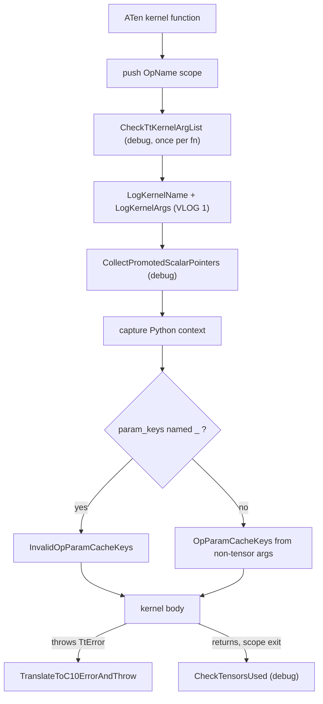
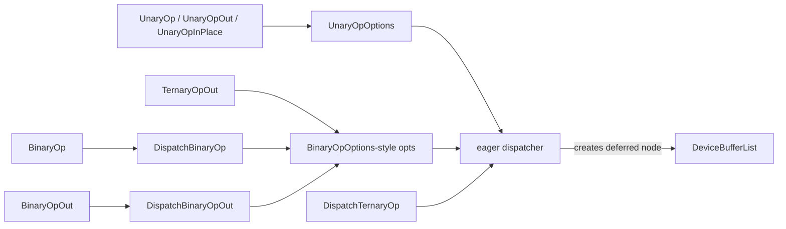

# ATen kernel authoring: TT_KERNEL and the Unary/Binary/Ternary op helpers

## Overview

Every C++ ATen kernel in torch_tpu (802 `TT_KERNEL(` call sites across 202 files in `csrc/` at v0.2.0) has the same two-layer shape. The outer layer is the `TT_KERNEL(op_name, param_keys, (args...), { body })` macro (`csrc/ops/macros/kernel.h`), which turns a plain function into an op kernel: it pushes the [`OpName`](../catalog/csrc/ops/op_names.h.md#OpName "csrc/ops/op_names.h:L29") onto a thread-local stack, captures the Python context, computes the **op parameter cache keys** from the non-tensor arguments, and catches internal errors so they surface to Python prefixed with the user-visible root op name. The inner layer is a family of helpers - [`UnaryOp`](../catalog/csrc/ops/unary_aten_kernels.cc.md#UnaryOp "csrc/ops/unary_aten_kernels.cc:L106"), [`UnaryOpOut`](../catalog/csrc/ops/unary_aten_kernels.cc.md#UnaryOpOut "csrc/ops/unary_aten_kernels.cc:L163"), [`UnaryOpInPlace`](../catalog/csrc/ops/unary_aten_kernels.cc.md#UnaryOpInPlace "csrc/ops/unary_aten_kernels.cc:L140"), [`BinaryOp`](../catalog/csrc/ops/binary_aten_kernels.h.md#BinaryOp "csrc/ops/binary_aten_kernels.h:L124"), [`BinaryOpOut`](../catalog/csrc/ops/binary_aten_kernels.h.md#BinaryOpOut "csrc/ops/binary_aten_kernels.h:L135"), [`TernaryOpOut`](../catalog/csrc/ops/binary_aten_kernels.cc.md#TernaryOpOut "csrc/ops/binary_aten_kernels.cc:L262") - that do the PyTorch-semantics bookkeeping (output shape by broadcasting, result dtype by type promotion, out-tensor validation) and hand a StableHLO builder lambda to the eager dispatcher. The key design idea: **the kernel never computes anything on device and never builds MLIR itself**. It returns a description (op name + builder + cache keys + output shapes/dtypes) that becomes a deferred node; the builder runs later, at materialization, and the cache keys decide whether that later compile is a cache hit.

For TPU performance this matters in three ways: (1) everything the macro adds runs on the host on every op call, so it is part of eager dispatch overhead; (2) what lands in `param_keys` and what is promoted to a runtime tensor decides how many distinct executables an op produces (recompiles vs. reuse); (3) the `computation_dtype` / `force_float_inputs` options are where per-op precision (upcast-compute-downcast) is decided.

## Diagram

What one `TT_KERNEL(...)` expansion does, in execution order (debug-only pieces marked):



Legend:
- `K` - (concept) the C++ function registered for an ATen schema
- `SCOPE` - [`OpName`](../catalog/csrc/ops/op_names.h.md#OpName "csrc/ops/op_names.h:L29")
- `ARGS` - [`CheckTtKernelArgList`](../catalog/csrc/ops/macros/logging.h.md#CheckTtKernelArgList "csrc/ops/macros/logging.h:L564")
- `LOG` - [`LogKernelName`](../catalog/csrc/ops/macros/logging.h.md#LogKernelName "csrc/ops/macros/logging.h:L131"), [`LogKernelArgs`](../catalog/csrc/ops/macros/logging.h.md#LogKernelArgs "csrc/ops/macros/logging.h:L157")
- `PS` - [`CollectPromotedScalarPointers`](../catalog/csrc/ops/macros/kernel.h.md#CollectPromotedScalarPointers "csrc/ops/macros/kernel.h:L208")
- `CTX` - (concept) Python-context capture, see [op names and Python context](op-names-and-python-context.md)
- `KEYS` - (concept) compile-time branch on the spelling of the `param_keys` macro argument
- `INV` - [`InvalidOpParamCacheKeys`](../catalog/csrc/ops/macros/kernel.h.md#InvalidOpParamCacheKeys "csrc/ops/macros/kernel.h:L223")
- `PK` - [`PromotedScalar`](../catalog/csrc/common/cache_key.h.md#PromotedScalar "csrc/common/cache_key.h:L98") (excluded from keys; other non-tensor args included)
- `BODY` - (concept) the author's statements
- `TR` - [`TranslateToC10ErrorAndThrow`](../catalog/csrc/common/error_utils.cc.md#TranslateToC10ErrorAndThrow "csrc/common/error_utils.cc:L1223")
- `CHK` - [`CheckTensorsUsed`](../catalog/csrc/ops/macros/kernel.cc.md#CheckTensorsUsed "csrc/ops/macros/kernel.cc:L33")

How the helpers layer onto the dispatcher (the body's usual content):



Legend:
- `U` - [`UnaryOp`](../catalog/csrc/ops/unary_aten_kernels.cc.md#UnaryOp "csrc/ops/unary_aten_kernels.cc:L106"), [`UnaryOpOut`](../catalog/csrc/ops/unary_aten_kernels.cc.md#UnaryOpOut "csrc/ops/unary_aten_kernels.cc:L163"), [`UnaryOpInPlace`](../catalog/csrc/ops/unary_aten_kernels.cc.md#UnaryOpInPlace "csrc/ops/unary_aten_kernels.cc:L140")
- `UO` - [`UnaryOpOptions`](../catalog/csrc/ops/unary_aten_kernels.h.md#UnaryOpOptions "csrc/ops/unary_aten_kernels.h:L33")
- `B` - [`BinaryOp`](../catalog/csrc/ops/binary_aten_kernels.h.md#BinaryOp "csrc/ops/binary_aten_kernels.h:L124")
- `DB` - [`DispatchBinaryOp`](../catalog/csrc/ops/binary_aten_kernels.cc.md#DispatchBinaryOp "csrc/ops/binary_aten_kernels.cc:L101")
- `BO` - [`BinaryOpOut`](../catalog/csrc/ops/binary_aten_kernels.h.md#BinaryOpOut "csrc/ops/binary_aten_kernels.h:L135")
- `DBO` - [`DispatchBinaryOpOut`](../catalog/csrc/ops/binary_aten_kernels.cc.md#DispatchBinaryOpOut "csrc/ops/binary_aten_kernels.cc:L211")
- `T` - [`TernaryOpOut`](../catalog/csrc/ops/binary_aten_kernels.cc.md#TernaryOpOut "csrc/ops/binary_aten_kernels.cc:L262")
- `BOPT` - [`BinaryOpOptions`](../catalog/csrc/ops/binary_aten_kernels.h.md#BinaryOpOptions "csrc/ops/binary_aten_kernels.h:L44") (the ternary path uses a parallel options struct with the same fields minus `reverse_operands`)
- `DTO` - [`DispatchTernaryOp`](../catalog/csrc/ops/binary_aten_kernels.cc.md#DispatchTernaryOp "csrc/ops/binary_aten_kernels.cc:L142")
- `DISP` - (concept) the generic eager dispatch entry, see [eager op dispatch](eager-op-dispatch.md)
- `DBL` - [`DeviceBufferList`](../catalog/csrc/eager/device_buffer.h.md#DeviceBufferList "csrc/eager/device_buffer.h:L529")

## Design rationale (why it's built this way)

**One macro owns every cross-cutting concern.** The header comment states the contract: TT_KERNEL "wraps the implementation of an op kernel and takes care of logging, capturing the Python context, computing parameter cache keys, and attributing errors to the correct root op." Centralizing these means an op author writes only the lowering, and the invariants the rest of the system depends on (an op name is always on the stack when the dispatcher runs; every non-tensor argument that can change the generated HLO is in the cache key) cannot be forgotten op-by-op. The dispatcher enforces the first invariant hard: it crashes with "DispatchOp() called without an active TT_KERNEL() context" if no op name is on the stack.

**The argument list is passed twice on purpose.** The author repeats the kernel's full parameter list as the parenthesized `(args...)`. The macro uses `__PRETTY_FUNCTION__` to check at compile time that the count matches the enclosing function's signature, `static_assert`s that each entry is a bare identifier (or `IgnoreInCacheKey(id, "reason")`, validated by a `consteval` parser), and in debug builds compares each argument's C++ type against the normalized type string parsed from the signature by [`ParseArgTypesOrEmpty`](../catalog/csrc/ops/macros/logging.cc.md#ParseArgTypesOrEmpty "csrc/ops/macros/logging.cc:L150"). The point is the cache key: if a non-tensor argument that changes the lowering were omitted from `(args...)`, two different programs would share one cache key and the wrong executable would be reused. Repeating and cross-checking the list makes that omission a build or debug-run failure instead of a silent wrong result.

**`_` is an explicit, checked opt-out of cache keys.** Naming the keys variable `_` skips key computation (saving its host cost for ops with no parameters). It is guarded twice: a `static_assert` fires if any argument in the list would normally be part of the key ("wrap them in IgnoreInCacheKey() with a string explaining why. Otherwise, rename _ to param_keys"), and the variable gets the deliberately useless type [`InvalidOpParamCacheKeys`](../catalog/csrc/ops/macros/kernel.h.md#InvalidOpParamCacheKeys "csrc/ops/macros/kernel.h:L223") - "A type that can't be used to do anything useful" - so accidentally passing `_` into a helper does not link (its conversion operators are declared but never defined).

**Scalars become tensors, not constants.** An `at::Scalar` argument baked into HLO as a constant would make every distinct value (a learning rate, an `alpha`, a clamp bound) a new executable. The debug type checker refuses raw `at::Scalar` arguments with "Don't use Scalar inputs with TT_KERNEL(). Promote them to Tensors via PromoteScalar() first." A [`PromotedScalar`](../catalog/csrc/common/cache_key.h.md#PromotedScalar "csrc/common/cache_key.h:L98") ("A scalar value that is promoted to a tensor lazily") is excluded from the parameter cache key and becomes a runtime input instead. The debug-only [`CheckTensorsUsed`](../catalog/csrc/ops/macros/kernel.cc.md#CheckTensorsUsed "csrc/ops/macros/kernel.cc:L33") then crashes if the kernel never called `GetTensor()` on it - the bug class where the lowering quietly used the original scalar (now absent from the key) instead of the promoted tensor. `AtenAddOut` shows the sanctioned exception: `AvoidPromoting(ScalarValue::kOne)` keeps `alpha == 1` in the key so the kernel can specialize to a plain add and skip the multiply.

**Out/in-place variants exist because PyTorch's out= semantics are strict.** The helpers re-implement ATen's dtype rules (result type from `at::result_type`, integer to default-float promotion for float-only ops, `c10::canCast` checks on `out`) so that a TPU op fails or casts exactly where CPU/CUDA would. Options such as `allow_out_dtype_cast` exist because some ATen ops (abs on real inputs, neg, trunc) enforce identical dtypes while math ops allow a safe cast into `out`.

> [!inferred]
> The explicit `.op_name` override in the options structs ("If omitted, use the op name from the active TT_KERNEL() context") plus the dispatcher's check that an override must differ from the context name suggests the design wants exactly one source of truth for the op name, with the override reserved for kernels that dispatch a differently-named op from inside their scope.

## Entry points

- [`UnaryOpOut`](../catalog/csrc/ops/unary_aten_kernels.cc.md#UnaryOpOut "csrc/ops/unary_aten_kernels.cc:L163") - "Like UnaryOpCallback, but the result overwrites the provided `out` tensor." The workhorse for `*.out` unary kernels; reached from inside a TT_KERNEL body, and stamped out wholesale by the `TT_DEFINE_ATEN_UNARY_OUT` / `TT_DEFINE_FP_ONLY_ATEN_UNARY_OUT` macros in `unary_aten_kernels.cc` (exp, log, sin, sqrt, rsqrt, tanh and ~20 more). An overload at [`UnaryOpOut`](../catalog/csrc/ops/unary_aten_kernels.cc.md#UnaryOpOut "csrc/ops/unary_aten_kernels.cc:L192") takes an explicit `OpName`.
- [`UnaryOp`](../catalog/csrc/ops/unary_aten_kernels.cc.md#UnaryOp "csrc/ops/unary_aten_kernels.cc:L106") - "Safely applies a functional unary operation to the input tensor." Functional variant returning a new tensor (e.g. `AtenRelu`); the [`UnaryOp`](../catalog/csrc/ops/unary_aten_kernels.cc.md#UnaryOp "csrc/ops/unary_aten_kernels.cc:L130") overload takes an explicit `OpName` and `ABSL_CHECK`s that the options do not also set one.
- [`UnaryOpInPlace`](../catalog/csrc/ops/unary_aten_kernels.cc.md#UnaryOpInPlace "csrc/ops/unary_aten_kernels.cc:L140") - "Like UnaryOpCallback, but the result overwrites the input." Used by `relu_`; `.out_dims` / `.out_dtype` are ignored because the output must match `self`.
- [`BinaryOpOut`](../catalog/csrc/ops/binary_aten_kernels.h.md#BinaryOpOut "csrc/ops/binary_aten_kernels.h:L135") / [`BinaryOp`](../catalog/csrc/ops/binary_aten_kernels.h.md#BinaryOp "csrc/ops/binary_aten_kernels.h:L124") - header templates over `OtherType` (tensor or scalar `other`) used by add/sub/mul/div/comparison/bitwise kernels; they compute or validate the expected result dtype and delegate to [`DispatchBinaryOpOut`](../catalog/csrc/ops/binary_aten_kernels.cc.md#DispatchBinaryOpOut "csrc/ops/binary_aten_kernels.cc:L211") / [`DispatchBinaryOp`](../catalog/csrc/ops/binary_aten_kernels.cc.md#DispatchBinaryOp "csrc/ops/binary_aten_kernels.cc:L101").
- [`TernaryOpOut`](../catalog/csrc/ops/binary_aten_kernels.cc.md#TernaryOpOut "csrc/ops/binary_aten_kernels.cc:L262") - "Performs output tensor processing for Ternary operations on TPU." Used where a third operand rides along, most visibly `add.out`/`sub.out` with a promoted `alpha` tensor.
- [`CheckTtKernelArgList`](../catalog/csrc/ops/macros/logging.h.md#CheckTtKernelArgList "csrc/ops/macros/logging.h:L564") - "Checks that the arguments passed to TT_KERNEL() match the arguments for the" enclosing kernel; reached from every TT_KERNEL expansion in debug builds, once per kernel function.

## Mechanism (step-by-step)

1. **Scope and op identity.** The expansion opens a `do { ... } while (false)` block and first constructs an RAII scope that pushes the [`OpName`](../catalog/csrc/ops/op_names.h.md#OpName "csrc/ops/op_names.h:L29") onto the thread-local op-name stack. That push is not free bookkeeping: it also enforces that an op only delegates to another TT_KERNEL op if it is on a frozen allow-list of 151 legacy composite ops (anything else is a fatal "please implement the op by lowering it to SHLO instead"). For performance this means one ATen call normally lowers to one StableHLO builder, rather than fanning out into many separately-dispatched sub-ops. Details on the stack are in [op names and Python context](op-names-and-python-context.md).

2. **Argument checks and logging.** Next comes the internal `TT_CHECK_AND_LOG_KERNEL_ARGS_`: two `static_assert`s (identifier-only list; count equal to the `__PRETTY_FUNCTION__` parameter count) cost nothing at run time. If `ABSL_VLOG_IS_ON(1)`, it formats `[C++ KERNEL <op>]` via [`LogKernelName`](../catalog/csrc/ops/macros/logging.h.md#LogKernelName "csrc/ops/macros/logging.h:L131") and one `name: value` line per argument via the variadic [`LogKernelArgs`](../catalog/csrc/ops/macros/logging.h.md#LogKernelArgs "csrc/ops/macros/logging.h:L157") (its base case [`LogKernelArgs`](../catalog/csrc/ops/macros/logging.h.md#LogKernelArgs "csrc/ops/macros/logging.h:L148") checks that names and values line up); argument names come from the stringified macro list split by [`ArgsAsStrings`](../catalog/csrc/common/macro_utils.cc.md#ArgsAsStrings "csrc/common/macro_utils.cc:L31"). Under `if constexpr (kDebugMode)` a function-local `static const bool` runs [`CheckTtKernelArgList`](../catalog/csrc/ops/macros/logging.h.md#CheckTtKernelArgList "csrc/ops/macros/logging.h:L564") exactly once per kernel: duplicate-name check, then a per-argument comparison of the C++ type with the normalized signature type from [`ParseArgTypesOrEmpty`](../catalog/csrc/ops/macros/logging.cc.md#ParseArgTypesOrEmpty "csrc/ops/macros/logging.cc:L150") (which rewrites `c10::optional` to `std::optional`, `long` to `int64_t`, and so on). The failure message carries the call site via [`NormalizeIfInsideBuildDirectory`](../catalog/csrc/common/macro_utils.cc.md#NormalizeIfInsideBuildDirectory "csrc/common/macro_utils.cc:L64"), which strips `bazel-out/.../_virtual_includes/` prefixes so paths read as `csrc/...`.

3. **Promoted-scalar tracking (debug only).** Inside `TT_IF_DEBUG(...)`, the variadic [`CollectPromotedScalarPointers`](../catalog/csrc/ops/macros/kernel.h.md#CollectPromotedScalarPointers "csrc/ops/macros/kernel.h:L208") walks the argument list (base case [`CollectPromotedScalarPointers`](../catalog/csrc/ops/macros/kernel.h.md#CollectPromotedScalarPointers "csrc/ops/macros/kernel.h:L202")) and keeps a `shared_ptr` to the state of each [`PromotedScalar`](../catalog/csrc/common/cache_key.h.md#PromotedScalar "csrc/common/cache_key.h:L98") - including ones inside `std::optional`, `std::vector`, or `IgnoreInCacheKey` wrappers. An `absl::Cleanup` registered here runs [`CheckTensorsUsed`](../catalog/csrc/ops/macros/kernel.cc.md#CheckTensorsUsed "csrc/ops/macros/kernel.cc:L33") at scope exit unless the body threw; the shared ownership is why a kernel may move a promoted scalar and still be checked.

4. **Python context capture.** An RAII capturer records the op (by base name, e.g. `add`) on a second thread-local stack so that any deferred op created inside the body carries the user call chain, and, when traceback mode is on, the Python traceback. The bottom of that call chain is also what [`GetRootOpName`](../catalog/csrc/ops/python_context.cc.md#GetRootOpName "csrc/ops/python_context.cc:L325") returns while the kernel runs, which is how errors raised deep inside a helper still name the op the user called. The same context later becomes the MLIR location xprof shows; see [op names and Python context](op-names-and-python-context.md).

5. **Parameter cache keys.** An `if constexpr` on the literal spelling of the second macro argument picks one of two blocks. With `_`, a conditional `static_assert` proves that every argument is a type excluded from keys (tensors, tensor lists, [`PromotedScalar`](../catalog/csrc/common/cache_key.h.md#PromotedScalar "csrc/common/cache_key.h:L98"), generators, c10d options) or is wrapped in `IgnoreInCacheKey`, and the variable is an [`InvalidOpParamCacheKeys`](../catalog/csrc/ops/macros/kernel.h.md#InvalidOpParamCacheKeys "csrc/ops/macros/kernel.h:L223"). Otherwise the macro builds an `OpParamCacheKeys` by walking the stringified list and calling `SetParam(name, value)` for every non-excluded argument (tensors are skipped because their shapes and dtypes are encoded in the compile cache key automatically). The kernel test shows the result for `(self, ndim, expand, seed)` with `seed = nullopt`: just `{expand: 1, ndim: 3}`. These keys travel through the helper options into the deferred op and finally into the compile cache key, whose human-readable form is produced by [`operator<<`](../catalog/csrc/common/cache_key.cc.md#operator "csrc/common/cache_key.cc:L276") ("Formats a compilation cache key as a human-readable string").

6. **Body and error translation.** The author's statements run inside `try`. Helpers return `absl::Status`; the body converts failures with `TT_THROW_IF_ERROR` / `TT_ASSIGN_OR_THROW`, which throw a `TtError`. Statuses created by the `TT_ERROR`/`TT_RET_CHECK` family already carry a payload naming the root op ([`GetRootOpName`](../catalog/csrc/ops/python_context.cc.md#GetRootOpName "csrc/ops/python_context.cc:L325") stored by [`SetRootOpNamePayload`](../catalog/csrc/common/status_builder.cc.md#SetRootOpNamePayload "csrc/common/status_builder.cc:L136")) and, when C++ stack traces are enabled, a source location from [`MaybeAddCppSourceLoc`](../catalog/csrc/common/status_builder.cc.md#MaybeAddCppSourceLoc "csrc/common/status_builder.cc:L148"); the message is streamed in through [`StatusBuilder`](../catalog/csrc/common/status_builder.h.md#StatusBuilder "csrc/common/status_builder.h:L63"). The `catch (const TtError&)` arm calls [`TranslateToC10ErrorAndThrow`](../catalog/csrc/common/error_utils.cc.md#TranslateToC10ErrorAndThrow "csrc/common/error_utils.cc:L1223"), which prefixes `"<root op>(): "` and maps the status code to a `c10::Error` subclass (Python `IndexError` or `NotImplementedError` for the two codes it special-cases, `RuntimeError` otherwise); the kernel test asserts `"add(): test error"`, and for a nested call `"cat(): some error"` - the root op, not the inner one. Any other exception is rethrown unchanged.

7. **Unary helpers.** [`UnaryOp`](../catalog/csrc/ops/unary_aten_kernels.cc.md#UnaryOp "csrc/ops/unary_aten_kernels.cc:L106") resolves the output dtype (from [`UnaryOpOptions`](../catalog/csrc/ops/unary_aten_kernels.h.md#UnaryOpOptions "csrc/ops/unary_aten_kernels.h:L33")`.out_dtype` or `self`'s dtype) and dims (`out_dims` or `self.sizes()`), then dispatches a one-input builder and wraps the resulting buffer reference in a new tensor. [`UnaryOpOut`](../catalog/csrc/ops/unary_aten_kernels.cc.md#UnaryOpOut "csrc/ops/unary_aten_kernels.cc:L163") first `TT_RET_CHECK`s that `out` is a TPU tensor, validates `out`'s dtype against the natural result dtype honoring `allow_out_dtype_cast`, and then dispatches with **`out`'s** dtype as the output dtype, so the cast into `out` is part of the same compiled op. [`UnaryOpInPlace`](../catalog/csrc/ops/unary_aten_kernels.cc.md#UnaryOpInPlace "csrc/ops/unary_aten_kernels.cc:L140") passes `self` as both input and output. The `TT_DEFINE_FP_ONLY_ATEN_UNARY_OUT` variant computes the output dtype with `InferOutputDtype(self)` at dispatch time (integers become the current default float dtype, mirroring CUDA) and names a real `param_keys` variable; the source comment says this "means the default dtype also needs to be included as a parameter key", but because the macro's argument list holds only the tensors `self` and `out`, the keys it builds are empty and the default dtype is never added to them.

8. **Binary and ternary helpers.** [`DispatchBinaryOp`](../catalog/csrc/ops/binary_aten_kernels.cc.md#DispatchBinaryOp "csrc/ops/binary_aten_kernels.cc:L101") moves 1-element CPU tensors to TPU (mixed-device `tpu + cpu_scalar` bypasses device guards; scalar tensors are deduplicated by a cache), computes the broadcast output shape into [`Dimensions`](../catalog/csrc/common/dimension_types.h.md#Dimensions "csrc/common/dimension_types.h:L33"), picks the computation dtype from `at::result_type` (bumped to the default float dtype when `force_float_inputs` and the promoted type is integral), and wraps the author's two-input builder to honor `reverse_operands`. The scalar-`other` overload [`DispatchBinaryOp`](../catalog/csrc/ops/binary_aten_kernels.cc.md#DispatchBinaryOp "csrc/ops/binary_aten_kernels.cc:L89") first lifts the scalar into a tensor of the result type. [`DispatchBinaryOpOut`](../catalog/csrc/ops/binary_aten_kernels.cc.md#DispatchBinaryOpOut "csrc/ops/binary_aten_kernels.cc:L211") adds the in-place broadcast rule (if `out` aliases an input, `out`'s shape must already equal the broadcast shape) and dispatches with `out`'s element type; [`DispatchBinaryOpOut`](../catalog/csrc/ops/binary_aten_kernels.cc.md#DispatchBinaryOpOut "csrc/ops/binary_aten_kernels.cc:L183") is the scalar-`other` form. [`TernaryOpOut`](../catalog/csrc/ops/binary_aten_kernels.cc.md#TernaryOpOut "csrc/ops/binary_aten_kernels.cc:L262") is the same recipe for three inputs, but promotion uses only the first two operands - the comment says current callers pass an internal alpha tensor as `third` and general ternary callers "should pass opts.result_dtype explicitly if `third` affects promotion". All of them forward `split_mode` and `donated_indices` from [`BinaryOpOptions`](../catalog/csrc/ops/binary_aten_kernels.h.md#BinaryOpOptions "csrc/ops/binary_aten_kernels.h:L44") to the dispatcher, the two knobs that control graph splitting and buffer donation for the op.

## Key data structures

- [`UnaryOpOptions`](../catalog/csrc/ops/unary_aten_kernels.h.md#UnaryOpOptions "csrc/ops/unary_aten_kernels.h:L33") - `op_name` (optional override), `op_param_cache_keys`, `out_dtype` (natural result dtype), `out_dims`, `computation_dtype` ("all inputs will be casted to this dtype before the op_builder is applied"), `allow_out_dtype_cast`.
- [`BinaryOpOptions`](../catalog/csrc/ops/binary_aten_kernels.h.md#BinaryOpOptions "csrc/ops/binary_aten_kernels.h:L44") - adds `reverse_operands`, `force_float_inputs`, `split_mode`, `donated_indices`, and `result_dtype` (when unset, inferred via PyTorch promotion; set it for comparisons returning bool or complex constructors).
- [`PromotedScalar`](../catalog/csrc/common/cache_key.h.md#PromotedScalar "csrc/common/cache_key.h:L98") - move-only handle on a shared state `{promoter, scalar, tensor_used}`; `GetTensor()` performs the promotion and sets `tensor_used`. Excluded from parameter cache keys.
- [`InvalidOpParamCacheKeys`](../catalog/csrc/ops/macros/kernel.h.md#InvalidOpParamCacheKeys "csrc/ops/macros/kernel.h:L223") - poison type for the `_` keys variable; default-constructible ([`InvalidOpParamCacheKeys`](../catalog/csrc/ops/macros/kernel.h.md#InvalidOpParamCacheKeys.InvalidOpParamCacheKeys "csrc/ops/macros/kernel.h:L225")) but every useful member is declared without a definition.
- [`OpName`](../catalog/csrc/ops/op_names.h.md#OpName "csrc/ops/op_names.h:L29") - the enum naming each kernel; its string form ([`ToString`](../catalog/csrc/ops/op_names.h.md#ToString "csrc/ops/op_names.h:L889")) is the registration name and part of the cache key.

## What survives into an optimized build

The `.bazelrc` defaults OSS builds to `--compilation_mode=opt`. Splitting TT_KERNEL's work by build mode (`TT_IF_DEBUG` and `kDebugMode` key off `NDEBUG`):

```
| Piece                                         | debug / fastbuild | opt (NDEBUG)          |
|-----------------------------------------------|-------------------|-----------------------|
| identifier + arg-count static_asserts         | compile time      | compile time          |
| `_` vs. non-key-argument static_assert        | compile time      | compile time          |
| op-name stack push/pop + composite-op check   | every call        | every call            |
| VLOG(1) kernel/arg logging                    | if VLOG >= 1      | if VLOG >= 1 (1 test) |
| CheckTtKernelArgList type match               | once per kernel   | compiled out          |
| promoted-scalar collection + CheckTensorsUsed | every call        | compiled out          |
| Python context capture (call-chain push)      | every call        | every call            |
| traceback capture                             | if mode enabled   | if mode enabled       |
| OpParamCacheKeys build (non-`_` kernels)      | every call        | every call            |
| try/catch + TtError translation               | every call        | every call            |
```

So the steady-state host cost of the macro in an opt wheel is two thread-local stack pushes (one of them a `std::string`), the parameter-key build for kernels that use `param_keys`, and the helper's dtype/shape bookkeeping. The debug-only checks are correctness guards that an opt build no longer enforces.

> [!inferred]
> Bazel's `opt` mode is what defines `NDEBUG`, so a fastbuild wheel keeps every `TT_IF_DEBUG` check live on every op call; this is plausibly one contributor (alongside `-O0` code) to the large fastbuild eager slowdown recorded on the `torch-tpu-wheel-must-build-with-c-opt` concept page. Whether the raw-`at::Scalar` `static_assert` (reached only through the debug-gated checker) still fires in an opt build depends on whether the compiler instantiates the discarded `if constexpr` branch outside a template; do not rely on it in release builds.

## Dynamics (design intent)

- **Thread-locality.** Both stacks that TT_KERNEL pushes are `thread_local` and annotated "needed only in the dispatching thread"; kernels are assumed to run on the thread that holds the PyTorch dispatcher. Nesting is legal only for allow-listed composite ops (the kernel test nests `bmm` inside `cat.out`, which is on the list).
- **Once-per-kernel checking.** The debug signature check is memoized in a function-local static, so its regex-based signature parsing is paid once per kernel function, not per call.
- **Error path ordering.** On a thrown error, `_kernel_threw` is set before translation so the promoted-scalar cleanup does not fire a misleading "didn't call GetTensor()" crash (test `CheckTensorsUsedDoesNotCrashIfKernelThrows`).
- **Deferred, not executed.** All helpers end in the dispatcher, which records a deferred node; the builder lambda you pass is invoked later, when the graph is materialized (see [deferred execution and materialization](deferred-execution-and-materialization.md)). Anything captured by value in the lambda is therefore frozen at dispatch time - which is why the FP-only unary macro captures the dispatch-time default dtype into the lambda (and passes it as the output dtype) rather than reading it at compile time.

## Edge cases

- **Forgetting an argument in `(args...)`** fails the arg-count `static_assert`; passing an expression instead of a name fails the identifier `static_assert`. Passing the same name twice is caught only in debug builds.
- **Unsupported argument types** hit `static_assert(false, "Unsupported argument type.")` in the debug checker; extending TT_KERNEL to a new parameter type requires both an `EncodeParamCacheKey()` overload and a branch in the checker.
- **`double` vs `std::optional<double>`** is deliberately accepted by the checker, because kernels sometimes normalize an optional before invoking TT_KERNEL.
- **Explicit op-name override that matches the context name** crashes in the dispatcher as redundant; the [`UnaryOp`](../catalog/csrc/ops/unary_aten_kernels.cc.md#UnaryOp "csrc/ops/unary_aten_kernels.cc:L130") / [`UnaryOpInPlace`](../catalog/csrc/ops/unary_aten_kernels.cc.md#UnaryOpInPlace "csrc/ops/unary_aten_kernels.cc:L153") / [`UnaryOpOut`](../catalog/csrc/ops/unary_aten_kernels.cc.md#UnaryOpOut "csrc/ops/unary_aten_kernels.cc:L192") overloads that take an `OpName` crash if the options also set one.
- **Mixed-device operands** (CPU scalar tensor + TPU tensor) are silently moved to TPU by the binary/ternary helpers, but only for 1-element CPU tensors; larger CPU tensors are not moved.
- **In-place broadcasting** (`a.add_(b)` where the broadcast shape exceeds `a`) is rejected with a shape error, matching PyTorch.
- **Ternary promotion ignores the third operand** unless `result_dtype` is set explicitly (see step 8).

## Open questions

- [`DispatchTernaryOp`](../catalog/csrc/ops/binary_aten_kernels.cc.md#DispatchTernaryOp "csrc/ops/binary_aten_kernels.cc:L142") (functional, non-out ternary) is declared and defined but has no caller in `csrc/` at v0.2.0; only [`TernaryOpOut`](../catalog/csrc/ops/binary_aten_kernels.cc.md#TernaryOpOut "csrc/ops/binary_aten_kernels.cc:L262") is used. Unclear whether it is kept for out-of-tree ops or is dead code.
- Packet gap: the generic dispatcher entry points, the op-name RAII scope, the Python-context capturer, `OpParamCacheKeys`, `MaybePromotedScalar` and the `PromoteScalar` factory are central to this mechanism but are not in this page's subgraph; they are described from source without catalog links (the scope and capturer are cited on [op names and Python context](op-names-and-python-context.md)).
- The host-time cost of parameter-key construction per op (string/fingerprint per `SetParam`) is not measured anywhere in the repo's tests; whether `_` measurably reduces eager dispatch overhead is unknown.

## See also

- [Op names and Python context](op-names-and-python-context.md) - the op-name stack and context capture TT_KERNEL relies on
- [StableHLO op builder utilities](stablehlo-op-builder.md) - what goes inside the builder lambda you pass to the helpers
- [Eager op dispatch](eager-op-dispatch.md) - what the helpers call into
- [Compilation cache key](compilation-cache-key.md) - how `param_keys` become part of the executable key
- [Deferred execution and materialization](deferred-execution-and-materialization.md) - when the builder actually runs
- [Dtype and precision](dtype-and-precision.md) - `computation_dtype` and promotion rules in context
- [Error handling](error-handling.md) - `TtError`, `StatusBuilder`, and the root-op payload
