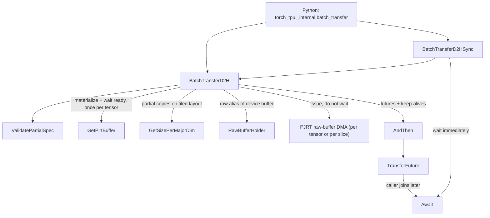
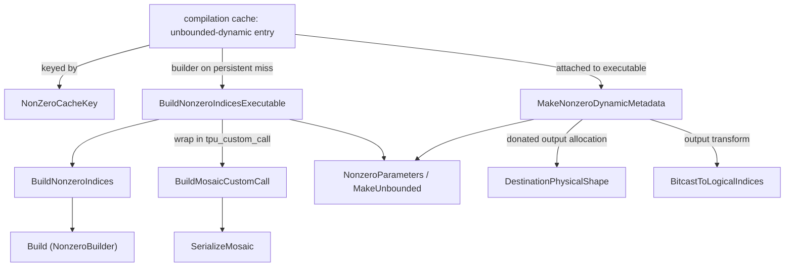

# Batch host-device transfer and precompiled Mosaic kernels (csrc/experimental)

<!-- connect:up:begin -->
> **Cross-repo concept:** part of [mosaic-kernel](../../../concepts/mosaic-kernel.md) across this wiki's repos.
<!-- connect:up:end -->
## Overview

`csrc/experimental` holds two performance escape hatches that bypass the normal per-op eager path. **Batch transfer** ([`BatchTransferD2H`](../catalog/csrc/experimental/batch_transfer/batch_transfer.cc.md#BatchTransferD2H "csrc/experimental/batch_transfer/batch_transfer.cc:L212"), [`BatchTransferH2D`](../catalog/csrc/experimental/batch_transfer/batch_transfer.cc.md#BatchTransferH2D "csrc/experimental/batch_transfer/batch_transfer.cc:L425")) moves a list of same-shape tensors between HBM and host by aliasing each device buffer through the PJRT C API raw-buffer extension and issuing raw byte DMAs of the buffer's **physical** (tiled, padded) bytes, all launched back to back and joined by one [`TransferFuture`](../catalog/csrc/experimental/batch_transfer/batch_transfer.h.md#TransferFuture "csrc/experimental/batch_transfer/batch_transfer.h:L35"). The key idea is amortization: shape/layout/API discovery is done once for the whole batch, no per-tensor relayout or host-side conversion happens, and the caller decides when to wait. **Precompiled kernels** ([`BuildMosaicCustomCall`](../catalog/csrc/experimental/precompiled_kernels/mosaic_custom_call.cc.md#BuildMosaicCustomCall "csrc/experimental/precompiled_kernels/mosaic_custom_call.cc:L64"), [`BuildNonzeroIndicesExecutable`](../catalog/csrc/experimental/precompiled_kernels/nonzero_indices.cc.md#BuildNonzeroIndicesExecutable "csrc/experimental/precompiled_kernels/nonzero_indices.cc:L421")) build a Mosaic kernel directly in MLIR, wrap it in a single `tpu_custom_call` HLO, and compile it **once against unbounded dynamic shapes**, so a data-dependent op such as `torch.nonzero` can be served for every input shape and output count from one executable instead of one XLA compilation per shape.

## Diagram

Batch transfer (D2H shown; H2D is symmetric with source and destination swapped):

Legend:
- `PY` - (concept) the pybind module that exposes these functions to Python and releases the GIL around them
- `SYNC` - [`BatchTransferD2HSync`](../catalog/csrc/experimental/batch_transfer/batch_transfer.cc.md#BatchTransferD2HSync "csrc/experimental/batch_transfer/batch_transfer.cc:L593")
- `D2H` - [`BatchTransferD2H`](../catalog/csrc/experimental/batch_transfer/batch_transfer.cc.md#BatchTransferD2H "csrc/experimental/batch_transfer/batch_transfer.cc:L212")
- `VAL` - [`ValidatePartialSpec`](../catalog/csrc/experimental/batch_transfer/batch_transfer.cc.md#ValidatePartialSpec "csrc/experimental/batch_transfer/batch_transfer.cc:L153")
- `GPB` - [`GetPjrtBuffer`](../catalog/csrc/experimental/batch_transfer/batch_transfer.cc.md#GetPjrtBuffer "csrc/experimental/batch_transfer/batch_transfer.cc:L197")
- `SPM` - [`GetSizePerMajorDim`](../catalog/csrc/experimental/batch_transfer/batch_transfer.cc.md#GetSizePerMajorDim "csrc/experimental/batch_transfer/batch_transfer.cc:L170")
- `RBH` - [`RawBufferHolder`](../catalog/csrc/experimental/batch_transfer/batch_transfer.cc.md#RawBufferHolder "csrc/experimental/batch_transfer/batch_transfer.cc:L55")
- `DMA` - (concept) the PJRT C API raw-buffer extension's device-to-host / host-to-device copy
- `TF` - [`TransferFuture`](../catalog/csrc/experimental/batch_transfer/batch_transfer.h.md#TransferFuture "csrc/experimental/batch_transfer/batch_transfer.h:L35")
- `AT` - [`AndThen`](../catalog/csrc/experimental/batch_transfer/batch_transfer.cc.md#TransferFuture.AndThen "csrc/experimental/batch_transfer/batch_transfer.cc:L127")
- `AW` - [`Await`](../catalog/csrc/experimental/batch_transfer/batch_transfer.cc.md#TransferFuture.Await "csrc/experimental/batch_transfer/batch_transfer.cc:L71")

Precompiled nonzero kernel (build once, serve every shape):

Legend:
- `CACHE` - (concept) the torch_tpu compilation cache's unbounded-dynamic entry table (registration API not in this packet)
- `KEY` - [`NonZeroCacheKey`](../catalog/csrc/experimental/precompiled_kernels/nonzero_indices.cc.md#NonZeroCacheKey "csrc/experimental/precompiled_kernels/nonzero_indices.cc:L443")
- `META` - [`MakeNonzeroDynamicMetadata`](../catalog/csrc/experimental/precompiled_kernels/nonzero_indices.cc.md#MakeNonzeroDynamicMetadata "csrc/experimental/precompiled_kernels/nonzero_indices.cc:L377")
- `EXE` - [`BuildNonzeroIndicesExecutable`](../catalog/csrc/experimental/precompiled_kernels/nonzero_indices.cc.md#BuildNonzeroIndicesExecutable "csrc/experimental/precompiled_kernels/nonzero_indices.cc:L421")
- `BNI` - [`BuildNonzeroIndices`](../catalog/csrc/experimental/precompiled_kernels/nonzero_indices.cc.md#BuildNonzeroIndices "csrc/experimental/precompiled_kernels/nonzero_indices.cc:L323")
- `BLD` - [`Build`](../catalog/csrc/experimental/precompiled_kernels/nonzero_indices.cc.md#NonzeroBuilder.Build "csrc/experimental/precompiled_kernels/nonzero_indices.cc:L93")
- `MCC` - [`BuildMosaicCustomCall`](../catalog/csrc/experimental/precompiled_kernels/mosaic_custom_call.cc.md#BuildMosaicCustomCall "csrc/experimental/precompiled_kernels/mosaic_custom_call.cc:L64")
- `SER` - [`SerializeMosaic`](../catalog/csrc/experimental/precompiled_kernels/mosaic_custom_call.cc.md#SerializeMosaic "csrc/experimental/precompiled_kernels/mosaic_custom_call.cc:L46")
- `PAR` - [`NonzeroParameters`](../catalog/csrc/experimental/precompiled_kernels/nonzero_indices.cc.md#NonzeroParameters "csrc/experimental/precompiled_kernels/nonzero_indices.cc:L367") and [`MakeUnbounded`](../catalog/csrc/experimental/precompiled_kernels/nonzero_indices.cc.md#MakeUnbounded "csrc/experimental/precompiled_kernels/nonzero_indices.cc:L329")
- `PHYS` - [`DestinationPhysicalShape`](../catalog/csrc/experimental/precompiled_kernels/nonzero_indices.cc.md#DestinationPhysicalShape "csrc/experimental/precompiled_kernels/nonzero_indices.cc:L340")
- `BIT` - [`BitcastToLogicalIndices`](../catalog/csrc/experimental/precompiled_kernels/nonzero_indices.cc.md#BitcastToLogicalIndices "csrc/experimental/precompiled_kernels/nonzero_indices.cc:L351")

## Design rationale (why it's built this way)

**Copy physical bytes, not logical tensors.** The normal copy path materializes a tensor and lets PJRT relayout it into a dense logical host array. Batch transfer instead creates a raw alias of the device buffer and copies `GetOnDeviceSizeInBytes()` bytes verbatim, so the host buffer holds the TPU's tiled, padded layout. That removes all relayout work and makes each transfer a single contiguous DMA, but it means the host side is only meaningful to send back to an identically shaped TPU buffer. The tests say this outright: host buffers are over-allocated because "TPU device buffers are padded to hardware-specific boundaries ... typically padded to 4KB chunks", and the partial round-trip test copies back to the TPU "to validate logical values, rather than interpreting physical layout on CPU buffer directly".

**Amortize discovery across the batch.** [`BatchTransferD2H`](../catalog/csrc/experimental/batch_transfer/batch_transfer.cc.md#BatchTransferD2H "csrc/experimental/batch_transfer/batch_transfer.cc:L212") reads shape, element size, physical byte size, tiling layout, the PJRT C API pointer and the raw-buffer extension from the **first** tensor only ("We assume all tensors in the batch have the same shape and layout"), then checks each subsequent tensor's on-device shape against it. Every per-tensor cost that remains is materializing the tensor and blocking on its buffer's ready future, a raw alias, and a DMA issue.

**Issue everything, wait once.** Futures from every DMA are collected into one [`TransferFuture`](../catalog/csrc/experimental/batch_transfer/batch_transfer.h.md#TransferFuture "csrc/experimental/batch_transfer/batch_transfer.h:L35") rather than awaited per tensor, so the DMAs overlap each other and the caller's host work. The `*Sync` variants exist for callers who just want the blocking behavior.

**Lifetime is the future's job.** Raw DMAs read or write memory the runtime does not track, so the future must pin everything involved: the raw aliases ([`c_api_holds_`](../catalog/csrc/experimental/batch_transfer/batch_transfer.h.md#TransferFuture.c_api_holds_ "csrc/experimental/batch_transfer/batch_transfer.h:L59"), destroyed through the C API by [`~RawBufferHolder`](../catalog/csrc/experimental/batch_transfer/batch_transfer.cc.md#RawBufferHolder.-RawBufferHolder "csrc/experimental/batch_transfer/batch_transfer.cc:L64")), the device buffer references ([`holds_`](../catalog/csrc/experimental/batch_transfer/batch_transfer.h.md#TransferFuture.holds_ "csrc/experimental/batch_transfer/batch_transfer.h:L60")), and the source and destination `at::Tensor`s. Header comment on [`AndThen`](../catalog/csrc/experimental/batch_transfer/batch_transfer.cc.md#TransferFuture.AndThen "csrc/experimental/batch_transfer/batch_transfer.cc:L117"): "The tensors in other_tensors will be kept alive until this TransferFuture is destroyed." [`Await`](../catalog/csrc/experimental/batch_transfer/batch_transfer.cc.md#TransferFuture.Await "csrc/experimental/batch_transfer/batch_transfer.cc:L71") releases them in a cleanup that runs "even if an exception is thrown".

**H2D deliberately does not join TorchTPU stream ordering.** The header warns that `BatchTransferH2D` "does not register the raw-copy future with TorchTPU stream state, and therefore does not synchronize with TPU streams. Callers must explicitly wait for the returned TransferFuture to complete before launching TPU computations that consume the destination buffer." The raw write lands in an existing device buffer in place, outside the deferred-execution bookkeeping, which is the price of avoiding a new allocation and a logical-layout upload.

**Partial copies are restricted to tile-aligned major-dim slabs.** Offsets and sizes address only dimension 0, rank must be >= 3, and the product of the non-major dimensions times element size must be a multiple of 4 KB ("must align with TPU 4KB tile boundaries"). For a tiled layout, [`GetSizePerMajorDim`](../catalog/csrc/experimental/batch_transfer/batch_transfer.cc.md#GetSizePerMajorDim "csrc/experimental/batch_transfer/batch_transfer.cc:L170") computes the padded bytes per major index (tiles of the last two dims rounded up, times the middle dims), so a slab is one contiguous byte range in the physical buffer.

> [!inferred]
> The per-layer loop variable (`layer_idx`) and the major-dim slab API suggest the target use case is stashing and restoring per-layer state (for example KV-cache pages or offloaded weights) between HBM and pinned host memory, where the host never needs to interpret the bytes. The code does not state this.

**Compile once for dynamic shapes.** The nonzero kernel's parameters are built by [`MakeUnbounded`](../catalog/csrc/experimental/precompiled_kernels/nonzero_indices.cc.md#MakeUnbounded "csrc/experimental/precompiled_kernels/nonzero_indices.cc:L329") ("a rank-2 unbounded-dynamic shape with a row-major tiled layout"), and the Mosaic body reads its real extents from memref metadata at runtime. The benchmark test prints "Mosaic compile: ... (once for all shapes/K)" next to per-shape XLA compile times; the checked-in v6 XLA baseline lists roughly 7 seconds (8x128) to 47 seconds (2048x2048) of compile per `(M, N, K)` case. For a data-dependent output size, that per-shape compile is the cost being removed.

**Work around Mosaic's type limits instead of exposing them.** Mosaic has no S64 memrefs, so the logical `S64[K,2]` output is allocated as an `S32[R,128]` view ([`DestinationPhysicalShape`](../catalog/csrc/experimental/precompiled_kernels/nonzero_indices.cc.md#DestinationPhysicalShape "csrc/experimental/precompiled_kernels/nonzero_indices.cc:L340"): "Both occupy 2048 * ceil(K/128) bytes") and bitcast back afterwards by [`BitcastToLogicalIndices`](../catalog/csrc/experimental/precompiled_kernels/nonzero_indices.cc.md#BitcastToLogicalIndices "csrc/experimental/precompiled_kernels/nonzero_indices.cc:L351"). The header: "The detour exists only because Mosaic does not support S64 memrefs; callers never see it." Similarly, TPU scalar arithmetic is integer-only, so [`IsNonzero`](../catalog/csrc/experimental/precompiled_kernels/nonzero_indices.cc.md#NonzeroBuilder.IsNonzero "csrc/experimental/precompiled_kernels/nonzero_indices.cc:L113") bitcasts each float to i32 and tests `bits & 0x7fffffff > 0`, which excludes only +0.0 and -0.0 exactly like `torch.nonzero`.

**Bypass the HLO pipeline.** [`BuildMosaicCustomCall`](../catalog/csrc/experimental/precompiled_kernels/mosaic_custom_call.cc.md#BuildMosaicCustomCall "csrc/experimental/precompiled_kernels/mosaic_custom_call.cc:L64") ("Serializes the module in place and wraps it in one scheduled custom call") emits a one-instruction module with SPMD/Shardy off, one replica and one partition, an explicit schedule ("Backend-only compilation requires an explicit schedule"), and a backend config with `needs_hlo_passes: false`. The executable is compiled with `run_backend_only`, so no HLO pass can rewrite the aliasing or layout contract the kernel was written against.

## Entry points

- [`BatchTransferD2H`](../catalog/csrc/experimental/batch_transfer/batch_transfer.cc.md#BatchTransferD2H "csrc/experimental/batch_transfer/batch_transfer.cc:L212") - asynchronous batch device-to-host ("Batch transfers"); reached from Python through the `torch_tpu._internal.batch_transfer` pybind module, which releases the GIL. Returns a future the caller waits on.
- [`BatchTransferH2D`](../catalog/csrc/experimental/batch_transfer/batch_transfer.cc.md#BatchTransferH2D "csrc/experimental/batch_transfer/batch_transfer.cc:L425") - asynchronous batch host-to-device into existing TPU tensors; caller must wait before any TPU op reads the destinations.
- [`BatchTransferD2HSync`](../catalog/csrc/experimental/batch_transfer/batch_transfer.cc.md#BatchTransferD2HSync "csrc/experimental/batch_transfer/batch_transfer.cc:L593") and [`BatchTransferH2DSync`](../catalog/csrc/experimental/batch_transfer/batch_transfer.cc.md#BatchTransferH2DSync "csrc/experimental/batch_transfer/batch_transfer.cc:L605") - "Synchronous batch transfers": the async call followed immediately by `Await`.
- [`TransferFuture`](../catalog/csrc/experimental/batch_transfer/batch_transfer.h.md#TransferFuture "csrc/experimental/batch_transfer/batch_transfer.h:L35") / [`Await`](../catalog/csrc/experimental/batch_transfer/batch_transfer.cc.md#TransferFuture.Await "csrc/experimental/batch_transfer/batch_transfer.cc:L71") - the handle returned to Python (its `wait()` maps to `Await`, also with the GIL released); several futures can be merged with [`AndThen`](../catalog/csrc/experimental/batch_transfer/batch_transfer.cc.md#TransferFuture.AndThen "csrc/experimental/batch_transfer/batch_transfer.cc:L103").
- [`NonZeroCacheKey`](../catalog/csrc/experimental/precompiled_kernels/nonzero_indices.cc.md#NonZeroCacheKey "csrc/experimental/precompiled_kernels/nonzero_indices.cc:L443"), [`BuildNonzeroIndicesExecutable`](../catalog/csrc/experimental/precompiled_kernels/nonzero_indices.cc.md#BuildNonzeroIndicesExecutable "csrc/experimental/precompiled_kernels/nonzero_indices.cc:L421") and [`MakeNonzeroDynamicMetadata`](../catalog/csrc/experimental/precompiled_kernels/nonzero_indices.cc.md#MakeNonzeroDynamicMetadata "csrc/experimental/precompiled_kernels/nonzero_indices.cc:L377") - the three arguments of an unbounded-dynamic compilation-cache registration. The header notes the builder "Matches the LoadedExecutableBuilder signature, so it can be passed directly to CompilationCache::AddUnboundedDynamicCacheEntry"; in this checkout only the kernel's test performs that registration.
- [`BuildMosaicCustomCall`](../catalog/csrc/experimental/precompiled_kernels/mosaic_custom_call.cc.md#BuildMosaicCustomCall "csrc/experimental/precompiled_kernels/mosaic_custom_call.cc:L64") - the reusable wrapper for any future hand-built Mosaic kernel; [`CreateKernelTestClient`](../catalog/csrc/experimental/precompiled_kernels/kernel_test_utils.cc.md#CreateKernelTestClient "csrc/experimental/precompiled_kernels/kernel_test_utils.cc:L29") ("Load the test's pinned PJRT plugin and create a client for the attached TPU.") is the test-side way to get a raw PJRT client for such kernels.

## Mechanism (step-by-step)

1. **Validate the request.** [`BatchTransferD2H`](../catalog/csrc/experimental/batch_transfer/batch_transfer.cc.md#BatchTransferD2H "csrc/experimental/batch_transfer/batch_transfer.cc:L212") requires equal-length source and destination lists and calls [`ValidatePartialSpec`](../catalog/csrc/experimental/batch_transfer/batch_transfer.cc.md#ValidatePartialSpec "csrc/experimental/batch_transfer/batch_transfer.cc:L153"), which only checks that the three major-dim vectors (source offsets, destination offsets, sizes) are either all empty (full copy) or all the same length (one slab per entry). An empty batch returns an empty future.

2. **Discover metadata once.** [`GetPjrtBuffer`](../catalog/csrc/experimental/batch_transfer/batch_transfer.cc.md#GetPjrtBuffer "csrc/experimental/batch_transfer/batch_transfer.cc:L197") is called on the first TPU tensor: it materializes the tensor with reason "CPU transfer" and awaits the underlying PJRT buffer. From that buffer the routine takes the on-device shape, element size, physical byte size and layout, down-casts to the PJRT C API buffer and client, and looks up the raw-buffer extension (failing with an internal error if the plugin does not provide it). For partial copies it computes bytes per major index with [`GetSizePerMajorDim`](../catalog/csrc/experimental/batch_transfer/batch_transfer.cc.md#GetSizePerMajorDim "csrc/experimental/batch_transfer/batch_transfer.cc:L170") when the layout is 2-D tiled, else `stride * itemsize`.

3. **Per tensor: materialize, wait for readiness, alias.** In the loop, each source again goes through [`GetPjrtBuffer`](../catalog/csrc/experimental/batch_transfer/batch_transfer.cc.md#GetPjrtBuffer "csrc/experimental/batch_transfer/batch_transfer.cc:L197"), its shape is checked against the first, and the code blocks on the buffer's ready future because "The raw PJRT copy API does not chain on buffer readiness, so we must wait here for the producing computation to commit its result before issuing the DMA." It then creates a raw alias of the buffer and wraps it in a [`RawBufferHolder`](../catalog/csrc/experimental/batch_transfer/batch_transfer.cc.md#RawBufferHolder "csrc/experimental/batch_transfer/batch_transfer.cc:L55") so it is destroyed only after the transfer.

4. **Issue raw DMAs without waiting.** Still inside [`BatchTransferD2H`](../catalog/csrc/experimental/batch_transfer/batch_transfer.cc.md#BatchTransferD2H "csrc/experimental/batch_transfer/batch_transfer.cc:L212"), for a full copy one device-to-host raw copy of the whole physical size is issued (the destination must be at least that large). For a partial copy one raw copy is issued per slab, with byte offsets computed from the per-major-index size and bounds-checked against both buffers. Each returns a future that is appended to the batch list; the device buffer reference is pushed into the keep-alive list. Time spent materializing and issuing is accumulated into `materialize_ms` and `raw_copy_issue_ms`.

5. **Assemble the future.** All futures, raw-alias holders and buffer references go into the accumulator via the three-vector [`AndThen`](../catalog/csrc/experimental/batch_transfer/batch_transfer.cc.md#TransferFuture.AndThen "csrc/experimental/batch_transfer/batch_transfer.cc:L127"), and all source and destination tensors via the tensor overload [`AndThen`](../catalog/csrc/experimental/batch_transfer/batch_transfer.cc.md#TransferFuture.AndThen "csrc/experimental/batch_transfer/batch_transfer.cc:L117"). The D2H future is tagged (stored in [`tag_`](../catalog/csrc/experimental/batch_transfer/batch_transfer.h.md#TransferFuture.tag_ "csrc/experimental/batch_transfer/batch_transfer.h:L62")) as `BatchTransferD2H`, and the two issue-side timings are logged at INFO.

6. **H2D mirror.** [`BatchTransferH2D`](../catalog/csrc/experimental/batch_transfer/batch_transfer.cc.md#BatchTransferH2D "csrc/experimental/batch_transfer/batch_transfer.cc:L425") does the same with roles swapped: metadata comes from the first **destination** TPU tensor, each destination is materialized and its ready future awaited ("the destination buffer's ready future signals that it is safe to write into"), and host-to-device raw copies write the CPU bytes into the existing device buffer. It sets no tag and logs no timings.

7. **Join.** [`Await`](../catalog/csrc/experimental/batch_transfer/batch_transfer.cc.md#TransferFuture.Await "csrc/experimental/batch_transfer/batch_transfer.cc:L71") waits on every entry of [`futures_`](../catalog/csrc/experimental/batch_transfer/batch_transfer.h.md#TransferFuture.futures_ "csrc/experimental/batch_transfer/batch_transfer.h:L58"), remembers the first error, throws "Async copy failed: ..." if any failed, logs `raw_copy_wait_ms` when tagged, and always clears futures and keep-alives. [`BatchTransferD2HSync`](../catalog/csrc/experimental/batch_transfer/batch_transfer.cc.md#BatchTransferD2HSync "csrc/experimental/batch_transfer/batch_transfer.cc:L593") is exactly steps 1-5 followed by this call.

8. **Build the Mosaic nonzero body.** [`BuildNonzeroIndices`](../catalog/csrc/experimental/precompiled_kernels/nonzero_indices.cc.md#BuildNonzeroIndices "csrc/experimental/precompiled_kernels/nonzero_indices.cc:L323") runs [`Build`](../catalog/csrc/experimental/precompiled_kernels/nonzero_indices.cc.md#NonzeroBuilder.Build "csrc/experimental/precompiled_kernels/nonzero_indices.cc:L93") ("Emit the complete scalar scan, then flush the remaining output coordinates."). [`CreateModule`](../catalog/csrc/experimental/precompiled_kernels/nonzero_indices.cc.md#NonzeroBuilder.CreateModule "csrc/experimental/precompiled_kernels/nonzero_indices.cc:L304") declares dynamic HBM memrefs for input, private destination and aliased result; [`Initialize`](../catalog/csrc/experimental/precompiled_kernels/nonzero_indices.cc.md#NonzeroBuilder.Initialize "csrc/experimental/precompiled_kernels/nonzero_indices.cc:L278") allocates one 8x128 f32 VMEM tile, two 1x128 i32 VMEM staging vectors, an SMEM counter and a DMA semaphore, and zeroes the int64 high-word half of the output once. The scan is three nested device loops built by [`For`](../catalog/csrc/experimental/precompiled_kernels/nonzero_indices.cc.md#NonzeroBuilder.For "csrc/experimental/precompiled_kernels/nonzero_indices.cc:L259"): rows, 128-column blocks, lanes. [`LoadRow`](../catalog/csrc/experimental/precompiled_kernels/nonzero_indices.cc.md#NonzeroBuilder.LoadRow "csrc/experimental/precompiled_kernels/nonzero_indices.cc:L124") DMAs the containing 8x128 tile ("DMA requires whole physical tiles") and rotates the wanted row to sublane 0; for each nonzero lane, [`Append`](../catalog/csrc/experimental/precompiled_kernels/nonzero_indices.cc.md#NonzeroBuilder.Append "csrc/experimental/precompiled_kernels/nonzero_indices.cc:L144") writes (row, col) at slot `count % 128` with a masked store and bumps the counter, and when the stage fills [`Flush`](../catalog/csrc/experimental/precompiled_kernels/nonzero_indices.cc.md#NonzeroBuilder.Flush "csrc/experimental/precompiled_kernels/nonzero_indices.cc:L159") writes it out as two tiles (rows, then columns) through [`WriteTile`](../catalog/csrc/experimental/precompiled_kernels/nonzero_indices.cc.md#NonzeroBuilder.WriteTile "csrc/experimental/precompiled_kernels/nonzero_indices.cc:L174"). [`FlushTail`](../catalog/csrc/experimental/precompiled_kernels/nonzero_indices.cc.md#NonzeroBuilder.FlushTail "csrc/experimental/precompiled_kernels/nonzero_indices.cc:L166") writes a partial last stage. The source comment summarizes the payoff: this "preserves lexicographic ordering without a sort or prefix sum."

9. **Wrap and compile once.** [`BuildNonzeroIndicesExecutable`](../catalog/csrc/experimental/precompiled_kernels/nonzero_indices.cc.md#BuildNonzeroIndicesExecutable "csrc/experimental/precompiled_kernels/nonzero_indices.cc:L421") passes the module to [`BuildMosaicCustomCall`](../catalog/csrc/experimental/precompiled_kernels/mosaic_custom_call.cc.md#BuildMosaicCustomCall "csrc/experimental/precompiled_kernels/mosaic_custom_call.cc:L64") with the four [`NonzeroParameters`](../catalog/csrc/experimental/precompiled_kernels/nonzero_indices.cc.md#NonzeroParameters "csrc/experimental/precompiled_kernels/nonzero_indices.cc:L367") (unbounded F32 input, unbounded S32 output view, and two S32[2] dimension vectors), operand-to-metadata routing `{2, 3, -1, -1}` and the result aliased to parameter 1. [`SerializeMosaic`](../catalog/csrc/experimental/precompiled_kernels/mosaic_custom_call.cc.md#SerializeMosaic "csrc/experimental/precompiled_kernels/mosaic_custom_call.cc:L46") uses "TorchTPU's pinned Mosaic transport version, not upstream's latest" and bytecode version 0 to "Match JAX's Mosaic bytecode encoding". The HLO is then compiled backend-only with the parameter shapes as argument layouts.

10. **Serve every shape from the cache.** [`MakeNonzeroDynamicMetadata`](../catalog/csrc/experimental/precompiled_kernels/nonzero_indices.cc.md#MakeNonzeroDynamicMetadata "csrc/experimental/precompiled_kernels/nonzero_indices.cc:L377") tells the executor how to run the generic executable for a concrete call: logical input 0 is PJRT parameter 0; the logical output is a donated parameter 1 allocated in the physical shape from [`DestinationPhysicalShape`](../catalog/csrc/experimental/precompiled_kernels/nonzero_indices.cc.md#DestinationPhysicalShape "csrc/experimental/precompiled_kernels/nonzero_indices.cc:L340"); parameters 2 and 3 carry the runtime dims of the input and destination; the result passes through [`BitcastToLogicalIndices`](../catalog/csrc/experimental/precompiled_kernels/nonzero_indices.cc.md#BitcastToLogicalIndices "csrc/experimental/precompiled_kernels/nonzero_indices.cc:L351"); and an `is_compatible` predicate accepts only rank-2 F32 input with an I64 `[K, 2]` output where K > 2. [`NonZeroCacheKey`](../catalog/csrc/experimental/precompiled_kernels/nonzero_indices.cc.md#NonZeroCacheKey "csrc/experimental/precompiled_kernels/nonzero_indices.cc:L443") builds the shapeless key of a one-op `nonzero` graph ("Only ranks and dtypes reach the shapeless key, so these extents are placeholders"), so a normal lookup for any `F32[M,N]` nonzero lands on this entry instead of compiling.

## Key data structures

- [`TransferFuture`](../catalog/csrc/experimental/batch_transfer/batch_transfer.h.md#TransferFuture "csrc/experimental/batch_transfer/batch_transfer.h:L35") - a bag of [`futures_`](../catalog/csrc/experimental/batch_transfer/batch_transfer.h.md#TransferFuture.futures_ "csrc/experimental/batch_transfer/batch_transfer.h:L58") plus keep-alives ([`c_api_holds_`](../catalog/csrc/experimental/batch_transfer/batch_transfer.h.md#TransferFuture.c_api_holds_ "csrc/experimental/batch_transfer/batch_transfer.h:L59"), [`holds_`](../catalog/csrc/experimental/batch_transfer/batch_transfer.h.md#TransferFuture.holds_ "csrc/experimental/batch_transfer/batch_transfer.h:L60"), the tensor list) and an optional [`tag_`](../catalog/csrc/experimental/batch_transfer/batch_transfer.h.md#TransferFuture.tag_ "csrc/experimental/batch_transfer/batch_transfer.h:L62") used only for latency logging. Default-constructible ([`TransferFuture`](../catalog/csrc/experimental/batch_transfer/batch_transfer.h.md#TransferFuture.TransferFuture "csrc/experimental/batch_transfer/batch_transfer.h:L37")), mergeable, and empty again after `Await`.
- [`RawBufferHolder`](../catalog/csrc/experimental/batch_transfer/batch_transfer.cc.md#RawBufferHolder "csrc/experimental/batch_transfer/batch_transfer.cc:L55") - RAII over a PJRT C API raw alias (API pointer, extension pointer, raw buffer); held by `shared_ptr` inside the future.
- Nonzero buffer contract - input `F32[M,N]` tiled `(8,128)`; output logically `S64[K,2]` tiled `(2,128)`, physically `S32[R,128]` with `R = 4 * ceil(K/128)`; rows `[0, R/2)` hold interleaved row/col low words, `[R/2, R)` the zeroed high words.
- [`NonzeroBuilder`'s builder handle `b_`](../catalog/csrc/experimental/precompiled_kernels/nonzero_indices.cc.md#NonzeroBuilder.b_ "csrc/experimental/precompiled_kernels/nonzero_indices.cc:L319") - the implicit-location MLIR builder every emit helper ([`Const`](../catalog/csrc/experimental/precompiled_kernels/nonzero_indices.cc.md#NonzeroBuilder.Const "csrc/experimental/precompiled_kernels/nonzero_indices.cc:L210"), [`And`](../catalog/csrc/experimental/precompiled_kernels/nonzero_indices.cc.md#NonzeroBuilder.And "csrc/experimental/precompiled_kernels/nonzero_indices.cc:L235"), [`Ref`](../catalog/csrc/experimental/precompiled_kernels/nonzero_indices.cc.md#NonzeroBuilder.Ref "csrc/experimental/precompiled_kernels/nonzero_indices.cc:L252")) writes through. `Ref` only describes a memref type plus memory space (HBM, VMEM, SMEM, semaphore) "without allocating storage".

## Dynamics (design intent)

- **Where the batch still serializes.** Materialization and the per-buffer ready-future wait happen inside the issue loop, before each DMA is launched. If the source tensors are still being produced, `BatchTransferD2H` itself blocks on each producer in turn; only the DMAs (not the waits for producers) overlap. The three logged timings separate these: `materialize_ms` (producer and materialization wait), `raw_copy_issue_ms` (alias + issue), and `raw_copy_wait_ms` (the join in `Await`).
- **GIL.** The Python bindings release the GIL for all four transfer functions and for `wait()`, so Python threads can run while transfers are issued or awaited.
- **Ordering with TPU work.** D2H relies on readiness waits to observe completed producers. H2D writes into live device buffers outside stream ordering; correctness depends on the caller awaiting the future before dispatching consumers, and on no in-flight TPU op still reading the destination.
- **Kernel execution model.** The nonzero kernel is a serial scalar scan: every DMA in it is synchronous (enqueue then wait on one semaphore), and the input tile is reloaded for every row ("This baseline reloads the input tile for each row"). Its advantage is compile-time amortization across shapes, not peak throughput.

## Edge cases

- **Host buffers must cover the physical size.** A full-copy D2H/H2D fails with "Destination buffer too small for raw copy" / "Source buffer too small for raw copy" if the host tensor is smaller than the padded device buffer; tests allocate 32 KB pinned buffers for 10-element tensors for this reason.
- **Mixed shapes are rejected.** Every tensor must have exactly the first tensor's on-device shape.
- **Partial copies** require rank >= 3 and a 4 KB-multiple slab size; only 2-D tiling is supported when computing tiled slab sizes ("Only 2D tiling supported for now").
- **Non-C-API PJRT clients** cannot use batch transfer: the buffer must down-cast to the C API buffer and the client must expose the raw-buffer extension.
- **Nonzero needs K > 2** because XLA's default `S64[K,2]` layout switches to a different tiling when K <= 2; caller-checked bounds are `1 <= M <= INT32_MAX`, `1 <= N <= INT32_MAX - 127`, `3 <= K <= min(M*N, INT32_MAX)`.
- **Await after Await** is a no-op: the first call clears all futures.

## Open questions

- In this checkout the nonzero kernel is registered into the compilation cache only by its unit test; whether a production path (e.g. eager `torch.nonzero` setup) performs the registration is not visible here. The cache registration API and the unbounded-dynamic executor that consumes the metadata are outside this packet's subgraph.
- The pybind wrapper functions and the materialization calls used by the buffer lookup are not in the subgraph, so their exact semantics are described from reading, not cited.
- No in-repo production caller of batch transfer was found besides its Python test; the intended consumer is not documented.

## See also

- [host-device-copy](host-device-copy.md) - the standard per-tensor aten copy path that batch transfer bypasses.
- [dynamic-shape-ops](dynamic-shape-ops.md) - the bounded-dynamic (padded) alternative to unbounded-dynamic kernels in compiled mode.
