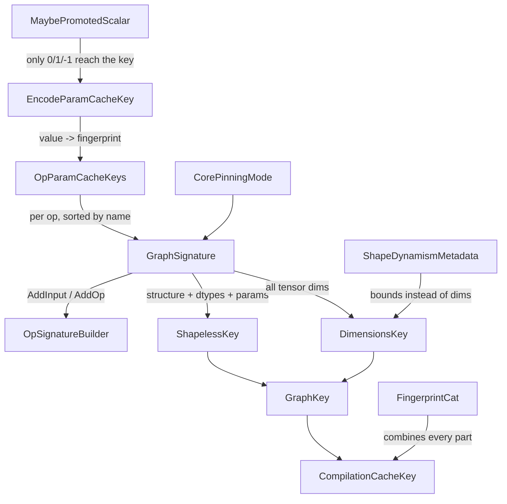

# Compilation cache key - shapeless key, dimensions key, op param keys and promoted scalars

## Overview

A [`CompilationCacheKey`](../catalog/csrc/common/cache_key.h.md#CompilationCacheKey "csrc/common/cache_key.h:L846")
is four parts: a **shapeless key** (graph structure, ranks, dtypes, op names, op parameters, buffer
donation, core pinning), a **dimensions key** (every concrete tensor dimension in the graph), a
**compile options key** (resolved XLA options plus raw `XLA_FLAGS` / `LIBTPU_INIT_ARGS`; see
[compilation-pipeline](compilation-pipeline.md)), and an optional free-form id string. The split
between the first two is the central design idea: the
[`GraphKey`](../catalog/csrc/common/cache_key.h.md#GraphKey "csrc/common/cache_key.h:L809")
keeps the [`ShapelessKey`](../catalog/csrc/common/cache_key.h.md#ShapelessKey "csrc/common/cache_key.h:L757")
and [`DimensionsKey`](../catalog/csrc/common/cache_key.h.md#DimensionsKey "csrc/common/cache_key.h:L785")
as separately typed fingerprints so that the cache can look up "the same graph at any shape" by the
shapeless key alone - which is exactly what bounded- and unbounded-dynamic cache entries do. Op-level
inputs that would otherwise change the graph on every call (scalar hyperparameters, for instance)
are pushed out of the key by promoting them to runtime tensors
([`PromotedScalar`](../catalog/csrc/common/cache_key.h.md#PromotedScalar "csrc/common/cache_key.h:L98")),
so a changing value does not force a recompile.

## Diagram

Legend:
- `GS` - [`GraphSignature`](../catalog/csrc/common/cache_key.h.md#GraphSignature "csrc/common/cache_key.h:L1011")
- `OSB` - [`OpSignatureBuilder`](../catalog/csrc/common/cache_key.h.md#GraphSignature.OpSignatureBuilder "csrc/common/cache_key.h:L1019")
- `OPK` - [`OpParamCacheKeys`](../catalog/csrc/common/cache_key.h.md#OpParamCacheKeys "csrc/common/cache_key.h:L541")
- `ENC` - [`EncodeParamCacheKey`](../catalog/csrc/common/cache_key.cc.md#EncodeParamCacheKey "csrc/common/cache_key.cc:L63")
- `MPS` - [`MaybePromotedScalar`](../catalog/csrc/common/cache_key.h.md#MaybePromotedScalar "csrc/common/cache_key.h:L150")
- `CPM` - [`CorePinningMode`](../catalog/csrc/common/cache_key.h.md#CorePinningMode "csrc/common/cache_key.h:L968")
- `SK` - [`ShapelessKey`](../catalog/csrc/common/cache_key.h.md#ShapelessKey "csrc/common/cache_key.h:L757")
- `DK` - [`DimensionsKey`](../catalog/csrc/common/cache_key.h.md#DimensionsKey "csrc/common/cache_key.h:L785")
- `SDM` - [`ShapeDynamismMetadata`](../catalog/csrc/common/cache_key.h.md#ShapeDynamismMetadata "csrc/common/cache_key.h:L931")
- `GK` - [`GraphKey`](../catalog/csrc/common/cache_key.h.md#GraphKey "csrc/common/cache_key.h:L809")
- `CCK` - [`CompilationCacheKey`](../catalog/csrc/common/cache_key.h.md#CompilationCacheKey "csrc/common/cache_key.h:L846")
- `FC` - [`FingerprintCat`](../catalog/csrc/common/fingerprint_utils.h.md#FingerprintCat "csrc/common/fingerprint_utils.h:L183")

## Design rationale (why it's built this way)

- **Separate types for the two halves.** "Give the shapeless and dimensions keys separate types to avoid accidentally using the wrong key." Both are just 64-bit fingerprints, but the dynamic caches are indexed by [`ShapelessKey`](../catalog/csrc/common/cache_key.h.md#ShapelessKey "csrc/common/cache_key.h:L757") only, and mixing the two up would silently alias unrelated graphs.
- **Tensors are described by the graph, not by op params.** [`IncludeInCacheKey`](../catalog/csrc/common/cache_key.h.md#IncludeInCacheKey "csrc/common/cache_key.h:L241") excludes tensors, tensor lists, generators, promoted scalars and some collective option structs because "their information is already included in the cache key automatically" (shape and dtype through the graph signature) or is runtime data.
- **Stable encodings, because keys outlive the process.** Keys name files in the tier-2/tier-3 caches, so encodings avoid anything that can drift between builds: enum values are encoded through their *names* ("The numerical value of an enum is not guaranteed to be stable across different versions of PyTorch" / "of MLIR"), `-0.0` is normalized to `0.0` for doubles, and op params live in a `std::map` "because we need the keys to be sorted for deterministic cache keys".
- **Promote scalars to avoid recompiles.** A plain scalar parameter is encoded *by value* (dtype + value), so every distinct value is a distinct graph. A [`PromotedScalar`](../catalog/csrc/common/cache_key.h.md#PromotedScalar "csrc/common/cache_key.h:L98") ("A scalar value that is promoted to a tensor lazily") is instead fed as a runtime input and ignored by the key. [`MaybePromotedScalar`](../catalog/csrc/common/cache_key.h.md#MaybePromotedScalar "csrc/common/cache_key.h:L150") keeps a small escape hatch: "If the value matches an exclude, it is not promoted and its value is included in the cache key. Otherwise, it is promoted to a tensor and ignored in the cache key."
- **Opting out must be justified.** [`IgnoredInCacheKey`](../catalog/csrc/common/cache_key.h.md#IgnoredInCacheKey "csrc/common/cache_key.h:L210") is the wrapper for "a value that should be ignored in the cache key computation"; the factory that creates it refuses an empty reason string, because dropping a parameter that actually changes the lowered module would make two different graphs share one executable.

> [!inferred]
> The 0/1/-1 exclusion is a compile-quality trade: a literal `alpha=1` or `0` can be folded by XLA
> (for example `add(x, y, alpha=1)` needs no multiply), which is worth one extra cached graph per
> special value, while every other value shares a single executable with the scalar as a runtime
> input.

## Entry points

- [`GraphSignature`](../catalog/csrc/common/cache_key.h.md#GraphSignature "csrc/common/cache_key.h:L1011") - "holds all information necessary to uniquely identify and describe a graph of DeferredOps"; "*not* intended to be a long-lived object". A traversal builds one per graph (once, then memoized on the traversal) when the compile path asks for its cache key; the cache also builds synthetic ones for pad/slice adapter modules.
- [`MakeOpParamCacheKeys`](../catalog/csrc/common/cache_key.h.md#MakeOpParamCacheKeys "csrc/common/cache_key.h:L746") - reached from the kernel-definition macro when an ATen op is dispatched: it walks the kernel's argument list against the stringified argument names, "skips all at::Tensor-typed arguments in the list", and calls `SetParam` for the rest. [`EnforceSetParamType`](../catalog/csrc/common/cache_key.h.md#EnforceSetParamType "csrc/common/cache_key.h:L711") selects whether non-key types are a compile error.
- [`OpParamCacheKeys`](../catalog/csrc/common/cache_key.h.md#OpParamCacheKeys "csrc/common/cache_key.h:L541") - the per-op parameter map. Op authors add to it when "any parameters that can change the compilation of the op without changing the shape or dtype of the inputs or outputs" exist; the header's example is gelu's `approximate`.
- [`CompilationCacheKey`](../catalog/csrc/common/cache_key.h.md#CompilationCacheKey.CompilationCacheKey "csrc/common/cache_key.h:L860") - constructor joining graph key, options key and id; called by the traversal compile and by the cache when it derives storage keys for bounded entries and adapter modules.

## Mechanism (step-by-step)

1. **Encode each op parameter.** For every argument that [`IncludeInCacheKey`](../catalog/csrc/common/cache_key.h.md#IncludeInCacheKey "csrc/common/cache_key.h:L241") admits, `SetParam` finds the right [`EncodeParamCacheKey`](../catalog/csrc/common/cache_key.h.md#EncodeParamCacheKey "csrc/common/cache_key.h:L282") overload by argument-dependent lookup - the family "convert different op parameter types to strings or fingerprints" and "must guarantee that different values produce different keys". Built-ins cover integers, bools, doubles, strings, `SymInt`s, dtypes, layouts, devices, reduce ops, StableHLO precision, optionals and containers; ops add their own next to their enum types, for example softmax mode via [`EncodeParamCacheKey`](../catalog/csrc/ops/softmax/softmax.h.md#EncodeParamCacheKey "csrc/ops/softmax/softmax.h:L33") or device groups via [`EncodeParamCacheKey`](../catalog/csrc/distributed/types.h.md#EncodeParamCacheKey "csrc/distributed/types.h:L88"). A raw scalar becomes dtype + value through [`EncodeParamCacheKey`](../catalog/csrc/common/cache_key.cc.md#EncodeParamCacheKey "csrc/common/cache_key.cc:L63"), so the test expects `FingerprintCat("int64", 123)` for `Scalar(123)` (`cache_key_test.cc`).
2. **Drop empties, reject duplicates.** In [`EncodeParamCacheKey`](../catalog/csrc/common/cache_key.h.md#OpParamCacheKeys.SetParam.EncodeParamCacheKey "csrc/common/cache_key.h:L595") use inside `SetParam`, string results are fingerprinted, and a fingerprint equal to that of the empty string is not stored at all. That is how `nullopt`, an undefined optional tensor, and a promoted (non-excluded) [`MaybePromotedScalar`](../catalog/csrc/common/cache_key.cc.md#MaybePromotedScalar.MaybePromotedScalar "csrc/common/cache_key.cc:L221") all vanish from the key (tests `SetParamNullopt`, `SetParamMaybePromotedScalar_Promoted`). Setting the same name twice is a CHECK failure ("This is a TorchTPU bug"). [`OpParamCacheKeys`](../catalog/csrc/common/cache_key.h.md#OpParamCacheKeys.OpParamCacheKeys "csrc/common/cache_key.h:L560") are move-only ("copying may be expensive") and cannot be default-constructed ("force callers to decide what entries to include").
3. **Record the graph.** The traversal walks its arguments and then its ops in execution order: inputs first through `AddInput` (adding an input after any op is a CHECK failure), then each op through `AddOp`, whose callback receives an [`OpSignatureBuilder`](../catalog/csrc/common/cache_key.h.md#GraphSignature.OpSignatureBuilder "csrc/common/cache_key.h:L1019") to stream the op's input edges (topological indices) and its outputs (dims + dtype). [`GraphSignature`](../catalog/csrc/common/cache_key.h.md#GraphSignature "csrc/common/cache_key.h:L1011") stores everything in flat arrays - per-tensor dimension spans and element types, per-op input-index spans, op names, the op's sorted (name, fingerprint) params, output counts, donated input indices (deduplicated), graph outputs - and the graph's [`CorePinningMode`](../catalog/csrc/common/cache_key.h.md#CorePinningMode "csrc/common/cache_key.h:L968") (unpinned, TensorCore, or SparseCore).
4. **Split into shapeless and dimensions keys.** On `GetKey`, the [`ShapelessKey`](../catalog/csrc/common/cache_key.h.md#ShapelessKey "csrc/common/cache_key.h:L757") is a single [`FingerprintCat`](../catalog/csrc/common/fingerprint_utils.h.md#FingerprintCat "csrc/common/fingerprint_utils.h:L183") over graph outputs, the per-tensor dimension *offsets* (so ranks are in, sizes are not), element types, sorted donated indices, op edges, op names, op params, output counts and the pinning mode. The [`DimensionsKey`](../catalog/csrc/common/cache_key.h.md#DimensionsKey.DimensionsKey "csrc/common/cache_key.h:L787") is a fingerprint of the concatenated dimensions of **every** tensor in the graph, inputs and intermediates alike. Two graphs that differ only in sizes therefore share a shapeless key and differ in the dimensions key.
5. **Assemble the full key.** The traversal folds non-default argument layouts and donated inputs into the graph key, then [`CompilationCacheKey`](../catalog/csrc/common/cache_key.h.md#CompilationCacheKey.CompilationCacheKey "csrc/common/cache_key.h:L860") pairs it with the options key and an optional id. Equality and hashing use all four parts (the hash is a [`FingerprintCat`](../catalog/csrc/common/fingerprint_utils.h.md#FingerprintCat "csrc/common/fingerprint_utils.h:L183") of shapeless, dimensions, options and id). The id is meant for "multiple different dynamic kernels that share a graph_key but are optimized for different sizes". The compact form `<shapeless>_<dims>_<options>[_<id>]` in 16-digit hex is the on-disk file stem of tier-2/tier-3 entries.
6. **Dynamic shapes swap dims for bounds.** When some input carries bounded dynamic dimensions, [`ShapeDynamismMetadata`](../catalog/csrc/common/cache_key.cc.md#ShapeDynamismMetadata.ShapeDynamismMetadata "csrc/common/cache_key.cc:L310") records a [lower, upper] pair for every input and output dimension (equal pairs for static dims). The middle executable is keyed by the same shapeless key plus a [`DimensionsKey`](../catalog/csrc/common/cache_key.cc.md#DimensionsKey.DimensionsKey "csrc/common/cache_key.cc:L285") built from the input upper and lower bounds, not the observed dims. A later call reuses it when [`IsStaticShapeCompatible`](../catalog/csrc/common/cache_key.cc.md#ShapeDynamismMetadata.IsStaticShapeCompatible "csrc/common/cache_key.cc:L385") finds the same flattened rank and every concrete dim inside its bounds ("This ignores dynamic annotations").
7. **Adapter modules get synthetic keys.** The padding preamble is keyed by [`PadModuleCacheKey`](../catalog/csrc/common/cache_key.cc.md#PadModuleCacheKey "csrc/common/cache_key.cc:L413"), which builds a tiny [`GraphSignature`](../catalog/csrc/common/cache_key.h.md#GraphSignature "csrc/common/cache_key.h:L1011") with one pad-to-upper-bound op per dynamic input plus a get-dimension-size op per dynamic dim (the dimension index is an op param). The slicing postamble is keyed by [`GetSliceModuleCacheKey`](../catalog/csrc/common/cache_key.cc.md#ShapeDynamismMetadata.GetSliceModuleCacheKey "csrc/common/cache_key.cc:L506"), one slice op per output whose padded dims differ from its runtime dims. These keys include the runtime target shapes, so adapters are cached per runtime size while the expensive middle executable is shared.

## Key data structures

| Structure | Contents | In the key as |
|---|---|---|
| [`ShapelessKey`](../catalog/csrc/common/cache_key.h.md#ShapelessKey "csrc/common/cache_key.h:L757") | Fingerprint of structure, ranks, dtypes, op names and params, donation, core pinning | index of bounded/unbounded dynamic maps |
| [`DimensionsKey`](../catalog/csrc/common/cache_key.h.md#DimensionsKey "csrc/common/cache_key.h:L785") | Fingerprint of all tensor dims, or of input dim bounds | completes the static-map key |
| [`GraphKey`](../catalog/csrc/common/cache_key.h.md#GraphKey "csrc/common/cache_key.h:L809") | (shapeless, dimensions) | "identify a computation graph by combining its structural representation ... and the specific tensor dimensions" |
| [`CompilationCacheKey`](../catalog/csrc/common/cache_key.h.md#CompilationCacheKey "csrc/common/cache_key.h:L846") | graph key + options key + id | static-map key and on-disk file name |
| [`OpParamCacheKeys`](../catalog/csrc/common/cache_key.h.md#OpParamCacheKeys "csrc/common/cache_key.h:L541") | sorted map param name -> fingerprint | folded into the shapeless key |
| [`ShapeDynamismMetadata`](../catalog/csrc/common/cache_key.h.md#ShapeDynamismMetadata "csrc/common/cache_key.h:L931") | [lower, upper] per input and output dim | "The metadata necessary to check if a static graph is compatible with a BoundedDynamicCacheEntry" |
| [`PromotedScalar`](../catalog/csrc/common/cache_key.h.md#PromotedScalar "csrc/common/cache_key.h:L98") / [`MaybePromotedScalar`](../catalog/csrc/common/cache_key.h.md#MaybePromotedScalar "csrc/common/cache_key.h:L150") | scalar + promoter function (+ exclude match) | absent, or "0"/"1"/"-1" when excluded |

## Dynamics (design intent)

- **When the key is computed.** The graph key is built once per traversal and memoized; per-op param keys are computed at dispatch, inside the kernel macro, so their cost is paid on every eager op. That is why [`OpParamCacheKeys`](../catalog/csrc/common/cache_key.h.md#OpParamCacheKeys "csrc/common/cache_key.h:L541") is marked `[[nodiscard]]` ("to avoid wasting time computing cache keys that are not used").
- **Promotion contract.** A kernel that receives a promoted scalar must call `GetTensor()` on it; debug builds abort with "The kernel didn't call .GetTensor() on the promoted scalar" (`MaybePromotedScalarNotUsedCrashes`), and calling it on an excluded value aborts too (`GetTensorWhenValueMatchesExcludeCrashes`). This guards against a kernel that silently bakes a promoted value into the graph while the key ignores it.
- **IgnoreInCacheKey is honored by the macro** - test `TtKernelIgnored` shows only the non-ignored argument reaching the param map.

## Edge cases

- **Every dimension counts, including intermediates.** A size change anywhere in the graph (new batch size, sequence length, last short batch) is a new dimensions key and a new compile unless the inputs are marked bounded-dynamic.
- **Raw scalars recompile per value.** A non-promoted `at::Scalar` or `double` parameter puts its value into the key; learning-rate-like values passed that way cause one compile per distinct value.
- **Excluded values fork the graph.** With a [`MaybePromotedScalar`](../catalog/csrc/common/cache_key.h.md#MaybePromotedScalar "csrc/common/cache_key.h:L150") excluding 0 and 1, the values 0, 1 and "anything else" give three different keys.
- **Donation and pinning are structural.** Donating a different input, or running the same ops pinned to SparseCore vs TensorCore, changes the shapeless key.
- **Bounded reuse requires identical rank layout** - [`IsStaticShapeCompatible`](../catalog/csrc/common/cache_key.cc.md#ShapeDynamismMetadata.IsStaticShapeCompatible "csrc/common/cache_key.cc:L385") returns false if the flattened number of dims differs.
- **Device assignment rides on op params.** Collectives and Pallas kernels contribute a `device_assignment` param, so the same graph on different device groups has different keys.
- A legacy `false` argument is still mixed into the static [`DimensionsKey`](../catalog/csrc/common/cache_key.h.md#DimensionsKey.DimensionsKey "csrc/common/cache_key.h:L787") "for backward compatibility" (TODO in source); removing it would invalidate every persisted entry.

## Open questions

- `GraphSignature::GetKey`, `CompactFormat`, `Traversal::BuildGraphKey` and the layout/donation annotation helpers are not in this packet's subgraph; their behavior above is from reading source.
- Which ATen kernels actually use promoted scalars (and with which exclusions) is decided per op, outside this subgraph.
- The comment says the id key distinguishes size-specialized dynamic kernels; no in-subgraph caller sets a non-empty id, so its production use is unconfirmed here.

## See also

- [compilation-cache](compilation-cache.md) - how the static, bounded and unbounded maps use these keys.
- [compilation-pipeline](compilation-pipeline.md) - where the compile options key comes from.
