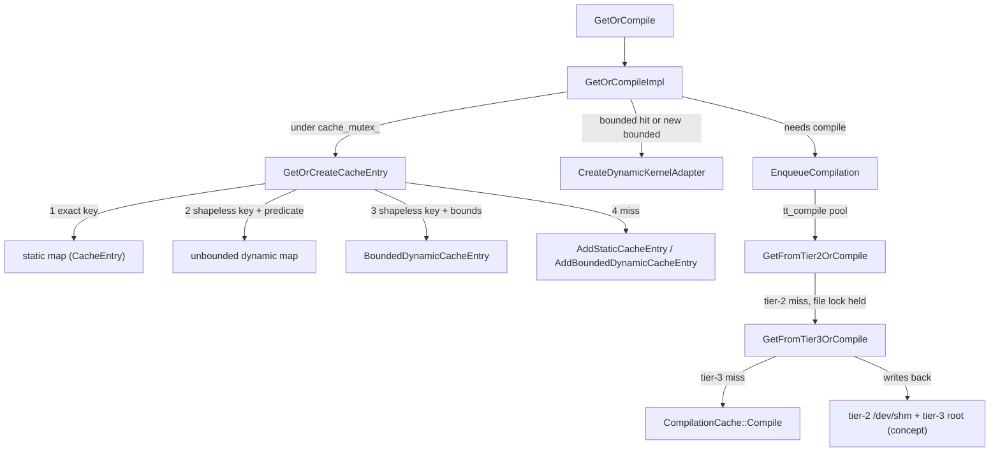

# Compilation cache - tier-1 in-memory, tier-2 /dev/shm, tier-3 remote, and dynamic-shape entries

## Overview

[`CompilationCache`](../catalog/csrc/common/compilation_cache.h.md#CompilationCache "csrc/common/compilation_cache.h:L201")
is a process-wide singleton that maps a compilation cache key to a *future* executable. Its docstring:
"An in-memory cache for compiled XLA programs. The ownership of cached executables is shared between
the cache and the user of the executable." The key design idea is that a lookup is a short critical
section that either returns an existing future or **inserts an empty promise/future pair** and
schedules the compile on a thread pool; concurrent requests for the same key simply share the
future. Below the in-memory (tier-1) maps sit two optional persistent tiers: tier-2, serialized
executables in host tmpfs (`/dev/shm`) guarded by per-key file locks so that several processes on a
host compile each graph once; and tier-3, a local or remote (for example `gs://`) directory shared
across hosts and runs. Tier-1 itself has three shapes of entry - static, bounded-dynamic, and
unbounded-dynamic - which is how one executable can serve many runtime shapes.

## Diagram

Legend:
- `GOC` - [`GetOrCompile`](../catalog/csrc/common/compilation_cache.cc.md#CompilationCache.GetOrCompile "csrc/common/compilation_cache.cc:L1004")
- `IMPL` - [`GetOrCompileImpl`](../catalog/csrc/common/compilation_cache.cc.md#CompilationCache.GetOrCompileImpl "csrc/common/compilation_cache.cc:L920")
- `GOCE` - [`GetOrCreateCacheEntry`](../catalog/csrc/common/compilation_cache.cc.md#CompilationCache.GetOrCreateCacheEntry "csrc/common/compilation_cache.cc:L607")
- `STATIC` - [`CacheEntry`](../catalog/csrc/common/compilation_cache.h.md#CacheEntry "csrc/common/compilation_cache.h:L84")
- `UNB` - (concept) the unbounded dynamic map, populated by [`AddUnboundedDynamicCacheEntry`](../catalog/csrc/common/compilation_cache.cc.md#CompilationCache.AddUnboundedDynamicCacheEntry "csrc/common/compilation_cache.cc:L568")
- `BND` - [`BoundedDynamicCacheEntry`](../catalog/csrc/common/compilation_cache.h.md#BoundedDynamicCacheEntry "csrc/common/compilation_cache.h:L116")
- `ADD` - [`AddStaticCacheEntry`](../catalog/csrc/common/compilation_cache.cc.md#CompilationCache.AddStaticCacheEntry "csrc/common/compilation_cache.cc:L522") and [`AddBoundedDynamicCacheEntry`](../catalog/csrc/common/compilation_cache.cc.md#CompilationCache.AddBoundedDynamicCacheEntry "csrc/common/compilation_cache.cc:L535")
- `ADAPT` - [`CreateDynamicKernelAdapter`](../catalog/csrc/common/compilation_cache.cc.md#CompilationCache.CreateDynamicKernelAdapter "csrc/common/compilation_cache.cc:L870")
- `ENQ` - [`EnqueueCompilation`](../catalog/csrc/common/compilation_cache.cc.md#CompilationCache.EnqueueCompilation "csrc/common/compilation_cache.cc:L1026")
- `T2` - [`GetFromTier2OrCompile`](../catalog/csrc/common/compilation_cache.cc.md#CompilationCache.GetFromTier2OrCompile "csrc/common/compilation_cache.cc:L1127")
- `T3` - [`GetFromTier3OrCompile`](../catalog/csrc/common/compilation_cache.cc.md#CompilationCache.GetFromTier3OrCompile "csrc/common/compilation_cache.cc:L1180")
- `COMP` - (concept) the uncached compile step; see [compilation-pipeline](compilation-pipeline.md)
- `DISK` - (concept) the serialized-executable files

## Design rationale (why it's built this way)

- **Futures, not results, are cached.** A [`CacheEntry`](../catalog/csrc/common/compilation_cache.h.md#CacheEntry "csrc/common/compilation_cache.h:L84") is "a future executable with its metadata". Inserting the promise *before* compiling means a second request for the same graph, arriving while the first compile is still running, gets a hit and waits on the same future rather than compiling twice. The promise is set at most once; a late setter (for example the losing side of a tier-3 read vs backup compile race) is silently ignored.
- **Shared ownership enables eviction under use.** The docstring says shared ownership "is needed to avoid deleting an executable still in use when the cache decides to evict it". Eviction drops the cache's reference; a running step keeps its own.
- **Lazy initialization.** The singleton exists from first use, but thread pools are created only by [`EnsureInitialized`](../catalog/csrc/common/compilation_cache.cc.md#CompilationCache.EnsureInitialized "csrc/common/compilation_cache.cc:L162") on the first compile, because "the compilation thread pool initialization needs PjRt to be initialized (and PJRT initialization is lazy)" - see [`EnsureInitialized`](../catalog/csrc/pjrt/pjrt_state.cc.md#PjrtBackend.EnsureInitialized "csrc/pjrt/pjrt_state.cc:L202") on the PjRt side.
- **Tier-2 exists for multi-process hosts.** With one process per TPU chip (world size > 1), every rank would otherwise compile the same graph. The tier-2 file lock serializes compilation of a key across processes, and the "check again after acquiring the lock" step lets every rank but one load the executable instead of compiling. That is why tier-2 defaults to on when world size > 1 and off for a single process.
- **Persistent tiers are invalidated wholesale on version change.** The on-disk directory name embeds [`GetTorchTpuBinaryFingerprint`](../catalog/csrc/common/compilation_cache_utils.cc.md#GetTorchTpuBinaryFingerprint "csrc/common/compilation_cache_utils.cc:L91"), whose intent per its docstring is to change when the TorchTPU binary version or the PjRt/libtpu version changes ("Whenever either changes, we invalidate the tier-2 cache to be safe"). Old entries are not migrated, just never found.
- **Writes are best-effort.** A failed tier-2 or tier-3 write is logged and ignored: "we don't need to fail the user if it fails (the program will just run slower)."

## Entry points

- [`GetOrCompile`](../catalog/csrc/common/compilation_cache.cc.md#CompilationCache.GetOrCompile "csrc/common/compilation_cache.cc:L1004") - two overloads. The `const xla::CompileOptions&` one at L1004 is the "Zero-copy fast path overload for cache hits": options are copied only if a compile is actually needed. The [`GetOrCompile`](../catalog/csrc/common/compilation_cache.cc.md#CompilationCache.GetOrCompile "csrc/common/compilation_cache.cc:L1015") at L1015 takes ownership of a patched options object. Every traversal compile in eager and compiled mode lands here.
- [`AddUnboundedDynamicCacheEntry`](../catalog/csrc/common/compilation_cache.cc.md#CompilationCache.AddUnboundedDynamicCacheEntry "csrc/common/compilation_cache.cc:L568") - registers a precompiled kernel (for example the Mosaic nonzero-indices kernel) that can serve any runtime shape accepted by its compatibility predicate. Synchronous: "Blocks until the entry is ready. Adding a key that is already present is a no-op."
- [`EvictAll`](../catalog/csrc/common/compilation_cache.cc.md#CompilationCache.EvictAll "csrc/common/compilation_cache.cc:L280") - "Evicts all existing executables from the cache. The function waits for all in-flight compilations to complete." Exposed to Python as `_clear_cache`, and run by the destructor at shutdown.
- [`HbmUsageSummary`](../catalog/csrc/common/compilation_cache.cc.md#CompilationCache.HbmUsageSummary "csrc/common/compilation_cache.cc:L1346") - "Debugging function to return the total resident size of the loaded executables in HBM"; sums `generated_code_size_in_bytes` over ready static and unbounded entries. Exposed as `_hbm_usage_summary`.
- [`PerfStats`](../catalog/csrc/common/compilation_cache.h.md#PerfStats "csrc/common/compilation_cache.h:L137") and [`GetDumpOnCacheMissMode`](../catalog/csrc/common/compilation_cache.cc.md#CompilationCache.GetDumpOnCacheMissMode "csrc/common/compilation_cache.cc:L377") - the observability surface: request/hit/compile counters plus per-entry stats, and the dump-StableHLO-on-miss switch (Python `_get_cache_requests` / `_get_cache_hits` / `_get_cache_misses`, `_set_dump_on_cache_miss`).

## Mechanism (step-by-step)

1. **Critical-section lookup.** [`GetOrCompileImpl`](../catalog/csrc/common/compilation_cache.cc.md#CompilationCache.GetOrCompileImpl "csrc/common/compilation_cache.cc:L920") takes `cache_mutex_`, increments `num_cache_reqs`, and calls [`GetOrCreateCacheEntry`](../catalog/csrc/common/compilation_cache.cc.md#CompilationCache.GetOrCreateCacheEntry "csrc/common/compilation_cache.cc:L607"). Everything it gets back is a shared pointer or shared future, so all later work happens outside the lock. If the result is a static hit, it returns immediately with a compiled-kernel struct carrying only the future - "the steady-state case in eager execution" - without allocating or copying compile options.
2. **Lookup order inside tier-1.** [`GetOrCreateCacheEntry`](../catalog/csrc/common/compilation_cache.cc.md#CompilationCache.GetOrCreateCacheEntry "csrc/common/compilation_cache.cc:L607") tries, in order: (1) the static map by exact key (shapeless + dimensions + options + id); (2) the unbounded-dynamic map by shapeless key, taking the first entry whose compatibility predicate accepts the input and output shapes (entries whose compile already failed are skipped, in-flight ones are served); (3) the bounded-dynamic map by shapeless key, taking the first [`BoundedDynamicCacheEntry`](../catalog/csrc/common/compilation_cache.h.md#BoundedDynamicCacheEntry "csrc/common/compilation_cache.h:L116") whose bounds contain every input dimension *and* whose options key matches, then recursing on that entry's middle-executable key with dynamic lookup disabled. Every hit bumps `num_cache_hits` and the entry's read count and last-read time in [`CacheEntryStats`](../catalog/csrc/common/compilation_cache.h.md#CacheEntryStats "csrc/common/compilation_cache.h:L56").
3. **Miss: cache-only gate, then create an entry.** If cache-only mode is set the miss is a `FailedPrecondition` error ("The user has asserted that no more compilation should happen; yet compilation is needed"). Otherwise, if any input shape carries bounded dynamic dimensions, [`AddBoundedDynamicCacheEntry`](../catalog/csrc/common/compilation_cache.cc.md#CompilationCache.AddBoundedDynamicCacheEntry "csrc/common/compilation_cache.cc:L535") records the dimension bounds under the shapeless key and creates a static entry for the *middle* executable keyed by the bounds rather than the actual dims; else [`AddStaticCacheEntry`](../catalog/csrc/common/compilation_cache.cc.md#CompilationCache.AddStaticCacheEntry "csrc/common/compilation_cache.cc:L522") inserts a fresh promise/future under the exact key ("If the key is already in the static cache, it will crash", which cannot happen because lookup ran first under the same lock).
4. **Bounded dynamic: build adapters.** When the lookup carries dynamism metadata, the executable is stored under a key whose dimensions part encodes the bounds, and (unless the caller asked for StableHLO bounds instead) [`CreateDynamicKernelAdapter`](../catalog/csrc/common/compilation_cache.cc.md#CompilationCache.CreateDynamicKernelAdapter "csrc/common/compilation_cache.cc:L870") builds the preamble/postamble. [`CreatePaddingKernel`](../catalog/csrc/common/compilation_cache.cc.md#CompilationCache.CreatePaddingKernel "csrc/common/compilation_cache.cc:L776") compiles a module that pads each dynamic input up to its upper bound (and reports the real sizes), going through the same cache recursively. [`CreateSlicingKernel`](../catalog/csrc/common/compilation_cache.cc.md#CompilationCache.CreateSlicingKernel "csrc/common/compilation_cache.cc:L805") is only added when padding changes the default TPU layout of some input; otherwise "the current mechanisms in the TPU backend already handle the slicing for us". So one middle executable compiled at the upper bound serves every runtime size inside the bounds, at the cost of padded compute plus one or two small extra executions.
5. **Build and enqueue on a miss.** If an entry was created, [`GetOrCompileImpl`](../catalog/csrc/common/compilation_cache.cc.md#CompilationCache.GetOrCompileImpl "csrc/common/compilation_cache.cc:L920") runs the caller's module builder on the calling thread (failures are written into the promise so waiters see them), optionally logs the StableHLO module if dump-on-miss is on, and hands it to [`EnqueueCompilation`](../catalog/csrc/common/compilation_cache.cc.md#CompilationCache.EnqueueCompilation "csrc/common/compilation_cache.cc:L1026"). That ensures initialization and schedules a closure on the `tt_compile` pool; the worker is barred from thread-local context state, routes its warnings back to the dispatch thread, and measures memory inside a container (feeding `peak_compilation_memory_bytes`).
6. **Tier-2: host tmpfs with a cross-process lock.** [`GetFromTier2OrCompile`](../catalog/csrc/common/compilation_cache.cc.md#CompilationCache.GetFromTier2OrCompile "csrc/common/compilation_cache.cc:L1127") skips straight to compiling if tier-2 is disabled or allow-cache is off. Otherwise it tries to mmap the entry file (`/dev/shm/torch_tpu_cache/<name>/<binary fingerprint>/<key>.bin`) and deserialize it into a loaded executable; on a miss it takes a blocking per-key `.lock` file, checks the file again ("in case another thread or process has just finished the compilation and released the lock"), and only then proceeds to tier-3/compile while still holding the lock.
7. **Tier-3: remote read raced with a local backup compile.** [`GetFromTier3OrCompile`](../catalog/csrc/common/compilation_cache.cc.md#CompilationCache.GetFromTier3OrCompile "csrc/common/compilation_cache.cc:L1180") first, if the backup task is enabled, schedules a compile on the lower-priority `tt_compile2` pool (half the main pool's threads), which skips itself if the executable is already ready. It then reads `<root>/<binary fingerprint>/<key>.bin` (via the TSL filesystem, so `gs://` paths work); a hit publishes the executable. Whichever of the tier-3 read and the backup compile finishes first fulfils the future. With the backup disabled, it compiles only after the tier-3 read fails.
8. **Compile, then write back.** The uncached compile step (see [compilation-pipeline](compilation-pipeline.md)) records `compilation_duration` and publishes into the tier-1 entry. [`GetFromTier3OrCompile`](../catalog/csrc/common/compilation_cache.cc.md#CompilationCache.GetFromTier3OrCompile "csrc/common/compilation_cache.cc:L1180") then waits on the tier-1 future *outside* the mutex (holding it would deadlock against the backup thread), serializes the executable and atomically writes it (temp file + rename, "last writer wins") to tier-2, releases the tier-2 lock immediately so waiting processes unblock, and, if the result was compiled rather than read from tier-3, also writes it to tier-3. A tier-3 hit therefore backfills tier-2 but is not rewritten to tier-3 (the `UnboundedDynamicCacheTier3Hit` test checks the backfill).
9. **Unbounded-dynamic entries take the same tiered path.** [`AddUnboundedDynamicCacheEntry`](../catalog/csrc/common/compilation_cache.cc.md#CompilationCache.AddUnboundedDynamicCacheEntry "csrc/common/compilation_cache.cc:L568") registers a pending entry under the shapeless key, then calls the tier-2/tier-3/compile path synchronously with a caller-supplied executable builder. Because executables loaded from disk carry no metadata, the dynamic execution metadata is attached when the executable is published "for every source alike". If the entry was evicted mid-flight the call returns `kAborted`.

## Key data structures

| Structure | Keyed by | Holds | Serves |
|---|---|---|---|
| static map of [`CacheEntry`](../catalog/csrc/common/compilation_cache.h.md#CacheEntry "csrc/common/compilation_cache.h:L84") | full key (shapeless, dims, options, id) | promise + shared future + [`CacheEntryStats`](../catalog/csrc/common/compilation_cache.h.md#CacheEntryStats "csrc/common/compilation_cache.h:L56") | exact-shape graphs, and the middle executables of bounded entries |
| bounded dynamic map of [`BoundedDynamicCacheEntry`](../catalog/csrc/common/compilation_cache.h.md#BoundedDynamicCacheEntry "csrc/common/compilation_cache.h:L116") lists | shapeless key | middle-executable key + per-dimension lower/upper bounds | any input dims inside the bounds, via pad (+ optional slice) adapters; "triplets [preamble, middle, postamble]" |
| unbounded dynamic map | shapeless key | key + dynamic metadata (compatibility predicate) + its own `CacheEntry` | any shapes the predicate accepts; precompiled kernels |
| [`PerfStats`](../catalog/csrc/common/compilation_cache.h.md#PerfStats "csrc/common/compilation_cache.h:L137") | - | `num_cache_reqs`, `num_cache_hits` (tier-1 only), `num_compilations`, peak host compile memory, per-entry stats | hit-rate and compile-storm diagnosis |
| [`CompilationCacheInitializationOptions`](../catalog/csrc/common/compilation_cache.h.md#CompilationCacheInitializationOptions "csrc/common/compilation_cache.h:L51") | - | `cache_only` | applied at init; runtime-adjustable |

[`CacheEntryStats`](../catalog/csrc/common/compilation_cache.h.md#CacheEntryStats "csrc/common/compilation_cache.h:L56") semantics worth knowing: `compilation_duration` is non-zero only if *this process* compiled the entry (zero for a tier-2/tier-3 load or a failure), and "The initial compilation counts as one read".

### Knobs

| Knob | Kind | Default | Effect |
|---|---|---|---|
| `TORCH_TPU_TIER2_COMPILATION_CACHE=<name>` | env, read once | unset: tier-2 on as `default` if world size > 1 or tier-3 is set, off for world size 1 | Directory **name** under `/dev/shm/torch_tpu_cache/`; `disabled` turns tier-2 off |
| `TORCH_TPU_TIER3_COMPILATION_CACHE_ROOT=<path or gs://...>` | env, read once | unset: tier-3 off | Root of the shared store; requires tier-2 (setting it with tier-2 explicitly `disabled` leaves tier-3 off) |
| `TORCH_TPU_INTERNAL_TIER3_COMPILATION_CACHE_LOCAL_BACKUP_TASK` | env, read once | unset = on | `1`: race local compile with tier-3 read; `0`: compile only after the tier-3 read fails. Does not gate tier-3 writes |
| `NPROC` / `--torch_tpu_internal_num_compilation_threads` | env / flag | (CPUs - 1) x hyperthreads | Size of the `tt_compile` pool; `tt_compile2` gets half |
| `_set_allow_cache(False)` | Python | allow | Every graph compiled from scratch; tier-2/3 skipped; entries erased once published |
| `_set_cache_only(True)` | Python | off | Any tier-1 miss raises instead of compiling |
| `_set_dump_on_cache_miss(True)` | Python | off | Logs the StableHLO module of every miss |

## Dynamics (design intent)

- **Concurrency.** One mutex guards maps and stats; lookups and inserts are short critical sections, compiles run on pool threads, and waiting on futures is always done outside the lock. Cross-process dedup is the tier-2 lock; cross-thread dedup is the shared future. `OnlyOneUserCanHoldLockAtATime` and `ConcurrentWritesDoNotCorruptCacheFile` (`tier2_compilation_cache_test.cc`) cover the file side.
- **Eviction.** [`EvictAll`](../catalog/csrc/common/compilation_cache.cc.md#CompilationCache.EvictAll "csrc/common/compilation_cache.cc:L280") snapshots the current keys, then busy-waits in 1 s rounds, erasing each entry once its future is ready, and finally clears both dynamic maps wholesale. New entries created during eviction are not promised to be evicted ("that work may never end"). A compile that finishes after its key was evicted logs and drops the result.
- **Readiness probe.** [`IsExecutableReady`](../catalog/csrc/common/compilation_cache.cc.md#CompilationCache.IsExecutableReady "csrc/common/compilation_cache.cc:L693") is what the backup compile uses to skip itself when the tier-3 read already won.
- **Tests worth reading.** `DynamicCacheLayoutMismatch` (same bounded graph, different options key -> different executables), `UnboundedDynamicCacheShapeMismatch` / `...OutputShapeMismatch` / `...EvictAll`, `AllowCacheModeDisabled`, `LazyInitialization` (`compilation_cache_test.cc`), and `UnboundedDynamicCacheTier2Hit` / `...Tier3Hit` (`compilation_cache_tiered_test.cc`).

## Edge cases

- **Hit counters are tier-1 only.** A tier-2 or tier-3 load counts as a *miss* in `num_cache_hits`; use `num_compilations` (incremented only on a real compile) to tell a cold host from a warm persistent cache.
- **Dimensions are part of the static key.** Without bounded-dynamic annotations, a new batch size or sequence length is a full recompile; only shapes carrying bounded dynamic dimensions take the bounded path.
- **Bounded match needs the same options key.** A bounded entry built under O1 is not reused by an O2 request for the same graph.
- **Env vars are memoized.** All tier env vars are read once (static locals); set them before the first compile.
- **Version bumps empty the persistent tiers.** A new libtpu/PjRt version or TorchTPU binary version moves to a new subdirectory; expect one cold compile per graph.
- **`/dev/shm` is host RAM.** Tier-2 lives in tmpfs and grows with the number of unique graphs; nothing here prunes it.
- **Disabling the cache is not free of entries.** With allow-cache off, an entry is still inserted "so we can keep track of it and safely evict it later", then erased after its promise is set.
- **Shutdown.** The cache cannot be used after `ShutDown()`; the destructor evicts everything and logs final stats.

## Open questions

- `CompilationCacheKey`, `ShapeDynamismMetadata`, the tier-2/tier-3 helper functions (file locking, mmap read, atomic write, root-dir resolution) and the Python bindings are outside this packet's subgraph; their behavior above comes from reading source, not from cited symbols.
- Nothing in the source prunes `/dev/shm` or the tier-3 root; retention is left to the operator.
- Whether a tier-3 read that loses the race to the backup compile still costs a full remote download is not settled by the code beyond "whichever succeeds first will unblock execution".

## See also

- [compilation-pipeline](compilation-pipeline.md) - what calls the cache and what an uncached compile does.
- [compilation-cache-key](compilation-cache-key.md) - what goes into shapeless / dimensions / options keys.
