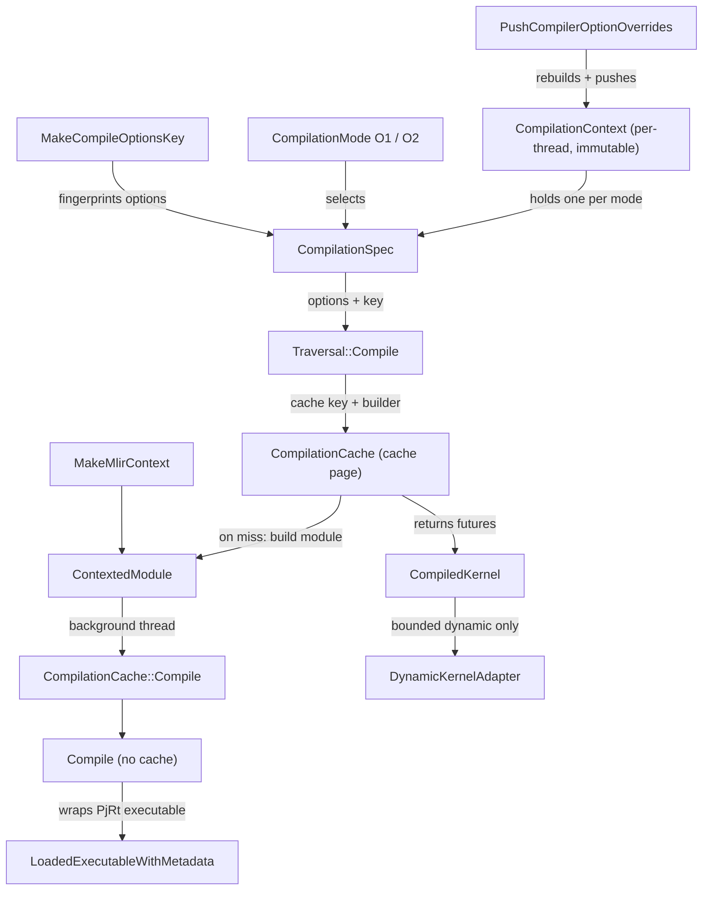

# Compilation pipeline - from a deferred-op Traversal to a loaded PjRt executable

## Overview

Every TPU execution in torch_tpu (eager deferred mode and the `torch.compile` backend alike) ends
with a *Traversal* - a DAG of deferred ATen ops - being handed to
[`Compile`](../catalog/csrc/eager/traversal.cc.md#Traversal.Compile "csrc/eager/traversal.cc:L1065").
The pipeline has two halves that are deliberately decoupled. The **options half** resolves, once
per thread context, a fully-built `xla::CompileOptions` plus its 64-bit fingerprint (a
[`CompilationSpec`](../catalog/csrc/common/compilation_spec.h.md#CompilationSpec "csrc/common/compilation_spec.h:L54")),
for each of two modes in
[`CompilationMode`](../catalog/csrc/common/compilation_spec.h.md#CompilationMode "csrc/common/compilation_spec.h:L33"):
fast-compile (XLA effort O1) and fast-runtime (XLA default, O2). The **graph half** fingerprints the
Traversal, asks the compilation cache for an executable, and - only on a miss - builds a StableHLO
module in a fresh MLIR context
([`ContextedModule`](../catalog/csrc/common/compilation.h.md#ContextedModule "csrc/common/compilation.h:L216"))
and compiles it on a background thread pool through
[`Compile`](../catalog/csrc/common/compilation.cc.md#Compile "csrc/common/compilation.cc:L141").
The caller never blocks on compilation: it receives a
[`CompiledKernel`](../catalog/csrc/common/compilation.h.md#CompiledKernel "csrc/common/compilation.h:L197")
holding *futures*, and only waits when the executable is actually needed to run.

## Diagram

Legend:
- `CTX` - [`CompilationContext`](../catalog/csrc/common/compilation_spec.h.md#CompilationContext "csrc/common/compilation_spec.h:L90")
- `SPEC` - [`CompilationSpec`](../catalog/csrc/common/compilation_spec.h.md#CompilationSpec "csrc/common/compilation_spec.h:L54")
- `PUSH` - [`PushCompilerOptionOverrides`](../catalog/csrc/common/compilation.cc.md#PushCompilerOptionOverrides "csrc/common/compilation.cc:L541")
- `MODE` - [`CompilationMode`](../catalog/csrc/common/compilation_spec.h.md#CompilationMode "csrc/common/compilation_spec.h:L33")
- `MCOK` - [`MakeCompileOptionsKey`](../catalog/csrc/common/compilation.cc.md#MakeCompileOptionsKey "csrc/common/compilation.cc:L441")
- `TC` - [`Compile`](../catalog/csrc/eager/traversal.cc.md#Traversal.Compile "csrc/eager/traversal.cc:L1065")
- `CACHE` - (concept) the tier-1/2/3 compilation cache, see [compilation-cache](compilation-cache.md)
- `CM` - [`ContextedModule`](../catalog/csrc/common/compilation.h.md#ContextedModule "csrc/common/compilation.h:L216")
- `MMC` - [`MakeMlirContext`](../catalog/csrc/common/compilation.cc.md#MakeMlirContext "csrc/common/compilation.cc:L88")
- `CCC` - [`Compile`](../catalog/csrc/common/compilation_cache.cc.md#CompilationCache.Compile "csrc/common/compilation_cache.cc:L1316")
- `C` - [`Compile`](../catalog/csrc/common/compilation.cc.md#Compile "csrc/common/compilation.cc:L141")
- `LEWM` - [`LoadedExecutableWithMetadata`](../catalog/csrc/common/compilation.h.md#LoadedExecutableWithMetadata "csrc/common/compilation.h:L119")
- `CK` - [`CompiledKernel`](../catalog/csrc/common/compilation.h.md#CompiledKernel "csrc/common/compilation.h:L197")
- `DKA` - [`DynamicKernelAdapter`](../catalog/csrc/common/compilation.h.md#DynamicKernelAdapter "csrc/common/compilation.h:L189")

## Design rationale (why it's built this way)

- **Resolve options once, fingerprint once.** `xla::CompileOptions` is, in the authors' words, "a
  complex object with many fields. Even moving it is expensive", so it is wrapped in a
  `unique_ptr` and resolved ahead of time into an immutable per-thread
  [`CompilationContext`](../catalog/csrc/common/compilation_spec.h.md#CompilationContext "csrc/common/compilation_spec.h:L90")
  ("All op compilation tasks initiated by the same thread will reuse the cached
  `xla::CompileOptions`"). The fingerprint
  ([`CompileOptionsKey`](../catalog/csrc/common/compile_options_key.h.md#CompileOptionsKey "csrc/common/compile_options_key.h:L27"))
  is stored next to the options, so the hot path - a cache hit on every eager step - never
  re-hashes options. The cache's zero-copy hit path even avoids copying the options at all
  (see [compilation-cache](compilation-cache.md)).
- **Two modes, chosen per execution style.** Eager dispatch wants low compile latency because
  every new small graph is compiled on the critical path; captured graphs (`torch.compile`,
  defer-and-fuse) amortize compile over many steps and want the fastest executable. The source
  encodes this directly: fast-compile forces `xla_optimization_level=O1` and disables
  `xla_tpu_autofdo` ("We want lowering parameters to be chosen according to the optimization
  level, rather than being pulled out of the autofdo database"), while fast-runtime leaves XLA
  at its default effort. Tests assert eager defaults to O1 and the compile mode leaves the level
  unset (`compilation_test.cc`).
- **Compilation never runs on the dispatch thread.** Compiles run on a pool sized from CPU count,
  and worker threads are forbidden from reading thread-local context; they only see options
  already resolved by the dispatching thread. This keeps `custom_compiler_options` scoping
  deterministic even though the actual compile happens later on another thread.
- **One MLIR context per compiled module.**
  [`ContextedModule`](../catalog/csrc/common/compilation.h.md#ContextedModule "csrc/common/compilation.h:L216")
  is "An MLIR module, with the MLIR context it requires"; the context must outlive the module and
  ownership of both is transferred to PjRt, so the builder is single-use (`&&`-qualified).
  Building a new context per miss lets compilations proceed in parallel without sharing a
  non-thread-safe MLIRContext.

> [!inferred]
> The O1 default for eager is a compile-latency vs runtime trade: an eager graph that is
> recompiled often (shape churn, many small graphs) pays less per miss, but a graph that is hot
> and stable under eager runs a less-optimized executable than it would under `torch.compile`.
> The convolution promotion described in Mechanism step 3 is the authors' targeted exception.

## Entry points

- [`Compile`](../catalog/csrc/eager/traversal.cc.md#Traversal.Compile "csrc/eager/traversal.cc:L1065") - `Traversal::Compile(spec, ...)`. Reached from eager materialization (an execution task compiling a split traversal) and from compiled mode (the `torch.compile` path). The docstring: "Compiles the Traversal into a CompiledKernel. For static graphs, this will be a single executable future. For bounded dynamic graphs, this will in addition contain futures for dynamic adapters (unless `use_stablehlo_bounds` is true)."
- [`PushCompilerOptionOverrides`](../catalog/csrc/common/compilation.cc.md#PushCompilerOptionOverrides "csrc/common/compilation.cc:L541") / [`PopCompilerOptionOverrides`](../catalog/csrc/common/compilation.cc.md#PopCompilerOptionOverrides "csrc/common/compilation.cc:L557") - the C++ side of the Python `custom_compiler_options({...})` context manager; push merges new key=value overrides over the current ones and rebuilds a whole context, pop restores the previous one. Tests wrap them in a scoped helper (`compilation_test_helper.h`).
- [`MakeCompileOptionsKey`](../catalog/csrc/common/compilation.cc.md#MakeCompileOptionsKey "csrc/common/compilation.cc:L441") - called whenever a spec is (re)built, including after a traversal patches device assignment or placements into a copy of the spec.
- [`Compile`](../catalog/csrc/common/compilation.cc.md#Compile "csrc/common/compilation.cc:L141") - "Synchronously compiles a program, without any cache behavior." Reached from the cache's compile step (on a background pool thread, or synchronously when an unbounded-dynamic entry is added).

## Mechanism (step-by-step)

1. **Build the per-mode compile options.** The default context is built lazily once per process; each push builds a new one. For each [`CompilationMode`](../catalog/csrc/common/compilation_spec.h.md#CompilationMode "csrc/common/compilation_spec.h:L33") the code layers sources from lowest to highest precedence: `XLA_FLAGS`-derived debug options (plus the process-wide allow-excess-precision bit), a device assignment of 1 replica x N partitions over all global devices with SPMD and Shardy partitioning switched on ("required by Pallas/Mosaic", a no-op since torch_tpu emits no sharding annotations), TPU env-option defaults (`xla_tpu_vmem_scavenging_mode=SAFE_IFF_KERNEL_REQUIRED`), the mode defaults (O1 + autofdo off for fast-compile on TPU), the `TORCH_TPU_INTERNAL_XLA_OPTIONS` env var ("key1=value1 key2=value2"), and finally the Python context overrides. `xla_optimization_level` and `xla_memory_fitting_level` are special keys mapped to XLA effort levels O0-O3; every other key becomes an `env_option_overrides` entry. The result is stored as a [`CompilationSpec`](../catalog/csrc/common/compilation_spec.h.md#CompilationSpec "csrc/common/compilation_spec.h:L54") inside an immutable [`CompilationContext`](../catalog/csrc/common/compilation_spec.h.md#CompilationContext "csrc/common/compilation_spec.h:L90").
2. **Fingerprint the options.** [`MakeCompileOptionsKey`](../catalog/csrc/common/compilation.cc.md#MakeCompileOptionsKey "csrc/common/compilation.cc:L441") concatenates fingerprints of the raw `XLA_FLAGS` string, the raw `LIBTPU_INIT_ARGS` string, and a selective fingerprint of the options (excess precision, replica/partition counts, SPMD/Shardy bits, the device assignment, effort levels, the env-option overrides, and argument layouts if set). It deliberately does not parse the env vars, so "Semantically identical flags in a different order will yield different keys, but it is an acceptable trade-off." Tests pin exact fingerprint values with the message "Fingerprint stability is vital for the compilation cache correctness" (`compile_options_key_test.cc`), which matters because this key is part of the on-disk cache file name. The result is a [`CompileOptionsKey`](../catalog/csrc/common/compile_options_key.h.md#CompileOptionsKey "csrc/common/compile_options_key.h:L27").
3. **Pick a spec for the graph.** Eager modes that defer and fuse (and the internal compile-FX-graph mode) use fast-runtime; defer-never modes use fast-compile. During eager materialization a traversal running under fast-compile is promoted to the fast-runtime spec if any of its ops is an eligible convolution that benefits from O2. Callers then hand the chosen [`CompilationSpec`](../catalog/csrc/common/compilation_spec.h.md#CompilationSpec "csrc/common/compilation_spec.h:L54") to [`Compile`](../catalog/csrc/eager/traversal.cc.md#Traversal.Compile "csrc/eager/traversal.cc:L1065").
4. **Patch the spec per traversal, then compute the cache key.** [`Compile`](../catalog/csrc/eager/traversal.cc.md#Traversal.Compile "csrc/eager/traversal.cc:L1065") resolves the device assignment implied by the graph's ops (collectives, SparseCore ops, pinned-host placements). Only if something must change does it copy the spec and patch it, which also refreshes its [`CompileOptionsKey`](../catalog/csrc/common/compile_options_key.h.md#CompileOptionsKey "csrc/common/compile_options_key.h:L27"); otherwise the shared spec is used by reference. It then builds the graph key from the traversal (structure + shapes, cached on the traversal), annotates it with non-default argument layouts and donated inputs, and pairs it with the options key (see [compilation-cache-key](compilation-cache-key.md)). The closure that would build the MLIR module is created here but not run.
5. **Ask the cache; build StableHLO only on a miss.** The key, input/output shapes, the module-builder closure and the options go to the compilation cache. On a hit nothing below runs. On a miss the cache calls the [`ContextedModule`](../catalog/csrc/common/compilation.h.md#ContextedModule "csrc/common/compilation.h:L216") factory synchronously on the caller's thread: [`MakeMlirContext`](../catalog/csrc/common/compilation.cc.md#MakeMlirContext "csrc/common/compilation.cc:L88") "Creates an MLIR context and registers all required TPU dialects", the traversal lowers its ops into a module (with argument/output layout annotations), and torch_tpu's own MLIR optimization passes run on it. This is why the traversal may safely capture `this` in the closure: "CompilationCache::GetOrCompile() will call this builder before the function returns and in the same thread it is invoked."
6. **Compile in the background.** The module and an owned copy of the options are scheduled onto the compilation pool. The worker goes through the tier-2/tier-3 lookup and, failing that, [`Compile`](../catalog/csrc/common/compilation_cache.cc.md#CompilationCache.Compile "csrc/common/compilation_cache.cc:L1316") fetches the PjRt client, bumps the compilation counter, times the call, and invokes [`Compile`](../catalog/csrc/common/compilation.cc.md#Compile "csrc/common/compilation.cc:L141"), which runs the single-use builder (`PjRtClient::CompileAndLoad` on the module) and wraps the result. Errors are not thrown here; they are stored in the future, enriched with C++ source location and root op name via [`StatusBuilder`](../catalog/csrc/common/status_builder.h.md#StatusBuilder "csrc/common/status_builder.h:L63") and [`SetRootOpNamePayload`](../catalog/csrc/common/status_builder.cc.md#SetRootOpNamePayload "csrc/common/status_builder.cc:L136").
7. **Wrap the executable with metadata.** [`LoadedExecutableWithMetadata`](../catalog/csrc/common/compilation.h.md#LoadedExecutableWithMetadata "csrc/common/compilation.h:L119") holds a shared pointer to the PjRt executable plus its flattened output shapes (tuples are flattened once, at wrap time, so execution does not re-query them), optional argument-index remapping, and optional [`UnboundedDynamicExecutionMetadata`](../catalog/csrc/common/compilation.h.md#UnboundedDynamicExecutionMetadata "csrc/common/compilation.h:L58") - the "Metadata describing how logical runtime inputs and outputs map to physical PjRt executable parameters for precompiled unbounded-dynamic kernels". Because executables loaded from disk carry no such metadata, it is re-attached via [`WithDynamicExecutionMetadata`](../catalog/csrc/common/compilation.h.md#LoadedExecutableWithMetadata.WithDynamicExecutionMetadata "csrc/common/compilation.h:L137"), which shares the same underlying executable.
8. **Return futures; wait at execution time.** The caller gets a [`CompiledKernel`](../catalog/csrc/common/compilation.h.md#CompiledKernel "csrc/common/compilation.h:L197"): "For static kernels, only the fixed_shape_kernel future will be set. For bounded dynamic kernels, both the fixed_shape_kernel and dynamic_kernel_adapter will be set." The [`DynamicKernelAdapter`](../catalog/csrc/common/compilation.h.md#DynamicKernelAdapter "csrc/common/compilation.h:L189") holds two more futures, a padding preamble and an optional slicing postamble ("lightweight executables, e.g. padding and slicing ops"). The execution task blocks on these futures (logging every 5 s while it waits) only when it is about to run, so graph capture and dispatch of later work overlap with compilation.

## Key data structures

| Structure | What it represents | Perf relevance |
|---|---|---|
| [`CompilationContext`](../catalog/csrc/common/compilation_spec.h.md#CompilationContext "csrc/common/compilation_spec.h:L90") | Immutable per-thread map mode -> spec, plus the raw override map it was built from | Push rebuilds options for *both* modes; scope pushes outside hot loops |
| [`CompilationSpec`](../catalog/csrc/common/compilation_spec.h.md#CompilationSpec "csrc/common/compilation_spec.h:L54") | Resolved `xla::CompileOptions` + its [`CompileOptionsKey`](../catalog/csrc/common/compile_options_key.h.md#CompileOptionsKey "csrc/common/compile_options_key.h:L27"); move-only, explicit deep `Copy()` | Copy is used "sparsely when the same specification needs to be fanned out" |
| [`CompilationMode`](../catalog/csrc/common/compilation_spec.h.md#CompilationMode "csrc/common/compilation_spec.h:L33") | `kFastCompile` ("Reduces compile time, but may result in slower execution") vs `kFastRuntime` ("more optimized executables, but with longer compile") | Different modes give different options keys, hence separate cache entries |
| [`ContextedModule`](../catalog/csrc/common/compilation.h.md#ContextedModule "csrc/common/compilation.h:L216") | StableHLO module + owning MLIR context, move-only | Built only on a cache miss |
| [`LoadedExecutableWithMetadata`](../catalog/csrc/common/compilation.h.md#LoadedExecutableWithMetadata "csrc/common/compilation.h:L119") | Shared PjRt executable + output shapes + optional arg remap / dynamic metadata | Shared ownership lets the cache evict while a step still runs it |
| [`CompiledKernel`](../catalog/csrc/common/compilation.h.md#CompiledKernel "csrc/common/compilation.h:L197") | Futures for main kernel and optional adapters | The async boundary between dispatch and compile |

The Python [`CompilationContext`](../catalog/src/torch_tpu/_internal/compile/compiler.md#CompilationContext "src/torch_tpu/_internal/compile/compiler.py:L57") is a different thing with the same name: "Compilation state for a single graph module", shared across the forward and backward compilations of the `torch.compile` backend. It carries no XLA options.

## Dynamics (design intent)

- **Threading.** Option resolution and module building happen on the dispatching (Python) thread; XLA compilation happens on the cache's pool. `custom_compiler_options` therefore affects graphs *dispatched* inside the `with` block, even if they finish compiling after it exits; the immutable context is captured by shared pointer (header comment on context retrieval).
- **Overrides compose.** Nested pushes merge maps with the innermost value winning; the `ThreadLocalContextOverrides` test checks that the options key returns to the default fingerprint after the scope ends (`compile_options_key_test.cc`).
- **Failure isolation.** An invalid override (for example an unknown effort level) makes the push fail and leaves the stack unchanged ("On errors, the compiler option overrides take no effect").

## Edge cases

- `LIBTPU_INIT_ARGS` and `XLA_FLAGS` are read once per process and hashed as raw strings: reordering flags, or adding a no-op flag, changes the options key and therefore misses every persistent cache entry.
- Any override key - even one XLA ignores - changes the options key, so wrapping code in `custom_compiler_options` always creates a new set of cache entries.
- The single-device case uses the process's own global device id in the device assignment; multi-device uses all PjRt devices. Changing visible device count changes the key.
- A traversal that needs SparseCore, explicit device assignment, or pinned-host placement gets a patched spec copy and a different options key from an otherwise identical graph.
- `Compile` builders are single-use (`&&`); a builder cannot be retried after it was consumed.

## Open questions

- The Python `custom_compiler_options` wrapper, the per-traversal spec patching helpers, and the module lowering (`BuildMlirModule`) and optimization passes are not in this packet's subgraph; their exact behavior is cited from source reading only.
- Which ops count as an O2-eligible convolution for the fast-compile promotion is decided outside this subgraph.
- Whether `xla_tpu_autofdo=false` under fast-compile is still needed is an open TODO in the source.

## See also

- [compilation-cache](compilation-cache.md) - the tier-1/2/3 cache that sits between steps 4 and 6.
- [compilation-cache-key](compilation-cache-key.md) - how the graph half of the key is computed.
