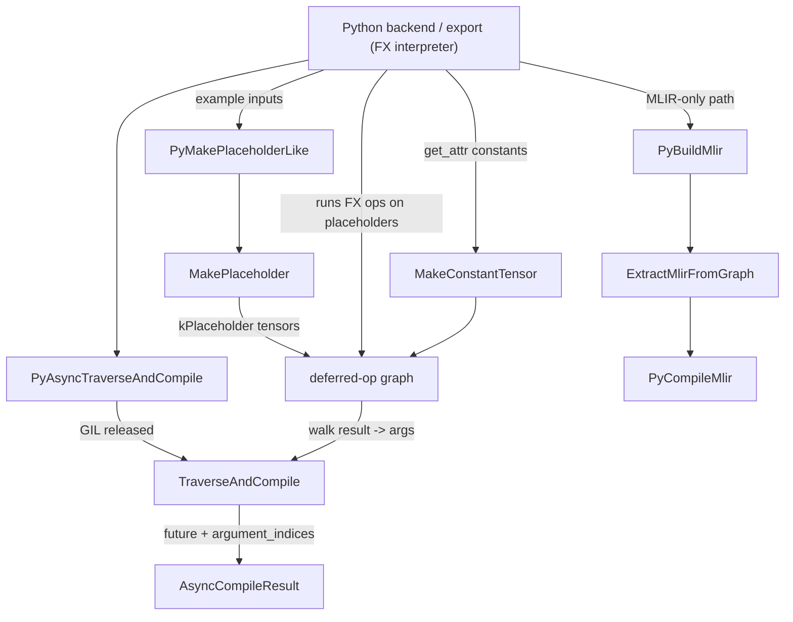
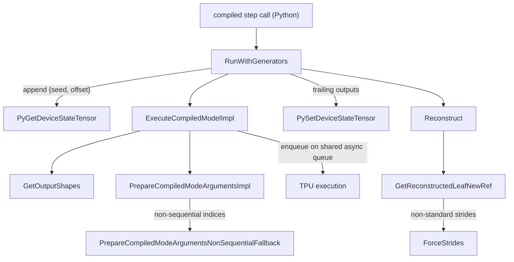

# Compiled mode - the C++ core of torch.compile on TorchTPU

## Overview

"Compiled mode" is the authors' name (header comment of `compiled_mode.h`: "The core functions
used for Dynamo compiled mode") for the C++ half of TorchTPU's `torch.compile` backend, exposed to
Python as the `tpu_torch_compile` extension module. Its single key idea is that **there is no
separate FX-to-StableHLO lowering**: the FX graph is run, op by op, on *placeholder* tensors under
an internal eager mode, so every ATen op appends a node to the same deferred-op graph eager mode
builds; compiled mode then walks that graph backwards from the result tensors to the placeholders
([`TraverseAndCompile`](../catalog/csrc/internal/compile/compiled_mode.cc.md#TraverseAndCompile "csrc/internal/compile/compiled_mode.cc:L357")),
emits one StableHLO module and hands it to XLA as one PJRT executable. Every op lowering, layout
rule and Pallas custom call that works in eager therefore works identically under
`torch.compile`. The rest of the subsystem exists to make that cheap at runtime: arguments are
deduplicated to unique base buffers at compile time and materialized only when needed at run time
([`PrepareCompiledModeArgumentsImpl`](../catalog/csrc/internal/compile/compiled_mode.cc.md#PrepareCompiledModeArgumentsImpl "csrc/internal/compile/compiled_mode.cc:L211")),
outputs are rebuilt into the FX output pytree in C++
([`Reconstruct`](../catalog/csrc/internal/compile/tpu_torch_compile.cc.md#FxOutputReconstructor.Reconstruct "csrc/internal/compile/tpu_torch_compile.cc:L1598")),
RNG generator state rides along as extra executable inputs/outputs
([`RunWithGenerators`](../catalog/csrc/internal/compile/tpu_torch_compile.cc.md#CompiledExecutableRunner.RunWithGenerators "csrc/internal/compile/tpu_torch_compile.cc:L1956")),
and the `scan` / `associative_scan` higher-order ops become a single deferred custom op whose
lowering emits a `stablehlo.while` or a native `chlo.scan`
([`PyCreateScanOp`](../catalog/csrc/internal/compile/dispatch_scan.cc.md#PyCreateScanOp "csrc/internal/compile/dispatch_scan.cc:L984"),
[`PyCreateAssociativeScanOp`](../catalog/csrc/internal/compile/dispatch_scan.cc.md#PyCreateAssociativeScanOp "csrc/internal/compile/dispatch_scan.cc:L1124")).

For the TPU-performance lens, the levers that live here are: one executable per FX graph (fusion
scope = the whole graph), argument donation and deduplication, forced argument layouts, the
`fast_compile` vs fast-runtime compiler profile, non-blocking compilation with the GIL released,
the per-step host overhead of the execute path, and the scan lowering tier (one `chlo.scan`
kernel vs slice + loop + concatenate).

## Diagram

Compile time (FX graph -> executable):

Legend:
- `PYB` - (concept) the Python `torch.compile` backend / `export` layer that drives this module
- `PHL` - [`PyMakePlaceholderLike`](../catalog/csrc/internal/compile/tpu_torch_compile.cc.md#PyMakePlaceholderLike "csrc/internal/compile/tpu_torch_compile.cc:L186")
- `MP` - [`MakePlaceholder`](../catalog/csrc/internal/compile/compiled_mode.cc.md#MakePlaceholder "csrc/internal/compile/compiled_mode.cc:L263")
- `DG` - (concept) the eager deferred-op graph of device-buffer nodes
- `MCT` - [`MakeConstantTensor`](../catalog/csrc/internal/compile/compiled_mode.cc.md#MakeConstantTensor "csrc/internal/compile/compiled_mode.cc:L705")
- `PATC` - [`PyAsyncTraverseAndCompile`](../catalog/csrc/internal/compile/tpu_torch_compile.cc.md#PyAsyncTraverseAndCompile "csrc/internal/compile/tpu_torch_compile.cc:L623")
- `TAC` - [`TraverseAndCompile`](../catalog/csrc/internal/compile/compiled_mode.cc.md#TraverseAndCompile "csrc/internal/compile/compiled_mode.cc:L357")
- `ACR` - [`AsyncCompileResult`](../catalog/csrc/internal/compile/compiled_mode.h.md#AsyncCompileResult "csrc/internal/compile/compiled_mode.h:L101")
- `PBM` - [`PyBuildMlir`](../catalog/csrc/internal/compile/tpu_torch_compile.cc.md#PyBuildMlir "csrc/internal/compile/tpu_torch_compile.cc:L334")
- `EMG` - [`ExtractMlirFromGraph`](../catalog/csrc/internal/compile/compiled_mode.cc.md#ExtractMlirFromGraph "csrc/internal/compile/compiled_mode.cc:L299")
- `PCM` - [`PyCompileMlir`](../catalog/csrc/internal/compile/tpu_torch_compile.cc.md#PyCompileMlir "csrc/internal/compile/tpu_torch_compile.cc:L450")

Run time (one compiled step with RNG state):

Legend:
- `STEP` - (concept) the per-step call into the pre-bound C++ runner
- `RWG` - [`RunWithGenerators`](../catalog/csrc/internal/compile/tpu_torch_compile.cc.md#CompiledExecutableRunner.RunWithGenerators "csrc/internal/compile/tpu_torch_compile.cc:L1956")
- `GDS` - [`PyGetDeviceStateTensor`](../catalog/csrc/internal/compile/tpu_torch_compile.cc.md#PyGetDeviceStateTensor "csrc/internal/compile/tpu_torch_compile.cc:L689")
- `ECM` - [`ExecuteCompiledModelImpl`](../catalog/csrc/internal/compile/compiled_mode.cc.md#ExecuteCompiledModelImpl "csrc/internal/compile/compiled_mode.cc:L650")
- `GOS` - [`GetOutputShapes`](../catalog/csrc/internal/compile/compiled_mode.cc.md#GetOutputShapes "csrc/internal/compile/compiled_mode.cc:L598")
- `PCA` - [`PrepareCompiledModeArgumentsImpl`](../catalog/csrc/internal/compile/compiled_mode.cc.md#PrepareCompiledModeArgumentsImpl "csrc/internal/compile/compiled_mode.cc:L211")
- `NSF` - [`PrepareCompiledModeArgumentsNonSequentialFallback`](../catalog/csrc/internal/compile/compiled_mode.cc.md#PrepareCompiledModeArgumentsNonSequentialFallback "csrc/internal/compile/compiled_mode.cc:L180")
- `TPU` - (concept) PJRT execution on the device stream
- `SDS` - [`PySetDeviceStateTensor`](../catalog/csrc/internal/compile/tpu_torch_compile.cc.md#PySetDeviceStateTensor "csrc/internal/compile/tpu_torch_compile.cc:L695")
- `REC` - [`Reconstruct`](../catalog/csrc/internal/compile/tpu_torch_compile.cc.md#FxOutputReconstructor.Reconstruct "csrc/internal/compile/tpu_torch_compile.cc:L1598")
- `GRL` - [`GetReconstructedLeafNewRef`](../catalog/csrc/internal/compile/tpu_torch_compile.cc.md#FxOutputReconstructor.GetReconstructedLeafNewRef "csrc/internal/compile/tpu_torch_compile.cc:L1679")
- `FS` - [`ForceStrides`](../catalog/csrc/internal/compile/tpu_torch_compile.cc.md#ForceStrides "csrc/internal/compile/tpu_torch_compile.cc:L1256")

## Design rationale (why it's built this way)

**Placeholders, not example inputs, are the graph arguments.** The docstring of
[`MakePlaceholder`](../catalog/csrc/internal/compile/compiled_mode.cc.md#MakePlaceholder "csrc/internal/compile/compiled_mode.cc:L263")
states the problem: "the example inputs provided by torch.compile might be views or have deferred
ops; this would change the shape of the deferred op graph even if the FX graph is the same,
creating inconsistency between PyTorch's expectations and PjRt's expectations." A placeholder is a
fresh contiguous tensor with its own unshared storage and a `kPlaceholder` buffer, so "the traced
graph will depend only on the shape and dtype of the example inputs" - which is also all a
`PjRtBuffer` carries (no strides, offsets or storage size). This is what makes the traced module
reusable across calls and cacheable. When the example input is itself a view,
[`PyMakePlaceholderLike`](../catalog/csrc/internal/compile/tpu_torch_compile.cc.md#PyMakePlaceholderLike "csrc/internal/compile/tpu_torch_compile.cc:L186")
allocates the *minimal* contiguous base that backs the view and re-applies `as_strided` on top, so
the view arithmetic becomes part of the compiled graph. Its comment and the runtime twin
[`PrepareCompiledModeArgumentsImpl`](../catalog/csrc/internal/compile/compiled_mode.cc.md#PrepareCompiledModeArgumentsImpl "csrc/internal/compile/compiled_mode.cc:L103")
both carry a "must match" note: the runtime must feed exactly the base buffer shape the trace
assumed.

**Deduplicate arguments to unique base buffers.** Two FX inputs that are the same tensor, or views
of one storage, would otherwise become two XLA parameters aliasing one buffer.
[`TraverseAndCompile`](../catalog/csrc/internal/compile/compiled_mode.cc.md#TraverseAndCompile "csrc/internal/compile/compiled_mode.cc:L357")
collapses them to `K <= N` unique base buffers (a linear scan, "as `argument_tensors` is expected
to have few elements (<100)"), records `argument_indices` so the runtime can dedupe call-site
arguments in the same order, remaps `donated_inputs` onto the unique bases, and maps forced layouts
only from arguments that cover the whole base buffer (slices/transposes describe the view, not the
buffer; conflicting requests drop the layout with a warning). Donation and layout forcing - two
real HBM/step-time levers - would silently misfire without this remapping.

**Compile asynchronously and off the GIL.** `PyCompileMlir` notes "PJRT compilation can take
minutes"; both it and
[`PyAsyncTraverseAndCompile`](../catalog/csrc/internal/compile/tpu_torch_compile.cc.md#PyAsyncTraverseAndCompile "csrc/internal/compile/tpu_torch_compile.cc:L623")
capture the Python traceback first (needed for readable MLIR module names), then release the GIL
"across traversal, MLIR lowering, and the cache query so multiple Python threads can lower and
enqueue compilations in parallel".
[`AsyncCompileResult`](../catalog/csrc/internal/compile/compiled_mode.h.md#AsyncCompileResult "csrc/internal/compile/compiled_mode.h:L101")
wraps the compilation future; its `Get()` applies the dedup indices exactly once behind a
`call_once`, described in the source as "a poor-man's solution" for the missing continuation
chaining on `std::shared_future`.

**Bugs crash, user errors return.** `TraverseAndCompile` treats an empty result list, an argument
with pending deferred ops, or an already-materializing result as compile-backend bugs
(`CRASH_OK`), while the MLIR-only
[`ExtractMlirFromGraph`](../catalog/csrc/internal/compile/compiled_mode.cc.md#ExtractMlirFromGraph "csrc/internal/compile/compiled_mode.cc:L299")
returns the same conditions as a status. Arguments must be placeholders or already-materialized
buffers by contract.

**Keep the per-step path in C++.** The source documents a pre-bound runner that "caches the
unpacked C++ executable, output shapes, and FxOutputReconstructor pointer to bypass per-step
pybind11 type-registry hash table lookups and Python dispatch overhead". Inputs are unpacked as raw
`const at::Tensor*` because copying tensors "incurs 200+ atomic increment/decrement operations on
the hot path" for a 100-parameter model;
[`Reconstruct`](../catalog/csrc/internal/compile/tpu_torch_compile.cc.md#FxOutputReconstructor.Reconstruct "csrc/internal/compile/tpu_torch_compile.cc:L1598")
builds flat tuples/lists with direct CPython calls instead of pytree unflattening; generator locks
take an uncontended `try_lock` without dropping the GIL because a GIL round-trip "costs
~150-300ns". These matter for small, launch-bound steps (decode, small models) where host overhead
can rival device time.

**Scan is one deferred op, and its body is text.** Both scan bindings serialize the body MLIR
module to a string "to act as a cache key and to pass across different `MLIRContext`s", then
register one `kCustomKernel` deferred op whose builder re-parses the text into the lowering
context. For associative scans the lowering picks the cheapest legal tier; the source spells out
why an inferred identity matters: it lets `chlo.scan` "run ... directly over the full `seq_len`
input tensor in a single kernel (avoiding the Tier 2 `stablehlo.slice` + `(seq_len - 1)` scan +
`stablehlo.concatenate` HBM copy overhead and keeping `seq_len` aligned to powers of two / TPU
tile multiples)".

## Entry points

- [`TorchTpuPyBindInitModule_tpu_torch_compile`](../catalog/csrc/internal/compile/tpu_torch_compile.cc.md#TorchTpuPyBindInitModule_tpu_torch_compile "csrc/internal/compile/tpu_torch_compile.cc:L2014") - the module initializer that publishes every entry below to Python under `torch_tpu._internal.compile.tpu_torch_compile` (`placeholder`, `placeholder_like`, `dynamic_placeholder`, `traverse_and_compile`, `async_traverse_and_compile`, `build_mlir`, `compile_mlir`, `parse_mlir_text`, `execute`, `make_compiled_runner`, pad/slice module helpers, `create_scan_op`, `create_associative_scan_op`, `get/set_device_state_tensor`, `force_strides`, constant-tensor helpers). Reached on extension import.
- [`PyMakePlaceholderLike`](../catalog/csrc/internal/compile/tpu_torch_compile.cc.md#PyMakePlaceholderLike "csrc/internal/compile/tpu_torch_compile.cc:L186"), [`PyMakePlaceholder`](../catalog/csrc/internal/compile/tpu_torch_compile.cc.md#PyMakePlaceholder "csrc/internal/compile/tpu_torch_compile.cc:L155") and [`PyMakeDynamicPlaceholder`](../catalog/csrc/internal/compile/tpu_torch_compile.cc.md#PyMakeDynamicPlaceholder "csrc/internal/compile/tpu_torch_compile.cc:L165") - called by the Python compiler/export layer for every FX input before tracing (and by the scan frontend for body arguments), producing the graph's argument tensors.
- [`PyAsyncTraverseAndCompile`](../catalog/csrc/internal/compile/tpu_torch_compile.cc.md#PyAsyncTraverseAndCompile "csrc/internal/compile/tpu_torch_compile.cc:L623") - called once per FX graph after it has been run on placeholders; the synchronous `traverse_and_compile` binding wraps it and blocks on the future.
- [`PyBuildMlir`](../catalog/csrc/internal/compile/tpu_torch_compile.cc.md#PyBuildMlir "csrc/internal/compile/tpu_torch_compile.cc:L334") / [`ExtractMlirFromGraph`](../catalog/csrc/internal/compile/compiled_mode.cc.md#ExtractMlirFromGraph "csrc/internal/compile/compiled_mode.cc:L299") and [`PyCompileMlir`](../catalog/csrc/internal/compile/tpu_torch_compile.cc.md#PyCompileMlir "csrc/internal/compile/tpu_torch_compile.cc:L450") - the split MLIR-only path: get a verified module without compiling (used, e.g., to build a scan combine body), and compile a module separately. [`PyParseMlirText`](../catalog/csrc/internal/compile/tpu_torch_compile.cc.md#PyParseMlirText "csrc/internal/compile/tpu_torch_compile.cc:L357") feeds hand-written or round-tripped MLIR text into the same path.
- [`RunWithGenerators`](../catalog/csrc/internal/compile/tpu_torch_compile.cc.md#CompiledExecutableRunner.RunWithGenerators "csrc/internal/compile/tpu_torch_compile.cc:L1956") over [`ExecuteCompiledModelImpl`](../catalog/csrc/internal/compile/compiled_mode.cc.md#ExecuteCompiledModelImpl "csrc/internal/compile/compiled_mode.cc:L650") - every compiled step; the RNG-free path goes straight to the execute impl, the RNG path goes through generator locking first.
- [`PyCreateScanOp`](../catalog/csrc/internal/compile/dispatch_scan.cc.md#PyCreateScanOp "csrc/internal/compile/dispatch_scan.cc:L984") and [`PyCreateAssociativeScanOp`](../catalog/csrc/internal/compile/dispatch_scan.cc.md#PyCreateAssociativeScanOp "csrc/internal/compile/dispatch_scan.cc:L1124") - reached when the `scan` / `associative_scan` higher-order ops are traced by `torch.compile` (and on the eager fallback of `associative_scan`).
- [`PyGetDeviceStateTensor`](../catalog/csrc/internal/compile/tpu_torch_compile.cc.md#PyGetDeviceStateTensor "csrc/internal/compile/tpu_torch_compile.cc:L689") / [`PySetDeviceStateTensor`](../catalog/csrc/internal/compile/tpu_torch_compile.cc.md#PySetDeviceStateTensor "csrc/internal/compile/tpu_torch_compile.cc:L695") - read/write a device generator's `{seed, offset}` tensor; used at export time to plumb RNG state into the graph and at run time to feed and persist it.
- [`PyGetOrCompilePadModule`](../catalog/csrc/internal/compile/tpu_torch_compile.cc.md#PyGetOrCompilePadModule "csrc/internal/compile/tpu_torch_compile.cc:L982"), [`PyPrecompilePadModule`](../catalog/csrc/internal/compile/tpu_torch_compile.cc.md#PyPrecompilePadModule "csrc/internal/compile/tpu_torch_compile.cc:L926"), [`PyGetDynamicPadModule`](../catalog/csrc/internal/compile/tpu_torch_compile.cc.md#PyGetDynamicPadModule "csrc/internal/compile/tpu_torch_compile.cc:L1044"), [`PyGetOrCompileSliceModule`](../catalog/csrc/internal/compile/tpu_torch_compile.cc.md#PyGetOrCompileSliceModule "csrc/internal/compile/tpu_torch_compile.cc:L1144"), [`PyPrecompileSliceModule`](../catalog/csrc/internal/compile/tpu_torch_compile.cc.md#PyPrecompileSliceModule "csrc/internal/compile/tpu_torch_compile.cc:L1083") - small standalone pad / slice executables used by the bucketed dynamic-shape compiler to pad inputs up to a bucket bound and slice outputs back.
- [`MakeConstantTensor`](../catalog/csrc/internal/compile/compiled_mode.cc.md#MakeConstantTensor "csrc/internal/compile/compiled_mode.cc:L705") / [`AssignConstantTensor`](../catalog/csrc/internal/compile/compiled_mode.cc.md#AssignConstantTensor "csrc/internal/compile/compiled_mode.cc:L741") - turn a CPU tensor into a constant deferred op so FX `get_attr` constants embed as StableHLO constants rather than runtime inputs.

## Mechanism (step-by-step)

1. **Make placeholder arguments.** For each FX input the Python layer calls
   [`PyMakePlaceholderLike`](../catalog/csrc/internal/compile/tpu_torch_compile.cc.md#PyMakePlaceholderLike "csrc/internal/compile/tpu_torch_compile.cc:L186"),
   which computes the smallest contiguous base shape behind the (possibly strided) example input,
   creates it with
   [`MakePlaceholder`](../catalog/csrc/internal/compile/compiled_mode.cc.md#MakePlaceholder "csrc/internal/compile/compiled_mode.cc:L263")
   and re-applies the original sizes/strides/offset with `as_strided` unless the input already has
   a trivial layout. Pinned-host inputs stay pinned-host placeholders (host-offload graphs). Two
   quirks live in the placeholder constructors: `float4_e2m1fn_x2` doubles the last physical
   dimension (two values per byte), and
   [`PyMakeDynamicPlaceholder`](../catalog/csrc/internal/compile/tpu_torch_compile.cc.md#PyMakeDynamicPlaceholder "csrc/internal/compile/tpu_torch_compile.cc:L165")
   marks each dynamic dimension with a hard-coded lower bound of 2 and the caller's upper bound via
   the second [`MakePlaceholder`](../catalog/csrc/internal/compile/compiled_mode.cc.md#MakePlaceholder "csrc/internal/compile/compiled_mode.cc:L284")
   overload, which is what later yields bounded-dynamic StableHLO types.

2. **Trace by running the graph eagerly-but-deferred.** The FX graph is interpreted on those
   placeholders inside an internal eager mode, so each ATen kernel appends a deferred node instead
   of executing. Constant attributes have already been swapped (by the FX pass that marks embedded
   constants) for tensors made by
   [`MakeConstantTensor`](../catalog/csrc/internal/compile/compiled_mode.cc.md#MakeConstantTensor "csrc/internal/compile/compiled_mode.cc:L705"),
   which memcpys the CPU bytes into a constant deferred op ("so that dropping the tensor does not
   invalidate the DeferredOp"); in the MLIR they become literal constants XLA can fold. When the
   graph consumes RNG, the export layer swaps in an export-mode generator whose state tensor is
   itself a placeholder, reads the final state with
   [`PyGetDeviceStateTensor`](../catalog/csrc/internal/compile/tpu_torch_compile.cc.md#PyGetDeviceStateTensor "csrc/internal/compile/tpu_torch_compile.cc:L689")
   and appends it as the last result, so RNG advancement is an explicit graph output.

3. **Traverse, dedupe and compile.**
   [`PyAsyncTraverseAndCompile`](../catalog/csrc/internal/compile/tpu_torch_compile.cc.md#PyAsyncTraverseAndCompile "csrc/internal/compile/tpu_torch_compile.cc:L623")
   converts Python options (layouts parsed by
   [`ParseCustomLayout`](../catalog/csrc/internal/compile/tpu_torch_compile.cc.md#ParseCustomLayout "csrc/internal/compile/tpu_torch_compile.cc:L556")
   from `(minor_to_major, tiles, element_size_in_bits)` tuples or legacy lists, donated indices,
   module name, `fast_compile`), captures the Python context, releases the GIL and calls
   [`TraverseAndCompile`](../catalog/csrc/internal/compile/compiled_mode.cc.md#TraverseAndCompile "csrc/internal/compile/compiled_mode.cc:L357").
   That function resolves every argument to its base buffer, dedupes them, builds a traversal from
   the result buffers, sorts it by creation order, validates/reorders the arguments against the
   traversal's leaves, remaps donation and layouts onto the unique bases, and compiles with the
   compilation spec for the chosen mode (`kFastRuntime` by default; `fast_compile=True` selects
   `kFastCompile`, the eager-oriented profile). The traversal's compile goes through the
   compilation cache, so an identical graph hits a cached executable; the call returns
   immediately with an
   [`AsyncCompileResult`](../catalog/csrc/internal/compile/compiled_mode.h.md#AsyncCompileResult "csrc/internal/compile/compiled_mode.h:L101")
   holding the future, the optional MLIR module (only when `build_mlir_module` is requested, e.g.
   for debug dumps) and the dedup indices.

4. **MLIR-only path.**
   [`PyBuildMlir`](../catalog/csrc/internal/compile/tpu_torch_compile.cc.md#PyBuildMlir "csrc/internal/compile/tpu_torch_compile.cc:L334")
   runs
   [`ExtractMlirFromGraph`](../catalog/csrc/internal/compile/compiled_mode.cc.md#ExtractMlirFromGraph "csrc/internal/compile/compiled_mode.cc:L299")
   inside a fresh MLIR context (under an artificial `kCompileMlir` Python context so dumped
   modules are distinguishable from eager ones), verifies the result and returns it without
   compiling.
   [`PyCompileMlir`](../catalog/csrc/internal/compile/tpu_torch_compile.cc.md#PyCompileMlir "csrc/internal/compile/tpu_torch_compile.cc:L450")
   compiles any such module: it applies per-argument `minor_to_major` layouts to the `main`
   signature, and - a TPU-specific special case - when the module contains SparseCore custom calls
   (`SparseDenseMatmul`, `SparseGather`, `SparseMapRow`, `CooToCsr`) but no SPMD sharding
   annotations on a multi-device host, forces replicated compilation (`num_replicas = devices`,
   `num_partitions = 1`) "to prevent SPMD partitioning compilation hangs and failures for
   table-parallel asymmetric graphs". It then releases the GIL for the PJRT compile.

5. **Prepare arguments at run time.**
   [`ExecuteCompiledModelImpl`](../catalog/csrc/internal/compile/compiled_mode.cc.md#ExecuteCompiledModelImpl "csrc/internal/compile/compiled_mode.cc:L650")
   borrows the executable's precomputed output shapes for static graphs (no per-step vector copy)
   or validates caller overrides with
   [`GetOutputShapes`](../catalog/csrc/internal/compile/compiled_mode.cc.md#GetOutputShapes "csrc/internal/compile/compiled_mode.cc:L598")
   for dynamic outputs (each override dimension must not exceed the compiled bound). It then calls
   [`PrepareCompiledModeArgumentsImpl`](../catalog/csrc/internal/compile/compiled_mode.cc.md#PrepareCompiledModeArgumentsImpl "csrc/internal/compile/compiled_mode.cc:L211"):
   with dedup indices it fetches each unique base buffer once in a single pass (falling back to
   [`PrepareCompiledModeArgumentsNonSequentialFallback`](../catalog/csrc/internal/compile/compiled_mode.cc.md#PrepareCompiledModeArgumentsNonSequentialFallback "csrc/internal/compile/compiled_mode.cc:L180")
   if indices are not first-appearance ordered); without them
   [`PrepareCompiledModeArgumentsImpl`](../catalog/csrc/internal/compile/compiled_mode.cc.md#PrepareCompiledModeArgumentsImpl "csrc/internal/compile/compiled_mode.cc:L103")
   uses the buffer directly for trivially laid-out tensors and otherwise restricts a view's base to
   the minimal contiguous block via `as_strided`. Only if some argument is still deferred or a
   placeholder does it ask the eager materializer to run them (split-graph mode, block until *started*, not finished).
   In steady state - parameters and outputs of previous compiled steps - nothing is deferred and
   the materialization call is skipped entirely. The executable is then enqueued on the async queue
   shared with eager execution and fresh output tensors are wrapped around the result buffers.

6. **Thread RNG state through the step.**
   [`RunWithGenerators`](../catalog/csrc/internal/compile/tpu_torch_compile.cc.md#CompiledExecutableRunner.RunWithGenerators "csrc/internal/compile/tpu_torch_compile.cc:L1956")
   locks every participating device generator (sorted, deduplicated mutexes), appends each one's
   [`PyGetDeviceStateTensor`](../catalog/csrc/internal/compile/tpu_torch_compile.cc.md#PyGetDeviceStateTensor "csrc/internal/compile/tpu_torch_compile.cc:L689")
   tensor as a trailing argument, adds a static `{2}` output shape per generator when output shapes
   are overridden, executes, and writes the trailing outputs back with
   [`PySetDeviceStateTensor`](../catalog/csrc/internal/compile/tpu_torch_compile.cc.md#PySetDeviceStateTensor "csrc/internal/compile/tpu_torch_compile.cc:L695")
   before releasing the locks - so get-state, execute and set-state are atomic per generator.
   Graphs with no generator arguments skip the locking entirely.

7. **Rebuild the FX output structure.**
   [`Reconstruct`](../catalog/csrc/internal/compile/tpu_torch_compile.cc.md#FxOutputReconstructor.Reconstruct "csrc/internal/compile/tpu_torch_compile.cc:L1598")
   maps the executable's deduplicated outputs back to the FX output pytree using a schema cached
   at compile time: each leaf is a deduped tensor, a non-tensor input passthrough, or `None`;
   repeated tensor leaves are cloned, single-use ones are moved.
   [`InitExpectedLayouts`](../catalog/csrc/internal/compile/tpu_torch_compile.cc.md#FxOutputReconstructor.InitExpectedLayouts "csrc/internal/compile/tpu_torch_compile.cc:L1538")
   precomputes which outputs need a stride check: fresh PJRT buffers are always standard
   contiguous, so only outputs whose FX metadata demands non-standard strides are checked.
   [`GetReconstructedLeafNewRef`](../catalog/csrc/internal/compile/tpu_torch_compile.cc.md#FxOutputReconstructor.GetReconstructedLeafNewRef "csrc/internal/compile/tpu_torch_compile.cc:L1679")
   fixes a mismatch by rewriting stride metadata in place when the layout is physically contiguous
   (size-1 dims only), else via
   [`ForceStrides`](../catalog/csrc/internal/compile/tpu_torch_compile.cc.md#ForceStrides "csrc/internal/compile/tpu_torch_compile.cc:L1256"),
   which has the same metadata-only fast path and otherwise emits a contiguous-to-view deferred op
   (a real device copy, tagged `kForceStrides` in profiles).

8. **Lower `scan` to a while loop.**
   [`PyCreateScanOp`](../catalog/csrc/internal/compile/dispatch_scan.cc.md#PyCreateScanOp "csrc/internal/compile/dispatch_scan.cc:L984")
   validates the step-function module (`(*carries, *scan_inputs, *additional_inputs) ->
   (*next_carries, *outputs)`), serializes it, collects carry and input buffers with
   `GetInputBuffers`,
   derives output shapes (carries keep their shape, stacked outputs come from the caller's dummy
   `ys`) with
   [`GetOutputShapes`](../catalog/csrc/internal/compile/dispatch_scan.cc.md#GetOutputShapes "csrc/internal/compile/dispatch_scan.cc:L99"),
   and registers one `kCustomKernel` deferred op keyed by the body text, direction, number of
   scanned inputs and carries. Its builder re-parses the body, imports any private helper
   functions the body calls, zero-initializes the stacked-output accumulators and builds a
   `stablehlo.while` along dim 0 by cloning the body into the loop region. Because the body is
   compiled once regardless of trip count, a layer stack expressed as `scan` costs one body worth
   of HLO - the scan-over-layers compile-time win - and a reverse annotation on the body turns a
   reverse scan into a reverse loop instead of two full flips.

9. **Lower `associative_scan` to the cheapest legal tier.**
   [`PyCreateAssociativeScanOp`](../catalog/csrc/internal/compile/dispatch_scan.cc.md#PyCreateAssociativeScanOp "csrc/internal/compile/dispatch_scan.cc:L1124")
   first checks whether every scanned input is a `movedim(base, d, 0)` view (the shape PyTorch's
   frontend produces to normalize `dim` to 0); if so it scans the contiguous base buffers along
   `d` and stamps the view metadata on the outputs, eliding a `stablehlo.transpose` before and
   after the scan. The deferred op's builder runs
   [`BuildAssociativeScan`](../catalog/csrc/internal/compile/dispatch_scan.cc.md#BuildAssociativeScan "csrc/internal/compile/dispatch_scan.cc:L920"):
   `seq_len <= 1` short-circuits to identity; if the combine body is a pure elementwise StableHLO
   combiner over uniformly shaped static non-complex inputs with no extra inputs, it tries to infer
   a two-sided identity by symbolic evaluation over
   [`SymVal`](../catalog/csrc/internal/compile/dispatch_scan.cc.md#SymVal "csrc/internal/compile/dispatch_scan.cc:L358")
   (exhaustively for up to 4 scanned tensors, 4^k candidates of zero / one / -inf / +inf, checked
   on both sides so `x - 0` is rejected while the Mamba/SSM pair `(a_l * a_r, a_r * b_l + b_r)`
   with identity `(1, 0)` is accepted). Tier 1,
   `EmitIdentityInitChloScan`,
   emits one `chlo.scan(is_associative=true)` over the whole sequence with the identity as the
   initial carry, letting XLA's TPU scan emitter vectorize it. Otherwise Tier 2,
   [`EmitSliceInitScan`](../catalog/csrc/internal/compile/dispatch_scan.cc.md#EmitSliceInitScan "csrc/internal/compile/dispatch_scan.cc:L869"),
   slices off the first (or last, for reverse) element as the carry, scans the remaining
   `seq_len - 1` elements (still with `chlo.scan` when the body qualifies, else `stablehlo.while`)
   and concatenates the slice back - correct for any associative combiner, but paying slice and
   concatenate copies.

10. **Dynamic-shape pad and slice executables.**
    [`MakePadDynamicShapes`](../catalog/csrc/internal/compile/tpu_torch_compile.cc.md#MakePadDynamicShapes "csrc/internal/compile/tpu_torch_compile.cc:L730")
    turns `(shape, dtype)` plus `(dynamic_dims, upper_bounds)` into bounded shapes (lower bound
    2, upper bound must be >= the current size);
    [`PyGetOrCompilePadModule`](../catalog/csrc/internal/compile/tpu_torch_compile.cc.md#PyGetOrCompilePadModule "csrc/internal/compile/tpu_torch_compile.cc:L982")
    and
    [`PyGetOrCompileSliceModule`](../catalog/csrc/internal/compile/tpu_torch_compile.cc.md#PyGetOrCompileSliceModule "csrc/internal/compile/tpu_torch_compile.cc:L1144")
    (inputs unpacked and checked by
    [`UnpackSliceInputs`](../catalog/csrc/internal/compile/tpu_torch_compile.cc.md#UnpackSliceInputs "csrc/internal/compile/tpu_torch_compile.cc:L808"))
    build tiny `stablehlo.pad` / `stablehlo.slice` modules and route them through
    [`CompileModuleWithCache`](../catalog/csrc/internal/compile/tpu_torch_compile.cc.md#CompileModuleWithCache "csrc/internal/compile/tpu_torch_compile.cc:L868"),
    which consults the global compilation cache unless caching is disabled. The `Precompile`
    variants
    ([`PyPrecompilePadModule`](../catalog/csrc/internal/compile/tpu_torch_compile.cc.md#PyPrecompilePadModule "csrc/internal/compile/tpu_torch_compile.cc:L926"),
    [`PyPrecompileSliceModule`](../catalog/csrc/internal/compile/tpu_torch_compile.cc.md#PyPrecompileSliceModule "csrc/internal/compile/tpu_torch_compile.cc:L1083"))
    issue the same cache request without waiting on the result, warming the cache for a bucket
    ahead of first use;
    [`PyGetDynamicPadModule`](../catalog/csrc/internal/compile/tpu_torch_compile.cc.md#PyGetDynamicPadModule "csrc/internal/compile/tpu_torch_compile.cc:L1044")
    compiles a pad that also re-marks the padded dimension dynamic via
    `get_dimension_size`/`set_dimension_size`, bypassing the cache.

## Key data structures

- **Placeholder tensor** - an `at::Tensor` over a fresh `kPlaceholder` device buffer
  ([`MakePlaceholder`](../catalog/csrc/internal/compile/compiled_mode.cc.md#MakePlaceholder "csrc/internal/compile/compiled_mode.cc:L263")).
  It has shape, dtype, optional bounded-dynamic dims and pinned-host flag, but no data; it marks
  where the compiled graph's parameters are.
- **[`AsyncCompileResult`](../catalog/csrc/internal/compile/compiled_mode.h.md#AsyncCompileResult "csrc/internal/compile/compiled_mode.h:L101")**
  - optional MLIR module, the shared future for the executable, and `argument_indices` (caller
  position -> unique base index; empty when no two arguments alias). `IsReady()` never blocks;
  `Get()` blocks once and caches the resolved executable with the indices attached.
- **Argument indices on the executable** - consumed by
  [`PrepareCompiledModeArgumentsImpl`](../catalog/csrc/internal/compile/compiled_mode.cc.md#PrepareCompiledModeArgumentsImpl "csrc/internal/compile/compiled_mode.cc:L211")
  every step to feed `K` unique base buffers for `N` caller arguments.
- **Output schema** - per-leaf entries (deduped tensor / input passthrough / None, plus clone,
  move and layout-check flags) and expected layouts (dtype, shape, stride, offset, dynamic flag)
  built by
  [`InitExpectedLayouts`](../catalog/csrc/internal/compile/tpu_torch_compile.cc.md#FxOutputReconstructor.InitExpectedLayouts "csrc/internal/compile/tpu_torch_compile.cc:L1538")
  and read by
  [`Reconstruct`](../catalog/csrc/internal/compile/tpu_torch_compile.cc.md#FxOutputReconstructor.Reconstruct "csrc/internal/compile/tpu_torch_compile.cc:L1598").
  The schema is picklable, so it survives serialized compiled-artifact caching.
- **Device state tensor** - a generator's `{seed, offset}` tensor
  ([`PyGetDeviceStateTensor`](../catalog/csrc/internal/compile/tpu_torch_compile.cc.md#PyGetDeviceStateTensor "csrc/internal/compile/tpu_torch_compile.cc:L689")),
  shape `{2}`; the compiled graph takes it as its last input(s) and returns the advanced state as
  its last output(s).
- **[`SymVal`](../catalog/csrc/internal/compile/dispatch_scan.cc.md#SymVal "csrc/internal/compile/dispatch_scan.cc:L358")**
  - the tiny symbolic domain (constant, variable, -inf, +inf, unknown) used only to prove an
  identity element for associative scans.

## Dynamics (design intent)

- **Thread safety.** The header documents
  [`TraverseAndCompile`](../catalog/csrc/internal/compile/compiled_mode.cc.md#TraverseAndCompile "csrc/internal/compile/compiled_mode.cc:L357")
  as "Thread-compatible, not thread-safe": concurrent calls on disjoint graphs are safe, but the
  traversal "is a sequence of individually safe reads", so the caller must keep the reachable
  subgraph quiescent (no concurrent materialization) for the duration. It is pure C++ and never
  touches the GIL; the Python binding releases it.
- **Compilation overlaps Python work.** `async_traverse_and_compile` returns before XLA finishes;
  the Python static compiler can also submit the whole compile to a background executor. Multiple
  graphs (e.g. forward and backward, or split submodules) can therefore lower and compile
  concurrently.
- **Execution is asynchronous.** Per the header of the execute entry point, compiled executions
  are added to "an async background queue (which is shared with eager execution)", so a later
  `.cpu()` may block while the host keeps enqueueing steps. Argument materialization blocks only
  until the producers have *started*.
- **Generator locking order.** Mutexes are sorted by address and deduplicated to prevent AB-BA and
  self-deadlock; the GIL is released before any blocking lock to avoid GIL/mutex inversion.
- **Scan tiers are test-pinned.** `dispatch_scan_test.cc` exercises identity inference emitting
  `chlo.scan`, the Mamba/SSM tuple identity, the slice-init fallback, the while fallback when the
  body has constants or extra inputs, movedim unwrapping, bitwise-AND using slice-init, the
  `seq_len == 1` short-circuit, reverse scans, imported step-function callees and the cache keys.

## Edge cases

- **Arguments with pending deferred ops crash `TraverseAndCompile`.** Placeholders or
  materialized buffers only; a view argument is resolved to its base buffer first precisely
  because "view tensors will always have deferred ops".
- **Layouts on aliased arguments.** With duplicate/aliased arguments, a forced layout is honored
  only from an argument that covers the whole base (same sizes, contiguous, zero offset); two
  conflicting requests for one base drop the layout with a warning.
- **Dynamic output overrides** must give either all outputs or none, match rank, and never exceed
  the compiled bound
  ([`GetOutputShapes`](../catalog/csrc/internal/compile/compiled_mode.cc.md#GetOutputShapes "csrc/internal/compile/compiled_mode.cc:L598")).
- **`chlo.scan` bodies may not contain constants.** `chlo.scan` is not `IsolatedFromAbove`, so
  canonicalization would hoist a body constant out and the later outlining would fail
  verification; such bodies (and bodies with additional inputs, complex dtypes, non-uniform or
  dynamic shapes) fall back to Tier 2 / `stablehlo.while`.
- **Identity inference stops at 4 scanned tensors**; wider tuples always use slice-init.
- **SparseCore replicated mode** is only forced when no sharding annotation is present and the
  host has more than one device; an SPMD-annotated SparseCore graph compiles normally.
- **`ForceStrides` can cost a copy.** An FX output that expects a transposed / non-contiguous
  layout is materialized through a contiguous-to-view copy on every step unless the difference is only
  along size-1 dimensions.

## Open questions

- `CompiledExecutableRunner` (its `RunFast` entry), `FxOutputReconstructor` (the class),
  `PyTraverseAndCompile`, `CompileMlirExecutable` and `ExecuteCompiledModel` are central to this
  subsystem but are not in the packet subgraph; the page cites their in-subgraph members or
  callees instead.
- `PyGetDynamicPadModule` always compiles fresh (no cache); whether callers memoize it is not
  visible from this subsystem.
- Every module built through the MLIR-context helper also runs TorchTPU's own MLIR optimization
  pipeline before XLA; how often that pipeline runs on a scan body (once when the body is built,
  again inside the enclosing module) is not settled by this code.

> [!inferred]
> The `fast_compile` flag selects `CompilationMode::kFastCompile`, documented in `PyCompileMlir`
> as "the compiler profile optimized for eager execution". For long-lived training/inference
> graphs the default fast-runtime profile is the one to keep; `fast_compile=True` trades step
> time for compile latency. The concrete XLA option differences live in the compilation-spec code,
> not here.

## See also

- [Compilation pipeline](compilation-pipeline.md) - how a traversal is lowered and compiled.
- [Compilation cache](compilation-cache.md) and [compilation cache keys](compilation-cache-key.md) - what `TraverseAndCompile` and the pad/slice helpers hit.
- [torch.compile backend](torch-compile-backend.md) - the Python side that drives this module.
- [Deferred execution and materialization](deferred-execution-and-materialization.md) - the deferred-op graph compiled mode traces into.
- [Dynamic-shapes compiler](dynamic-shapes-compiler.md) - the bucketed compiler that uses the pad/slice executables.
- [Device streams, generators and RNG](device-streams-generators-and-rng.md) - the generators whose state tensors are threaded through.
- [MLIR optimization passes](mlir-optimization-passes.md) - the pass pipeline run on every module built here.
- [FX graph passes](fx-graph-passes.md) - the FX rewrites applied before tracing.
