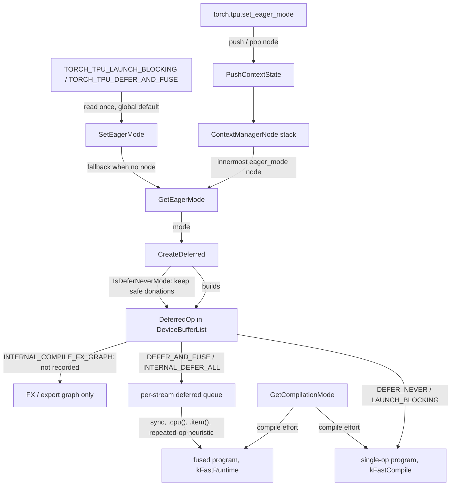
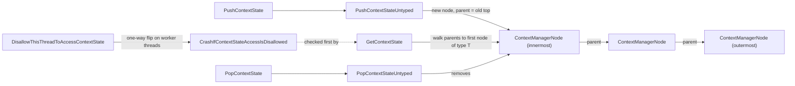

# Context states and eager execution modes (Strict / Fused / Debug eager)

## Overview
torch_tpu has exactly **one** op-dispatch path. Every TPU ATen kernel ends in [`CreateDeferred`](../catalog/csrc/eager/device_buffer.cc.md#DeviceBufferList.CreateDeferred "csrc/eager/device_buffer.cc:L357"), which builds a [`DeferredOp`](../catalog/csrc/eager/device_buffer.h.md#DeferredOp "csrc/eager/device_buffer.h:L383") (a StableHLO builder closure plus inputs and cache keys) inside a [`DeviceBufferList`](../catalog/csrc/eager/device_buffer.h.md#DeviceBufferList "csrc/eager/device_buffer.h:L529"). The **eager mode** ([`EagerMode`](../catalog/csrc/common/context_states.h.md#EagerMode "csrc/common/context_states.h:L35"), "The op defer mode") only decides what happens to that node *afterwards*: compile and launch it alone now (Strict eager, the default), leave it queued so many ops become one fused XLA program (Fused eager), launch it and block (Debug eager), or never put it on the device at all (`torch.compile` / `torch.export` tracing). The mode also picks the XLA compile effort ([`GetCompilationMode`](../catalog/csrc/eager/events_queue.cc.md#GetCompilationMode "csrc/eager/events_queue.cc:L1400")) and whether in-place ops may donate their input buffer.

The mode is one of seven **context states** that torch_tpu keeps in a persistent linked stack of [`ContextManagerNode`](../catalog/csrc/common/context_manager.h.md#ContextManagerNode "csrc/common/context_manager.h:L75")s on PyTorch's per-thread debug-info slot. Python context managers push and pop nodes; C++ reads the nearest node of the wanted type with [`GetContextState`](../catalog/csrc/common/context_manager.h.md#GetContextState "csrc/common/context_manager.h:L101") and falls back to a process-global default. Only the Python **dispatch thread** may touch the stack: compile, materialize and execute worker threads crash if they try, so every setting that matters to a compile is resolved on the dispatch thread and carried along explicitly.

## Diagram
What each mode does with a freshly built op (control flow on the dispatch thread).

Legend:
- `ENV` - (concept) environment variables, memoized at first use
- `SET` - [`SetEagerMode`](../catalog/csrc/eager/eager_mode.cc.md#SetEagerMode "csrc/eager/eager_mode.cc:L56")
- `PY` - [`EagerMode`](../catalog/src/torch_tpu/_internal/execution_mode/__init__.md#EagerMode "src/torch_tpu/_internal/execution_mode/__init__.py:L30") (the Python enum that `set_eager_mode` takes)
- `PUSH` - [`PushContextState`](../catalog/csrc/common/context_manager.h.md#PushContextState "csrc/common/context_manager.h:L153")
- `NODE` - [`ContextManagerNode`](../catalog/csrc/common/context_manager.h.md#ContextManagerNode "csrc/common/context_manager.h:L75")
- `GET` - [`GetEagerMode`](../catalog/csrc/eager/eager_mode.cc.md#GetEagerMode "csrc/eager/eager_mode.cc:L51")
- `CD` - [`CreateDeferred`](../catalog/csrc/eager/device_buffer.cc.md#DeviceBufferList.CreateDeferred "csrc/eager/device_buffer.cc:L357")
- `DOP` - [`DeferredOp`](../catalog/csrc/eager/device_buffer.h.md#DeferredOp "csrc/eager/device_buffer.h:L383")
- `ONE` - (concept) a one-op XLA program compiled and launched immediately
- `Q` - (concept) the per-stream deferred-op queue
- `FUSED` - (concept) one XLA program covering everything queued up to the trigger
- `FX` - (concept) symbolic FX / export graph, nothing runs on device
- `GCM` - [`GetCompilationMode`](../catalog/csrc/eager/events_queue.cc.md#GetCompilationMode "csrc/eager/events_queue.cc:L1400")

The context-state stack itself: a persistent list whose nodes each override one state type.

Legend:
- `PUSH` - [`PushContextState`](../catalog/csrc/common/context_manager.h.md#PushContextState "csrc/common/context_manager.h:L153")
- `PU` - [`PushContextStateUntyped`](../catalog/csrc/common/context_manager.cc.md#PushContextStateUntyped "csrc/common/context_manager.cc:L44")
- `N1` - [`ContextManagerNode`](../catalog/csrc/common/context_manager.h.md#ContextManagerNode.ContextManagerNode "csrc/common/context_manager.h:L78")
- `N2` - [`ContextManagerNode`](../catalog/csrc/common/context_manager.h.md#ContextManagerNode.ContextManagerNode "csrc/common/context_manager.h:L78")
- `N3` - [`ContextManagerNode`](../catalog/csrc/common/context_manager.h.md#ContextManagerNode.ContextManagerNode "csrc/common/context_manager.h:L78")
- `GCS` - [`GetContextState`](../catalog/csrc/common/context_manager.h.md#GetContextState "csrc/common/context_manager.h:L101")
- `POP` - [`PopContextState`](../catalog/csrc/common/context_manager.h.md#PopContextState "csrc/common/context_manager.h:L165")
- `PO` - [`PopContextStateUntyped`](../catalog/csrc/common/context_manager.cc.md#PopContextStateUntyped "csrc/common/context_manager.cc:L56")
- `GUARD` - [`CrashIfContextStateAccessIsDisallowed`](../catalog/csrc/common/context_manager.cc.md#CrashIfContextStateAccessIsDisallowed "csrc/common/context_manager.cc:L36")
- `DIS` - [`DisallowThisThreadToAccessContextState`](../catalog/csrc/common/context_manager.cc.md#DisallowThisThreadToAccessContextState "csrc/common/context_manager.cc:L30")

## The modes at a glance (TPU performance view)

| Mode (Python name) | How selected | After the op node is built | Fusion across ops | XLA compile mode | In-place buffer donation |
|---|---|---|---|---|---|
| `DEFER_NEVER` ("Strict eager", default) | default; `torch.tpu.eager_mode = ...` | recorded, then materialized now, full graph, non-blocking (metadata-only ops skipped) | none - one program per op | `kFastCompile` | automatic for eligible aliasing outputs |
| `DEFER_NEVER_AND_LAUNCH_BLOCKING` ("Debug eager") | `TORCH_TPU_LAUNCH_BLOCKING=1` (wins over defer-and-fuse) | materialize, block until started, then synchronize; debug checks on by default | none | `kFastCompile` | automatic |
| `DEFER_AND_FUSE` ("Fused eager") | `TORCH_TPU_DEFER_AND_FUSE=1` | recorded in the stream queue; repeated-sequence heuristic may start a background materialization | yes - everything queued until a trigger | `kFastRuntime` | not done |
| `INTERNAL_DEFER_ALL` | internal / tests only (not in the Python enum) | recorded, never materialized automatically | yes, explicit sync only | `kFastRuntime` | not done |
| `_INTERNAL_COMPILE_FX_GRAPH` | pushed by the `torch.compile` backend, `scan`, export, model-summary utils | not recorded on any stream | whole FX graph compiled by compiled mode | `kFastRuntime` | n/a |

`kFastCompile` is documented as "Reduces compile time, but may result in slower execution" and `kFastRuntime` as "Produces more optimized executables, but with longer compile". Strict eager compiles thousands of tiny programs, so it trades executable quality for compile latency; Fused eager compiles few large programs and asks XLA for its best code.

## Design rationale (why it's built this way)

- **One dispatch path, mode as a post-step.** Because Strict eager also builds a [`DeferredOp`](../catalog/csrc/eager/device_buffer.h.md#DeferredOp "csrc/eager/device_buffer.h:L383"), every op kernel is written once and works unchanged in all modes. The authors' comment on `DeferredOp` states the payoff: deferral "allows us to delay compilation until we can compile multiple ops at once, reducing total compilation time and achieving better performance through XLA optimizations (e.g. kernel fusion) than we could with individual op-by-op executions."
- **Strict eager is the default for compatibility, not speed.** The [`EagerMode`](../catalog/csrc/common/context_states.h.md#EagerMode "csrc/common/context_states.h:L35") enum comment says `kDeferNever` behaves "similarly to PyTorch on CUDA eager mode" and "is primarily used for debugging, as it has suboptimal compile and execution performance", while `kDeferAndFuse` "provides a higher performance eager mode". `kDeferNeverAndLaunchBlocking` "should be used only for debugging, as it has the worst execution performance". The user docs (`docs/markdown/eager_mode.md`) recommend `TORCH_TPU_DEFER_AND_FUSE=1` for high-throughput eager training and `torch.compile(backend="tpu")` for peak throughput.
- **Two layers: a global base plus a scoped override.** [`SetEagerMode`](../catalog/csrc/eager/eager_mode.cc.md#SetEagerMode "csrc/eager/eager_mode.cc:L56") ("Sets the global default eager mode. Thread-safe.") writes an atomic; [`GetEagerMode`](../catalog/csrc/eager/eager_mode.cc.md#GetEagerMode "csrc/eager/eager_mode.cc:L51") consults the context-state stack first ("innermost context taking precedence") and only falls back to the atomic. That lets the compile backend force `_INTERNAL_COMPILE_FX_GRAPH` for the duration of a trace without disturbing the user's process-wide choice.
- **Context states live on `c10::ThreadLocalDebugInfo`, not a plain `thread_local`.** PyTorch propagates that slot across its own thread hops (e.g. autograd), and torch_tpu can only use one slot (`TEST_INFO`; a TODO points at pytorch issue 56027), so all seven states share one persistent linked list of [`ContextManagerNode`](../catalog/csrc/common/context_manager.h.md#ContextManagerNode "csrc/common/context_manager.h:L75")s ("Each node contains a specific feature override and a pointer to the previous node") and each read walks it until it finds the wanted variant type.
- **Worker threads are forbidden from reading context state.** Materialize, execute and compilation-pool workers call [`DisallowThisThreadToAccessContextState`](../catalog/csrc/common/context_manager.cc.md#DisallowThisThreadToAccessContextState "csrc/common/context_manager.cc:L30") at startup; afterwards [`CrashIfContextStateAccessIsDisallowed`](../catalog/csrc/common/context_manager.cc.md#CrashIfContextStateAccessIsDisallowed "csrc/common/context_manager.cc:L36") aborts with "Thread-local context state access and mutation is only allowed in the dispatch thread ... please have the dispatch thread resolve thread-local context states and explicitly pass down parameters." Otherwise a background compile would silently read the (empty) stack of its own thread and compile with defaults.
- **Donation only where buffer ownership is local.** In the defer-never modes the op runs right away, so a per-op check can prove the input buffer has a single owner; in deferred modes the comment in [`CreateDeferred`](../catalog/csrc/eager/device_buffer.cc.md#DeviceBufferList.CreateDeferred "csrc/eager/device_buffer.cc:L357") says "DAG buffer assignment is handled globally" instead.

> [!inferred]
> Picking `kFastRuntime` for Fused eager and compile-FX mode but `kFastCompile` for the defer-never modes means a training loop in Strict eager will typically run slower per step than the same loop in Fused eager even with a warm compilation cache: the cached executables are built with less optimization and cannot fuse across op boundaries.

## Entry points
- [`EagerMode`](../catalog/src/torch_tpu/_internal/execution_mode/__init__.md#EagerMode "src/torch_tpu/_internal/execution_mode/__init__.py:L30") - the public Python enum ("Eager execution mode for TPU operations", marked experimental) exposing `DEFER_AND_FUSE`, `DEFER_NEVER`, `DEFER_NEVER_AND_LAUNCH_BLOCKING` and `_INTERNAL_COMPILE_FX_GRAPH`. It is what users pass to the `torch.tpu.eager_mode` property setter (which lands in [`SetEagerMode`](../catalog/csrc/eager/eager_mode.cc.md#SetEagerMode "csrc/eager/eager_mode.cc:L56")) and to the `torch.tpu.set_eager_mode(mode)` context manager (which lands in [`PushContextState`](../catalog/csrc/common/context_manager.h.md#PushContextState "csrc/common/context_manager.h:L153") on entry and [`PopContextState`](../catalog/csrc/common/context_manager.h.md#PopContextState "csrc/common/context_manager.h:L165") on exit). The context manager is forbidden inside `torch.compile`: "A compiled graph cannot select how to dispatch eager ops."
- [`EagerMode`](../catalog/src/torch_tpu/_internal/export/export.md#EagerMode.EagerMode "src/torch_tpu/_internal/export/export.py:L33") and [`EagerMode`](../catalog/src/torch_tpu/_internal/utils/utils.md#EagerMode.EagerMode "src/torch_tpu/_internal/utils/utils.py:L33") - module aliases used by `torch.export` lowering and the model-summary utility to wrap tracing in `set_eager_mode(EagerMode._INTERNAL_COMPILE_FX_GRAPH)`, so `make_fx` / export see symbolic ops and nothing executes on device. The `torch.compile` backend does the same around AOT autograd, and `scan` around tracing its combine function into MLIR.
- [`GetEagerMode`](../catalog/csrc/eager/eager_mode.cc.md#GetEagerMode "csrc/eager/eager_mode.cc:L51") - the C++ read point, reached on every op dispatch (from [`CreateDeferred`](../catalog/csrc/eager/device_buffer.cc.md#DeviceBufferList.CreateDeferred "csrc/eager/device_buffer.cc:L357") and the post-creation switch), on scalar promotion, on every snapshot request, and by debug-check, traceback and RNG code that behave differently under compile-FX or launch-blocking.
- [`EnableInplaceBufferDonation`](../catalog/csrc/eager/eager_mode.cc.md#EnableInplaceBufferDonation "csrc/eager/eager_mode.cc:L81") - the global switch behind the `disable_inplace_buffer_donation` property (inverted) of the internal `torch_tpu._internal.execution_mode` module and the `TORCH_TPU_INTERNAL_DISABLE_INPLACE_BUFFER_DONATION` env var default; read back by [`IsInplaceBufferDonationEnabled`](../catalog/csrc/eager/eager_mode.cc.md#IsInplaceBufferDonationEnabled "csrc/eager/eager_mode.cc:L77").

## Mechanism (step-by-step)

1. **Resolve the global base mode once.** The first time anything asks for the mode, a memoized default is computed from the environment: `TORCH_TPU_LAUNCH_BLOCKING` truthy gives `kDeferNeverAndLaunchBlocking`, else `TORCH_TPU_DEFER_AND_FUSE` truthy gives `kDeferAndFuse`, else `kDeferNever`. That value seeds a process-global `std::atomic<EagerMode>` which [`SetEagerMode`](../catalog/csrc/eager/eager_mode.cc.md#SetEagerMode "csrc/eager/eager_mode.cc:L56") later overwrites. Because the env vars are read once, flipping them after the first TPU op has no effect; the property setter is the runtime knob.

2. **Scoped overrides push nodes on the dispatch thread.** `torch.tpu.set_eager_mode(m)` calls [`PushContextState`](../catalog/csrc/common/context_manager.h.md#PushContextState "csrc/common/context_manager.h:L153") for the `EagerModeContextState` alternative. It statically checks the type is one of the seven variant alternatives, runs [`CrashIfContextStateAccessIsDisallowed`](../catalog/csrc/common/context_manager.cc.md#CrashIfContextStateAccessIsDisallowed "csrc/common/context_manager.cc:L36"), then [`PushContextStateUntyped`](../catalog/csrc/common/context_manager.cc.md#PushContextStateUntyped "csrc/common/context_manager.cc:L44") allocates a new [`ContextManagerNode`](../catalog/csrc/common/context_manager.h.md#ContextManagerNode.ContextManagerNode "csrc/common/context_manager.h:L78") ("Creates a node from the given state (delta) and parent node") whose parent is the current top, and pushes it onto the debug-info slot. The same mechanism carries `precision`, `enable_tracebacks`, `spmd_safe`, `custom_compiler_options`, `layout` and `profile`; only the variant alternative differs.

3. **Reads walk the stack, innermost first.** [`GetEagerMode`](../catalog/csrc/eager/eager_mode.cc.md#GetEagerMode "csrc/eager/eager_mode.cc:L51") calls the defaulting overload [`GetContextState`](../catalog/csrc/common/context_manager.h.md#GetContextState "csrc/common/context_manager.h:L132") with a lambda that loads the global atomic. The core [`GetContextState`](../catalog/csrc/common/context_manager.h.md#GetContextState "csrc/common/context_manager.h:L101") fetches the slot, checks it really is a `ContextManagerNode`, and follows `parent()` links until `std::get_if<T>` matches, so an inner `precision` block does not hide an outer `eager_mode` block. If no node of that type exists it returns `nullopt` and the default wins.

4. **Build the op node; donation is filtered by mode.** [`CreateDeferred`](../catalog/csrc/eager/device_buffer.cc.md#DeviceBufferList.CreateDeferred "csrc/eager/device_buffer.cc:L357") reads the mode and asks [`IsDeferNeverMode`](../catalog/csrc/eager/eager_mode.h.md#IsDeferNeverMode "csrc/eager/eager_mode.h:L36"). In a defer-never mode, for any op other than a Pallas custom kernel ([`OpName`](../catalog/csrc/ops/op_names.h.md#OpName "csrc/ops/op_names.h:L29") `kCustomKernel`), each requested donated input survives only if its buffer exists and its slot has exactly one live reference: the comment walks through `b = a`, `view_as` and `save_for_backward` cases where donating would leave another tensor pointing at an invalidated PjRt buffer. Upstream, the dispatcher only proposes donations at all when [`IsInplaceBufferDonationEnabled`](../catalog/csrc/eager/eager_mode.cc.md#IsInplaceBufferDonationEnabled "csrc/eager/eager_mode.cc:L77") is true and the mode is defer-never ("In deferred execution (kDeferAndFuse), automated donation is currently not done"). The node is then wrapped in a [`DeviceBufferList`](../catalog/csrc/eager/device_buffer.h.md#DeviceBufferList "csrc/eager/device_buffer.h:L529") and returned as one [`DeviceBufferRef`](../catalog/csrc/eager/device_buffer.h.md#DeviceBufferRef "csrc/eager/device_buffer.h:L173") per output, which [`MakeTensor`](../catalog/csrc/eager/tensor_to_buffer.cc.md#MakeTensor "csrc/eager/tensor_to_buffer.cc:L392") turns into ATen tensors.

5. **Branch on the mode right after creation.** Immediately after `CreateDeferred` returns, a five-way switch on [`GetEagerMode`](../catalog/csrc/eager/eager_mode.cc.md#GetEagerMode "csrc/eager/eager_mode.cc:L51") decides the fate of the [`DeferredOp`](../catalog/csrc/eager/device_buffer.h.md#DeferredOp "csrc/eager/device_buffer.h:L383"). *Strict eager* records it on its stream and materializes it in full-graph mode **non-blocking** ("we don't block on materialization, we initiate and continue"), skipping metadata-only ops so view chains do not each launch a program. *Debug eager* does the same but "first block[s] until the materialization is started, and then block[s] on its completion", so the failing Python line is the one that raises. *Fused eager* records the op and, unless `TORCH_TPU_INTERNAL_DETECT_REPEATED_OPS` is set to something other than `safe` (default) or `aggressive`, checks whether the stream tail repeats a sequence; if so it starts a background materialization of the stream (split-graph for `safe`, full-graph for `aggressive`) so a training-loop body compiles once and later iterations hit the cache. *Defer-all* records and leaves the op deferred. *Compile-FX* records nothing: the node exists only for the tracer.

6. **Freeze compile settings at snapshot time.** When a materialization is requested (explicit sync, `.cpu()`, `.item()`, the repeated-op heuristic, stream exit), the stream records a snapshot together with frozen settings: reason, split/full graph mode, the XLA compilation mode from [`GetCompilationMode`](../catalog/csrc/eager/events_queue.cc.md#GetCompilationMode "csrc/eager/events_queue.cc:L1400") applied to the *current* [`EagerMode`](../catalog/csrc/common/context_states.h.md#EagerMode "csrc/common/context_states.h:L35"), and the *current* `custom_compiler_options` compilation context. The header calls these "frozen at the time of the snapshot request, and used to dictate later behavior". They are computed on the dispatch thread because the compile and execute workers that consume them cannot read context state.

7. **Worker threads lock themselves out.** The materialize loop, execute loop, compilation pool and backup compilation pool each call [`DisallowThisThreadToAccessContextState`](../catalog/csrc/common/context_manager.cc.md#DisallowThisThreadToAccessContextState "csrc/common/context_manager.cc:L30") as their first action, flipping a `thread_local` flag; every later [`GetContextState`](../catalog/csrc/common/context_manager.h.md#GetContextState "csrc/common/context_manager.h:L101"), push or pop on that thread dies in [`CrashIfContextStateAccessIsDisallowed`](../catalog/csrc/common/context_manager.cc.md#CrashIfContextStateAccessIsDisallowed "csrc/common/context_manager.cc:L36"). Error context still reaches the user from those threads through values captured at dispatch, e.g. the root op name surfaced by [`GetRootOpName`](../catalog/csrc/ops/python_context.cc.md#GetRootOpName "csrc/ops/python_context.cc:L325").

8. **Scope exit pops and type-checks.** On `with`-block exit, [`PopContextState`](../catalog/csrc/common/context_manager.h.md#PopContextState "csrc/common/context_manager.h:L165") calls [`PopContextStateUntyped`](../catalog/csrc/common/context_manager.cc.md#PopContextStateUntyped "csrc/common/context_manager.cc:L56"), which crashes if the slot is empty ("This is a bug in TorchTPU"), and then checks that the popped node holds the expected type. Pushes and pops must therefore nest strictly per type; the Python context managers guarantee this with `try/finally`.

## Key data structures
- [`EagerMode`](../catalog/csrc/common/context_states.h.md#EagerMode "csrc/common/context_states.h:L35") - the five-value C++ enum; `EagerModeContextState` is an alias of it.
- **`ContextManagerState`** - a `std::variant` of seven state types from `csrc/common/context_states.h`: a shared `CompilationContext` (`custom_compiler_options`), `EagerMode`, an optional [`TracebackMode`](../catalog/csrc/common/context_states.h.md#TracebackMode "csrc/common/context_states.h:L86") ("Whether to capture tracebacks for each dispatched op"; off by default in eager, on by default in FX compiled/export modes), a `bool` (`spmd_safe`), a shared `xla::Layout` (`layout`), `mlir::stablehlo::Precision` (falls back to `torch.set_float32_matmul_precision`, whose TPU default is `medium`), and [`ProfilerStatus`](../catalog/csrc/common/context_states.h.md#ProfilerStatus "csrc/common/context_states.h:L72") (`profile`, slated for removal once the native PyTorch profiler is integrated).
- [`ContextManagerNode`](../catalog/csrc/common/context_manager.h.md#ContextManagerNode "csrc/common/context_manager.h:L75") - an immutable `c10::DebugInfoBase` holding one variant value and a non-owning parent pointer; "neither copyable nor movable". Lookups cost a short list walk proportional to nesting depth.
- **Per-snapshot materialization settings** - materialization mode, reason, compilation mode and a shared, pre-resolved compilation context, frozen from the dispatch thread's state at request time.

## Dynamics (design intent)
- Tests in `csrc/common/context_state_access_test.cc` pin the threading contract: access and mutation are allowed by default; a thread that called the disallow function dies with a "dispatch thread" message on get, push or pop; and states pushed on one thread are not visible to another.
- Strict eager overlaps host dispatch with device work (initiate and continue), like CUDA's asynchronous launch. Debug eager blocks twice per op (until started, then until done), which serializes host and device.
- Repeated-op materializations are deliberately non-blocking ("Start a background materialization of the current stream; don't wait for it to complete"), so the heuristic never stalls the Python thread.
- [`SetEagerMode`](../catalog/csrc/eager/eager_mode.cc.md#SetEagerMode "csrc/eager/eager_mode.cc:L56") and [`EnableInplaceBufferDonation`](../catalog/csrc/eager/eager_mode.cc.md#EnableInplaceBufferDonation "csrc/eager/eager_mode.cc:L81") are plain atomic stores: they are visible to other dispatch threads immediately, but do not affect ops already queued in Fused eager.

## Edge cases
- **Env var timing.** `TORCH_TPU_DEFER_AND_FUSE` / `TORCH_TPU_LAUNCH_BLOCKING` are memoized on first read; set them before the first TPU op. `LAUNCH_BLOCKING` wins if both are set. Both are registered as experimental env vars.
- **Debug eager turns on debug checks.** Unless `TORCH_TPU_ENABLE_DEBUG_CHECKS` is set explicitly, debug checks default to on exactly when the mode is `kDeferNeverAndLaunchBlocking` (the enum comment: "Some expensive runtime checks are also performed in this mode"). Do not benchmark in Debug eager.
- **Compiler-option scope in Fused eager.** Compile mode and compile options come from the context active when the *materialization is requested*, not when ops were queued. Ops queued inside `torch.tpu.compiler.custom_compiler_options(...)` but materialized after the block exits are compiled with the outer options. Precision does not have this problem because it is baked into each op's cache key at dispatch.
- **Switching modes mid-run.** Ops already queued under Fused eager stay queued after a switch to Strict eager until something materializes their stream; the switch changes only what happens to newly created ops.
- **`INTERNAL_DEFER_ALL` is a manual-sync mode.** Async host-side assertion checks are not scheduled and nothing runs until an explicit sync. The Python enum omits it; reading `torch.tpu.eager_mode` back returns the raw pybind value.
- **Compile-FX mode is device-free.** Device snapshots are refused ("cannot record EventSnapshot during an FX trace"), tracebacks default to on, and scalars become foldable constants rather than device-buffer arguments, so a Python float that varies between calls is a recompile trigger inside compiled graphs ([`PromotedScalar`](../catalog/csrc/common/cache_key.h.md#PromotedScalar "csrc/common/cache_key.h:L98"), "A scalar value that is promoted to a tensor lazily", is what makes eager executables value-agnostic instead).
- **Donation is off in Fused eager.** In-place updates of large buffers (optimizer state, KV caches) can hold two copies in HBM until the fused program runs. Pallas custom kernels bypass the automatic check because they declare donation through their own signatures.
- **Donation docstring vs. implementation.** The header says [`IsInplaceBufferDonationEnabled`](../catalog/csrc/eager/eager_mode.cc.md#IsInplaceBufferDonationEnabled "csrc/eager/eager_mode.cc:L77") resolves "from the thread-local context state ... with innermost context taking precedence", but at this pin it only loads the global atomic; there is no donation context state in the variant.

## Open questions
- The post-creation switch (`CreateDeferredDeviceBufferList` and its `DeferNeverDispatch` / `DeferAndFuseDispatch` helpers in `csrc/eager/device_buffer_utils.cc`), the materialization-settings struct in `csrc/eager/events_queue.h`, the `kFastCompile` / `kFastRuntime` enum in `csrc/common/compilation_spec.h`, and the pybind module `csrc/internal/execution_mode/execution_mode_impl.cc` are not in this page's symbol subgraph; steps 5-6 are grounded by reading those files but cite neighboring in-subgraph symbols.
- `docs/markdown/eager_mode.md` says modes "must be configured via environment variables before initializing TPU operations", yet the code exposes a runtime setter and a context manager (both marked experimental). Whether every combination of mid-run switching is supported is not settled by the source.
- The materialization thresholds and graph-size limits that force a flush in Fused eager are not visible from this page's sources.

## See also
- [Eager op dispatch](eager-op-dispatch.md)
- [Deferred execution and materialization](deferred-execution-and-materialization.md)
- [Compilation pipeline](compilation-pipeline.md)
- [Compilation cache](compilation-cache.md)
- [Compilation cache key](compilation-cache-key.md)
- [dtype and precision](dtype-and-precision.md)
- [Device streams, generators and RNG](device-streams-generators-and-rng.md)
- [torch.compile backend](torch-compile-backend.md)
- [Compiled mode](compiled-mode.md)
- [Op names and Python context](op-names-and-python-context.md)
- [Profiler](profiler.md)
