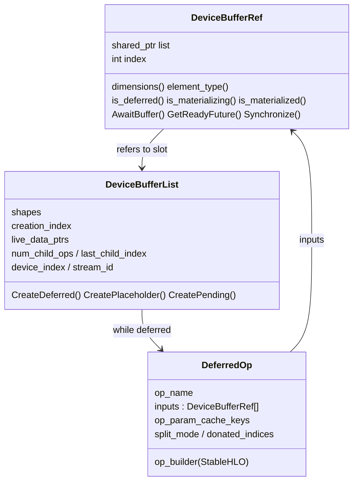
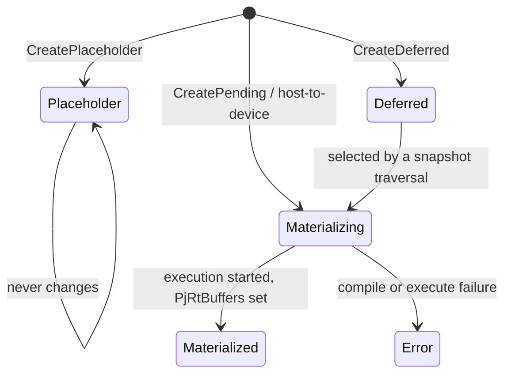

# Deferred execution and materialization - DeviceBufferRef, DeferredOp graphs, and the materialization worker

Scope: the `csrc/eager` core that owns tensor *data* - `device_buffer.{h,cc}`,
`device_buffer_utils.cc`, `events_queue.{h,cc}`, `materialize.{h,cc}`, `traversal.{h,cc}`,
`split_traversal.cc`, `materialization_heuristics.cc`, `execution_task.{h,cc}` and the
materialization reasons in `structured_log_buffer.h`.

## Overview

In torch_tpu a tensor's storage never points straight at HBM. It points at a
[`DeviceBufferRef`](../catalog/csrc/eager/device_buffer.h.md#DeviceBufferRef "csrc/eager/device_buffer.h:L173")
- "nothing more than a shared pointer to a DeviceBufferList and an index into that list". A
[`DeviceBufferList`](../catalog/csrc/eager/device_buffer.h.md#DeviceBufferList "csrc/eager/device_buffer.h:L529")
holds the output(s) of one ATen op, and is either a *placeholder* (compiled-mode argument with no
data), *deferred* (holds a [`DeferredOp`](../catalog/csrc/eager/device_buffer.h.md#DeferredOp "csrc/eager/device_buffer.h:L383")
- the op's StableHLO builder plus input refs), or *materialized* (holds PjRtBuffers). Because
inputs are held by immutable refs, dispatching ops grows an acyclic graph. *Materialization* is the
act of cutting a piece of that graph, building one StableHLO module from it, compiling (or hitting
the cache), executing, and flipping the affected lists to materialized. The header states the
payoff directly: deferral "allows us to delay compilation until we can compile multiple ops at
once, reducing total compilation time and achieving better performance through XLA optimizations
(e.g. kernel fusion) than we could with individual op-by-op executions." When to cut is the eager
mode's decision; how much to cut is governed by the
[`MaterializationMode`](../catalog/csrc/eager/events_queue.h.md#MaterializationMode "csrc/eager/events_queue.h:L87")
(full vs split graph) and how long the caller waits by the
[`MaterializationBlockMode`](../catalog/csrc/eager/materialize.h.md#MaterializationBlockMode "csrc/eager/materialize.h:L54").

## Diagram

The first diagram is the three-part data structure (nodes are the
[`DeviceBufferRef`](../catalog/csrc/eager/device_buffer.h.md#DeviceBufferRef "csrc/eager/device_buffer.h:L173"),
[`DeviceBufferList`](../catalog/csrc/eager/device_buffer.h.md#DeviceBufferList "csrc/eager/device_buffer.h:L529")
and [`DeferredOp`](../catalog/csrc/eager/device_buffer.h.md#DeferredOp "csrc/eager/device_buffer.h:L383")
types); the second is the one-way state ramp of a list, created by
[`CreatePlaceholder`](../catalog/csrc/eager/device_buffer.cc.md#DeviceBufferList.CreatePlaceholder "csrc/eager/device_buffer.cc:L459"),
[`CreateDeferred`](../catalog/csrc/eager/device_buffer.cc.md#DeviceBufferList.CreateDeferred "csrc/eager/device_buffer.cc:L357")
or [`CreatePending`](../catalog/csrc/eager/device_buffer.cc.md#DeviceBufferList.CreatePending "csrc/eager/device_buffer.cc:L472"),
and observed through [`is_placeholder`](../catalog/csrc/eager/device_buffer.cc.md#DeviceBufferRef.is_placeholder "csrc/eager/device_buffer.cc:L665"),
[`is_deferred`](../catalog/csrc/eager/device_buffer.cc.md#DeviceBufferRef.is_deferred "csrc/eager/device_buffer.cc:L669"),
[`is_materializing`](../catalog/csrc/eager/device_buffer.cc.md#DeviceBufferRef.is_materializing "csrc/eager/device_buffer.cc:L673")
and [`is_materialized`](../catalog/csrc/eager/device_buffer.cc.md#DeviceBufferRef.is_materialized "csrc/eager/device_buffer.cc:L681").

## Design rationale (why it's built this way)

**Data handles, not data.** The `device_buffer.h` file comment contrasts CUDA, where "every new
c10::DataPtr represents a physical block of device memory", with torch_tpu, where a DataPtr "may
point to either a materialized output buffer, **or** a deferred operation that can produce it".
Consequence: "we do not need to persist every intermediate tensor; only the tensors which have
their data moved off-device are strictly necessary to materialize." Intermediates that die before a
cut never get an HBM buffer of their own - XLA fuses them.

**One list per op, not per tensor.** Multi-output ops (layer/batch/group norm, fused optimizers)
share one DeferredOp, so the list is the unit of compilation and of synchronization; a ref is just
an index into it.

**Immutability plus a one-way ramp gives thread safety.** Shapes, dtypes and the DeferredOp of a
list never change; only the backing data moves deferred -> pending -> (materialized | error), with
two atomic flags assigning who clears the DeferredOp and who fulfills the materialization promise.
This lets the dispatch thread keep recording ops while background threads compile and execute.

**XLA cannot allocate uninitialized memory, and constants should stay constants.**
[`CreateEmptyDeviceBufferRef`](../catalog/csrc/eager/device_buffer_utils.cc.md#CreateEmptyDeviceBufferRef "csrc/eager/device_buffer_utils.cc:L354")
models `torch.empty` as a deferred deterministic fill, and
[`is_constant`](../catalog/csrc/eager/device_buffer.cc.md#DeviceBufferRef.is_constant "csrc/eager/device_buffer.cc:L693")
marks such lists: "We avoid materializing these buffers whenever possible, to preserve
constant-folding and avoiding materializing uninitialized memory." The events queue therefore never
records constant/empty ops; they are re-emitted into whichever graph first reads them.

**Views are recomputed, not stored.** A PjRtBuffer "does not support random-access indexing", so
[`CreateViewDeviceBufferRef`](../catalog/csrc/eager/device_buffer_utils.cc.md#CreateViewDeviceBufferRef "csrc/eager/device_buffer_utils.cc:L535")
lazily builds an `as_strided` DeferredOp from the base on each use, and
[`CreateInverseViewDeviceBufferRef`](../catalog/csrc/eager/device_buffer_utils.cc.md#CreateInverseViewDeviceBufferRef "csrc/eager/device_buffer_utils.cc:L633")
builds the write-back of a strided in-place update into a new base.

**Compile/execute are pipelined off the dispatch thread.** A singleton materialization worker owns
two threads: one turns snapshots into traversals and compiled executables (with its own reused
MLIR context), the other runs the executions. The Python thread only enqueues work.

## Entry points

- [`CreateDeferredDeviceBufferList`](../catalog/csrc/eager/device_buffer_utils.cc.md#CreateDeferredDeviceBufferList "csrc/eager/device_buffer_utils.cc:L213") - the single funnel every dispatched op goes through (author note: "Don't use this directly when defining ops. Use DispatchOp"); reached from [`DispatchOp`](../catalog/csrc/eager/op_dispatcher.h.md#DispatchOp "csrc/eager/op_dispatcher.h:L312"), view/inverse-view creation, constants, scan (`PyCreateScanOp`) and collectives (e.g. [`alltoall`](../catalog/csrc/distributed/process_group_tpu.cc.md#ProcessGroupTpu.alltoall "csrc/distributed/process_group_tpu.cc:L2652")). This is where the eager mode is applied.
- [`DeviceBufferRef`](../catalog/csrc/eager/device_buffer.h.md#DeviceBufferRef "csrc/eager/device_buffer.h:L173") - the handle every kernel and the at::Tensor bridge ([`MakeTensor`](../catalog/csrc/eager/tensor_to_buffer.cc.md#MakeTensor "csrc/eager/tensor_to_buffer.cc:L392"), [`AssignBufferToAtTensor`](../catalog/csrc/eager/tensor_to_buffer.cc.md#AssignBufferToAtTensor "csrc/eager/tensor_to_buffer.cc:L134")) passes around; its accessors ([`dimensions`](../catalog/csrc/eager/device_buffer.cc.md#DeviceBufferRef.dimensions "csrc/eager/device_buffer.cc:L701"), [`element_type`](../catalog/csrc/eager/device_buffer.cc.md#DeviceBufferRef.element_type "csrc/eager/device_buffer.cc:L709"), [`shape`](../catalog/csrc/eager/device_buffer.cc.md#DeviceBufferRef.shape "csrc/eager/device_buffer.cc:L697")) answer metadata questions without materializing.
- [`MaterializationReason`](../catalog/csrc/eager/structured_log_buffer.h.md#MaterializationReason "csrc/eager/structured_log_buffer.h:L36") - passed by every caller that forces a cut (`.cpu()`, `item()`, `synchronize()`, autograd post-backward, repeated-op heuristic, debug mode, distributed op, compile-mode execution); rendered by [`ToString`](../catalog/csrc/eager/structured_log_buffer.h.md#ToString "csrc/eager/structured_log_buffer.h:L48") into structured logs.
- [`EventSnapshot`](../catalog/csrc/eager/events_queue.h.md#EventSnapshot "csrc/eager/events_queue.h:L91") / `Record` - the stream-level cut: "a joined XLA future that represents the state of a stream at a particular point in time"; used by explicit materialization, `torch.tpu.Event`-style recording and device/stream synchronization.
- [`Synchronize`](../catalog/csrc/eager/device_buffer.cc.md#DeviceBufferRef.Synchronize "csrc/eager/device_buffer.cc:L718"), [`AwaitBuffer`](../catalog/csrc/eager/device_buffer.cc.md#DeviceBufferRef.AwaitBuffer "csrc/eager/device_buffer.cc:L722"), [`GetReadyFuture`](../catalog/csrc/eager/device_buffer.cc.md#DeviceBufferRef.GetReadyFuture "csrc/eager/device_buffer.cc:L747") - the consumer side, reached by device-to-host copies and [tensor synchronization](tensor-synchronization.md).

## Mechanism (step-by-step)

1. **Create the node.** [`CreateDeferredDeviceBufferList`](../catalog/csrc/eager/device_buffer_utils.cc.md#CreateDeferredDeviceBufferList "csrc/eager/device_buffer_utils.cc:L213")
   first wraps the op builder so inputs are upcast to `computation_dtype` and outputs downcast back
   to the declared dtypes (precision handling lives here, inside the graph), then calls
   [`CreateDeferred`](../catalog/csrc/eager/device_buffer.cc.md#DeviceBufferList.CreateDeferred "csrc/eager/device_buffer.cc:L357"),
   which validates output byte sizes and donated indices, builds the DeferredOp and the list, and
   returns one [`DeviceBufferRef`](../catalog/csrc/eager/device_buffer.h.md#DeviceBufferRef.DeviceBufferRef "csrc/eager/device_buffer.h:L192")
   per output. In DeferNever modes it also drops any requested donation whose input slot has more
   than one live DataPtr (aliases, views, autograd-saved tensors), except for custom (Pallas)
   kernels that manage donation themselves.

2. **Stamp graph metadata.** The list constructor takes a global
   [`g_creation_index_`](../catalog/csrc/eager/device_buffer.cc.md#DeviceBufferList.g_creation_index_ "csrc/eager/device_buffer.cc:L342")
   (monotonic dispatch order), records the current device and stream (see
   [`device_index`](../catalog/csrc/eager/device_buffer.cc.md#DeviceBufferRef.device_index "csrc/eager/device_buffer.cc:L813"),
   [`stream_id`](../catalog/csrc/eager/device_buffer.cc.md#DeviceBufferRef.stream_id "csrc/eager/device_buffer.cc:L817")),
   and calls [`RecordChildOp`](../catalog/csrc/eager/device_buffer.cc.md#DeviceBufferRef.RecordChildOp "csrc/eager/device_buffer.cc:L809")
   on every input, updating each input's fanout and "last child" creation index. Metadata-only
   (view) ops inherit their base's host-offload flag and activation-offload ops set it, so
   [`is_pinned_host`](../catalog/csrc/eager/device_buffer.cc.md#DeviceBufferRef.is_pinned_host "csrc/eager/device_buffer.cc:L685")
   follows data through views (see [`set_is_pinned_host`](../catalog/csrc/eager/device_buffer.cc.md#DeviceBufferRef.set_is_pinned_host "csrc/eager/device_buffer.cc:L689")).

3. **Apply the eager mode.** Still inside
   [`CreateDeferredDeviceBufferList`](../catalog/csrc/eager/device_buffer_utils.cc.md#CreateDeferredDeviceBufferList "csrc/eager/device_buffer_utils.cc:L213"),
   the current eager mode decides what happens next. *DeferNever* (the default unless
   `TORCH_TPU_DEFER_AND_FUSE=1`) records the op and immediately materializes this one list in
   full-graph, non-blocking mode with reason `debug_mode`: op-by-op execution, but asynchronous;
   metadata-only ops are skipped so views stay lazy. *DeferNeverAndLaunchBlocking*
   (`TORCH_TPU_LAUNCH_BLOCKING`, the CUDA_LAUNCH_BLOCKING analogue) does the same but blocks until
   started and then calls [`Synchronize`](../catalog/csrc/eager/device_buffer.cc.md#DeviceBufferRef.Synchronize "csrc/eager/device_buffer.cc:L718").
   *DeferAndFuse* only records. If the repeated-ops heuristic is on
   (`TORCH_TPU_INTERNAL_DETECT_REPEATED_OPS`, default `safe`; `aggressive` uses full-graph), each
   recorded op is hashed and, once the tail of the stream's queue contains the same 2..128-op
   sequence twice, the current stream is materialized in the background with reason
   `repeated_op_heuristic` (see [`MaterializationReason`](../catalog/csrc/eager/structured_log_buffer.h.md#MaterializationReason "csrc/eager/structured_log_buffer.h:L36")).
   This is what cuts a training loop into per-iteration graphs without user syncs.
   *InternalDeferAll* records and never auto-cuts; *InternalCompileFxGraph* (torch.compile/export
   tracing) does not even record.

4. **Track liveness per stream.** Each (device, stream) has an events queue. Non-side-effecting
   ops are held *weakly*, so an op whose tensors all die before a cut is dead code and disappears;
   side-effecting ops are held strongly until executed. DataPtr creation/destruction updates a
   live-node map; a [`DeviceBufferList`](../catalog/csrc/eager/device_buffer.h.md#DeviceBufferList "csrc/eager/device_buffer.h:L529")
   with no live DataPtrs is "stale" and will never be an output. Constants and empties (lists for
   which [`is_constant`](../catalog/csrc/eager/device_buffer.cc.md#DeviceBufferRef.is_constant "csrc/eager/device_buffer.cc:L693")
   holds) are not queued at all (rationale above).

5. **Request a cut.** `Materialize(...)` collapses its targets per (device, stream), skipping
   anything not [`is_deferred`](../catalog/csrc/eager/device_buffer.cc.md#DeviceBufferRef.is_deferred "csrc/eager/device_buffer.cc:L669")
   and erroring on placeholders. For each stream it calls
   `Record`
   with the stream's targets as `must_materialize`, the [`MaterializationReason`](../catalog/csrc/eager/structured_log_buffer.h.md#MaterializationReason "csrc/eager/structured_log_buffer.h:L36")
   and [`MaterializationMode`](../catalog/csrc/eager/events_queue.h.md#MaterializationMode "csrc/eager/events_queue.h:L87"),
   enqueues the stream on the worker, and - with `kBlockUntilStarted` - waits on the snapshot
   future. Note that the snapshot covers *everything* live on that stream up to now, not just the
   requested tensors: one `.item()` flushes the whole pending stream.

6. **Partition into traversals.** On the materialize thread the stream's queued
   [`DeferredOp`](../catalog/csrc/eager/device_buffer.h.md#DeferredOp "csrc/eager/device_buffer.h:L383")
   nodes are split into execution orders with fixed rules from `events_queue.cc`: a split-before op starts a new order, a
   split-after op ends one and is an output, any node with live DataPtrs or in `must_materialize` is
   an output, every non-constant op must feed some output, and constants/empties are inserted just
   before their first read. A single-op fast path skips the hash maps for the common DeferNever
   case. In `kSplitGraph` mode a traversal is further cut at materialization points, and nodes
   whose creation-to-last-child span crosses a cut are forced to materialize so later graphs can
   consume them (the `num_child_ops`/`last_child_index` stamped in step 2).

7. **Build one module per traversal.** [`BuildMlirModule`](../catalog/csrc/eager/traversal.cc.md#Traversal.BuildMlirModule "csrc/eager/traversal.cc:L583")
   creates a `main` function whose parameters are the traversal's non-deferred inputs (materialized
   buffers or placeholders), then calls each [`DeferredOp`](../catalog/csrc/eager/device_buffer.h.md#DeferredOp "csrc/eager/device_buffer.h:L383")'s
   builder in execution order, wiring donated inputs, and names the module from the Python context
   of the last op (the op that triggered the cut). The graph key, extended with argument layouts and
   donated inputs, drives the [compilation cache](compilation-cache.md). For split traversals,
   eligible heavy unaligned NCHW convolutions are selectively promoted from the default fast-compile
   (O1) to fast-runtime (O2) compilation.

8. **Execute and publish.** The execute thread runs each execution task in order; outputs flip
   their lists to materialized (or error), fulfilling the materialization future. Consumers then use
   [`AwaitBuffer`](../catalog/csrc/eager/device_buffer.cc.md#DeviceBufferRef.AwaitBuffer "csrc/eager/device_buffer.cc:L722")
   ("Awaits the PjRtBuffer to be materialized") or
   [`GetReadyFuture`](../catalog/csrc/eager/device_buffer.cc.md#DeviceBufferRef.GetReadyFuture "csrc/eager/device_buffer.cc:L747")
   (ready once the device has a PjRtBuffer "with ready data"); [`Synchronize`](../catalog/csrc/eager/device_buffer.cc.md#DeviceBufferRef.Synchronize "csrc/eager/device_buffer.cc:L718")
   awaits every buffer in the list and latches an `is_synchronized` flag so repeat syncs are free.
   torch.compile outputs skip steps 3-7: precompiled executables are enqueued directly and their
   outputs are [`CreatePending`](../catalog/csrc/eager/device_buffer.cc.md#DeviceBufferList.CreatePending "csrc/eager/device_buffer.cc:L472")
   lists, while their traced inputs were [`CreatePlaceholder`](../catalog/csrc/eager/device_buffer.cc.md#DeviceBufferList.CreatePlaceholder "csrc/eager/device_buffer.cc:L459")
   lists that can never materialize.

## Key data structures

| Structure | What it represents | Perf-relevant state |
|---|---|---|
| [`DeviceBufferRef`](../catalog/csrc/eager/device_buffer.h.md#DeviceBufferRef "csrc/eager/device_buffer.h:L173") | one tensor's data: (list, index) | equality/hash by identity, so caches key on it; [`size_bytes`](../catalog/csrc/eager/device_buffer.cc.md#DeviceBufferRef.size_bytes "csrc/eager/device_buffer.cc:L657"), [`num_elements`](../catalog/csrc/eager/device_buffer.cc.md#DeviceBufferRef.num_elements "csrc/eager/device_buffer.cc:L705") are logical |
| [`DeviceBufferList`](../catalog/csrc/eager/device_buffer.h.md#DeviceBufferList "csrc/eager/device_buffer.h:L529") | one op's outputs | creation index, per-slot live DataPtr counts (donation safety, staleness), fanout/last-child (split planning), device/stream, pinned-host flag, sync latch |
| [`DeferredOp`](../catalog/csrc/eager/device_buffer.h.md#DeferredOp "csrc/eager/device_buffer.h:L383") | an unexecuted op (via [`deferred_op`](../catalog/csrc/eager/device_buffer.cc.md#DeviceBufferRef.deferred_op "csrc/eager/device_buffer.cc:L714")) | op name, builder, inputs, `op_param_cache_keys`, split mode, donated indices, device assignment, captured Python context |
| [`EventSnapshot`](../catalog/csrc/eager/events_queue.h.md#EventSnapshot "csrc/eager/events_queue.h:L91") | a point in a stream's history | awaitable; elapsed-time between snapshots (event timing) |
| [`MaterializationReason`](../catalog/csrc/eager/structured_log_buffer.h.md#MaterializationReason "csrc/eager/structured_log_buffer.h:L36") | why a cut happened | recorded with cache-hit flag, ATen graph and StableHLO payload (on miss) in structured log events |

Dynamic shapes ride on the same structures: [`MarkDynamic`](../catalog/csrc/eager/device_buffer.cc.md#DeviceBufferRef.MarkDynamic "csrc/eager/device_buffer.cc:L793")
attaches a bounded dynamic dimension to a slot, and
[`dynamic_dimensions`](../catalog/csrc/eager/device_buffer.cc.md#DeviceBufferRef.dynamic_dimensions "csrc/eager/device_buffer.cc:L804") /
[`on_device_shape_is_dynamic`](../catalog/csrc/eager/device_buffer.cc.md#DeviceBufferRef.on_device_shape_is_dynamic "csrc/eager/device_buffer.cc:L800")
expose it to graph building without a blocking device query.

## Dynamics (design intent)

- **Ordering across threads.** Snapshot promises are released in order per stream, and the events
  queue releases chained promises in a loop rather than recursively, because "a long chain overflows
  the stack of the thread that completed the first snapshot" (`events_queue.cc`).
- **Worker threads cannot read context state.** Both worker threads call a guard that forbids
  thread-local context access, "to enforce they always rely on resolved configurations passed down
  from the dispatch thread"; compile options are frozen into the snapshot's materialization settings
  at request time. Changing an eager-mode or compiler-option context after dispatch does not affect
  already-requested cuts.
- **Cross-stream views.** If a view and its base were created on different streams, the base is
  materialized first (blocking until started) before the view is enqueued, avoiding scheduling the
  view ahead of its input.
- **Tests.** `csrc/eager/events_queue_test.cc`, `materialize_test.cc`,
  `materialization_heuristics_test.cc`, `split_traversal_test.cc` and `traversal_test.cc` exercise
  queue partitioning, repeated-op detection, split planning and module building (see packet
  Evidence).

> [!inferred]
> For TPU step time the practical levers are therefore: run under DeferAndFuse so a step becomes a
> few large fused programs instead of one program per op; avoid stray `.item()`/`.cpu()`/prints
> mid-step (each is a full stream cut with reason `.cpu()`/`item()`); keep the per-iteration op
> sequence identical so the repeated-op heuristic finds a stable period and the compilation cache
> hits; and use split modes or an explicit `synchronize(x, wait=False)` to bound graph size when
> compile time dominates. These are readings of the mechanism, not measured claims in the source.

## Edge cases

- Materializing a placeholder - or anything depending on one - is an internal error: placeholders exist only while tracing for torch.compile. Abandoned eager ops traced over placeholders are pruned from traversals rather than failing the whole cut.
- A list's state can only advance; once it errors, every consumer of [`AwaitBuffer`](../catalog/csrc/eager/device_buffer.cc.md#DeviceBufferRef.AwaitBuffer "csrc/eager/device_buffer.cc:L722") sees that error.
- Recording an [`EventSnapshot`](../catalog/csrc/eager/events_queue.h.md#EventSnapshot "csrc/eager/events_queue.h:L91") during an FX trace returns InvalidArgument.
- Moving out of a [`DeviceBufferRef`](../catalog/csrc/eager/device_buffer.h.md#DeviceBufferRef.DeviceBufferRef "csrc/eager/device_buffer.h:L192") leaves a null list pointer ("Use with caution"); holding a `DeviceBufferRef&` beyond one kernel call is documented as unsafe.
- An explicitly requested constant/empty tensor is appended to the last traversal so it gets a real buffer (needed, e.g., before handing it to a compiled function).
- Stream states are never freed; the source TODO warns that creating new streams in a loop can cause host-side OOM.
- [`DebugString`](../catalog/csrc/eager/device_buffer.cc.md#DeviceBufferRef.DebugString "csrc/eager/device_buffer.cc:L287") is verbose and documented as for logs/internal errors only.

## Open questions

- The `Materialize` overloads, `MaterializeStream`/`MaterializeDevice`, `Traversal::Create`, the
  events-queue stream state and `PrepareSnapshotMaterializations`, and `ExecutionTask` are not in
  this packet's subgraph; their behavior above is from reading the source, not from cited symbols.
- How the repeated-op heuristic interacts with data-dependent control flow (sequences that
  almost-repeat) is not specified beyond the min/max length constants.
- The exact policy for when split-graph vs full-graph is better for compile time vs runtime is not
  documented beyond the repeated-op env var.

## See also

- [Eager op dispatch](eager-op-dispatch.md) - how kernels create these nodes.
- [Tensor synchronization](tensor-synchronization.md) - the Python-facing cut/wait API.
- [Compilation pipeline](compilation-pipeline.md), [compilation cache](compilation-cache.md), [compiled mode](compiled-mode.md), [context states and execution modes](context-states-and-execution-modes.md), [view decomposition](view-decomposition.md), [device streams, generators and RNG](device-streams-generators-and-rng.md), [dynamic shapes compiler](dynamic-shapes-compiler.md).
