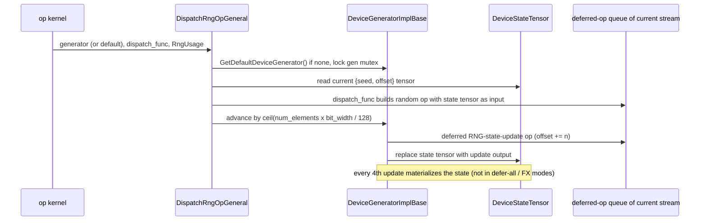
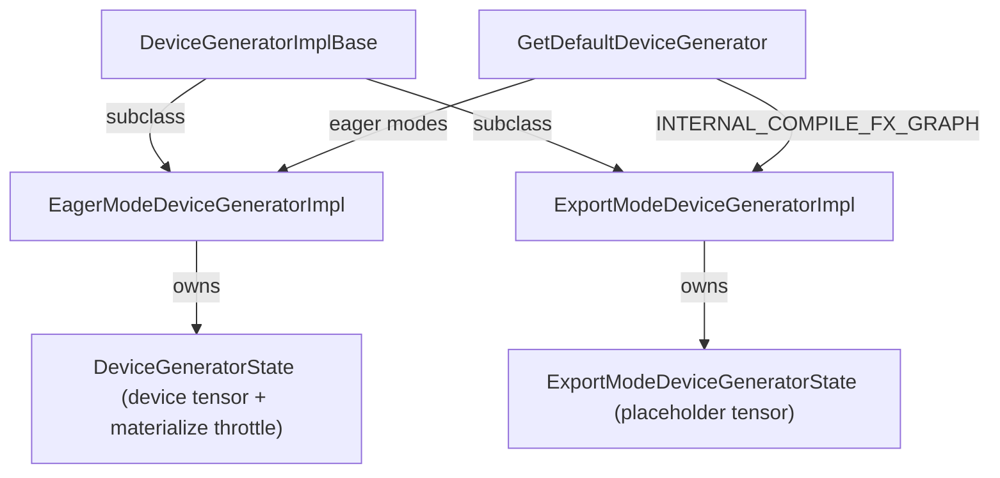

# Device streams, RNG generators and random-op dispatch

<!-- connect:up:begin -->
> **Cross-repo concept:** part of [sparsecore](../../../concepts/sparsecore.md) across this wiki's repos.
<!-- connect:up:end -->
## Overview
Two pieces of per-device runtime state sit underneath every dispatched op. **Streams**: each Python-facing thread has a current device index and, per device, a current stream id ([`GetCurrentDeviceStreamId`](../catalog/csrc/eager/current_stream.cc.md#GetCurrentDeviceStreamId "csrc/eager/current_stream.cc:L67")). Every buffer list created by an op is stamped with that pair, and each (device, stream) owns its own queue of deferred ops, its own materialization snapshots and its own TensorCore/SparseCore pinning. XLA itself has no streams; on TPU a stream is a *scheduling and fusion boundary* that torch_tpu emulates for CUDA-style code (mainly FSDP). **RNG**: a TPU generator ([`DeviceGeneratorImplBase`](../catalog/csrc/eager/device_gen_impl.h.md#DeviceGeneratorImplBase "csrc/eager/device_gen_impl.h:L154")) holds its state as a 2-element `uint64` **device tensor** `{seed, offset}`. A random op takes that tensor as an ordinary input, and the generator then replaces it with the output of a tiny deferred "add to offset" op. Seed and offset therefore never appear in the cache key and never need a host round trip, so the same compiled program serves every step and random ops fuse with their consumers.

## Diagram
One random op, end to end (e.g. `dropout` in Fused eager).

Legend:
- `K` - (concept) a random ATen kernel (dropout, normal_, uniform_, bernoulli, randperm, multinomial, exponential, flash-attention dropout, RNN cells)
- `D` - [`DispatchRngOpGeneral`](../catalog/csrc/ops/rng_utils.h.md#DispatchRngOpGeneral "csrc/ops/rng_utils.h:L52")
- `G` - [`DeviceGeneratorImplBase`](../catalog/csrc/eager/device_gen_impl.h.md#DeviceGeneratorImplBase "csrc/eager/device_gen_impl.h:L154")
- `S` - [`DeviceStateTensor`](../catalog/csrc/eager/device_gen_impl.h.md#DeviceGeneratorImplBase.DeviceStateTensor "csrc/eager/device_gen_impl.h:L169")
- `Q` - (concept) the per-(device, stream) deferred-op queue

Generator structure: eager and export generators are isolated.

Legend:
- `BASE` - [`DeviceGeneratorImplBase`](../catalog/csrc/eager/device_gen_impl.h.md#DeviceGeneratorImplBase "csrc/eager/device_gen_impl.h:L154")
- `EAGER` - (concept) eager generator; its state accessor is [`DeviceStateTensor`](../catalog/csrc/eager/device_gen_impl.cc.md#EagerModeDeviceGeneratorImpl.DeviceStateTensor "csrc/eager/device_gen_impl.cc:L502")
- `EXPORT` - (concept) export/trace generator; its state accessor is [`DeviceStateTensor`](../catalog/csrc/eager/device_gen_impl.cc.md#ExportModeDeviceGeneratorImpl.DeviceStateTensor "csrc/eager/device_gen_impl.cc:L660")
- `EST` - (concept) eager state holder; accessor [`DeviceStateTensor`](../catalog/csrc/eager/device_gen_impl.h.md#DeviceGeneratorState.DeviceStateTensor "csrc/eager/device_gen_impl.h:L95")
- `XST` - (concept) export state holder; accessor [`DeviceStateTensor`](../catalog/csrc/eager/device_gen_impl.h.md#ExportModeDeviceGeneratorState.DeviceStateTensor "csrc/eager/device_gen_impl.h:L137")
- `DEF` - [`GetDefaultDeviceGenerator`](../catalog/csrc/eager/device_gen_impl.cc.md#GetDefaultDeviceGenerator "csrc/eager/device_gen_impl.cc:L779")

## Design rationale (why it's built this way)

- **RNG state lives on the device, as data.** The state holder is described as "the TPU equivalent of PyTorch's CUDAGeneratorState"; a 1D `uint64` tensor of `{seed, offset}`. Passing it into the random op as a tensor input (instead of baking seed/offset into the HLO) is what lets one executable be reused across steps; the state-update op is keyed only on `(num_elements, bit_width)`, which are shape-derived and stable. The advance itself is plain StableHLO: each Philox step "consumes 128 bits of randomness and increments the offset by 1", so the offset grows by `ceil(num_elements x bit_width / 128)`, computed in unsigned arithmetic that deliberately wraps "matching CUDA behavior".
- **Throttled materialization of the state.** Because each update is a deferred op that depends on the previous one, an unmaterialized generator is an ever-growing chain. The source says the throttle exists "To prevent the deferred execution graph from growing indefinitely (which causes host-side memory leaks and OOM during compilation)": every `kMaterializationThreshold = 4` updates the state tensor is materialized (split-graph, non-blocking; blocking in launch-blocking mode).
- **Eager vs export isolation.** The header's design note: TorchTPU "provides strict RNG generator state isolation between eager execution mode and graph export mode ... This isolation prevents graph tracing passes (which inspect and advance RNG states) from mutating or polluting the global default eager RNG state." Under `INTERNAL_COMPILE_FX_GRAPH`, [`GetDefaultDeviceGenerator`](../catalog/csrc/eager/device_gen_impl.cc.md#GetDefaultDeviceGenerator "csrc/eager/device_gen_impl.cc:L779") returns a per-thread export-mode override (cloned from the eager state) and throws if none was registered.
- **Streams are kept minimal on purpose.** The Python stream class says "Streams are a CUDA concept with no clear analog in XLA ... Because XLA is functional it can schedule operations based on data dependencies and does not need streams", and "implements dummy methods that are needed to enable PyTorch's Fully Sharded Data Parallel". The one real performance use is core pinning: a stream created with `pinned="sparse_core"` (or `"tensor_core"`) pins every program materialized from that stream's queue, so SparseCore work (gathers, scatters, collectives) can run concurrently with TensorCore work.

## Entry points
- [`DispatchRngOpGeneral`](../catalog/csrc/ops/rng_utils.h.md#DispatchRngOpGeneral "csrc/ops/rng_utils.h:L52") - "Dispatches an RNG operation, handling locking, state retrieval, and advancement." Every random kernel funnels here, directly or through [`DispatchRngOpAndReturnBuffer`](../catalog/csrc/ops/rng_utils.h.md#DispatchRngOpAndReturnBuffer "csrc/ops/rng_utils.h:L89") (single output) or [`DispatchRngOp`](../catalog/csrc/ops/rng_utils.h.md#DispatchRngOp "csrc/ops/rng_utils.h:L104") (single output assigned into an existing tensor).
- [`GetDefaultDeviceGenerator`](../catalog/csrc/eager/device_gen_impl.cc.md#GetDefaultDeviceGenerator "csrc/eager/device_gen_impl.cc:L779") - reached whenever a random op is called without `generator=`; lazily creates one eager generator per device (seeded non-deterministically on first use) and selects eager vs export generator by the current eager mode.
- [`DeviceGeneratorImplBase`](../catalog/csrc/eager/device_gen_impl.cc.md#DeviceGeneratorImplBase.DeviceGeneratorImplBase "csrc/eager/device_gen_impl.cc:L405") - constructor run for `torch.Generator(device="tpu")` and the default generators; it binds the generator to the `PrivateUse1` device and dispatch key ("If device_index is -1, the generator is bound to the current accelerator device").
- [`GetCurrentDeviceStreamId`](../catalog/csrc/eager/current_stream.cc.md#GetCurrentDeviceStreamId "csrc/eager/current_stream.cc:L67") - read whenever a buffer list is created or an executable is enqueued, to decide which stream queue the work belongs to.

> [!inferred]
> Python reaches these through `torch.tpu.manual_seed` / `manual_seed_all` / `get_rng_state` / `set_rng_state` / `default_generators` / `initial_seed` and `torch.tpu.Stream` / `stream` / `set_stream` / `current_stream` (exported in `src/torch_tpu/_internal/public_api.py`), and via `torch.manual_seed`, which seeds every device's eager generator. The bindings are outside this page's symbol subgraph.

## Mechanism (step-by-step)

1. **Pick the generator and lock it.** [`DispatchRngOpGeneral`](../catalog/csrc/ops/rng_utils.h.md#DispatchRngOpGeneral "csrc/ops/rng_utils.h:L52") resolves the user's `generator=` or [`GetDefaultDeviceGenerator`](../catalog/csrc/eager/device_gen_impl.cc.md#GetDefaultDeviceGenerator "csrc/eager/device_gen_impl.cc:L779") and takes the generator's mutex for the whole read-dispatch-advance sequence, so two Python threads sharing a generator cannot hand the same offset to two ops.

2. **Feed the state tensor to the op.** It calls the kernel's `dispatch_func` with [`DeviceStateTensor`](../catalog/csrc/eager/device_gen_impl.h.md#DeviceGeneratorImplBase.DeviceStateTensor "csrc/eager/device_gen_impl.h:L169") ("Returns the active TPU RNG state tensor {seed, offset}"). The kernel dispatches an ordinary deferred op whose inputs are `[rng_state, ...]` - e.g. dropout builds a two-input, two-output op producing `[output, mask]` - so the random-bit generation lives inside the same HLO as the surrounding computation and can fuse with it in Fused eager or `torch.compile`. The returned buffers are [`DeviceBufferRef`](../catalog/csrc/eager/device_buffer.h.md#DeviceBufferRef "csrc/eager/device_buffer.h:L173")s.

3. **Compute how much randomness was consumed.** If the kernel passed an [`RngUsage`](../catalog/csrc/ops/rng_utils.h.md#RngUsage "csrc/ops/rng_utils.h:L40") (`num_elements`, `bit_width`), those values are used; otherwise they are inferred from the first output (element count x PyTorch-equivalent bit width). The header documents the explicit form as "required when the output type/shape does not match the actual RNG consumption, e.g., dropout"; in practice dropout passes `{input.numel(), bit width of the output dtype}` (it returns two outputs, `[output, mask]`), and randperm, multinomial and the RNN kernels also pass an explicit usage.

4. **Advance the state with a deferred op.** Only after `dispatch_func` succeeds does the generator advance: it dispatches an `RngStateUpdate` op that adds `[0, ceil(num_bits / 128)]` to the state tensor, keyed by `(num_elements, bit_width)`, validates the result (TPU device, `uint64`, shape `[2]`) and installs it as the new state via [`MakeTensor`](../catalog/csrc/eager/tensor_to_buffer.cc.md#MakeTensor "csrc/eager/tensor_to_buffer.cc:L392"). With `TORCH_TPU_INTERNAL_SPLIT_RNG_STATE_UPDATE=1` the update is isolated into its own compilation unit, which "may degrade performance, but improves error recovery" by keeping the generator clean if the main program fails.

5. **Throttle the chain.** Installing a new state increments the eager state holder's counter ([`DeviceStateTensor`](../catalog/csrc/eager/device_gen_impl.h.md#DeviceGeneratorState.DeviceStateTensor "csrc/eager/device_gen_impl.h:L95") is its accessor); on the 4th update it materializes the state tensor with split-graph mode, non-blocking (blocking plus synchronize in Debug eager). It skips this entirely under `INTERNAL_COMPILE_FX_GRAPH` and skips the threshold under `INTERNAL_DEFER_ALL`. In Fused eager this is a forced materialization point every four random ops; split-graph mode limits it to the subgraph the state depends on.

6. **Host-side seeding and state reads.** `manual_seed` (and generator `seed()`) write a fresh `{seed, 0}` tensor with a direct host-to-device copy rather than a deferred op, because deferred allocations need an active op context and would break when seeding from plain Python. Reading `initial_seed()` / offset or calling `get_state()` takes the eager generator's state tensor ([`DeviceStateTensor`](../catalog/csrc/eager/device_gen_impl.cc.md#EagerModeDeviceGeneratorImpl.DeviceStateTensor "csrc/eager/device_gen_impl.cc:L502")) and reads it back with `.item()` / `.to("cpu")` - a **blocking device sync** that also forces materialization of everything the state depends on. `graphsafe_get_state` / `graphsafe_set_state` instead share the state holder object without a sync.

7. **Streams decide which queue an op joins.** Each [`DeviceBufferList`](../catalog/csrc/eager/device_buffer.h.md#DeviceBufferList "csrc/eager/device_buffer.h:L529") records the device and stream returned by [`GetCurrentDeviceStreamId`](../catalog/csrc/eager/current_stream.cc.md#GetCurrentDeviceStreamId "csrc/eager/current_stream.cc:L67") at creation, and its op is appended to that (device, stream)'s deferred queue; repeated-op detection, snapshots and core pinning are all per stream. New streams get ids from a per-device atomic counter starting at 1 (0 is the default stream). Switching streams through the device guard materializes the stream being left and waits until that materialization is queued, because "In TorchTPU's DeferAndFuse mode, work on a stream can remain deferred indefinitely until something forces it to materialize", and a later op on another stream could otherwise race its unqueued inputs.

## Key data structures
- **Eager state holder** (`DeviceGeneratorState`) - the `{seed, offset}` device tensor plus the throttle counter; `clone()` force-materializes so a cloned generator starts from a concrete buffer.
- **Export state holder** (`ExportModeDeviceGeneratorState`) - just a (placeholder) tensor; eager-only accessors on the export generator (`seed`, `get_state`, `set_offset`, ...) deliberately crash because Dynamo graph-breaks on them before they could be reached.
- [`RngUsage`](../catalog/csrc/ops/rng_utils.h.md#RngUsage "csrc/ops/rng_utils.h:L40") - `{num_elements, bit_width}`; the only inputs to the offset arithmetic and to the update op's cache key.
- **Current device / stream** - `thread_local` device index and a per-device array of current stream ids (capacity `kMaxDevices = 8` local devices), plus process-wide atomic next-id counters; a TODO notes they should become per-Python-thread.

## Dynamics (design intent)
- The generator mutex serializes random-op dispatch per generator, not per device; independent `torch.Generator` objects can dispatch concurrently.
- The state update is ordered after the random op only by data dependence (the next random op consumes the update's output), so in a fused program the random op and the offset add are independent and XLA may schedule them freely.
- Materialize and execute workers read the stream from the calling thread at enqueue time ("Get the stream from the calling thread, not from the execution worker thread"), consistent with the rule that background threads never consult per-thread state.

## Edge cases
- **Reading RNG state syncs.** `torch.tpu.get_rng_state()`, `initial_seed()` and the offset getter all `.item()` / copy to host; calling them inside a training step serializes host and device every step.
- **Fusion break every 4 random ops.** In Fused eager the throttle forces a state materialization every fourth RNG advance; models with many dropout layers see extra materialization points that are not visible in user code.
- **Export without an override throws.** Under `INTERNAL_COMPILE_FX_GRAPH` the default generator must have been registered by the compile/export path; otherwise a `FailedPrecondition` names the device.
- **`set_state` format.** It accepts only a contiguous CPU `torch.uint8` tensor of shape `(16,)` (the two `uint64` values reinterpreted as bytes), mirroring PyTorch's byte-tensor RNG state.
- **Streams are partial.** `query()` and several event methods raise `NotImplementedError` ("Streams and Events are not fully implemented in TorchTPU"); `wait_event` simply waits on the host.
- **More than 8 local devices** would trip the stream bookkeeping's `kMaxDevices` check.

## Open questions
- `EagerModeDeviceGeneratorImpl`, `ExportModeDeviceGeneratorImpl`, `DeviceGeneratorState`, `AdvanceDeviceStateTensor`, the RNG-state update builder, the stream queue (`StreamState`) and the device-guard stream switch are central here but outside the packet's citable subgraph; they are described from `csrc/eager/device_gen_impl.{h,cc}`, `csrc/ops/op_builder_utils.cc`, `csrc/eager/events_queue.cc` and `csrc/eager/tpu_hooks.cc`.
- A TODO in the throttle says it "should also materialize in kDeferNever or kDeferNeverAndLaunchBlocking modes, but this breaks excess precision functionality currently", yet the threshold condition as written only excludes defer-all; which behavior is intended for the defer-never modes is unclear.
- Whether XLA's random-bit generator used by the random kernels (Philox per the offset comment) produces the same sequences as CUDA for the same seed is not asserted anywhere in source.

## See also
- [Context states and execution modes](context-states-and-execution-modes.md)
- [Deferred execution and materialization](deferred-execution-and-materialization.md)
- [Eager op dispatch](eager-op-dispatch.md)
- [Compilation cache key](compilation-cache-key.md)
- [dtype and precision](dtype-and-precision.md)
- [torch.compile backend](torch-compile-backend.md)
- [Tensor synchronization](tensor-synchronization.md)
