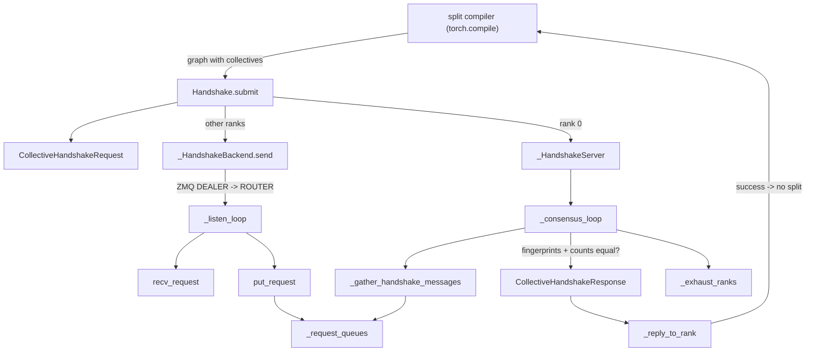
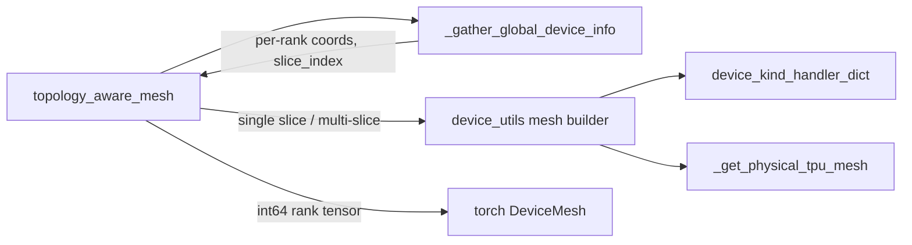

# Distributed launchers, topology-aware meshes and the SPMD collective handshake

<!-- connect:up:begin -->
> **Cross-repo concept:** part of [sharding](../../../concepts/sharding.md) across this wiki's repos.
<!-- connect:up:end -->
## Overview

`src/torch_tpu/_internal/distributed` is the Python layer that sits on top of the C++
`ProcessGroupTpu` backend (see [process group and collectives](process-group-and-collectives.md)).
It answers four questions a multi-chip job has to settle *before* collectives can run fast:
which env vars every rank must agree on before workers spawn (the launch-env bootstrap in
`distributed.py`); which torch rank should sit at which logical mesh coordinate
([`topology_aware_mesh`](../catalog/src/torch_tpu/_internal/distributed/device_mesh.md#topology_aware_mesh "src/torch_tpu/_internal/distributed/device_mesh.py:L224"));
when it is safe to fuse a collective with the ops around it instead of isolating it in its own
graph (`spmd_safe` for eager, the collective handshake for `torch.compile`); and how other
communicator APIs plug into the same backend
([`TorchCommsTPU`](../catalog/src/torch_tpu/_internal/distributed/torchcomm_tpu.md#TorchCommsTPU "src/torch_tpu/_internal/distributed/torchcomm_tpu.py:L96")).

The performance thread running through all of it: TorchTPU's default is to cut the execution
graph around every collective, because ranks that fuse *different* ops around a collective
compile different executables and can deadlock. Everything SPMD-related here is a way to
*prove* (eager: by user assertion; compile: by a cross-rank fingerprint vote) that ranks are
identical, so the split can be skipped and XLA sees collectives and compute in one module.

## Diagram

Legend:
- `SPLIT` - (concept) TorchTPU's split compiler in `_internal/compile/split_compiler.py`, the only caller
- `SUB` - [`submit`](../catalog/src/torch_tpu/_internal/distributed/handshake.md#Handshake.submit "src/torch_tpu/_internal/distributed/handshake.py:L1528")
- `REQ` - [`CollectiveHandshakeRequest`](../catalog/src/torch_tpu/_internal/distributed/handshake.md#CollectiveHandshakeRequest "src/torch_tpu/_internal/distributed/handshake.py:L375")
- `SRV` - [`_HandshakeServer`](../catalog/src/torch_tpu/_internal/distributed/handshake.md#_HandshakeServer "src/torch_tpu/_internal/distributed/handshake.py:L961")
- `BSEND` - [`send`](../catalog/src/torch_tpu/_internal/distributed/handshake.md#_HandshakeBackend.send "src/torch_tpu/_internal/distributed/handshake.py:L793")
- `LISTEN` - [`_listen_loop`](../catalog/src/torch_tpu/_internal/distributed/handshake.md#_HandshakeServer._listen_loop "src/torch_tpu/_internal/distributed/handshake.py:L1065")
- `RECV` - [`recv_request`](../catalog/src/torch_tpu/_internal/distributed/handshake.md#_ZMQServer.recv_request "src/torch_tpu/_internal/distributed/handshake.py:L916")
- `PUT` - [`put_request`](../catalog/src/torch_tpu/_internal/distributed/handshake.md#_CollectiveHandshakeConsensus.put_request "src/torch_tpu/_internal/distributed/handshake.py:L594")
- `Q` - [`_request_queues`](../catalog/src/torch_tpu/_internal/distributed/handshake.md#_CollectiveHandshakeConsensus._request_queues "src/torch_tpu/_internal/distributed/handshake.py:L589")
- `CONS` - [`_consensus_loop`](../catalog/src/torch_tpu/_internal/distributed/handshake.md#_HandshakeServer._consensus_loop "src/torch_tpu/_internal/distributed/handshake.py:L1205")
- `GATHER` - [`_gather_handshake_messages`](../catalog/src/torch_tpu/_internal/distributed/handshake.md#_HandshakeServer._gather_handshake_messages "src/torch_tpu/_internal/distributed/handshake.py:L1147")
- `RESP` - [`CollectiveHandshakeResponse`](../catalog/src/torch_tpu/_internal/distributed/handshake.md#CollectiveHandshakeResponse "src/torch_tpu/_internal/distributed/handshake.py:L470")
- `EXH` - [`_exhaust_ranks`](../catalog/src/torch_tpu/_internal/distributed/handshake.md#_HandshakeServer._exhaust_ranks "src/torch_tpu/_internal/distributed/handshake.py:L1165")
- `REPLY` - [`_reply_to_rank`](../catalog/src/torch_tpu/_internal/distributed/handshake.md#_HandshakeServer._reply_to_rank "src/torch_tpu/_internal/distributed/handshake.py:L1138")

Topology-aware mesh construction:

Legend:
- `TAM` - [`topology_aware_mesh`](../catalog/src/torch_tpu/_internal/distributed/device_mesh.md#topology_aware_mesh "src/torch_tpu/_internal/distributed/device_mesh.py:L224")
- `GDI` - [`_gather_global_device_info`](../catalog/src/torch_tpu/_internal/distributed/device_mesh.md#_gather_global_device_info "src/torch_tpu/_internal/distributed/device_mesh.py:L69")
- `MESH` - (concept) the JAX-derived `create_device_mesh` / `create_hybrid_device_mesh` in `device_utils.py`
- `HAND` - [`device_kind_handler_dict`](../catalog/src/torch_tpu/_internal/distributed/device_utils.md#device_kind_handler_dict.device_kind_handler_dict "src/torch_tpu/_internal/distributed/device_utils.py:L233")
- `PHYS` - [`_get_physical_tpu_mesh`](../catalog/src/torch_tpu/_internal/distributed/device_utils.md#_get_physical_tpu_mesh "src/torch_tpu/_internal/distributed/device_utils.py:L664")
- `DM` - (concept) `torch.distributed.device_mesh.DeviceMesh(device_type, mesh=...)`

## Design rationale (why it's built this way)

**Bootstrap in the parent, never spawn.** The `distributed.py` module docstring explains that
three variables must be decided in the parent process "because every rank must agree on the same
values": `TORCH_TPU_SLICEBUILDER_ADDRESSES` (one `host:port` per rank), `TORCH_TPU_TOPOLOGY`
(e.g. `"2,2,1"`) and `TORCH_TPU_XPROF_SESSION_ID`. The bootstrap "only mutates `os.environ` and
then gets out of the way, so it composes with `torchrun`, `elastic_launch`,
`torch.multiprocessing.spawn`, or any other launcher". It is idempotent and never overwrites an
already-set variable. Multi-host is detected by counting `TPU_WORKER_HOSTNAMES` entries (or
`nnodes > 1`, or `JOB_COMPLETION_INDEX`), not by the variable's presence, because a single-host
TPU VM sets it to one name and treating that as multi-host "would put a single-host job on the
rendezvous path and hang it". On multi-host it also derives `NNODES`, `NODE_RANK` (from the
host's physical coordinates within the slice when `TORCH_TPU_TOPOLOGY` is supplied, so node
ranks are "deterministic and topologically contiguous"), `MASTER_ADDR` and `MASTER_PORT`
(default 29500). Querying coordinates initializes PjRt, which claims the TPUs, so the query runs
in a short-lived child process.

**Rank-to-chip mapping is assumed arbitrary.** The `device_mesh.py` docstring: "Launchers may
assign global rank ids with no topology input ... the standard sequential assignment of torch
ranks may place logically adjacent mesh coordinates on physically distant devices." So
[`topology_aware_mesh`](../catalog/src/torch_tpu/_internal/distributed/device_mesh.md#topology_aware_mesh "src/torch_tpu/_internal/distributed/device_mesh.py:L224")
recovers the physical layout and runs the JAX `mesh_utils` placement logic (ported into
`device_utils.py`) over stub devices. `mesh_shape` follows the JAX convention: axes ordered by
increasing network intensity, highest-traffic axis last. On multi-slice jobs the mesh is split
across slices on the outermost non-trivial axis ("the least communication-hungry one and the
right place to pay the inter-slice cost") - for HSDP that keeps every shard group inside one
slice, on ICI.

**Two separate ways to skip collective graph splits, matched to the execution mode.** In eager,
the user asserts SPMD-ness with the `spmd_safe` decorator (see the section below). Under
`torch.compile` there is something better than trust: every rank already has an FX graph and a
fingerprint, so the ranks can *vote*. The handshake was built so "such graphs can be compiled
without splitting at the collectives" (env-var comment for `TORCH_TPU_SPMD_HANDSHAKE_STAGE`).

**A single coordinator with per-rank queues, not a store barrier.** The handshake is a
centralized consensus on rank 0 over ZMQ ROUTER/DEALER sockets with an asyncio loop on a
background thread. Requests carry cumulative per-process-group collective counts, which lets the
coordinator detect ranks that are *behind* (they compiled fewer collective-bearing graphs) and
answer their stale requests with failure in
[`_exhaust_ranks`](../catalog/src/torch_tpu/_internal/distributed/handshake.md#_HandshakeServer._exhaust_ranks "src/torch_tpu/_internal/distributed/handshake.py:L1165")
instead of mis-pairing them with other ranks' newer requests.

**The coordinator answers itself through a local queue.** [`_reply_to_rank`](../catalog/src/torch_tpu/_internal/distributed/handshake.md#_HandshakeServer._reply_to_rank "src/torch_tpu/_internal/distributed/handshake.py:L1138")
puts the coordinator's own response into a `queue.Queue` rather than over the network, and the
consensus loop replies to remote ranks first "to avoid GIL contention between the main thread and
the loop runner thread which would cause us to wait before sending out replies to other ranks."

## Entry points

- [`topology_aware_mesh`](../catalog/src/torch_tpu/_internal/distributed/device_mesh.md#topology_aware_mesh "src/torch_tpu/_internal/distributed/device_mesh.py:L224") - exposed as `torch.tpu.distributed.topology_aware_mesh(mesh_shape, dcn_mesh_shape=..., ...)`; called by user code after `init_process_group` to obtain the rank tensor for `DeviceMesh(device_type, mesh=...)`.
- [`submit`](../catalog/src/torch_tpu/_internal/distributed/handshake.md#Handshake.submit "src/torch_tpu/_internal/distributed/handshake.py:L1528") - `Handshake().submit(msg)`, called by the split compiler when `TORCH_TPU_SPMD_HANDSHAKE_STAGE` is `COMPILE_STAGE` or `DISPATCH_STAGE` and the graph's collectives target only the global process group; returns True iff all ranks agree.
- [`_HandshakeServer.__new__`](../catalog/src/torch_tpu/_internal/distributed/handshake.md#_HandshakeServer.__new__ "src/torch_tpu/_internal/distributed/handshake.py:L1000") / [`_HandshakeClient.__new__`](../catalog/src/torch_tpu/_internal/distributed/handshake.md#_HandshakeClient.__new__ "src/torch_tpu/_internal/distributed/handshake.py:L1395") - process-wide singletons created lazily on the first `Handshake()`: the server on the coordinator rank, a client everywhere else.
- [`TorchCommsTPU`](../catalog/src/torch_tpu/_internal/distributed/torchcomm_tpu.md#TorchCommsTPU "src/torch_tpu/_internal/distributed/torchcomm_tpu.py:L96") - the backend class registered with `torchcomms` as `"tpu"` and `"tpu_dist"`; instantiated by `torchcomms.new_comm()` or directly, and wrapping a `ProcessGroupTpu`.
- [`split`](../catalog/src/torch_tpu/_internal/distributed/torchcomm_tpu.md#TorchCommsTPU.split "src/torch_tpu/_internal/distributed/torchcomm_tpu.py:L308") - "Creates a new subgroup communicator" from a rank list or a color/key pair.

## Mechanism (step-by-step)

1. **Recover the physical layout from the backend, not from a new exchange.**
   [`_gather_global_device_info`](../catalog/src/torch_tpu/_internal/distributed/device_mesh.md#_gather_global_device_info "src/torch_tpu/_internal/distributed/device_mesh.py:L69")
   ("Each torch rank reports its PJRT device; returns list indexed by rank") reads the world
   device attributes that the C++ process group already all-gathered when the WORLD group was
   created, and wraps each in a stub that duck-types the subset of `jax.Device` that `mesh_utils`
   touches (id, coords, core_on_chip, device_kind, process_index, slice_index). It records whether
   the PjRt device actually reported a `slice_index`, which only the MegaScale PJRT client does.

2. **Validate and choose single- vs multi-slice placement.**
   [`topology_aware_mesh`](../catalog/src/torch_tpu/_internal/distributed/device_mesh.md#topology_aware_mesh "src/torch_tpu/_internal/distributed/device_mesh.py:L224")
   rejects duplicate PjRt device ids ("expected exactly one torch process per TPU device"), and
   rejects jobs where only some ranks report `slice_index` (mixed MegaScale and plain clients). It
   counts slices from the devices; if there is more than one, or the caller asked for a DCN split,
   it infers or validates `dcn_mesh_shape` and builds a hybrid mesh with per-slice ICI shape
   `mesh_shape / dcn_mesh_shape`; otherwise it builds a single-slice mesh. Devices are sorted by
   id first because some per-generation handlers "may be sensitive to input order".

3. **Per-generation placement.** The `device_utils` builder first consults
   [`device_kind_handler_dict`](../catalog/src/torch_tpu/_internal/distributed/device_utils.md#device_kind_handler_dict.device_kind_handler_dict "src/torch_tpu/_internal/distributed/device_utils.py:L233"),
   which maps device kinds (TPU v2/v3, v4 lite, v5e/v5 lite, v5p, v6 lite, TPU7x, TPU8i) to
   specialized mesh constructors that "take precedence over the more general logic" and may
   return None to fall back. The general path uses
   [`_get_physical_tpu_mesh`](../catalog/src/torch_tpu/_internal/distributed/device_utils.md#_get_physical_tpu_mesh "src/torch_tpu/_internal/distributed/device_utils.py:L664")
   to "Rearrange TPU devices in a slice into a physical mesh" of shape `[x, y, z]` (cores per chip
   in place of z on v2/v3), requiring the coordinates to form a hole-free cuboid, then assigns
   logical axes onto the N-D torus. The resulting device array is mapped back to torch ranks and
   returned as an int64 tensor that is identical on every rank.

4. **Build a handshake request from cumulative collective counts.** When the split compiler
   decides to handshake, it bumps a process-wide per-PG count and constructs a
   [`CollectiveHandshakeRequest`](../catalog/src/torch_tpu/_internal/distributed/handshake.md#CollectiveHandshakeRequest "src/torch_tpu/_internal/distributed/handshake.py:L375")
   holding the executable fingerprint, the sending
   [`rank`](../catalog/src/torch_tpu/_internal/distributed/handshake.md#CollectiveHandshakeRequest.rank "src/torch_tpu/_internal/distributed/handshake.py:L399"),
   and
   [`pg_collective_counts`](../catalog/src/torch_tpu/_internal/distributed/handshake.md#CollectiveHandshakeRequest.pg_collective_counts "src/torch_tpu/_internal/distributed/handshake.py:L397")
   keyed by [`ProcessGroupId`](../catalog/src/torch_tpu/_internal/distributed/handshake.md#ProcessGroupId "src/torch_tpu/_internal/distributed/handshake.py:L141").
   [`participating_ranks`](../catalog/src/torch_tpu/_internal/distributed/handshake.md#CollectiveHandshakeRequest.participating_ranks "src/torch_tpu/_internal/distributed/handshake.py:L417")
   is derived as the union of all PG member sets.
   [`submit`](../catalog/src/torch_tpu/_internal/distributed/handshake.md#Handshake.submit "src/torch_tpu/_internal/distributed/handshake.py:L1528")
   refuses anything that is not world-wide ("We currently do not support subgroup
   communication"), then calls `send` and blocks in `recv` on the role-specific
   [`_backend`](../catalog/src/torch_tpu/_internal/distributed/handshake.md#Handshake._backend "src/torch_tpu/_internal/distributed/handshake.py:L1512").

5. **Bring up the coordinator.** On rank 0,
   [`_HandshakeServer.__new__`](../catalog/src/torch_tpu/_internal/distributed/handshake.md#_HandshakeServer.__new__ "src/torch_tpu/_internal/distributed/handshake.py:L1000")
   creates, under a lock and exactly once per process, the
   [`_zmq_server`](../catalog/src/torch_tpu/_internal/distributed/handshake.md#_HandshakeServer._zmq_server "src/torch_tpu/_internal/distributed/handshake.py:L989")
   (a ROUTER socket bound on `TORCH_TPU_INTERNAL_HANDSHAKE_PORT`, default 36423, with
   `ROUTER_HANDOVER` so a reconnecting client keeps its routing id), the
   [`_handshake_consensus`](../catalog/src/torch_tpu/_internal/distributed/handshake.md#_HandshakeServer._handshake_consensus "src/torch_tpu/_internal/distributed/handshake.py:L990")
   object with one asyncio queue per rank, and a
   [`_loop_runner`](../catalog/src/torch_tpu/_internal/distributed/handshake.md#_HandshakeServer._loop_runner "src/torch_tpu/_internal/distributed/handshake.py:L994")
   thread on which
   [`run_coroutine_async`](../catalog/src/torch_tpu/_internal/distributed/handshake.md#_LoopRunner.run_coroutine_async "src/torch_tpu/_internal/distributed/handshake.py:L711")
   schedules the listen and consensus loops. The server never times out on receive (idle waiting
   is expected) but times out sends after `TORCH_TPU_INTERNAL_HANDSHAKE_TIMEOUT_S` (default 60).

6. **Route requests into per-rank queues.** Non-coordinator ranks serialize the request as JSON
   and send it over a DEALER socket.
   [`_listen_loop`](../catalog/src/torch_tpu/_internal/distributed/handshake.md#_HandshakeServer._listen_loop "src/torch_tpu/_internal/distributed/handshake.py:L1065")
   awaits
   [`recv_request`](../catalog/src/torch_tpu/_internal/distributed/handshake.md#_ZMQServer.recv_request "src/torch_tpu/_internal/distributed/handshake.py:L916"),
   which decodes the `[client_id, payload]` frames with
   [`from_bytes`](../catalog/src/torch_tpu/_internal/distributed/handshake.md#CollectiveHandshakeRequest.from_bytes "src/torch_tpu/_internal/distributed/handshake.py:L443")
   into a
   [`_CollectiveHandshakeRequestZMQEnvelope`](../catalog/src/torch_tpu/_internal/distributed/handshake.md#_CollectiveHandshakeRequestZMQEnvelope "src/torch_tpu/_internal/distributed/handshake.py:L549"),
   and
   [`put_request`](../catalog/src/torch_tpu/_internal/distributed/handshake.md#_CollectiveHandshakeConsensus.put_request "src/torch_tpu/_internal/distributed/handshake.py:L594")
   files it in the sender's slot of
   [`_request_queues`](../catalog/src/torch_tpu/_internal/distributed/handshake.md#_CollectiveHandshakeConsensus._request_queues "src/torch_tpu/_internal/distributed/handshake.py:L589").
   The coordinator's own request skips the network:
   [`_HandshakeServer.send`](../catalog/src/torch_tpu/_internal/distributed/handshake.md#_HandshakeServer.send "src/torch_tpu/_internal/distributed/handshake.py:L1095")
   "Directly adds coordinator message to _CollectiveHandshakeConsensus" with an empty client id.

7. **Decide a round.**
   [`_consensus_loop`](../catalog/src/torch_tpu/_internal/distributed/handshake.md#_HandshakeServer._consensus_loop "src/torch_tpu/_internal/distributed/handshake.py:L1205")
   calls
   [`_gather_handshake_messages`](../catalog/src/torch_tpu/_internal/distributed/handshake.md#_HandshakeServer._gather_handshake_messages "src/torch_tpu/_internal/distributed/handshake.py:L1147"),
   which takes whichever request arrives first
   ([`get_first_request`](../catalog/src/torch_tpu/_internal/distributed/handshake.md#_CollectiveHandshakeConsensus.get_first_request "src/torch_tpu/_internal/distributed/handshake.py:L614"))
   and then concurrently awaits one request from each remaining participating rank
   ([`get_from_ranks`](../catalog/src/torch_tpu/_internal/distributed/handshake.md#_CollectiveHandshakeConsensus.get_from_ranks "src/torch_tpu/_internal/distributed/handshake.py:L631")).
   Consensus is all-or-nothing: every request's executable fingerprint *and* its full
   per-PG collective counts must equal the first one's. The verdict is a one-byte
   [`CollectiveHandshakeResponse`](../catalog/src/torch_tpu/_internal/distributed/handshake.md#CollectiveHandshakeResponse "src/torch_tpu/_internal/distributed/handshake.py:L470")
   ([`to_bytes`](../catalog/src/torch_tpu/_internal/distributed/handshake.md#CollectiveHandshakeResponse.to_bytes "src/torch_tpu/_internal/distributed/handshake.py:L483")),
   delivered by
   [`_reply_to_rank`](../catalog/src/torch_tpu/_internal/distributed/handshake.md#_HandshakeServer._reply_to_rank "src/torch_tpu/_internal/distributed/handshake.py:L1138")
   via
   [`send_reply`](../catalog/src/torch_tpu/_internal/distributed/handshake.md#_ZMQServer.send_reply "src/torch_tpu/_internal/distributed/handshake.py:L937")
   for remote ranks.

8. **Drain ranks that are behind.**
   [`_exhaust_ranks`](../catalog/src/torch_tpu/_internal/distributed/handshake.md#_HandshakeServer._exhaust_ranks "src/torch_tpu/_internal/distributed/handshake.py:L1165")
   computes each rank's
   [`collective_count`](../catalog/src/torch_tpu/_internal/distributed/handshake.md#RankCollectiveCounts.collective_count "src/torch_tpu/_internal/distributed/handshake.py:L323")
   for the global PG (collectives before this graph plus collectives in it). Any rank below the
   maximum has its subsequent requests answered with `success=False` until its count catches up,
   so a rank that compiled an extra or missing collective-bearing graph cannot desynchronize the
   pairing of later rounds.

9. **Act on the verdict (split compiler, outside this unit).** In `COMPILE_STAGE` the vote runs
   on the FX graph code fingerprint before compiling; a True result from
   [`submit`](../catalog/src/torch_tpu/_internal/distributed/handshake.md#Handshake.submit "src/torch_tpu/_internal/distributed/handshake.py:L1528")
   compiles the graph *without* splitting at collectives, False compiles it split. In
   `DISPATCH_STAGE` the graph is compiled unsplit optimistically and the vote runs on the compiled
   executable's fingerprint at call time; a mismatch triggers a recompile with collectives split.
   If `TORCH_TPU_INTERNAL_MATERIALIZE_COLLECTIVE_TENSORS` is false the handshake is skipped
   entirely ("Handshake will be skipped"), since graphs are already unsplit.

10. **Delegate TorchComms calls to the process group.**
    [`TorchCommsTPU`](../catalog/src/torch_tpu/_internal/distributed/torchcomm_tpu.md#TorchCommsTPU "src/torch_tpu/_internal/distributed/torchcomm_tpu.py:L96")
    resolves [`_rank`](../catalog/src/torch_tpu/_internal/distributed/torchcomm_tpu.md#TorchCommsTPU._rank "src/torch_tpu/_internal/distributed/torchcomm_tpu.py:L140")
    and [`_size`](../catalog/src/torch_tpu/_internal/distributed/torchcomm_tpu.md#TorchCommsTPU._size "src/torch_tpu/_internal/distributed/torchcomm_tpu.py:L147")
    from arguments or `TORCHCOMM_RANK`/`RANK`/`LOCAL_RANK` and `TORCHCOMM_SIZE`/`WORLD_SIZE`,
    [`_device`](../catalog/src/torch_tpu/_internal/distributed/torchcomm_tpu.md#TorchCommsTPU._device "src/torch_tpu/_internal/distributed/torchcomm_tpu.py:L123")
    (falling back to `privateuseone` if the `tpu` alias is not registered) and
    [`_name`](../catalog/src/torch_tpu/_internal/distributed/torchcomm_tpu.md#TorchCommsTPU._name "src/torch_tpu/_internal/distributed/torchcomm_tpu.py:L153"),
    and obtains [`_pg`](../catalog/src/torch_tpu/_internal/distributed/torchcomm_tpu.md#TorchCommsTPU._pg "src/torch_tpu/_internal/distributed/torchcomm_tpu.py:L161")
    from an explicit PG, a fresh `ProcessGroupTpu` built on a given store, or the default WORLD
    group. Each collective first calls
    [`_check_not_finalized`](../catalog/src/torch_tpu/_internal/distributed/torchcomm_tpu.md#TorchCommsTPU._check_not_finalized "src/torch_tpu/_internal/distributed/torchcomm_tpu.py:L349")
    and then maps 1:1 onto a c10d backend method:
    [`all_reduce`](../catalog/src/torch_tpu/_internal/distributed/torchcomm_tpu.md#TorchCommsTPU.all_reduce "src/torch_tpu/_internal/distributed/torchcomm_tpu.py:L357")
    -> `allreduce`,
    [`all_gather`](../catalog/src/torch_tpu/_internal/distributed/torchcomm_tpu.md#TorchCommsTPU.all_gather "src/torch_tpu/_internal/distributed/torchcomm_tpu.py:L373")
    -> `allgather`,
    [`all_gather_single`](../catalog/src/torch_tpu/_internal/distributed/torchcomm_tpu.md#TorchCommsTPU.all_gather_single "src/torch_tpu/_internal/distributed/torchcomm_tpu.py:L397")
    -> `_allgather_base`,
    [`reduce_scatter`](../catalog/src/torch_tpu/_internal/distributed/torchcomm_tpu.md#TorchCommsTPU.reduce_scatter "src/torch_tpu/_internal/distributed/torchcomm_tpu.py:L421")
    -> `reduce_scatter`,
    [`reduce_scatter_single`](../catalog/src/torch_tpu/_internal/distributed/torchcomm_tpu.md#TorchCommsTPU.reduce_scatter_single "src/torch_tpu/_internal/distributed/torchcomm_tpu.py:L448")
    -> `_reduce_scatter_base`,
    [`all_to_all_single`](../catalog/src/torch_tpu/_internal/distributed/torchcomm_tpu.md#TorchCommsTPU.all_to_all_single "src/torch_tpu/_internal/distributed/torchcomm_tpu.py:L553")
    -> `alltoall_base`. TorchComms therefore inherits exactly the lowering and split behavior of
    the c10d path. `all_gather_v` and `reduce_scatter_v` simply call `all_gather` /
    `reduce_scatter`, while `all_to_all_v_single` forwards its output/input split sizes to
    `all_to_all_single`, which passes them to `alltoall_base`.

## The `spmd_safe` region (eager opt-in)

`spmd_util.py` defines the experimental decorator `torch.tpu.distributed.spmd_safe`. Its
docstring is the clearest statement of the performance trade-off in this subsystem: "By default,
TorchTPU runs each eager collective, such as `torch.distributed.all_reduce`, in an execution
graph of its own, separate from the surrounding operations, so that ranks that fuse different
operations around a collective cannot deadlock. In a function decorated with `spmd_safe`,
collectives are instead fused with the surrounding operations into the same graphs, which is more
efficient." In eager mode the wrapper synchronizes its non-CPU tensor inputs (without waiting) so
nothing from outside leaks into the fused graph, enters the C++ SPMD-safe region (which makes the
process group's split-mode query return no split), runs the function, exits the region and
synchronizes the outputs. Under `torch.compile` it instead annotates traced FX nodes with
`spmd_safe` metadata. Only functions that issue identical TPU ops, in the same order and with the
same shapes on all ranks, may be decorated; rank-dependent control flow must not be.

## Key data structures

- [`CollectiveHandshakeRequest`](../catalog/src/torch_tpu/_internal/distributed/handshake.md#CollectiveHandshakeRequest "src/torch_tpu/_internal/distributed/handshake.py:L375") - `pg_collective_counts`, `executable_fingerprint`, `rank`, plus cached `participating_ranks`; JSON-serialized and explicitly "not guaranteed to be stable across different versions of TorchTPU".
- `RankCollectiveCounts` - per-PG `ProcessGroupCollectiveCount` (collectives before this graph, collectives in this graph) stored in [`_pg_to_count`](../catalog/src/torch_tpu/_internal/distributed/handshake.md#RankCollectiveCounts._pg_to_count "src/torch_tpu/_internal/distributed/handshake.py:L160") and decoded by [`from_json`](../catalog/src/torch_tpu/_internal/distributed/handshake.md#RankCollectiveCounts.from_json "src/torch_tpu/_internal/distributed/handshake.py:L243"); equality of the whole map is part of consensus.
- [`ProcessGroupId`](../catalog/src/torch_tpu/_internal/distributed/handshake.md#ProcessGroupId "src/torch_tpu/_internal/distributed/handshake.py:L141") - a hashable member-rank tuple plus world size; the global PG is `range(world_size)`.
- [`_HandshakeServer`](../catalog/src/torch_tpu/_internal/distributed/handshake.md#_HandshakeServer "src/torch_tpu/_internal/distributed/handshake.py:L961") singleton state: [`_instance`](../catalog/src/torch_tpu/_internal/distributed/handshake.md#_HandshakeServer._instance "src/torch_tpu/_internal/distributed/handshake.py:L986"), [`_current_rank`](../catalog/src/torch_tpu/_internal/distributed/handshake.md#_HandshakeServer._current_rank "src/torch_tpu/_internal/distributed/handshake.py:L993"), the ZMQ server and its [`_socket`](../catalog/src/torch_tpu/_internal/distributed/handshake.md#_ZMQServer._socket "src/torch_tpu/_internal/distributed/handshake.py:L897"), the consensus queues and the background [`_loop`](../catalog/src/torch_tpu/_internal/distributed/handshake.md#_LoopRunner._loop "src/torch_tpu/_internal/distributed/handshake.py:L677"). Clients hold a DEALER [`_socket`](../catalog/src/torch_tpu/_internal/distributed/handshake.md#_ZMQClient._socket "src/torch_tpu/_internal/distributed/handshake.py:L1325") connected to `MASTER_ADDR`.
- The rank tensor returned by [`topology_aware_mesh`](../catalog/src/torch_tpu/_internal/distributed/device_mesh.md#topology_aware_mesh "src/torch_tpu/_internal/distributed/device_mesh.py:L224") - int64, shape `mesh_shape`, value = global torch rank; identical on all ranks by construction.

## Dynamics (design intent)

- **Handshake round trip is on the compile (or dispatch) critical path.** Each `submit` blocks the calling rank until every participating rank has submitted and the coordinator has replied; a slow rank stalls all others for up to the socket timeout. The split compiler wraps it in an xprof `TraceMe("split_compiler._submit_handshake")`, so the cost is visible in profiles.
- **Background thread failures surface on the next call.** The server checks its listen/consensus tasks for exceptions on every `send`/`recv` and re-raises as `RuntimeError("Handshake server loop task failed.")`.
- **Cleanup is idempotent.** [`close`](../catalog/src/torch_tpu/_internal/distributed/handshake.md#_HandshakeServer.close "src/torch_tpu/_internal/distributed/handshake.py:L1244") cancels the loop tasks, stops the loop thread and closes the ROUTER socket; `atexit` resets both singletons. ZMQ failures are logged with their elapsed time by [`_log_zmq_duration_if_exception`](../catalog/src/torch_tpu/_internal/distributed/handshake.md#_log_zmq_duration_if_exception "src/torch_tpu/_internal/distributed/handshake.py:L827").

> [!inferred]
> In `DISPATCH_STAGE`, `split_compiler.py` keeps the executable's `recompile_fn` after a successful vote and runs the handshake check on every `__call__`, which suggests a coordinator round trip per dispatch of a fused graph, whereas `COMPILE_STAGE` pays it once per compilation. This is read from code outside this packet's subgraph and was not measured.

## Edge cases

- Handshake is global-PG only: graphs whose collectives touch a subgroup log "We do not support non global PG handshakes" and fall back to splitting.
- The coordinator raises if `TORCH_TPU_INTERNAL_HANDSHAKE_PORT` is not free; every rank must use the same port.
- [`topology_aware_mesh`](../catalog/src/torch_tpu/_internal/distributed/device_mesh.md#topology_aware_mesh "src/torch_tpu/_internal/distributed/device_mesh.py:L224") needs an initialized process group and a `mesh_shape` whose product equals the world size even on multi-slice jobs. A multi-slice request on devices without `slice_index` fails with a long explanation of the MegaScale PJRT client env (`MEGASCALE_COORDINATOR_ADDRESS`, `MEGASCALE_SLICE_ID`, `MEGASCALE_NUM_SLICES`, and not setting `SKIP_MEGASCALE_PJRT_CLIENT` at launch).
- [`split`](../catalog/src/torch_tpu/_internal/distributed/torchcomm_tpu.md#TorchCommsTPU.split "src/torch_tpu/_internal/distributed/torchcomm_tpu.py:L308") with `color`/`key` keeps `sub_size = self._size` (the parent size), and a rank not in an explicit rank list gets `None`.
- `TorchCommsTPU` collectives raise if no underlying `ProcessGroupTpu` could be created ("Underlying ProcessGroupTpu is not initialized on TorchCommTPU").
- `DTensor.from_local` is patched to warn when `shape`/`stride` are omitted: "Unevenly sharded tensors across ranks may cause collectives to hang or error out."
- `torch.multiprocessing.spawn` workers start with unparsed absl flags; the OSS `init_spawn` parses them with `known_only=True`.

## Open questions

- The launch-env bootstrap (`set_tpu_launch_env` in `distributed.py`), the `spmd_safe` decorator (`spmd_util.py`), the FX collective registry (`collective_ops.py`), `get_num_collectives_per_pg` (`process_group_utils.py`) and the `DTensor.from_local` patch are central to this subsystem but none of their symbols are in this packet's subgraph, so they are described without catalog citations.
- `_HandshakeClient` internals (send/recv timeouts, reconnect behavior) are only cited through its constructor.
- Whether the handshake will generalize to non-global process groups is a stated TODO in both `should_handshake` and `_exhaust_ranks`.

## See also

- [Process group and collectives](process-group-and-collectives.md) - the C++ backend these APIs drive, and the split-mode policy `spmd_safe` toggles.
- [PjRt client](pjrt-client.md) - how the launch env vars become libtpu topology settings.
- [torch.compile backend](torch-compile-backend.md) and [compilation pipeline](compilation-pipeline.md) - where the split compiler lives.
- [Deferred execution and materialization](deferred-execution-and-materialization.md)
- [Tensor synchronization](tensor-synchronization.md)
