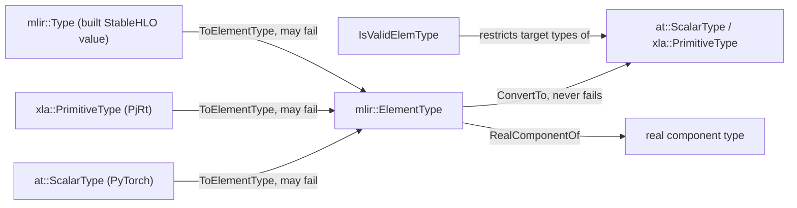
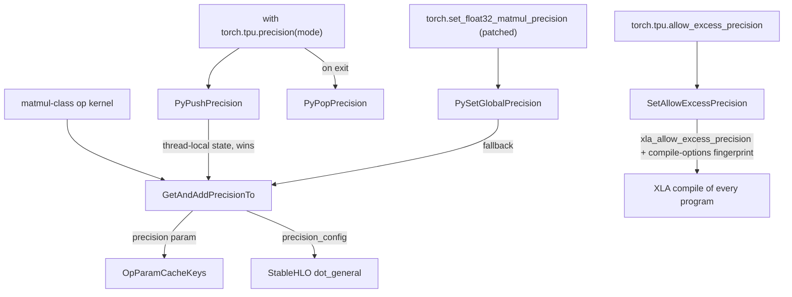

# dtype mapping and matmul precision (Precision, set_float32_matmul_precision, allow_excess_precision)

## Overview
Three separate mechanisms decide the numeric format of what a TPU actually computes in torch_tpu. **(1) dtype translation**: four representations of an element type coexist (`at::ScalarType` from PyTorch, `mlir::ElementType` inside the op builders, `mlir::Type` on built StableHLO values, `xla::PrimitiveType` at the PjRt boundary), and `mlir::ElementType` is the hub every conversion goes through via [`ConvertTo`](../catalog/csrc/common/dtype.h.md#ConvertTo "csrc/common/dtype.h:L95"). **(2) matmul precision**: every matmul-class op stamps a StableHLO `Precision` (`DEFAULT` / `HIGH` / `HIGHEST`, i.e. 1, 3 or 6 bf16 MXU passes) onto its `dot_general`, read from a thread-local `torch.tpu.precision(...)` context or the process-global value behind `torch.set_float32_matmul_precision`, and the value is written into the op's compilation cache key at dispatch through [`GetAndAddPrecisionTo`](../catalog/csrc/ops/precision_context.cc.md#GetAndAddPrecisionTo "csrc/ops/precision_context.cc:L76"). **(3) intermediate rounding**: elementwise ops upcast low-precision inputs to a compute dtype and downcast results, and the global `allow_excess_precision` flag ([`SetAllowExcessPrecision`](../catalog/csrc/common/excess_precision.cc.md#SetAllowExcessPrecision "csrc/common/excess_precision.cc:L54")) decides whether XLA may skip those downcasts inside a fused program. The TPU defaults are tuned for speed and for eager/compiled parity: matmul precision `DEFAULT` (PyTorch reports it as `"medium"`), excess precision **off**.

## Diagram
dtype translation: `mlir::ElementType` is the hub.

Legend:
- `AT` - (concept) PyTorch dtype; converted by [`ToElementType`](../catalog/csrc/common/dtype.cc.md#ToElementType "csrc/common/dtype.cc:L123")
- `XT` - (concept) XLA primitive type; converted by [`ToElementType`](../catalog/csrc/common/dtype.cc.md#ToElementType "csrc/common/dtype.cc:L218")
- `MT` - (concept) MLIR type of a built value; converted by [`ToElementType`](../catalog/csrc/common/dtype.cc.md#ToElementType "csrc/common/dtype.cc:L333")
- `EL` - (concept) the internal element-type enum used by all op builders
- `OUT` - [`ConvertTo`](../catalog/csrc/common/dtype.h.md#ConvertTo "csrc/common/dtype.h:L95")
- `RE` - [`RealComponentOf`](../catalog/csrc/common/dtype.cc.md#RealComponentOf "csrc/common/dtype.cc:L738")
- `CHECK` - [`IsValidElemType`](../catalog/csrc/common/dtype.h.md#IsValidElemType "csrc/common/dtype.h:L68")

Precision and excess precision: who sets what, and where it lands.

Legend:
- `GSET` - (concept) PyTorch global API, monkey-patched by torch_tpu at load
- `PSG` - [`PySetGlobalPrecision`](../catalog/csrc/ops/precision_context.cc.md#PySetGlobalPrecision "csrc/ops/precision_context.cc:L37")
- `CM` - (concept) Python context manager `torch.tpu.precision`
- `PUSH` - [`PyPushPrecision`](../catalog/csrc/ops/precision_context.cc.md#PyPushPrecision "csrc/ops/precision_context.cc:L45")
- `POP` - [`PyPopPrecision`](../catalog/csrc/ops/precision_context.cc.md#PyPopPrecision "csrc/ops/precision_context.cc:L49")
- `KERNEL` - (concept) mm, bmm, addmm, linear, baddbmm, dot, SDPA / flash attention, ragged_dot, scaled_mm, RNN cells
- `GAP` - [`GetAndAddPrecisionTo`](../catalog/csrc/ops/precision_context.cc.md#GetAndAddPrecisionTo "csrc/ops/precision_context.cc:L76")
- `KEYS` - [`OpParamCacheKeys`](../catalog/csrc/common/cache_key.h.md#OpParamCacheKeys "csrc/common/cache_key.h:L541")
- `DOT` - (concept) the generated StableHLO op
- `EXC` - (concept) Python property on `torch.tpu`
- `SAEP` - [`SetAllowExcessPrecision`](../catalog/csrc/common/excess_precision.cc.md#SetAllowExcessPrecision "csrc/common/excess_precision.cc:L54")
- `XLA` - (concept) XLA compiler options for every compilation

## The knobs at a glance

| Knob | API | Default on TPU | Scope | Cache effect | Perf / numerics |
|---|---|---|---|---|---|
| Matmul precision (global) | `torch.set_float32_matmul_precision("medium" / "high" / "highest")` | `DEFAULT` ("medium") | process | per-op cache-key param | `HIGH` ~3 passes, `HIGHEST` ~6 passes of the bf16 MXU; a one-time performance warning fires when the global is not `DEFAULT` |
| Matmul precision (local) | `with torch.tpu.precision(torch.tpu.Precision.HIGHEST):` | unset (falls back to global) | Python thread, nested | per-op cache-key param | overrides the global for ops dispatched inside the block |
| Excess precision | `torch.tpu.allow_excess_precision = True / False` | `False` unless `XLA_FLAGS` explicitly mentions `xla_allow_excess_precision` | process, every compile | part of the compile-options fingerprint, so a flip recompiles | `True` lets XLA keep f32 intermediates instead of rounding back to bf16 between fused ops |
| Output accumulator | `out_dtype=torch.float32` on `bmm` / `mm` etc. | input dtype | per call | changes output shape/type | forces a wider result, not just wider intermediates |

## Design rationale (why it's built this way)

- **One internal enum.** The header comment states the policy: "In most of the op logic, we should use mlir::ElementType. at::ScalarType is only used when interacting with PyTorch. xla::PrimitiveType is only used when interacting with XLA and PjRt." Conversions *into* the hub return `StatusOr` because PyTorch and PjRt can hand torch_tpu types it does not support; conversions *out of* the hub never fail because "all mlir::ElementType values are created by us and should be valid", so they crash on an impossible value instead of burdening every op with error handling. The `at::ScalarType` -> hub and hub -> PyTorch/XLA switches deliberately omit `default:` so that a new enum value becomes a compile error, not a silent fallthrough; the `xla::PrimitiveType` -> hub switch, by contrast, ends in a `default:` that returns an "unsupported XLA PrimitiveType" error.
- **Precision is a cache-key input, not a compile option.** [`GetAndAddPrecisionTo`](../catalog/csrc/ops/precision_context.cc.md#GetAndAddPrecisionTo "csrc/ops/precision_context.cc:L76") both reads the precision and writes it into the op's [`OpParamCacheKeys`](../catalog/csrc/common/cache_key.h.md#OpParamCacheKeys "csrc/common/cache_key.h:L541"); the plain getter beside it is named "unsafe" because "it doesn't ensure that the precision is included in an op's cache key". Making precision part of the key means a `HIGHEST` and a `DEFAULT` matmul of the same shape get different executables, and a deferred op compiled later on a worker thread still uses the precision that was active at dispatch.
- **The TPU global default is `DEFAULT`, not PyTorch's `"highest"`.** The context-state comment says "the default value for global precision is `medium` for TPU", and torch_tpu monkey-patches `torch.set_float32_matmul_precision` / `torch.get_float32_matmul_precision` so the PyTorch API maps onto the TPU global (`medium`->`DEFAULT`, `high`->`HIGH`, `highest`->`HIGHEST`). The Python docstring explains why it matters: "On TPU, float32 matrix multiplications are natively executed in bfloat16."
- **Excess precision defaults off, unlike XLA.** The source notes that XLA's own `DebugOptions` always reports a value (defaulting to true), "making it impossible to distinguish between a user-set value and XLA's internal default", so torch_tpu only honours `XLA_FLAGS` when the string literally contains `xla_allow_excess_precision`, and otherwise uses `false`. Keeping intermediate downcasts makes a fused (Fused eager or `torch.compile`) program round exactly where op-by-op execution would.
- **CUDA-style accumulation.** The accumulate-type helper documents that torch_tpu "mimic[s] CUDA's accumulation behavior (e.g. promoting Float16/BFloat16 to Float32) instead of CPU's behavior because TPUs, like GPUs, benefit from higher precision accumulation", and extends PyTorch's table for types upstream left undefined (UInt16/UInt32 -> Long, UInt64 stays UInt64, Float8/Float4 -> Float, ComplexHalf -> ComplexFloat).

> [!inferred]
> For bf16 elementwise chains, `allow_excess_precision = True` can also be a performance lever: with it off, each fused op keeps an explicit f32->bf16->f32 convert pair at op boundaries (from the compute-dtype upcast/downcast below), which XLA is not allowed to elide. The user docs frame the flag only in numerical terms; any speedup should be measured, and turning it on breaks bitwise parity with Strict eager.

## Entry points
- [`ConvertTo`](../catalog/csrc/common/dtype.h.md#ConvertTo "csrc/common/dtype.h:L106") - the overload every ATen kernel uses to turn an incoming `at::ScalarType` into an `mlir::ElementType` (e.g. `ConvertTo<mlir::ElementType>(target_scalar_type)` in `mm`); this is where an unsupported dtype first surfaces as a `NotImplementedError` naming the dtype.
- [`GetAndAddPrecisionTo`](../catalog/csrc/ops/precision_context.cc.md#GetAndAddPrecisionTo "csrc/ops/precision_context.cc:L76") - called inside every matmul-class kernel (mm, bmm, addmm, addmv, baddbmm, linear, dot/vdot, SDPA and the flash-attention builder, native MHA, ragged_dot, scaled_mm, GRU) while building its cache keys.
- [`PyPushPrecision`](../catalog/csrc/ops/precision_context.cc.md#PyPushPrecision "csrc/ops/precision_context.cc:L45") / [`PyPopPrecision`](../catalog/csrc/ops/precision_context.cc.md#PyPopPrecision "csrc/ops/precision_context.cc:L49") - reached from `torch.tpu.precision(mode)` on block entry and exit.
- [`PySetGlobalPrecision`](../catalog/csrc/ops/precision_context.cc.md#PySetGlobalPrecision "csrc/ops/precision_context.cc:L37") / [`PyGetGlobalPrecision`](../catalog/csrc/ops/precision_context.cc.md#PyGetGlobalPrecision "csrc/ops/precision_context.cc:L41") - reached from the patched `torch.set_float32_matmul_precision` / `torch.get_float32_matmul_precision`.
- [`SetAllowExcessPrecision`](../catalog/csrc/common/excess_precision.cc.md#SetAllowExcessPrecision "csrc/common/excess_precision.cc:L54") - reached from the `torch.tpu.allow_excess_precision` property setter; read back on every compile.

## Mechanism (step-by-step)

1. **Incoming dtype -> hub.** A kernel receives tensors and optional `dtype=` / `out_dtype=` arguments as `at::ScalarType` and converts them with [`ConvertTo`](../catalog/csrc/common/dtype.h.md#ConvertTo "csrc/common/dtype.h:L106"), which calls [`ToElementType`](../catalog/csrc/common/dtype.cc.md#ToElementType "csrc/common/dtype.cc:L123"). Supported: bool (`PRED`), int8/16/32/64, uint8/16/32/64, f16, bf16, f32, f64, complex64/128, and the low-precision formats `float8_e4m3fn`, `float8_e4m3fnuz`, `float8_e5m2`, `float8_e5m2fnuz`, `float8_e8m0fnu` and `float4_e2m1fn_x2`. Everything else (`complex32`, quantized `qint*`, sub-byte `int1..int7` / `uint1..uint7`, `bits*`) returns `kPythonNotImplementedError` with "TorchTPU does not yet support dtype ...", formatted with the PyTorch dtype name by [`ToString`](../catalog/csrc/common/to_string.cc.md#ToString "csrc/common/to_string.cc:L178"). Python scalars of type complex128 are narrowed to complex64 before promotion ("TPU does not support complex128").

2. **Hub -> XLA / PyTorch, and back from built values.** At the PjRt boundary and when wrapping outputs, [`ConvertTo`](../catalog/csrc/common/dtype.h.md#ConvertTo "csrc/common/dtype.h:L95") maps the hub back to `xla::PrimitiveType` or `at::ScalarType`; its template parameter is limited by [`IsValidElemType`](../catalog/csrc/common/dtype.h.md#IsValidElemType "csrc/common/dtype.h:L68") to exactly those three types. Buffers coming *from* PjRt go through [`ToElementType`](../catalog/csrc/common/dtype.cc.md#ToElementType "csrc/common/dtype.cc:L218") (which also accepts XLA's `S2`/`S4`/`U2`/`U4`, f8 variants without a PyTorch twin such as `F8E3M4` and `F8E4M3B11FNUZ`, and the MX `F6`/`F4` types), and op builders that inspect an already-built StableHLO value use [`ToElementType`](../catalog/csrc/common/dtype.cc.md#ToElementType "csrc/common/dtype.cc:L333") on its `mlir::Type`. Complex kernels use [`RealComponentOf`](../catalog/csrc/common/dtype.cc.md#RealComponentOf "csrc/common/dtype.cc:L738") to get the f32/f64 type of the real and imaginary parts.

3. **Compute dtype and accumulation.** Many elementwise kernels choose a computation dtype - for example sigmoid uses the CUDA-style accumulate type of its input (bf16 -> f32), binary ops use the promoted `at::result_type` - and pass it with the op. Before the op builder runs, every input whose element type (read with [`GetTensorTypeOrDie`](../catalog/csrc/ops/op_builder_utils.cc.md#GetTensorTypeOrDie "csrc/ops/op_builder_utils.cc:L475")) differs is wrapped in a StableHLO `convert` to the compute dtype, and every result is converted back to the expected output dtype. This wrapping happens when the [`DeferredOp`](../catalog/csrc/eager/device_buffer.h.md#DeferredOp "csrc/eager/device_buffer.h:L383") is created, so the converts become part of the HLO the compiler sees and can fuse.

4. **Matmul precision is resolved and keyed at dispatch.** A matmul-class kernel calls [`GetAndAddPrecisionTo`](../catalog/csrc/ops/precision_context.cc.md#GetAndAddPrecisionTo "csrc/ops/precision_context.cc:L76") with its param keys. It first looks for a thread-local `precision` context state (pushed by [`PyPushPrecision`](../catalog/csrc/ops/precision_context.cc.md#PyPushPrecision "csrc/ops/precision_context.cc:L45")); if none, it reads the global atomic through [`PyGetGlobalPrecision`](../catalog/csrc/ops/precision_context.cc.md#PyGetGlobalPrecision "csrc/ops/precision_context.cc:L41") and, if that is not `DEFAULT`, emits a once-only performance warning: "TPU is using ... precision as requested, but performance may be significantly lower. Consider using torch.set_float32_matmul_precision('medium') for better performance." The chosen value is stored under the `precision` key in [`OpParamCacheKeys`](../catalog/csrc/common/cache_key.h.md#OpParamCacheKeys "csrc/common/cache_key.h:L541") and captured by value in the op builder, which passes it to the StableHLO matmul as its precision config. Note the precision applies to the op regardless of input dtype - the mechanism is "float32 matmul precision" by name only.

5. **Excess precision is applied per compile.** On every compilation torch_tpu copies the cached default build options (parsed once from `XLA_FLAGS`) and then overwrites `xla_allow_excess_precision` with the value set by [`SetAllowExcessPrecision`](../catalog/csrc/common/excess_precision.cc.md#SetAllowExcessPrecision "csrc/common/excess_precision.cc:L54") (or the `XLA_FLAGS` / `false` fallback when never set). The same value is folded into the compile-options fingerprint used by the compilation cache, so flipping the flag yields new cache entries instead of silently reusing executables built under the other setting.

## Key data structures
- **`mlir::ElementType`** - the closed enum of element types torch_tpu builds HLO with; its short names (`f32`, `bf16`, `f8E4M3FN`, ...) are also the stable fingerprint used in cache keys.
- **Global precision** - a process-wide atomic `mlir::stablehlo::Precision`, initial value `DEFAULT`, written by [`PySetGlobalPrecision`](../catalog/csrc/ops/precision_context.cc.md#PySetGlobalPrecision "csrc/ops/precision_context.cc:L37").
- **`precision` context state** - an `mlir::stablehlo::Precision` node on the per-thread context-state stack (see [context states and execution modes](context-states-and-execution-modes.md)); empty means "use the global".
- **Excess-precision tri-state** - an atomic `unset / allow / disallow`; `unset` resolves once (memoized) from `XLA_FLAGS`.

## Dynamics (design intent)
- Precision is read on the dispatch thread at op creation and travels inside the op's cache key and builder closure; compile workers never consult the context stack. Ops inside a `torch.tpu.precision` block keep their precision even if the fused program is materialized after the block ends.
- The `torch.tpu.precision` context manager inserts an explicit TorchDynamo graph break ("`precision` context manager is not yet traceable by TorchDynamo, so the surrounding frame will fall back to eager execution"), so under `fullgraph=True` it raises; set the global instead for compiled code.
- The user docs warn that "Changing [allow_excess_precision] mid-session forces recompilation, and the TPU XLA runtime can latch the compiler option on the first compilation in a session, ignoring subsequent changes" - set it at the start of the script.

## Edge cases
- **`torch.get_float32_matmul_precision()` returns `"medium"`** on a fresh TPU process, not PyTorch's `"highest"`; scripts that assume full f32 matmuls get single-pass bf16 MXU math with f32 accumulation.
- **Precision values outside DEFAULT/HIGH/HIGHEST** are rejected by both the Python context manager and the patched setter.
- **f64 and complex128 tensors are accepted** as buffer types (they map to `F64` / `C128`), but Python complex scalars are narrowed to complex64.
- **Lossy round trips.** `F8E4M3` (no PyTorch twin) maps to `torch.float8_e4m3fn` when converted to `at::ScalarType`; `F6E2M3FN`, `F6E3M2FN`, `F8E3M4` and `F8E4M3B11FNUZ` have no PyTorch type at all and crash if converted to one, so they can only appear inside kernels.
- **Booleans** are 1-bit `PRED` in XLA but 8-bit in PyTorch; RNG offset accounting uses the PyTorch-equivalent width (8 bits).
- **`out_dtype` vs excess precision.** Excess precision only *permits* wider intermediates; `out_dtype=torch.float32` on `bmm` / `mm` forces a wider result and changes the output tensor.

## Open questions
- `ToAccumulateType`, the compute-dtype `CastInputs` / `CastOutputs` wrapping, `PyUnsafeGetPrecision`, `GetAllowExcessPrecision` and the compile-options fingerprint are central to this page but not in its symbol subgraph; they are described from `csrc/common/dtype.cc`, `csrc/eager/device_buffer_utils.cc`, `csrc/ops/precision_context.cc`, `csrc/common/excess_precision.cc` and `csrc/common/compilation.cc` without citations.
- Whether `HIGH` / `HIGHEST` actually map to 3 / 6 MXU passes on every TPU generation is a lowering detail of libtpu; the Python docstring itself says "precision may vary across different hardwares".
- An RNG-generator TODO in `csrc/eager/device_gen_impl.cc` says materializing the RNG state more eagerly "breaks excess precision functionality currently"; the interaction is not explained in source.

## See also
- [Context states and execution modes](context-states-and-execution-modes.md)
- [Compilation cache key](compilation-cache-key.md)
- [Compilation pipeline](compilation-pipeline.md)
- [StableHLO op builder](stablehlo-op-builder.md)
- [ATen kernel authoring](aten-kernel-authoring.md)
- [Scaled dot-product attention](scaled-dot-product-attention.md)
- [Device streams, generators and RNG](device-streams-generators-and-rng.md)
