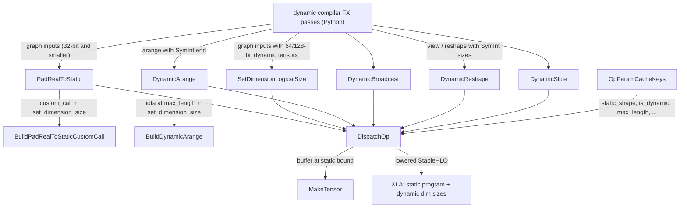

# Bounded dynamic-shape ops (pad_real_to_static, set_dimension_logical_size, dynamic_reshape / broadcast / arange / slice)

## Overview

`csrc/ops/dynamic` is a small set of TPU-internal custom ops that exist for one purpose: let `torch.compile()` graphs with symbolic (SymInt) sizes compile to a **single static-shape XLA program** instead of one program per concrete size. The model is *bounded dynamism*: every dynamic tensor is physically allocated at a static upper bound, and its real ("logical") size travels alongside it as a runtime int32 scalar that XLA attaches to the dimension with `stablehlo.set_dimension_size` (or, for reshape, a bounded `?` dimension). Because the runtime sizes are **tensor inputs** while the bounds and dynamic-dimension masks are **compile-time parameters**, the compilation cache key depends only on the bound, not on the actual size. The ops split into three roles: entering the bounded world ([`PadRealToStatic`](../catalog/csrc/ops/dynamic/pad_real_to_static/pad_real_to_static.cc.md#PadRealToStatic "csrc/ops/dynamic/pad_real_to_static/pad_real_to_static.cc:L100"), [`SetDimensionLogicalSize`](../catalog/csrc/ops/dynamic/set_dimension_logical_size/set_dimension_logical_size.cc.md#SetDimensionLogicalSize "csrc/ops/dynamic/set_dimension_logical_size/set_dimension_logical_size.cc:L44")), producing new bounded tensors ([`DynamicArange`](../catalog/csrc/ops/dynamic/dynamic_arange/dynamic_arange.cc.md#DynamicArange "csrc/ops/dynamic/dynamic_arange/dynamic_arange.cc:L120"), [`DynamicBroadcast`](../catalog/csrc/ops/dynamic/dynamic_broadcast/dynamic_broadcast.cc.md#DynamicBroadcast "csrc/ops/dynamic/dynamic_broadcast/dynamic_broadcast.cc:L47"), [`DynamicReshape`](../catalog/csrc/ops/dynamic/dynamic_reshape/dynamic_reshape.cc.md#DynamicReshape "csrc/ops/dynamic/dynamic_reshape/dynamic_reshape.cc:L49")), and indexing at a runtime offset with a static size ([`DynamicSlice`](../catalog/csrc/ops/dynamic/dynamic_slice/dynamic_slice.cc.md#DynamicSlice "csrc/ops/dynamic/dynamic_slice/dynamic_slice.cc:L44")).

## Diagram

Legend:
- `FX` - (concept) the Python dynamic compiler's graph passes that insert these ops (outside this packet)
- `PRS` - [`PadRealToStatic`](../catalog/csrc/ops/dynamic/pad_real_to_static/pad_real_to_static.cc.md#PadRealToStatic "csrc/ops/dynamic/pad_real_to_static/pad_real_to_static.cc:L100")
- `BPC` - [`BuildPadRealToStaticCustomCall`](../catalog/csrc/ops/dynamic/pad_real_to_static/pad_real_to_static.cc.md#BuildPadRealToStaticCustomCall "csrc/ops/dynamic/pad_real_to_static/pad_real_to_static.cc:L68")
- `SDL` - [`SetDimensionLogicalSize`](../catalog/csrc/ops/dynamic/set_dimension_logical_size/set_dimension_logical_size.cc.md#SetDimensionLogicalSize "csrc/ops/dynamic/set_dimension_logical_size/set_dimension_logical_size.cc:L44")
- `DA` - [`DynamicArange`](../catalog/csrc/ops/dynamic/dynamic_arange/dynamic_arange.cc.md#DynamicArange "csrc/ops/dynamic/dynamic_arange/dynamic_arange.cc:L120")
- `BDA` - [`BuildDynamicArange`](../catalog/csrc/ops/dynamic/dynamic_arange/dynamic_arange.cc.md#BuildDynamicArange "csrc/ops/dynamic/dynamic_arange/dynamic_arange.cc:L46")
- `DB` - [`DynamicBroadcast`](../catalog/csrc/ops/dynamic/dynamic_broadcast/dynamic_broadcast.cc.md#DynamicBroadcast "csrc/ops/dynamic/dynamic_broadcast/dynamic_broadcast.cc:L47")
- `DR` - [`DynamicReshape`](../catalog/csrc/ops/dynamic/dynamic_reshape/dynamic_reshape.cc.md#DynamicReshape "csrc/ops/dynamic/dynamic_reshape/dynamic_reshape.cc:L49")
- `DS` - [`DynamicSlice`](../catalog/csrc/ops/dynamic/dynamic_slice/dynamic_slice.cc.md#DynamicSlice "csrc/ops/dynamic/dynamic_slice/dynamic_slice.cc:L44")
- `KEYS` - [`OpParamCacheKeys`](../catalog/csrc/common/cache_key.h.md#OpParamCacheKeys "csrc/common/cache_key.h:L541")
- `DOP` - [`DispatchOp`](../catalog/csrc/eager/op_dispatcher.h.md#DispatchOp "csrc/eager/op_dispatcher.h:L312")
- `MT` - [`MakeTensor`](../catalog/csrc/eager/tensor_to_buffer.cc.md#MakeTensor "csrc/eager/tensor_to_buffer.cc:L392")
- `XLA` - (concept) the XLA compiler / runtime, which honors dynamic dimension sizes on statically shaped buffers

## Design rationale (why it's built this way)

**Compile for the bound, run for the size.** Every op dispatches with a static `out_dims` - the upper bound (`static_shape`, `max_length`, or the input's own sizes), or for slice the static `slice_sizes` - so the device buffer and the compiled program are static. Only the scalar size tensors vary between calls. The arange header states the pattern directly: "Since the length of the sequence can be dynamic, it takes a `max_length` to allocate a static tensor of that size, and then uses `stablehlo.set_dimension_size` to set the runtime size." The set-size header explains what XLA does with it: it "lowers down to stablehlo.set_dimension_size which XLA uses to determine the runtime size of the padded tensor dimension."

**Sizes are tensors so they stay out of the cache key.** All six kernels use `TT_KERNEL` with a real `param_keys` variable, which hashes every non-tensor argument into the op's [`OpParamCacheKeys`](../catalog/csrc/common/cache_key.h.md#OpParamCacheKeys "csrc/common/cache_key.h:L541") ("any parameters that can change the compilation of the" op). `static_shape`, `is_dynamic`, `broadcast_dims`, `slice_sizes`, `max_length`, `dtype` and `dim` therefore select the program; the runtime sizes are passed as 0-D int32 tensors (int32 or int64 for slice starts) and become ordinary program inputs. Two calls that differ only in real length hit the same compiled executable.

**Two ways to enter the bounded world, chosen by dtype.** [`PadRealToStatic`](../catalog/csrc/ops/dynamic/pad_real_to_static/pad_real_to_static.cc.md#PadRealToStatic "csrc/ops/dynamic/pad_real_to_static/pad_real_to_static.cc:L100") pads a real-sized graph input up to the bound **inside the model module** ("to pad dynamic tensors as part of the model module itself") via an XLA `PadRealToStatic` custom call, so the host can feed the unpadded tensor. [`SetDimensionLogicalSize`](../catalog/csrc/ops/dynamic/set_dimension_logical_size/set_dimension_logical_size.cc.md#SetDimensionLogicalSize "csrc/ops/dynamic/set_dimension_logical_size/set_dimension_logical_size.cc:L44") only annotates an already bound-shaped tensor ("the first `size` elements of the specified dimension being valid and the rest being undefined").

> [!inferred]
> The Python dynamic compiler (outside this packet) prefers PadRealToStatic for graph inputs and falls back to chains of SetDimensionLogicalSize when any dynamic input tensor is 64- or 128-bit; its docstring says XLA "does not support rewriting 64-bit/128-bit element types for PadRealToStatic". In the fallback the host must supply inputs already padded to the bound (a separate pad step), which costs a host or device pad per call.

**Reshape uses a bounded type instead of set-size.** [`DynamicReshape`](../catalog/csrc/ops/dynamic/dynamic_reshape/dynamic_reshape.cc.md#DynamicReshape "csrc/ops/dynamic/dynamic_reshape/dynamic_reshape.cc:L49") is the one op that builds a genuinely dynamic StableHLO type: dynamic dimensions become `?` with their bound attached through a type-extensions attribute, and the op is `stablehlo.dynamic_reshape` fed a concatenated 1-D shape tensor. Reshape cannot be expressed as "static result plus a size annotation" when the dynamic extent moves between dimensions, so it needs the shape operand.

> [!inferred]
> XLA's dynamic padder then rewrites these bounded-dynamic ops into static-shape operations on the bound-sized buffers with size tracking; the code here only emits the StableHLO, so the downstream rewriting is a reading of how set_dimension_size / bounded types are consumed, not something this subsystem implements.

**Arange computes its own length on device.** [`BuildDynamicArange`](../catalog/csrc/ops/dynamic/dynamic_arange/dynamic_arange.cc.md#BuildDynamicArange "csrc/ops/dynamic/dynamic_arange/dynamic_arange.cc:L46") fills all `max_length` slots (`iota * step + start`) and derives the logical length from `start/end/step` tensors, so no host round-trip is needed to learn the sequence length - an eager arange with a tensor-valued end would otherwise force a TPU -> CPU copy of `end`.

**Slice has dynamic offsets but a static size.** [`DynamicSlice`](../catalog/csrc/ops/dynamic/dynamic_slice/dynamic_slice.cc.md#DynamicSlice "csrc/ops/dynamic/dynamic_slice/dynamic_slice.cc:L44") ("Slices a dynamic sub-array from the input tensor at the given runtime start indices with static slice sizes") lowers to `stablehlo.dynamic_slice`; it adds no padding at all, which makes it the cheapest way to index by a runtime position in a compiled graph.

## Entry points

- [`PadRealToStatic`](../catalog/csrc/ops/dynamic/pad_real_to_static/pad_real_to_static.cc.md#PadRealToStatic "csrc/ops/dynamic/pad_real_to_static/pad_real_to_static.cc:L100") - inserted after each dynamic graph-input placeholder; takes the input, one int32 scalar per dimension (`runtime_shape`), the `static_shape` bound and the `is_dynamic` mask.
- [`SetDimensionLogicalSize`](../catalog/csrc/ops/dynamic/set_dimension_logical_size/set_dimension_logical_size.cc.md#SetDimensionLogicalSize "csrc/ops/dynamic/set_dimension_logical_size/set_dimension_logical_size.cc:L44") - inserted per dynamic dimension (chained) when PadRealToStatic cannot be used, and after generative ops whose output must be marked bounded.
- [`DynamicArange`](../catalog/csrc/ops/dynamic/dynamic_arange/dynamic_arange.cc.md#DynamicArange "csrc/ops/dynamic/dynamic_arange/dynamic_arange.cc:L120") - replaces an `arange` whose end is symbolic: "a torch_tpu custom op for use in torch.compile() mode to handle dynamic arange operations on TPU".
- [`DynamicReshape`](../catalog/csrc/ops/dynamic/dynamic_reshape/dynamic_reshape.cc.md#DynamicReshape "csrc/ops/dynamic/dynamic_reshape/dynamic_reshape.cc:L49") - replaces view/reshape ops with symbolic target sizes: "Reshapes the input tensor to a dynamic output shape."
- [`DynamicBroadcast`](../catalog/csrc/ops/dynamic/dynamic_broadcast/dynamic_broadcast.cc.md#DynamicBroadcast "csrc/ops/dynamic/dynamic_broadcast/dynamic_broadcast.cc:L47") - "Broadcasts the input tensor to a dynamic output shape", for expand/broadcast to symbolic sizes.
- [`DynamicSlice`](../catalog/csrc/ops/dynamic/dynamic_slice/dynamic_slice.cc.md#DynamicSlice "csrc/ops/dynamic/dynamic_slice/dynamic_slice.cc:L44") - indexing at runtime start positions with static sizes.

All six are registered as internal TPU ops (the `ImplInternal` block of the aten kernel table) and are called from compiled FX graphs as `torch.ops.tpu._<name>`; they are not meant to be used from user code directly.

## Mechanism (step-by-step)

1. **Kernel prologue and validation.** Each op body runs inside `TT_KERNEL`, which captures the Python context ([`ScopedPythonContextCapturer`](../catalog/csrc/ops/python_context.h.md#ScopedPythonContextCapturer "csrc/ops/python_context.h:L165")), pushes the op name ([`ScopedOpName`](../catalog/csrc/common/op_name_stack.h.md#ScopedOpName "csrc/common/op_name_stack.h:L54")) and computes [`OpParamCacheKeys`](../catalog/csrc/common/cache_key.h.md#OpParamCacheKeys "csrc/common/cache_key.h:L541") from the non-tensor arguments. The body then checks the shape contract: every size tensor is 0-D int32, list lengths equal the rank (`static_shape.size()` or input rank), `broadcast_dims` lie in `[0, rank)`, slice sizes lie in `[0, input.size(i)]`. Violations throw `kInvalidArgument` at trace time, before any HLO is built.

2. **Pad graph inputs to the bound.** [`PadRealToStatic`](../catalog/csrc/ops/dynamic/pad_real_to_static/pad_real_to_static.cc.md#PadRealToStatic "csrc/ops/dynamic/pad_real_to_static/pad_real_to_static.cc:L100") concatenates the input and its per-dimension runtime sizes into one operand list and builds the op with [`BuildPadRealToStaticCustomCall`](../catalog/csrc/ops/dynamic/pad_real_to_static/pad_real_to_static.cc.md#BuildPadRealToStaticCustomCall "csrc/ops/dynamic/pad_real_to_static/pad_real_to_static.cc:L68"): a `stablehlo.custom_call` with target `PadRealToStatic`, `has_side_effect=false`, original API version, all sizes as operands, and a static result type equal to the bound ("On TPU, the custom call pads the physical tensor representation up to the static bounds"). It then applies `set_dimension_size` for each dimension marked dynamic, so downstream ops see a bound-shaped tensor with the real size attached.

3. **Or annotate one dimension.** [`SetDimensionLogicalSize`](../catalog/csrc/ops/dynamic/set_dimension_logical_size/set_dimension_logical_size.cc.md#SetDimensionLogicalSize "csrc/ops/dynamic/set_dimension_logical_size/set_dimension_logical_size.cc:L44") wraps a negative `dim`, requires a 0-D int32 size, and emits a single `stablehlo.set_dimension_size(input, size, dim)` with output dims equal to the input's (bound) sizes. Multiple dynamic dims are handled by chaining calls.

4. **Generate a bounded sequence.** [`DynamicArange`](../catalog/csrc/ops/dynamic/dynamic_arange/dynamic_arange.cc.md#DynamicArange "csrc/ops/dynamic/dynamic_arange/dynamic_arange.cc:L120") requires 0-D `start/end/step` and an integral or floating dtype, then dispatches [`BuildDynamicArange`](../catalog/csrc/ops/dynamic/dynamic_arange/dynamic_arange.cc.md#BuildDynamicArange "csrc/ops/dynamic/dynamic_arange/dynamic_arange.cc:L46"). The builder casts the three scalars with [`CastIfNeeded`](../catalog/csrc/ops/op_builder_utils.cc.md#CastIfNeeded "csrc/ops/op_builder_utils.cc:L1243"), broadcasts start and step to `[max_length]`, computes `iota * step + start`, and computes the length as `(end - start + step - sgn(step)) / step` for integers or `ceil((end - start) / step)` for floats, converted to i32 and clamped at 0 (with a [`MakeScalarConstant`](../catalog/csrc/ops/op_builder_utils.h.md#MakeScalarConstant "csrc/ops/op_builder_utils.h:L338") zero) "to handle case when end < start and step > 0". The result is `set_dimension_size(padded_arange, length, 0)`.

5. **Broadcast or reshape to symbolic sizes.** [`DynamicBroadcast`](../catalog/csrc/ops/dynamic/dynamic_broadcast/dynamic_broadcast.cc.md#DynamicBroadcast "csrc/ops/dynamic/dynamic_broadcast/dynamic_broadcast.cc:L47") emits `broadcast_in_dim` to the static bound with the given `broadcast_dims`, then `set_dimension_size` for every dynamic output dim using the matching size tensor. [`DynamicReshape`](../catalog/csrc/ops/dynamic/dynamic_reshape/dynamic_reshape.cc.md#DynamicReshape "csrc/ops/dynamic/dynamic_reshape/dynamic_reshape.cc:L49") reshapes each 0-D size to `[1]`, concatenates them into a 1-D shape tensor, builds a result type whose dynamic dims are `?` with bounds from `static_shape` (static dims carry no bound), reading element type via [`GetTensorTypeOrDie`](../catalog/csrc/ops/op_builder_utils.cc.md#GetTensorTypeOrDie "csrc/ops/op_builder_utils.cc:L475"), and emits `stablehlo.dynamic_reshape`.

6. **Slice at runtime offsets.** [`DynamicSlice`](../catalog/csrc/ops/dynamic/dynamic_slice/dynamic_slice.cc.md#DynamicSlice "csrc/ops/dynamic/dynamic_slice/dynamic_slice.cc:L44") requires one 0-D start index per input dimension, all int32 or all int64, and emits `stablehlo.dynamic_slice(input, starts, slice_sizes)`; the output shape is exactly `slice_sizes`.

7. **Dispatch at the static shape.** Every op calls [`DispatchOp`](../catalog/csrc/eager/op_dispatcher.h.md#DispatchOp "csrc/eager/op_dispatcher.h:L312") - with fixed arity (`DispatchOp<2>` / `DispatchOp<3>`) for set-size and arange, and `kDynamicSize` arity for the list-taking ops, since "If the number of inputs is unknown at compile time, use kDynamicSize" - passing the builder lambda, the input tensors (data tensor plus size tensors), `out_dtype`, `out_dims` = the static bound, and the param keys. The returned buffer is wrapped by [`MakeTensor`](../catalog/csrc/eager/tensor_to_buffer.cc.md#MakeTensor "csrc/eager/tensor_to_buffer.cc:L392") ("Returns an ATen tensor with the given DeviceBufferRef"), so the ATen tensor that PyTorch sees has the **bound** shape; the logical size lives only in the StableHLO.

> [!inferred]
> Slicing results back to their real sizes is not done by these ops. The Python dynamic executable (outside this packet) tracks symbolic output shapes, picks a size bucket per call, and narrows bound-shaped outputs to their runtime sizes after execution. Likewise, the bound itself comes from the dynamic compiler's bucket upper bounds (bucket size and count are compiler options), so the padding waste per call is roughly (bound - real) / bound of the affected dimension's work.

## Key data structures

- **The (`static_shape`, `is_dynamic`) pair** - the compile-time description of a bounded tensor: per-dimension upper bound plus a mask of which dims carry a runtime size. Both are cache-key parameters.
- **Size tensors** - 0-D int32 TPU tensors, one per dimension (or per dynamic dimension for set-size), produced by the compiled graph from SymInts. Static dims still get a size tensor in the list-taking ops; only dims with `is_dynamic[i]` true receive a `set_dimension_size`.
- [`OpParamCacheKeys`](../catalog/csrc/common/cache_key.h.md#OpParamCacheKeys "csrc/common/cache_key.h:L541") - holds the fingerprints of the static arguments; this is why a change in bound (a new bucket) compiles a new program while a change in real size does not.
- [`Dimensions`](../catalog/csrc/common/dimension_types.h.md#Dimensions "csrc/common/dimension_types.h:L33") - the bound-shaped `out_dims` (and the reshape bounds vector) passed to dispatch.

## Dynamics (design intent)

- **Trace-time vs run-time.** All validation, cache-key computation and StableHLO construction happen when the op is traced/dispatched; the sizes are only read on device. No op in this subsystem reads a size tensor on the host, so none of them introduces a TPU -> CPU sync.
- **Undefined padding.** After `set_dimension_size` the elements beyond the logical size are "undefined" (header of `SetDimensionLogicalSize`); correctness relies on XLA's dynamic-dimension handling to keep reductions and other size-sensitive ops from consuming them.
- **Cost model.** Compute and HBM traffic scale with the bound, not with the real size, for ops that XLA cannot shrink; compilation count scales with the number of distinct bounds (buckets), not with the number of distinct sizes.

## Edge cases

- **Size tensor dtype.** Size inputs must be int32 (`kInt`); passing int64 sizes fails validation. Only `DynamicSlice` start indices may be int64, and then all of them must be.
- **Rank must match.** `PadRealToStatic` requires `input.dim() == static_shape.size()`; `DynamicBroadcast` requires `broadcast_dims.size() == input.dim()`.
- **Negative or reversed arange.** When `end < start` with a positive step, the computed length is clamped to 0; the integer length formula uses `sgn(step)` to get floor/ceil right for negative steps.
- **64-bit inputs** cannot use PadRealToStatic (see rationale); the set-size path is used instead.
- **`DynamicSlice` sizes are static** and must fit within the input's (bound) size in each dimension; only the start is dynamic.
- **Eager use.** These kernels dispatch like any other op, so calling them eagerly produces a bound-shaped ATen tensor whose sizes do not reflect the logical size.

## Open questions

- The Python passes that insert these ops (input padding, generative-op handling, view-op conversion), the bucket selection, and the output-narrowing logic are outside this packet's subgraph; their behavior is summarized in `[!inferred]` blocks from a read of `src/torch_tpu/_internal/compile/dynamic/`.
- How the TPU backend implements the `PadRealToStatic` custom call (on-device pad vs layout trick) is not visible in this repository.
- The `kDynamicSize` constant and the registration table entries are not in the subgraph.

## See also

- [dynamic-shapes-compiler](dynamic-shapes-compiler.md) - the torch.compile dynamic compiler that inserts these ops and buckets sizes.
- [compilation-cache](compilation-cache.md) - how bound-keyed programs are cached and reused.
- [batch-host-device-transfer](batch-host-device-transfer.md) - the unbounded-dynamic (compile-once Mosaic) alternative, used for nonzero.
- [host-device-copy](host-device-copy.md) - the TPU -> CPU syncs these ops help avoid.
