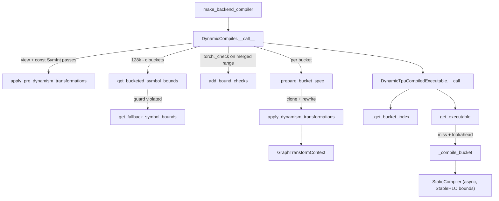

# Dynamic-shapes compiler (bounded dynamism with shape buckets)

## Overview
XLA executables have static shapes, so torch_tpu does not compile "truly dynamic" programs. Instead [`DynamicCompiler`](../catalog/src/torch_tpu/_internal/compile/dynamic/dynamic_compiler.md#DynamicCompiler "src/torch_tpu/_internal/compile/dynamic/dynamic_compiler.py:L113") implements **bounded dynamism**: every symbolic size gets a static upper bound, buffers are allocated at that bound, and the real (logical) size travels alongside as a runtime int32 scalar that bounded-dynamic ops (`tpu._pad_real_to_static`, `tpu._set_dimension_logical_size`, `tpu._dynamic_slice/_reshape/_broadcast/_arange`) respect. To keep padding waste small without one executable per size, the symbol range is cut into up to 8 **buckets** whose upper bounds are aligned so output shapes land on multiples of 128; each bucket is its own static compile. At runtime a dispatcher, [`__call__`](../catalog/src/torch_tpu/_internal/compile/dynamic/dynamic_executable.md#DynamicTpuCompiledExecutable.__call__ "src/torch_tpu/_internal/compile/dynamic/dynamic_executable.py:L515"), picks the smallest bucket that fits the actual sizes and runs that executable. The backend routes a graph here whenever its example inputs contain SymInts with free symbols ([`make_backend_compiler`](../catalog/src/torch_tpu/_internal/compile/_backend.md#make_backend_compiler "src/torch_tpu/_internal/compile/_backend.py:L432")).

## Diagram

Legend:
- `MBC` - [`make_backend_compiler`](../catalog/src/torch_tpu/_internal/compile/_backend.md#make_backend_compiler "src/torch_tpu/_internal/compile/_backend.py:L432")
- `DC` - [`__call__`](../catalog/src/torch_tpu/_internal/compile/dynamic/dynamic_compiler.md#DynamicCompiler.__call__ "src/torch_tpu/_internal/compile/dynamic/dynamic_compiler.py:L217")
- `PRE` - [`apply_pre_dynamism_transformations`](../catalog/src/torch_tpu/_internal/compile/dynamic/graph_transformations.md#apply_pre_dynamism_transformations "src/torch_tpu/_internal/compile/dynamic/graph_transformations.py:L349")
- `BKT` - [`get_bucketed_symbol_bounds`](../catalog/src/torch_tpu/_internal/compile/dynamic/sym_bounds_manager.md#SymBoundsManager.get_bucketed_symbol_bounds "src/torch_tpu/_internal/compile/dynamic/sym_bounds_manager.py:L75")
- `FB` - [`get_fallback_symbol_bounds`](../catalog/src/torch_tpu/_internal/compile/dynamic/sym_bounds_manager.md#SymBoundsManager.get_fallback_symbol_bounds "src/torch_tpu/_internal/compile/dynamic/sym_bounds_manager.py:L41")
- `CHK` - [`add_bound_checks`](../catalog/src/torch_tpu/_internal/compile/dynamic/sym_bounds_manager.md#SymBoundsManager.add_bound_checks "src/torch_tpu/_internal/compile/dynamic/sym_bounds_manager.py:L265")
- `PREP` - [`_prepare_bucket_spec`](../catalog/src/torch_tpu/_internal/compile/dynamic/dynamic_compiler.md#DynamicCompiler._prepare_bucket_spec "src/torch_tpu/_internal/compile/dynamic/dynamic_compiler.py:L173")
- `ADT` - [`apply_dynamism_transformations`](../catalog/src/torch_tpu/_internal/compile/dynamic/graph_transformations.md#apply_dynamism_transformations "src/torch_tpu/_internal/compile/dynamic/graph_transformations.py:L395")
- `CTX` - [`GraphTransformContext`](../catalog/src/torch_tpu/_internal/compile/dynamic/graph_transform_context.md#GraphTransformContext "src/torch_tpu/_internal/compile/dynamic/graph_transform_context.py:L27")
- `DTE` - [`__call__`](../catalog/src/torch_tpu/_internal/compile/dynamic/dynamic_executable.md#DynamicTpuCompiledExecutable.__call__ "src/torch_tpu/_internal/compile/dynamic/dynamic_executable.py:L515")
- `IDX` - [`_get_bucket_index`](../catalog/src/torch_tpu/_internal/compile/dynamic/dynamic_executable.md#DynamicTpuCompiledExecutable._get_bucket_index "src/torch_tpu/_internal/compile/dynamic/dynamic_executable.py:L272")
- `GE` - [`get_executable`](../catalog/src/torch_tpu/_internal/compile/dynamic/dynamic_executable.md#DynamicTpuCompiledExecutable.get_executable "src/torch_tpu/_internal/compile/dynamic/dynamic_executable.py:L438")
- `CB` - [`_compile_bucket`](../catalog/src/torch_tpu/_internal/compile/dynamic/dynamic_executable.md#DynamicTpuCompiledExecutable._compile_bucket "src/torch_tpu/_internal/compile/dynamic/dynamic_executable.py:L417")
- `STATIC` - (concept) the internal static compiler instance, see [torch-compile-backend](torch-compile-backend.md)

## Design rationale (why it's built this way)
- **Bounds instead of recompiles.** A single static executable per bucket covers every size in that bucket's range, so a model whose sequence length varies inside the range never recompiles. [`add_bound_checks`](../catalog/src/torch_tpu/_internal/compile/dynamic/sym_bounds_manager.md#SymBoundsManager.add_bound_checks "src/torch_tpu/_internal/compile/dynamic/sym_bounds_manager.py:L265") turns the merged range into `torch._check(symint >= lower)` / `<= upper` calls inside the backend; the in-code comment says this "forces dynamo to trigger a recompilation if the bound constraint isn't satisfied" - sizes outside every bucket fall back to Dynamo's normal recompile path rather than failing at runtime.
- **128-aligned buckets.** [`get_bucketed_symbol_bounds`](../catalog/src/torch_tpu/_internal/compile/dynamic/sym_bounds_manager.md#SymBoundsManager.get_bucketed_symbol_bounds "src/torch_tpu/_internal/compile/dynamic/sym_bounds_manager.py:L75") documents the rule: for symbol `s` with lower bound / trace-time hint `L` and a constant offset `c` extracted from `s + c` output shapes, the first bucket upper is `ceil((L + c) / step) * step - c` and later buckets step by `bucket_step` (default 128). Subtracting `c` makes the *output* dimension (e.g. `s + 1` after a concat) land on a multiple of 128, not just the input.
- **Every bucket is validated against Dynamo's shape guards.** A candidate upper bound that violates an active guard (e.g. a reshape divisibility constraint) would produce a wrong program, so the whole bucket plan is dropped and [`get_fallback_symbol_bounds`](../catalog/src/torch_tpu/_internal/compile/dynamic/sym_bounds_manager.md#SymBoundsManager.get_fallback_symbol_bounds "src/torch_tpu/_internal/compile/dynamic/sym_bounds_manager.py:L41") uses a single bucket with explicit bounds or `2 x lower bound` for unbounded symbols, raising `ConstraintViolationError` if even that violates a guard.
- **Rewrite per bucket on a cloned graph.** [`_prepare_bucket_spec`](../catalog/src/torch_tpu/_internal/compile/dynamic/dynamic_compiler.md#DynamicCompiler._prepare_bucket_spec "src/torch_tpu/_internal/compile/dynamic/dynamic_compiler.py:L173") deep-copies the graph for each bucket because the rewrite bakes that bucket's static upper bounds into op arguments (slice sizes, reshape shapes, arange max length).
- **Never evaluate a SymBool in the backend.** Passes decide signs and equalities from trace-time hints or static analysis; the slice pass comments that evaluating a SymInt comparison inside the backend "installs a Dynamo guard (unintended specialization and recompiles)". [`_is_negative`](../catalog/src/torch_tpu/_internal/compile/dynamic/view_ops_passes.md#HandleSliceLikeOpsPass._is_negative "src/torch_tpu/_internal/compile/dynamic/view_ops_passes.py:L238") is documented as "without guards".
- **Two ways to make an input dynamic.** Inputs are normally wrapped in-graph with `_pad_real_to_static`; XLA cannot rewrite 64-bit/128-bit element types for that op, so if any dynamic input has an 8- or 16-byte dtype the compiler switches to chained `_set_dimension_logical_size` in-graph plus a separately compiled **pad subgraph** run before the model ([`_compile_and_execute_pad_subgraph`](../catalog/src/torch_tpu/_internal/compile/dynamic/dynamic_executable.md#DynamicTpuCompiledExecutable._compile_and_execute_pad_subgraph "src/torch_tpu/_internal/compile/dynamic/dynamic_executable.py:L151")).
- **Pre-compile all buckets up front.** The constructor defaults `num_lookahead_buckets` to `num_buckets` "so all configured buckets are pre-compiled during warmup (on StaticCompiler's bounded thread pool), avoiding lookahead compilation overhead during steady-state execution".

## Entry points
- [`make_backend_compiler`](../catalog/src/torch_tpu/_internal/compile/_backend.md#make_backend_compiler "src/torch_tpu/_internal/compile/_backend.py:L432") - (outside this unit) the backend's selector; builds a [`DynamicCompiler`](../catalog/src/torch_tpu/_internal/compile/dynamic/dynamic_compiler.md#DynamicCompiler "src/torch_tpu/_internal/compile/dynamic/dynamic_compiler.py:L113") with the user's `num_dynamic_buckets` / `bucket_size` options when example inputs carry free-symbol SymInts.
- [`__call__`](../catalog/src/torch_tpu/_internal/compile/dynamic/dynamic_compiler.md#DynamicCompiler.__call__ "src/torch_tpu/_internal/compile/dynamic/dynamic_compiler.py:L217") - "Called by AOT Autograd to compile the graph" (via the split compiler, once per split submodule, forward and backward). Builds bucket specs, returns the dispatcher.
- [`__call__`](../catalog/src/torch_tpu/_internal/compile/dynamic/view_ops_passes.md#ReplaceDynamicOutputBroadcastOpsPreGradPass.__call__ "src/torch_tpu/_internal/compile/dynamic/view_ops_passes.py:L811") - the pre-grad hook run on the Dynamo graph before AOTAutograd (the dynamic compiler's pre-grad passes).
- [`__call__`](../catalog/src/torch_tpu/_internal/compile/dynamic/dynamic_executable.md#DynamicTpuCompiledExecutable.__call__ "src/torch_tpu/_internal/compile/dynamic/dynamic_executable.py:L515") - per-step execution; reached on every call of the compiled region.
- [`is_symint_node`](../catalog/src/torch_tpu/_internal/compile/dynamic/sym_utils.md#is_symint_node "src/torch_tpu/_internal/compile/dynamic/sym_utils.py:L93") and [`is_symint`](../catalog/src/torch_tpu/_internal/compile/dynamic/sym_utils.md#is_symint "src/torch_tpu/_internal/compile/dynamic/sym_utils.py:L111") - the predicates every pass (and the split compiler's SymInt propagation passes, e.g. [`apply`](../catalog/src/torch_tpu/_internal/compile/fx_passes/propagate_symints.md#apply "src/torch_tpu/_internal/compile/fx_passes/propagate_symints.py:L51")) uses to recognize symbolic sizes.

## Mechanism (step-by-step)
1. **Pre-grad: make returned dynamic views real copies.** Before AOTAutograd, [`__call__`](../catalog/src/torch_tpu/_internal/compile/dynamic/view_ops_passes.md#ReplaceDynamicOutputBroadcastOpsPreGradPass.__call__ "src/torch_tpu/_internal/compile/dynamic/view_ops_passes.py:L811") rewrites returned `expand`/`broadcast_to` with a dynamic target shape into `expand_copy` and clones returned slice/select/narrow views with symbolic indices. The docstring explains why: AOTAutograd regenerates aliased outputs by view replay, skips replay when a view has SymInt arguments, and falls back to `as_strided` on what is, on TPU, a fresh contiguous buffer - reading the wrong window or failing the storage-size check.
2. **Pre-dynamism passes.** [`apply_pre_dynamism_transformations`](../catalog/src/torch_tpu/_internal/compile/dynamic/graph_transformations.md#apply_pre_dynamism_transformations "src/torch_tpu/_internal/compile/dynamic/graph_transformations.py:L349") runs the input-view pass (non-contiguous view placeholders become contiguous base-buffer placeholders followed by explicit view ops, layout computed by [`_decompose_layout`](../catalog/src/torch_tpu/_internal/compile/dynamic/view_decomposition.md#_decompose_layout "src/torch_tpu/_internal/compile/dynamic/view_decomposition.py:L622")) and the constant-SymInt pass (SymInts with zero free symbols, e.g. `Sym(62)`, become plain ints in graph and example inputs). It returns the indices of decomposed view args so the runtime can pass base tensors.
3. **Collect atomic symbols and output shape formulas.** The bounds manager scans example inputs for standalone SymInt inputs (the "atomic" symbols) and requires every symbol appearing in a tensor's shape, stride or offset to also be such an input. [`create_output_sym_shapes`](../catalog/src/torch_tpu/_internal/compile/dynamic/output_sym_shape.md#create_output_sym_shapes "src/torch_tpu/_internal/compile/dynamic/output_sym_shape.py:L264") records, per graph output, each dimension as a constant or a symbolic expression tied to the input `(arg, dim)` it can be read from ([`from_output_node_meta_value`](../catalog/src/torch_tpu/_internal/compile/dynamic/output_sym_shape.md#OutputSymShape.from_output_node_meta_value "src/torch_tpu/_internal/compile/dynamic/output_sym_shape.py:L151")).
4. **Plan buckets.** [`get_bucketed_symbol_bounds`](../catalog/src/torch_tpu/_internal/compile/dynamic/sym_bounds_manager.md#SymBoundsManager.get_bucketed_symbol_bounds "src/torch_tpu/_internal/compile/dynamic/sym_bounds_manager.py:L75") produces contiguous, non-overlapping ranges `[L, B0], [B0+1, B1], ...` per symbol, stops early when every symbol has hit its user-given finite max (the last bucket is stretched to that max to satisfy Dynamo's min/max constraint), and bumps a degenerate `[L, L]` first bucket by one step so ShapeEnv does not specialize the symbol. [`merge_bounds`](../catalog/src/torch_tpu/_internal/compile/dynamic/symbol_bounds.md#SymbolBounds.merge_bounds "src/torch_tpu/_internal/compile/dynamic/symbol_bounds.py:L258") unions the buckets into one range, which feeds [`add_bound_checks`](../catalog/src/torch_tpu/_internal/compile/dynamic/sym_bounds_manager.md#SymBoundsManager.add_bound_checks "src/torch_tpu/_internal/compile/dynamic/sym_bounds_manager.py:L265").
5. **Rewrite one clone per bucket.** For each bucket's [`SymbolBounds`](../catalog/src/torch_tpu/_internal/compile/dynamic/symbol_bounds.md#SymbolBounds "src/torch_tpu/_internal/compile/dynamic/symbol_bounds.py:L218"), [`_prepare_bucket_spec`](../catalog/src/torch_tpu/_internal/compile/dynamic/dynamic_compiler.md#DynamicCompiler._prepare_bucket_spec "src/torch_tpu/_internal/compile/dynamic/dynamic_compiler.py:L173") clones the graph and runs [`apply_dynamism_transformations`](../catalog/src/torch_tpu/_internal/compile/dynamic/graph_transformations.md#apply_dynamism_transformations "src/torch_tpu/_internal/compile/dynamic/graph_transformations.py:L395"), each pass wrapped in a [`GraphTransformObserver`](../catalog/src/torch_tpu/_internal/compile/dynamic/graph_transformations.md#GraphTransformObserver "src/torch_tpu/_internal/compile/dynamic/graph_transformations.py:L38") (so it shows in PyTorch's graph-transform logging). In order:
   - [`__call__`](../catalog/src/torch_tpu/_internal/compile/dynamic/graph_transformations.md#ScanInputsCreatePlaceholdersPass.__call__ "src/torch_tpu/_internal/compile/dynamic/graph_transformations.py:L197") adds an int32 scalar placeholder `<sym>_size` next to every SymInt input - the runtime carrier of the logical size.
   - [`__call__`](../catalog/src/torch_tpu/_internal/compile/dynamic/graph_transformations.md#HandleDynamicInputTensorPass.__call__ "src/torch_tpu/_internal/compile/dynamic/graph_transformations.py:L57") wraps each dynamic input tensor in `tpu._pad_real_to_static(x, sizes, bounded_shape, is_dynamic)`, or [`__call__`](../catalog/src/torch_tpu/_internal/compile/dynamic/graph_transformations.md#HandleDynamicInputTensorSetDimensionSizePass.__call__ "src/torch_tpu/_internal/compile/dynamic/graph_transformations.py:L126") chains `_set_dimension_logical_size` per dynamic dim on the 64/128-bit path.
   - Generative ops: [`_process_arange_op`](../catalog/src/torch_tpu/_internal/compile/dynamic/generative_ops_pass.md#HandleGenerativeOpsPass._process_arange_op "src/torch_tpu/_internal/compile/dynamic/generative_ops_pass.py:L180") emits `tpu._dynamic_arange` sized to the bound (or a static arange times step plus start when only the endpoints are symbolic), [`_process_bounded_size_op`](../catalog/src/torch_tpu/_internal/compile/dynamic/generative_ops_pass.md#HandleGenerativeOpsPass._process_bounded_size_op "src/torch_tpu/_internal/compile/dynamic/generative_ops_pass.py:L326") allocates `ones/zeros/empty/full/rand*` at the upper bound and re-labels the logical size, and [`_process_like_op`](../catalog/src/torch_tpu/_internal/compile/dynamic/generative_ops_pass.md#HandleGenerativeOpsPass._process_like_op "src/torch_tpu/_internal/compile/dynamic/generative_ops_pass.py:L373") does the same for `*_like`.
   - View ops: [`_process_view_op`](../catalog/src/torch_tpu/_internal/compile/dynamic/view_ops_passes.md#HandleReshapeLikeOpsPass._process_view_op "src/torch_tpu/_internal/compile/dynamic/view_ops_passes.py:L100") -> `tpu._dynamic_reshape`, [`_process_broadcast_op`](../catalog/src/torch_tpu/_internal/compile/dynamic/view_ops_passes.md#HandleBroadcastLikeOpsPass._process_broadcast_op "src/torch_tpu/_internal/compile/dynamic/view_ops_passes.py:L163") -> `tpu._dynamic_broadcast`, and the slice family below.
   - [`__call__`](../catalog/src/torch_tpu/_internal/compile/dynamic/graph_transformations.md#HandleSymIntUsagesPass.__call__ "src/torch_tpu/_internal/compile/dynamic/graph_transformations.py:L240") replaces any remaining SymInt argument of a tensor op, or SymInt/scalar graph output, with its tensor node.
   Finally a detection pass raises `NotImplementedError` ("Please set torch.compile(..., dynamic=False, ...)") listing any node that still consumes a SymInt.
6. **Turning symbols into tensors.** All passes go through [`ensure_tensor`](../catalog/src/torch_tpu/_internal/compile/dynamic/graph_transform_context.md#GraphTransformContext.ensure_tensor "src/torch_tpu/_internal/compile/dynamic/graph_transform_context.py:L146") on the shared [`GraphTransformContext`](../catalog/src/torch_tpu/_internal/compile/dynamic/graph_transform_context.md#GraphTransformContext "src/torch_tpu/_internal/compile/dynamic/graph_transform_context.py:L27"). For a SymInt, [`_get_or_create_tensor_node`](../catalog/src/torch_tpu/_internal/compile/dynamic/graph_transform_context.md#GraphTransformContext._get_or_create_tensor_node "src/torch_tpu/_internal/compile/dynamic/graph_transform_context.py:L87") returns the size placeholder for a bare symbol, or lowers a sympy expression (e.g. `s0 * 2 + 1`, `Max`, `Min`) to a chain of aten ops on those placeholders, memoized by expression string so each expression is computed once in-graph. Python constants become `aten.scalar_tensor` (int -> int32). [`get_upper_bound`](../catalog/src/torch_tpu/_internal/compile/dynamic/graph_transform_context.md#GraphTransformContext.get_upper_bound "src/torch_tpu/_internal/compile/dynamic/graph_transform_context.py:L83") delegates to [`get_upper_bound`](../catalog/src/torch_tpu/_internal/compile/dynamic/symbol_bounds.md#SymbolBounds.get_upper_bound "src/torch_tpu/_internal/compile/dynamic/symbol_bounds.py:L296"), which bounds composite expressions with `bound_sympy` over the bucket's symbol ranges.
7. **Slices on bounded buffers.** [`_process_slice_op`](../catalog/src/torch_tpu/_internal/compile/dynamic/view_ops_passes.md#HandleSliceLikeOpsPass._process_slice_op "src/torch_tpu/_internal/compile/dynamic/view_ops_passes.py:L449") (dispatched via [`_op_handlers`](../catalog/src/torch_tpu/_internal/compile/dynamic/view_ops_passes.md#HandleSliceLikeOpsPass._op_handlers "src/torch_tpu/_internal/compile/dynamic/view_ops_passes.py:L227")) normalizes negative indices against the symbolic dim ([`_normalize_index`](../catalog/src/torch_tpu/_internal/compile/dynamic/view_ops_passes.md#HandleSliceLikeOpsPass._normalize_index "src/torch_tpu/_internal/compile/dynamic/view_ops_passes.py:L259")), drops full-extent start-0 slices, and otherwise emits `tpu._dynamic_slice` with slice sizes at the output's upper bound followed by `_set_dimension_logical_size` for each dynamic output dim ([`_dynamic_output_dim_sizes`](../catalog/src/torch_tpu/_internal/compile/dynamic/view_ops_passes.md#HandleSliceLikeOpsPass._dynamic_output_dim_sizes "src/torch_tpu/_internal/compile/dynamic/view_ops_passes.py:L360")). [`_prepare_slice_operand`](../catalog/src/torch_tpu/_internal/compile/dynamic/view_ops_passes.md#HandleSliceLikeOpsPass._prepare_slice_operand "src/torch_tpu/_internal/compile/dynamic/view_ops_passes.py:L295") first sets every dynamic dim of the operand to its upper bound so the window is read from the padded buffer; because XLA clamps `dynamic_slice` starts, it right-pads with a zero block ([`_build_constant_tensor`](../catalog/src/torch_tpu/_internal/compile/dynamic/view_ops_passes.md#HandleSliceLikeOpsPass._build_constant_tensor "src/torch_tpu/_internal/compile/dynamic/view_ops_passes.py:L274")) when `upper(start) + extent` exceeds the bound - the docstring calls out sliding-window masks `m[:, -q_len:]` as the case that materializes a padded copy. [`_process_select_op`](../catalog/src/torch_tpu/_internal/compile/dynamic/view_ops_passes.md#HandleSliceLikeOpsPass._process_select_op "src/torch_tpu/_internal/compile/dynamic/view_ops_passes.py:L616") is a size-1 dynamic slice plus squeeze, [`_process_slice_backward_op`](../catalog/src/torch_tpu/_internal/compile/dynamic/view_ops_passes.md#HandleSliceLikeOpsPass._process_slice_backward_op "src/torch_tpu/_internal/compile/dynamic/view_ops_passes.py:L550") runs `slice_backward` at upper-bound sizes, and [`_process_constant_pad_nd_op`](../catalog/src/torch_tpu/_internal/compile/dynamic/view_ops_passes.md#HandleSliceLikeOpsPass._process_constant_pad_nd_op "src/torch_tpu/_internal/compile/dynamic/view_ops_passes.py:L674") becomes constant blocks concatenated around the input.
8. **Bounded example inputs.** Still in [`_prepare_bucket_spec`](../catalog/src/torch_tpu/_internal/compile/dynamic/dynamic_compiler.md#DynamicCompiler._prepare_bucket_spec "src/torch_tpu/_internal/compile/dynamic/dynamic_compiler.py:L173"), dynamic tensors are replaced by zeros at the bucket's upper-bound shape plus a `TensorBounds(dynamic_dims, uppers)` record, and each SymInt input by its upper bound followed by an int32 tensor for the size placeholder. The bucket spec ([`symbol_bounds`](../catalog/src/torch_tpu/_internal/compile/dynamic/dynamic_executable.md#BucketCompilationSpec.symbol_bounds "src/torch_tpu/_internal/compile/dynamic/dynamic_executable.py:L41"), graph, bounded inputs, bounds) is stored in the dispatcher's [`_bucket_specs`](../catalog/src/torch_tpu/_internal/compile/dynamic/dynamic_executable.md#DynamicTpuCompiledExecutable._bucket_specs "src/torch_tpu/_internal/compile/dynamic/dynamic_executable.py:L99"); nothing is lowered yet.
9. **Runtime dispatch.** [`__call__`](../catalog/src/torch_tpu/_internal/compile/dynamic/dynamic_executable.md#DynamicTpuCompiledExecutable.__call__ "src/torch_tpu/_internal/compile/dynamic/dynamic_executable.py:L515") swaps decomposed view args for their base tensors, then [`_get_bucket_index`](../catalog/src/torch_tpu/_internal/compile/dynamic/dynamic_executable.md#DynamicTpuCompiledExecutable._get_bucket_index "src/torch_tpu/_internal/compile/dynamic/dynamic_executable.py:L272") bisects each symbol's runtime value (read from the arg position in [`_symbol_to_input_loc`](../catalog/src/torch_tpu/_internal/compile/dynamic/dynamic_executable.md#DynamicTpuCompiledExecutable._symbol_to_input_loc "src/torch_tpu/_internal/compile/dynamic/dynamic_executable.py:L224")) into the per-bucket uppers in [`_symbol_bucket_uppers`](../catalog/src/torch_tpu/_internal/compile/dynamic/dynamic_executable.md#DynamicTpuCompiledExecutable._symbol_bucket_uppers "src/torch_tpu/_internal/compile/dynamic/dynamic_executable.py:L257") and takes the max index over symbols. Optionally the pad subgraph runs; [`_get_model_inputs`](../catalog/src/torch_tpu/_internal/compile/dynamic/dynamic_executable.md#DynamicTpuCompiledExecutable._get_model_inputs "src/torch_tpu/_internal/compile/dynamic/dynamic_executable.py:L296") assembles the executable inputs, converting each SymInt value to a device int32 tensor cached per value. The minor-to-major layouts of the dynamic inputs form a layout key.
10. **Compile on miss, with lookahead.** [`get_executable`](../catalog/src/torch_tpu/_internal/compile/dynamic/dynamic_executable.md#DynamicTpuCompiledExecutable.get_executable "src/torch_tpu/_internal/compile/dynamic/dynamic_executable.py:L438") looks up `(bucket_idx, layout_key)` in [`_model_executables`](../catalog/src/torch_tpu/_internal/compile/dynamic/dynamic_executable.md#DynamicTpuCompiledExecutable._model_executables "src/torch_tpu/_internal/compile/dynamic/dynamic_executable.py:L114"); on a miss [`_compile_bucket`](../catalog/src/torch_tpu/_internal/compile/dynamic/dynamic_executable.md#DynamicTpuCompiledExecutable._compile_bucket "src/torch_tpu/_internal/compile/dynamic/dynamic_executable.py:L417") hands the pre-transformed graph, bounded inputs and `TensorBounds` to the internal static compiler (always async, StableHLO bounds on). Before blocking on the current bucket it enqueues compiles for the next `num_lookahead_buckets` buckets with the same layout, so all buckets compile in parallel on the shared pool. Lowering failures evict the entries and are re-raised as `NotImplementedError` advising `dynamic=False`.
11. **Output shapes.** [`_compute_output_shapes`](../catalog/src/torch_tpu/_internal/compile/dynamic/dynamic_executable.md#DynamicTpuCompiledExecutable._compute_output_shapes "src/torch_tpu/_internal/compile/dynamic/dynamic_executable.py:L360") evaluates each output's symbolic shape against the runtime args and passes the resulting `OutputShape` list to the static executable; outputs that were promoted from Python scalars are converted back with `.item()`.

## Key data structures
- [`SymbolBounds`](../catalog/src/torch_tpu/_internal/compile/dynamic/symbol_bounds.md#SymbolBounds "src/torch_tpu/_internal/compile/dynamic/symbol_bounds.py:L218") - "Holds lower and upper bounds for atomic symbols and evaluates symbolic expressions": a `sympy.Symbol -> ValueRanges` map; bounds of composite expressions come from `bound_sympy`. One per bucket, plus the merged one used for guards.
- `BucketCompilationSpec` (frozen dataclass, its [`symbol_bounds`](../catalog/src/torch_tpu/_internal/compile/dynamic/dynamic_executable.md#BucketCompilationSpec.symbol_bounds "src/torch_tpu/_internal/compile/dynamic/dynamic_executable.py:L41") field shown) - the rewritten graph, bounded example inputs and per-input `TensorBounds` for one bucket. Held in [`_bucket_specs`](../catalog/src/torch_tpu/_internal/compile/dynamic/dynamic_executable.md#DynamicTpuCompiledExecutable._bucket_specs "src/torch_tpu/_internal/compile/dynamic/dynamic_executable.py:L99").
- [`_model_executables`](../catalog/src/torch_tpu/_internal/compile/dynamic/dynamic_executable.md#DynamicTpuCompiledExecutable._model_executables "src/torch_tpu/_internal/compile/dynamic/dynamic_executable.py:L114") - the executable cache keyed by `(bucket_idx, layout_key)`; values may be unresolved async artifacts.
- [`GraphTransformContext`](../catalog/src/torch_tpu/_internal/compile/dynamic/graph_transform_context.md#GraphTransformContext "src/torch_tpu/_internal/compile/dynamic/graph_transform_context.py:L27") - per-bucket rewrite state: the bucket's bounds, `sym_str -> size placeholder`, and memo tables from SymInt nodes / expression strings to the tensor nodes computing them.
- The input packing plan (built once in the dispatcher's constructor) - maps each original arg to a slot in the executable's input list (static tensors, dynamic tensors, SymInt scalars, other scalars) plus [`_symbol_to_input_loc`](../catalog/src/torch_tpu/_internal/compile/dynamic/dynamic_executable.md#DynamicTpuCompiledExecutable._symbol_to_input_loc "src/torch_tpu/_internal/compile/dynamic/dynamic_executable.py:L224") for bucket selection.

## Dynamics (design intent)
- Bucket compiles are always asynchronous (the internal static compiler is built with `async_compile=True`) and share the static compiler's 8-worker pool; with default lookahead the first call in bucket `i` enqueues buckets `i+1 .. n-1` before blocking on bucket `i`.
- The per-step dispatch is Python: bucket bisect, input packing, layout-key construction, output-shape evaluation. Because the dispatcher always passes explicit output shapes when the graph has tensor outputs, the static executable takes its Python `execute` path rather than the pre-bound C++ fast runner (which is only used when no output shapes are given) - see [torch-compile-backend](torch-compile-backend.md).

> [!inferred]
> Padding cost is bounded by the bucket step: an input of logical size `n` in a bucket with upper `B` computes on `B` rows (up to `bucket_size - 1` wasted per dynamic dim with tight buckets, more in the fallback `2 x lower` bucket). Raising `num_dynamic_buckets` trades compile time and HBM for executables against less padding. The 128 default plausibly matches the TPU lane width, which is why output dims are aligned to it.

## Edge cases
- Inputs on CPU raise `ValueError` ("CPU tensors are not supported in dynamic shapes compilation").
- A symbol used in a tensor shape/stride/offset that is not also a standalone SymInt input raises `ValueError` at bounds-manager construction.
- Slices with a non-unit step on a dynamic dimension, `slice_backward` with a symbolic start, unbacked SymInt indices whose sign straddles zero, and `constant_pad_nd` with negative or symbolic pads raise `NotImplementedError`.
- A runtime value above every bucket raises `ValueError` in [`_get_bucket_index`](../catalog/src/torch_tpu/_internal/compile/dynamic/dynamic_executable.md#DynamicTpuCompiledExecutable._get_bucket_index "src/torch_tpu/_internal/compile/dynamic/dynamic_executable.py:L272"); normally the `torch._check` guards make Dynamo recompile before that point.
- Conflicting constant offsets for the same symbol across outputs log a warning and keep the first.
- The dispatcher is not picklable (`__reduce__` raises), which is why the backend disables AOTAutograd cache serialization for dynamic graphs: dynamic regions recompile on every process start.
- Any 64-bit or 128-bit dynamic input switches the whole graph to the pad-subgraph path, adding an extra executable launch per call.

## Open questions
- The `HandleSliceLikeOpsPass`, `SymBoundsManager`, `BucketCompilationSpec` and `OutputSymShape` classes themselves are not in the subgraph (only their members), so they are named without citations.
- How `tpu._pad_real_to_static` and `_set_dimension_logical_size` lower to StableHLO bounded dynamism (and whether XLA then skips padded rows in compute) lives in the C++ op layer, not in this unit; see the dynamic-shape ops page.
- Whether steady-state lookahead overhead was the reason for the "TODO: Expose configurable lookahead" note is not stated beyond the comment.

## See also
- [torch-compile-backend](torch-compile-backend.md) - how graphs reach this compiler and how the static compiler builds each bucket.
- [dynamic-shape-ops](dynamic-shape-ops.md) - the C++ bounded-dynamic ops these passes emit.
- [view-decomposition](view-decomposition.md) - view-to-base decomposition used by the input view pass.
- [fx-graph-passes](fx-graph-passes.md) - SymInt propagation across split submodules.
