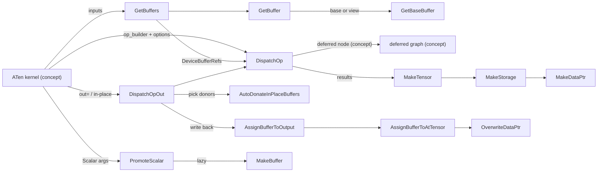

# Eager op dispatch - DispatchOp, tensor-to-buffer binding, and in-place donation

Scope: the `csrc/eager` layer that sits between a registered ATen kernel and the deferred-op graph -
`op_dispatcher.{h,cc}` (dispatch API, scalar promotion, donation) and `tensor_to_buffer.cc` (the
at::Tensor <-> DeviceBufferRef bridge and the PrivateUse1 allocators).

## Overview

Every torch_tpu ATen kernel ends in the same three moves: (1) unwrap its at::Tensor inputs into
device-buffer handles with [`GetBuffers`](../catalog/csrc/eager/tensor_to_buffer.cc.md#GetBuffers "csrc/eager/tensor_to_buffer.cc:L369"),
(2) hand a StableHLO "op builder" lambda plus output shapes/dtypes to
[`DispatchOp`](../catalog/csrc/eager/op_dispatcher.h.md#DispatchOp "csrc/eager/op_dispatcher.h:L312"),
which records a deferred node and returns result handles, and (3) wrap those handles back into
at::Tensors with [`MakeTensor`](../catalog/csrc/eager/tensor_to_buffer.cc.md#MakeTensor "csrc/eager/tensor_to_buffer.cc:L392")
or write them into existing out/in-place tensors with
[`DispatchOpOut`](../catalog/csrc/eager/op_dispatcher.h.md#DispatchOpOut "csrc/eager/op_dispatcher.h:L455").
The key design idea, stated in the header comment, is that whether execution "happens right away
(immediate execution) or it is deferred to later (deferred execution) is an implementation detail
and is not controlled through this API": the kernel only describes *what* to compute and *how to
cache it* (op name + `op_param_cache_keys`); the eager mode decides *when*. A tensor's
`c10::DataPtr` does not point at device memory; it points at a heap-allocated DeviceBufferRef, so
"writing" a tensor means swapping which DeviceBufferRef that pointer holds.

## Diagram

Legend:
- `K` - (concept) a TT_KERNEL-registered ATen kernel
- `GBS` - [`GetBuffers`](../catalog/csrc/eager/tensor_to_buffer.cc.md#GetBuffers "csrc/eager/tensor_to_buffer.cc:L369")
- `GB` - [`GetBuffer`](../catalog/csrc/eager/tensor_to_buffer.cc.md#GetBuffer "csrc/eager/tensor_to_buffer.cc:L350")
- `GBB` - [`GetBaseBuffer`](../catalog/csrc/eager/tensor_to_buffer.cc.md#GetBaseBuffer "csrc/eager/tensor_to_buffer.cc:L317")
- `DO` - [`DispatchOp`](../catalog/csrc/eager/op_dispatcher.h.md#DispatchOp "csrc/eager/op_dispatcher.h:L312")
- `DEF` - (concept) the deferred-op graph; see [deferred execution](deferred-execution-and-materialization.md)
- `MT` - [`MakeTensor`](../catalog/csrc/eager/tensor_to_buffer.cc.md#MakeTensor "csrc/eager/tensor_to_buffer.cc:L392")
- `MS` - [`MakeStorage`](../catalog/csrc/eager/tensor_to_buffer.cc.md#MakeStorage "csrc/eager/tensor_to_buffer.cc:L380")
- `MDP` - [`MakeDataPtr`](../catalog/csrc/eager/tensor_to_buffer.cc.md#MakeDataPtr "csrc/eager/tensor_to_buffer.cc:L655")
- `DOO` - [`DispatchOpOut`](../catalog/csrc/eager/op_dispatcher.h.md#DispatchOpOut "csrc/eager/op_dispatcher.h:L455")
- `ADB` - [`AutoDonateInPlaceBuffers`](../catalog/csrc/eager/op_dispatcher.cc.md#AutoDonateInPlaceBuffers "csrc/eager/op_dispatcher.cc:L239")
- `ABO` - [`AssignBufferToOutput`](../catalog/csrc/eager/op_dispatcher.cc.md#AssignBufferToOutput "csrc/eager/op_dispatcher.cc:L271")
- `ABT` - [`AssignBufferToAtTensor`](../catalog/csrc/eager/tensor_to_buffer.cc.md#AssignBufferToAtTensor "csrc/eager/tensor_to_buffer.cc:L134")
- `ODP` - [`OverwriteDataPtr`](../catalog/csrc/eager/tensor_to_buffer.cc.md#OverwriteDataPtr "csrc/eager/tensor_to_buffer.cc:L120")
- `PS` - [`PromoteScalar`](../catalog/csrc/eager/op_dispatcher.cc.md#PromoteScalar "csrc/eager/op_dispatcher.cc:L302")
- `MB` - [`MakeBuffer`](../catalog/csrc/eager/op_dispatcher.cc.md#MakeBuffer "csrc/eager/op_dispatcher.cc:L67")

## Design rationale (why it's built this way)

**Kernels describe, the runtime schedules.** Because [`DispatchOp`](../catalog/csrc/eager/op_dispatcher.h.md#DispatchOp "csrc/eager/op_dispatcher.h:L312")
always returns DeviceBufferRefs to a freshly recorded deferred node (never a raw device pointer),
the same kernel code serves the debugging `DeferNever` mode, the fusing `DeferAndFuse` mode and the
`torch.compile` FX-tracing mode. For TPU performance this is the whole game: per-op XLA executables
are slow to compile and cannot fuse, so the dispatcher's job is to make every op cheap to *record*
and let materialization batch many of them into one StableHLO module. Note that the out-of-the-box
eager mode is `DeferNever` (each op is launched as its own program, asynchronously); fusion across
ops requires `TORCH_TPU_DEFER_AND_FUSE=1` or the eager-mode context, while `TORCH_TPU_LAUNCH_BLOCKING`
selects the blocking debug mode.

**The cache key is the kernel author's responsibility.** The header documents that the op name
alone is enough for parameterless ops (relu, abs) but a parameterized op (gelu's `approximate`)
must populate `op_param_cache_keys` in [`DispatchOpOptions`](../catalog/csrc/eager/op_dispatcher.h.md#DispatchOpOptions "csrc/eager/op_dispatcher.h:L108");
otherwise two semantically different builders would collide in the compilation cache. A missing
key is a silent-correctness bug, an over-specific key is a recompilation (perf) bug.

**Arity is a compile-time contract.** [`OpInputs`](../catalog/csrc/eager/op_dispatcher.h.md#OpInputs "csrc/eager/op_dispatcher.h:L262")
and [`DeviceBufferRefArray`](../catalog/csrc/eager/op_dispatcher.h.md#DeviceBufferRefArray "csrc/eager/op_dispatcher.h:L215")
map `kArity`/`kNumOutputs` to `at::Tensor` / `std::array` / `std::vector` so a kernel that passes
the wrong number of tensors does not compile; only `kDynamicSize` defers the check to runtime.

**Scalars are arguments in eager, constants under compile.** [`MakeBuffer`](../catalog/csrc/eager/op_dispatcher.cc.md#MakeBuffer "csrc/eager/op_dispatcher.cc:L67")
comments: in eager modes "scalars are treated as arguments to increase code reuse, as the benefit
of constant folding is not justified at the risk of over-specialization and recompilation"; only in
the internal compile-FX-graph mode does a scalar become a `stablehlo.constant` emitted through a
0-ary `DispatchOp` (op name `kScalarTensor`), letting XLA constant-fold. This is a deliberate
trade of peak per-graph performance for executable reuse across steps whose learning rate, loss
scale or step counter changes.

**Writes swap pointers, never mutate buffers.** XLA buffers are immutable, so
[`AssignBufferToAtTensor`](../catalog/csrc/eager/tensor_to_buffer.cc.md#AssignBufferToAtTensor "csrc/eager/tensor_to_buffer.cc:L134")
emulates an in-place write by replacing the DeviceBufferRef that the storage's DataPtr points at.
[`OverwriteDataPtr`](../catalog/csrc/eager/tensor_to_buffer.cc.md#OverwriteDataPtr "csrc/eager/tensor_to_buffer.cc:L120")
keeps the heap address stable because PyTorch may hold "borrowing" DataPtrs that share the same
`data_` pointer; overwriting in place makes the write visible to every alias at once.

**Donation is on by default but conservative.** Reusing an input HBM buffer for the output (XLA buffer
donation) avoids an extra allocation per in-place op, but donating a buffer that some other tensor
still references would be a use-after-free. Automatic in-place donation is enabled unless the
`TORCH_TPU_INTERNAL_DISABLE_INPLACE_BUFFER_DONATION` env var is set, and it only fires when every
one of the six invariants listed above
[`AutoDonateInPlaceBuffers`](../catalog/csrc/eager/op_dispatcher.cc.md#AutoDonateInPlaceBuffers "csrc/eager/op_dispatcher.cc:L239")
(aliasing, eager mode, dense layout, matching dtype, single donation, unique ownership) holds.

## Entry points

- [`DispatchOp`](../catalog/csrc/eager/op_dispatcher.h.md#DispatchOp "csrc/eager/op_dispatcher.h:L312") - the functional dispatch template; reached from essentially every ATen kernel (657 outside symbols depend on this unit) once its op builder and output shapes are known. Author intent: "Dispatches an op with the given number of inputs (kArity) and given number of outputs (kNumOutputs). This function enforces the number inputs or outputs at compile time."
- [`DispatchOpOut`](../catalog/csrc/eager/op_dispatcher.h.md#DispatchOpOut "csrc/eager/op_dispatcher.h:L455") - the `out=` / in-place variant (`add_`, `copy_`-style kernels): auto-detects donation, calls `DispatchOp`, then resizes and rebinds the destination tensors.
- [`MakeTensor`](../catalog/csrc/eager/tensor_to_buffer.cc.md#MakeTensor "csrc/eager/tensor_to_buffer.cc:L392") - wraps a result DeviceBufferRef into a new contiguous PrivateUse1 at::Tensor; the last line of most functional kernels.
- [`PromoteScalar`](../catalog/csrc/eager/op_dispatcher.cc.md#PromoteScalar "csrc/eager/op_dispatcher.cc:L302") (plus the optional and [array overload](../catalog/csrc/eager/op_dispatcher.cc.md#PromoteScalar "csrc/eager/op_dispatcher.cc:L321")) - called when a kernel receives an `at::Scalar`; returns a lazy wrapper so the scalar is only turned into a device buffer if the kernel actually needs a tensor. Replaces the deprecated scalar [`MakeTensor`](../catalog/csrc/eager/op_dispatcher.cc.md#MakeTensor "csrc/eager/op_dispatcher.cc:L295").
- [`MakeEmptyTensor`](../catalog/csrc/eager/tensor_to_buffer.cc.md#MakeEmptyTensor "csrc/eager/tensor_to_buffer.cc:L775") / [`MakeEmptyMemoryFormat`](../catalog/csrc/eager/tensor_to_buffer.cc.md#MakeEmptyMemoryFormat "csrc/eager/tensor_to_buffer.cc:L720") - back `aten::empty` and internal scratch allocation with a deferred "fill uninitialized" node instead of real memory.
- [`AssignBufferToAtTensor`](../catalog/csrc/eager/tensor_to_buffer.cc.md#AssignBufferToAtTensor "csrc/eager/tensor_to_buffer.cc:L134") - the low-level write primitive used by `DispatchOpOut`, copy kernels and collectives to make an existing tensor (or a view of it) observe a new buffer.
- [`RegisterTpuAllocator`](../catalog/csrc/eager/tensor_to_buffer.cc.md#RegisterTpuAllocator "csrc/eager/tensor_to_buffer.cc:L650") - installed at startup; makes [`GetTpuAllocator`](../catalog/csrc/eager/tensor_to_buffer.cc.md#GetTpuAllocator "csrc/eager/tensor_to_buffer.cc:L636") the c10 allocator and [`GetTpuPinnedAllocator`](../catalog/csrc/eager/tensor_to_buffer.cc.md#GetTpuPinnedAllocator "csrc/eager/tensor_to_buffer.cc:L641") the host (pinned) allocator for the PrivateUse1 device.

## Mechanism (step-by-step)

1. **Guard and name the op.** [`DispatchOp`](../catalog/csrc/eager/op_dispatcher.h.md#DispatchOp "csrc/eager/op_dispatcher.h:L312")
   first returns any sticky (previously latched) error, then reads the op name from the active
   TT_KERNEL() context - it hard-crashes if called outside one. An explicit
   [`op_name`](../catalog/csrc/eager/op_dispatcher.h.md#DispatchOpOptions.op_name "csrc/eager/op_dispatcher.h:L113")
   override is allowed only if it *differs* from the context name (a redundant override is also a
   crash), which keeps the [`OpName`](../catalog/csrc/ops/op_names.h.md#OpName "csrc/ops/op_names.h:L29")
   recorded in the graph - and therefore the cache key and the xprof module name - honest.

2. **Unwrap inputs to buffers (views become deferred ops here).** The inputs are flattened with
   [`GetTensorSpan`](../catalog/csrc/eager/op_dispatcher.h.md#GetTensorSpan "csrc/eager/op_dispatcher.h:L270")
   and converted by [`GetBuffers`](../catalog/csrc/eager/tensor_to_buffer.cc.md#GetBuffers "csrc/eager/tensor_to_buffer.cc:L369").
   [`GetBuffer`](../catalog/csrc/eager/tensor_to_buffer.cc.md#GetBuffer "csrc/eager/tensor_to_buffer.cc:L350")
   reads the storage's "contiguous base" via [`GetBaseBuffer`](../catalog/csrc/eager/tensor_to_buffer.cc.md#GetBaseBuffer "csrc/eager/tensor_to_buffer.cc:L317")
   and returns it unchanged only when the tensor is non-conjugate, contiguous, at offset 0, and its
   resolved TPU layout matches the base's dims and dtype. Any other view (transpose, slice,
   dtype-reinterpret) is turned into an *ephemeral* `as_strided` deferred op over the base. Perf
   consequence: views are free to create in Python but each use of a non-trivial view adds a
   gather/slice/transpose node to the next compiled graph, and nothing caches the view result.

3. **Record the deferred node.** For each arity case `DispatchOp` packs op name, the builder
   (adapted to the dynamic MLIR builder signature), `op_param_cache_keys`, the input buffers, the
   output `Shape`s built from `out_dtype(s)`/`out_dims`, `computation_dtype`,
   `split_mode`,
   `donated_indices` and `device_assignment` into deferred-op parameters and hands them to the
   deferred layer (see [deferred execution and materialization](deferred-execution-and-materialization.md)).
   That layer decides, by eager mode, whether the node is launched now or left to fuse. Before
   that, a test-only hook compares the op's base name against
   [`GetOpDispatchFailure`](../catalog/csrc/eager/op_dispatcher.cc.md#GetOpDispatchFailure "csrc/eager/op_dispatcher.cc:L205")
   (set via [`SetOpDispatchFailure`](../catalog/csrc/eager/op_dispatcher.cc.md#SetOpDispatchFailure "csrc/eager/op_dispatcher.cc:L210"))
   to inject failures. The result vector is reshaped to `DeviceBufferRef`, `std::array` or
   `std::vector` per [`DeviceBufferRefArray`](../catalog/csrc/eager/op_dispatcher.h.md#DeviceBufferRefArray "csrc/eager/op_dispatcher.h:L215").

4. **Wrap results into tensors.** [`MakeTensor`](../catalog/csrc/eager/tensor_to_buffer.cc.md#MakeTensor "csrc/eager/tensor_to_buffer.cc:L392")
   derives the ATen dtype from the buffer's MLIR element type (halving the last dim for packed FP4,
   whose TPU buffer stores one 4-bit value per byte), and builds a storage with
   [`MakeStorage`](../catalog/csrc/eager/tensor_to_buffer.cc.md#MakeStorage "csrc/eager/tensor_to_buffer.cc:L380")
   whose byte size is the buffer's logical `size_bytes`. The DataPtr from
   [`MakeDataPtr`](../catalog/csrc/eager/tensor_to_buffer.cc.md#MakeDataPtr "csrc/eager/tensor_to_buffer.cc:L655")
   owns a `new DeviceBufferRef` as both data and context and increments the buffer slot's live
   DataPtr count; its deleter decrements it via
   [`RemoveDataPtrAlias`](../catalog/csrc/eager/tensor_to_buffer.cc.md#RemoveDataPtrAlias "csrc/eager/tensor_to_buffer.cc:L91").
   That live count is what later lets materialization treat unreferenced intermediates as dead and
   lets donation prove exclusive ownership.

5. **Out/in-place: choose donors, dispatch, write back.** [`DispatchOpOut`](../catalog/csrc/eager/op_dispatcher.h.md#DispatchOpOut "csrc/eager/op_dispatcher.h:L455")
   first calls [`AutoDonateInPlaceBuffers`](../catalog/csrc/eager/op_dispatcher.cc.md#AutoDonateInPlaceBuffers "csrc/eager/op_dispatcher.cc:L239"),
   which is a no-op unless the caller left `donated_indices` empty, in-place donation is enabled,
   and the eager mode is a DeferNever variant. For each defined output it picks the first unused
   input that passes [`IsEligibleDonor`](../catalog/csrc/eager/op_dispatcher.cc.md#IsEligibleDonor "csrc/eager/op_dispatcher.cc:L155")
   (output aliases input, dense, offset 0, not conjugate, non-empty, same shape and dtype, and on
   TPU the base buffer has `live_data_ptrs <= 1`), then marks that input and every storage alias of
   it as donated so no buffer is donated twice. After `DispatchOp` returns,
   [`AssignBuffersToOutputs`](../catalog/csrc/eager/op_dispatcher.cc.md#AssignBuffersToOutputs "csrc/eager/op_dispatcher.cc:L281")
   / [`AssignBufferToOutput`](../catalog/csrc/eager/op_dispatcher.cc.md#AssignBufferToOutput "csrc/eager/op_dispatcher.cc:L271")
   resize each output if its shape differs and bind the new buffer.

6. **Bind a buffer to an existing tensor.** [`AssignBufferToAtTensor`](../catalog/csrc/eager/tensor_to_buffer.cc.md#AssignBufferToAtTensor "csrc/eager/tensor_to_buffer.cc:L134")
   checks element type and element count against the tensor's resolved TPU layout (view-equivalent
   shapes like (100,) vs (10,10) are allowed). If the write is a *full, contiguous, non-conjugate
   overwrite* of the storage, the result buffer simply becomes the new base ("last write wins",
   so `b = a.view(10,10); b.add_(1)` can flip which shape is the base). Otherwise the write is a
   partial/strided update and the new base is an `as_strided` *inverse* deferred op combining old
   base and written values. The old base is donated into it only when the caller passes
   `enable_autodonation` (default false; the `DispatchOpOut` write-back path does not), the write
   is not a full overwrite, it does not widen a bool buffer, and this was the base's last live
   DataPtr. Either way
   [`OverwriteDataPtr`](../catalog/csrc/eager/tensor_to_buffer.cc.md#OverwriteDataPtr "csrc/eager/tensor_to_buffer.cc:L120")
   swaps the referent and the TensorImpl version is bumped for functionalization/autograd.
   [`AssignBufferAsStorageBase`](../catalog/csrc/eager/tensor_to_buffer.cc.md#AssignBufferAsStorageBase "csrc/eager/tensor_to_buffer.cc:L294")
   is the fast variant for a pure byte-reinterpretation of the whole storage, gated by
   [`IsFullStorageReinterpretView`](../catalog/csrc/eager/tensor_to_buffer.cc.md#IsFullStorageReinterpretView "csrc/eager/tensor_to_buffer.cc:L268").

7. **Scalars: promote lazily, cache per thread.** [`PromoteScalar`](../catalog/csrc/eager/op_dispatcher.cc.md#PromoteScalar "csrc/eager/op_dispatcher.cc:L302")
   wraps the value in a closure that calls [`MakeBuffer`](../catalog/csrc/eager/op_dispatcher.cc.md#MakeBuffer "csrc/eager/op_dispatcher.cc:L67")
   only on demand. In eager modes `MakeBuffer` looks up a `thread_local` map keyed by (value, dtype);
   on a miss it builds a CPU scalar tensor, casts it, and starts a non-blocking host-to-device copy
   (visible in xprof as a `ScalarBuffer_<value>` TraceMe), caching the resulting materialized
   buffer. Complex128 is narrowed to complex64. [`EncodeParamCacheKey`](../catalog/csrc/eager/op_dispatcher.cc.md#EncodeParamCacheKey "csrc/eager/op_dispatcher.cc:L216")
   encodes only *whether* an optional promoted scalar is present (`"s"` vs empty), never its value,
   so changing a scalar does not change the cache key.

8. **Allocation without memory.** When PyTorch itself allocates storage (e.g. `resize_`), the
   TPU allocator's [`allocate`](../catalog/csrc/eager/tensor_to_buffer.cc.md#TpuAllocator.allocate "csrc/eager/tensor_to_buffer.cc:L437")
   creates a deferred `uint8[nbytes]` "empty" node and wraps it with `MakeDataPtr` - no HBM is
   touched until the buffer is materialized. Its [`copy_data`](../catalog/csrc/eager/tensor_to_buffer.cc.md#TpuAllocator.copy_data "csrc/eager/tensor_to_buffer.cc:L463")
   throws, since raw byte copies have no meaning for a handle. The pinned host allocator's
   [`allocate`](../catalog/csrc/eager/tensor_to_buffer.cc.md#TpuPinnedAllocator.allocate "csrc/eager/tensor_to_buffer.cc:L553")
   uses the PJRT host-memory allocator and tracks pointers so
   [`IsTpuPinnedPtr`](../catalog/csrc/eager/tensor_to_buffer.cc.md#IsTpuPinnedPtr "csrc/eager/tensor_to_buffer.cc:L645")
   can recognize `pin_memory()` buffers for fast host-device transfers.

## Key data structures

- **[`DispatchOpOptions`](../catalog/csrc/eager/op_dispatcher.h.md#DispatchOpOptions "csrc/eager/op_dispatcher.h:L108")** - transient (must not be stored: it references temporaries) per-call options, specialized for 1, N>=2 and dynamic outputs. Perf-relevant fields: `computation_dtype` (upcast all inputs before the builder, then cast outputs back - used by clamp/softmax-style ops), `op_param_cache_keys` (compilation-cache identity), `split_mode` (force a graph break before/after this op), `donated_indices` (explicit donation, used by custom kernels), and `device_assignment` (rank-to-device mapping for collectives/Pallas).
- **Storage DataPtr -> DeviceBufferRef** - built by [`MakeDataPtr`](../catalog/csrc/eager/tensor_to_buffer.cc.md#MakeDataPtr "csrc/eager/tensor_to_buffer.cc:L655"); the storage "base" read by [`GetBaseBuffer`](../catalog/csrc/eager/tensor_to_buffer.cc.md#GetBaseBuffer "csrc/eager/tensor_to_buffer.cc:L317") is the only persistent buffer; views are recomputed from it.
- **Per-thread scalar cache** - inside [`MakeBuffer`](../catalog/csrc/eager/op_dispatcher.cc.md#MakeBuffer "csrc/eager/op_dispatcher.cc:L67"); keeps one device buffer per distinct (scalar, dtype) per dispatch thread, never evicted.

## Dynamics (design intent)

- Donation detection runs only in DeferNever modes; the source comment for [`AutoDonateInPlaceBuffers`](../catalog/csrc/eager/op_dispatcher.cc.md#AutoDonateInPlaceBuffers "csrc/eager/op_dispatcher.cc:L239") says "In deferred execution (kDeferAndFuse), automated donation is currently not done" - buffer reuse there is left to whole-graph XLA buffer assignment. Tests in `csrc/eager/op_dispatcher_test.cc` exercise donor selection (aliasing, multiple outputs, clones).
- The exclusive-ownership check exists because torch_tpu's TPU-to-TPU copy implements `.clone()` as shallow buffer sharing: a clone and its source have different storages (so `is_alias_of` is false) but the same buffer, detected only by `live_data_ptrs() > 1` in [`IsEligibleDonor`](../catalog/csrc/eager/op_dispatcher.cc.md#IsEligibleDonor "csrc/eager/op_dispatcher.cc:L155").
- The scalar cache is deliberately `thread_local` "to avoid synchronization overhead", accepting missed reuse across threads ([`MakeBuffer`](../catalog/csrc/eager/op_dispatcher.cc.md#MakeBuffer "csrc/eager/op_dispatcher.cc:L67")).
- [`MaterializeAndReturn`](../catalog/csrc/eager/tensor_to_buffer.cc.md#MaterializeAndReturn "csrc/eager/tensor_to_buffer.cc:L663") is the tensor-level bridge into materialization: if base and view buffers live on different device/stream pairs it first blocks until the base has *started* materializing, otherwise it materializes both jointly in split-graph mode; it is emitted as a `MaterializeAndReturn` TraceMe.

> [!inferred]
> In a training step with many changing Python scalars (lr schedules, grad-scaler factors), eager
> mode pays one small host-to-device copy per new distinct value per thread but keeps the same
> compiled executable; values that never repeat (e.g. a step counter) make the per-thread scalar
> map grow without bound. Neither cost is measured in the source.

## Edge cases

- Calling [`DispatchOp`](../catalog/csrc/eager/op_dispatcher.h.md#DispatchOp "csrc/eager/op_dispatcher.h:L312") outside a TT_KERNEL() context, or with a redundant `.op_name` override, is a CHECK-crash, not a Python error.
- [`GetBaseBuffer`](../catalog/csrc/eager/tensor_to_buffer.cc.md#GetBaseBuffer "csrc/eager/tensor_to_buffer.cc:L317") rejects null storage pointers with a NotImplementedError that names FakeTensor: running TPU kernels on fake tensors is unsupported.
- Writing into an overlapping (self-aliasing) strided view is rejected rather than silently racing; clone or `contiguous()` first.
- FP4 (`float4_e2m1fn_x2`): PyTorch packs 2 values per byte but the TPU buffer holds one per byte, so [`MakeEmptyMemoryFormat`](../catalog/csrc/eager/tensor_to_buffer.cc.md#MakeEmptyMemoryFormat "csrc/eager/tensor_to_buffer.cc:L720") doubles the last dim and [`MakeTensor`](../catalog/csrc/eager/tensor_to_buffer.cc.md#MakeTensor "csrc/eager/tensor_to_buffer.cc:L392") halves it; the last dim must be even. `complex32` is rejected outright.
- Writing non-bool data into a bool base buffer forces a dtype change of the storage and disables donation ([`AssignBufferToAtTensor`](../catalog/csrc/eager/tensor_to_buffer.cc.md#AssignBufferToAtTensor "csrc/eager/tensor_to_buffer.cc:L134")).
- A zero-element write is a no-op and does not bump the tensor version.
- The donation guard in [`IsEligibleDonor`](../catalog/csrc/eager/op_dispatcher.cc.md#IsEligibleDonor "csrc/eager/op_dispatcher.cc:L155") only consults buffer ownership for PrivateUse1 tensors, so C++ unit tests on CPU tensors exercise layout rules without a TPU.

## Open questions

- The deferred-node constructor reached from step 3 (the deferred-op params struct and its "create deferred device buffer list" function), the lazy scalar wrapper type, the sticky-error check, the op-name stack, the inverse-view builder and the CPU-to-TPU copy used by scalar promotion are all outside this packet's subgraph, so they are described here only by behavior; see [deferred execution and materialization](deferred-execution-and-materialization.md) for the deferred-node side.
- The scalar cache has no eviction or size bound in the source; whether that matters for long runs is not established.
- Whether DeferAndFuse ever gets per-op auto-donation (the comment says "currently not done") is open.

## See also

- [Deferred execution and materialization](deferred-execution-and-materialization.md) - what happens to the node `DispatchOp` records.
- [Tensor synchronization](tensor-synchronization.md) - forcing materialization from Python.
- [ATen kernel authoring](aten-kernel-authoring.md), [view decomposition](view-decomposition.md), [compilation cache key](compilation-cache-key.md), [context states and execution modes](context-states-and-execution-modes.md), [StableHLO op builder](stablehlo-op-builder.md).
