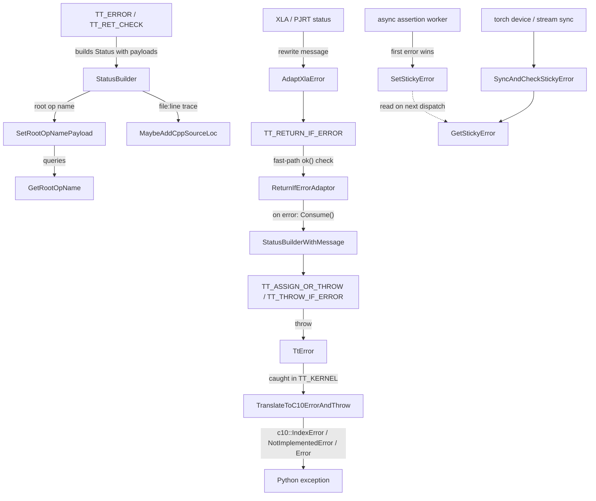

# Error handling - TT_* status macros, the throw boundary, and the sticky error latch

## Overview
torch_tpu's C++ core never throws in its interior. Every fallible helper returns an `absl::Status` or `absl::StatusOr<T>`, built and propagated by a family of `TT_*` macros in `csrc/common/error_utils.h` whose engine is [`StatusBuilder`](../catalog/csrc/common/status_builder.h.md#StatusBuilder "csrc/common/status_builder.h:L63"). Only at the PyTorch boundary - the top of a PyTorch-registered kernel (the `TT_KERNEL` macro), a Python-bound API wrapped by the pybind error helper, or another runtime callback such as the TPU device guard - is a failed Status turned into an exception: a [`TtError`](../catalog/csrc/common/error_utils.h.md#TtError "csrc/common/error_utils.h:L348") carrying the original Status. `TT_KERNEL` and the pybind wrapper catch it and call [`TranslateToC10ErrorAndThrow`](../catalog/csrc/common/error_utils.cc.md#TranslateToC10ErrorAndThrow "csrc/common/error_utils.cc:L1223"), which re-throws it as the `c10::Error` subclass that PyTorch maps to the right Python exception type; a `TtError` that reaches PyTorch without passing through either (a case its constructor anticipates) surfaces as a plain `std::runtime_error` carrying its pre-rendered message. Two pieces of metadata ride along in the Status payload rather than the message: the name of the user-visible ("root") ATen op, and an optional C++ error trace. A separate, process-global **sticky error** handles the one case the synchronous model cannot: a failure detected later, on another thread, after the op that caused it has already returned to Python.

The single design idea is that the success path must cost almost nothing - a predicted-taken branch on an `ok()` bit, no heap allocation, no string formatting - because these macros wrap every step of op dispatch and lowering, and the sticky-error check runs on every op dispatch.

## Diagram
How an error is born, propagated, and surfaced to Python (synchronous path), and how the sticky latch injects an asynchronous failure into that path.

Legend:
- `ERR` - (concept) the `TT_ERROR` / `TT_RET_CHECK` macros, which expand to a [`StatusBuilder`](../catalog/csrc/common/status_builder.h.md#StatusBuilder "csrc/common/status_builder.h:L63")
- `SB` - [`StatusBuilder`](../catalog/csrc/common/status_builder.h.md#StatusBuilder "csrc/common/status_builder.h:L63")
- `RON` - [`SetRootOpNamePayload`](../catalog/csrc/common/status_builder.cc.md#SetRootOpNamePayload "csrc/common/status_builder.cc:L136")
- `GRON` - [`GetRootOpName`](../catalog/csrc/ops/python_context.cc.md#GetRootOpName "csrc/ops/python_context.cc:L325")
- `LOC` - [`MaybeAddCppSourceLoc`](../catalog/csrc/common/status_builder.cc.md#MaybeAddCppSourceLoc "csrc/common/status_builder.cc:L148")
- `PROP` - (concept) the `TT_RETURN_IF_ERROR` / `TT_ASSIGN_OR_RETURN` propagation macros
- `RIE` - [`ReturnIfErrorAdaptor`](../catalog/csrc/common/error_utils.h.md#ReturnIfErrorAdaptor "csrc/common/error_utils.h:L831")
- `SBM` - [`StatusBuilderWithMessage`](../catalog/csrc/common/status_builder.h.md#StatusBuilderWithMessage "csrc/common/status_builder.h:L195")
- `XLA` - (concept) a Status returned by the XLA compiler or PJRT runtime
- `AXE` - [`AdaptXlaError`](../catalog/csrc/common/error_utils.cc.md#AdaptXlaError "csrc/common/error_utils.cc:L986")
- `THROW` - (concept) the throwing macros, legal only in PyTorch-registered callbacks
- `TTE` - [`TtError`](../catalog/csrc/common/error_utils.h.md#TtError "csrc/common/error_utils.h:L348")
- `TC10` - [`TranslateToC10ErrorAndThrow`](../catalog/csrc/common/error_utils.cc.md#TranslateToC10ErrorAndThrow "csrc/common/error_utils.cc:L1223")
- `PY` - (concept) the Python exception PyTorch raises from the `c10::Error`
- `ASYNC` - (concept) the background worker that checks `torch._assert_async` conditions
- `SSE` - [`SetStickyError`](../catalog/csrc/common/error_utils.cc.md#SetStickyError "csrc/common/error_utils.cc:L935")
- `GSE` - [`GetStickyError`](../catalog/csrc/common/error_utils.cc.md#GetStickyError "csrc/common/error_utils.cc:L946")
- `SYNC` - (concept) `torch.tpu.synchronize()` / stream synchronize, implemented by the device guard
- `SCSE` - [`SyncAndCheckStickyError`](../catalog/csrc/common/error_utils.cc.md#SyncAndCheckStickyError "csrc/common/error_utils.cc:L972")

## Design rationale (why it's built this way)
- **Status inside, exceptions only at the PyTorch boundary.** The header states the rule directly: the throwing macros "should only be used in callbacks registered with the PyTorch runtime", and "compilation will fail if these macros are used in a function that returns a Status or StatusOr - this is intended (throwing in a helper function may lead to undefined behavior if a caller isn't compiled with exceptions enabled)". The enforcement is a compile-time trick: the throwing macros embed a dead `return AnythingCompatibleWithThrow();` whose conversion operator `static_assert`s that the enclosing function does not return a raw pointer, `absl::Status`, or `absl::StatusOr<>`. The check is only active in internal (clang) builds; in the OSS build the macro is a no-op.
- **A message is mandatory, and checked twice.** [`StatusBuilder`](../catalog/csrc/common/status_builder.h.md#StatusBuilder "csrc/common/status_builder.h:L63") "cannot be implicitly converted to absl::Status ... but the result of `builder << message` can", so `return TT_ERROR(code);` with no `<<` is a compile error (a templated conversion operator that always fails its `static_assert`). Streaming an empty string still compiles, so `CreateStatus()` also `ABSL_CHECK`s a non-empty message at runtime ("Did you forget to stream anything into the TT_* macro?"). Propagation paths return [`StatusBuilderWithMessage`](../catalog/csrc/common/status_builder.h.md#StatusBuilderWithMessage "csrc/common/status_builder.h:L195") instead, because the original Status already carries a message.
- **The OK path is engineered to be free.** The builder keeps all state in a lazily allocated `Rep`, and `InitRep` returns `nullptr` for an OK status, so an OK builder is one null pointer; every method is a no-op on `nullptr`. The `stringstream` inside `Rep` is itself lazily created ("it's expensive to construct"). [`ReturnIfErrorAdaptor`](../catalog/csrc/common/error_utils.h.md#ReturnIfErrorAdaptor "csrc/common/error_utils.h:L831") "avoids constructing a StatusBuilder on the fast path": it holds the Status in a union so the compiler emits no destructor call, relying on the fact that an OK or moved-from `absl::Status` owns no memory. All macro branches use `ABSL_PREDICT_TRUE` / `ABSL_PREDICT_FALSE`. Even the constructors are out of line "to reduce binary size" ([`StatusBuilder`](../catalog/csrc/common/status_builder.cc.md#StatusBuilder.StatusBuilder "csrc/common/status_builder.cc:L58")).
- **Debug context lives in payloads, not in the message.** The C++ trace and the root op name are stored under `type.googleapis.com/torch_tpu.cpp_error_trace` and `.../torch_tpu.root_op_name`, so code that rewrites a message (prepend, override, XLA adaptation) keeps them; `JoinMessageToStatus` copies both payloads onto the new status. The trace is only recorded when `TORCH_SHOW_CPP_STACKTRACES` is enabled, read once and cached for the process lifetime (default on for internal builds, off for OSS).
- **Crash versus error.** User mistakes become a Status with a Python-meaningful code; torch_tpu bugs crash. [`CheckDeviceIsTpu`](../catalog/csrc/common/error_utils.cc.md#CheckDeviceIsTpu "csrc/common/error_utils.cc:L904") is the canonical example: "If the check fails, it's a bug in the torch_tpu implementation, so we crash with a C++ stack trace instead of returning an error." Every deliberate crash site in the codebase is annotated `// CRASH_OK=<reason>`.
- **Why a sticky error exists at all.** `torch._assert_async` must not block the host, and the source comment in `csrc/ops/assertion_aten_kernels.cc` explains why the check cannot run on the TPU: a device-side assertion "permanently halts the execution core", wedging "lockstep pod execution", and StableHLO has no runtime assert. So the condition is checked on a host worker thread, and a failure must be reported on whatever op happens to run next - which needs process-global state.

## Entry points
- [`StatusBuilder`](../catalog/csrc/common/status_builder.h.md#StatusBuilder "csrc/common/status_builder.h:L63") - reached through `TT_ERROR(code) << ...` and `TT_RET_CHECK(cond, code) << ...` whenever a helper detects a bad argument, shape, or dtype; also used directly with `.SetPrepend()` / `.SetOverride()` to re-word an existing Status.
- [`ReturnIfErrorAdaptor`](../catalog/csrc/common/error_utils.h.md#ReturnIfErrorAdaptor "csrc/common/error_utils.h:L831") - the object behind `TT_RETURN_IF_ERROR`, `TT_THROW_IF_ERROR` and `TT_CHECK_THROW`; control reaches it at every propagation step, on both the OK and error paths. [`GetStatus`](../catalog/csrc/common/error_utils.h.md#GetStatus "csrc/common/error_utils.h:L326") lets the same macro accept a `Status` or a `StatusOr<T>`.
- [`AdaptXlaError`](../catalog/csrc/common/error_utils.h.md#AdaptXlaError "csrc/common/error_utils.h:L231") - wrapped around calls into OpenXLA/PJRT: `CompileAndLoad` in compiled mode, loading serialized executables for `torch.compile`, PJRT execute and host-device transfer, and Mosaic custom-call HLO construction.
- [`TranslateToC10ErrorAndThrow`](../catalog/csrc/common/error_utils.cc.md#TranslateToC10ErrorAndThrow "csrc/common/error_utils.cc:L1223") - invoked by the `catch (const TtError&)` clause inside every `TT_KERNEL` body, i.e. exactly once per failing ATen op.
- [`SetStickyError`](../catalog/csrc/common/error_utils.cc.md#SetStickyError "csrc/common/error_utils.cc:L935") - called by the asynchronous assertion machinery when a `torch._assert_async` condition is false, or when materializing / copying the condition tensor fails.
- [`SyncAndCheckStickyError`](../catalog/csrc/common/error_utils.cc.md#SyncAndCheckStickyError "csrc/common/error_utils.cc:L972") - called at the end of the TPU device guard's `synchronizeStream` and `synchronizeDevice`, so an explicit sync is the deterministic point where a pending async assertion failure surfaces.
- [`ClearStickyError`](../catalog/csrc/common/error_utils.cc.md#ClearStickyError "csrc/common/error_utils.cc:L979") - "Used for testing."; resets the latch after draining pending checks.

## Mechanism (step-by-step)
1. **Creating an error.** `TT_ERROR(code)` expands to `StatusBuilder(MaybeAddCppSourceLoc(SetRootOpNamePayload(absl::Status(code, ""), GetRootOpName(std::nullopt)), TT_NORMALIZED_FILE, __LINE__, __func__))`. [`GetRootOpName`](../catalog/csrc/ops/python_context.cc.md#GetRootOpName "csrc/ops/python_context.cc:L325") returns the first entry of the active Python-context op call chain (the user-visible ATen op even when the failure is deep inside a decomposition), [`SetRootOpNamePayload`](../catalog/csrc/common/status_builder.cc.md#SetRootOpNamePayload "csrc/common/status_builder.cc:L136") stores it, and [`MaybeAddCppSourceLoc`](../catalog/csrc/common/status_builder.cc.md#MaybeAddCppSourceLoc "csrc/common/status_builder.cc:L148") appends `file:line: function()` to the trace payload if traces are enabled. The file path is pre-normalized by [`NormalizeIfInsideBuildDirectory`](../catalog/csrc/common/macro_utils.cc.md#NormalizeIfInsideBuildDirectory "csrc/common/macro_utils.cc:L64") so `bazel-out/...` prefixes do not leak into messages. `TT_RET_CHECK` wraps the same thing in `if (ABSL_PREDICT_TRUE(cond)) ; else return ...`, written that way so a dangling `else` in caller code binds correctly, and so the `<<` operands are evaluated only on failure.

2. **Composing the message.** Each `<<` on the builder ([`operator<<`](../catalog/csrc/common/status_builder.h.md#StatusBuilder.operator "csrc/common/status_builder.h:L267")) appends to the lazily created stream and returns a [`StatusBuilderWithMessage`](../catalog/csrc/common/status_builder.h.md#StatusBuilderWithMessage "csrc/common/status_builder.h:L195"), which is what converts implicitly to `absl::Status`. On conversion, `JoinMessageToStatus` appends (default), prepends (`SetPrepend()`, no separator inserted) or overrides (`SetOverride()`) the original message, keeping the status code and copying the trace and root-op payloads across.

3. **Propagating.** `TT_RETURN_IF_ERROR(expr)` builds a [`ReturnIfErrorAdaptor`](../catalog/csrc/common/error_utils.h.md#ReturnIfErrorAdaptor "csrc/common/error_utils.h:L831") from [`GetStatus`](../catalog/csrc/common/error_utils.h.md#GetStatus "csrc/common/error_utils.h:L326")`(expr)` inside an `if` whose `else` branch returns `adaptor.Consume(file, line, func)`; `Consume` appends the propagation site to the trace and hands back a builder with message, so callers may chain `<< " in Foo"`. `TT_ASSIGN_OR_RETURN(lhs, rexpr[, error_expr])` does the same for `StatusOr`, exposing the error to `error_expr` as a builder named `_` (for example `_.SetPrepend() << "context: "`). The resulting trace reads origin-first, one line per hop, which is what `error_utils_cpp_context_test.cc` asserts. `TT_ASSIGN_OR_*` refuse `StatusOr<T&>` at compile time via [`is_status_or_ref`](../catalog/csrc/common/error_utils.h.md#is_status_or_ref "csrc/common/error_utils.h:L1164") ("it's easy to bind the value to a T object, creating a new copy").

4. **Adapting XLA errors.** When the compiler or runtime fails, [`AdaptXlaError`](../catalog/csrc/common/error_utils.cc.md#AdaptXlaError "csrc/common/error_utils.cc:L986") cleans the external message and rebuilds it as `<context> -- the XLA compiler failed with: <cleaned message>` using `StatusBuilder(...).SetOverride()`. The status code survives, but the override goes through `JoinMessageToStatus`, which builds a fresh Status and copies only torch_tpu's own two payloads (the C++ trace, when traces are enabled, and the root op name); any other payload XLA attached is dropped, even though the header comment says payloads are preserved. The `StatusOr` overload in the header passes OK values straight through. For performance work this is the message shape to grep for when a compile fails (for example an HBM OOM at compile time).

5. **Crossing into PyTorch.** Inside a kernel body, `TT_ASSIGN_OR_THROW` / `TT_THROW_IF_ERROR` / `TT_CHECK_THROW` throw a [`TtError`](../catalog/csrc/common/error_utils.h.md#TtError "csrc/common/error_utils.h:L348") holding the Status and the throw site. Its constructor ([`TtError`](../catalog/csrc/common/error_utils.cc.md#TtError.TtError "csrc/common/error_utils.cc:L1211")) pre-renders a `std::runtime_error` message for ops "that aren't migrated to TT_KERNEL yet". `TT_KERNEL` catches it and calls [`TranslateToC10ErrorAndThrow`](../catalog/csrc/common/error_utils.cc.md#TranslateToC10ErrorAndThrow "csrc/common/error_utils.cc:L1223"), which formats `root_op(): message` (plus the C++ trace and stack per the environment policy) and switches on the code: `kPythonIndexError` (an alias of `kOutOfRange`) -> `c10::IndexError`, `kPythonNotImplementedError` (`kUnimplemented`) -> `c10::NotImplementedError`, everything else -> `c10::Error` (Python `RuntimeError`). Choosing the right code is therefore how a kernel author picks the Python exception type.

6. **Latching an asynchronous failure.** [`SetStickyError`](../catalog/csrc/common/error_utils.cc.md#SetStickyError "csrc/common/error_utils.cc:L935") ignores OK statuses, takes a mutex, and stores the status only if none is stored yet ("first error wins"), then sets a cache-line-aligned `std::atomic<bool>` with release ordering. The fast check `HasStickyError()` is a relaxed load of that flag; the header comment explains it "runs on the critical path of every op dispatch", reads no payload, and the slow path [`GetStickyError`](../catalog/csrc/common/error_utils.cc.md#GetStickyError "csrc/common/error_utils.cc:L946") takes the mutex, which supplies the acquire/release synchronization needed to see the full Status. Op dispatch returns the sticky Status instead of building the op, and the next assertion call throws it.

7. **Draining at sync points.** [`SyncAndCheckStickyError`](../catalog/csrc/common/error_utils.cc.md#SyncAndCheckStickyError "csrc/common/error_utils.cc:L972") first waits on a condition variable until the count of pending assertion checks reaches zero, then throws the sticky error if one was recorded. This gives users a deterministic place to observe assertion failures: after `synchronize()`, all scheduled checks have finished. [`ClearStickyError`](../catalog/csrc/common/error_utils.cc.md#ClearStickyError "csrc/common/error_utils.cc:L979") performs the same drain before resetting both the stored Status and the flag.

## Key data structures
- **The Status payloads.** `cpp_error_trace`: a multi-line `absl::Cord`, origin first, each line `<file>:<line>: <function>()`. `root_op_name`: the ATen op name shown as the `xxx(): ` message prefix.
- **`StatusBuilder::Rep`** (inside [`StatusBuilder`](../catalog/csrc/common/status_builder.h.md#StatusBuilder "csrc/common/status_builder.h:L63")): the original status, an optional `stringstream` of extra message, and a join style (`kAppend`, `kPrepend`, `kOverride`). `rep_ == nullptr` means "OK"; the copy constructor ([`StatusBuilder`](../catalog/csrc/common/status_builder.h.md#StatusBuilder.StatusBuilder "csrc/common/status_builder.h:L222")) deep-copies `Rep` only when present.
- **[`TtError`](../catalog/csrc/common/error_utils.h.md#TtError "csrc/common/error_utils.h:L348")**: a `std::runtime_error` plus the non-OK `absl::Status` (invariant checked in the constructor) and the `c10::SourceLocation` it was thrown from, so translation can preserve both.
- **Sticky state** (file-local in `error_utils.cc`): `g_sticky_error` (mutex-guarded `absl::Status`), `g_has_sticky_error` (atomic flag, `alignas(64)` "to prevent false sharing with other frequently mutated global variables on the hot dispatch path"), and `g_pending_assertions` with its mutex and condition variable.
- **Error-code aliases** in the `error` namespace: the usual absl codes plus `kIndexError` / `kPythonIndexError` (both `kOutOfRange`), `kPythonNotImplementedError` (`kUnimplemented`) and `kPythonRuntimeError` (`kUnknown`).

## Dynamics (design intent)
- **Ordering.** Payload propagation is strictly additive along the call stack: every `TT_RETURN_IF_ERROR` / `TT_ASSIGN_OR_RETURN` hop appends one line, as `error_utils_cpp_context_test.cc` checks line by line. `TT_ASSIGN_OR_THROW` deliberately does not add a trace line itself "because TT_THROW_TT_ERROR_ already does that" (it records the throw site in the `TtError`).
- **Threading.** The sticky flag is a monotonic latch (false -> true) except for the test-only clear. Writers serialize on a mutex; the per-dispatch reader is lock-free. The assertion worker increments the pending count before scheduling and decrements it in a cleanup handler, so a sync cannot return while a check is in flight.
- **Environment policy for traces.** `TORCH_SHOW_CPP_STACKTRACES` is read once (`GetBooleanEnvOnce`) and cached; changing it after the first error has no effect. For a `TtError` reaching PyTorch unintercepted, torch_tpu appends the C++ stack itself (PyTorch only does so for `c10::Error`).

> [!inferred]
> Performance consequences that follow from the source but are not stated as such: (a) an error check that passes costs roughly one predicted branch, which is why the macros can wrap every lowering step without showing up in host-side dispatch profiles; (b) scheduling a `torch._assert_async` check calls `MaterializeAndReturn(..., kCpuTransfer)` on the condition tensor, so although the host does not wait for the result, each async assertion still forces execution of the deferred graph that produces the condition - in a training step this behaves like an extra materialization point and can split the step graph; (c) once a sticky error is set, every later dispatch fails fast, so the first assertion failure effectively poisons the process until it is handled.

## Edge cases
- `TT_ERROR(code) << ""` compiles but crashes in `CreateStatus()`; `SetOverride()` with an empty message is likewise fatal (`AssignOrReturnDeathTest.CrashesIfOverriddenWithEmptyMessage`).
- `TT_ASSIGN_OR_*` expand to several statements and cannot be the unbraced body of an `if`. The throwing macros cannot be used inside a void-returning lambda; convert it to a named function.
- `TT_ASSIGN_OR_CRASH` is for invariants: it `ABSL_CHECK`s / `LOG(FATAL)`s the status message and never returns an error.
- Only the first sticky error is kept; later failures are dropped silently until [`ClearStickyError`](../catalog/csrc/common/error_utils.cc.md#ClearStickyError "csrc/common/error_utils.cc:L979").
- The `TT_STATIC_ASSERT_RETURN_TYPE_NOT_STATUS_` guard is a no-op in OSS builds, so misuse of a throwing macro in a Status-returning helper is only caught internally.
- Error-message format guideline checks (`CheckErrorMessageFollowsGuidelines`) run only when `TT_CHECKS_ERROR_FORMAT` is set (internal debug builds).

## Open questions
- `IsXlaOomError` (a status-code plus `"allocation_size"` substring heuristic, marked TODO) and `AdaptVfioDeviceCollisionError` (rewrites libtpu "Couldn't open vfio container" into a `TPU_VISIBLE_DEVICES` hint listing the colliding PIDs) are part of this subsystem but are not in the packet subgraph; their callers were not traced here.
- `HasStickyError`, `DispatchOp`, `TT_KERNEL`, the assertion worker (`ScheduleAsyncAssertionCheck`) and the device guard's sync methods are central to the flow but outside the subgraph; they are described from source in prose without catalog links.
- Whether a set sticky error is ever cleared outside tests (for example on device reset) is not settled by the files read.

## See also
- [eager-op-dispatch](eager-op-dispatch.md) - where the per-dispatch sticky check sits.
- [aten-kernel-authoring](aten-kernel-authoring.md) - the `TT_KERNEL` macro that owns the throw boundary.
- [op-names-and-python-context](op-names-and-python-context.md) - how the root op name in error messages is captured.
- [deferred-execution-and-materialization](deferred-execution-and-materialization.md) - why an async assertion still materializes its condition tensor.
- [compilation-pipeline](compilation-pipeline.md) - where XLA compile errors are adapted.
- [tensor-synchronization](tensor-synchronization.md) - the sync points that drain pending assertion checks.
