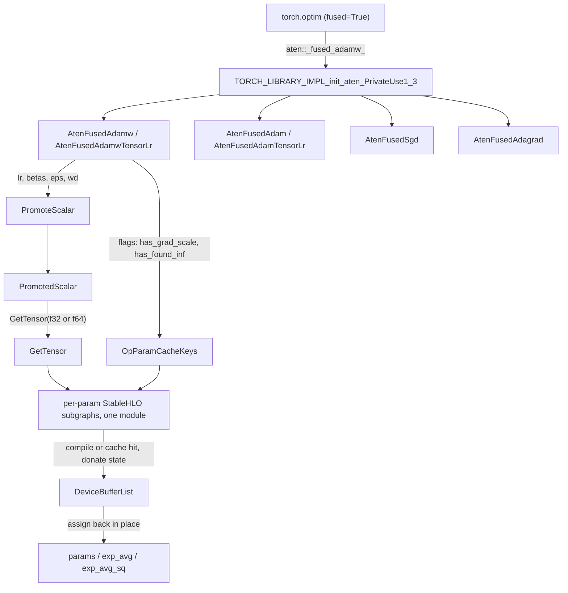

# Fused optimizer kernels (_fused_adam / _fused_adamw / _fused_sgd / _fused_adagrad) lowered to one multi-tensor StableHLO program

When a PyTorch optimizer is built with `fused=True`, `torch.optim` calls one ATen op per param group (`aten::_fused_adam_`, `_fused_adamw_`, `_fused_sgd_`, `_fused_adagrad_`) that carries the whole tensor lists. This page covers how torch_tpu implements those ops and why the choices it makes matter for optimizer-step time and HBM.

## Overview

torch_tpu registers its own eager kernels for eight fused-optimizer ATen schemas: Adam, AdamW, SGD and Adagrad, each with both a scalar-`lr` and a `tensor_lr` overload. Registration happens in the PrivateUse1 dispatch table `TORCH_LIBRARY_IMPL_init_aten_PrivateUse1_3`. The key design idea is that **one optimizer step for a whole param group is one StableHLO program**. The kernel flattens every list (params, grads, moments, steps) into one input vector. It then emits an independent element-wise update subgraph for each parameter inside a single module, compiles and caches that module, and writes the new buffers back into the original tensors. So the per-tensor work is a fusion problem for XLA, not N separate dispatches. Hyperparameters such as `lr`, `betas`, `eps` and `weight_decay` are promoted to device tensors rather than baked in as constants. Changing them, as an LR schedule does, therefore never recompiles the program.

## Diagram

Legend:
- `PY` - (concept) upstream `torch.optim` functional path with `fused=True`
- `REG` - `TORCH_LIBRARY_IMPL_init_aten_PrivateUse1_3`
- `ADAMW` - [`AtenFusedAdamw`](../catalog/csrc/ops/fused_adamw/fused_adamw_aten_kernels.cc.md#AtenFusedAdamw "csrc/ops/fused_adamw/fused_adamw_aten_kernels.cc:L675") / [`AtenFusedAdamwTensorLr`](../catalog/csrc/ops/fused_adamw/fused_adamw_aten_kernels.cc.md#AtenFusedAdamwTensorLr "csrc/ops/fused_adamw/fused_adamw_aten_kernels.cc:L725")
- `ADAM` - [`AtenFusedAdam`](../catalog/csrc/ops/fused_adam/fused_adam_aten_kernels.cc.md#AtenFusedAdam "csrc/ops/fused_adam/fused_adam_aten_kernels.cc:L690") / [`AtenFusedAdamTensorLr`](../catalog/csrc/ops/fused_adam/fused_adam_aten_kernels.cc.md#AtenFusedAdamTensorLr "csrc/ops/fused_adam/fused_adam_aten_kernels.cc:L741")
- `SGD` - [`AtenFusedSgd`](../catalog/csrc/ops/fused_sgd/fused_sgd_aten_kernels.cc.md#AtenFusedSgd "csrc/ops/fused_sgd/fused_sgd_aten_kernels.cc:L638")
- `ADAG` - [`AtenFusedAdagrad`](../catalog/csrc/ops/fused_adagrad/fused_adagrad_aten_kernels.cc.md#AtenFusedAdagrad "csrc/ops/fused_adagrad/fused_adagrad_aten_kernels.cc:L543")
- `PROM` - [`PromoteScalar`](../catalog/csrc/eager/op_dispatcher.cc.md#PromoteScalar "csrc/eager/op_dispatcher.cc:L302")
- `PS` - [`PromotedScalar`](../catalog/csrc/common/cache_key.h.md#PromotedScalar "csrc/common/cache_key.h:L98")
- `GT` - [`GetTensor`](../catalog/csrc/common/cache_key.cc.md#PromotedScalar.GetTensor "csrc/common/cache_key.cc:L186")
- `KEYS` - [`OpParamCacheKeys`](../catalog/csrc/common/cache_key.h.md#OpParamCacheKeys "csrc/common/cache_key.h:L541")
- `BUILD` - (concept) the file-local StableHLO builder lambda that each kernel passes to the dispatcher
- `OUT` - [`DeviceBufferList`](../catalog/csrc/eager/device_buffer.h.md#DeviceBufferList "csrc/eager/device_buffer.h:L529")
- `MT` - (concept) the caller's in-place-mutated tensors

## Design rationale (why it's built this way)

**One program per param group, not one dispatch per tensor.** Each kernel loops over the N tensors at graph-build time and emits a separate update subgraph for each one into the same module (`fused_adam_aten_kernels.cc:462-491`). The comments call this the "combined StableHLO operations for the entire optimizer step". The subgraphs are independent element-wise chains, so XLA sees one large fusion-friendly program, and host dispatch cost is paid once per step instead of N times.

> [!inferred]
> On TPU the per-parameter chains do not share data, so the compiled cost is mostly HBM traffic. Each parameter reads param, grad, m and v and writes param, m and v. The fused op is therefore memory-bandwidth-bound, and its benefit over the unfused path comes from dispatch and fusion, not from any change in arithmetic.

**Hyperparameters are runtime tensors, so LR schedules never recompile.** The scalar-`lr` entry points wrap every `double` hyperparameter with [`PromoteScalar`](../catalog/csrc/eager/op_dispatcher.cc.md#PromoteScalar "csrc/eager/op_dispatcher.cc:L302") ("Promotes the given scalar to a tensor lazily"). A [`PromotedScalar`](../catalog/csrc/common/cache_key.h.md#PromotedScalar "csrc/common/cache_key.h:L98") is left out of the compilation cache key and becomes an operand instead (cache_key.h: "promoted to a tensor and ignored in the cache key"). Two steps with different `lr` values hit the same compiled executable. The `tensor_lr` variants ([`AtenFusedAdamTensorLr`](../catalog/csrc/ops/fused_adam/fused_adam_aten_kernels.cc.md#AtenFusedAdamTensorLr "csrc/ops/fused_adam/fused_adam_aten_kernels.cc:L741"), [`AtenFusedAdamwTensorLr`](../catalog/csrc/ops/fused_adamw/fused_adamw_aten_kernels.cc.md#AtenFusedAdamwTensorLr "csrc/ops/fused_adamw/fused_adamw_aten_kernels.cc:L725")) take `lr` already as a tensor. The source says they exist "so `torch.compile` does not recompile on LR schedule steps" (Meta-kernel comment, `fused_adam_aten_kernels.cc:799-807`).

**Compute in fp32 (fp64 if needed), store in whatever dtype the state has.** The per-parameter builder picks `comp_type = f32`. It promotes to f64 only if the param or `exp_avg` is f64 (Adagrad also checks `state_sum`; SGD checks only the param). Every input and hyperparameter is converted to that type, the update runs, and each result is converted back to its own buffer's dtype. bf16 params with bf16 moments are therefore updated with fp32 arithmetic, but stored rounded to bf16 every step. No fp32 master copy is kept by the kernel. The scalar-to-tensor promotion follows the same rule: hyperparameters are materialized as f64 when `self[0]` is double and as f32 otherwise (`hyperparam_st` in [`AtenFusedAdam`](../catalog/csrc/ops/fused_adam/fused_adam_aten_kernels.cc.md#AtenFusedAdam "csrc/ops/fused_adam/fused_adam_aten_kernels.cc:L690")).

**Bias correction is rewritten so the per-element work is smaller.** Adam and AdamW compute `step_size = lr / (1 - b1^t) * sqrt(1 - b2^t)` and `scaled_eps = eps * sqrt(1 - b2^t)` as 0-D scalars. The per-element update is then `p -= step_size * m / (sqrt(v) + scaled_eps)`. The comment says this "replaces an O(N) tensor division with O(1) scalar multiplications and improves IEEE floating-point precision in low-precision training" (`fused_adam_aten_kernels.cc:298-316`).

**found_inf is a select, not a branch.** Upstream CUDA kernels return early when `found_inf == 1`. On TPU the update is always computed, and `stablehlo.select` restores the pre-step param, grad and moments when the AMP inf flag is set. The comment's reason is that StableHLO "dataflow graphs are static pipelines that do not support dynamic per-kernel branching without incurring host-device sync overhead" (`fused_adam_aten_kernels.cc:124-132`). The cost is that a skipped step still pays the full update bandwidth.

**State buffers are donated.** Each dispatcher marks the param and its mutated optimizer state as donated inputs: `exp_avg`, `exp_avg_sq` and `max_exp_avg_sq` for Adam/AdamW, the momentum buffers (when momentum is on) for SGD, `state_sums` for Adagrad, plus grads when `grad_scale` unscales them in place. XLA can then reuse their HBM for the outputs instead of holding a second copy of optimizer state during the step. `state_steps` are not donated: "step counters are scalars".

## Entry points

- [`AtenFusedAdamw`](../catalog/csrc/ops/fused_adamw/fused_adamw_aten_kernels.cc.md#AtenFusedAdamw "csrc/ops/fused_adamw/fused_adamw_aten_kernels.cc:L675") - `aten::_fused_adamw_` with a `double lr`. Reached from `torch.optim.AdamW(..., fused=True)` on TPU tensors, and from the torch_tpu `AdamW` wrapper when `fused=True` (see [python-optimizers](python-optimizers.md)). Weight decay is decoupled: `param *= (1 - lr*wd)` happens before the moment update.
- [`AtenFusedAdamwTensorLr`](../catalog/csrc/ops/fused_adamw/fused_adamw_aten_kernels.cc.md#AtenFusedAdamwTensorLr "csrc/ops/fused_adamw/fused_adamw_aten_kernels.cc:L725") - the `tensor_lr` overload, used when the caller passes `lr` as a tensor (the common choice under `torch.compile`).
- [`AtenFusedAdam`](../catalog/csrc/ops/fused_adam/fused_adam_aten_kernels.cc.md#AtenFusedAdam "csrc/ops/fused_adam/fused_adam_aten_kernels.cc:L690") / [`AtenFusedAdamTensorLr`](../catalog/csrc/ops/fused_adam/fused_adam_aten_kernels.cc.md#AtenFusedAdamTensorLr "csrc/ops/fused_adam/fused_adam_aten_kernels.cc:L741") - `aten::_fused_adam_`. Identical to AdamW except that weight decay is coupled (`grad += wd * param`) instead of decoupled. Both support AMSGrad through `max_exp_avg_sqs`.
- [`AtenFusedSgd`](../catalog/csrc/ops/fused_sgd/fused_sgd_aten_kernels.cc.md#AtenFusedSgd "csrc/ops/fused_sgd/fused_sgd_aten_kernels.cc:L638") - "Executes multi-tensor SGD optimizer step with a scalar learning rate." Momentum is enabled iff `momentum_buffer_list` is non-empty. `is_first_step` selects a separately compiled program that seeds the buffer with the gradient.
- [`AtenFusedAdagrad`](../catalog/csrc/ops/fused_adagrad/fused_adagrad_aten_kernels.cc.md#AtenFusedAdagrad "csrc/ops/fused_adagrad/fused_adagrad_aten_kernels.cc:L543") - "Executes multi-tensor Adagrad optimizer step with a scalar learning rate." It accumulates `state_sum += g^2` and uses a step-decayed `clr = lr / (1 + (t-1)*lr_decay)`.

## Mechanism (step-by-step)

1. **Dispatch.** Every op above (for example [`AtenFusedAdam`](../catalog/csrc/ops/fused_adam/fused_adam_aten_kernels.cc.md#AtenFusedAdam "csrc/ops/fused_adam/fused_adam_aten_kernels.cc:L690")) is registered with `ImplStable` in the `csrc/eager/tpu_aten_kernels.cc` PrivateUse1 registration block, the dispatch table PyTorch consults first for PrivateUse1 (TPU) tensors. The same file registers Meta kernels for the `tensor_lr` and functional (out-of-place) variants, so that FakeTensor tracing under `torch.compile` can propagate shapes. The in-place ones are no-ops and the functional ones return `empty_like` tensors.

2. **Promote hyperparameters before entering the kernel scope.** [`AtenFusedAdamw`](../catalog/csrc/ops/fused_adamw/fused_adamw_aten_kernels.cc.md#AtenFusedAdamw "csrc/ops/fused_adamw/fused_adamw_aten_kernels.cc:L675") wraps `lr`, `beta1`, `beta2`, `weight_decay` and `eps` with [`PromoteScalar`](../catalog/csrc/eager/op_dispatcher.cc.md#PromoteScalar "csrc/eager/op_dispatcher.cc:L302") and passes the [`PromotedScalar`](../catalog/csrc/common/cache_key.h.md#PromotedScalar "csrc/common/cache_key.h:L98") objects into the `TT_KERNEL` argument tuple. That macro builds the op's [`OpParamCacheKeys`](../catalog/csrc/common/cache_key.h.md#OpParamCacheKeys "csrc/common/cache_key.h:L541") through [`MakeOpParamCacheKeys`](../catalog/csrc/common/cache_key.h.md#MakeOpParamCacheKeys "csrc/common/cache_key.h:L746"). It also pushes the op name ([`ScopedOpName`](../catalog/csrc/common/op_name_stack.h.md#ScopedOpName "csrc/common/op_name_stack.h:L54"), [`ScopedPythonContextCapturer`](../catalog/csrc/ops/python_context.h.md#ScopedPythonContextCapturer "csrc/ops/python_context.h:L165")) and validates the argument list ([`CheckTtKernelArgList`](../catalog/csrc/ops/macros/logging.h.md#CheckTtKernelArgList "csrc/ops/macros/logging.h:L564")). Booleans like `amsgrad` and `maximize` are hashed into the key, so each combination is its own executable. The promoted scalars are not.

3. **Materialize the scalars at the right precision.** Inside the scope, the kernel rejects non-floating params (`kPythonNotImplementedError`). It then calls [`GetTensor`](../catalog/csrc/common/cache_key.cc.md#PromotedScalar.GetTensor "csrc/common/cache_key.cc:L186") on each promoted scalar with f64 if `self[0]` is double and f32 otherwise. The docstring requires this call to happen "at least once when the op succeeds". In debug builds only, `TT_KERNEL` checks for it when the kernel finishes without throwing, which catches a promoted hyperparameter that was silently dropped; release builds do not check.

4. **Flatten and key the optional inputs.** The private dispatcher concatenates `params | grads | exp_avgs | exp_avg_sqs | state_steps | [max_exp_avg_sqs] | lr | beta1 | beta2 | wd | eps | [grad_scale] | [found_inf]` into one tensor vector. Optional tensors are not inspected automatically, so it records `has_grad_scale` and `has_found_inf` with `SetParam` on the [`OpParamCacheKeys`](../catalog/csrc/common/cache_key.h.md#OpParamCacheKeys "csrc/common/cache_key.h:L541"). Without that, going from `grad_scale=None` to a defined tensor would reuse the wrong cached program. SGD adds `has_momentum` the same way.

5. **Build one module with N per-parameter subgraphs.** The builder lambda slices the flat MLIR operand span back into lists and emits, for each parameter: converts to `comp_type`, optional `grad / grad_scale`, optional negate for `maximize`, the weight-decay term, the `m` and `v` EMA updates, the O(1) bias-corrected scalars, `denom = sqrt(v or max_v) + scaled_eps`, and `p -= step_size * m / denom`. Scalars arriving with rank greater than 0 are reshaped to 0-D first, using [`GetTensorTypeOrDie`](../catalog/csrc/ops/op_builder_utils.cc.md#GetTensorTypeOrDie "csrc/ops/op_builder_utils.cc:L475") to read the rank. If `found_inf` is present, its `!= 0` predicate is computed once per group (Adam) or once per parameter (AdamW/SGD/Adagrad), and `select` restores the old values. Each output is then converted back to its target buffer dtype.

6. **Compile or hit cache, with donation, then write back.** The dispatcher passes the output dtypes and shapes (one per list entry), the cache keys and the donated-index list to the eager op dispatcher. That returns a [`DeviceBufferList`](../catalog/csrc/eager/device_buffer.h.md#DeviceBufferList "csrc/eager/device_buffer.h:L529"), described as "the data backing one or more tensors". Each result buffer is assigned back onto the original `self`, `grads` (only when unscaled), `exp_avgs`, `exp_avg_sqs` and `max_exp_avg_sqs` tensors. From PyTorch's side the op is a true in-place mutation. On device, the new values live in the donated buffers.

> [!inferred]
> Like any eager torch_tpu op, the result buffers are probably backed by a [`DeferredOp`](../catalog/csrc/eager/device_buffer.h.md#DeferredOp "csrc/eager/device_buffer.h:L383") ("A deferred operation, used to back a DeviceBufferList"). If so, the optimizer program joins the lazy eager graph and is only compiled and run at the next materialization point, not synchronously inside `optimizer.step()`. I did not trace the dispatcher's deferral decision for these ops.

## Key data structures

| Thing | Role | Perf consequence |
|---|---|---|
| [`PromotedScalar`](../catalog/csrc/common/cache_key.h.md#PromotedScalar "csrc/common/cache_key.h:L98") | Lazy scalar-to-tensor holder for `lr`, betas, eps, wd, momentum, dampening | Excluded from the cache key, so hyperparameter changes do not recompile |
| [`OpParamCacheKeys`](../catalog/csrc/common/cache_key.h.md#OpParamCacheKeys "csrc/common/cache_key.h:L541") | "any parameters that can change the compilation of the op" | Holds `amsgrad`, `maximize`, `nesterov`, `is_first_step`, `has_grad_scale`, `has_found_inf`, `has_momentum` plus tensor-list shapes and dtypes. A new param-shape set (new model, or a different param-group split) means a new compile |
| Flat input vector | `5N+5` tensors (Adam, no AMSGrad) up to `6N+7` | Program arity grows with the number of params. Very large groups mean very large modules |
| Donated indices | `self`, `exp_avgs`, `exp_avg_sqs`, `max_exp_avg_sqs`, `grads` (if scaled); SGD: `self`, `momentum_buffer_list`; Adagrad: `self`, `state_sums` | Optimizer state is updated in place in HBM. There is no double-buffered copy |
| [`DeviceBufferList`](../catalog/csrc/eager/device_buffer.h.md#DeviceBufferList "csrc/eager/device_buffer.h:L529") | Output buffers of the single program | One buffer per output tensor, rebound to the caller's tensors |

Per-optimizer update formulas, read from the builders:

| Op | Weight decay | State update | Param update |
|---|---|---|---|
| Adam | coupled: `g += wd*p` | `m = b1*m + (1-b1)*g`; `v = b2*v + (1-b2)*g^2`; AMSGrad `vmax = max(vmax, v)` | `p -= (lr/bc1*sqrt(bc2)) * m / (sqrt(v) + eps*sqrt(bc2))` |
| AdamW | decoupled: `p *= 1 - lr*wd` | same as Adam | same as Adam |
| SGD | coupled | `buf = g` on the first step, else `buf = mom*buf + (1-damp)*g`; Nesterov `g += mom*buf` | `p -= lr*g` |
| Adagrad | coupled | `sum += g^2` | `p -= (lr/(1+(t-1)*lr_decay)) * g / (sqrt(sum)+eps)` |

## Dynamics (design intent)

- **Steps are read, not incremented.** `state_steps` are inputs to the Adam and Adagrad programs but never outputs. Only param, moment and grad buffers are written back. Incrementing the step counter is left to the caller (upstream `torch.optim` does that before calling the fused op).
- **Compile-cache churn.** The tests around [`OpParamCacheKeys`](../catalog/csrc/common/cache_key.h.md#OpParamCacheKeys "csrc/common/cache_key.h:L541") and `KernelWithMaybePromotedScalar` (`csrc/common/cache_key_test.cc:157`) exercise the contract that promoted scalars stay out of keys while boolean flags go in. For SGD, `is_first_step` is a key flag, so step 1 and step 2+ use two different executables.
- **Error surfacing.** Failures inside the scope become [`TtError`](../catalog/csrc/common/error_utils.h.md#TtError "csrc/common/error_utils.h:L348") and are translated to Python by [`TranslateToC10ErrorAndThrow`](../catalog/csrc/common/error_utils.cc.md#TranslateToC10ErrorAndThrow "csrc/common/error_utils.cc:L1223"). Examples are list-length mismatches (`kInvalidArgument`) and integer params (`kPythonNotImplementedError`).

## Edge cases

- **Empty param list.** All kernels return immediately (`if (self.empty()) return;`), so no program is built.
- **Mixed dtypes within a group.** `hyperparam_st` comes from `self[0]` only. A group mixing f64 and f32 params gets hyperparameters at the first param's precision, while each subgraph picks its own `comp_type`.
- **bf16 moments.** These are allowed (each output keeps its own dtype). The update math is fp32 but `m` and `v` are re-quantized to bf16 every step, which is the precision trade-off the Python layer's `use_bfloat16_moments` flag opts into.
- **AMSGrad on AdamW.** The `amsgrad` path exists in both Adam and AdamW builders. Only the scalar-lr AdamW and both Adam variants are in this packet.
- **found_inf with a skipped step.** The full update is still computed and then discarded by `select`. Step time does not drop on skipped AMP steps.
- **Comment drift.** The Adam donation comment lists only `self`, `exp_avgs` and `max_exp_avg_sqs`, but the code also donates `exp_avg_sqs` (`3N+i`). The AdamW copy of the comment is correct.

## Open questions

- **Packet gap.** The central file-local helpers are not in the subgraph, so they cannot be cited: the per-parameter builders (`BuildAdamStepForOneParam`, the AdamW, SGD and Adagrad equivalents), the multi-tensor loop (`BuildAdamShlo`), the dispatchers (`DispatchAdam`, `DispatchSgd`, `DispatchAdagrad`), the donation-index builders, and the SGD/Adagrad `tensor_lr` entry points and Meta kernels. The mechanism above was read directly from `csrc/ops/fused_*/*_aten_kernels.cc`.
- Does XLA actually fuse the N independent per-parameter chains into a few large fusions, or into one fusion per parameter? That needs an HLO dump of a real model's optimizer program.
- Is the optimizer program deferred into the surrounding eager graph, or does it always split out? It depends on the eager dispatcher's split policy, which was not traced here.
- With bf16 params, is there any path that keeps an fp32 master copy? Not in these kernels. If one exists, it would have to come from the caller.

## See also

- [python-optimizers](python-optimizers.md) - torch_tpu's functional optimizer wrappers and `SingleTraceTrainer`, which reach these ops only when `fused=True`.
- [compilation-cache-key](compilation-cache-key.md) - how `OpParamCacheKeys` and promoted scalars form the executable key.
- [eager-op-dispatch](eager-op-dispatch.md) - the dispatcher these kernels hand their builder lambda to.
- [deferred-execution-and-materialization](deferred-execution-and-materialization.md) - when the optimizer program actually runs.
- [dtype-and-precision](dtype-and-precision.md) - the f32-compute and stored-dtype rules in context.
- [ragged-collectives-and-sparse-ops](ragged-collectives-and-sparse-ops.md) - SparseCore embedding ops that fuse SGD, Adagrad or Adam into the sparse backward.
