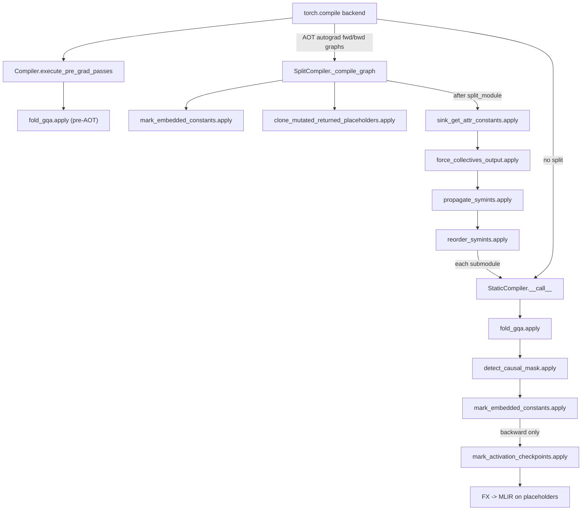

# TorchTPU FX graph passes

<!-- connect:up:begin -->
> **Cross-repo concept:** part of [rematerialization](../../../concepts/rematerialization.md) across this wiki's repos.
<!-- connect:up:end -->
## Overview

`src/torch_tpu/_internal/compile/fx_passes` is a flat library of single-purpose FX graph
rewrites, one module per pass, each exposing one `apply(...)` function that mutates a
`GraphModule` (or `Graph`) in place. There is no pass manager: the compilers call them in a
hard-coded order, almost all wrapped in PyTorch's graph-transform observer (the one exception is
the pre-AOT `fold_gqa` call in the base compiler's pre-grad hook, which is invoked directly). They
fall into two families.
**Optimization passes** change what the TPU computes - fold GQA head repetition into attention
([`apply`](../catalog/src/torch_tpu/_internal/compile/fx_passes/fold_gqa.md#apply "src/torch_tpu/_internal/compile/fx_passes/fold_gqa.py:L253")
in `fold_gqa`), replace a materialized causal mask with `is_causal=True`
([`apply`](../catalog/src/torch_tpu/_internal/compile/fx_passes/detect_causal_mask.md#apply "src/torch_tpu/_internal/compile/fx_passes/detect_causal_mask.py:L244")
in `detect_causal_mask`), embed constants as StableHLO constants, and fence recomputed
activations with optimization barriers. **Repair passes** exist because the split compiler cuts
the graph at collectives with `torch.fx.passes.split_module`, which leaves submodules with lost
mutations, hoisted constants, dead collectives and missing SymInt inputs; four passes put those
back. The key design idea is that the FX level is where *model-level* patterns (Hugging Face
`repeat_kv`, mask construction, checkpoint annotations, collective boundaries) are still
recognizable; once lowered to StableHLO they are just broadcasts, iotas and compares.

## Diagram

Legend:
- `BK` - (concept) the TorchTPU `torch.compile` backend entry
- `PRE` - [`execute_pre_grad_passes`](../catalog/src/torch_tpu/_internal/compile/compiler.md#Compiler.execute_pre_grad_passes "src/torch_tpu/_internal/compile/compiler.py:L103")
- `GQA0` - [`apply`](../catalog/src/torch_tpu/_internal/compile/fx_passes/fold_gqa.md#apply "src/torch_tpu/_internal/compile/fx_passes/fold_gqa.py:L253") (fold_gqa)
- `SPLIT` - [`_compile_graph`](../catalog/src/torch_tpu/_internal/compile/split_compiler.md#SplitCompiler._compile_graph "src/torch_tpu/_internal/compile/split_compiler.py:L608")
- `MEC1` - [`apply`](../catalog/src/torch_tpu/_internal/compile/fx_passes/mark_embedded_constants.md#apply "src/torch_tpu/_internal/compile/fx_passes/mark_embedded_constants.py:L24") (mark_embedded_constants)
- `CLN` - [`apply`](../catalog/src/torch_tpu/_internal/compile/fx_passes/clone_mutated_returned_placeholders.md#apply "src/torch_tpu/_internal/compile/fx_passes/clone_mutated_returned_placeholders.py:L88") (clone_mutated_returned_placeholders)
- `SINK` - [`apply`](../catalog/src/torch_tpu/_internal/compile/fx_passes/sink_get_attr_constants.md#apply "src/torch_tpu/_internal/compile/fx_passes/sink_get_attr_constants.py:L169") (sink_get_attr_constants)
- `FCO` - [`apply`](../catalog/src/torch_tpu/_internal/compile/fx_passes/force_collectives_output.md#apply "src/torch_tpu/_internal/compile/fx_passes/force_collectives_output.py:L45") (force_collectives_output)
- `PSY` - [`apply`](../catalog/src/torch_tpu/_internal/compile/fx_passes/propagate_symints.md#apply "src/torch_tpu/_internal/compile/fx_passes/propagate_symints.py:L51") (propagate_symints)
- `RSY` - [`apply`](../catalog/src/torch_tpu/_internal/compile/fx_passes/reorder_symints.md#apply "src/torch_tpu/_internal/compile/fx_passes/reorder_symints.py:L22") (reorder_symints)
- `STAT` - [`__call__`](../catalog/src/torch_tpu/_internal/compile/compiler.md#StaticCompiler.__call__ "src/torch_tpu/_internal/compile/compiler.py:L463")
- `GQA` - [`apply`](../catalog/src/torch_tpu/_internal/compile/fx_passes/fold_gqa.md#apply "src/torch_tpu/_internal/compile/fx_passes/fold_gqa.py:L253") (fold_gqa, post-AOT)
- `DCM` - [`apply`](../catalog/src/torch_tpu/_internal/compile/fx_passes/detect_causal_mask.md#apply "src/torch_tpu/_internal/compile/fx_passes/detect_causal_mask.py:L244") (detect_causal_mask)
- `MEC2` - [`apply`](../catalog/src/torch_tpu/_internal/compile/fx_passes/mark_embedded_constants.md#apply "src/torch_tpu/_internal/compile/fx_passes/mark_embedded_constants.py:L24") (mark_embedded_constants, again; idempotent)
- `MAC` - [`apply`](../catalog/src/torch_tpu/_internal/compile/fx_passes/mark_activation_checkpoints.md#apply "src/torch_tpu/_internal/compile/fx_passes/mark_activation_checkpoints.py:L22") (mark_activation_checkpoints)
- `LOWER` - (concept) the placeholder-based FX-to-StableHLO lowering that follows

| Pass | Family | Runs in | Graph | Effect on the TPU program |
|---|---|---|---|---|
| fold_gqa | optimization | pre-AOT hook + static compiler | fwd + bwd | K/V no longer expanded G x in HBM; backward group-sum removed |
| detect_causal_mask | optimization | static compiler | fwd + bwd | S x S mask not built/stored; attention sees `is_causal=True` |
| mark_embedded_constants | optimization | split + static compiler | fwd + bwd | tensor attributes become StableHLO constants, not runtime inputs |
| mark_activation_checkpoints | optimization | static compiler | bwd only | optimization barrier after each recomputed leaf |
| clone_mutated_returned_placeholders | repair | split compiler (pre-split) | fwd + bwd | keeps in-place input mutations visible after splitting |
| sink_get_attr_constants | repair | split compiler (post-split) | split root | constants back inside submodules (foldable) |
| force_collectives_output | repair | split compiler (post-split) | split root | dead collectives / waits kept alive as outputs |
| propagate_symints | repair | split compiler (post-split) | split root | submodules receive the SymInts their shapes use |
| reorder_symints | repair | split compiler (post-split) | split root | SymInt inputs first in every submodule signature |

## Design rationale (why it's built this way)

**Rewrite model idioms where they are still visible.** The module docstring of `fold_gqa` is the
clearest statement: Hugging Face's `repeat_kv` "materializes 4D expanded tensors in memory and
forces autograd to trace a backward `.sum(dim=2)` reduction pass across query groups", while
"TorchTPU natively supports 5D folded GQA contractions directly in its StableHLO SDPA lowering".
Feeding SDPA the unexpanded K/V means "head broadcast and backward reduction are folded directly
on device MXU without memory materialization". Likewise `_is_causal_mask`'s comment: when an
explicit mask "matches this structure, materializing it in HBM across all transformer layers is
redundant. We eliminate the argument and set `is_causal = True`, triggering native
hardware-optimized causal attention lowerings." Both are pattern matches on aten ops that would be
hard to recover from StableHLO.

**Prove, do not guess, that a mask is causal.**
[`_evaluate_node_on_inputs`](../catalog/src/torch_tpu/_internal/compile/fx_passes/detect_causal_mask.md#_evaluate_node_on_inputs "src/torch_tpu/_internal/compile/fx_passes/detect_causal_mask.py:L103")
constant-folds the mask's producer chain on CPU (any deterministic, non-mutating aten op,
including factories like `arange`), so masks "built inside the graph from positions alone (as
Hugging Face does when it detects tracing) [can] be proven causal without depending on example
input values"; the folded value is then checked element-wise by
[`_is_causal_mask`](../catalog/src/torch_tpu/_internal/compile/fx_passes/detect_causal_mask.md#_is_causal_mask "src/torch_tpu/_internal/compile/fx_passes/detect_causal_mask.py:L23").
Work is bounded by
[`_MAX_FOLD_NUMEL`](../catalog/src/torch_tpu/_internal/compile/fx_passes/detect_causal_mask.md#_MAX_FOLD_NUMEL "src/torch_tpu/_internal/compile/fx_passes/detect_causal_mask.py:L92")
(2^26 elements) and
[`_MAX_FOLD_DEPTH`](../catalog/src/torch_tpu/_internal/compile/fx_passes/detect_causal_mask.md#_MAX_FOLD_DEPTH "src/torch_tpu/_internal/compile/fx_passes/detect_causal_mask.py:L93")
(64), so a huge or deep producer simply leaves the mask in place.

**Repair `split_module` instead of avoiding it.** The split compiler always routes through
`split_module`, even for one partition; a source comment warns against short-circuiting the
single-partition case because that "mask[s] these issues" until a real split hits them, and says
the fix is "altering or adding a consolidating fx pass". The repair passes are exactly those
consolidating passes. Three of their docstrings name the `split_module` behavior they undo
(passthrough outputs losing mutations, hoisted `get_attr` constants, SymInts not propagated
"unless they are explicitly used in the submodule body"); the `force_collectives_output` and
`reorder_symints` docstrings only state what they enforce (collective results become outputs,
SymInt placeholders move to the front).

**Fence recomputation so XLA cannot undo it.**
[`apply`](../catalog/src/torch_tpu/_internal/compile/fx_passes/mark_activation_checkpoints.md#apply "src/torch_tpu/_internal/compile/fx_passes/mark_activation_checkpoints.py:L22")
in `mark_activation_checkpoints` "Inserts optimization barriers for recomputed leaf nodes" in the
backward graph only.

> [!inferred]
> The barrier is what keeps activation checkpointing effective on XLA: without it, XLA's CSE /
> scheduling could merge the backward's recomputation with the original forward values (which
> are still in the same module when forward and backward are compiled together) or hoist the
> recomputation earlier, restoring the activation memory the checkpoint was meant to save.
> Barriering only the *leaves* of each recompute region (nodes with no recomputed users) is the
> minimal fence: everything upstream is forced to be recomputed before the barrier, and
> consumers can only read the barrier's output.

**Embed constants at FX time.**
[`apply`](../catalog/src/torch_tpu/_internal/compile/fx_passes/mark_embedded_constants.md#apply "src/torch_tpu/_internal/compile/fx_passes/mark_embedded_constants.py:L24")
in `mark_embedded_constants` replaces tensor attributes with tensors "that will generate a
deferred op during graph traversal via EagerLikeFxInterpreter. This enables us to properly embed
a ConstantOp in the MLIR graph." A constant XLA can see is a constant XLA can fold, and it is not
a per-step input transfer.

## Entry points

- [`execute_pre_grad_passes`](../catalog/src/torch_tpu/_internal/compile/compiler.md#Compiler.execute_pre_grad_passes "src/torch_tpu/_internal/compile/compiler.py:L103") - the backend calls this hook on the Dynamo graph before AOT autograd; the base implementation runs only [`apply`](../catalog/src/torch_tpu/_internal/compile/fx_passes/fold_gqa.md#apply "src/torch_tpu/_internal/compile/fx_passes/fold_gqa.py:L253") from `fold_gqa`, so GQA folding happens before autograd derives the backward (and the split / dynamic compilers delegate the hook to their base compiler).
- [`__call__`](../catalog/src/torch_tpu/_internal/compile/compiler.md#StaticCompiler.__call__ "src/torch_tpu/_internal/compile/compiler.py:L463") (static compiler) - per AOT-autograd graph (or per split submodule): after decomposing auto-functionalized ops it runs `fold_gqa` again (now also seeing SDPA backward ops), [`apply`](../catalog/src/torch_tpu/_internal/compile/fx_passes/detect_causal_mask.md#apply "src/torch_tpu/_internal/compile/fx_passes/detect_causal_mask.py:L244") from `detect_causal_mask` with the example inputs, [`apply`](../catalog/src/torch_tpu/_internal/compile/fx_passes/mark_embedded_constants.md#apply "src/torch_tpu/_internal/compile/fx_passes/mark_embedded_constants.py:L24"), and for backward graphs [`apply`](../catalog/src/torch_tpu/_internal/compile/fx_passes/mark_activation_checkpoints.md#apply "src/torch_tpu/_internal/compile/fx_passes/mark_activation_checkpoints.py:L22"); then lints, recompiles and lowers.
- [`_compile_graph`](../catalog/src/torch_tpu/_internal/compile/split_compiler.md#SplitCompiler._compile_graph "src/torch_tpu/_internal/compile/split_compiler.py:L608") (split compiler) - "Splits the graph on collectives and compiles the submodules": runs [`apply`](../catalog/src/torch_tpu/_internal/compile/fx_passes/clone_mutated_returned_placeholders.md#apply "src/torch_tpu/_internal/compile/fx_passes/clone_mutated_returned_placeholders.py:L88") (and constant marking) before splitting, then [`apply`](../catalog/src/torch_tpu/_internal/compile/fx_passes/sink_get_attr_constants.md#apply "src/torch_tpu/_internal/compile/fx_passes/sink_get_attr_constants.py:L169"), [`apply`](../catalog/src/torch_tpu/_internal/compile/fx_passes/force_collectives_output.md#apply "src/torch_tpu/_internal/compile/fx_passes/force_collectives_output.py:L45"), [`apply`](../catalog/src/torch_tpu/_internal/compile/fx_passes/propagate_symints.md#apply "src/torch_tpu/_internal/compile/fx_passes/propagate_symints.py:L51") and [`apply`](../catalog/src/torch_tpu/_internal/compile/fx_passes/reorder_symints.md#apply "src/torch_tpu/_internal/compile/fx_passes/reorder_symints.py:L22") on the split root, and finally hands each submodule to the static compiler.

## Mechanism (step-by-step)

1. **Fold GQA head repetition (pre-AOT, and again per compiled graph).** For every SDPA forward
   or backward node
   ([`_SDPA_FORWARD_TARGETS`](../catalog/src/torch_tpu/_internal/compile/fx_passes/fold_gqa.md#_SDPA_FORWARD_TARGETS "src/torch_tpu/_internal/compile/fx_passes/fold_gqa.py:L37"),
   [`_SDPA_BACKWARD_TARGETS`](../catalog/src/torch_tpu/_internal/compile/fx_passes/fold_gqa.md#_SDPA_BACKWARD_TARGETS "src/torch_tpu/_internal/compile/fx_passes/fold_gqa.py:L43")),
   [`apply`](../catalog/src/torch_tpu/_internal/compile/fx_passes/fold_gqa.md#apply "src/torch_tpu/_internal/compile/fx_passes/fold_gqa.py:L253")
   inspects the key and value arguments (positions 1/2 in forward, 2/3 in backward).
   [`_extract_repeat_kv_source`](../catalog/src/torch_tpu/_internal/compile/fx_passes/fold_gqa.md#_extract_repeat_kv_source "src/torch_tpu/_internal/compile/fx_passes/fold_gqa.py:L76")
   looks through optional `clone`/`contiguous`, requires a reshape of a 5D `expand` whose group
   size `G = shape[2]` is a constant int > 1, fed by `unsqueeze(dim=2)` (or a view to
   `[B, H_kv, 1, S, D]`), and returns the original K/V node plus `G`. Only if key *and* value
   both match with the same `G` are the SDPA arguments swapped for the unexpanded tensors. In the
   backward, the grad-key / grad-value outputs are already group-reduced by the native lowering,
   so
   [`_detect_repeat_kv_backward_reduction`](../catalog/src/torch_tpu/_internal/compile/fx_passes/fold_gqa.md#_detect_repeat_kv_backward_reduction "src/torch_tpu/_internal/compile/fx_passes/fold_gqa.py:L151")
   finds autograd's `reshape -> sum(dim=2)` (or `sum(keepdim) -> squeeze / reshape-to-4D`) chain
   with the same `G` and rewires its users to the SDPA output directly.
   [`_erase_unused_chain`](../catalog/src/torch_tpu/_internal/compile/fx_passes/fold_gqa.md#_erase_unused_chain "src/torch_tpu/_internal/compile/fx_passes/fold_gqa.py:L242")
   then deletes the now-dead expand/reshape and reduction nodes and any inputs that become dead.

2. **Eliminate provably causal masks.** For each SDPA variant listed in
   [`_SDPA_SPECS`](../catalog/src/torch_tpu/_internal/compile/fx_passes/detect_causal_mask.md#_SDPA_SPECS._SDPA_SPECS "src/torch_tpu/_internal/compile/fx_passes/detect_causal_mask.py:L161")
   (bias position, `is_causal` position, forward/backward),
   [`_try_eliminate_causal_mask`](../catalog/src/torch_tpu/_internal/compile/fx_passes/detect_causal_mask.md#_try_eliminate_causal_mask "src/torch_tpu/_internal/compile/fx_passes/detect_causal_mask.py:L186")
   skips nodes already `is_causal=True` or without a mask, evaluates the mask with
   [`_evaluate_node_on_inputs`](../catalog/src/torch_tpu/_internal/compile/fx_passes/detect_causal_mask.md#_evaluate_node_on_inputs "src/torch_tpu/_internal/compile/fx_passes/detect_causal_mask.py:L103")
   (placeholders resolve to the example inputs, `get_attr` to module attributes, foldable ops per
   [`_is_foldable`](../catalog/src/torch_tpu/_internal/compile/fx_passes/detect_causal_mask.md#_is_foldable "src/torch_tpu/_internal/compile/fx_passes/detect_causal_mask.py:L96")
   are executed on CPU with any `device` kwarg forced to `cpu`, results memoized per node), and
   tests it with
   [`_is_causal_mask`](../catalog/src/torch_tpu/_internal/compile/fx_passes/detect_causal_mask.md#_is_causal_mask "src/torch_tpu/_internal/compile/fx_passes/detect_causal_mask.py:L23"):
   square `S x S` (S > 1) trailing dims and either a boolean lower-triangular pattern or a float
   pattern with `|x| < 1e-4` on and below the diagonal and `<= -1000` or `-inf` above it. On a
   match the mask argument becomes `None` (forward) or an empty `[0]` tensor (backward, which
   needs a tensor), `is_causal` is set, and the graph is dead-code-eliminated so the whole mask
   construction disappears.
   [`apply`](../catalog/src/torch_tpu/_internal/compile/fx_passes/detect_causal_mask.md#apply "src/torch_tpu/_internal/compile/fx_passes/detect_causal_mask.py:L244")
   drives this over all nodes and recompiles the module if anything changed.

3. **Embed tensor attributes as constants.**
   [`apply`](../catalog/src/torch_tpu/_internal/compile/fx_passes/mark_embedded_constants.md#apply "src/torch_tpu/_internal/compile/fx_passes/mark_embedded_constants.py:L24")
   in `mark_embedded_constants` visits every distinct `get_attr` target that resolves to a tensor,
   exits fake mode, copies the value back to CPU (AOT autograd will have placed it on device) and
   re-registers it as a TorchTPU constant tensor, so that tracing the graph later produces a
   constant deferred op and a StableHLO `ConstantOp`. Already-constant tensors and targets already
   processed (tracked on the module) are skipped, which makes the pass safe to run in both the
   split and static compilers.

4. **Barrier the leaves of recompute regions (backward only).**
   [`apply`](../catalog/src/torch_tpu/_internal/compile/fx_passes/mark_activation_checkpoints.md#apply "src/torch_tpu/_internal/compile/fx_passes/mark_activation_checkpoints.py:L22")
   in `mark_activation_checkpoints` collects nodes whose `recompute` metadata is
   `MUST_RECOMPUTE` or `PREFER_RECOMPUTE` (set by PyTorch's selective activation checkpointing),
   keeps the "leaves" (no user is itself recomputed), and after each inserts
   `torch.ops.tpu._optimization_barrier` plus a `getitem`, redirecting every original user to the
   barrier's output. The TorchTPU kernel for that op emits a `stablehlo.optimization_barrier`,
   which orders every producer before it and every consumer after it.

5. **Pre-split repair: keep mutated inputs visible.** Before splitting,
   [`apply`](../catalog/src/torch_tpu/_internal/compile/fx_passes/clone_mutated_returned_placeholders.md#apply "src/torch_tpu/_internal/compile/fx_passes/clone_mutated_returned_placeholders.py:L88")
   in `clone_mutated_returned_placeholders` finds the (single) output node
   ([`_get_output_node`](../catalog/src/torch_tpu/_internal/compile/fx_passes/clone_mutated_returned_placeholders.md#_get_output_node "src/torch_tpu/_internal/compile/fx_passes/clone_mutated_returned_placeholders.py:L29"),
   [`_get_returned_nodes`](../catalog/src/torch_tpu/_internal/compile/fx_passes/clone_mutated_returned_placeholders.md#_get_returned_nodes "src/torch_tpu/_internal/compile/fx_passes/clone_mutated_returned_placeholders.py:L41")),
   selects tensor placeholders that are both returned and consumed by compute
   ([`_find_placeholders_to_clone`](../catalog/src/torch_tpu/_internal/compile/fx_passes/clone_mutated_returned_placeholders.md#_find_placeholders_to_clone "src/torch_tpu/_internal/compile/fx_passes/clone_mutated_returned_placeholders.py:L59"),
   [`_is_returned_compute_placeholder`](../catalog/src/torch_tpu/_internal/compile/fx_passes/clone_mutated_returned_placeholders.md#_is_returned_compute_placeholder "src/torch_tpu/_internal/compile/fx_passes/clone_mutated_returned_placeholders.py:L47")),
   and inserts an `aten.clone` right after each, pointing all uses - including the output - at the
   clone
   ([`_clone_and_replace_placeholder`](../catalog/src/torch_tpu/_internal/compile/fx_passes/clone_mutated_returned_placeholders.md#_clone_and_replace_placeholder "src/torch_tpu/_internal/compile/fx_passes/clone_mutated_returned_placeholders.py:L71")).
   Per its docstring, otherwise "the output will be a passthrough meaning that the user won't
   receive the mutated value" once `split_module` reshapes the graph.

6. **Post-split repair: sink constants back into submodules.** `split_module` hoists every
   `get_attr` to the root and passes it as a submodule input.
   [`apply`](../catalog/src/torch_tpu/_internal/compile/fx_passes/sink_get_attr_constants.md#apply "src/torch_tpu/_internal/compile/fx_passes/sink_get_attr_constants.py:L169")
   in `sink_get_attr_constants` maps every submodule to all its call sites
   ([`_map_call_module_nodes`](../catalog/src/torch_tpu/_internal/compile/fx_passes/sink_get_attr_constants.md#_map_call_module_nodes "src/torch_tpu/_internal/compile/fx_passes/sink_get_attr_constants.py:L22")),
   and
   [`_sink_constants_for_submodule`](../catalog/src/torch_tpu/_internal/compile/fx_passes/sink_get_attr_constants.md#_sink_constants_for_submodule "src/torch_tpu/_internal/compile/fx_passes/sink_get_attr_constants.py:L91")
   sinks a placeholder only when every call site passes the same tensor `get_attr` at that
   position
   ([`_get_sinkable_constant`](../catalog/src/torch_tpu/_internal/compile/fx_passes/sink_get_attr_constants.md#_get_sinkable_constant "src/torch_tpu/_internal/compile/fx_passes/sink_get_attr_constants.py:L43")):
   the constant is registered on the submodule and the placeholder swapped for an in-submodule
   `get_attr`
   ([`_replace_placeholder_with_get_attr`](../catalog/src/torch_tpu/_internal/compile/fx_passes/sink_get_attr_constants.md#_replace_placeholder_with_get_attr "src/torch_tpu/_internal/compile/fx_passes/sink_get_attr_constants.py:L72")),
   and the argument removed from every call site. Root `get_attr` nodes left without users are
   erased together with their attributes
   ([`_erase_dead_get_attrs`](../catalog/src/torch_tpu/_internal/compile/fx_passes/sink_get_attr_constants.md#_erase_dead_get_attrs "src/torch_tpu/_internal/compile/fx_passes/sink_get_attr_constants.py:L156")).
   The docstring's stated payoff: it lets the submodule "profit from optimizations such as
   constant folding".

7. **Post-split repair: force collectives to be outputs.**
   [`apply`](../catalog/src/torch_tpu/_internal/compile/fx_passes/force_collectives_output.md#apply "src/torch_tpu/_internal/compile/fx_passes/force_collectives_output.py:L45")
   in `force_collectives_output` marks, per submodule, everything that transitively feeds an
   existing output as live
   ([`_mark_live`](../catalog/src/torch_tpu/_internal/compile/fx_passes/force_collectives_output.md#_mark_live "src/torch_tpu/_internal/compile/fx_passes/force_collectives_output.py:L34")),
   then walks the graph backwards and appends any collective or `wait_tensor`
   ([`_is_collective_or_wait`](../catalog/src/torch_tpu/_internal/compile/fx_passes/force_collectives_output.md#_is_collective_or_wait "src/torch_tpu/_internal/compile/fx_passes/force_collectives_output.py:L23"))
   that is not live to the outputs; walking backwards means a chain of dead collectives only needs
   its last node returned. The output always becomes a tuple, and a parent call site that used to
   receive a single value gets a `getitem(..., 0)` so its users are unaffected.

8. **Post-split repair: give submodules their SymInts, first.**
   [`apply`](../catalog/src/torch_tpu/_internal/compile/fx_passes/propagate_symints.md#apply "src/torch_tpu/_internal/compile/fx_passes/propagate_symints.py:L51")
   in `propagate_symints` collects the free symbols in each submodule's placeholder shapes, strides
   and storage offsets
   ([`_collect_free_symbols`](../catalog/src/torch_tpu/_internal/compile/fx_passes/propagate_symints.md#_collect_free_symbols "src/torch_tpu/_internal/compile/fx_passes/propagate_symints.py:L23")),
   subtracts the SymInt placeholders it already has (recognized with
   [`is_symint_node`](../catalog/src/torch_tpu/_internal/compile/dynamic/sym_utils.md#is_symint_node "src/torch_tpu/_internal/compile/dynamic/sym_utils.py:L93")),
   and prepends a `sym_<name>` placeholder for each missing symbol (sorted for determinism) while
   prepending the parent's matching SymInt to the call site.
   [`apply`](../catalog/src/torch_tpu/_internal/compile/fx_passes/reorder_symints.md#apply "src/torch_tpu/_internal/compile/fx_passes/reorder_symints.py:L22")
   in `reorder_symints` then stably moves every SymInt placeholder (and its call-site argument)
   ahead of the tensor placeholders in each submodule.

## Key data structures

- **Target sets** in `fold_gqa` -
  [`_RESHAPE_TARGETS`](../catalog/src/torch_tpu/_internal/compile/fx_passes/fold_gqa.md#_RESHAPE_TARGETS "src/torch_tpu/_internal/compile/fx_passes/fold_gqa.py:L48")
  (`reshape`, `view`, `_unsafe_view`),
  [`_EXPAND_TARGETS`](../catalog/src/torch_tpu/_internal/compile/fx_passes/fold_gqa.md#_EXPAND_TARGETS "src/torch_tpu/_internal/compile/fx_passes/fold_gqa.py:L54"),
  [`_UNSQUEEZE_TARGETS`](../catalog/src/torch_tpu/_internal/compile/fx_passes/fold_gqa.md#_UNSQUEEZE_TARGETS "src/torch_tpu/_internal/compile/fx_passes/fold_gqa.py:L59"),
  [`_SUM_TARGETS`](../catalog/src/torch_tpu/_internal/compile/fx_passes/fold_gqa.md#_SUM_TARGETS "src/torch_tpu/_internal/compile/fx_passes/fold_gqa.py:L64"),
  [`_SQUEEZE_TARGETS`](../catalog/src/torch_tpu/_internal/compile/fx_passes/fold_gqa.md#_SQUEEZE_TARGETS "src/torch_tpu/_internal/compile/fx_passes/fold_gqa.py:L69")
  - the aten overloads (including `_copy` variants) the matcher accepts. Adding a new spelling of
  `repeat_kv` means extending these.
- **[`_SDPA_SPECS`](../catalog/src/torch_tpu/_internal/compile/fx_passes/detect_causal_mask.md#_SDPA_SPECS._SDPA_SPECS "src/torch_tpu/_internal/compile/fx_passes/detect_causal_mask.py:L161")** -
  per SDPA overload, the positional index of the mask/bias argument, of `is_causal`, and whether
  it is a backward op; the single place to add a new attention overload.
- **Fold cache** - the per-pass-run `node -> value` dict inside
  [`_evaluate_node_on_inputs`](../catalog/src/torch_tpu/_internal/compile/fx_passes/detect_causal_mask.md#_evaluate_node_on_inputs "src/torch_tpu/_internal/compile/fx_passes/detect_causal_mask.py:L103");
  a mask shared by all layers is folded once per graph.
- **Processed-constants set** - a `_processed_constant_attrs` attribute stored on the
  `GraphModule` by
  [`apply`](../catalog/src/torch_tpu/_internal/compile/fx_passes/mark_embedded_constants.md#apply "src/torch_tpu/_internal/compile/fx_passes/mark_embedded_constants.py:L24")
  that makes constant marking idempotent across the compilers that call it.

## Dynamics (design intent)

- **Order is load-bearing.** `fold_gqa` runs before AOT autograd so the backward is derived from
  the folded forward, and again after so it can also clean SDPA *backward* ops and their
  group-sum reductions; constant marking precedes lowering because the lowering's tracer must see
  constant tensors; the SymInt passes run after constant sinking and collective forcing because
  those change submodule signatures.
- **Per-submodule optimization.** In the split path the optimization passes run inside the static
  compiler once per submodule, so a causal mask or `repeat_kv` that straddles a collective split
  is only rewritten if the whole pattern landed in one submodule.
- **Observability.** Every pass is applied through PyTorch's graph-transform observer under its
  module name, and the static compiler emits the post-pass FX graph as a `torchtpu_fx_graph`
  structured-trace artifact when `TORCH_TRACE` is set, so tlparse shows the graph these passes
  produced.
- **No tests in the configured test paths** reference this subgraph (packet Evidence); behavior
  above is read from source and docstrings.

## Edge cases

- **Partial GQA matches are left alone.** Key and value must both match, with equal `G`; a
  `repeat_kv` with a symbolic group size (non-int) or an unsqueeze on another dim is not folded.
- **Causal-mask proof can rely on example input values.** Placeholders resolve to the example
  inputs, so a mask passed *into* the graph is judged by its example value.

> [!inferred]
> If a compiled graph receives its attention mask as an input, the decision to drop it is based
> on the example input seen at compile time; Dynamo does not guard on tensor values, so a later
> call with a non-causal (e.g. padded) mask through the same compiled graph would silently be
> treated as causal. In practice `_is_causal_mask` returns False for fake/meta tensors, so this
> only bites when the compiler is handed real example inputs. Masks built in-graph from positions
> are proven independently of input values and are safe.

- **Float masks use thresholds, not exact values.** "Allowed" entries must be within 1e-4 of 0 and
  "masked" entries `<= -1000` or `-inf`; a mask using `-100` or `finfo.min / 2`-style fills with
  small magnitudes will not be detected. Only square masks with `S > 1` qualify (prefill, not
  single-token decode with a cache).
- **Backward SDPA keeps a dummy bias.** The backward overloads get an empty `[0]` tensor rather
  than `None` in the bias slot.
- **Constant embedding grows the executable.** Every tensor attribute becomes a literal in the
  StableHLO module; large buffers held as plain attributes (rather than parameters/inputs) are
  copied to CPU and baked in.
- **Cloned placeholders cost a copy** unless XLA elides it; the clone is inserted for any
  returned-and-used placeholder, mutated or not.
- **Collective forcing changes submodule arity.** Submodules gain extra outputs; parent code that
  indexes submodule results positionally relies on the inserted `getitem`.
- **SymInt not found in the parent** is logged as a warning and skipped, which can leave a
  submodule unable to resolve a dynamic dimension.

## Open questions

- The rationale for `force_collectives_output` is not written in the source.

> [!inferred]
> A collective whose result is unused would otherwise be dead code in its submodule; dropping it
> on some ranks but not others (or dropping a `wait_tensor` that pops a pending work handle)
> breaks the cross-rank collective sequence and can deadlock, so every issued collective must be
> kept observable as an output.

- Why `reorder_symints` puts SymInts first is not documented here; the consumer is presumably the
  dynamic-shape compiler's argument convention.
- Which SDPA lowering actually consumes the folded 5D GQA operands and `is_causal=True` (splash /
  flash-style kernel vs XLA composite) lives in the attention subsystem, not in this subgraph.

## See also

- [torch.compile backend](torch-compile-backend.md) - the Python compiler classes that call these passes.
- [Compiled mode](compiled-mode.md) - the C++ tracing and compilation that runs after them.
- [MLIR optimization passes](mlir-optimization-passes.md) - the StableHLO-level rewrites applied after lowering.
- [Scaled dot-product attention](scaled-dot-product-attention.md) - the SDPA lowering that `fold_gqa` and `detect_causal_mask` target.
- [Process group and collectives](process-group-and-collectives.md) - the collectives the split compiler cuts on.
- [Dynamic-shapes compiler](dynamic-shapes-compiler.md) - where SymInt placeholders are consumed.
