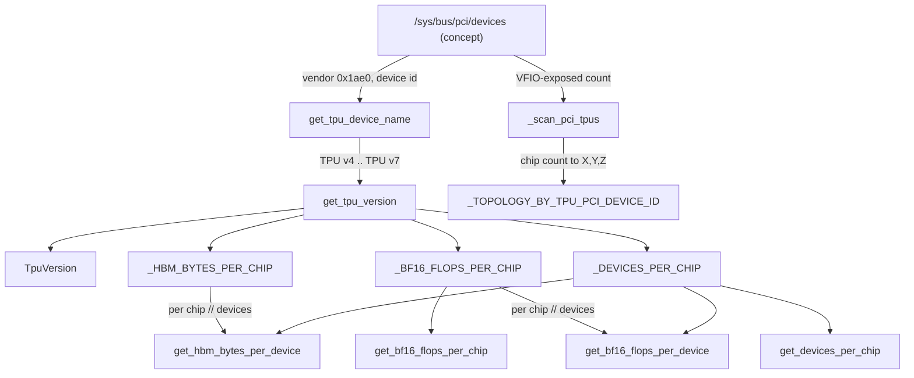
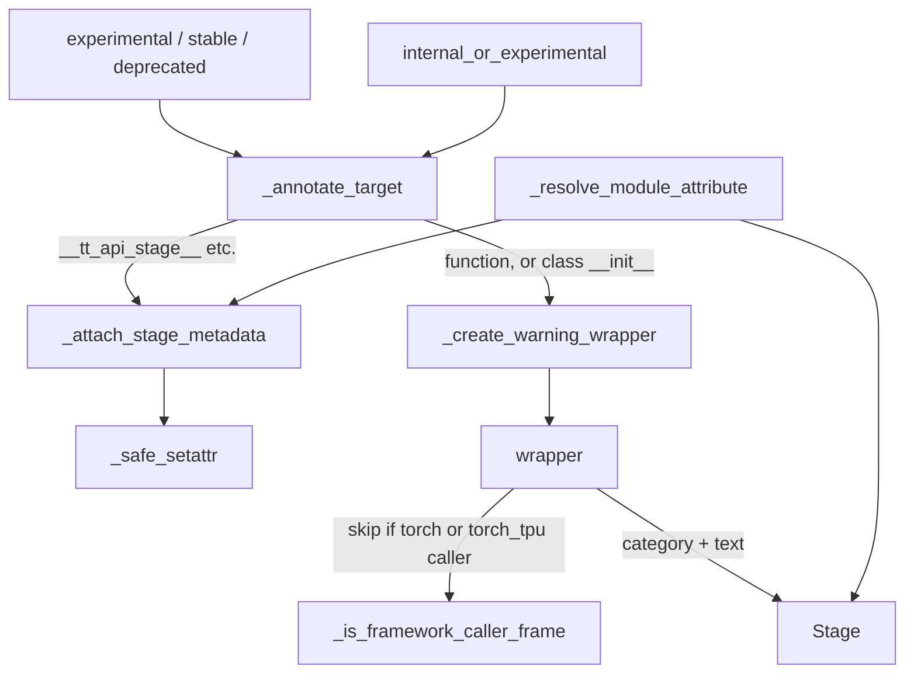

# Hardware introspection and API utilities (torch_tpu._internal.utils)

## Overview
`torch_tpu._internal.utils` is a grab-bag package with one performance-critical job and two supporting ones. The critical job is **hardware introspection** (`hardware.py`, "Utilities for hardware discovery and configuration"): it reads `/sys/bus/pci/devices` to find a Google TPU, maps the PCI device id to a generation ([`TpuVersion`](../catalog/src/torch_tpu/_internal/utils/hardware.md#TpuVersion "src/torch_tpu/_internal/utils/hardware.py:L109")), and from the generation looks up static published constants - HBM capacity, peak dense bf16 FLOP/s, chip-count-to-topology strings - and divides per-chip figures by the number of *separately addressable devices* per chip. The key design idea is that **nothing here touches the TPU runtime**: it is pure sysfs + lookup tables, so it is "safe to call at import time and from concurrent processes" ([`get_tpu_device_name`](../catalog/src/torch_tpu/_internal/utils/hardware.md#get_tpu_device_name "src/torch_tpu/_internal/utils/hardware.py:L119")) and usable by launchers before any process owns a chip. The supporting jobs are the **API lifecycle annotations** (`annotations.py`: [`Stage`](../catalog/src/torch_tpu/_internal/utils/annotations.md#Stage "src/torch_tpu/_internal/utils/annotations.py:L104"), [`experimental`](../catalog/src/torch_tpu/_internal/utils/annotations.md#experimental "src/torch_tpu/_internal/utils/annotations.py:L339"), [`forbid_in_torch_compile`](../catalog/src/torch_tpu/_internal/utils/annotations.md#forbid_in_torch_compile "src/torch_tpu/_internal/utils/annotations.py:L471"), written to never cause a Dynamo graph break) and **debug tracers** (`utils.py`, `tracer_utils.py`: module-hook activation tracing, aten op counting, CPU-replay diffs).

## Diagram
Hardware introspection: from sysfs to the numbers a perf calculation needs.

Legend:
- `SYS` - (concept) Linux PCI sysfs
- `NAME` - [`get_tpu_device_name`](../catalog/src/torch_tpu/_internal/utils/hardware.md#get_tpu_device_name "src/torch_tpu/_internal/utils/hardware.py:L119")
- `VER` - [`get_tpu_version`](../catalog/src/torch_tpu/_internal/utils/hardware.md#get_tpu_version "src/torch_tpu/_internal/utils/hardware.py:L147")
- `TV` - [`TpuVersion`](../catalog/src/torch_tpu/_internal/utils/hardware.md#TpuVersion "src/torch_tpu/_internal/utils/hardware.py:L109")
- `HBM` - [`_HBM_BYTES_PER_CHIP`](../catalog/src/torch_tpu/_internal/utils/hardware.md#_HBM_BYTES_PER_CHIP._HBM_BYTES_PER_CHIP "src/torch_tpu/_internal/utils/hardware.py:L165")
- `FLOPS` - [`_BF16_FLOPS_PER_CHIP`](../catalog/src/torch_tpu/_internal/utils/hardware.md#_BF16_FLOPS_PER_CHIP._BF16_FLOPS_PER_CHIP "src/torch_tpu/_internal/utils/hardware.py:L205")
- `DPC` - [`_DEVICES_PER_CHIP`](../catalog/src/torch_tpu/_internal/utils/hardware.md#_DEVICES_PER_CHIP._DEVICES_PER_CHIP "src/torch_tpu/_internal/utils/hardware.py:L195")
- `FC` - [`get_bf16_flops_per_chip`](../catalog/src/torch_tpu/_internal/utils/hardware.md#get_bf16_flops_per_chip "src/torch_tpu/_internal/utils/hardware.py:L232")
- `HD` - [`get_hbm_bytes_per_device`](../catalog/src/torch_tpu/_internal/utils/hardware.md#get_hbm_bytes_per_device "src/torch_tpu/_internal/utils/hardware.py:L242")
- `FD` - [`get_bf16_flops_per_device`](../catalog/src/torch_tpu/_internal/utils/hardware.md#get_bf16_flops_per_device "src/torch_tpu/_internal/utils/hardware.py:L261")
- `GDPC` - [`get_devices_per_chip`](../catalog/src/torch_tpu/_internal/utils/hardware.md#get_devices_per_chip "src/torch_tpu/_internal/utils/hardware.py:L216")
- `SCAN` - [`_scan_pci_tpus`](../catalog/src/torch_tpu/_internal/utils/hardware.md#_scan_pci_tpus "src/torch_tpu/_internal/utils/hardware.py:L280")
- `TOPO` - [`_TOPOLOGY_BY_TPU_PCI_DEVICE_ID`](../catalog/src/torch_tpu/_internal/utils/hardware.md#_TOPOLOGY_BY_TPU_PCI_DEVICE_ID._TOPOLOGY_BY_TPU_PCI_DEVICE_ID "src/torch_tpu/_internal/utils/hardware.py:L81")

API lifecycle annotation: what a decorator does to its target.

Legend:
- `EXP` - [`experimental`](../catalog/src/torch_tpu/_internal/utils/annotations.md#experimental "src/torch_tpu/_internal/utils/annotations.py:L339"), [`stable`](../catalog/src/torch_tpu/_internal/utils/annotations.md#stable "src/torch_tpu/_internal/utils/annotations.py:L362"), [`deprecated`](../catalog/src/torch_tpu/_internal/utils/annotations.md#deprecated "src/torch_tpu/_internal/utils/annotations.py:L380")
- `IOE` - [`internal_or_experimental`](../catalog/src/torch_tpu/_internal/utils/annotations.md#internal_or_experimental "src/torch_tpu/_internal/utils/annotations.py:L406")
- `AT` - [`_annotate_target`](../catalog/src/torch_tpu/_internal/utils/annotations.md#_annotate_target "src/torch_tpu/_internal/utils/annotations.py:L277")
- `ASM` - [`_attach_stage_metadata`](../catalog/src/torch_tpu/_internal/utils/annotations.md#_attach_stage_metadata "src/torch_tpu/_internal/utils/annotations.py:L178")
- `SS` - [`_safe_setattr`](../catalog/src/torch_tpu/_internal/utils/annotations.md#_safe_setattr "src/torch_tpu/_internal/utils/annotations.py:L164")
- `CWW` - [`_create_warning_wrapper`](../catalog/src/torch_tpu/_internal/utils/annotations.md#_create_warning_wrapper "src/torch_tpu/_internal/utils/annotations.py:L213")
- `W` - [`wrapper`](../catalog/src/torch_tpu/_internal/utils/annotations.md#_create_warning_wrapper.wrapper "src/torch_tpu/_internal/utils/annotations.py:L244")
- `FCF` - [`_is_framework_caller_frame`](../catalog/src/torch_tpu/_internal/utils/annotations.md#_is_framework_caller_frame "src/torch_tpu/_internal/utils/annotations.py:L80")
- `ST` - [`Stage`](../catalog/src/torch_tpu/_internal/utils/annotations.md#Stage "src/torch_tpu/_internal/utils/annotations.py:L104")
- `RMA` - [`_resolve_module_attribute`](../catalog/src/torch_tpu/_internal/utils/annotations.md#_resolve_module_attribute "src/torch_tpu/_internal/utils/annotations.py:L529")

## Design rationale (why it's built this way)
- **Static tables, not runtime queries.** Peak FLOP/s and HBM are copied from the public Cloud TPU docs ("Sources: https://cloud.google.com/tpu/docs/{v4,v5e,v5p,v6e,tpu7x}") into immutable dicts keyed by generation. That keeps the numbers checkable against the docs and available without initializing the runtime, at the cost of returning `None` for any generation not in the table.
- **Per-chip is stored, per-device is derived.** [`_BF16_FLOPS_PER_CHIP`](../catalog/src/torch_tpu/_internal/utils/hardware.md#_BF16_FLOPS_PER_CHIP._BF16_FLOPS_PER_CHIP "src/torch_tpu/_internal/utils/hardware.py:L205") is "Stored as the published *per-chip* figure (easy to check against the docs); the per-device value is derived below". The divisor is [`_DEVICES_PER_CHIP`](../catalog/src/torch_tpu/_internal/utils/hardware.md#_DEVICES_PER_CHIP._DEVICES_PER_CHIP "src/torch_tpu/_internal/utils/hardware.py:L195"), which is "deliberately NOT the physical TensorCore count": megacore chips (v4, v5p) fuse two cores into one addressable device and count as 1, single-core chips (v5e, v6e) are 1, and only v7 - which "splits its two cores into two devices (verified - one device reports ~96 GB of the 192 GB chip)" - is listed with 2. The source also flags that "the default of 1 for the other generations, and v7 = 2, are to be confirmed against Google before landing".
- **Why per-device matters for MFU.** [`get_bf16_flops_per_device`](../catalog/src/torch_tpu/_internal/utils/hardware.md#get_bf16_flops_per_device "src/torch_tpu/_internal/utils/hardware.py:L261") documents itself as "the correct denominator for per-device MFU (each rank drives one exposed device)". Using the per-chip figure on v7 would halve the reported MFU of every rank.
- **Count only what is exposed via VFIO.** [`_scan_pci_tpus`](../catalog/src/torch_tpu/_internal/utils/hardware.md#_scan_pci_tpus "src/torch_tpu/_internal/utils/hardware.py:L280") counts a TPU PCI function only if its IOMMU group has a node under `/dev/vfio` ("Some devices have multiple tensorcores sharing the same bus. We count only those that are exposed via VFIO."). The check is a `stat()` of that node - existence only; the scan never opens it, so a node this process lacks permission for, or that another process holds, is still counted.
- **Lifecycle warnings must be invisible to `torch.compile`.** Every warning path checks `torch.compiler.is_compiling()` first, because "TorchDynamo cannot trace `sys._getframe()`"; skipping the caller check while compiling lets decorated APIs "trace through without graph breaks". The trade-off, stated in the source, is that the warning only appears on an eager call.
- **Fail loudly instead of silently de-compiling.** [`forbid_in_torch_compile`](../catalog/src/torch_tpu/_internal/utils/annotations.md#forbid_in_torch_compile "src/torch_tpu/_internal/utils/annotations.py:L471") exists so that an API that cannot work inside a compiled region raises `AssertionError: Attempt to trace forbidden callable` "instead of silently breaking the graph and running the surrounding frame eagerly" - a silent graph break is a performance bug that never shows up as an error.

## Entry points
- [`get_tpu_device_name`](../catalog/src/torch_tpu/_internal/utils/hardware.md#get_tpu_device_name "src/torch_tpu/_internal/utils/hardware.py:L119") - "Returns a human-readable name for the attached TPU device", e.g. `"TPU v7"`, or `"TPU"` if none is recognized. Reached from the device module's `get_device_name` and indirectly from every getter below.
- [`get_hbm_bytes_per_device`](../catalog/src/torch_tpu/_internal/utils/hardware.md#get_hbm_bytes_per_device "src/torch_tpu/_internal/utils/hardware.py:L242") - "Physical HBM capacity, in bytes, visible to a single device"; the `total_memory` behind `torch.tpu.get_device_properties()`.
- [`get_bf16_flops_per_device`](../catalog/src/torch_tpu/_internal/utils/hardware.md#get_bf16_flops_per_device "src/torch_tpu/_internal/utils/hardware.py:L261") and [`get_bf16_flops_per_chip`](../catalog/src/torch_tpu/_internal/utils/hardware.md#get_bf16_flops_per_chip "src/torch_tpu/_internal/utils/hardware.py:L232") - peak dense bf16 FLOP/s, meant as the MFU denominator. At v0.2.0 nothing in the repository calls them except `hardware_test.py`: there is no in-tree benchmark or MFU caller, so they are an API for external training/benchmark code.
- [`_scan_pci_tpus`](../catalog/src/torch_tpu/_internal/utils/hardware.md#_scan_pci_tpus "src/torch_tpu/_internal/utils/hardware.py:L280") - "Scans PCI bus for TPU devices"; reached via the device-count and topology helpers used by the loader and the distributed launcher.
- [`experimental`](../catalog/src/torch_tpu/_internal/utils/annotations.md#experimental "src/torch_tpu/_internal/utils/annotations.py:L339"), [`deprecated`](../catalog/src/torch_tpu/_internal/utils/annotations.md#deprecated "src/torch_tpu/_internal/utils/annotations.py:L380"), [`stable`](../catalog/src/torch_tpu/_internal/utils/annotations.md#stable "src/torch_tpu/_internal/utils/annotations.py:L362"), [`internal_or_experimental`](../catalog/src/torch_tpu/_internal/utils/annotations.md#internal_or_experimental "src/torch_tpu/_internal/utils/annotations.py:L406") - applied at import time to public `torch.tpu.*` APIs (e.g. `jax_op` is `@experimental`); the generated [`wrapper`](../catalog/src/torch_tpu/_internal/utils/annotations.md#_create_warning_wrapper.wrapper "src/torch_tpu/_internal/utils/annotations.py:L244") then runs on every call.
- [`_resolve_module_attribute`](../catalog/src/torch_tpu/_internal/utils/annotations.md#_resolve_module_attribute "src/torch_tpu/_internal/utils/annotations.py:L529") - called from a module's or metaclass's `__getattr__` when user code touches a stage-tagged attribute of a virtual public module.
- [`forbid_in_torch_compile`](../catalog/src/torch_tpu/_internal/utils/annotations.md#forbid_in_torch_compile "src/torch_tpu/_internal/utils/annotations.py:L471") - applied at import time; its effect fires when Dynamo traces the decorated callable.
- [`__enter__`](../catalog/src/torch_tpu/_internal/utils/utils.md#ActivationTracer.__enter__ "src/torch_tpu/_internal/utils/utils.py:L580") of `ActivationTracer` and [`format_model`](../catalog/src/torch_tpu/_internal/utils/utils.md#format_model "src/torch_tpu/_internal/utils/utils.py:L91") - opt-in debugging entry points for numerics investigations; in-tree they are used only by tests (`tests/op_testing.py`, `tests/precision_test.py`, `tests/tensor_test.py`, `tests/pallas/pallas_test.py` and the utils' own tests), not by `examples/`.

## Mechanism (step-by-step)
1. **Identify the chip from PCI.** [`get_tpu_device_name`](../catalog/src/torch_tpu/_internal/utils/hardware.md#get_tpu_device_name "src/torch_tpu/_internal/utils/hardware.py:L119") iterates `/sys/bus/pci/devices/*`, keeps entries whose `vendor` file is Google's `0x1ae0`, and returns the name of the first `device` id it recognizes: `0x005e` TPU v4, `0x0062` TPU v5p, `0x0063` TPU v5e, `0x006f` TPU v6e, `0x0076` TPU v7. All I/O errors are swallowed per device, so a host without a TPU (or a container without sysfs) simply yields `"TPU"`. [`get_tpu_version`](../catalog/src/torch_tpu/_internal/utils/hardware.md#get_tpu_version "src/torch_tpu/_internal/utils/hardware.py:L147") converts that string into a [`TpuVersion`](../catalog/src/torch_tpu/_internal/utils/hardware.md#TpuVersion "src/torch_tpu/_internal/utils/hardware.py:L109") member (enum values are exactly those names), falling back to `TpuVersion.UNKNOWN`.

2. **Look up the per-chip envelope.** [`_HBM_BYTES_PER_CHIP`](../catalog/src/torch_tpu/_internal/utils/hardware.md#_HBM_BYTES_PER_CHIP._HBM_BYTES_PER_CHIP "src/torch_tpu/_internal/utils/hardware.py:L165") and [`_BF16_FLOPS_PER_CHIP`](../catalog/src/torch_tpu/_internal/utils/hardware.md#_BF16_FLOPS_PER_CHIP._BF16_FLOPS_PER_CHIP "src/torch_tpu/_internal/utils/hardware.py:L205") hold (in GiB = 1024^3 bytes, and FLOP/s):

   | Generation | HBM per chip | Peak bf16 per chip | Devices per chip | HBM per device | bf16 per device |
   |---|---|---|---|---|---|
   | v4 | 32 GiB | 275e12 | 1 (megacore) | 32 GiB | 275e12 |
   | v5e | 16 GiB | 197e12 | 1 | 16 GiB | 197e12 |
   | v5p | 95 GiB | 459e12 | 1 (megacore) | 95 GiB | 459e12 |
   | v6e | 32 GiB | 918e12 | 1 | 32 GiB | 918e12 |
   | v7 | 192 GiB | 2307e12 | 2 | 96 GiB | 1153.5e12 |

   [`get_bf16_flops_per_chip`](../catalog/src/torch_tpu/_internal/utils/hardware.md#get_bf16_flops_per_chip "src/torch_tpu/_internal/utils/hardware.py:L232") returns the table value directly; the HBM comment notes that on v7 "this HBM is shared across the chip's TensorCores; it is reported per chip (the published physical capacity), not divided per exposed device".

3. **Derive what one rank sees.** [`get_devices_per_chip`](../catalog/src/torch_tpu/_internal/utils/hardware.md#get_devices_per_chip "src/torch_tpu/_internal/utils/hardware.py:L216") returns `None` for an unknown chip and otherwise `_DEVICES_PER_CHIP.get(version, 1)`. [`get_hbm_bytes_per_device`](../catalog/src/torch_tpu/_internal/utils/hardware.md#get_hbm_bytes_per_device "src/torch_tpu/_internal/utils/hardware.py:L242") and [`get_bf16_flops_per_device`](../catalog/src/torch_tpu/_internal/utils/hardware.md#get_bf16_flops_per_device "src/torch_tpu/_internal/utils/hardware.py:L261") integer-divide the per-chip value by that count. These are the two numbers a training loop needs: the HBM budget per rank (memory-fit decisions, remat/offload thresholds) and the MFU denominator per rank.

4. **Count devices and derive topology.** [`_scan_pci_tpus`](../catalog/src/torch_tpu/_internal/utils/hardware.md#_scan_pci_tpus "src/torch_tpu/_internal/utils/hardware.py:L280") repeats the PCI walk, counts only functions whose IOMMU group has a `/dev/vfio` node (checked with `stat()`, not opened), and returns the topology map of the first matching device id from [`_TOPOLOGY_BY_TPU_PCI_DEVICE_ID`](../catalog/src/torch_tpu/_internal/utils/hardware.md#_TOPOLOGY_BY_TPU_PCI_DEVICE_ID._TOPOLOGY_BY_TPU_PCI_DEVICE_ID "src/torch_tpu/_internal/utils/hardware.py:L81"). Each map takes a single-host chip/device count to an `"X,Y,Z"` mesh string (v4/v5p: 1/2/4/8 -> `1,1,1`/`1,2,1`/`2,2,1`/`2,2,2`; v6e: 1/4/8 -> `1,1,1`/`2,2,1`/`2,4,1`; v5e 8 -> `2,4,1` in OSS builds, matching the physical 2x4 wiring; v7 uses a fourth coordinate for the two devices per chip: 2/4/8 -> `1,1,1,2`/`1,2,1,2`/`2,2,1,2`).

   > [!inferred]
   > Outside this packet, `torch_tpu._internal.distributed.distributed` calls the topology helper built on this scan to set `TORCH_TPU_TOPOLOGY` for single-host launches, and raises if the requested process count has no entry - so sub-slicing a host is limited to the counts listed in these maps.

5. **Tag an API with a lifecycle stage.** The public decorators validate their arguments ([`experimental`](../catalog/src/torch_tpu/_internal/utils/annotations.md#experimental "src/torch_tpu/_internal/utils/annotations.py:L339") and [`deprecated`](../catalog/src/torch_tpu/_internal/utils/annotations.md#deprecated "src/torch_tpu/_internal/utils/annotations.py:L380") require a non-empty reason, `deprecated` also a version) and delegate to [`_annotate_target`](../catalog/src/torch_tpu/_internal/utils/annotations.md#_annotate_target "src/torch_tpu/_internal/utils/annotations.py:L277"). It always calls [`_attach_stage_metadata`](../catalog/src/torch_tpu/_internal/utils/annotations.md#_attach_stage_metadata "src/torch_tpu/_internal/utils/annotations.py:L178"), which writes `__tt_api_stage__`, `__tt_api_stage_reason__` and optionally `__tt_api_deprecated_version__` / `__tt_api_prefer__` (also onto `__func__` for bound methods) through [`_safe_setattr`](../catalog/src/torch_tpu/_internal/utils/annotations.md#_safe_setattr "src/torch_tpu/_internal/utils/annotations.py:L164"), so scanner tools can inventory the API surface. Then, only for stages that have a [`warning_category`](../catalog/src/torch_tpu/_internal/utils/annotations.md#Stage.warning_category "src/torch_tpu/_internal/utils/annotations.py:L113") ([`INTERNAL`](../catalog/src/torch_tpu/_internal/utils/annotations.md#Stage.INTERNAL "src/torch_tpu/_internal/utils/annotations.py:L107"), [`EXPERIMENTAL`](../catalog/src/torch_tpu/_internal/utils/annotations.md#Stage.EXPERIMENTAL "src/torch_tpu/_internal/utils/annotations.py:L109"), [`DEPRECATED`](../catalog/src/torch_tpu/_internal/utils/annotations.md#Stage.DEPRECATED "src/torch_tpu/_internal/utils/annotations.py:L110"); stable has none and is left unwrapped), it wraps a function, or a class's `__init__`. The docstring says Enum classes are only tagged, but the code has no Enum branch: an Enum's `__init__` is wrapped like any class's. Since an Enum's `__init__` runs only when its members are created, before the decorator is applied, in practice an Enum never warns.

6. **Warn once, from the right frame, never while compiling.** The [`wrapper`](../catalog/src/torch_tpu/_internal/utils/annotations.md#_create_warning_wrapper.wrapper "src/torch_tpu/_internal/utils/annotations.py:L244") built by [`_create_warning_wrapper`](../catalog/src/torch_tpu/_internal/utils/annotations.md#_create_warning_wrapper "src/torch_tpu/_internal/utils/annotations.py:L213") ("emit a one-time warning per process before execution") does nothing extra when `torch.compiler.is_compiling()`; otherwise it inspects the immediate caller frame with [`_is_framework_caller_frame`](../catalog/src/torch_tpu/_internal/utils/annotations.md#_is_framework_caller_frame "src/torch_tpu/_internal/utils/annotations.py:L80") and stays silent for callers in `torch.*` / `torch_tpu.*` (tests excepted), so internal uses do not burn the one-time warning. For an external caller it emits [`format_warning_message`](../catalog/src/torch_tpu/_internal/utils/annotations.md#Stage.format_warning_message "src/torch_tpu/_internal/utils/annotations.py:L125") text under the stage's category; for a strict [`internal_or_experimental`](../catalog/src/torch_tpu/_internal/utils/annotations.md#internal_or_experimental "src/torch_tpu/_internal/utils/annotations.py:L406") API whose `internal_when` is true (e.g. a `torch.tpu` API whose `torch.accelerator` equivalent exists) it raises `RuntimeError` on every external call instead, naming the `prefer`red alternative.

7. **Lazily resolve stage-tagged module attributes.** For virtual public modules, [`_resolve_module_attribute`](../catalog/src/torch_tpu/_internal/utils/annotations.md#_resolve_module_attribute "src/torch_tpu/_internal/utils/annotations.py:L529") looks the name up in a map of `ApiStageInfo` records ([`stage`](../catalog/src/torch_tpu/_internal/utils/annotations.md#ApiStageInfo.stage "src/torch_tpu/_internal/utils/annotations.py:L158"), [`reason`](../catalog/src/torch_tpu/_internal/utils/annotations.md#ApiStageInfo.reason "src/torch_tpu/_internal/utils/annotations.py:L159"), [`value`](../catalog/src/torch_tpu/_internal/utils/annotations.md#ApiStageInfo.value "src/torch_tpu/_internal/utils/annotations.py:L160"), [`version`](../catalog/src/torch_tpu/_internal/utils/annotations.md#ApiStageInfo.version "src/torch_tpu/_internal/utils/annotations.py:L161")), walks past `public_api` and `_frozen_importlib` frames to find the real caller (bumping `stacklevel` so the warning points at user code), warns if needed, tags the value, and caches it into the module globals only "when no warning is required ... or after the warning has been emitted to an external caller" - so the second access costs a plain dict hit.

8. **Forbid an API inside compiled regions.** [`forbid_in_torch_compile`](../catalog/src/torch_tpu/_internal/utils/annotations.md#forbid_in_torch_compile "src/torch_tpu/_internal/utils/annotations.py:L471")'s inner [`decorator`](../catalog/src/torch_tpu/_internal/utils/annotations.md#forbid_in_torch_compile.decorator "src/torch_tpu/_internal/utils/annotations.py:L509") appends an `.. note:: Unsupported inside torch.compile regions because <reason>` block to the docstring (since `torch._dynamo.forbid_in_graph` cannot carry a custom message) and returns `torch._dynamo.forbid_in_graph(target)`. It must be the outermost decorator. In-tree users include the profiler's `profile()` context manager, whose reason is that compiling it "would force the profiled code to run eagerly, and the trace would not reflect compiled execution" (see [profiler](profiler.md)).

9. **Trace module activations for numerics debugging.** `ActivationTracer` is a context decorator: [`__init__`](../catalog/src/torch_tpu/_internal/utils/utils.md#ActivationTracer.__init__ "src/torch_tpu/_internal/utils/utils.py:L427") prepares four logs, and [`__enter__`](../catalog/src/torch_tpu/_internal/utils/utils.md#ActivationTracer.__enter__ "src/torch_tpu/_internal/utils/utils.py:L580") clears them, resets [`_idx`](../catalog/src/torch_tpu/_internal/utils/utils.md#ActivationTracer._idx "src/torch_tpu/_internal/utils/utils.py:L585") and calls [`_register_hooks_recursive`](../catalog/src/torch_tpu/_internal/utils/utils.md#ActivationTracer._register_hooks_recursive "src/torch_tpu/_internal/utils/utils.py:L547"), which installs forward-pre, forward, full-backward-pre and full-backward hooks on every submodule (depth is not incremented through `ModuleList`/`ModuleDict` containers) and keeps the handles in [`_hook_handles`](../catalog/src/torch_tpu/_internal/utils/utils.md#ActivationTracer._hook_handles "src/torch_tpu/_internal/utils/utils.py:L429") for removal on exit. Each hook ([`_forward_pre_hook`](../catalog/src/torch_tpu/_internal/utils/utils.md#ActivationTracer._forward_pre_hook "src/torch_tpu/_internal/utils/utils.py:L437"), [`_forward_hook`](../catalog/src/torch_tpu/_internal/utils/utils.md#ActivationTracer._forward_hook "src/torch_tpu/_internal/utils/utils.py:L465"), [`_backward_pre_hook`](../catalog/src/torch_tpu/_internal/utils/utils.md#ActivationTracer._backward_pre_hook "src/torch_tpu/_internal/utils/utils.py:L496"), [`_backward_hook`](../catalog/src/torch_tpu/_internal/utils/utils.md#ActivationTracer._backward_hook "src/torch_tpu/_internal/utils/utils.py:L521")) appends an [`Event`](../catalog/src/torch_tpu/_internal/utils/utils.md#Event.Event "src/torch_tpu/_internal/utils/utils.py:L397") dict - module, args/kwargs or grads, output, depth, `time.perf_counter()`, and a global sequence index - to [`forward_pre_log`](../catalog/src/torch_tpu/_internal/utils/utils.md#ActivationTracer.forward_pre_log "src/torch_tpu/_internal/utils/utils.py:L422"), [`forward_log`](../catalog/src/torch_tpu/_internal/utils/utils.md#ActivationTracer.forward_log "src/torch_tpu/_internal/utils/utils.py:L423"), [`backward_pre_log`](../catalog/src/torch_tpu/_internal/utils/utils.md#ActivationTracer.backward_pre_log "src/torch_tpu/_internal/utils/utils.py:L424") or [`backward_log`](../catalog/src/torch_tpu/_internal/utils/utils.md#ActivationTracer.backward_log "src/torch_tpu/_internal/utils/utils.py:L425").

10. **Render and diff against CPU.** [`pformat_activation_tracer`](../catalog/src/torch_tpu/_internal/utils/tracer_utils.md#pformat_activation_tracer "src/torch_tpu/_internal/utils/tracer_utils.py:L138") pairs pre/post events into an indented module tree, formatting values with [`_pformat_value`](../catalog/src/torch_tpu/_internal/utils/tracer_utils.md#_pformat_value "src/torch_tpu/_internal/utils/tracer_utils.py:L39") / [`_pformat_arg`](../catalog/src/torch_tpu/_internal/utils/tracer_utils.md#_pformat_value._pformat_arg "src/torch_tpu/_internal/utils/tracer_utils.py:L62") (shape, min/max/mean/var, dtype, device). [`pformat_replay`](../catalog/src/torch_tpu/_internal/utils/tracer_utils.md#pformat_replay "src/torch_tpu/_internal/utils/tracer_utils.py:L321") takes a forward log plus a replay of each module on another device (typically CPU), prints a per-module header with start/end/duration via [`_helper_pformat_module_header`](../catalog/src/torch_tpu/_internal/utils/tracer_utils.md#_helper_pformat_module_header "src/torch_tpu/_internal/utils/tracer_utils.py:L252"), and the elementwise CPU-minus-TPU delta via [`_helper_render_delta`](../catalog/src/torch_tpu/_internal/utils/tracer_utils.md#_helper_render_delta "src/torch_tpu/_internal/utils/tracer_utils.py:L293") - a per-layer numerics bisection tool. Separately, [`format_model`](../catalog/src/torch_tpu/_internal/utils/utils.md#format_model "src/torch_tpu/_internal/utils/utils.py:L91") ("Formats a model or tensor function in various ways") can print parameter counts and estimated memory, the module, aten-op counts collected in an op tracer's [`ops_log`](../catalog/src/torch_tpu/_internal/utils/utils.md#OpTracer.ops_log "src/torch_tpu/_internal/utils/utils.py:L365") (a `TorchDispatchMode` that counts every op per namespace), and the generated StableHLO; [`get_primary_tensor_output`](../catalog/src/torch_tpu/_internal/utils/utils.md#get_primary_tensor_output "src/torch_tpu/_internal/utils/utils.py:L645") picks the "primary" tensor (`logits`, `last_hidden_state`, ...) out of HF-style model outputs for such comparisons.

## Key data structures
- **Generation tables** - [`_HBM_BYTES_PER_CHIP`](../catalog/src/torch_tpu/_internal/utils/hardware.md#_HBM_BYTES_PER_CHIP._HBM_BYTES_PER_CHIP "src/torch_tpu/_internal/utils/hardware.py:L165"), [`_BF16_FLOPS_PER_CHIP`](../catalog/src/torch_tpu/_internal/utils/hardware.md#_BF16_FLOPS_PER_CHIP._BF16_FLOPS_PER_CHIP "src/torch_tpu/_internal/utils/hardware.py:L205"), [`_DEVICES_PER_CHIP`](../catalog/src/torch_tpu/_internal/utils/hardware.md#_DEVICES_PER_CHIP._DEVICES_PER_CHIP "src/torch_tpu/_internal/utils/hardware.py:L195") (sparse: only generations with more than one device), and [`_TOPOLOGY_BY_TPU_PCI_DEVICE_ID`](../catalog/src/torch_tpu/_internal/utils/hardware.md#_TOPOLOGY_BY_TPU_PCI_DEVICE_ID._TOPOLOGY_BY_TPU_PCI_DEVICE_ID "src/torch_tpu/_internal/utils/hardware.py:L81") (keyed by PCI id, not by `TpuVersion`). All are `immutabledict`s; the source contains placeholder comments (`TPU_DEVICE_0083_...`) where a further, unreleased device id is spliced in for internal builds.
- **[`TpuVersion`](../catalog/src/torch_tpu/_internal/utils/hardware.md#TpuVersion "src/torch_tpu/_internal/utils/hardware.py:L109")** - string enum `V4 .. V7` plus `UNKNOWN = "TPU"`; its values double as the human-readable device names.
- **[`Stage`](../catalog/src/torch_tpu/_internal/utils/annotations.md#Stage "src/torch_tpu/_internal/utils/annotations.py:L104")** - `str` enum `Internal | Stable | Experimental | Deprecated` ("Lifecycle stages for TorchTPU APIs") carrying its warning category and message format; `ApiStageInfo` is the frozen record for map-registered attributes.
- **ActivationTracer events** - plain dicts ([`Event`](../catalog/src/torch_tpu/_internal/utils/utils.md#Event.Event "src/torch_tpu/_internal/utils/utils.py:L397")) holding *references* to the live args/outputs, so the logs keep activations alive until the tracer is dropped. Lazy formatting helpers such as [`__str__`](../catalog/src/torch_tpu/_internal/utils/utils.md#_InputArgumentMetadata.__str__ "src/torch_tpu/_internal/utils/utils.py:L299") of the input-metadata wrapper print only shape/dtype/device, "without requiring access to their data".

## Dynamics (design intent)
- Hardware getters are recomputed on every call (each one re-walks sysfs; nothing is cached in this module). They are cheap but not free; hoist them out of a per-step loop.
- The lifecycle `wrapper` keeps a per-wrapped-callable `_warned` flag in a closure, so "one-time per process" is per API, and it is only set when a warning was actually issued (the warn helper returns `False` while Dynamo is tracing).
- `ActivationTracer` hooks run synchronously on the Python thread during forward/backward; their timestamps are host wall-clock.

> [!inferred]
> Because torch_tpu defers device execution (see [deferred-execution-and-materialization](deferred-execution-and-materialization.md)), the `perf_counter` start/end/duration that `pformat_replay` prints measure host-side dispatch of each module, not TPU time; use the [profiler](profiler.md) for device time. Conversely, formatting a tracer with tensor statistics copies each logged tensor to CPU, which forces materialization of the deferred graph at every logged module - a heavy, timing-distorting operation intended only for numerics debugging.

## Edge cases
- **Unknown or absent TPU.** Name falls back to `"TPU"`, version to `UNKNOWN`, and every numeric getter returns `None` - callers must handle `None` (the device module raises `RuntimeError("unrecognized TPU ...; cannot determine device memory")`).
- **Integer division.** Per-device values use `//`; v7 per-device bf16 is `1153500000000000`, exact here, but any future odd per-chip value would be truncated.
- **HBM is physical, not usable.** The tables hold published physical capacity; runtime-reserved memory is not subtracted, so an HBM budget built on [`get_hbm_bytes_per_device`](../catalog/src/torch_tpu/_internal/utils/hardware.md#get_hbm_bytes_per_device "src/torch_tpu/_internal/utils/hardware.py:L242") is an upper bound.
- **Mixed generations** on one host are not modeled: the first matching PCI function decides both the name and the topology map.
- **VFIO visibility.** In a container where `/dev/vfio/<group>` is not mounted, the device count from [`_scan_pci_tpus`](../catalog/src/torch_tpu/_internal/utils/hardware.md#_scan_pci_tpus "src/torch_tpu/_internal/utils/hardware.py:L280") is 0 even though the name lookup (which does not check VFIO) still reports the generation.
- **Warnings hidden under compile.** Code that only ever runs inside `torch.compile` never shows its experimental/deprecated warning, and strict internal APIs do not raise when traced (a TODO in the wrapper).
- **`forbid_in_torch_compile` ordering.** The docstring requires it to be the outermost decorator "so that both the forbidden flag and the docstring note land on the object that users call"; applied further in, the flag marks an inner object instead.
- **Activation tracing reuse.** A module instance used twice in one forward is "a reasonable but unsupported use case" for `pformat_replay` (raises `RuntimeError`).

## Open questions
- The device-count, topology, per-chip-HBM and NVIDIA-detection helpers that wrap [`_scan_pci_tpus`](../catalog/src/torch_tpu/_internal/utils/hardware.md#_scan_pci_tpus "src/torch_tpu/_internal/utils/hardware.py:L280") / [`_HBM_BYTES_PER_CHIP`](../catalog/src/torch_tpu/_internal/utils/hardware.md#_HBM_BYTES_PER_CHIP._HBM_BYTES_PER_CHIP "src/torch_tpu/_internal/utils/hardware.py:L165") are not in this packet's subgraph, nor are the replay/linking helpers of `tracer_utils.py`, the `OpTracer` class itself, or the compile-safe warn helper in `tt_warnings.py`; they are described here only through the cited symbols.
- The source itself marks the devices-per-chip values (1 for v4/v5p megacore, 2 for v7) as "to be confirmed against Google before landing".
- No peak figures exist for other precisions (int8, fp8); an MFU for fp8 matmuls has no denominator here.
- No tests are in the packet's configured test paths; `hardware_test.py` (v7/v5e/v5p/v6e topology and v7 name/FLOPs/memory cases) sits next to the module in the checkout.

## See also
- [profiler](profiler.md) - device-time measurement; its `profile()` API is `forbid_in_torch_compile`.
- [distributed-launchers-and-spmd](distributed-launchers-and-spmd.md) - consumer of device count and topology.
- [pjrt-client](pjrt-client.md) - runtime-side device discovery (as opposed to this sysfs-side one).
- [torch-compile-backend](torch-compile-backend.md) - why graph breaks matter and how compiled regions are formed.
- [deferred-execution-and-materialization](deferred-execution-and-materialization.md) - why host timestamps are not device time.
- [pallas-custom-kernels](pallas-custom-kernels.md) - an `@experimental` public API built on these decorators.
