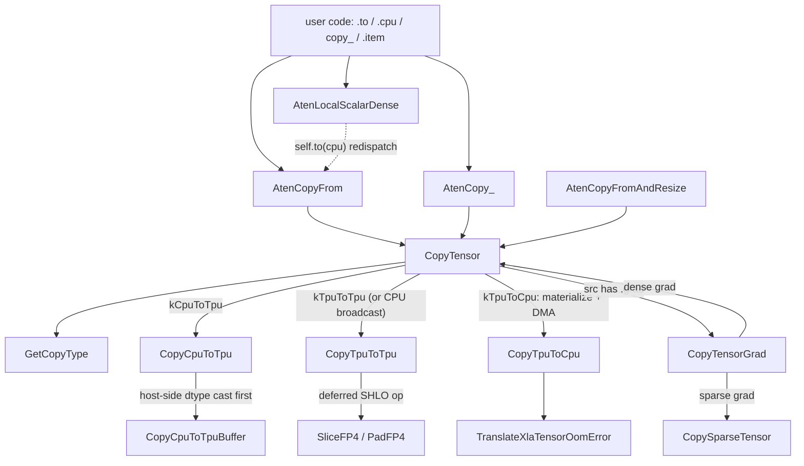
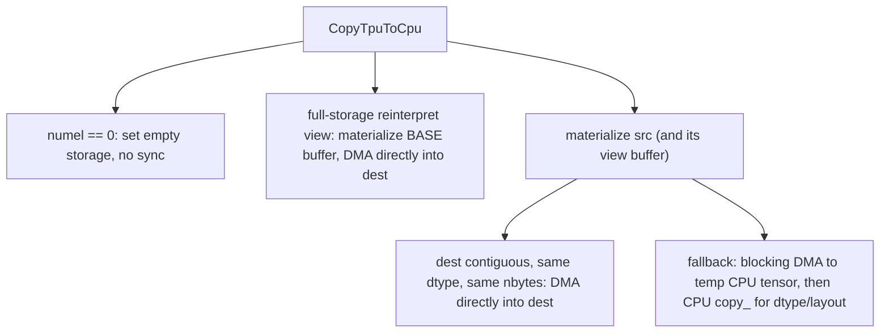

# Host-device copy (aten _copy_from / copy_ / item on TPU)

## Overview

`csrc/ops/copy_from` is the single funnel through which every tensor copy that touches a TPU tensor passes: PyTorch's `.to(device)`, `.cpu()`, `copy_()`, `.item()` and the CPU-fallback machinery all end up in [`CopyTensor`](../catalog/csrc/ops/copy_from/copy_from_aten_kernels.cc.md#CopyTensor "csrc/ops/copy_from/copy_from_aten_kernels.cc:L189"). The key design idea is that the three copy directions have completely different performance characters, so `CopyTensor` first classifies the copy into a [`CopyType`](../catalog/csrc/ops/copy_from/copy_from_aten_kernels.cc.md#CopyType "csrc/ops/copy_from/copy_from_aten_kernels.cc:L55") and then hands it to one direction-specific routine. CPU -> TPU is an eager host-to-device upload. TPU -> TPU usually moves **no bytes at all**: a same-shape/same-dtype copy re-points the destination at the source's device buffer, and anything else becomes one more deferred StableHLO op (convert / broadcast / FP4 pad-slice). TPU -> CPU is the one direction that **forces materialization**: it must run the pending deferred graph that produces the source, wait for it, and DMA the bytes back - it is the implicit sync point of eager torch_tpu.

## Diagram

Legend:
- `PY` - (concept) the PyTorch call site; aten dispatch for the PrivateUse1 key routes it to the kernels below
- `CF` - [`AtenCopyFrom`](../catalog/csrc/ops/copy_from/copy_from_aten_kernels.cc.md#AtenCopyFrom "csrc/ops/copy_from/copy_from_aten_kernels.cc:L232")
- `CP` - [`AtenCopy_`](../catalog/csrc/ops/copy_from/copy_from_aten_kernels.cc.md#AtenCopy_ "csrc/ops/copy_from/copy_from_aten_kernels.cc:L268")
- `CFR` - [`AtenCopyFromAndResize`](../catalog/csrc/ops/copy_from/copy_from_aten_kernels.cc.md#AtenCopyFromAndResize "csrc/ops/copy_from/copy_from_aten_kernels.cc:L241")
- `LSD` - [`AtenLocalScalarDense`](../catalog/csrc/ops/copy_from/copy_from_aten_kernels.cc.md#AtenLocalScalarDense "csrc/ops/copy_from/copy_from_aten_kernels.cc:L254")
- `CT` - [`CopyTensor`](../catalog/csrc/ops/copy_from/copy_from_aten_kernels.cc.md#CopyTensor "csrc/ops/copy_from/copy_from_aten_kernels.cc:L189")
- `GCT` - [`GetCopyType`](../catalog/csrc/ops/copy_from/copy_from_aten_kernels.cc.md#GetCopyType "csrc/ops/copy_from/copy_from_aten_kernels.cc:L61")
- `C2T` - [`CopyCpuToTpu`](../catalog/csrc/ops/copy_from/cpu_to_tpu.cc.md#CopyCpuToTpu "csrc/ops/copy_from/cpu_to_tpu.cc:L61")
- `C2TB` - [`CopyCpuToTpuBuffer`](../catalog/csrc/ops/copy_from/cpu_to_tpu.cc.md#CopyCpuToTpuBuffer "csrc/ops/copy_from/cpu_to_tpu.cc:L38")
- `T2T` - [`CopyTpuToTpu`](../catalog/csrc/ops/copy_from/tpu_to_tpu.cc.md#CopyTpuToTpu "csrc/ops/copy_from/tpu_to_tpu.cc:L87")
- `FP4` - [`SliceFP4`](../catalog/csrc/ops/copy_from/tpu_to_tpu.cc.md#SliceFP4 "csrc/ops/copy_from/tpu_to_tpu.cc:L49") and [`PadFP4`](../catalog/csrc/ops/copy_from/tpu_to_tpu.cc.md#PadFP4 "csrc/ops/copy_from/tpu_to_tpu.cc:L67")
- `T2C` - [`CopyTpuToCpu`](../catalog/csrc/ops/copy_from/tpu_to_cpu.cc.md#CopyTpuToCpu "csrc/ops/copy_from/tpu_to_cpu.cc:L77")
- `OOM` - [`TranslateXlaTensorOomError`](../catalog/csrc/ops/copy_from/tpu_to_cpu.cc.md#TranslateXlaTensorOomError "csrc/ops/copy_from/tpu_to_cpu.cc:L55")
- `GRAD` - [`CopyTensorGrad`](../catalog/csrc/ops/copy_from/copy_from_aten_kernels.cc.md#CopyTensorGrad "csrc/ops/copy_from/copy_from_aten_kernels.cc:L157")
- `SP` - [`CopySparseTensor`](../catalog/csrc/ops/copy_from/copy_from_aten_kernels.cc.md#CopySparseTensor "csrc/ops/copy_from/copy_from_aten_kernels.cc:L134")

The dashed edge is a redispatch through PyTorch, not a direct C++ call (see Mechanism step 6).

TPU -> CPU has three internal paths, chosen by how well the destination matches the source buffer:

Legend:
- `T2C` - [`CopyTpuToCpu`](../catalog/csrc/ops/copy_from/tpu_to_cpu.cc.md#CopyTpuToCpu "csrc/ops/copy_from/tpu_to_cpu.cc:L77")
- `Z` - (concept) zero-element shortcut
- `BASE` - (concept) base-buffer fast path
- `MAT` - (concept) general materialization of the source tensor
- `DIRECT` - (concept) direct-DMA fast path; together with `BASE`, the paths where `non_blocking=True` can stay asynchronous (no secondary CPU `copy_`)
- `FB` - (concept) synchronous fallback through PyTorch's CPU `copy_`

## Design rationale (why it's built this way)

**One classifier, three cost models.** [`GetCopyType`](../catalog/csrc/ops/copy_from/copy_from_aten_kernels.cc.md#GetCopyType "csrc/ops/copy_from/copy_from_aten_kernels.cc:L61") accepts exactly three pairings ([`kCpuToTpu`](../catalog/csrc/ops/copy_from/copy_from_aten_kernels.cc.md#CopyType.kCpuToTpu "csrc/ops/copy_from/copy_from_aten_kernels.cc:L56"), [`kTpuToTpu`](../catalog/csrc/ops/copy_from/copy_from_aten_kernels.cc.md#CopyType.kTpuToTpu "csrc/ops/copy_from/copy_from_aten_kernels.cc:L57"), [`kTpuToCpu`](../catalog/csrc/ops/copy_from/copy_from_aten_kernels.cc.md#CopyType.kTpuToCpu "csrc/ops/copy_from/copy_from_aten_kernels.cc:L58")) and raises a Python `NotImplementedError` for anything else (e.g. TPU to a third device). Keeping the direction explicit is what lets each path pick the cheapest primitive: a host upload, a buffer alias / deferred op, or a materialize-and-DMA.

**`non_blocking` is deliberately not part of the compilation cache key.** Both [`AtenCopyFrom`](../catalog/csrc/ops/copy_from/copy_from_aten_kernels.cc.md#AtenCopyFrom "csrc/ops/copy_from/copy_from_aten_kernels.cc:L232") and [`AtenCopy_`](../catalog/csrc/ops/copy_from/copy_from_aten_kernels.cc.md#AtenCopy_ "csrc/ops/copy_from/copy_from_aten_kernels.cc:L268") wrap the flag as ignored-in-cache-key with the comment "Doesn't affect SHLO". The flag only changes host-side waiting, never the program that runs, so toggling it cannot fragment the [`OpParamCacheKeys`](../catalog/csrc/common/cache_key.h.md#OpParamCacheKeys "csrc/common/cache_key.h:L541")-driven compilation cache.

**TPU -> TPU copies are aliasing, not data movement.** [`CopyTpuToTpu`](../catalog/csrc/ops/copy_from/tpu_to_tpu.cc.md#CopyTpuToTpu "csrc/ops/copy_from/tpu_to_tpu.cc:L87") checks shape and dtype; on a match it simply assigns the source's device buffer reference to the destination tensor (and, if both tensors are full-storage reinterpretations of the same base buffer, shares the base buffer itself regardless of element type). Only when dtype or shape differ does it emit work, and that work is a deferred StableHLO op built in a lambda: slice FP4 source, broadcast, `convert`, pad FP4 destination - all fused into one dispatched op with `OpParamCacheKeys::Empty()`.

> [!inferred]
> Buffer sharing is safe because device buffers in the deferred-execution model are treated as immutable values; an in-place op on the destination later produces a new buffer rather than writing through the shared one. The source does not show the write path, so this is a reading of the design, not a quoted guarantee.

**Dtype conversion for uploads happens on the host.** [`CopyCpuToTpu`](../catalog/csrc/ops/copy_from/cpu_to_tpu.cc.md#CopyCpuToTpu "csrc/ops/copy_from/cpu_to_tpu.cc:L61") casts the CPU tensor to the destination dtype ("Do the type conversion on the host before transfer") before calling [`CopyCpuToTpuBuffer`](../catalog/csrc/ops/copy_from/cpu_to_tpu.cc.md#CopyCpuToTpuBuffer "csrc/ops/copy_from/cpu_to_tpu.cc:L38"). Consequence for perf: an fp32 CPU tensor copied into a bf16 TPU tensor crosses PCIe as bf16 (half the bytes), but the cast costs host CPU time and an extra host allocation; no device-side convert op is compiled.

**Broadcasting uploads ship the small tensor.** When a CPU source's sizes differ from the TPU destination's, [`CopyTensor`](../catalog/csrc/ops/copy_from/copy_from_aten_kernels.cc.md#CopyTensor "csrc/ops/copy_from/copy_from_aten_kernels.cc:L189") uploads the source at its own shape into a temporary TPU tensor and then broadcasts TPU -> TPU, so only the un-broadcast bytes cross the host link.

**Errors surface at the copy, so they are rewritten for the copy.** Because execution is deferred, a TPU -> CPU copy is often the first moment a large pending graph actually runs, so an HBM OOM caused by earlier ops is reported here. [`TranslateXlaTensorOomError`](../catalog/csrc/ops/copy_from/tpu_to_cpu.cc.md#TranslateXlaTensorOomError "csrc/ops/copy_from/tpu_to_cpu.cc:L55") turns the raw XLA OOM into "the TPU ran out of memory while awaiting the materialization of value <dtype>[dims]" - the wording itself tells you the copy was only the trigger.

**`copy_` exists for PyTorch, not for TPU.** The author comment on [`AtenCopy_`](../catalog/csrc/ops/copy_from/copy_from_aten_kernels.cc.md#AtenCopy_ "csrc/ops/copy_from/copy_from_aten_kernels.cc:L268") reads: "Identical to _copy_from, only registered to avoid a dispatch error in torch." Both route to the same `CopyTensor` with swapped argument order.

## Entry points

- [`AtenCopyFrom`](../catalog/csrc/ops/copy_from/copy_from_aten_kernels.cc.md#AtenCopyFrom "csrc/ops/copy_from/copy_from_aten_kernels.cc:L232") - the aten `_copy_from` kernel for the PrivateUse1 (TPU) key, registered in the `TORCH_LIBRARY_IMPL(aten, PrivateUse1, m)` table ([`TORCH_LIBRARY_IMPL_static_init_aten_PrivateUse1_3`](../catalog/csrc/eager/tpu_aten_kernels.cc.md#TORCH_LIBRARY_IMPL_static_init_aten_PrivateUse1_3 "csrc/eager/tpu_aten_kernels.cc:L364")). That same table registers `copy_` separately (to `AtenCopy_`, below), so a `copy_` call lands in `AtenCopy_` rather than here; both end in `CopyTensor`. Wrapped in a profiler TraceMe named `AtenCopyFrom`, so it shows up by that name in xprof.
- [`AtenCopy_`](../catalog/csrc/ops/copy_from/copy_from_aten_kernels.cc.md#AtenCopy_ "csrc/ops/copy_from/copy_from_aten_kernels.cc:L268") - the aten `copy_` kernel; identical behavior to `_copy_from`, registered so torch does not hit a dispatch error.
- [`AtenCopyFromAndResize`](../catalog/csrc/ops/copy_from/copy_from_aten_kernels.cc.md#AtenCopyFromAndResize "csrc/ops/copy_from/copy_from_aten_kernels.cc:L241") - `_copy_from_and_resize`, used by PyTorch's CPU-fallback path (per its docstring, "By going through its usage in ATen/native/CPUFallback.cpp"); resizes the destination to the source shape first and always copies blocking.
- [`AtenLocalScalarDense`](../catalog/csrc/ops/copy_from/copy_from_aten_kernels.cc.md#AtenLocalScalarDense "csrc/ops/copy_from/copy_from_aten_kernels.cc:L254") - `_local_scalar_dense`, i.e. `tensor.item()` and every implicit Python `bool()/int()/float()` of a 1-element TPU tensor: "Copies a 1-element tensor from TPU to CPU and converts it to a scalar." This is the most common hidden sync in training loops.
- [`CopyTensor`](../catalog/csrc/ops/copy_from/copy_from_aten_kernels.cc.md#CopyTensor "csrc/ops/copy_from/copy_from_aten_kernels.cc:L189") - the C++ API ("Copies `src` tensor contents to `self_dest` tensor.") called directly by other op kernels (sparse COO, masked_fill, linalg LU) that need to move a tensor without going back through aten dispatch.
- [`CopyTpuToCpu`](../catalog/csrc/ops/copy_from/tpu_to_cpu.cc.md#CopyTpuToCpu "csrc/ops/copy_from/tpu_to_cpu.cc:L77") / [`CopyCpuToTpuBuffer`](../catalog/csrc/ops/copy_from/cpu_to_tpu.cc.md#CopyCpuToTpuBuffer "csrc/ops/copy_from/cpu_to_tpu.cc:L38") - called directly by op kernels. Ops whose output size is data-dependent (embedding, unique_consecutive, sparse COO, repeat_interleave, ctc_loss) call `CopyTpuToCpu` on a count tensor with `non_blocking=false`, which is a device sync buried inside an op; the eager dispatcher and index/searchsorted helpers call `CopyCpuToTpuBuffer` to upload host scalars and index tensors.

## Mechanism (step-by-step)

1. **Kernel wrapper.** [`AtenCopyFrom`](../catalog/csrc/ops/copy_from/copy_from_aten_kernels.cc.md#AtenCopyFrom "csrc/ops/copy_from/copy_from_aten_kernels.cc:L232"), [`AtenCopy_`](../catalog/csrc/ops/copy_from/copy_from_aten_kernels.cc.md#AtenCopy_ "csrc/ops/copy_from/copy_from_aten_kernels.cc:L268") and [`AtenCopyFromAndResize`](../catalog/csrc/ops/copy_from/copy_from_aten_kernels.cc.md#AtenCopyFromAndResize "csrc/ops/copy_from/copy_from_aten_kernels.cc:L241") each run inside the standard `TT_KERNEL` macro, which pushes a [`ScopedOpName`](../catalog/csrc/common/op_name_stack.h.md#ScopedOpName "csrc/common/op_name_stack.h:L54") and a [`ScopedPythonContextCapturer`](../catalog/csrc/ops/python_context.h.md#ScopedPythonContextCapturer "csrc/ops/python_context.h:L165") (so any deferred op created during the copy is attributed to `copy_from` and the Python call site), logs arguments, and converts internal errors to c10 exceptions via [`TranslateToC10ErrorAndThrow`](../catalog/csrc/common/error_utils.cc.md#TranslateToC10ErrorAndThrow "csrc/common/error_utils.cc:L1223"). The body is a one-line call into `CopyTensor`.

2. **Classify and short-circuit.** [`CopyTensor`](../catalog/csrc/ops/copy_from/copy_from_aten_kernels.cc.md#CopyTensor "csrc/ops/copy_from/copy_from_aten_kernels.cc:L189") requires at least one side on the TPU, returns immediately for a self-to-self copy ("Self-to-self copy is a no-op"), and asks [`GetCopyType`](../catalog/csrc/ops/copy_from/copy_from_aten_kernels.cc.md#GetCopyType "csrc/ops/copy_from/copy_from_aten_kernels.cc:L61") for the direction. After the data copy it always calls [`CopyTensorGrad`](../catalog/csrc/ops/copy_from/copy_from_aten_kernels.cc.md#CopyTensorGrad "csrc/ops/copy_from/copy_from_aten_kernels.cc:L157"), so a copy also moves the source's `.grad` when one is defined.

3. **CPU -> TPU upload.** For [`kCpuToTpu`](../catalog/csrc/ops/copy_from/copy_from_aten_kernels.cc.md#CopyType.kCpuToTpu "csrc/ops/copy_from/copy_from_aten_kernels.cc:L56"), [`CopyCpuToTpu`](../catalog/csrc/ops/copy_from/cpu_to_tpu.cc.md#CopyCpuToTpu "csrc/ops/copy_from/cpu_to_tpu.cc:L61") casts to the destination dtype on the host, then [`CopyCpuToTpuBuffer`](../catalog/csrc/ops/copy_from/cpu_to_tpu.cc.md#CopyCpuToTpuBuffer "csrc/ops/copy_from/cpu_to_tpu.cc:L38") makes the source contiguous, resolves the TPU layout, and allocates + memcpys host-to-device. With `non_blocking=True` it passes the contiguous CPU tensor along to keep it alive until the async transfer finishes; with `False` no keep-alive is needed because the call blocks. A zero-element tensor gets a zero-size device buffer directly, "to avoid blocking on host/device synchronization". The resulting buffer reference is then assigned as the destination tensor's storage - the destination's old buffer is replaced, not written into.

4. **TPU -> TPU alias or deferred op.** For [`kTpuToTpu`](../catalog/csrc/ops/copy_from/copy_from_aten_kernels.cc.md#CopyType.kTpuToTpu "csrc/ops/copy_from/copy_from_aten_kernels.cc:L57") (and the second half of a broadcasting upload), [`CopyTpuToTpu`](../catalog/csrc/ops/copy_from/tpu_to_tpu.cc.md#CopyTpuToTpu "csrc/ops/copy_from/tpu_to_tpu.cc:L87") first rejects mismatched device indices, then takes the zero-cost path when shape and dtype match. Otherwise it builds a StableHLO lambda that applies, in order: [`SliceFP4`](../catalog/csrc/ops/copy_from/tpu_to_tpu.cc.md#SliceFP4 "csrc/ops/copy_from/tpu_to_tpu.cc:L49") if the source is packed `float4_e2m1fn_x2` ("Slices the first half of elements to discard the padding"), a broadcast if shapes differ, a `convert` if element types differ, and [`PadFP4`](../catalog/csrc/ops/copy_from/tpu_to_tpu.cc.md#PadFP4 "csrc/ops/copy_from/tpu_to_tpu.cc:L67") if the destination is FP4 ("Zero-pads the last dimension to double the size (logical N -> physical 2N)"). The output dims are doubled on the last axis for an FP4 destination, and the op is dispatched as one deferred node: nothing executes on the TPU at this point.

5. **TPU -> CPU materialize and DMA.** For [`kTpuToCpu`](../catalog/csrc/ops/copy_from/copy_from_aten_kernels.cc.md#CopyType.kTpuToCpu "csrc/ops/copy_from/copy_from_aten_kernels.cc:L58"), [`CopyTpuToCpu`](../catalog/csrc/ops/copy_from/tpu_to_cpu.cc.md#CopyTpuToCpu "csrc/ops/copy_from/tpu_to_cpu.cc:L77") picks a block mode (`non_blocking` -> non-blocking, otherwise block-until-started) and tries the cheapest path first. (a) If the source is a full reinterpretation of all bytes of its base buffer and the destination is contiguous, same dtype and exactly the base buffer's size, it materializes only the base buffer with reason "CPU transfer" in split-graph mode and DMAs straight into the destination's memory. (b) Otherwise it materializes the source (for a view, both the base and the ephemeral view buffer), and if the destination is contiguous with matching dtype and byte count it DMAs directly - the comment notes this "enables true non-blocking transfers because we don't need to invoke a secondary PyTorch CPU copy_() afterwards". (c) Failing that it does a **synchronous** DMA into a temporary CPU tensor and redispatches PyTorch's CPU `copy_` for dtype/layout conversion ("This must be synchronous, otherwise the CPU copy_() will read garbage"). Every DMA status passes through [`TranslateXlaTensorOomError`](../catalog/csrc/ops/copy_from/tpu_to_cpu.cc.md#TranslateXlaTensorOomError "csrc/ops/copy_from/tpu_to_cpu.cc:L55"), and a cleanup hook surfaces warnings rerouted from background threads the copy waited on.

6. **Scalar read.** [`AtenLocalScalarDense`](../catalog/csrc/ops/copy_from/copy_from_aten_kernels.cc.md#AtenLocalScalarDense "csrc/ops/copy_from/copy_from_aten_kernels.cc:L254") checks `numel() == 1`, calls `self.to(cpu, contiguous)` - which re-enters PyTorch dispatch and lands back in the TPU -> CPU path above with a blocking copy - and returns `item()` of the CPU tensor. A single `.item()` therefore costs a full materialization of whatever deferred graph produces that scalar plus a round-trip.

7. **Gradients and sparse tensors.** [`CopyTensorGrad`](../catalog/csrc/ops/copy_from/copy_from_aten_kernels.cc.md#CopyTensorGrad "csrc/ops/copy_from/copy_from_aten_kernels.cc:L157") allocates a destination grad if missing (native CPU `at::empty` for TPU -> CPU, a TPU empty tensor otherwise) and recursively calls `CopyTensor` on it. Sparse grads go through [`CopySparseTensor`](../catalog/csrc/ops/copy_from/copy_from_aten_kernels.cc.md#CopySparseTensor "csrc/ops/copy_from/copy_from_aten_kernels.cc:L134"), which copies indices and values separately via [`CopySparseBuffers`](../catalog/csrc/ops/copy_from/copy_from_aten_kernels.cc.md#CopySparseBuffers "csrc/ops/copy_from/copy_from_aten_kernels.cc:L92") and rebuilds a sparse tensor in a [`TpuSparseTensorImpl`](../catalog/csrc/ops/copy_from/copy_from_aten_kernels.cc.md#TpuSparseTensorImpl "csrc/ops/copy_from/copy_from_aten_kernels.cc:L123") with a SparseCPU or SparsePrivateUse1 dispatch key, preserving the coalesced flag.

## Key data structures

- [`CopyType`](../catalog/csrc/ops/copy_from/copy_from_aten_kernels.cc.md#CopyType "csrc/ops/copy_from/copy_from_aten_kernels.cc:L55") - the three-way direction enum; every branch in this subsystem switches on it.
- [`SparseBuffers`](../catalog/csrc/ops/copy_from/copy_from_aten_kernels.cc.md#SparseBuffers "csrc/ops/copy_from/copy_from_aten_kernels.cc:L85") - the pair of copied [`indices`](../catalog/csrc/ops/copy_from/copy_from_aten_kernels.cc.md#SparseBuffers.indices "csrc/ops/copy_from/copy_from_aten_kernels.cc:L86") and [`values`](../catalog/csrc/ops/copy_from/copy_from_aten_kernels.cc.md#SparseBuffers.values "csrc/ops/copy_from/copy_from_aten_kernels.cc:L88") tensors. Values take the target's dtype; indices keep their own.
- [`TpuSparseTensorImpl`](../catalog/csrc/ops/copy_from/copy_from_aten_kernels.cc.md#TpuSparseTensorImpl "csrc/ops/copy_from/copy_from_aten_kernels.cc:L123") - a `SparseTensorImpl` subclass whose constructor ([`TpuSparseTensorImpl`](../catalog/csrc/ops/copy_from/copy_from_aten_kernels.cc.md#TpuSparseTensorImpl.TpuSparseTensorImpl "csrc/ops/copy_from/copy_from_aten_kernels.cc:L124")) builds as SparseCPU and then overwrites the key set and device, which is how a sparse tensor can live on the TPU device.
- Device buffer references - every TPU side of a copy is a reference into the deferred-buffer layer ([`DeviceBufferList`](../catalog/csrc/eager/device_buffer.h.md#DeviceBufferList "csrc/eager/device_buffer.h:L529"), backed by a [`DeferredOp`](../catalog/csrc/eager/device_buffer.h.md#DeferredOp "csrc/eager/device_buffer.h:L383") until materialized). Copies mostly swap which reference a tensor's storage points at.

## Dynamics (design intent)

- **Which directions sync.** CPU -> TPU is an eager transfer (blocking unless `non_blocking=True`). TPU -> TPU never syncs and never moves bytes at call time. TPU -> CPU always materializes; with `non_blocking=False` it blocks until materialization has at least started, then the DMA itself blocks.
- **`non_blocking=True` is only fully async on fast paths.** In the TPU -> CPU direction, only the base-buffer and direct-DMA paths honor it end to end; the fallback path (dtype change, non-contiguous destination, size mismatch) is always synchronous. In the CPU -> TPU direction, a host dtype cast still runs synchronously before the async upload.
- **Graph splitting.** The base-buffer path materializes with split-graph mode and reason "CPU transfer".

> [!inferred]
> Split-graph mode appears to cut the pending deferred graph at the transferred value so that it can be compiled and executed now, while later ops start a new graph. That is why frequent `.item()` / `.cpu()` calls in a step fragment the step into many smaller XLA programs (more launches, less fusion, more distinct compilations) - the same effect the graph-split synchronize pattern exploits deliberately.

- **Profiler visibility.** TraceMe scopes `AtenCopyFrom`, `AtenLocalScalarDense`, `CopyTpuToCpu`, `CopyTpuToCpu::MaterializeBase`, `CopyTpuToCpu::MaterializeAndReturn` and `AtenCopy_ (Redispatch)` mark where host time goes; a large `MaterializeAndReturn` span is the deferred graph executing, not the copy.

## Edge cases

- **Zero-element tensors** never sync: CPU -> TPU creates a zero-size device buffer, TPU -> CPU swaps in an empty storage.
- **Cross-device-index TPU copies** (`tpu:0` -> `tpu:1`) are rejected with `NotImplementedError` ("Can't use 2 TPUs in one host").
- **FP4 (`float4_e2m1fn_x2`) tensors** must be at least 1-D; they are physically 2N on device, so the last dimension of an FP4 source must be even.
- **CPU -> TPU with different sizes** goes through a temporary TPU tensor plus a broadcast; the temporary costs HBM for the source size.
- **TPU -> CPU with a dtype change or a non-contiguous destination** always takes the synchronous temp-buffer path, even if `non_blocking=True`.
- **OOM at copy time** usually reflects the memory footprint of the whole pending graph, not of the copied tensor; the translated message names the value being awaited.
- **Copies carry `.grad`.** A copy of a leaf with a defined gradient also allocates and copies the destination gradient, which can be unexpected extra traffic.

## Open questions

- The materialization layer (the materialize / materialize-and-return calls, block modes, split-graph mode), the buffer-assignment helpers, and the H2D/D2H transfer primitives used here are not in this packet's subgraph, so their exact semantics (e.g. what "block until started" waits for, whether split-graph also flushes unrelated pending ops) are not documented from source on this page.
- Whether the direct-DMA destination needs to be pinned host memory for true async behavior is not visible in this subsystem.
- The aten registrations for sparse `copy_` (a separate sparse kernel) live outside this unit.

## See also

- [batch-host-device-transfer](batch-host-device-transfer.md) - the experimental batched, raw-PJRT alternative for moving many tensors at once.
- [dynamic-shape-ops](dynamic-shape-ops.md) - how bounded dynamic shapes avoid data-dependent host round-trips in compiled mode.
