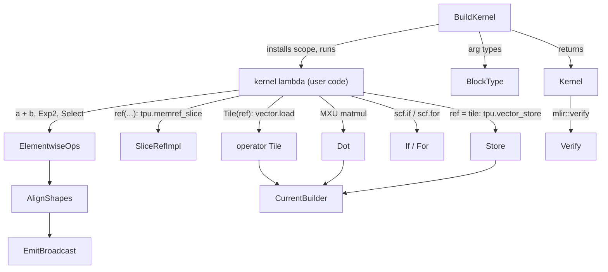

# KILN - the Pallas-shaped C++ DSL for authoring Mosaic TPU kernels

<!-- connect:up:begin -->
> **Cross-repo concept:** part of [mosaic-kernel](../../../concepts/mosaic-kernel.md), [pallas-kernel](../../../concepts/pallas-kernel.md), [vmem](../../../concepts/vmem.md) across this wiki's repos.
<!-- connect:up:end -->
## Overview

KILN is, in the authors' words (`kiln/kiln.h`), "a small, Pallas-shaped kernel language for
authoring Mosaic TPU kernels in C++. The goal is that a framework kernel reads like the Pallas
kernel it would otherwise be, while everything (grid, tile sizes, optional operands, which branches
exist) remains a runtime decision." A kernel is a grid spec plus operand block specs plus a C++
lambda; inside the lambda, [`Ref`](../catalog/csrc/internal/mosaic/kiln/core/ref.h.md#Ref "csrc/internal/mosaic/kiln/core/ref.h:L79")
(a VMEM/SMEM memref operand), [`Tile`](../catalog/csrc/internal/mosaic/kiln/core/tile.h.md#Tile "csrc/internal/mosaic/kiln/core/tile.h:L41")
("a tile living in vregs"), [`Scalar`](../catalog/csrc/internal/mosaic/kiln/core/scalar.h.md#Scalar "csrc/internal/mosaic/kiln/core/scalar.h:L35")
and [`Cond`](../catalog/csrc/internal/mosaic/kiln/core/cond.h.md#Cond "csrc/internal/mosaic/kiln/core/cond.h:L26")
are thin value handles whose overloaded operators append Mosaic/MLIR ops to a thread-local builder
([`CurrentBuilder`](../catalog/csrc/internal/mosaic/kiln/core/context.cc.md#CurrentBuilder "csrc/internal/mosaic/kiln/core/context.cc:L70")).
The key design idea is that **the C++ program is the tracer**: running the lambda once inside
[`BuildKernel`](../catalog/csrc/internal/mosaic/kiln/core/kernel.cc.md#BuildKernel "csrc/internal/mosaic/kiln/core/kernel.cc:L275")
records a `func.func` in the Mosaic calling convention, with `iteration_bounds`,
`dimension_semantics` and `window_params` attributes derived from the specs, and returns an opaque
[`Kernel`](../catalog/csrc/internal/mosaic/kiln/core/kernel.h.md#Kernel "csrc/internal/mosaic/kiln/core/kernel.h:L56")
that can be verified and serialized for a Mosaic custom call. At the pinned v0.2.0 no production op
under `csrc/ops` uses KILN yet - its only callers are `kiln_test.cc` - so it is the emerging
replacement for the hand-written MLIR-builder style that the flash-attention kernels use (see
[Scaled dot-product attention](scaled-dot-product-attention.md)).

## Diagram

Legend:
- `USER` - (concept) the body callback passed to the variadic kernel-creation template
- `BK` - [`BuildKernel`](../catalog/csrc/internal/mosaic/kiln/core/kernel.cc.md#BuildKernel "csrc/internal/mosaic/kiln/core/kernel.cc:L275")
- `BT` - [`BlockType`](../catalog/csrc/internal/mosaic/kiln/core/kernel.cc.md#BlockType "csrc/internal/mosaic/kiln/core/kernel.cc:L120")
- `OPT` - [`operator Tile`](../catalog/csrc/internal/mosaic/kiln/core/ref.cc.md#Ref.operator-Tile "csrc/internal/mosaic/kiln/core/ref.cc:L108")
- `SL` - [`SliceRefImpl`](../catalog/csrc/internal/mosaic/kiln/core/ref.cc.md#SliceRefImpl "csrc/internal/mosaic/kiln/core/ref.cc:L148")
- `EW` - [`ElementwiseOps`](../catalog/csrc/internal/mosaic/kiln/core/elementwise.h.md#ElementwiseOps "csrc/internal/mosaic/kiln/core/elementwise.h:L41")
- `AL` - [`AlignShapes`](../catalog/csrc/internal/mosaic/kiln/core/elementwise_impl.cc.md#AlignShapes "csrc/internal/mosaic/kiln/core/elementwise_impl.cc:L77")
- `EB` - [`EmitBroadcast`](../catalog/csrc/internal/mosaic/kiln/core/elementwise_impl.cc.md#EmitBroadcast "csrc/internal/mosaic/kiln/core/elementwise_impl.cc:L66")
- `DOT` - [`Dot`](../catalog/csrc/internal/mosaic/kiln/core/tile.cc.md#Dot "csrc/internal/mosaic/kiln/core/tile.cc:L331")
- `CF` - [`If`](../catalog/csrc/internal/mosaic/kiln/core/control_flow.cc.md#If "csrc/internal/mosaic/kiln/core/control_flow.cc:L43"), [`For`](../catalog/csrc/internal/mosaic/kiln/core/control_flow.cc.md#For "csrc/internal/mosaic/kiln/core/control_flow.cc:L64")
- `ST` - [`Store`](../catalog/csrc/internal/mosaic/kiln/core/ref.cc.md#Ref.Store "csrc/internal/mosaic/kiln/core/ref.cc:L119")
- `CB` - [`CurrentBuilder`](../catalog/csrc/internal/mosaic/kiln/core/context.cc.md#CurrentBuilder "csrc/internal/mosaic/kiln/core/context.cc:L70")
- `K` - [`Kernel`](../catalog/csrc/internal/mosaic/kiln/core/kernel.h.md#Kernel "csrc/internal/mosaic/kiln/core/kernel.h:L56")
- `V` - [`Verify`](../catalog/csrc/internal/mosaic/kiln/core/kernel.cc.md#Kernel.Verify "csrc/internal/mosaic/kiln/core/kernel.cc:L251")

### Pallas to KILN mapping (from the `kiln.h` header comment)

| Pallas TPU | KILN |
|---|---|
| `pallas_call` grid / in / out / scratch specs | `GridSpec`, `InSpec`, `OutSpec`, `ScratchSpec` (plus `ScalarPrefetchSpec`) |
| optional operand | `std::optional<InSpec / OutSpec>` -> `std::optional<Ref>` parameter |
| `pl.program_id` / `pl.num_programs` | `ProgramId(axis)` / `NumPrograms(axis)` |
| ref slicing | `ref(0, 0)`, `ref(0, Slice(c, kChunk), all)` -> `tpu.memref_slice` / `tpu.memref_squeeze` |
| load / store on refs | `Tile(ref)`, `ref = tile`, `Scalar(ref)` |
| a `jax.Array` inside the kernel | `Tile` |
| SMEM / grid-index scalars | `Scalar`, `Cond` |
| `pl.when` / `lax.fori_loop` | `If` / `For` |
| `index_map` | `IndexMap` lambda returning one index per block dim |
| `dimension_semantics` | `DimensionSemantics::kParallel / kArbitrary` per grid axis |

## Design rationale (why it's built this way)

**Pallas vocabulary, C++ runtime.** torch_tpu's ATen kernels run in C++ at dispatch time and know
the concrete shapes only then; a Python Pallas kernel would need a Python/JAX trace in that path.
KILN keeps the Pallas mental model (grid, block specs, index maps, program ids) so a kernel can be
ported 1:1 from a Pallas reference, while every structural choice is ordinary C++ control flow
evaluated while the body runs. The [`BuildKernel`](../catalog/csrc/internal/mosaic/kiln/core/kernel.cc.md#BuildKernel "csrc/internal/mosaic/kiln/core/kernel.cc:L275")
doc says it is the "Low-level entry point taking an assembled `KernelSpec`. Prefer `CreateKernel`
below, which unpacks each spec into a `Ref` parameter on the body callback."

**Trace-time vs. kernel-time control flow is explicit.** A plain C++ `for` loop over chunks unrolls
into straight-line IR at build time (the scalar-prefetch test checks the unrolled `tpu.memref_slice`
sequence with `CHECK-COUNT-7`), while [`For`](../catalog/csrc/internal/mosaic/kiln/core/control_flow.cc.md#For "csrc/internal/mosaic/kiln/core/control_flow.cc:L64")
emits a real `scf.for` whose induction variable is an i32 `Scalar`. The same split holds for C++
`if` (decides which ops exist) versus [`If`](../catalog/csrc/internal/mosaic/kiln/core/control_flow.cc.md#If "csrc/internal/mosaic/kiln/core/control_flow.cc:L43")
(an `scf.if` on a runtime `Cond`). That is the lever for unrolling and specialization.

> [!inferred]
> For performance this mirrors Pallas: unrolled C++ loops trade code size and compile time for
> scheduling freedom inside one grid step, while `For` keeps the IR small; which is better depends on
> trip count and vreg pressure.

**A thread-local builder instead of explicit builder threading.** Every op reaches the active
builder through [`CurrentBuilder`](../catalog/csrc/internal/mosaic/kiln/core/context.cc.md#CurrentBuilder "csrc/internal/mosaic/kiln/core/context.cc:L70"),
installed by an RAII scope for the duration of the body; that is what lets `out = Tile(x) + Tile(y)`
be the whole kernel. The price is a hard rule, enforced by a CHECK: "KILN operations may only be
called inside BuildKernel()".

**Opaque handles keep MLIR out of the public headers.** All handles derive from a base holding an
opaque IR pointer plus a KILN [`DType`](../catalog/csrc/internal/mosaic/kiln/core/dtype.h.md#DType "csrc/internal/mosaic/kiln/core/dtype.h:L31");
only [`ValueAccess`](../catalog/csrc/internal/mosaic/kiln/core/context.h.md#ValueAccess "csrc/internal/mosaic/kiln/core/context.h:L51")
(via [`wrap`](../catalog/csrc/internal/mosaic/kiln/core/context.h.md#wrap "csrc/internal/mosaic/kiln/core/context.h:L64") /
[`unwrap`](../catalog/csrc/internal/mosaic/kiln/core/context.h.md#unwrap "csrc/internal/mosaic/kiln/core/context.h:L61"))
converts back to `mlir::Value`. The elementwise emitters "are defined in elementwise_impl.h and
explicitly instantiated in scalar.cc and tile.cc, which keeps MLIR out of the public headers", and
one [`ElementwiseOps`](../catalog/csrc/internal/mosaic/kiln/core/elementwise.h.md#ElementwiseOps "csrc/internal/mosaic/kiln/core/elementwise.h:L41")
template serves both `Scalar` and `Tile` because "the underlying MLIR `arith` / `math` ops are
elementwise over both scalars and vectors".

**No implicit dtype promotion; numpy broadcasting only on shape.** `Tile` operands "broadcast
numpy-style" but "Element types are never promoted implicitly; use `AsType`." Mixing f32 with i32 or
i32 with u32 is a CHECK failure (the mismatched-types test expects "+ requires operands of the same
dtype"). For TPU this matters: a silent bf16 -> f32 upcast doubles vreg and VMEM traffic, and KILN
makes it impossible without an explicit [`AsType`](../catalog/csrc/internal/mosaic/kiln/core/elementwise.h.md#WithElementwiseOps.AsType "csrc/internal/mosaic/kiln/core/elementwise.h:L98").

**MXU contract baked into `Dot`.** [`Dot`](../catalog/csrc/internal/mosaic/kiln/core/tile.cc.md#Dot "csrc/internal/mosaic/kiln/core/tile.cc:L331")
is a "2-D matmul on the MXU with f32 accumulation": the result dtype is always
[`Float32Type`](../catalog/csrc/internal/mosaic/kiln/core/dtype.h.md#Float32Type "csrc/internal/mosaic/kiln/core/dtype.h:L155"),
transposes are expressed as dimension numbers rather than separate transposes, and an optional
contraction precision (`kBF16`, `kFP32`, `kBF16x3`) maps onto `tpu::ContractPrecision`. It lowers
through the shared Mosaic matmul helper documented in [Mosaic matmul](mosaic-matmul.md).

## Entry points

- [`BuildKernel`](../catalog/csrc/internal/mosaic/kiln/core/kernel.cc.md#BuildKernel "csrc/internal/mosaic/kiln/core/kernel.cc:L275") - the low-level builder taking an assembled spec and a `void()` body; the variadic creation template in `kernel.h` registers each spec in argument order and calls it, so every kernel construction ends here.
- [`Ref`](../catalog/csrc/internal/mosaic/kiln/core/ref.h.md#Ref "csrc/internal/mosaic/kiln/core/ref.h:L79") - "A memref kernel argument (VMEM block, SMEM scalar-prefetch buffer or scratch)"; the body callback receives one per spec (or `std::optional<Ref>` for an optional spec), and it is the most-referenced KILN type from outside the core.
- [`Tile`](../catalog/csrc/internal/mosaic/kiln/core/tile.h.md#Tile "csrc/internal/mosaic/kiln/core/tile.h:L41") and [`Scalar`](../catalog/csrc/internal/mosaic/kiln/core/scalar.h.md#Scalar "csrc/internal/mosaic/kiln/core/scalar.h:L35") - the value types a body computes with; `Scalar` covers "Grid indices, loop induction variables, SMEM scalar values, constants, and scalar statistics", constructed with [`I32`](../catalog/csrc/internal/mosaic/kiln/core/scalar.cc.md#I32 "csrc/internal/mosaic/kiln/core/scalar.cc:L66") / [`U32`](../catalog/csrc/internal/mosaic/kiln/core/scalar.cc.md#U32 "csrc/internal/mosaic/kiln/core/scalar.cc:L67").
- [`Kernel`](../catalog/csrc/internal/mosaic/kiln/core/kernel.h.md#Kernel "csrc/internal/mosaic/kiln/core/kernel.h:L56") - "An opaque handle to a lowered KILN kernel module", returned by the builder; callers pretty-print it, run [`Verify`](../catalog/csrc/internal/mosaic/kiln/core/kernel.cc.md#Kernel.Verify "csrc/internal/mosaic/kiln/core/kernel.cc:L251"), and consume it with the destructive serialize call.
- Tests: [`TestBody`](../catalog/csrc/internal/mosaic/kiln/kiln_test.cc.md#KilnTest_TileScalarOperations_Test.TestBody "csrc/internal/mosaic/kiln/kiln_test.cc:L434") (tile/scalar arithmetic) and [`TestBody`](../catalog/csrc/internal/mosaic/kiln/kiln_test.cc.md#KilnTest_SimplifiedOverloadsAndBounds_Test.TestBody "csrc/internal/mosaic/kiln/kiln_test.cc:L805") (literal overloads, `For`/`If` bounds, ref slicing) are two of the 16 `TEST_F` cases in `kiln_test.cc`, which is the only file that calls KILN at this pin; every case runs `Verify` and serialization ("the same serialization step as the production kernels") and FileCheck-matches the printed IR.

## Mechanism (step-by-step)

1. **Register specs in call order.** The creation template walks its arguments left to right ("Order of evaluation in a braced-init-list is left-to-right, so specs are registered in the exact order they were passed"), appending each scalar-prefetch / in / out / scratch spec to a `KernelSpec` and producing a resolver per argument; an absent `std::optional` spec yields a resolver returning `std::nullopt`, so the operand simply does not exist in the kernel. It then calls [`BuildKernel`](../catalog/csrc/internal/mosaic/kiln/core/kernel.cc.md#BuildKernel "csrc/internal/mosaic/kiln/core/kernel.cc:L275") with a body that invokes the user lambda on the resolved [`Ref`](../catalog/csrc/internal/mosaic/kiln/core/ref.h.md#Ref "csrc/internal/mosaic/kiln/core/ref.h:L79") values.

2. **Lay out the Mosaic signature.** [`BuildKernel`](../catalog/csrc/internal/mosaic/kiln/core/kernel.cc.md#BuildKernel "csrc/internal/mosaic/kiln/core/kernel.cc:L275") rejects a `dimension_semantics` list whose length differs from the grid rank, creates a fresh MLIR context with the TorchTPU dialects, and builds the argument list in the Mosaic calling convention: one i32 per grid axis, SMEM memrefs for scalar prefetch, then in and out blocks and scratch, each typed by [`BlockType`](../catalog/csrc/internal/mosaic/kiln/core/kernel.cc.md#BlockType "csrc/internal/mosaic/kiln/core/kernel.cc:L120") as a VMEM or SMEM memref of the block shape and dtype. The function is tagged as a TensorCore kernel.

3. **Derive the grid attributes.** Still inside [`BuildKernel`](../catalog/csrc/internal/mosaic/kiln/core/kernel.cc.md#BuildKernel "csrc/internal/mosaic/kiln/core/kernel.cc:L275"), `iteration_bounds` is the grid, `dimension_semantics` defaults to parallel on every axis, and each in/out block gets a `window_params` entry. A block with an `IndexMap` gets a private function named `<kernel>_index_map_<i>` produced by *running the index-map lambda* under its own kernel scope, so `ProgramId` and `ScalarPrefetch` bind to that function's arguments (the scalar-prefetch test gathers rows through an SMEM index table this way); a block without a map gets a constant-zero affine map. `scalar_prefetch` and `scratch_operands` counts are attached as attributes.

4. **Run the body under a scope.** A kernel scope wraps every entry-block argument into a handle with [`wrap`](../catalog/csrc/internal/mosaic/kiln/core/context.h.md#wrap "csrc/internal/mosaic/kiln/core/context.h:L64") (grid indices as i32 `Scalar`s, operands as `Ref`s with their spec dtype) and installs the builder that [`CurrentBuilder`](../catalog/csrc/internal/mosaic/kiln/core/context.cc.md#CurrentBuilder "csrc/internal/mosaic/kiln/core/context.cc:L70") returns; the destructor restores the previous scope. The index-map scopes from step 3 are created and torn down before this body scope is constructed, so they run one after another rather than nested.

5. **Move data between refs and vregs.** [`operator Tile`](../catalog/csrc/internal/mosaic/kiln/core/ref.cc.md#Ref.operator-Tile "csrc/internal/mosaic/kiln/core/ref.cc:L108") loads a whole VMEM ref with `vector.load`; [`operator Scalar`](../catalog/csrc/internal/mosaic/kiln/core/ref.cc.md#Ref.operator-Scalar "csrc/internal/mosaic/kiln/core/ref.cc:L97") loads a 0-D SMEM ref with `memref.load`. Assignment is a store: [`operator=`](../catalog/csrc/internal/mosaic/kiln/core/ref.cc.md#Ref.operator "csrc/internal/mosaic/kiln/core/ref.cc:L81") from a `Tile` calls [`Store`](../catalog/csrc/internal/mosaic/kiln/core/ref.cc.md#Ref.Store "csrc/internal/mosaic/kiln/core/ref.cc:L119"), which casts to the ref's dtype, reshapes or broadcasts to the ref's shape, and emits `tpu.vector_store` with an optional i1 mask ("Pallas `pltpu.store`"); [`operator=`](../catalog/csrc/internal/mosaic/kiln/core/ref.cc.md#Ref.operator "csrc/internal/mosaic/kiln/core/ref.cc:L86") from a `Scalar` stores into a 0-D SMEM ref. Sub-views come from [`operator()`](../catalog/csrc/internal/mosaic/kiln/core/ref.h.md#Ref.operator "csrc/internal/mosaic/kiln/core/ref.h:L102") -> [`SliceRefImpl`](../catalog/csrc/internal/mosaic/kiln/core/ref.cc.md#SliceRefImpl "csrc/internal/mosaic/kiln/core/ref.cc:L148"), which emits `tpu.memref_slice` only when an offset is non-zero or the shape shrinks, and `tpu.memref_squeeze` for scalar-indexed (collapsed) dims; the result is another `Ref`, so "sliced and non-sliced references share the exact same interface". These are views, not copies.

6. **Compute elementwise.** Arithmetic, bitwise, comparison, `Min`/`Max`/`Select` and unary math (`Exp`, `Exp2`, `Log2`, `Rsqrt`, `Tanh`, ...) come from [`ElementwiseOps`](../catalog/csrc/internal/mosaic/kiln/core/elementwise.h.md#ElementwiseOps "csrc/internal/mosaic/kiln/core/elementwise.h:L41") through CRTP mixins, with [`operator+`](../catalog/csrc/internal/mosaic/kiln/core/elementwise.h.md#operator "csrc/internal/mosaic/kiln/core/elementwise.h:L114") and friends plus `Literal` overloads on either side ([`Literal`](../catalog/csrc/internal/mosaic/kiln/core/literal.h.md#Literal "csrc/internal/mosaic/kiln/core/literal.h:L29") is "implicitly convertible from all standard C++ integral and floating-point types"; a literal is splatted in the other operand's dtype via [`MakeConstant`](../catalog/csrc/internal/mosaic/kiln/core/tile.h.md#Tile.MakeConstant "csrc/internal/mosaic/kiln/core/tile.h:L48")). Before a multi-operand op, [`AlignShapes`](../catalog/csrc/internal/mosaic/kiln/core/elementwise_impl.cc.md#AlignShapes "csrc/internal/mosaic/kiln/core/elementwise_impl.cc:L77") computes the numpy broadcast shape and [`EmitBroadcast`](../catalog/csrc/internal/mosaic/kiln/core/elementwise_impl.cc.md#EmitBroadcast "csrc/internal/mosaic/kiln/core/elementwise_impl.cc:L66") inserts `vector.broadcast` for vector operands; scalar operands "have no shape and are left untouched". Comparisons on `Tile`s produce an i1 mask `Tile`, on `Scalar`s a `Cond`.

7. **Shape, reduce and matmul tiles.** [`Reshape`](../catalog/csrc/internal/mosaic/kiln/core/tile.cc.md#Tile.Reshape "csrc/internal/mosaic/kiln/core/tile.cc:L123") is a `vector.shape_cast`; [`BroadcastTo`](../catalog/csrc/internal/mosaic/kiln/core/tile.cc.md#Tile.BroadcastTo "csrc/internal/mosaic/kiln/core/tile.cc:L150") reuses `EmitBroadcast`; [`Slice`](../catalog/csrc/internal/mosaic/kiln/core/tile.cc.md#Tile.Slice "csrc/internal/mosaic/kiln/core/tile.cc:L173") is a static `vector.extract_strided_slice`; [`Lanes`](../catalog/csrc/internal/mosaic/kiln/core/tile.cc.md#Tile.Lanes "csrc/internal/mosaic/kiln/core/tile.cc:L155") resizes the last dim by slicing, broadcasting or repeating - "the idiom for lane-replicated row statistics stored as (rows, 128)", the same layout the flash-attention kernels use for their running max and sum. [`Rotate`](../catalog/csrc/internal/mosaic/kiln/core/tile.cc.md#Tile.Rotate "csrc/internal/mosaic/kiln/core/tile.cc:L194") (`tpu.dynamic_rotate`), [`Gather`](../catalog/csrc/internal/mosaic/kiln/core/tile.cc.md#Tile.Gather "csrc/internal/mosaic/kiln/core/tile.cc:L207") (`tpu.dynamic_gather`) and [`Extract`](../catalog/csrc/internal/mosaic/kiln/core/tile.cc.md#Tile.Extract "csrc/internal/mosaic/kiln/core/tile.cc:L228") cover lane movement. [`Reduce`](../catalog/csrc/internal/mosaic/kiln/core/tile.cc.md#Reduce "csrc/internal/mosaic/kiln/core/tile.cc:L85") emits `vector.multi_reduction` and reshapes back with the reduced dim kept as 1, underlying [`MaxReduce`](../catalog/csrc/internal/mosaic/kiln/core/tile.cc.md#MaxReduce "csrc/internal/mosaic/kiln/core/tile.cc:L299") (initialized from the dtype's minimum) and the sum reduction. [`Dot`](../catalog/csrc/internal/mosaic/kiln/core/tile.cc.md#Dot "csrc/internal/mosaic/kiln/core/tile.cc:L331") checks 2-D operands and matching contracting dims and emits an f32-accumulating MXU matmul. Constants come from [`Zeros`](../catalog/csrc/internal/mosaic/kiln/core/tile.cc.md#Zeros "csrc/internal/mosaic/kiln/core/tile.cc:L246"), [`Full`](../catalog/csrc/internal/mosaic/kiln/core/tile.cc.md#Full "csrc/internal/mosaic/kiln/core/tile.cc:L250"), [`NInf`](../catalog/csrc/internal/mosaic/kiln/core/tile.cc.md#NInf "csrc/internal/mosaic/kiln/core/tile.cc:L259") and [`Iota`](../catalog/csrc/internal/mosaic/kiln/core/tile.cc.md#Iota "csrc/internal/mosaic/kiln/core/tile.cc:L270") (a `tpu.iota`, integer dtypes only).

8. **Branch and loop at kernel time.** [`If`](../catalog/csrc/internal/mosaic/kiln/core/control_flow.cc.md#If "csrc/internal/mosaic/kiln/core/control_flow.cc:L43") emits `scf.if` (with an optional else body) on a `Cond`; [`For`](../catalog/csrc/internal/mosaic/kiln/core/control_flow.cc.md#For "csrc/internal/mosaic/kiln/core/control_flow.cc:L64") emits a unit-step `scf.for` whose bounds may be C++ integers or i32 `Scalar`s, casting only the `Scalar` bounds to `index`. The typical accumulator pattern - zero scratch when the arbitrary axis index is 0, accumulate, write out on the last index - is expressed with `If(ProgramId(k) == 0, ...)` and `If(ProgramId(k) == NumPrograms(k) - 1, ...)`, as in the blockwise-matmul test.

9. **Finish, verify, serialize.** The body is closed with `func.return` and wrapped into a [`Kernel`](../catalog/csrc/internal/mosaic/kiln/core/kernel.h.md#Kernel "csrc/internal/mosaic/kiln/core/kernel.h:L56") that owns both the MLIR context and module. [`Verify`](../catalog/csrc/internal/mosaic/kiln/core/kernel.cc.md#Kernel.Verify "csrc/internal/mosaic/kiln/core/kernel.cc:L251") runs `mlir::verify` and returns the printed IR in the error; serialization runs the versioned Mosaic serde pass and returns the module text - "This is a destructive operation" - which is what a `tpu_custom_call` backend config carries.

## Key data structures

- **Specs** (`specs.h`): `GridSpec` (name, grid shape, per-axis `DimensionSemantics`), `InSpec` / `OutSpec` (block shape, dtype, `IndexMap`, memory space defaulting to VMEM), `ScratchSpec`, `ScalarPrefetchSpec`. The two semantics are documented as "independent and may be reordered or executed concurrently by the compiler" (`kParallel`) versus "data dependencies and must execute sequentially in increasing index order" (`kArbitrary`). These types are described from source; they are outside this page's symbol subgraph.
- [`DType`](../catalog/csrc/internal/mosaic/kiln/core/dtype.h.md#DType "csrc/internal/mosaic/kiln/core/dtype.h:L31") with [`Kind`](../catalog/csrc/internal/mosaic/kiln/core/dtype.h.md#DType.Kind "csrc/internal/mosaic/kiln/core/dtype.h:L33") - bool, i8..i64, u8..u64, f16, bf16, f32 - and [`GetIntOrFloatBitWidth`](../catalog/csrc/internal/mosaic/kiln/core/dtype.h.md#DType.GetIntOrFloatBitWidth "csrc/internal/mosaic/kiln/core/dtype.h:L76"). Signedness lives in KILN's dtype, not in MLIR's signless integers, which is why `>>` can be arithmetic for signed and logical for unsigned types.
- Handles: [`Ref`](../catalog/csrc/internal/mosaic/kiln/core/ref.h.md#Ref "csrc/internal/mosaic/kiln/core/ref.h:L79") (memref), [`Tile`](../catalog/csrc/internal/mosaic/kiln/core/tile.h.md#Tile "csrc/internal/mosaic/kiln/core/tile.h:L41") (vector, with static [`shape`](../catalog/csrc/internal/mosaic/kiln/core/tile.cc.md#Tile.shape "csrc/internal/mosaic/kiln/core/tile.cc:L113") and [`rank`](../catalog/csrc/internal/mosaic/kiln/core/tile.cc.md#Tile.rank "csrc/internal/mosaic/kiln/core/tile.cc:L117") read from its vector type; a 0-D tile can be built from a scalar via [`Tile`](../catalog/csrc/internal/mosaic/kiln/core/tile.cc.md#Tile.Tile "csrc/internal/mosaic/kiln/core/tile.cc:L111")), [`Scalar`](../catalog/csrc/internal/mosaic/kiln/core/scalar.h.md#Scalar "csrc/internal/mosaic/kiln/core/scalar.h:L35"), [`Cond`](../catalog/csrc/internal/mosaic/kiln/core/cond.h.md#Cond "csrc/internal/mosaic/kiln/core/cond.h:L26"). Each carries its KILN [`dtype`](../catalog/csrc/internal/mosaic/kiln/core/value_base.h.md#ValueBase.dtype "csrc/internal/mosaic/kiln/core/value_base.h:L32") next to the opaque IR pointer; the constructors CHECK that the underlying value really is a memref / vector.
- [`Literal`](../catalog/csrc/internal/mosaic/kiln/core/literal.h.md#Literal.Literal "csrc/internal/mosaic/kiln/core/literal.h:L33") - an `int64_t` or `double` variant; it has no dtype of its own and takes the dtype of the handle it is combined with.

## Dynamics (design intent)

- **One context per kernel, one scope per thread.** [`BuildKernel`](../catalog/csrc/internal/mosaic/kiln/core/kernel.cc.md#BuildKernel "csrc/internal/mosaic/kiln/core/kernel.cc:L275") creates a fresh MLIR context for every kernel and the active builder is thread-local, so concurrent builds on different threads do not share state; nesting on one thread is handled by the scope's save/restore of the previous pointer ([`CurrentBuilder`](../catalog/csrc/internal/mosaic/kiln/core/context.cc.md#CurrentBuilder "csrc/internal/mosaic/kiln/core/context.cc:L70")).
- **Grid ordering is a declaration, not an implementation.** KILN only records `dimension_semantics`; the actual pipelining (DMA of the next block while the current one computes) and any cross-core splitting of parallel axes is done by Mosaic from `window_params` and the semantics.

> [!inferred]
> Because KILN exposes only whole-block `vector.load` / `tpu.vector_store` on VMEM refs (the store
> CHECK says "use AsyncCopy for HBM"), all HBM <-> VMEM movement at this pin comes from Mosaic's
> automatic block pipelining driven by the specs' index maps; manual DMA / double-buffering control,
> as in Pallas `pltpu.async_copy`, is not available yet.

## Edge cases

- Calling any KILN op outside a build (e.g. constructing a `Tile` in host code) aborts with "KILN operations may only be called inside BuildKernel()". Most authoring mistakes - dtype mismatch, bad slice bounds, `Scalar(ref)` on a non-0-D or non-SMEM ref, non-2-D `Dot` operands, unbroadcastable shapes - are CHECK failures that crash the process rather than `absl::Status` errors; only spec-level problems (semantics length, index-map arity) come back as status.
- `Ref` copy-assignment is deleted, but assignment from a `Tile` or `Scalar` is a **store** ([`operator=`](../catalog/csrc/internal/mosaic/kiln/core/ref.cc.md#Ref.operator "csrc/internal/mosaic/kiln/core/ref.cc:L81")); `Ref r2 = r;` copies the handle, `r2 = Tile(x);` writes memory.
- [`Store`](../catalog/csrc/internal/mosaic/kiln/core/ref.cc.md#Ref.Store "csrc/internal/mosaic/kiln/core/ref.cc:L119") is the one place with an implicit conversion: it casts the tile to the ref's dtype and broadcasts it to the ref's shape, so `out = Tile(acc)` into a bf16 output truncates f32 silently (the matmul test writes `Tile(acc).ToBF16()` explicitly anyway).
- Float-to-float casts between equal widths (f16 <-> bf16) hit "Unsupported float cast".
- [`Iota`](../catalog/csrc/internal/mosaic/kiln/core/tile.cc.md#Iota "csrc/internal/mosaic/kiln/core/tile.cc:L270") requires an integer dtype and [`NInf`](../catalog/csrc/internal/mosaic/kiln/core/tile.cc.md#NInf "csrc/internal/mosaic/kiln/core/tile.cc:L259") a float dtype; [`Gather`](../catalog/csrc/internal/mosaic/kiln/core/tile.h.md#Tile.Gather "csrc/internal/mosaic/kiln/core/tile.h:L73") broadcasts 0-D indices to the source shape.

## Open questions

- The variadic creation template (`CreateKernel` in `kernel.h`), the spec structs, `ProgramId` / `NumPrograms`, the grid-attribute helper and the destructive serialize method are central to KILN but are not symbols in this page's subgraph; they are described from source without citations.
- No op in `csrc/ops` builds a kernel with KILN at v0.2.0, so there is no in-tree evidence yet of KILN kernels' performance relative to the hand-built MLIR kernels or to XLA fusion.
- No manual DMA / semaphore primitives exist; the `AsyncCopy` named in the `Store` CHECK message has no implementation at this pin.
- Who wraps a serialized `Kernel` into the `tpu_custom_call` op for KILN kernels is not shown; the flash-attention path has its own file-local custom-call builder.

## See also

- [Mosaic matmul and kernel-emission helpers](mosaic-matmul.md) - `CreateMatmul`, VMEM/SMEM memref types and dimension-semantics attributes that KILN lowers onto.
- [Scaled dot-product attention](scaled-dot-product-attention.md) - the production Mosaic kernels written directly against MLIR builders.
- [Pallas custom kernels](pallas-custom-kernels.md) - the Python Pallas route that KILN's vocabulary mirrors.
