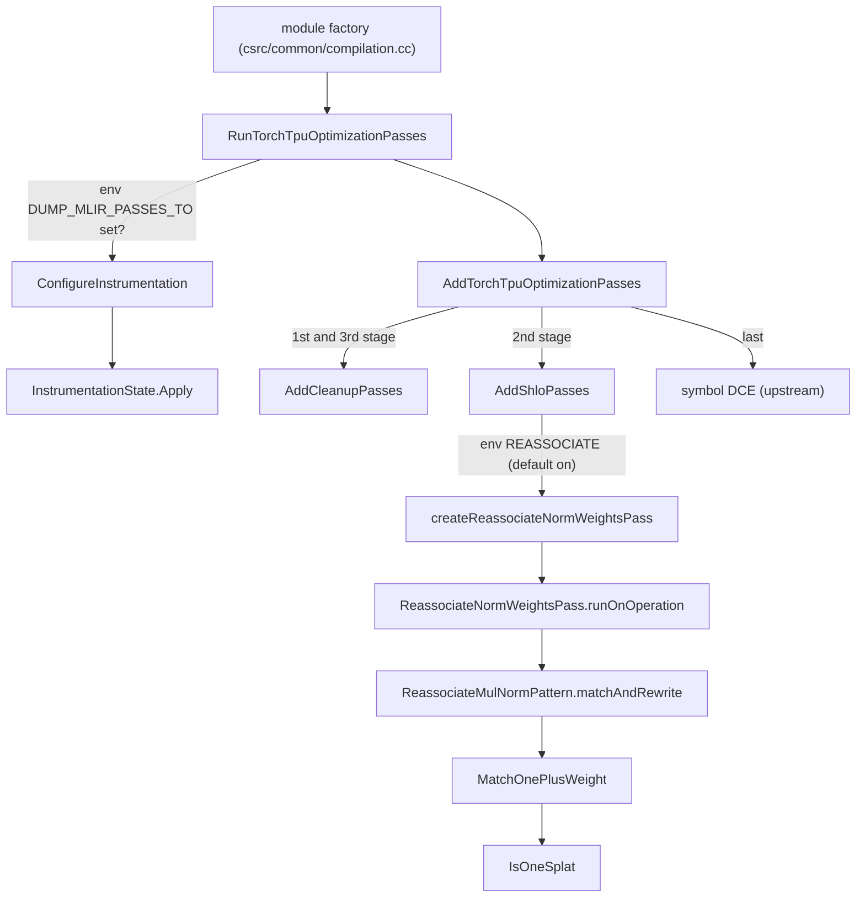

# TorchTPU MLIR optimization passes

<!-- connect:up:begin -->
> **Cross-repo concept:** part of [layer-norm](../../../concepts/layer-norm.md) across this wiki's repos.
<!-- connect:up:end -->
## Overview

`csrc/mlir` is TorchTPU's own, deliberately small, MLIR pass pipeline. It runs on the StableHLO
module that TorchTPU's op lowerings produce - for eager traversals and `torch.compile` graphs
alike - after the module is built and **before** it is handed to XLA/PJRT for compilation. One
function,
[`RunTorchTpuOptimizationPasses`](../catalog/csrc/mlir/pipeline.cc.md#RunTorchTpuOptimizationPasses "csrc/mlir/pipeline.cc:L68"),
is the whole public surface: it optionally attaches pass instrumentation
([`ConfigureInstrumentation`](../catalog/csrc/mlir/instrumentation.cc.md#ConfigureInstrumentation "csrc/mlir/instrumentation.cc:L78")),
populates a pass manager with
[`AddTorchTpuOptimizationPasses`](../catalog/csrc/mlir/pipeline.cc.md#AddTorchTpuOptimizationPasses "csrc/mlir/pipeline.cc:L61"),
and runs it. The key design idea is the *sandwich*: generic cleanup, then the StableHLO-level
rewrites (one TorchTPU-authored pattern,
[`ReassociateMulNormPattern`](../catalog/csrc/mlir/passes/reassociate_norm_weights.cc.md#ReassociateMulNormPattern "csrc/mlir/passes/reassociate_norm_weights.cc:L104"),
plus upstream StableHLO's target-independent optimizer), then cleanup again and dead-symbol
removal. Everything heavier - fusion, layout assignment, scheduling, rematerialization - is left
to XLA; this layer only normalizes and lightly rewrites the IR so XLA sees a cleaner graph.

For the TPU-performance lens the facts that matter are: the pipeline is on for every compiled
module, it runs whenever a module is actually built - in the compilation cache that is only on a
miss, because the cache key comes from the graph signature rather than from the module (compiled-mode
paths that ask for the module, or run with caching disabled, build and optimize it regardless), CSE is **off** by default because it measurably slowed large prefill graphs, the
norm-weight reassociation is **on** by default and is a floating-point reassociation (not
bit-exact), and three internal env vars control it all.

## Diagram

Legend:
- `CALLER` - (concept) the MLIR-context module factory that every TorchTPU module build goes through
- `RUN` - [`RunTorchTpuOptimizationPasses`](../catalog/csrc/mlir/pipeline.cc.md#RunTorchTpuOptimizationPasses "csrc/mlir/pipeline.cc:L68")
- `CFG` - [`ConfigureInstrumentation`](../catalog/csrc/mlir/instrumentation.cc.md#ConfigureInstrumentation "csrc/mlir/instrumentation.cc:L78")
- `APPLY` - [`Apply`](../catalog/csrc/mlir/instrumentation.cc.md#InstrumentationState.Apply "csrc/mlir/instrumentation.cc:L47")
- `ADD` - [`AddTorchTpuOptimizationPasses`](../catalog/csrc/mlir/pipeline.cc.md#AddTorchTpuOptimizationPasses "csrc/mlir/pipeline.cc:L61")
- `CLEAN` - [`AddCleanupPasses`](../catalog/csrc/mlir/pipeline.cc.md#AddCleanupPasses "csrc/mlir/pipeline.cc:L38")
- `SHLO` - [`AddShloPasses`](../catalog/csrc/mlir/pipeline.cc.md#AddShloPasses "csrc/mlir/pipeline.cc:L50")
- `RNW` - [`createReassociateNormWeightsPass`](../catalog/csrc/mlir/passes/reassociate_norm_weights.cc.md#createReassociateNormWeightsPass "csrc/mlir/passes/reassociate_norm_weights.cc:L187")
- `PASS` - [`runOnOperation`](../catalog/csrc/mlir/passes/reassociate_norm_weights.cc.md#ReassociateNormWeightsPass.runOnOperation "csrc/mlir/passes/reassociate_norm_weights.cc:L172")
- `PAT` - [`matchAndRewrite`](../catalog/csrc/mlir/passes/reassociate_norm_weights.cc.md#ReassociateMulNormPattern.matchAndRewrite "csrc/mlir/passes/reassociate_norm_weights.cc:L108")
- `MOPW` - [`MatchOnePlusWeight`](../catalog/csrc/mlir/passes/reassociate_norm_weights.cc.md#MatchOnePlusWeight "csrc/mlir/passes/reassociate_norm_weights.cc:L80")
- `ONE` - [`IsOneSplat`](../catalog/csrc/mlir/passes/reassociate_norm_weights.cc.md#IsOneSplat "csrc/mlir/passes/reassociate_norm_weights.cc:L55")
- `DCE` - (concept) MLIR's upstream symbol dead-code elimination pass

The pass order assembled by
[`AddTorchTpuOptimizationPasses`](../catalog/csrc/mlir/pipeline.cc.md#AddTorchTpuOptimizationPasses "csrc/mlir/pipeline.cc:L61"):

| # | Stage | Pass | Scope | Default | Knob |
|---|---|---|---|---|---|
| 1 | cleanup | CSE | module | **off** | `TORCH_TPU_INTERNAL_ENABLE_MLIR_CSE=1` |
| 2 | cleanup | canonicalizer | each `func.func` | on | - |
| 3 | shlo | reassociate norm weights | each `func.func` | **on** | `TORCH_TPU_INTERNAL_ENABLE_REASSOCIATE_NORM_WEIGHTS=0` |
| 4 | shlo | StableHLO target-independent optimization | each `func.func` | on | - |
| 5 | cleanup | CSE | module | **off** | `TORCH_TPU_INTERNAL_ENABLE_MLIR_CSE=1` |
| 6 | cleanup | canonicalizer | each `func.func` | on | - |
| 7 | final | symbol DCE | module | on | - |

## Design rationale (why it's built this way)

**A thin layer in front of XLA, not a second compiler.** The pipeline contains exactly one
TorchTPU-specific rewrite; the rest are stock MLIR / StableHLO passes. Running canonicalization
before and after the StableHLO rewrites lets each stage see normalized IR (the rewrite pattern
matches literal `stablehlo.add(1, w)` shapes that canonicalization exposes, and the
target-independent optimizer can fold what the rewrite leaves behind); the trailing symbol DCE
drops private functions that are no longer called - for example helper functions copied in for
scan bodies or bodies that canonicalization inlined away.

**CSE is opt-in because it regressed prefill.** The comment in
[`AddCleanupPasses`](../catalog/csrc/mlir/pipeline.cc.md#AddCleanupPasses "csrc/mlir/pipeline.cc:L38")
is explicit: "Merging common subexpressions in large prefill graphs makes them ~10% slower on TPU
(vLLM Qwen3.5-35B TTFT 124 -> 136 ms; GLM-5.2-FP8 TPOT ~250 -> ~554 ms with the full pipeline)."
The env-var docstring repeats that the default stays `false` until the tracking bug is fixed.

> [!inferred]
> A plausible mechanism for the CSE regression is that merging duplicated subexpressions extends
> live ranges and creates multi-consumer values, which constrains XLA's fusion (a value with
> several consumers may be materialized in HBM instead of being recomputed inside each fusion)
> and raises peak memory. XLA performs its own CSE with fusion-aware cost models, so doing it
> earlier and blindly can only remove choices. The source states the measured effect, not the
> cause.

**The one custom rewrite targets the "(1 + weight)" normalization idiom.**
[`ReassociateMulNormPattern`](../catalog/csrc/mlir/passes/reassociate_norm_weights.cc.md#ReassociateMulNormPattern "csrc/mlir/passes/reassociate_norm_weights.cc:L104")
documents its rewrite as `mul(norm_x, 1.0 + weight)` (either operand order) into
`add(norm_x, mul(norm_x, weight))`, and the pass description is "Reassociates norm_x * (1.0 +
weight) into norm_x + (norm_x * weight)." This is the shape of RMSNorm variants that store the
scale as an offset from 1 (zero-initialized `weight`). The match is conservative: the weight must
be rank <= 1 (a per-feature vector, optionally broadcast) and the `1` must be an exact splat
constant, possibly behind broadcasts
([`SkipBroadcasts`](../catalog/csrc/mlir/passes/reassociate_norm_weights.cc.md#SkipBroadcasts "csrc/mlir/passes/reassociate_norm_weights.cc:L43"),
[`IsOneSplat`](../catalog/csrc/mlir/passes/reassociate_norm_weights.cc.md#IsOneSplat "csrc/mlir/passes/reassociate_norm_weights.cc:L55")).

> [!inferred]
> The source gives no rationale for the rewrite. Two readings fit: (a) numerics - with bf16
> weights near zero, forming `1 + w` in bf16 rounds away most of `w`'s precision, while
> `x + x * w` keeps it; (b) fusion - the weight path no longer needs its own broadcast-add, so
> the scale multiply can fuse with the surrounding elementwise / matmul-epilogue work. Either way
> the rewrite is a floating-point reassociation and is **not bit-exact** with the un-rewritten
> graph; when validating loss/numerics parity against another stack (JAX, GPU), set
> `TORCH_TPU_INTERNAL_ENABLE_REASSOCIATE_NORM_WEIGHTS=0` to rule it out.

**Debuggability over speed when dumping.** When pass dumps are requested,
[`RunTorchTpuOptimizationPasses`](../catalog/csrc/mlir/pipeline.cc.md#RunTorchTpuOptimizationPasses "csrc/mlir/pipeline.cc:L68")
disables MLIR multithreading on the context before applying instrumentation (MLIR's IR printing
requires it), and dumps print IR before and after every pass at module scope, after-pass only on
change ([`Apply`](../catalog/csrc/mlir/instrumentation.cc.md#InstrumentationState.Apply "csrc/mlir/instrumentation.cc:L47")).
Without the env var, no instrumentation object is even constructed.

**Registration is for tooling, not for the pipeline.**
[`RegisterTorchTpuPasses`](../catalog/csrc/mlir/registration.cc.md#RegisterTorchTpuPasses "csrc/mlir/registration.cc:L30")
puts the passes in MLIR's global registry under their command-line names
(`dummy-pass`, `torch-tpu-reassociate-norm-weights`), and
[`RegisterTorchTpuDialects`](../catalog/csrc/mlir/registration.cc.md#RegisterTorchTpuDialects "csrc/mlir/registration.cc:L38")
registers the StableHLO dialects they depend on - what an `mlir-opt`-style driver needs to run a
pass on a dumped module. The production pipeline does not go through the registry; it constructs
passes directly.

## Entry points

- [`RunTorchTpuOptimizationPasses`](../catalog/csrc/mlir/pipeline.cc.md#RunTorchTpuOptimizationPasses "csrc/mlir/pipeline.cc:L68") - "Runs all custom Torch TPU optimization passes on the given module." Called from the MLIR-context module factory in `csrc/common/compilation.cc` immediately after a module builder runs, which every TorchTPU module build goes through: the compilation cache on a miss (eager traversals and `torch.compile` graphs), the compiled-mode MLIR-only helpers, and the pad/slice helper modules. A failure surfaces as an internal error "Failed to run custom MLIR optimization passes" with the MLIR diagnostics appended.
- [`AddTorchTpuOptimizationPasses`](../catalog/csrc/mlir/pipeline.cc.md#AddTorchTpuOptimizationPasses "csrc/mlir/pipeline.cc:L61") - "Adds Torch TPU optimization passes to the pass manager." The reusable half: any caller holding its own `PassManager` can splice the same pipeline in.
- [`createReassociateNormWeightsPass`](../catalog/csrc/mlir/passes/reassociate_norm_weights.cc.md#createReassociateNormWeightsPass "csrc/mlir/passes/reassociate_norm_weights.cc:L187") - factory for the custom `func.func` pass; reached from [`AddShloPasses`](../catalog/csrc/mlir/pipeline.cc.md#AddShloPasses "csrc/mlir/pipeline.cc:L50") when the env var allows it, and from the registry.
- [`RegisterTorchTpuPasses`](../catalog/csrc/mlir/registration.cc.md#RegisterTorchTpuPasses "csrc/mlir/registration.cc:L30") and [`RegisterTorchTpuDialects`](../catalog/csrc/mlir/registration.cc.md#RegisterTorchTpuDialects "csrc/mlir/registration.cc:L38") - "Registers all custom Torch TPU passes with the MLIR global registry" / "Registers dependent dialects for custom Torch TPU passes"; for pass-driver tooling.
- [`createDummyPass`](../catalog/csrc/mlir/passes/dummy_pass.cc.md#createDummyPass "csrc/mlir/passes/dummy_pass.cc:L48") - factory for a no-op-ish module pass used to exercise registration plumbing; never in the production pipeline.

## Mechanism (step-by-step)

1. **Decide whether to instrument.**
   [`ConfigureInstrumentation`](../catalog/csrc/mlir/instrumentation.cc.md#ConfigureInstrumentation "csrc/mlir/instrumentation.cc:L78")
   reads `TORCH_TPU_INTERNAL_DUMP_MLIR_PASSES_TO` once per process. Unset or empty: no
   instrumentation. `print`: IR and pass timing go to stderr via
   [`dump_to_print`](../catalog/csrc/mlir/instrumentation.h.md#InstrumentationState.dump_to_print "csrc/mlir/instrumentation.h:L33").
   Anything else is a directory: the module gets a process-unique id from
   [`NextModuleId`](../catalog/csrc/mlir/instrumentation.cc.md#NextModuleId "csrc/mlir/instrumentation.cc:L43")
   (an atomic
   [`g_module_counter`](../catalog/csrc/mlir/instrumentation.cc.md#g_module_counter "csrc/mlir/instrumentation.cc:L41"))
   and two files are opened, `<module_name>_<id>_pass_dumps.mlir` into
   [`ir_os`](../catalog/csrc/mlir/instrumentation.h.md#InstrumentationState.ir_os "csrc/mlir/instrumentation.h:L31")
   and `<module_name>_<id>_timing.txt` into
   [`timing_os`](../catalog/csrc/mlir/instrumentation.h.md#InstrumentationState.timing_os "csrc/mlir/instrumentation.h:L32").
   The module name is the readable name compiled mode / eager give their modules (from the
   captured Python context or a custom module name), so dumps line up with xprof module names. A
   file that fails to open is logged and skipped rather than failing compilation.

2. **Attach instrumentation and build the pipeline.**
   [`RunTorchTpuOptimizationPasses`](../catalog/csrc/mlir/pipeline.cc.md#RunTorchTpuOptimizationPasses "csrc/mlir/pipeline.cc:L68")
   creates a pass manager on the module's own context; if instrumentation is active it disables
   context multithreading and calls
   [`Apply`](../catalog/csrc/mlir/instrumentation.cc.md#InstrumentationState.Apply "csrc/mlir/instrumentation.cc:L47"),
   which enables before/after IR printing (to the file or stderr) and a text timing report. Then
   [`AddTorchTpuOptimizationPasses`](../catalog/csrc/mlir/pipeline.cc.md#AddTorchTpuOptimizationPasses "csrc/mlir/pipeline.cc:L61")
   appends cleanup, StableHLO passes, cleanup again, and symbol DCE.

3. **Cleanup stage.**
   [`AddCleanupPasses`](../catalog/csrc/mlir/pipeline.cc.md#AddCleanupPasses "csrc/mlir/pipeline.cc:L38")
   adds module-level CSE only when `TORCH_TPU_INTERNAL_ENABLE_MLIR_CSE` is true (default false,
   see rationale), then the canonicalizer nested on every `func.func`. Canonicalization applies
   the registered folders and canonicalization patterns of the ops in the module (constant
   folding, identity elimination and similar local simplifications), the cheap way to remove
   redundancy that op-by-op lowering leaves behind.

4. **StableHLO stage.**
   [`AddShloPasses`](../catalog/csrc/mlir/pipeline.cc.md#AddShloPasses "csrc/mlir/pipeline.cc:L50")
   adds the norm-weight reassociation pass on each function unless
   `TORCH_TPU_INTERNAL_ENABLE_REASSOCIATE_NORM_WEIGHTS` is false, followed by upstream StableHLO's
   target-independent optimization pass.
   [`runOnOperation`](../catalog/csrc/mlir/passes/reassociate_norm_weights.cc.md#ReassociateNormWeightsPass.runOnOperation "csrc/mlir/passes/reassociate_norm_weights.cc:L172")
   applies the single pattern greedily to the function and signals failure if the driver fails.

5. **Match and rewrite the norm idiom.** For every `stablehlo.multiply`,
   [`matchAndRewrite`](../catalog/csrc/mlir/passes/reassociate_norm_weights.cc.md#ReassociateMulNormPattern.matchAndRewrite "csrc/mlir/passes/reassociate_norm_weights.cc:L108")
   asks
   [`MatchOnePlusWeight`](../catalog/csrc/mlir/passes/reassociate_norm_weights.cc.md#MatchOnePlusWeight "csrc/mlir/passes/reassociate_norm_weights.cc:L80")
   whether either operand is `1 + w` or `w + 1`, optionally wrapped in one `broadcast_in_dim`;
   the `1` is recognized by
   [`IsOneSplat`](../catalog/csrc/mlir/passes/reassociate_norm_weights.cc.md#IsOneSplat "csrc/mlir/passes/reassociate_norm_weights.cc:L55")
   as an exact 1.0 (float) or 1 (integer) dense splat constant, looking through broadcasts. The
   match result,
   [`MatchedWeight`](../catalog/csrc/mlir/passes/reassociate_norm_weights.cc.md#MatchedWeight "csrc/mlir/passes/reassociate_norm_weights.cc:L70"),
   carries the
   [`raw_weight`](../catalog/csrc/mlir/passes/reassociate_norm_weights.cc.md#MatchedWeight.raw_weight "csrc/mlir/passes/reassociate_norm_weights.cc:L71")
   and the optional
   [`outer_bcast`](../catalog/csrc/mlir/passes/reassociate_norm_weights.cc.md#MatchedWeight.outer_bcast "csrc/mlir/passes/reassociate_norm_weights.cc:L72");
   matching never mutates IR. After a rank check (weight rank <= 1 once broadcasts are skipped),
   the pattern rebuilds the outer broadcast directly on `w` (same result type and broadcast
   dimensions), emits `mul(norm_x, w)` and `add(norm_x, that)`, and replaces the original
   multiply. The now-dead `1 + w` chain is erased as dead code (by the greedy rewrite driver
   or, at the latest, the following canonicalizer).

6. **Final cleanup and DCE.** A second cleanup round re-canonicalizes what the StableHLO stage
   produced, and MLIR's symbol DCE removes unreferenced private symbols. If any pass fails or the
   module fails post-pass verification,
   [`RunTorchTpuOptimizationPasses`](../catalog/csrc/mlir/pipeline.cc.md#RunTorchTpuOptimizationPasses "csrc/mlir/pipeline.cc:L68")
   returns an internal error with the consumed diagnostics; `pipeline_test.cc` pins this with a
   function whose block lacks a terminator.

## Key data structures

- **[`InstrumentationState`](../catalog/csrc/mlir/instrumentation.h.md#InstrumentationState "csrc/mlir/instrumentation.h:L30")** -
  two optional owned file streams
  ([`ir_os`](../catalog/csrc/mlir/instrumentation.h.md#InstrumentationState.ir_os "csrc/mlir/instrumentation.h:L31"),
  [`timing_os`](../catalog/csrc/mlir/instrumentation.h.md#InstrumentationState.timing_os "csrc/mlir/instrumentation.h:L32"))
  and the
  [`dump_to_print`](../catalog/csrc/mlir/instrumentation.h.md#InstrumentationState.dump_to_print "csrc/mlir/instrumentation.h:L33")
  flag. It lives for one pipeline run; the streams are flushed and closed when the run returns.
- **[`MatchedWeight`](../catalog/csrc/mlir/passes/reassociate_norm_weights.cc.md#MatchedWeight "csrc/mlir/passes/reassociate_norm_weights.cc:L70")** -
  the side-effect-free match result (weight value + optional enclosing broadcast) that separates
  "does it match" from "rewrite it", so a failed rank check leaves the IR untouched.
- **[`ReassociateNormWeightsPass`](../catalog/csrc/mlir/passes/reassociate_norm_weights.cc.md#ReassociateNormWeightsPass "csrc/mlir/passes/reassociate_norm_weights.cc:L159")**
  and **[`DummyPass`](../catalog/csrc/mlir/passes/dummy_pass.cc.md#DummyPass "csrc/mlir/passes/dummy_pass.cc:L31")** -
  the two TorchTPU passes; the first is a `func.func` pass (runs per function, parallelizable by
  MLIR), the second a module pass that only stamps a `torch_tpu.dummy_attr` attribute.

## Dynamics (design intent)

- **Per-module, per-context.** Each TorchTPU module is built in its own fresh MLIR context, and
  the pass manager is created on that context, so concurrent compilations on different threads
  run independent pipelines. Function-scoped passes (canonicalizer, reassociation, StableHLO
  optimizer) can additionally be run in parallel across functions by MLIR, except when dumping,
  where multithreading is disabled for that context.
- **Only on cache misses.** On the compilation-cache path the module (and therefore this
  pipeline) is only built when the lookup says compilation is needed; the cache key is computed
  from the graph as lowered, so the passes never affect hit/miss behavior and cost nothing on a
  hit. On a miss the passes run on the calling thread before the XLA compile is enqueued.
- **Env vars are read once.** All three knobs are read with once-per-process getters; set them
  before the first compilation. The norm-reassociation flag is also readable from Python through
  the generic Boolean-env bridge.
- **Dump file names are unique per process** thanks to the atomic module counter, so many modules
  compiled concurrently do not overwrite each other's dumps.

## Edge cases

- **CSE off means duplicated subexpressions reach XLA.** If an HLO dump shows the same expression
  computed twice, that is expected at this layer; XLA's own CSE / fusion decides the rest. Turning
  `TORCH_TPU_INTERNAL_ENABLE_MLIR_CSE` on is a perf experiment with a documented regression
  history, not a fix.
- **The reassociation only fires on the exact idiom.** `w + 1.0` must be a dense splat constant
  exactly equal to 1 (an `iota`, a non-splat, a `1.0 + eps`, or a scalar broadcast that the
  lowering expressed differently will not match); a weight of rank 2+ is rejected; only one
  enclosing `broadcast_in_dim` around the add is reconstructed.
- **Numerics.** The rewrite changes rounding (`x * (1 + w)` vs `x + x * w`). Small loss-curve
  differences against a reference stack that does not do this are expected while it is enabled.
- **Instrumentation directory must exist.** Files are opened directly; a missing directory only
  produces warnings and no dumps.
- **`sponge` dump target is internal-only.** In the internal build `sponge` resolves to the test
  outputs directory; in the open-source build it is treated as a literal directory name.

## Open questions

- The caller in `csrc/common/compilation.cc` (the contexted-module factory) and the compilation
  cache's miss path are outside this packet's subgraph; their names are not cited here.
- No in-repo caller of
  [`RegisterTorchTpuPasses`](../catalog/csrc/mlir/registration.cc.md#RegisterTorchTpuPasses "csrc/mlir/registration.cc:L30")
  was found in this checkout; the driver that uses it is presumably internal tooling.
- The exact pattern set of upstream StableHLO's target-independent optimization pass is defined
  in the StableHLO dependency, not here, and can change with the pinned StableHLO version.
- The env-var docstring says Python reads the reassociation flag, but no Python reader was found
  in `src/torch_tpu` at this pin.

## See also

- [Compiled mode](compiled-mode.md) - the `torch.compile` C++ core whose modules flow through this pipeline.
- [Compilation pipeline](compilation-pipeline.md) - where module building, these passes and XLA compilation sit in sequence.
- [Compilation cache](compilation-cache.md) - why the passes run only on misses.
- [StableHLO op builder](stablehlo-op-builder.md) - how the IR these passes see is produced.
- [FX graph passes](fx-graph-passes.md) - the FX-level rewrites that run before lowering.
- [dtype and precision](dtype-and-precision.md) - context for the numerics side effect of the norm rewrite.
