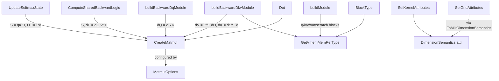

# Mosaic matmul and kernel-emission helpers - CreateMatmul, VMEM memrefs, dimension semantics

<!-- connect:up:begin -->
> **Cross-repo concept:** part of [mosaic-kernel](../../../concepts/mosaic-kernel.md), [vmem](../../../concepts/vmem.md) across this wiki's repos.
<!-- connect:up:end -->
## Overview

torch_tpu builds its Mosaic TPU kernels in C++ by constructing MLIR directly, and
`csrc/internal/mosaic/op_builders.{h,cc}` is the thin layer every such kernel shares. Three helpers
carry the performance-relevant contract:
[`CreateMatmul`](../catalog/csrc/internal/mosaic/op_builders.cc.md#CreateMatmul "csrc/internal/mosaic/op_builders.cc:L49")
("Creates a matmul for two 2D vectors") emits a `tpu.matmul` on the MXU that always accumulates in
f32, with transposes folded into dimension numbers and an optional contraction precision;
[`GetVmemMemRefType`](../catalog/csrc/internal/mosaic/op_builders.cc.md#GetVmemMemRefType "csrc/internal/mosaic/op_builders.cc:L111")
types a kernel operand as a memref in the `vmem` memory space - the per-grid-step block Mosaic
DMAs in from HBM; and
`GetDimensionSemanticsAttr`
marks each grid axis `parallel` or `arbitrary`. There is no standalone "matmul kernel" op in the
repo: matmuls are emitted *inside* larger kernels - the flash-attention forward and backward
([Scaled dot-product attention](scaled-dot-product-attention.md)) and kernels written in
[KILN](kiln-kernel-dsl.md), whose test suite contains the canonical blockwise-matmul kernel.

## Diagram

Legend:
- `MM` - [`CreateMatmul`](../catalog/csrc/internal/mosaic/op_builders.cc.md#CreateMatmul "csrc/internal/mosaic/op_builders.cc:L49")
- `OPTS` - [`MatmulOptions`](../catalog/csrc/internal/mosaic/op_builders.h.md#MatmulOptions "csrc/internal/mosaic/op_builders.h:L44")
- `VMEM` - [`GetVmemMemRefType`](../catalog/csrc/internal/mosaic/op_builders.cc.md#GetVmemMemRefType "csrc/internal/mosaic/op_builders.cc:L111")
- `DSA` - [`DimensionSemantics`](../catalog/csrc/internal/mosaic/op_builders.h.md#DimensionSemantics "csrc/internal/mosaic/op_builders.h:L39") (converted to the attribute by the `GetDimensionSemanticsAttr` helper)
- `FWD` - [`UpdateSoftmaxState`](../catalog/csrc/ops/scaled_dot_product_attention/flash_attention_kernel.cc.md#UpdateSoftmaxState "csrc/ops/scaled_dot_product_attention/flash_attention_kernel.cc:L224")
- `BWD` - [`ComputeSharedBackwardLogic`](../catalog/csrc/ops/scaled_dot_product_attention/flash_attention_backward_kernel.cc.md#ComputeSharedBackwardLogic "csrc/ops/scaled_dot_product_attention/flash_attention_backward_kernel.cc:L82")
- `DKV` - [`buildBackwardDkvModule`](../catalog/csrc/ops/scaled_dot_product_attention/flash_attention_backward_kernel.cc.md#buildBackwardDkvModule "csrc/ops/scaled_dot_product_attention/flash_attention_backward_kernel.cc:L218")
- `DQ` - [`buildBackwardDqModule`](../catalog/csrc/ops/scaled_dot_product_attention/flash_attention_backward_kernel.cc.md#buildBackwardDqModule "csrc/ops/scaled_dot_product_attention/flash_attention_backward_kernel.cc:L600")
- `KDOT` - [`Dot`](../catalog/csrc/internal/mosaic/kiln/core/tile.cc.md#Dot "csrc/internal/mosaic/kiln/core/tile.cc:L331")
- `FMOD` - [`buildModule`](../catalog/csrc/ops/scaled_dot_product_attention/flash_attention_kernel.cc.md#buildModule "csrc/ops/scaled_dot_product_attention/flash_attention_kernel.cc:L401")
- `BT` - [`BlockType`](../catalog/csrc/internal/mosaic/kiln/core/kernel.cc.md#BlockType "csrc/internal/mosaic/kiln/core/kernel.cc:L120")
- `SKA` - [`SetKernelAttributes`](../catalog/csrc/ops/scaled_dot_product_attention/flash_attention_kernel.cc.md#SetKernelAttributes "csrc/ops/scaled_dot_product_attention/flash_attention_kernel.cc:L84")
- `SGA` - [`SetGridAttributes`](../catalog/csrc/internal/mosaic/kiln/core/kernel.cc.md#SetGridAttributes "csrc/internal/mosaic/kiln/core/kernel.cc:L175")

## Design rationale (why it's built this way)

**f32 accumulation is not optional.** [`CreateMatmul`](../catalog/csrc/internal/mosaic/op_builders.cc.md#CreateMatmul "csrc/internal/mosaic/op_builders.cc:L49")
always creates a zero-initialized `vector<M x N x f32>` accumulator and returns an f32 result,
whatever the operand dtype. KILN states the same contract in its public API - [`Dot`](../catalog/csrc/internal/mosaic/kiln/core/tile.cc.md#Dot "csrc/internal/mosaic/kiln/core/tile.cc:L331")
is a "2-D matmul on the MXU with f32 accumulation" and comments "Matmuls always produce a float32
result". Callers that want a running sum add the fresh product to their own f32 state explicitly
(the flash accumulator `alpha * acc + P V`; KILN's `acc = Tile(acc) + Dot(...)`) and narrow to bf16
only when storing.

> [!inferred]
> Using a fresh zero accumulator plus an explicit `addf` keeps the builder stateless and lets the
> caller interleave rescaling (as online softmax needs) between products; whether Mosaic then folds
> the add into the MXU accumulate is a compiler decision not visible here.

**Transposes are dimension numbers, never data movement.** The options carry
[`transpose_lhs`](../catalog/csrc/internal/mosaic/op_builders.h.md#MatmulOptions.transpose_lhs "csrc/internal/mosaic/op_builders.h:L45")
and [`transpose_rhs`](../catalog/csrc/internal/mosaic/op_builders.h.md#MatmulOptions.transpose_rhs "csrc/internal/mosaic/op_builders.h:L46"),
but the builder turns them into `tpu::defaultDimensionNumbers(...)` and then deliberately passes
`transpose_lhs = transpose_rhs = false` to the op, with the comment "Hard-set transpose_<lhs/rhs> as
they are ignored when dimension_numbers is provided." So `q K^T`, `dO V^T`, `P^T dO` and `dS^T q`
are all expressed without a `vector.transpose` in the kernel body.

**Precision is a per-matmul attribute with a cheap default.** The
[`precision`](../catalog/csrc/internal/mosaic/op_builders.h.md#MatmulOptions.precision "csrc/internal/mosaic/op_builders.h:L48")
field documents itself as "MXU contraction precision (`nullopt` defaults to 1-pass kBF16)". The
flash kernels set it only for f32 inputs, from the user's matmul precision: StableHLO `HIGHEST`
maps to `kFP32` and `HIGH` to `kBF16x3`, everything else leaves it unset. In other words an f32
attention under the default precision runs its MXU passes as single-pass bf16, and asking for
`HIGHEST` buys accuracy with multi-pass MXU work. KILN exposes the same three choices
(`kBF16`, `kFP32`, `kBF16x3`) on [`Dot`](../catalog/csrc/internal/mosaic/kiln/core/tile.cc.md#Dot "csrc/internal/mosaic/kiln/core/tile.cc:L331").

**Two `DimensionSemantics` enums on purpose.** The internal one,
[`DimensionSemantics`](../catalog/csrc/internal/mosaic/op_builders.h.md#DimensionSemantics "csrc/internal/mosaic/op_builders.h:L39"),
lives next to the MLIR helpers; KILN declares its own public
[`DimensionSemantics`](../catalog/csrc/internal/mosaic/kiln/core/specs.h.md#DimensionSemantics "csrc/internal/mosaic/kiln/core/specs.h:L32")
("Iteration order guarantees for a grid dimension (Pallas `dimension_semantics`)") in a header with
no MLIR includes, and [`ToMlirDimensionSemantics`](../catalog/csrc/internal/mosaic/kiln/core/kernel.cc.md#ToMlirDimensionSemantics "csrc/internal/mosaic/kiln/core/kernel.cc:L129")
translates at build time. This is the same "keep MLIR out of the public headers" rule KILN applies
to its value handles.

## Entry points

- [`CreateMatmul`](../catalog/csrc/internal/mosaic/op_builders.cc.md#CreateMatmul "csrc/internal/mosaic/op_builders.cc:L49") - called from inside a kernel body under construction, whenever a kernel needs an MXU contraction of two 2-D vector values (flash forward/backward, KILN `Dot`).
- [`MatmulOptions`](../catalog/csrc/internal/mosaic/op_builders.h.md#MatmulOptions "csrc/internal/mosaic/op_builders.h:L44") - the per-call knob set (`transpose_lhs`, `transpose_rhs`, `precision`); constructed inline at each call site, e.g. `{.transpose_rhs = true, .precision = config.precision}` for `q K^T`.
- [`GetVmemMemRefType`](../catalog/csrc/internal/mosaic/op_builders.cc.md#GetVmemMemRefType "csrc/internal/mosaic/op_builders.cc:L111") - "Helper to build a memref type with vmem tpu::Vmem memory space"; used while laying out a kernel's function signature (block operands, outputs, scratch).
- `GetDimensionSemanticsAttr` (over the internal [`DimensionSemantics`](../catalog/csrc/internal/mosaic/op_builders.h.md#DimensionSemantics "csrc/internal/mosaic/op_builders.h:L39") enum) - used when attaching the `dimension_semantics` array to a kernel function: the flash kernels attach it after the body is built, while KILN's [`SetGridAttributes`](../catalog/csrc/internal/mosaic/kiln/core/kernel.cc.md#SetGridAttributes "csrc/internal/mosaic/kiln/core/kernel.cc:L175") attaches it before the kernel body is populated.
- [`Dot`](../catalog/csrc/internal/mosaic/kiln/core/tile.cc.md#Dot "csrc/internal/mosaic/kiln/core/tile.cc:L331") - the KILN front door to the same matmul, for kernels written in the DSL.

## Mechanism (step-by-step)

1. **Declare block operands in VMEM.** A kernel's `func.func` arguments are the per-grid-step windows, typed with [`GetVmemMemRefType`](../catalog/csrc/internal/mosaic/op_builders.cc.md#GetVmemMemRefType "csrc/internal/mosaic/op_builders.cc:L111") as `memref<shape x dtype, #tpu.memory_space<vmem>>` with no explicit layout. The flash forward's [`buildModule`](../catalog/csrc/ops/scaled_dot_product_attention/flash_attention_kernel.cc.md#buildModule "csrc/ops/scaled_dot_product_attention/flash_attention_kernel.cc:L401") declares q `[1,1,qt,D]`, k/v `[1,1,kt,D]`, the output block, and f32 scratch (`[qt,D]` accumulator, `[qt,128]` running max and sum); [`buildBackwardDkvModule`](../catalog/csrc/ops/scaled_dot_product_attention/flash_attention_backward_kernel.cc.md#buildBackwardDkvModule "csrc/ops/scaled_dot_product_attention/flash_attention_backward_kernel.cc:L218") adds dK/dV outputs in the input dtype plus f32 dK/dV scratch. KILN's [`BlockType`](../catalog/csrc/internal/mosaic/kiln/core/kernel.cc.md#BlockType "csrc/internal/mosaic/kiln/core/kernel.cc:L120") chooses between the VMEM helper and its SMEM sibling from the spec's memory space. The leading unit dims are why the kernels load 2-D tiles out of 4-D blocks before any matmul.

2. **Emit the contraction.** [`CreateMatmul`](../catalog/csrc/internal/mosaic/op_builders.cc.md#CreateMatmul "csrc/internal/mosaic/op_builders.cc:L49") reads both operands as `VectorType`, computes the output shape `[lhs[transpose_lhs ? 1 : 0], rhs[transpose_rhs ? 0 : 1]]`, materializes a zero f32 accumulator constant of that shape, builds a `tpu::ContractPrecisionAttr` only when [`precision`](../catalog/csrc/internal/mosaic/op_builders.h.md#MatmulOptions.precision "csrc/internal/mosaic/op_builders.h:L48") is set, and creates `tpu.matmul(lhs, rhs, acc)` with the dimension numbers from the transpose flags. The result is always f32.

3. **Forward attention matmuls.** [`UpdateSoftmaxState`](../catalog/csrc/ops/scaled_dot_product_attention/flash_attention_kernel.cc.md#UpdateSoftmaxState "csrc/ops/scaled_dot_product_attention/flash_attention_kernel.cc:L224") issues two per `[band_rows, kc]` sub-block: `S = q K^T` with `transpose_rhs = true` (q already pre-scaled, inputs in bf16 or f32), and `P V` after casting the f32 probabilities back to the input dtype, so for bf16 models both MXU passes take bf16 operands. Both pass `config.precision`, which is non-null only for f32 inputs under `HIGH`/`HIGHEST`.

4. **Backward attention matmuls.** [`ComputeSharedBackwardLogic`](../catalog/csrc/ops/scaled_dot_product_attention/flash_attention_backward_kernel.cc.md#ComputeSharedBackwardLogic "csrc/ops/scaled_dot_product_attention/flash_attention_backward_kernel.cc:L82") recomputes `S = q K^T` and `dP = dO V^T` (both `transpose_rhs`). The dK/dV kernel ([`buildBackwardDkvModule`](../catalog/csrc/ops/scaled_dot_product_attention/flash_attention_backward_kernel.cc.md#buildBackwardDkvModule "csrc/ops/scaled_dot_product_attention/flash_attention_backward_kernel.cc:L218")) then computes `dV = P^T dO` and `dK = dS^T q` with `transpose_lhs = true`, accumulating into f32 scratch; the dQ kernel ([`buildBackwardDqModule`](../catalog/csrc/ops/scaled_dot_product_attention/flash_attention_backward_kernel.cc.md#buildBackwardDqModule "csrc/ops/scaled_dot_product_attention/flash_attention_backward_kernel.cc:L600")) computes `dQ = dS K` without transposes. `P` and `dS` are cast to the input dtype before these contractions, so for a bf16 model every backward contraction takes bf16 operands; the dK/dV kernel issues four per grid step (S, dP, dV, dK) and the dQ kernel three (S, dP, dQ), because S and dP are recomputed in both kernels rather than shared.

5. **KILN's `Dot`.** [`Dot`](../catalog/csrc/internal/mosaic/kiln/core/tile.cc.md#Dot "csrc/internal/mosaic/kiln/core/tile.cc:L331") CHECKs that both tiles are 2-D, integer-or-float, and have matching contracting dims (a check [`CreateMatmul`](../catalog/csrc/internal/mosaic/op_builders.cc.md#CreateMatmul "csrc/internal/mosaic/op_builders.cc:L49") itself does not perform), maps KILN's precision enum onto `tpu::ContractPrecision`, and calls the shared builder with the transposes. The blockwise-matmul test [`TestBody`](../catalog/csrc/internal/mosaic/kiln/kiln_test.cc.md#KilnTest_BlockwiseMatmul_Test.TestBody "csrc/internal/mosaic/kiln/kiln_test.cc:L62") shows the full pattern for `out = a @ b` with M=1024, N=512, K=2048 and 256x256x512 blocks: grid `(M/tm, N/tn, K/tk)` with semantics `[parallel, parallel, arbitrary]`, bf16 `a`/`b` blocks indexed `(i, k)` and `(k, j)`, an f32 `[tm, tn]` scratch accumulator zeroed when `k == 0`, and a bf16 store when `k` is last; the checked IR is `tpu.matmul ... : vector<256x512xbf16>, vector<512x256xbf16>, vector<256x256xf32> -> vector<256x256xf32>`.

6. **Declare grid semantics.** `GetDimensionSemanticsAttr` maps the internal enum to `#tpu.dimension_semantics<parallel>` / `<arbitrary>`. The flash forward's [`SetKernelAttributes`](../catalog/csrc/ops/scaled_dot_product_attention/flash_attention_kernel.cc.md#SetKernelAttributes "csrc/ops/scaled_dot_product_attention/flash_attention_kernel.cc:L84") marks `(batch, head, q_block)` parallel and the KV axis arbitrary; [`SetBackwardDkvKernelAttributes`](../catalog/csrc/ops/scaled_dot_product_attention/flash_attention_backward_kernel.cc.md#SetBackwardDkvKernelAttributes "csrc/ops/scaled_dot_product_attention/flash_attention_backward_kernel.cc:L359") marks `(batch, kv_head, kv_tile)` parallel and `(q_tile, head_group)` arbitrary; [`SetBackwardDqKernelAttributes`](../catalog/csrc/ops/scaled_dot_product_attention/flash_attention_backward_kernel.cc.md#SetBackwardDqKernelAttributes "csrc/ops/scaled_dot_product_attention/flash_attention_backward_kernel.cc:L496") marks `(batch, head, q_tile)` parallel and the KV axis arbitrary. KILN's [`SetGridAttributes`](../catalog/csrc/internal/mosaic/kiln/core/kernel.cc.md#SetGridAttributes "csrc/internal/mosaic/kiln/core/kernel.cc:L175") writes `iteration_bounds` from the spec's [`grid`](../catalog/csrc/internal/mosaic/kiln/core/specs.h.md#GridSpec.grid "csrc/internal/mosaic/kiln/core/specs.h:L70") and defaults every axis to parallel unless the spec lists semantics, translating each with [`ToMlirDimensionSemantics`](../catalog/csrc/internal/mosaic/kiln/core/kernel.cc.md#ToMlirDimensionSemantics "csrc/internal/mosaic/kiln/core/kernel.cc:L129"). In every kernel the arbitrary axes are exactly the reduction axes whose partial results live in VMEM scratch across grid steps.

## Key data structures

- [`MatmulOptions`](../catalog/csrc/internal/mosaic/op_builders.h.md#MatmulOptions "csrc/internal/mosaic/op_builders.h:L44") - `transpose_lhs`, `transpose_rhs` (become dimension numbers) and an optional `tpu::ContractPrecision` (`nullopt` = one-pass bf16).
- [`DimensionSemantics`](../catalog/csrc/internal/mosaic/op_builders.h.md#DimensionSemantics "csrc/internal/mosaic/op_builders.h:L39") (internal) and [`DimensionSemantics`](../catalog/csrc/internal/mosaic/kiln/core/specs.h.md#DimensionSemantics "csrc/internal/mosaic/kiln/core/specs.h:L32") (KILN public) - both `{kParallel, kArbitrary}`. KILN documents them: parallel iterations "are independent and may be reordered or executed concurrently by the compiler"; arbitrary iterations "have data dependencies and must execute sequentially in increasing index order".
- VMEM block memref - the value [`GetVmemMemRefType`](../catalog/csrc/internal/mosaic/op_builders.cc.md#GetVmemMemRefType "csrc/internal/mosaic/op_builders.cc:L111") returns: static shape, element type, no layout map, `tpu::MemorySpace::kVmem`. Its shape is the block (window) shape, not the full tensor shape; the full tensor is the custom call's HBM operand and `window_params` says which block each grid step sees.

## Dynamics (design intent)

- **Reduction axes accumulate in scratch.** Every kernel here zeroes its f32 scratch when its arbitrary index is 0 and stores (or normalizes) when it is last - the forward on the KV axis, dK/dV on the `(q_tile, head_group)` pair, dQ on the KV axis, KILN's matmul on K. Correctness relies on arbitrary axes running in order ([`SetBackwardDkvKernelAttributes`](../catalog/csrc/ops/scaled_dot_product_attention/flash_attention_backward_kernel.cc.md#SetBackwardDkvKernelAttributes "csrc/ops/scaled_dot_product_attention/flash_attention_backward_kernel.cc:L359"), [`SetGridAttributes`](../catalog/csrc/internal/mosaic/kiln/core/kernel.cc.md#SetGridAttributes "csrc/internal/mosaic/kiln/core/kernel.cc:L175")).
- **The dK/dV kernel writes every step.** [`buildBackwardDkvModule`](../catalog/csrc/ops/scaled_dot_product_attention/flash_attention_backward_kernel.cc.md#buildBackwardDkvModule "csrc/ops/scaled_dot_product_attention/flash_attention_backward_kernel.cc:L218") stores the updated f32 accumulator into the input-dtype output block on every grid step, not just the last; the dQ kernel does the same. The final step's store is the one that lands.

> [!inferred]
> Marking the batch/head/row axes `parallel` is what allows Mosaic to split a kernel's grid across
> the TensorCores of a megacore-style chip and to reorder iterations for pipelining; a kernel with a
> small parallel extent (for example a single head and a sequence that fits in one tile) leaves that
> parallelism unused. The per-step output store in the backward kernels likely costs a VMEM store per
> step that a last-step-only `scf.if` would avoid; whether Mosaic's writeback elides it is not visible
> here.

## Edge cases

- [`CreateMatmul`](../catalog/csrc/internal/mosaic/op_builders.cc.md#CreateMatmul "csrc/internal/mosaic/op_builders.cc:L49") assumes 2-D `VectorType` operands and does not validate contracting dims; callers must squeeze block dims first (the flash kernels load 2-D slices from `[1,1,rows,D]` blocks) and must get shapes right - KILN's [`Dot`](../catalog/csrc/internal/mosaic/kiln/core/tile.cc.md#Dot "csrc/internal/mosaic/kiln/core/tile.cc:L331") adds the checks.
- The result is f32 even for bf16 inputs; forgetting to cast before a store into a bf16 ref is caught by KILN's store (which casts) but must be done by hand in the raw-builder kernels (they store through a helper that converts to the ref's element type).
- An unset [`precision`](../catalog/csrc/internal/mosaic/op_builders.h.md#MatmulOptions.precision "csrc/internal/mosaic/op_builders.h:L48") on f32 operands means one-pass bf16 MXU math - an f32 kernel is not "full f32" unless the call site passes `kFP32` (or `kBF16x3`).
- MXU-friendly tiling is the caller's job: the flash kernel requires its KV compute sub-tile to be a multiple of 128, and SDPA only selects the kernel when the head dim is below 128 or a multiple of 128.

## Open questions

- `GetDimensionSemanticsAttr` is in this page's packet subgraph, but the subgraph's moniker for it differs from the one the symbol index resolves `op_builders.cc#GetDimensionSemanticsAttr` to, so it is named but not cited here (an indexing duplicate, not a source question).
- Other helpers in the same file - SMEM memref types, `tpu.iota` / repeat / reciprocal builders, the TorchTPU MLIR context, the TensorCore core-type attribute and the versioned Mosaic serialization - are outside this page's symbol subgraph and are only mentioned.
- No matmul-only Mosaic kernel is wired into an ATen op at v0.2.0 - the matmul builder's only callers are the flash-attention kernels and KILN - so plain matmuls are left to the StableHLO/XLA path; whether a KILN matmul kernel is planned is not stated.
- Whether `tpu.matmul` with a zero accumulator plus a separate `addf` compiles to the same MXU code as accumulating in place is a Mosaic question the source does not answer.

## See also

- [Scaled dot-product attention](scaled-dot-product-attention.md) - the main consumer: flash forward and dK/dV/dQ kernels.
- [KILN kernel DSL](kiln-kernel-dsl.md) - the Pallas-shaped C++ layer whose `Dot` and specs lower onto these helpers.
- [Dtype and precision](dtype-and-precision.md) - where the `HIGH` / `HIGHEST` matmul precision that selects the contraction precision comes from.
- [Pallas custom kernels](pallas-custom-kernels.md) - the Python route to Mosaic kernels.
