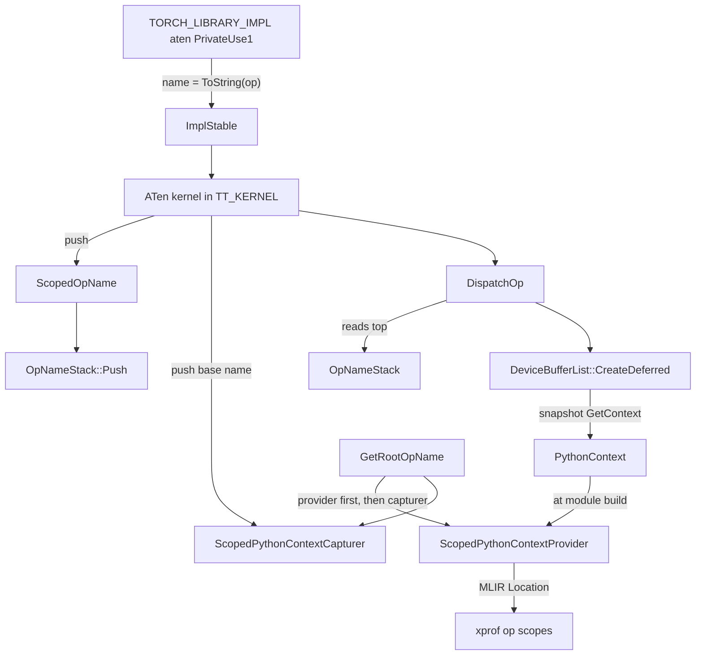

# Op names, the op-name stack, and Python context capture

## Overview

torch_tpu names every op it implements with one enum, [`OpName`](../catalog/csrc/ops/op_names.h.md#OpName "csrc/ops/op_names.h:L29"), whose string form ([`ToString`](../catalog/csrc/ops/op_names.h.md#ToString "csrc/ops/op_names.h:L889"), e.g. `"abs.out"`) is simultaneously the PyTorch registration name, the name fingerprinted into compilation cache keys, and the label in logs. Around that identity sit two **thread-local stacks** that every kernel pushes on entry: the [`OpNameStack`](../catalog/csrc/common/op_name_stack.h.md#OpNameStack "csrc/common/op_name_stack.h:L29") (which op is running right now, read by the dispatcher) and the stack behind [`ScopedPythonContextCapturer`](../catalog/csrc/ops/python_context.h.md#ScopedPythonContextCapturer "csrc/ops/python_context.h:L165") (the user-visible op call chain plus, optionally, a Python traceback). The key design idea is a **capture-now, provide-later** split (the header calls it the CATTO design): because ops are deferred, the context must be snapshotted into the deferred op while the ATen kernel is still on the stack, then re-installed with [`ScopedPythonContextProvider`](../catalog/csrc/ops/python_context.h.md#ScopedPythonContextProvider "csrc/ops/python_context.h:L248") when the op's StableHLO is finally built, so that the emitted MLIR carries the right source location. The same state answers "which op did the user actually call?" for error messages via [`GetRootOpName`](../catalog/csrc/ops/python_context.cc.md#GetRootOpName "csrc/ops/python_context.cc:L325").

For TPU performance work this is the plumbing behind three things you touch: (1) **xprof attribution** - the MLIR location is formatted so xprof can show `CALL/CHAIN/op` scopes and the Python file/line for each HLO op; (2) **cache keys** - op names enter graph keys through their stable strings, so renaming one invalidates persistent caches; (3) **dispatch overhead** - the per-op pushes and context copies are on the eager hot path, and traceback capture (off by default in eager) is expensive enough to be gated.

## Diagram



Legend:
- `REG` - `TORCH_LIBRARY_IMPL_init_aten_PrivateUse1_3`
- `IMPL` - [`ImplStable`](../catalog/csrc/eager/tpu_aten_kernels.cc.md#ImplStable "csrc/eager/tpu_aten_kernels.cc:L249")
- `KER` - (concept) a kernel wrapped in TT_KERNEL, see [ATen kernel authoring](aten-kernel-authoring.md)
- `SON` - [`ScopedOpName`](../catalog/csrc/common/op_name_stack.h.md#ScopedOpName "csrc/common/op_name_stack.h:L54")
- `PUSH` - [`Push`](../catalog/csrc/common/op_name_stack.cc.md#OpNameStack.Push "csrc/common/op_name_stack.cc:L42")
- `CAP` - [`ScopedPythonContextCapturer`](../catalog/csrc/ops/python_context.h.md#ScopedPythonContextCapturer "csrc/ops/python_context.h:L165")
- `DISP` - [`DispatchOp`](../catalog/csrc/eager/op_dispatcher.h.md#DispatchOp "csrc/eager/op_dispatcher.h:L312")
- `STK` - [`OpNameStack`](../catalog/csrc/common/op_name_stack.h.md#OpNameStack "csrc/common/op_name_stack.h:L29")
- `CD` - [`CreateDeferred`](../catalog/csrc/eager/device_buffer.cc.md#DeviceBufferList.CreateDeferred "csrc/eager/device_buffer.cc:L357")
- `PC` - [`PythonContext`](../catalog/csrc/ops/python_context.h.md#PythonContext "csrc/ops/python_context.h:L97")
- `PROV` - [`ScopedPythonContextProvider`](../catalog/csrc/ops/python_context.h.md#ScopedPythonContextProvider "csrc/ops/python_context.h:L248")
- `XP` - (concept) xprof trace viewer / op profile
- `ROOT` - [`GetRootOpName`](../catalog/csrc/ops/python_context.cc.md#GetRootOpName "csrc/ops/python_context.cc:L325")

The two phases of one op's context, in time order:

```mermaid
sequenceDiagram
  participant K as ATen kernel
  participant C as ScopedPythonContextCapturer
  participant D as DispatchOp
  participant P as ScopedPythonContextProvider
  K->>C: construct(OpName) pushes base name
  Note over C: root capturer only: capture traceback if mode enabled
  K->>D: dispatch builder
  D->>C: GetContext() copies call chain + traceback
  Note over D: context stored in the deferred op; kernel returns
  P->>P: later, on module build: install context, set builder Location
  Note over P: every MLIR op built now gets the user's location
```

Legend:
- `K` - (concept) the running kernel
- `C` - [`ScopedPythonContextCapturer`](../catalog/csrc/ops/python_context.h.md#ScopedPythonContextCapturer "csrc/ops/python_context.h:L165")
- `D` - [`DispatchOp`](../catalog/csrc/eager/op_dispatcher.h.md#DispatchOp "csrc/eager/op_dispatcher.h:L312")
- `P` - [`ScopedPythonContextProvider`](../catalog/csrc/ops/python_context.h.md#ScopedPythonContextProvider "csrc/ops/python_context.h:L248")

## Design rationale (why it's built this way)

**An enum for code, a stable string for everything persistent.** The enum doc is blunt: "The numerical values of the enum members are unstable and not meaningful, so do not persist them." Everything that outlives the process uses the string instead: the switch in [`ToString`](../catalog/csrc/ops/op_names.h.md#ToString "csrc/ops/op_names.h:L889") carries "WARNING: These names are used for computing cache keys, so they must be stable. Changing them may cause key collisions in the persistent cache," and the fingerprint specialization for `OpName` hashes `ToString(op_name)`. `ToString` is `constexpr` and defined in the header so registration code can `static_assert` on names at compile time (internal ops must start with `_`).

**Capture while the kernel runs, provide while the MLIR is built.** The header explains the timing constraint: the capturer "must be defined *before* the kernel returns in order to capture the correct context. In particular, if an op is deferred, its MlirOp build function will be called *after* the kernel returns." So capture happens in the kernel (TT_KERNEL does it for you) and provision happens in "a small number of places" that build MLIR, which "op authors don't need to worry about".

**Pure-C++ tracebacks to avoid the GIL later.** [`PythonStackFrame`](../catalog/csrc/ops/python_context.h.md#PythonStackFrame "csrc/ops/python_context.h:L59") and [`PythonTraceback`](../catalog/csrc/ops/python_context.h.md#PythonTraceback "csrc/ops/python_context.h:L66") exist "instead of using torch::SymbolizedTracebacks because it can interact with python objects, which can cause GIL contention. These structs are pure C++ and safe to pass between threads." Symbolization is done eagerly at capture time because "symbolization requires the GIL, and the PyTorch dispatcher is already holding the GIL. If we wait until later, this means we can't do it on a background thread."

**One traceback per thread, not per frame.** The capturer stack is conceptually a stack of contexts, but "All contexts in the stack for the same thread have the same traceback. Therefore we only need to maintain one copy of the traceback per thread." Only the root (outermost) capturer pays for capture; nested ops reuse it through a `shared_ptr`.

**The op-name stack doubles as an architecture guard.** [`Push`](../catalog/csrc/common/op_name_stack.cc.md#OpNameStack.Push "csrc/common/op_name_stack.cc:L42") refuses nesting unless the outer op is on a frozen list of known composite ops: "This is unusually not allowed - please implement the ... op by lowering it to SHLO instead." The list size is pinned with "DO NOT increase this!" (151 at v0.2.0). The perf consequence is deliberate: new ops lower to a single StableHLO builder instead of decomposing into many separately-dispatched sub-ops, each paying dispatch overhead and producing its own deferred node.

> [!inferred]
> Making the dispatcher read the op name from the stack (rather than taking it as a parameter) removes a whole class of mislabeled-op bugs - a helper three calls deep cannot attach the wrong name - and is what lets the generic Unary/Binary helpers stay op-agnostic.

## Entry points

- [`ScopedOpName`](../catalog/csrc/common/op_name_stack.h.md#ScopedOpName.ScopedOpName "csrc/common/op_name_stack.h:L56") - RAII constructor that calls [`Push`](../catalog/csrc/common/op_name_stack.cc.md#OpNameStack.Push "csrc/common/op_name_stack.cc:L42"); instantiated by every TT_KERNEL expansion (roughly 750 invocation sites at v0.2.0), popped at scope exit. Copying is deleted ([`ScopedOpName`](../catalog/csrc/common/op_name_stack.h.md#ScopedOpName.ScopedOpName "csrc/common/op_name_stack.h:L59")).
- [`ScopedPythonContextCapturer`](../catalog/csrc/ops/python_context.cc.md#ScopedPythonContextCapturer.ScopedPythonContextCapturer "csrc/ops/python_context.cc:L274") - the `OpName` constructor (pushes the op's base name, e.g. `add` for `add.out`), used by TT_KERNEL and directly by non-kernel producers of deferred ops such as constants, data-dependency no-ops, compiled-mode entry, and `PyCreateScanOp` (as `kCustomKernel`). The [`ScopedPythonContextCapturer`](../catalog/csrc/ops/python_context.cc.md#ScopedPythonContextCapturer.ScopedPythonContextCapturer "csrc/ops/python_context.cc:L270") overload takes a [`PythonApiName`](../catalog/csrc/ops/python_context.h.md#PythonApiName "csrc/ops/python_context.h:L139") and is used by the pybind error-handling wrapper so Python-API-level calls get the same root-name treatment.
- [`ScopedPythonContextProvider`](../catalog/csrc/ops/python_context.cc.md#ScopedPythonContextProvider.ScopedPythonContextProvider "csrc/ops/python_context.cc:L307") - "Pushes the python context onto the singleton context provider stack ... If `builder` is provided, sets the location attribute of `builder`." Constructed by the traversal's module builder around each deferred op's builder call, and by compiled-mode / sync entry points.
- [`GetRootOpName`](../catalog/csrc/ops/python_context.cc.md#GetRootOpName "csrc/ops/python_context.cc:L325") - "Returns the root op name for the current op." Called whenever an error status is created by the `TT_ERROR` / `TT_CHECK_THROW` macros (the root name is stored as a status payload, which is later read back - not recomputed - when the status is translated into a Python exception), and by some kernels to label warnings.
- [`IsDistributedOp`](../catalog/csrc/ops/op_names.h.md#IsDistributedOp "csrc/ops/op_names.h:L2631") - "Returns true if the op is a distributed op." Reached during materialization and event queuing: distributed ops are treated as side-effecting, and with `TORCH_TPU_INTERNAL_SKINNY_SC_OFFLOAD=1` a traversal that contains exactly one distributed op (e.g. from [`allgather`](../catalog/csrc/distributed/process_group_tpu.cc.md#ProcessGroupTpu.allgather "csrc/distributed/process_group_tpu.cc:L1959"), [`_allgather_base`](../catalog/csrc/distributed/process_group_tpu.cc.md#ProcessGroupTpu._allgather_base "csrc/distributed/process_group_tpu.cc:L2053") or [`alltoall`](../catalog/csrc/distributed/process_group_tpu.cc.md#ProcessGroupTpu.alltoall "csrc/distributed/process_group_tpu.cc:L2652"), each a TT_KERNEL with a `kDistributed*` name) is pinned to the SparseCore.

## Mechanism (step-by-step)

1. **Registration by name.** The `TORCH_LIBRARY_IMPL(aten, PrivateUse1, m)` block (`TORCH_LIBRARY_IMPL_init_aten_PrivateUse1_3`) registers each kernel with [`ImplStable`](../catalog/csrc/eager/tpu_aten_kernels.cc.md#ImplStable "csrc/eager/tpu_aten_kernels.cc:L249")`<OpName::kX>(m, AtenX)`, which calls `m.impl(ToString(op_name), kernel)`. The enum value is a template argument, so a typo is a compile error, and the ATen schema name and torch_tpu's internal name cannot drift apart.

2. **Kernel entry pushes the op name.** The first statement of TT_KERNEL constructs a [`ScopedOpName`](../catalog/csrc/common/op_name_stack.h.md#ScopedOpName "csrc/common/op_name_stack.h:L54"), "an RAII guard that pushes an OpName onto the thread-local stack on construction and pops it on destruction." [`Push`](../catalog/csrc/common/op_name_stack.cc.md#OpNameStack.Push "csrc/common/op_name_stack.cc:L42") checks the composite-op allow-list once per call when the stack is non-empty (a hash-set lookup) and pushes onto a `thread_local std::stack<OpName>`. With verbose logging on, the kernel header line comes from [`LogKernelName`](../catalog/csrc/ops/macros/logging.h.md#LogKernelName "csrc/ops/macros/logging.h:L131"), whose `OpName` overload converts the op with `ToString` and prints it as `[C++ KERNEL <name>]` (the generic [`operator<<`](../catalog/csrc/ops/op_names.h.md#operator "csrc/ops/op_names.h:L2603") for `OpName` also prints `ToString`, so both paths show the same stable string).

3. **Kernel entry pushes the Python context.** TT_KERNEL then constructs a [`ScopedPythonContextCapturer`](../catalog/csrc/ops/python_context.cc.md#ScopedPythonContextCapturer.ScopedPythonContextCapturer "csrc/ops/python_context.cc:L274"), which converts the `OpName` to its base name and delegates to the common initializer [`ScopedPythonContextCapturer`](../catalog/csrc/ops/python_context.cc.md#ScopedPythonContextCapturer.ScopedPythonContextCapturer "csrc/ops/python_context.cc:L253"): append the name to the thread-local `op_names_` vector and, if this is the first live capturer on the thread and the traceback mode is enabled, gather and symbolize the current Python stack into a shared [`PythonTraceback`](../catalog/csrc/ops/python_context.h.md#PythonTraceback "csrc/ops/python_context.h:L66"). The traceback mode is resolved in order: an `enable_tracebacks()` context-manager override, then the `--torch_tpu_internal_mlir_tracebacks` flag (read once), then the default - **disabled in eager mode, enabled when compiling an FX graph**. Setting `TORCH_TRACE` structured logging also pushes an enable at startup.

4. **Dispatch reads the name and snapshots the context.** [`DispatchOp`](../catalog/csrc/eager/op_dispatcher.h.md#DispatchOp "csrc/eager/op_dispatcher.h:L312") takes the op name from the top of the [`OpNameStack`](../catalog/csrc/common/op_name_stack.h.md#OpNameStack "csrc/common/op_name_stack.h:L29") (crashing with "Move the call inside a TT_KERNEL()" if empty) and creates the deferred node through [`CreateDeferred`](../catalog/csrc/eager/device_buffer.cc.md#DeviceBufferList.CreateDeferred "csrc/eager/device_buffer.cc:L357"), returning [`DeviceBufferRef`](../catalog/csrc/eager/device_buffer.h.md#DeviceBufferRef "csrc/eager/device_buffer.h:L173")s. The deferred op's constructor stores `ScopedPythonContextCapturer::GetContext()`, i.e. a fresh [`PythonContext`](../catalog/csrc/ops/python_context.cc.md#PythonContext.PythonContext "csrc/ops/python_context.cc:L204") built from a copy of the current call-chain strings plus the shared traceback pointer. This copy happens once per deferred op, on the dispatching thread.

5. **Errors use the root of the chain.** While the kernel is live, [`GetRootOpName`](../catalog/csrc/ops/python_context.cc.md#GetRootOpName "csrc/ops/python_context.cc:L325") returns the front of the call chain: first from an active provider (when the error happens during MLIR build), else from the capturer stack, else the current op's own name. Because the chain front is the outermost op, a failure inside `bmm` called from `cat.out` reports `cat(): ...` - "where we want to report the root op name as it appears in the user's PyTorch code."

6. **Module build re-installs the context as an MLIR location.** When a traversal is compiled (on a cache miss), the module builder wraps each deferred op's builder call in [`ScopedPythonContextProvider`](../catalog/csrc/ops/python_context.cc.md#ScopedPythonContextProvider.ScopedPythonContextProvider "csrc/ops/python_context.cc:L307") with a copy of the stored context and the function builder. The provider converts the context to an MLIR location and sets it on the builder for its lifetime, so every op the builder emits (including dtype converts) inherits it; it also saves and restores the previous top context, making providers nest. The location format is chosen for xprof: a root `NameLoc` `"CALL/CHAIN/op"` (a single-op chain becomes `op/op` "for consistency in xprof") wrapping a `CallSiteLoc` chain of user frames, each a `NameLoc(func, FileLineColLoc)`. Frames from `torch/_ops.py`, `torch/fx/interpreter.py`, test runners, and functions starting with `<` are filtered out; with no traceback the location is unknown and only the name scope remains.

## Key data structures

- [`OpName`](../catalog/csrc/ops/op_names.h.md#OpName "csrc/ops/op_names.h:L29") - `enum class` bracketed by sentinel members for enumeration in tests; the classifiers next to it ([`IsDistributedOp`](../catalog/csrc/ops/op_names.h.md#IsDistributedOp "csrc/ops/op_names.h:L2631") plus siblings for SparseCore, constant, and metadata-only ops) drive materialization decisions.
- [`OpNameStack`](../catalog/csrc/common/op_name_stack.h.md#OpNameStack "csrc/common/op_name_stack.h:L29") - "maintains a thread-local stack of OpName enums" (`Push`, `Pop`, `Top`, `MaybeTop`).
- [`PythonContext`](../catalog/csrc/ops/python_context.h.md#PythonContext "csrc/ops/python_context.h:L97") - "The python context of an op": `op_call_chain_` (non-empty vector of non-empty names, e.g. `{"foo", "bar"}` when foo calls bar) and a nullable shared traceback. Default-constructible ([`PythonContext`](../catalog/csrc/ops/python_context.h.md#PythonContext.PythonContext "csrc/ops/python_context.h:L99")), "move-only" ([`PythonContext`](../catalog/csrc/ops/python_context.h.md#PythonContext.PythonContext "csrc/ops/python_context.h:L103"); copy deleted at [`PythonContext`](../catalog/csrc/ops/python_context.h.md#PythonContext.PythonContext "csrc/ops/python_context.h:L105")), with an explicit `Copy()` so every duplication is visible in code.
- [`PythonStackFrame`](../catalog/csrc/ops/python_context.h.md#PythonStackFrame "csrc/ops/python_context.h:L59") / [`PythonTraceback`](../catalog/csrc/ops/python_context.h.md#PythonTraceback "csrc/ops/python_context.h:L66") - file, function, 1-based line; a vector of frames.
- [`PythonApiName`](../catalog/csrc/ops/python_context.h.md#PythonApiName "csrc/ops/python_context.h:L139") - "Encapsulates the name of the Python API boundary call"; a distinct type ([`PythonApiName`](../catalog/csrc/ops/python_context.h.md#PythonApiName.PythonApiName "csrc/ops/python_context.h:L140") is `explicit`) so an API string cannot be confused with an `OpName`.
- Capturer state - two `thread_local`s: `op_names_` (the stack) and one `traceback_`; the capturer is "neither copyable nor movable" ([`ScopedPythonContextCapturer`](../catalog/csrc/ops/python_context.h.md#ScopedPythonContextCapturer.ScopedPythonContextCapturer "csrc/ops/python_context.h:L183"), [`ScopedPythonContextCapturer`](../catalog/csrc/ops/python_context.h.md#ScopedPythonContextCapturer.ScopedPythonContextCapturer "csrc/ops/python_context.h:L186")). Provider state - a `thread_local optional<PythonContext> top_context_` plus a per-instance saved previous context; also non-copyable ([`ScopedPythonContextProvider`](../catalog/csrc/ops/python_context.h.md#ScopedPythonContextProvider.ScopedPythonContextProvider "csrc/ops/python_context.h:L259"), [`ScopedPythonContextProvider`](../catalog/csrc/ops/python_context.h.md#ScopedPythonContextProvider.ScopedPythonContextProvider "csrc/ops/python_context.h:L262")).

## Dynamics (design intent)

- **Thread model.** All four stacks/slots are `thread_local` with the annotation "needed only in the dispatching thread"; contexts are captured there and then travel as plain C++ data, so module building can happen elsewhere without the GIL.
- **Nesting semantics.** `op_name_stack_test.cc` checks that nested `ScopedOpName`s behave as a stack (inner name on top, outer restored after scope exit). The TT_KERNEL tests check that errors from a nested op are prefixed with the outer (root) op's name.
- **Cost profile in eager.** With tracebacks disabled (the eager default), per-op cost is: one enum push/pop, one string push/pop, and one vector-of-strings copy per deferred op created. Enabling tracebacks adds, once per root op call, a Python stack walk plus symbolization under the GIL.
- **Cache interaction.** Op names enter the traversal graph key (and helper keys such as [`PadModuleCacheKey`](../catalog/csrc/common/cache_key.cc.md#PadModuleCacheKey "csrc/common/cache_key.cc:L413") and [`SliceModuleCacheKey`](../catalog/csrc/common/cache_key.cc.md#SliceModuleCacheKey "csrc/common/cache_key.cc:L466"), which add internal pad/slice ops by `OpName`); the Python context does not - the graph key is built from op names, parameter keys, shapes/dtypes, and donation, not from locations.

> [!inferred]
> Because locations are not part of the cache key, an executable compiled at one call site is reused for an identical graph reached from another call site, carrying the first site's MLIR locations (and module name). When reading xprof for an eager run, a source location therefore identifies *a* site that produced the graph, not necessarily the one that executed this step.

## Edge cases

- **Calling the dispatcher outside a kernel** crashes ("DispatchOp() called without an active TT_KERNEL() context"); code that creates deferred ops outside TT_KERNEL must at least define a capturer, or `GetContext()` crashes with a pointer to the internal design doc.
- **New composite ops** crash at first nested push with `CompositeOpCheck`; the fix the message demands is a direct SHLO lowering, and the allow-list size check prevents quietly growing the list.
- **Base names, not full names, in the call chain.** The capturer pushes base names (`add`, not `add.out`; `index_put_` and `_ctc_loss` are special-cased; `distributed.*` names are kept whole), so xprof scopes and error prefixes use user-facing spelling.
- **`enable_tracebacks()` inside `torch.compile`** is forbidden: "A compiled graph already has MLIR debug locations for each op from the FX graph."
- **Ops that do not use TT_KERNEL yet** still produce readable errors: the `TtError` message itself is pre-prefixed with the root name, for "ops that aren't migrated to TT_KERNEL yet".
- **Renaming an op string** (in [`ToString`](../catalog/csrc/ops/op_names.h.md#ToString "csrc/ops/op_names.h:L889")) silently invalidates persistent compilation-cache entries for every graph containing it, and the warning notes it "may cause key collisions".

## Open questions

- The traceback-to-location conversion walks every user frame, while a TODO notes "Possible perf optimization, only take the top 2 frames, that's all XProf uses today"; the actual cost of enabling tracebacks on large eager programs is not measured in-repo.
- Packet gap: the location builder, module-name builder, and the side-effect/SparseCore/metadata-only classifiers are referenced here from source but are not in this page's subgraph.
- Several kernels in the subgraph (e.g. [`AtenIndexTensorOut`](../catalog/csrc/ops/index/index_aten_kernels.cc.md#AtenIndexTensorOut "csrc/ops/index/index_aten_kernels.cc:L236"), [`AtenMaskedScatter_`](../catalog/csrc/ops/masked_scatter/masked_scatter_aten_kernels.cc.md#AtenMaskedScatter_ "csrc/ops/masked_scatter/masked_scatter_aten_kernels.cc:L65")) carry `OpName`s that are on the frozen composite allow-list, i.e. they still delegate to other ops; which of them dominate dispatch overhead in real models is not established here.

## See also

- [ATen kernel authoring](aten-kernel-authoring.md) - TT_KERNEL, which pushes both stacks
- [StableHLO op builder utilities](stablehlo-op-builder.md) - the builders that run under a provider
- [Eager op dispatch](eager-op-dispatch.md) - the dispatcher that reads the op-name stack
- [Deferred execution and materialization](deferred-execution-and-materialization.md) - where the context is re-provided
- [Compilation cache key](compilation-cache-key.md) - op names inside graph keys
- [Error handling](error-handling.md) - root-op payloads and exception translation
- [Profiler](profiler.md) - reading the resulting locations in xprof
- [Process group and collectives](process-group-and-collectives.md) - the `kDistributed*` ops
