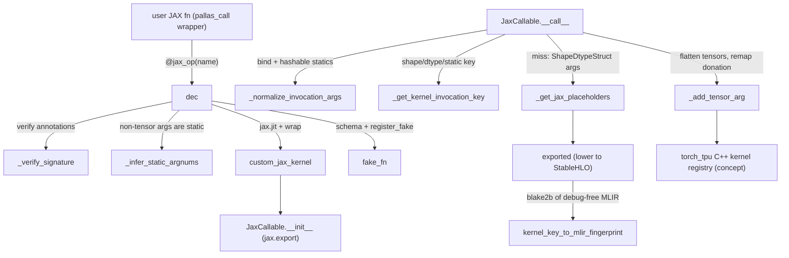

# Pallas / JAX custom kernels as torch ops (torch.tpu.pallas.jax_op)

<!-- connect:up:begin -->
> **Cross-repo concept:** part of [mosaic-kernel](../../../concepts/mosaic-kernel.md), [pallas-kernel](../../../concepts/pallas-kernel.md), [sharding](../../../concepts/sharding.md) across this wiki's repos.
<!-- connect:up:end -->
## Overview
The `torch_tpu._internal.pallas` subsystem ("APIs to call Pallas kernels from PyTorch", module docstring of `pallas.py`) lets a model call any JAX function - in practice a `jax.jit`-able wrapper around a `pallas_call`, e.g. a tokamax or splash-attention kernel - on torch TPU tensors. The key design idea is that **JAX is used only as a tracer/exporter, never as a runtime**: the JAX function is exported once per input signature to a serialized StableHLO module (where the Pallas body rides inside a Mosaic custom call), the module is handed to torch_tpu's own C++ kernel registry under a content fingerprint, and torch_tpu executes it with torch tensors as inputs. On top of that, the public decorator `jax_op` (its inner [`dec`](../catalog/src/torch_tpu/_internal/pallas/pallas.md#jax_op.dec "src/torch_tpu/_internal/pallas/pallas.py:L1619")) wraps the result as a real `torch.library.custom_op` with an inferred schema and a JAX-traced fake kernel, so the op is visible to Dynamo/`torch.compile`. The runtime object in the middle is [`JaxCallable`](../catalog/src/torch_tpu/_internal/pallas/pallas.md#JaxCallable "src/torch_tpu/_internal/pallas/pallas.py:L930") ("A torch callable function that wraps a JAX function"), which owns the export, the per-shape caches and the argument plumbing. A small side path, [`generate_embedded_file`](../catalog/src/torch_tpu/_internal/pallas/pallas_kernel_generate_utils.md#generate_embedded_file "src/torch_tpu/_internal/pallas/pallas_kernel_generate_utils.py:L18"), embeds pre-generated kernel MLIR into C++ at build time.

## Diagram
Registration (once, at decoration time) and invocation (every call) paths.

Legend:
- `USER` - (concept) the user's JAX function
- `DEC` - [`dec`](../catalog/src/torch_tpu/_internal/pallas/pallas.md#jax_op.dec "src/torch_tpu/_internal/pallas/pallas.py:L1619")
- `VS` - [`_verify_signature`](../catalog/src/torch_tpu/_internal/pallas/pallas.md#_verify_signature "src/torch_tpu/_internal/pallas/pallas.py:L498")
- `ISA` - [`_infer_static_argnums`](../catalog/src/torch_tpu/_internal/pallas/pallas.md#_infer_static_argnums "src/torch_tpu/_internal/pallas/pallas.py:L591")
- `CJK` - [`custom_jax_kernel`](../catalog/src/torch_tpu/_internal/pallas/pallas.md#custom_jax_kernel "src/torch_tpu/_internal/pallas/pallas.py:L1399")
- `INIT` - [`__init__`](../catalog/src/torch_tpu/_internal/pallas/pallas.md#JaxCallable.__init__ "src/torch_tpu/_internal/pallas/pallas.py:L951")
- `FAKE` - [`fake_fn`](../catalog/src/torch_tpu/_internal/pallas/pallas.md#jax_op.dec.fake_fn "src/torch_tpu/_internal/pallas/pallas.py:L1650")
- `CALL` - [`__call__`](../catalog/src/torch_tpu/_internal/pallas/pallas.md#JaxCallable.__call__ "src/torch_tpu/_internal/pallas/pallas.py:L1198")
- `NIA` - [`_normalize_invocation_args`](../catalog/src/torch_tpu/_internal/pallas/pallas.md#JaxCallable._normalize_invocation_args "src/torch_tpu/_internal/pallas/pallas.py:L1100")
- `KEY` - [`_get_kernel_invocation_key`](../catalog/src/torch_tpu/_internal/pallas/pallas.md#_get_kernel_invocation_key "src/torch_tpu/_internal/pallas/pallas.py:L290")
- `PH` - [`_get_jax_placeholders`](../catalog/src/torch_tpu/_internal/pallas/pallas.md#JaxCallable._get_jax_placeholders "src/torch_tpu/_internal/pallas/pallas.py:L1164")
- `EXP` - [`exported`](../catalog/src/torch_tpu/_internal/pallas/pallas.md#JaxCallable.exported "src/torch_tpu/_internal/pallas/pallas.py:L947")
- `FP` - [`kernel_key_to_mlir_fingerprint`](../catalog/src/torch_tpu/_internal/pallas/pallas.md#JaxCallable.kernel_key_to_mlir_fingerprint "src/torch_tpu/_internal/pallas/pallas.py:L1006")
- `ATA` - [`_add_tensor_arg`](../catalog/src/torch_tpu/_internal/pallas/pallas.md#JaxCallable._add_tensor_arg "src/torch_tpu/_internal/pallas/pallas.py:L1305")
- `RT` - (concept) the `tpu_torch_pallas` binding (`register_custom_kernel` / `lookup_custom_kernel` / `call_custom_kernel`), not in this packet

## Design rationale (why it's built this way)
- **Export, do not run JAX.** `JaxCallable.__init__` builds `jax.export.export(jit_fn, platforms=["tpu"], ...)` and the call path only ever lowers it with abstract `jax.ShapeDtypeStruct` arguments; no JAX device array is created on the torch path. The import block carries a TODO explaining the worry: frameworks "hitting deadlocks when each framework tried to access the PJRT plugin". Exporting keeps one owner (torch_tpu) of the TPU runtime, and lets the kernel join torch_tpu's own graph and compilation cache (see [compilation-cache](compilation-cache.md)).
- **"Ignore forward compatibility."** Both export and lowering run under `export_ignore_forward_compatibility(True)`; the comment in [`__init__`](../catalog/src/torch_tpu/_internal/pallas/pallas.md#JaxCallable.__init__ "src/torch_tpu/_internal/pallas/pallas.py:L951") says "Without this flag we can be missing the latest optimizations" - the StableHLO is consumed immediately by the same process, so serialization-compat guarantees buy nothing. The custom-call safety check is disabled (`DisabledSafetyCheck.custom_call("ALL")`) because a Pallas kernel *is* a custom call.
- **A process-stable fingerprint, separate from the process-local key.** The cheap lookup key built by [`_get_kernel_invocation_key`](../catalog/src/torch_tpu/_internal/pallas/pallas.md#_get_kernel_invocation_key "src/torch_tpu/_internal/pallas/pallas.py:L290") embeds `id(jax_fn)` via the [`trace_key`](../catalog/src/torch_tpu/_internal/pallas/pallas.md#JaxCallable.trace_key "src/torch_tpu/_internal/pallas/pallas.py:L938"), so it differs across processes. The [`kernel_key_to_mlir_fingerprint`](../catalog/src/torch_tpu/_internal/pallas/pallas.md#JaxCallable.kernel_key_to_mlir_fingerprint "src/torch_tpu/_internal/pallas/pallas.py:L1006") map bridges it to a BLAKE2b (16-byte) hash of the lowered module *with location debug info stripped*, "so that compilation caches can be shared across processes" and "differing caller stack frames produce the same deterministic fingerprint". The inner Mosaic body keeps its debug info, which the comment notes is the more useful one for profiling.
- **Every non-tensor argument is static.** [`_infer_static_argnums`](../catalog/src/torch_tpu/_internal/pallas/pallas.md#_infer_static_argnums "src/torch_tpu/_internal/pallas/pallas.py:L591") ("All non-tensor arguments are considered static") and [`_infer_static_argnames`](../catalog/src/torch_tpu/_internal/pallas/pallas.md#_infer_static_argnames "src/torch_tpu/_internal/pallas/pallas.py:L612") make block sizes, dtypes, enums and flags compile-time constants of the JAX trace. That is what a Pallas kernel needs (tile shapes must be Python ints), and it is what makes the torch schema expressible: only tensors flow through `call_custom_kernel`.
- **Donation without `mutates_args`.** `dec` registers the op with `mutates_args=()` even when `donate_argnums` is set. The comment: "If we mark donated args as mutable then Dynamo will copy back the original value of the donated arg which then defeats the purpose of donating." Donated inputs are instead documented as left "in an invalid state".
- **Signature-driven, not user-declared, schema.** `jax_op` takes only a name; the schema, static args and fake kernel are derived from the JAX function's type annotations, so a kernel author never writes a torch schema string by hand. The cost is strict annotation requirements (see Edge cases).

> [!inferred]
> `keep_unused=True` in the `jax.jit` call made by `custom_jax_kernel` keeps unused tensor parameters in the exported module's signature, so the flat tensor list that `__call__` passes to the C++ side lines up positionally with the module's arguments. The source sets the flag without a comment.

## Entry points
- [`dec`](../catalog/src/torch_tpu/_internal/pallas/pallas.md#jax_op.dec "src/torch_tpu/_internal/pallas/pallas.py:L1619") - the body of the public `torch.tpu.pallas.jax_op(name, fn=None, *, donate_argnums, mesh, input_partition_specs, output_partition_specs)` decorator (experimental). Runs once when the kernel module is imported/decorated; returns a `CustomOpDef` callable as `torch.ops.<ns>.<op>`.
- [`custom_jax_kernel`](../catalog/src/torch_tpu/_internal/pallas/pallas.md#custom_jax_kernel "src/torch_tpu/_internal/pallas/pallas.py:L1399") - the older, "Deprecated: Please use `jax_op` instead" wrapper that returns a bare [`JaxCallable`](../catalog/src/torch_tpu/_internal/pallas/pallas.md#JaxCallable "src/torch_tpu/_internal/pallas/pallas.py:L930") (no custom op, no fake kernel, explicit `static_argnums`). Still used internally by `jax_op` (with `warn_deprecated=False`) and by torch_tpu's own splash-attention integration.
- [`__call__`](../catalog/src/torch_tpu/_internal/pallas/pallas.md#JaxCallable.__call__ "src/torch_tpu/_internal/pallas/pallas.py:L1198") - reached on every eager invocation of the op (the custom op's real kernel is the `JaxCallable`). This is the hot path.
- [`fake_fn`](../catalog/src/torch_tpu/_internal/pallas/pallas.md#jax_op.dec.fake_fn "src/torch_tpu/_internal/pallas/pallas.py:L1650") - reached whenever PyTorch needs output metadata without running: FakeTensor propagation under `torch.compile`, `make_fx`, meta tensors.
- [`_get_pallas_mesh`](../catalog/src/torch_tpu/_internal/pallas/pallas.md#_get_pallas_mesh "src/torch_tpu/_internal/pallas/pallas.py:L1707") - implementation of `torch.tpu.pallas.get_pallas_mesh` / `get_default_pallas_mesh`; called by users who need a JAX `Mesh` for a communicating (distributed) kernel.
- [`generate_embedded_file`](../catalog/src/torch_tpu/_internal/pallas/pallas_kernel_generate_utils.md#generate_embedded_file "src/torch_tpu/_internal/pallas/pallas_kernel_generate_utils.py:L18") - build-time only: called by generator scripts such as the scaled-mm generator's [`main`](../catalog/src/torch_tpu/_internal/ops/scaled_mm/kernels/scaled_mm_generate.md#main "src/torch_tpu/_internal/ops/scaled_mm/kernels/scaled_mm_generate.py:L259") to bake kernel MLIR bytes into a C++ header/implementation pair.

## Mechanism (step-by-step)
1. **Validate the JAX signature.** `dec` first insists the op name has exactly one `::` namespace separator, collects names already bound by `functools.partial`, and reads the signature of `inspect.unwrap(fn)` with `eval_str=True` (so string annotations resolve against the function's real globals). [`_verify_signature`](../catalog/src/torch_tpu/_internal/pallas/pallas.md#_verify_signature "src/torch_tpu/_internal/pallas/pallas.py:L498") ("Verify that the signature contains only types supported by PyTorch custom_op") rejects any unannotated parameter, then checks every parameter with [`_is_valid_argument`](../catalog/src/torch_tpu/_internal/pallas/pallas.md#_is_valid_argument "src/torch_tpu/_internal/pallas/pallas.py:L488") / [`_is_valid_argument_type`](../catalog/src/torch_tpu/_internal/pallas/pallas.md#_is_valid_argument_type "src/torch_tpu/_internal/pallas/pallas.py:L461") and the return annotation with [`is_valid_result`](../catalog/src/torch_tpu/_internal/pallas/pallas.md#_verify_signature.is_valid_result "src/torch_tpu/_internal/pallas/pallas.py:L533"). The accepted vocabulary ([`_is_valid_base_type`](../catalog/src/torch_tpu/_internal/pallas/pallas.md#_is_valid_base_type "src/torch_tpu/_internal/pallas/pallas.py:L394"), [`_is_valid_sequence_element_type`](../catalog/src/torch_tpu/_internal/pallas/pallas.md#_is_valid_sequence_element_type "src/torch_tpu/_internal/pallas/pallas.py:L441")) is `jax.Array`/`torch.Tensor`, POD scalars, `str`, dtypes (torch or numpy), devices, enums and `Literal`s, plus homogeneous sequences whose elements are tensors/arrays (optionally `None`) or numeric scalars (`int`/`float`/`bool`/`Number`, not enums); `Optional[...]` and `Annotated[...]` are peeled by [`_strip_optional`](../catalog/src/torch_tpu/_internal/pallas/pallas.md#_strip_optional "src/torch_tpu/_internal/pallas/pallas.py:L341") and [`_unwrap_annotated`](../catalog/src/torch_tpu/_internal/pallas/pallas.md#_unwrap_annotated "src/torch_tpu/_internal/pallas/pallas.py:L334") everywhere.

2. **Infer what is static.** A parameter is a tensor iff [`_is_tensor_annotation`](../catalog/src/torch_tpu/_internal/pallas/pallas.md#_is_tensor_annotation "src/torch_tpu/_internal/pallas/pallas.py:L579") says so (array/tensor, or a sequence of them). Positional non-tensors become `static_argnums` via [`_infer_static_argnums`](../catalog/src/torch_tpu/_internal/pallas/pallas.md#_infer_static_argnums "src/torch_tpu/_internal/pallas/pallas.py:L591"); keyword-only non-tensors become `static_argnames` via [`_infer_static_argnames`](../catalog/src/torch_tpu/_internal/pallas/pallas.md#_infer_static_argnames "src/torch_tpu/_internal/pallas/pallas.py:L612"). For performance this is the single most important rule of the subsystem: each distinct value of a static argument is a distinct trace, export and TPU compile.

3. **jit + export once per function.** [`custom_jax_kernel`](../catalog/src/torch_tpu/_internal/pallas/pallas.md#custom_jax_kernel "src/torch_tpu/_internal/pallas/pallas.py:L1399") names the kernel (`name` or `fn.__name__`), builds a `trace_key` from `f"{name}_{id(jax_fn)}"` plus the static/donate configuration, wraps the function in `jax.jit(static_argnums=..., donate_argnums=..., keep_unused=True)`, and constructs a `JaxCallable`. Its [`__init__`](../catalog/src/torch_tpu/_internal/pallas/pallas.md#JaxCallable.__init__ "src/torch_tpu/_internal/pallas/pallas.py:L951") ("a cached callable for custom kernels") calls `jax.export.export` to produce [`exported`](../catalog/src/torch_tpu/_internal/pallas/pallas.md#JaxCallable.exported "src/torch_tpu/_internal/pallas/pallas.py:L947") - a function that, given abstract arguments, lowers to StableHLO. It also precomputes the per-parameter tables that the hot path consults: [`_orig_signature`](../catalog/src/torch_tpu/_internal/pallas/pallas.md#JaxCallable._orig_signature "src/torch_tpu/_internal/pallas/pallas.py:L1043"), [`_orig_params`](../catalog/src/torch_tpu/_internal/pallas/pallas.md#JaxCallable._orig_params "src/torch_tpu/_internal/pallas/pallas.py:L1044"), [`_orig_params_by_name`](../catalog/src/torch_tpu/_internal/pallas/pallas.md#JaxCallable._orig_params_by_name "src/torch_tpu/_internal/pallas/pallas.py:L1045"), [`_param_is_tensor`](../catalog/src/torch_tpu/_internal/pallas/pallas.md#JaxCallable._param_is_tensor "src/torch_tpu/_internal/pallas/pallas.py:L1052"), [`_static_param_names`](../catalog/src/torch_tpu/_internal/pallas/pallas.md#JaxCallable._static_param_names "src/torch_tpu/_internal/pallas/pallas.py:L1059"), [`_param_name_to_idx`](../catalog/src/torch_tpu/_internal/pallas/pallas.md#JaxCallable._param_name_to_idx "src/torch_tpu/_internal/pallas/pallas.py:L1065") and [`_donate_argnums_set`](../catalog/src/torch_tpu/_internal/pallas/pallas.md#JaxCallable._donate_argnums_set "src/torch_tpu/_internal/pallas/pallas.py:L1068"). The deprecated [`input_output_aliases`](../catalog/src/torch_tpu/_internal/pallas/pallas.md#JaxCallable.input_output_aliases "src/torch_tpu/_internal/pallas/pallas.py:L946") argument is translated into donation of its keys.

4. **Translate the signature into a torch schema.** [`_get_torch_signature`](../catalog/src/torch_tpu/_internal/pallas/pallas.md#_get_torch_signature "src/torch_tpu/_internal/pallas/pallas.py:L859") ("Converts a JAX signature to a Torch signature for custom_op schema") drops partial-bound and invalid parameters, maps each annotation with [`_map_jax_param_to_torch`](../catalog/src/torch_tpu/_internal/pallas/pallas.md#_map_jax_param_to_torch "src/torch_tpu/_internal/pallas/pallas.py:L696") (`jax.Array` -> `Tensor`, numpy dtype -> `torch.dtype`, `jax.Device` -> `torch.device`, enums -> their value type), normalizes defaults with [`_normalize_caller_arg`](../catalog/src/torch_tpu/_internal/pallas/pallas.md#_normalize_caller_arg "src/torch_tpu/_internal/pallas/pallas.py:L796"), and maps the return with [`_map_jax_return_to_torch`](../catalog/src/torch_tpu/_internal/pallas/pallas.md#_map_jax_return_to_torch "src/torch_tpu/_internal/pallas/pallas.py:L710"). `dec` then builds the explicit schema string: [`_generate_torch_schema`](../catalog/src/torch_tpu/_internal/pallas/pallas.md#_generate_torch_schema "src/torch_tpu/_internal/pallas/pallas.py:L897") lets `torch.library.infer_schema` render the parameters from a dummy function and splices in the return string from [`_map_jax_return_to_schema_str`](../catalog/src/torch_tpu/_internal/pallas/pallas.md#_map_jax_return_to_schema_str "src/torch_tpu/_internal/pallas/pallas.py:L749") (`int` -> `SymInt`, number unions -> `Scalar`, tuples -> `(...)`, sequences -> `T[]`). Finally `torch.library.custom_op(name, wrapped_fn, mutates_args=(), schema=...)` registers the op, its class is swapped to a subclass that runs `_normalize_caller_arg` over the caller's arguments (so `jnp.bfloat16` or an enum member can be passed directly), and `fake_fn` is registered as its fake kernel.

5. **Fake kernel = a real JAX trace.** [`fake_fn`](../catalog/src/torch_tpu/_internal/pallas/pallas.md#jax_op.dec.fake_fn "src/torch_tpu/_internal/pallas/pallas.py:L1650") refuses symbolic (`SymInt`) dimensions, normalizes the arguments, lowers [`exported`](../catalog/src/torch_tpu/_internal/pallas/pallas.md#JaxCallable.exported "src/torch_tpu/_internal/pallas/pallas.py:L947") on placeholders, and turns each output aval into an empty tensor on the inputs' device via [`torch_placeholder`](../catalog/src/torch_tpu/_internal/pallas/pallas.md#torch_placeholder "src/torch_tpu/_internal/pallas/pallas.py:L220"), rebuilt into the original pytree with `out_tree.unflatten`. Output shapes are therefore always exactly what JAX would produce, at the price of a JAX lowering per fake call (this path has no cache).

6. **Normalize the call.** On a real call, [`__call__`](../catalog/src/torch_tpu/_internal/pallas/pallas.md#JaxCallable.__call__ "src/torch_tpu/_internal/pallas/pallas.py:L1198") runs [`_validate_args`](../catalog/src/torch_tpu/_internal/pallas/pallas.md#JaxCallable._validate_args "src/torch_tpu/_internal/pallas/pallas.py:L1078") (tensors may not be static; non-static positions must be tensors, `None`, or sequences of them) and then [`_normalize_invocation_args`](../catalog/src/torch_tpu/_internal/pallas/pallas.md#JaxCallable._normalize_invocation_args "src/torch_tpu/_internal/pallas/pallas.py:L1100") ("Binds arguments to signature and normalizes static arguments"). Binding against the *original* JAX signature applies defaults and restores any non-optional default that the torch schema had to replace with `None`. Every static value goes through [`_to_hashable_jax_static_arg`](../catalog/src/torch_tpu/_internal/pallas/pallas.md#_to_hashable_jax_static_arg "src/torch_tpu/_internal/pallas/pallas.py:L830"): lists become tuples (JAX statics must be hashable), `torch.dtype` becomes the JAX dtype through [`TORCH_TO_JAX_DTYPE_MAP`](../catalog/src/torch_tpu/_internal/pallas/pallas.md#TORCH_TO_JAX_DTYPE_MAP "src/torch_tpu/_internal/pallas/pallas.py:L65"), and a schema-flattened `str`/`int` is turned back into its enum class using [`_get_enum_type`](../catalog/src/torch_tpu/_internal/pallas/pallas.md#_get_enum_type "src/torch_tpu/_internal/pallas/pallas.py:L359") and [`_get_sequence_element_type`](../catalog/src/torch_tpu/_internal/pallas/pallas.md#_get_sequence_element_type "src/torch_tpu/_internal/pallas/pallas.py:L374").

7. **Wrapper-tensor bypass.** If any argument looks like a JAX-backed wrapper tensor (has `_elem` and `_env`, the torchax shape), `__call__` skips the whole export machinery: it unwraps with [`unwrap_elem`](../catalog/src/torch_tpu/_internal/pallas/pallas.md#JaxCallable.unwrap_elem "src/torch_tpu/_internal/pallas/pallas.py:L1217"), calls the `jax.jit` function directly on the underlying `jax.Array`s, and rewraps the results. In that mode JAX *is* the runtime.

8. **Key, then trace-on-miss.** The invocation key from [`_get_kernel_invocation_key`](../catalog/src/torch_tpu/_internal/pallas/pallas.md#_get_kernel_invocation_key "src/torch_tpu/_internal/pallas/pallas.py:L290") ("Construct a unique ID for the kernel invocation") is a string of `trace_key`, then per argument [`get_hash`](../catalog/src/torch_tpu/_internal/pallas/pallas.md#_get_kernel_invocation_key.get_hash "src/torch_tpu/_internal/pallas/pallas.py:L314") - `"{shape}x{dtype}"` for tensors, `static_<value>` for static positions - then sorted kwargs. Strides, device and values of tensors are not part of it. If either the output-shape cache or the fingerprint is missing, or the C++ registry no longer knows the fingerprint, `__call__` builds abstract inputs with [`_get_jax_placeholders`](../catalog/src/torch_tpu/_internal/pallas/pallas.md#JaxCallable._get_jax_placeholders "src/torch_tpu/_internal/pallas/pallas.py:L1164") (via [`jax_placeholders`](../catalog/src/torch_tpu/_internal/pallas/pallas.md#jax_placeholders "src/torch_tpu/_internal/pallas/pallas.py:L198") / [`jax_placeholder`](../catalog/src/torch_tpu/_internal/pallas/pallas.md#jax_placeholder "src/torch_tpu/_internal/pallas/pallas.py:L151"), which produce `jax.ShapeDtypeStruct`s - with a *global* shape and `NamedSharding` when a [`mesh`](../catalog/src/torch_tpu/_internal/pallas/pallas.md#JaxCallable.mesh "src/torch_tpu/_internal/pallas/pallas.py:L940") is set), lowers `exported`, re-parses the MLIR text without debug info, hashes it with BLAKE2b, records it in [`kernel_key_to_mlir_fingerprint`](../catalog/src/torch_tpu/_internal/pallas/pallas.md#JaxCallable.kernel_key_to_mlir_fingerprint "src/torch_tpu/_internal/pallas/pallas.py:L1006"), and registers the serialized module with the C++ registry under `(`[`name`](../catalog/src/torch_tpu/_internal/pallas/pallas.md#JaxCallable.name "src/torch_tpu/_internal/pallas/pallas.py:L937")`, fingerprint)`. Output placeholders are computed once per key with [`torch_placeholder`](../catalog/src/torch_tpu/_internal/pallas/pallas.md#torch_placeholder "src/torch_tpu/_internal/pallas/pallas.py:L220") (global -> local shape through the mesh/partition spec) and cached with the pytree `out_tree`.

9. **Flatten tensors and remap donation.** JAX's static arguments are baked into the module, so only tensors are passed at run time. The local helper [`_add_tensor_arg`](../catalog/src/torch_tpu/_internal/pallas/pallas.md#JaxCallable._add_tensor_arg "src/torch_tpu/_internal/pallas/pallas.py:L1305") walks positional then keyword arguments (skipping static ones), flattens tensor lists into one list, and rewrites `donate_argnums` from *parameter* indices to *flat tensor* indices (a donated `list[Tensor]` parameter donates every element). The same remap applies to legacy `input_output_aliases`.

10. **Dispatch.** For a meshed kernel, [`_validate_pallas_mesh_world_size`](../catalog/src/torch_tpu/_internal/pallas/pallas.md#_validate_pallas_mesh_world_size "src/torch_tpu/_internal/pallas/pallas.py:L1366") re-checks that the mesh covers the whole world and the device ids of `mesh.devices.flat` become the `device_assignment`. `call_custom_kernel(name, fingerprint, inputs, output_shapes, donate_argnums, device_assignment)` returns flat result tensors; legacy aliased inputs are then overwritten with `copy_` (a real copy, not an alias), and `out_tree.unflatten` restores the declared return structure.

> [!inferred]
> On the C++ side (outside this packet: `csrc/internal/pallas/pallas_py.cc`, `csrc/ops/custom_kernels.cc`), `call_custom_kernel` is an ordinary torch_tpu op (`OpName::kCustomKernel`): the registry deserializes the stored module, specializes dynamic shapes to the concrete input shapes, partitions a global-view (meshed) module to per-device local view, and moves its entry function into the torch_tpu module being built as a private function that is called inline. The Pallas kernel therefore becomes part of torch_tpu's deferred graph and is compiled together with surrounding ops rather than as a separate executable - see [deferred-execution-and-materialization](deferred-execution-and-materialization.md).

## Key data structures
- **[`JaxCallable`](../catalog/src/torch_tpu/_internal/pallas/pallas.md#JaxCallable "src/torch_tpu/_internal/pallas/pallas.py:L930")** - one per decorated function. Holds the `jax.jit` function, [`exported`](../catalog/src/torch_tpu/_internal/pallas/pallas.md#JaxCallable.exported "src/torch_tpu/_internal/pallas/pallas.py:L947"), [`static_argnums`](../catalog/src/torch_tpu/_internal/pallas/pallas.md#JaxCallable.static_argnums "src/torch_tpu/_internal/pallas/pallas.py:L943"), mesh and partition specs, and two per-key caches: `output_shapes[kernel_key] -> (placeholder tensors, out_tree)` and `kernel_key_to_mlir_fingerprint[kernel_key] -> hex digest`. Its [`__repr__`](../catalog/src/torch_tpu/_internal/pallas/pallas.md#JaxCallable.__repr__ "src/torch_tpu/_internal/pallas/pallas.py:L1072") prints name, trace_key and static_argnums - handy when logging retraces.
- **Dtype tables** - [`TORCH_TO_JAX_DTYPE_MAP`](../catalog/src/torch_tpu/_internal/pallas/pallas.md#TORCH_TO_JAX_DTYPE_MAP "src/torch_tpu/_internal/pallas/pallas.py:L65") covers float32/64/16, bfloat16, the float8 family (`e4m3fn`, `e4m3fnuz`, `e5m2`, `e5m2fnuz`, `e8m0fnu`), packed `float4_e2m1fn_x2`, signed/unsigned ints, complex and bool; PyTorch alias dtypes are deliberately left out. [`JAX_TO_TORCH_DTYPE_MAP`](../catalog/src/torch_tpu/_internal/pallas/pallas.md#JAX_TO_TORCH_DTYPE_MAP "src/torch_tpu/_internal/pallas/pallas.py:L111") is its inversion ("will only preserve the last one" if two torch dtypes ever map to one JAX dtype).
- **`_PallasDevice`** - the abstract device that [`_get_pallas_mesh`](../catalog/src/torch_tpu/_internal/pallas/pallas.md#_get_pallas_mesh "src/torch_tpu/_internal/pallas/pallas.py:L1707") puts in a `jax.sharding.Mesh` ("Compile-only abstract device compatible with JAX mesh/sharding inspection without jax.devices()"). Identity is `(id, device_kind, platform)` per [`__eq__`](../catalog/src/torch_tpu/_internal/pallas/_mock_device.md#_PallasDevice.__eq__ "src/torch_tpu/_internal/pallas/_mock_device.py:L70") / [`__hash__`](../catalog/src/torch_tpu/_internal/pallas/_mock_device.md#_PallasDevice.__hash__ "src/torch_tpu/_internal/pallas/_mock_device.py:L79"), and it prints as `AbstractDevice(...)` ([`__repr__`](../catalog/src/torch_tpu/_internal/pallas/_mock_device.md#_PallasDevice.__repr__ "src/torch_tpu/_internal/pallas/_mock_device.py:L64")). Ids come from the process group's rank-to-device assignment and `device_kind` from the local TPU's attributes, so mesh position i is the device driven by torch rank i - which is what a cross-device Pallas kernel needs to address peers - without ever instantiating a JAX backend.

## Dynamics (design intent)
- **Steady state cost.** After the first call for a given (shapes, dtypes, static values) the hot path is: argument binding, one key string build, two dict lookups, one `lookup_custom_kernel` call into C++, list flattening, and `call_custom_kernel`. No JAX code runs. The first call per key pays a full JAX trace + lowering + MLIR re-parse + hash in Python, and then (downstream) a TPU compile unless the compile cache already holds the fingerprint.
- **Caches are per process and per `JaxCallable`.** Nothing is persisted by this module; cross-process reuse happens only because the fingerprint (not the key) is what the C++ side and the compile cache see. The source carries `TODO: Make trace_key stable across processes or remove it.`
- **Fake-kernel retracing.** `fake_fn` lowers through JAX each time it is invoked; under `torch.compile` this is a compile-time cost, not a runtime one.
- **Python-level thread safety is not addressed** in this module (the caches are plain dicts); the C++ registry it calls into is mutex-protected.

## Edge cases
- **Shape polymorphism.** Symbolic dims raise in the default fake kernel ("Either remove symbolic dimensions or override this default implementation"), and every new concrete shape is a new export - mark dynamic dims static or pad to buckets before calling a Pallas op inside a dynamic-shape model.
- **Static args must be hashable and annotation-typed.** A tensor passed in a static position raises `ValueError`; a non-tensor in a non-static position raises `TypeError` pointing at `static_argnums`/`functools.partial`. A missing annotation on any parameter fails at decoration time.
- **Defaults the schema cannot express** (anything not `None`/int/float/bool/str/device/dtype) are replaced by `None` in the torch signature and restored from the JAX default at call time by `_normalize_invocation_args`.
- **`float4_e2m1fn_x2`** is packed two values per byte in torch but unpacked in JAX: `jax_placeholder` doubles the last dimension and requires it to be contiguous (stride 1); `torch_placeholder` halves it and requires an even local size.
- **Unsupported dtypes** (quantized types, `complex32`) raise `NotImplementedError("Unsupported dtype for pallas kernels")` in either direction.
- **Meshes must be full world size.** `_validate_pallas_mesh_world_size` rejects a mesh, mesh shape or process group whose size differs from `dist.get_world_size()` ("currently require full world-size meshes only"). `_get_pallas_mesh` also requires `torch.distributed` to be initialized and an explicit `mesh_shape` for multi-axis meshes.
- **Donation is destructive.** After the call, donated torch tensors are invalid; the `jax_op` docstring recommends a wrapper that `copy_`/`set_`s them. `input_output_aliases` is deprecated and implemented as a post-call copy, so it costs an extra HBM write.
- **Op names** without `::`, or with more than one, are rejected.
- **No autograd.** `jax_op` registers no backward; a differentiable kernel must be wrapped by the caller.

> [!inferred]
> The in-repo example of the autograd pattern is `src/torch_tpu/_internal/ops/splash_attention.py`, which builds separate forward and backward `custom_jax_kernel` callables and binds them with a `torch.autograd.Function` (see [scaled-dot-product-attention](scaled-dot-product-attention.md)).

## Open questions
- `jax_op` itself (the outer decorator), the `_JaxCustomOpDef` argument-normalizing subclass, `_get_bound_names`, the public `get_pallas_mesh` / `get_default_pallas_mesh` wrappers and the `tpu_torch_pallas` pybind module are not in this packet's subgraph, so they are described here only through `dec`, `_normalize_caller_arg` and `_get_pallas_mesh`.
- The `_add_tensor_arg` donation remap and `_get_kernel_invocation_key` do not consider tensor strides or memory layout; whether non-contiguous inputs are made contiguous before reaching the custom kernel is decided on the C++ side and is not visible here.
- No tests are in the packet's configured test paths; `tests/pallas/` (fingerprint, signature, communication tests) exists in the checkout but was not part of the evidence set.

## See also
- [compilation-cache](compilation-cache.md) - where the fingerprinted module's compiled executable is cached.
- [deferred-execution-and-materialization](deferred-execution-and-materialization.md) - how the inlined kernel call is deferred with the rest of the graph.
- [scaled-dot-product-attention](scaled-dot-product-attention.md) - splash attention, the main in-tree user.
- [mosaic-matmul](mosaic-matmul.md) and [kiln-kernel-dsl](kiln-kernel-dsl.md) - torch_tpu's other custom-kernel authoring routes.
- [torch-compile-backend](torch-compile-backend.md) - consumer of the fake kernel.
- [distributed-launchers-and-spmd](distributed-launchers-and-spmd.md) - process groups and device assignment used by `get_pallas_mesh`.
