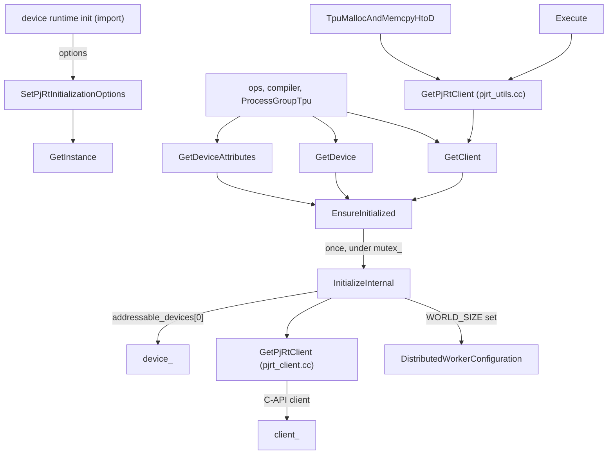
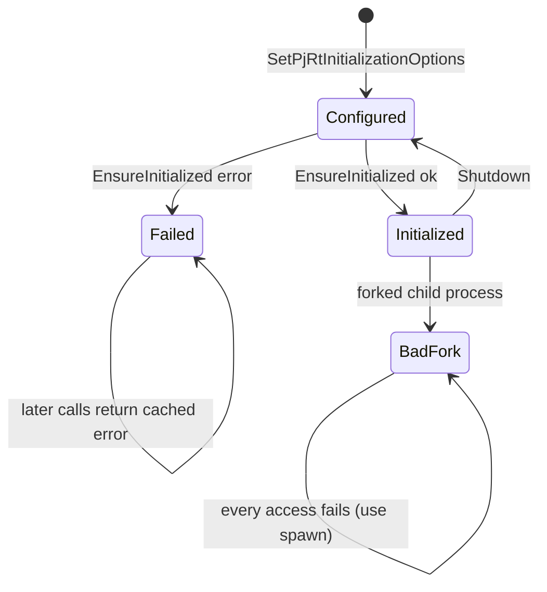

# PjrtBackend - lazy PjRt client, device, execution and host transfers

<!-- connect:up:begin -->
> **Cross-repo concept:** part of [sparsecore](../../../concepts/sparsecore.md) across this wiki's repos.
<!-- connect:up:end -->
## Overview

`csrc/pjrt` is TorchTPU's boundary with the XLA PjRt runtime (libtpu loaded as a PjRt C-API
plugin). Its center is
[`PjrtBackend`](../catalog/csrc/pjrt/pjrt_state.h.md#PjrtBackend "csrc/pjrt/pjrt_state.h:L66"),
which the header describes as managing "the lifecycle and state of the PjRt runtime. It provides
a singleton interface to initialize and access the PjRt client and devices. Initialization is
lazy and thread-safe." The key design idea is **one client, one device, created on first use**:
importing `torch_tpu` only records options; the first call that needs a client
([`GetClient`](../catalog/csrc/pjrt/pjrt_state.cc.md#PjrtBackend.GetClient "csrc/pjrt/pjrt_state.cc:L337"),
[`GetDevice`](../catalog/csrc/pjrt/pjrt_state.cc.md#PjrtBackend.GetDevice "csrc/pjrt/pjrt_state.cc:L354"),
...) runs
[`EnsureInitialized`](../catalog/csrc/pjrt/pjrt_state.cc.md#PjrtBackend.EnsureInitialized "csrc/pjrt/pjrt_state.cc:L202"),
which translates the distributed launch environment into libtpu topology variables, loads the
plugin, creates the client and pins this process to its first addressable device. Around that
singleton sit thin, performance-relevant wrappers: synchronous-enqueue
[`Execute`](../catalog/csrc/pjrt/pjrt_execute.cc.md#Execute "csrc/pjrt/pjrt_execute.cc:L206")
for compiled executables (including unbounded-dynamic argument routing) and the host/device
copy primitives in `pjrt_transfer.cc`.

## Diagram

Legend:
- `RT` - (concept) the device runtime's option setup when the TPU backend is registered
- `SET` - [`SetPjRtInitializationOptions`](../catalog/csrc/pjrt/pjrt_state.cc.md#PjrtBackend.SetPjRtInitializationOptions "csrc/pjrt/pjrt_state.cc:L193")
- `INST` - [`GetInstance`](../catalog/csrc/pjrt/pjrt_state.cc.md#PjrtBackend.GetInstance "csrc/pjrt/pjrt_state.cc:L188")
- `CALLER` - (concept) any TorchTPU code needing the runtime
- `GC` - [`GetClient`](../catalog/csrc/pjrt/pjrt_state.cc.md#PjrtBackend.GetClient "csrc/pjrt/pjrt_state.cc:L337")
- `GD` - [`GetDevice`](../catalog/csrc/pjrt/pjrt_state.cc.md#PjrtBackend.GetDevice "csrc/pjrt/pjrt_state.cc:L354")
- `GA` - [`GetDeviceAttributes`](../catalog/csrc/pjrt/pjrt_state.cc.md#PjrtBackend.GetDeviceAttributes "csrc/pjrt/pjrt_state.cc:L387")
- `ENS` - [`EnsureInitialized`](../catalog/csrc/pjrt/pjrt_state.cc.md#PjrtBackend.EnsureInitialized "csrc/pjrt/pjrt_state.cc:L202")
- `INIT` - [`InitializeInternal`](../catalog/csrc/pjrt/pjrt_state.cc.md#PjrtBackend.InitializeInternal "csrc/pjrt/pjrt_state.cc:L235")
- `CFG` - (concept) distributed worker configuration read from launcher env vars (see [distributed launchers and SPMD](distributed-launchers-and-spmd.md))
- `MK` - [`GetPjRtClient`](../catalog/csrc/pjrt/pjrt_client.cc.md#GetPjRtClient "csrc/pjrt/pjrt_client.cc:L32")
- `CL` - [`client_`](../catalog/csrc/pjrt/pjrt_state.h.md#PjrtBackend.client_ "csrc/pjrt/pjrt_state.h:L150")
- `DEV` - [`device_`](../catalog/csrc/pjrt/pjrt_state.h.md#PjrtBackend.device_ "csrc/pjrt/pjrt_state.h:L152")
- `EXE` - [`Execute`](../catalog/csrc/pjrt/pjrt_execute.cc.md#Execute "csrc/pjrt/pjrt_execute.cc:L206")
- `UGC` - [`GetPjRtClient`](../catalog/csrc/pjrt/pjrt_utils.cc.md#GetPjRtClient "csrc/pjrt/pjrt_utils.cc:L38")
- `H2D` - [`TpuMallocAndMemcpyHtoD`](../catalog/csrc/pjrt/pjrt_transfer.cc.md#TpuMallocAndMemcpyHtoD "csrc/pjrt/pjrt_transfer.cc:L175")

Lifecycle of the singleton:

## Design rationale (why it's built this way)

**Lazy initialization keeps the TPU free until it is needed.** Options are stored by
[`SetPjRtInitializationOptions`](../catalog/csrc/pjrt/pjrt_state.cc.md#PjrtBackend.SetPjRtInitializationOptions "csrc/pjrt/pjrt_state.cc:L193")
("These options will be used for lazy initialization when the first device or client is
requested"); the device runtime logs "PjRt runtime initialization deferred". Creating a PjRt client
claims the chip for the process, which is why the Python launch bootstrap queries device
coordinates in a throwaway child process and why a parent that spawns workers must not touch TPU
tensors first.

**Initialize once, cache the outcome - including failure.**
[`EnsureInitialized`](../catalog/csrc/pjrt/pjrt_state.cc.md#PjrtBackend.EnsureInitialized "csrc/pjrt/pjrt_state.cc:L202")
takes a reader lock for the fast path and a writer lock only for the first attempt; it records
`init_attempted_` and `init_status_`, so a failed init is not retried on every op (it returns the
same error until
[`Shutdown`](../catalog/csrc/pjrt/pjrt_state.cc.md#PjrtBackend.Shutdown "csrc/pjrt/pjrt_state.cc:L426")
resets the state). VFIO device collisions are adapted into actionable errors "instead of low-level
crashes".

**One addressable device per process.** [`InitializeInternal`](../catalog/csrc/pjrt/pjrt_state.cc.md#PjrtBackend.InitializeInternal "csrc/pjrt/pjrt_state.cc:L235")
always takes `addressable_devices[0]` and warns "Only using 1 device out of all the N addressable
devices" when a non-distributed process sees more. The global device count is set to
`WORLD_SIZE`, and the code requires `world_size == 1 || world_size == device_count`: the
process-per-chip model of `torch.distributed` maps directly onto PjRt's global device ids, and the
compilation cache uses this count as the number of replicas.

**Fork safety is delegated to PyTorch.** A pluggable `bad_fork_checker` (wired to PyTorch's
"device in bad fork" utility for `PrivateUse1`) makes every access in a child forked after init
fail with "cannot access or re-initialize TPU in a forked subprocess. To use TPU with
multiprocessing, you must use the 'spawn' start method". The `on_initialized_hook` registers
PyTorch's fork handler only after a successful init.

**Own the MegaScale client.** When the first addressable device reports `slice_index` (only the
MegaScale PJRT client publishes it), init sets `SKIP_MEGASCALE_PJRT_CLIENT=true` "so that later
PJRT clients in this process, e.g. JAX's for Pallas, skip MegaScale. A second MegaScale client
would redo slice discovery, which the coordinator rejects."

**Execute is synchronous-enqueue, asynchronous-complete.** The [`Execute`](../catalog/csrc/pjrt/pjrt_execute.cc.md#Execute "csrc/pjrt/pjrt_execute.cc:L206")
docstring: "This is a synchronous call, and will block until the execution is fully enqueued (but
not completed). Calls for D2H on the returned buffers will block until the execution and transfer
from TPU to CPU are complete." Host time spent here is dispatch overhead; device time shows up
only when something reads a result.

## Entry points

- [`GetInstance`](../catalog/csrc/pjrt/pjrt_state.cc.md#PjrtBackend.GetInstance "csrc/pjrt/pjrt_state.cc:L188") - "Returns the singleton PjrtBackend instance" (a never-destroyed static); the prefix of every runtime access in the repo.
- [`SetPjRtInitializationOptions`](../catalog/csrc/pjrt/pjrt_state.cc.md#PjrtBackend.SetPjRtInitializationOptions "csrc/pjrt/pjrt_state.cc:L193") - called once when the TPU device runtime is set up, with `device_type="tpu"`, the premapped buffer size from `TPU_PREMAPPED_BUFFER_SIZE` (default 0), and the fork checker/hook; also used by tests to re-arm after `Shutdown`.
- [`GetClient`](../catalog/csrc/pjrt/pjrt_state.cc.md#PjrtBackend.GetClient "csrc/pjrt/pjrt_state.cc:L337") / [`GetSharedClient`](../catalog/csrc/pjrt/pjrt_state.cc.md#PjrtBackend.GetSharedClient "csrc/pjrt/pjrt_state.cc:L348") / [`GetDevice`](../catalog/csrc/pjrt/pjrt_state.cc.md#PjrtBackend.GetDevice "csrc/pjrt/pjrt_state.cc:L354") - the first of these to run triggers initialization; afterwards they are reader-locked accessors. `ProcessGroupTpu` reads `devices()` from the client to define world size.
- [`GetDeviceAttributes`](../catalog/csrc/pjrt/pjrt_state.cc.md#PjrtBackend.GetDeviceAttributes "csrc/pjrt/pjrt_state.cc:L387") - returns [`PjRtDeviceAttributes`](../catalog/csrc/pjrt/pjrt_state.h.md#PjRtDeviceAttributes "csrc/pjrt/pjrt_state.h:L53"); this is what each rank publishes during the process group's world-topology exchange.
- [`GetGlobalDeviceCount`](../catalog/csrc/pjrt/pjrt_state.cc.md#PjrtBackend.GetGlobalDeviceCount "csrc/pjrt/pjrt_state.cc:L364") / [`GetGlobalDeviceId`](../catalog/csrc/pjrt/pjrt_state.cc.md#PjrtBackend.GetGlobalDeviceId "csrc/pjrt/pjrt_state.cc:L373") - world size and this process's global device id.
- [`Execute`](../catalog/csrc/pjrt/pjrt_execute.cc.md#Execute "csrc/pjrt/pjrt_execute.cc:L206") - launches a loaded executable on argument buffers; reached from materialization of deferred graphs and from compiled-mode execution.
- [`TpuMallocAndMemcpyHtoD`](../catalog/csrc/pjrt/pjrt_transfer.cc.md#TpuMallocAndMemcpyHtoD "csrc/pjrt/pjrt_transfer.cc:L175"), [`TpuMemcpyDtoH`](../catalog/csrc/pjrt/pjrt_transfer.cc.md#TpuMemcpyDtoH "csrc/pjrt/pjrt_transfer.cc:L311"), [`TpuMemcpyDtoHDirect`](../catalog/csrc/pjrt/pjrt_transfer.cc.md#TpuMemcpyDtoHDirect "csrc/pjrt/pjrt_transfer.cc:L399") - CPU->TPU and TPU->CPU tensor copies (`.to("tpu")`, `.cpu()`, `.item()`).
- [`TpuAsyncDmaCopyDtoH`](../catalog/csrc/pjrt/pjrt_transfer.cc.md#TpuAsyncDmaCopyDtoH "csrc/pjrt/pjrt_transfer.cc:L587") / [`TpuAsyncDmaCopyHtoD`](../catalog/csrc/pjrt/pjrt_transfer.cc.md#TpuAsyncDmaCopyHtoD "csrc/pjrt/pjrt_transfer.cc:L615") - raw-buffer DMA used by the RMA window's put/get path.
- [`TpuDeviceSupportsSparseCore`](../catalog/csrc/pjrt/pjrt_utils.cc.md#TpuDeviceSupportsSparseCore "csrc/pjrt/pjrt_utils.cc:L63") - capability probe for SparseCore-dependent paths.

## Mechanism (step-by-step)

1. **Record options at import.** The device runtime calls
   [`SetPjRtInitializationOptions`](../catalog/csrc/pjrt/pjrt_state.cc.md#PjrtBackend.SetPjRtInitializationOptions "csrc/pjrt/pjrt_state.cc:L193")
   on the
   [`GetInstance`](../catalog/csrc/pjrt/pjrt_state.cc.md#PjrtBackend.GetInstance "csrc/pjrt/pjrt_state.cc:L188")
   singleton. The fork checker and init hook are stored in atomics (so
   [`IsInBadFork`](../catalog/csrc/pjrt/pjrt_state.cc.md#PjrtBackend.IsInBadFork "csrc/pjrt/pjrt_state.cc:L332")
   can run lock-free); the rest is stored under
   [`mutex_`](../catalog/csrc/pjrt/pjrt_state.h.md#PjrtBackend.mutex_ "csrc/pjrt/pjrt_state.h:L147").
   No libtpu work happens yet.

2. **First access triggers one guarded init.** Any accessor calls
   [`EnsureInitialized`](../catalog/csrc/pjrt/pjrt_state.cc.md#PjrtBackend.EnsureInitialized "csrc/pjrt/pjrt_state.cc:L202"),
   which rejects bad-fork children, returns the cached status if an attempt already happened, and
   otherwise runs
   [`InitializeInternal`](../catalog/csrc/pjrt/pjrt_state.cc.md#PjrtBackend.InitializeInternal "csrc/pjrt/pjrt_state.cc:L235")
   under the writer lock, then fires the on-initialized hook on success.

3. **Per-rank env expansion and distributed environment.**
   [`InitializeInternal`](../catalog/csrc/pjrt/pjrt_state.cc.md#PjrtBackend.InitializeInternal "csrc/pjrt/pjrt_state.cc:L235")
   first replaces `${RANK}` in `XLA_FLAGS` and `LIBTPU_INIT_ARGS` with the process's `RANK`
   ("Required for dumping debug information separately per rank" - e.g. per-rank HLO dump
   directories). If `WORLD_SIZE` is set it reads the launcher configuration and initializes the
   distributed environment before creating the client: per the environment code (outside this
   packet) this pins `TPU_VISIBLE_DEVICES`/`TPU_VISIBLE_CHIPS` to the local rank, sets host/process
   bounds from `TORCH_TPU_TOPOLOGY`, sets this process's slicebuilder port and the slice's process
   addresses from `TORCH_TPU_SLICEBUILDER_ADDRESSES`, assigns MegaScale ports when the world spans
   more processes than one slice's address list, and rewrites `LIBTPU_INIT_ARGS`.

4. **Create the PjRt C-API client.** After initializing the libtpu PjRt plugin if needed,
   [`GetPjRtClient`](../catalog/csrc/pjrt/pjrt_client.cc.md#GetPjRtClient "csrc/pjrt/pjrt_client.cc:L32")
   ("Initializes and returns a PjRtClient based on the provided device type") calls
   `xla::GetCApiClient("tpu", {{"premapped_buffer_size", ...}})`; the premapped buffer size option
   is the only client knob plumbed through. The result lands in
   [`client_`](../catalog/csrc/pjrt/pjrt_state.h.md#PjrtBackend.client_ "csrc/pjrt/pjrt_state.h:L150").
   The PjRt profiler extension, if the plugin exposes one, is registered once per process so xprof
   captures device activity (skipped when libtpu is statically linked, to avoid a TSL global-mutex
   deadlock).

5. **Pin the device and derive world state.** Init calls the MegaScale-ownership check on the
   first addressable device, validates `WORLD_SIZE` against `client_->device_count()`, and
   stores [`device_`](../catalog/csrc/pjrt/pjrt_state.h.md#PjrtBackend.device_ "csrc/pjrt/pjrt_state.h:L152"),
   the device type, the global device count (world size) and global device id. Later,
   [`GetDeviceAttributes`](../catalog/csrc/pjrt/pjrt_state.cc.md#PjrtBackend.GetDeviceAttributes "csrc/pjrt/pjrt_state.cc:L387")
   reads `coords`, `core_on_chip` and `slice_index` from the PjRt device attribute map into a
   [`PjRtDeviceAttributes`](../catalog/csrc/pjrt/pjrt_state.h.md#PjRtDeviceAttributes "csrc/pjrt/pjrt_state.h:L53")
   whose [`id`](../catalog/csrc/pjrt/pjrt_state.h.md#PjRtDeviceAttributes.id "csrc/pjrt/pjrt_state.h:L54")
   is the global device id - the key the process group uses to build device assignments.

6. **Launch an executable.**
   [`Execute`](../catalog/csrc/pjrt/pjrt_execute.cc.md#Execute "csrc/pjrt/pjrt_execute.cc:L206")
   runs with `strict_shape_checking = true` on a single device's argument list. If the executable
   carries unbounded-dynamic execution metadata,
   [`PrepareDynamicExecutionArguments`](../catalog/csrc/pjrt/pjrt_execute.cc.md#PrepareDynamicExecutionArguments "csrc/pjrt/pjrt_execute.cc:L117")
   routes logical inputs to their physical parameter slots, allocates uninitialized donated
   output buffers (shape from
   [`MakeXlaShape`](../catalog/csrc/pjrt/pjrt_execute.cc.md#MakeXlaShape "csrc/pjrt/pjrt_execute.cc:L64")
   or a custom physical-shape hook), and creates S32[rank] metadata buffers with
   [`CreateRuntimeShapeMetadataBuffer`](../catalog/csrc/pjrt/pjrt_execute.cc.md#CreateRuntimeShapeMetadataBuffer "csrc/pjrt/pjrt_execute.cc:L78")
   carrying the actual runtime dimensions. These ephemeral buffers are kept alive by attaching
   them to the execution's returned future. Outputs come back as
   [`PjRtBufferPointers`](../catalog/csrc/pjrt/pjrt_execute.h.md#PjRtBufferPointers "csrc/pjrt/pjrt_execute.h:L35"),
   optionally post-processed by the metadata's output transform.

7. **Host to device.**
   [`TpuMallocAndMemcpyHtoD`](../catalog/csrc/pjrt/pjrt_transfer.cc.md#TpuMallocAndMemcpyHtoD "csrc/pjrt/pjrt_transfer.cc:L175")
   ("If backing tensor is present we keep it alive until the transfer completes, otherwise we block
   on the transfer to complete") calls `BufferFromHostBuffer` into the device's default memory
   space ([`GetDefaultMemorySpace`](../catalog/csrc/pjrt/pjrt_utils.cc.md#GetDefaultMemorySpace "csrc/pjrt/pjrt_utils.cc:L46"))
   with `kImmutableUntilTransferCompletes` semantics and a layout taken from the current layout
   context state. With a backing CPU tensor or byte vector the copy is non-blocking and recorded as
   an async H2D event; without one the host waits. A null host pointer means "allocate zeros" via a
   temporary zeroed host buffer; FP4 data is unpacked to one byte per element first.

8. **Device to host.**
   [`TpuMemcpyDtoH`](../catalog/csrc/pjrt/pjrt_transfer.cc.md#TpuMemcpyDtoH "csrc/pjrt/pjrt_transfer.cc:L311")
   awaits the device buffer (which waits for the producing execution), allocates a CPU tensor and
   blocks on `ToLiteral`; FP4 goes through
   [`TpuMemcpyDtoHFP4`](../catalog/csrc/pjrt/pjrt_transfer.cc.md#TpuMemcpyDtoHFP4 "csrc/pjrt/pjrt_transfer.cc:L130"),
   which receives unpacked bytes and repacks them.
   [`TpuMemcpyDtoHDirect`](../catalog/csrc/pjrt/pjrt_transfer.cc.md#TpuMemcpyDtoHDirect "csrc/pjrt/pjrt_transfer.cc:L399")
   writes into a caller-provided host buffer and, when `non_blocking` and the source is still
   deferred, chains futures: wait for materialization, then start the copy, and record the chained
   future on the event queue - so a pinned-destination `.to("cpu", non_blocking=True)` never
   blocks the host.

9. **Raw DMA for one-sided transfers.**
   [`PrepareRawBuffer`](../catalog/csrc/pjrt/pjrt_transfer.cc.md#PrepareRawBuffer "csrc/pjrt/pjrt_transfer.cc:L529")
   awaits buffer readiness, requires a C-API buffer/client, finds the PjRt RawBuffer extension and
   creates a raw alias of the device buffer wrapped in a ref-counted holder.
   [`TpuAsyncDmaCopyDtoH`](../catalog/csrc/pjrt/pjrt_transfer.cc.md#TpuAsyncDmaCopyDtoH "csrc/pjrt/pjrt_transfer.cc:L587")
   and
   [`TpuAsyncDmaCopyHtoD`](../catalog/csrc/pjrt/pjrt_transfer.cc.md#TpuAsyncDmaCopyHtoD "csrc/pjrt/pjrt_transfer.cc:L615")
   then issue `CopyRawDeviceToHost` / `CopyRawHostToDevice` (the latter at a byte offset) and return
   a future plus the hold object that keeps the device buffer alive until the DMA completes.

## Key data structures

- [`PjrtBackend`](../catalog/csrc/pjrt/pjrt_state.h.md#PjrtBackend "csrc/pjrt/pjrt_state.h:L66") - non-copyable, non-movable ([`operator=`](../catalog/csrc/pjrt/pjrt_state.h.md#PjrtBackend.operator "csrc/pjrt/pjrt_state.h:L72") deleted), private constructor and [`~PjrtBackend`](../catalog/csrc/pjrt/pjrt_state.h.md#PjrtBackend.-PjrtBackend "csrc/pjrt/pjrt_state.h:L142") so only the static instance exists. Guarded by [`mutex_`](../catalog/csrc/pjrt/pjrt_state.h.md#PjrtBackend.mutex_ "csrc/pjrt/pjrt_state.h:L147"): [`client_`](../catalog/csrc/pjrt/pjrt_state.h.md#PjrtBackend.client_ "csrc/pjrt/pjrt_state.h:L150") (shared_ptr, "Nullable because it is lazily initialized on the first device/client request and is reset to nullptr on Shutdown"), [`device_`](../catalog/csrc/pjrt/pjrt_state.h.md#PjrtBackend.device_ "csrc/pjrt/pjrt_state.h:L152"), device type, global device count and id, the options, and the cached `init_attempted_` / `init_status_`.
- `PjRtInitializationOptions` - `device_type` (only `"tpu"` is accepted), `premapped_buffer_size_bytes`, `bad_fork_checker`, `on_initialized_hook`.
- [`PjRtDeviceAttributes`](../catalog/csrc/pjrt/pjrt_state.h.md#PjRtDeviceAttributes "csrc/pjrt/pjrt_state.h:L53") - `id`, `process_index`, `device_kind`, optional `coords`, `core_on_chip`, `slice_index`; exposed to Python and serialized into the process-group topology exchange.
- [`PjRtBufferPointers`](../catalog/csrc/pjrt/pjrt_execute.h.md#PjRtBufferPointers "csrc/pjrt/pjrt_execute.h:L35") - vector of non-null owned `PjRtBuffer`s, one per executable output.
- `AsyncDmaResult` - completion future plus an opaque `shared_ptr<void>` hold that pins the raw buffer alias and its device buffer.

## Dynamics (design intent)

- **Thread safety.** All public accessors are `ABSL_LOCKS_EXCLUDED(mutex_)`; after init they take only a reader lock, so concurrent ops do not serialize on the runtime singleton. `pjrt_init_test.cc` checks that init is lazy, that client/device accessors succeed after init and fail for an unsupported device type, that the device count is set correctly, that `${RANK}` is expanded in env vars, that the bad-fork checker blocks access after init, that the init hook is invoked, and that a single-slice init does not set the MegaScale skip variable.
- **Shutdown resets, it does not tear down libtpu.** [`Shutdown`](../catalog/csrc/pjrt/pjrt_state.cc.md#PjrtBackend.Shutdown "csrc/pjrt/pjrt_state.cc:L426") drops the client and clears cached state so a later access re-initializes (tests use this between suites); it is a no-op in a bad-fork child.
- **Async completion.** Execute and non-blocking transfers return before the device finishes; completion is observed through PjRt futures (buffer ready futures, `ToLiteral` futures, raw-DMA events) that the eager events queue tracks.
- **Memory introspection.** [`GetAllocatorStats`](../catalog/csrc/pjrt/pjrt_state.cc.md#PjrtBackend.GetAllocatorStats "csrc/pjrt/pjrt_state.cc:L406") / [`ClearAllocatorStats`](../catalog/csrc/pjrt/pjrt_state.cc.md#PjrtBackend.ClearAllocatorStats "csrc/pjrt/pjrt_state.cc:L411") forward to the PjRt device (HBM usage counters), and [`GetHostAllocator`](../catalog/csrc/pjrt/pjrt_state.cc.md#PjrtBackend.GetHostAllocator "csrc/pjrt/pjrt_state.cc:L416") returns the client's host memory allocator or a not-implemented error.
- **Collective debugging hook.** At `VLOG(8)`, `Execute` logs the PjRt executable fingerprint and HLO module fingerprint for every executable that contains a collective, tagged with the rank - the way to confirm that all ranks are launching the same collective program.

## Edge cases

- `world_size` must be 1 or equal to the client's device count; any other `WORLD_SIZE` fails init with "invalid world_size configuration".
- A process that sees several addressable chips without `WORLD_SIZE` silently uses only the first one (with a warning).
- Forking after TPU init (default `fork` start method) makes every access fail; use `spawn`.
- `TpuMemcpyDtoH(non_blocking=True)` warns that it only helps for an already-pinned destination and otherwise still blocks.
- `TpuMemcpyDtoHDirect` does not support FP4; FP4 tensors need an even last dimension.
- [`CreateRuntimeShapeMetadataBuffer`](../catalog/csrc/pjrt/pjrt_execute.cc.md#CreateRuntimeShapeMetadataBuffer "csrc/pjrt/pjrt_execute.cc:L78") rejects any runtime dimension that does not fit in int32.
- [`TpuDeviceSupportsSparseCore`](../catalog/csrc/pjrt/pjrt_utils.cc.md#TpuDeviceSupportsSparseCore "csrc/pjrt/pjrt_utils.cc:L63") returns false for TPU v2, v3, v4, v4 lite, v5e / v5 lite, CPU, and when the backend is unavailable; any other device kind is assumed to have SparseCore.

## Open questions

- The distributed-environment setup (`InitializeDistributedEnvironment`, MegaScale port assignment, `LIBTPU_INIT_ARGS` rewriting in `csrc/common/environment.cc`) and the worker-config reader are not in this packet's subgraph; step 3 summarizes them from source without catalog citations.
- `PjRtInitializationOptions`, `AsyncDmaResult` and the device-runtime caller of [`SetPjRtInitializationOptions`](../catalog/csrc/pjrt/pjrt_state.cc.md#PjrtBackend.SetPjRtInitializationOptions "csrc/pjrt/pjrt_state.cc:L193") are not subgraph symbols.
- What `premapped_buffer_size` changes inside libtpu (e.g. pinned staging for transfers) is not visible in this source.
- [`GetDeviceType`](../catalog/csrc/pjrt/pjrt_state.cc.md#PjrtBackend.GetDeviceType "csrc/pjrt/pjrt_state.cc:L382") and [`IsInitialized`](../catalog/csrc/pjrt/pjrt_state.cc.md#PjrtBackend.IsInitialized "csrc/pjrt/pjrt_state.cc:L324") do not trigger initialization, unlike the other getters; callers that need a definite answer should use an initializing accessor.

## See also

- [Process group and collectives](process-group-and-collectives.md) - consumes device attributes and the client's device list.
- [Distributed launchers and SPMD](distributed-launchers-and-spmd.md) - produces the env vars init consumes.
- [Host-device copy](host-device-copy.md) and [batch host-device transfer](batch-host-device-transfer.md)
- [Deferred execution and materialization](deferred-execution-and-materialization.md) - the main caller of `Execute`.
- [Dynamic shapes compiler](dynamic-shapes-compiler.md) - producer of unbounded-dynamic execution metadata.
- [Profiler](profiler.md)
