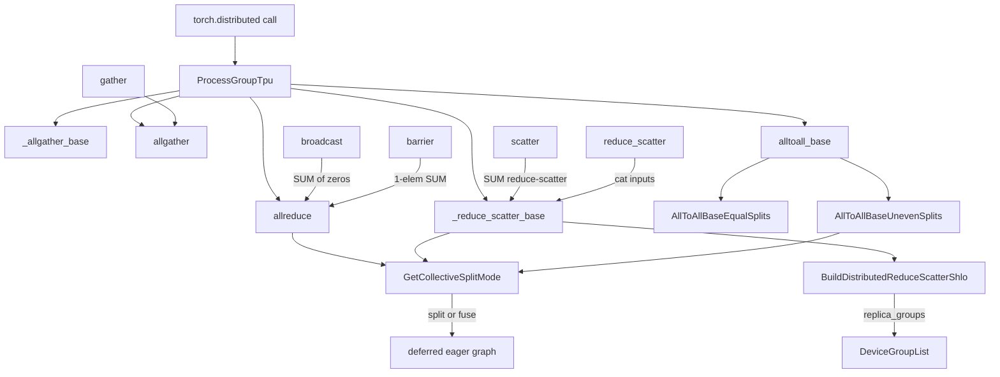
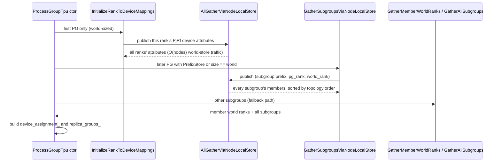

# ProcessGroupTpu - c10d collectives lowered to StableHLO

## Overview

[`ProcessGroupTpu`](../catalog/csrc/distributed/process_group_tpu.h.md#ProcessGroupTpu "csrc/distributed/process_group_tpu.h:L134")
is TorchTPU's `c10d::Backend` (backend name `"tpu_dist"`). The header states the contract
plainly: "All the PyTorch collective operations for tensors on TPU device will be delegated to
methods of this class." The key design idea is that **a collective is not a runtime call into a
communication library - it is just another op recorded into TorchTPU's deferred eager graph**.
Each method validates its tensors, builds a StableHLO collective (`all_reduce`, `all_gather`,
`reduce_scatter`, `all_to_all`, or a `ragged_all_to_all` custom call) whose `replica_groups`
come from the group's precomputed device layout, and hands it to the eager dispatcher together
with an `OpSplitMode` and a world-sized `device_assignment`. XLA then compiles the collective
like any other HLO, so ICI/DCN traffic is scheduled by the compiler, not by the backend.

The rest of the subsystem exists to make that lowering correct across processes: a one-time
store-based exchange that discovers which physical TPU each rank drives
([`InitializeRankToDeviceMappings`](../catalog/csrc/distributed/process_group_tpu.cc.md#ProcessGroupTpu.InitializeRankToDeviceMappings "csrc/distributed/process_group_tpu.cc:L1448")),
a per-group exchange that discovers all sibling subgroups so every rank compiles the *same*
HLO, and the policy in
[`GetCollectiveSplitMode`](../catalog/csrc/distributed/process_group_tpu.cc.md#GetCollectiveSplitMode "csrc/distributed/process_group_tpu.cc:L530")
that decides whether a collective is isolated in its own execution graph (safe, slower) or fused
with surrounding ops (fast, requires SPMD-identical ranks).

## Diagram

Legend:
- `API` - (concept) user or DTensor code calling `torch.distributed`
- `PG` - [`ProcessGroupTpu`](../catalog/csrc/distributed/process_group_tpu.h.md#ProcessGroupTpu "csrc/distributed/process_group_tpu.h:L134")
- `AR` - [`allreduce`](../catalog/csrc/distributed/process_group_tpu.cc.md#ProcessGroupTpu.allreduce "csrc/distributed/process_group_tpu.cc:L1785")
- `AGB` - [`_allgather_base`](../catalog/csrc/distributed/process_group_tpu.cc.md#ProcessGroupTpu._allgather_base "csrc/distributed/process_group_tpu.cc:L2053")
- `AG` - [`allgather`](../catalog/csrc/distributed/process_group_tpu.cc.md#ProcessGroupTpu.allgather "csrc/distributed/process_group_tpu.cc:L1959")
- `RSB` - [`_reduce_scatter_base`](../catalog/csrc/distributed/process_group_tpu.cc.md#ProcessGroupTpu._reduce_scatter_base "csrc/distributed/process_group_tpu.cc:L2385")
- `A2AB` - [`alltoall_base`](../catalog/csrc/distributed/process_group_tpu.cc.md#ProcessGroupTpu.alltoall_base "csrc/distributed/process_group_tpu.cc:L2478")
- `BC` - [`broadcast`](../catalog/csrc/distributed/process_group_tpu.cc.md#ProcessGroupTpu.broadcast "csrc/distributed/process_group_tpu.cc:L1834")
- `BAR` - [`barrier`](../catalog/csrc/distributed/process_group_tpu.cc.md#ProcessGroupTpu.barrier "csrc/distributed/process_group_tpu.cc:L2820")
- `GA` - [`gather`](../catalog/csrc/distributed/process_group_tpu.cc.md#ProcessGroupTpu.gather "csrc/distributed/process_group_tpu.cc:L2187")
- `SC` - [`scatter`](../catalog/csrc/distributed/process_group_tpu.cc.md#ProcessGroupTpu.scatter "csrc/distributed/process_group_tpu.cc:L2265")
- `RS` - [`reduce_scatter`](../catalog/csrc/distributed/process_group_tpu.cc.md#ProcessGroupTpu.reduce_scatter "csrc/distributed/process_group_tpu.cc:L2336")
- `EQ` - [`AllToAllBaseEqualSplits`](../catalog/csrc/distributed/process_group_tpu.cc.md#ProcessGroupTpu.AllToAllBaseEqualSplits "csrc/distributed/process_group_tpu.cc:L2528")
- `UNEV` - [`AllToAllBaseUnevenSplits`](../catalog/csrc/distributed/process_group_tpu.cc.md#ProcessGroupTpu.AllToAllBaseUnevenSplits "csrc/distributed/process_group_tpu.cc:L2555")
- `BUILD` - [`BuildDistributedReduceScatterShlo`](../catalog/csrc/distributed/reduce_scatter.cc.md#BuildDistributedReduceScatterShlo "csrc/distributed/reduce_scatter.cc:L37")
- `DGL` - [`DeviceGroupList`](../catalog/csrc/distributed/types.h.md#DeviceGroupList "csrc/distributed/types.h:L49")
- `MODE` - [`GetCollectiveSplitMode`](../catalog/csrc/distributed/process_group_tpu.cc.md#GetCollectiveSplitMode "csrc/distributed/process_group_tpu.cc:L530")
- `GRAPH` - (concept) TorchTPU's deferred eager execution graph (see [deferred execution](deferred-execution-and-materialization.md))

Group construction (once per process group):

## Design rationale (why it's built this way)

**Collectives are ops in a graph, so the backend's job is to emit identical HLO on every rank.**
SPMD compilation requires that every participating process compiles the same module with the
same `replica_groups`. That is why a subgroup cannot just know its own members: the
constructor gathers *every* sibling subgroup
([`GatherAllSubgroups`](../catalog/csrc/distributed/process_group_tpu.cc.md#ProcessGroupTpu.GatherAllSubgroups "csrc/distributed/process_group_tpu.cc:L1567")
docstring: "returns the unique, non-overlapping subgroups (as world ranks) that partition the
world. Returns an error if the subgroups overlap or do not cover the world"). The emitted
collective then names all groups at once, and each process contributes to its own. A
consequence the source states outright: "Overlapping subgroups are not supported in SPMD" and
the subgroup size must divide the world size.

**`replica_groups` are positions, not ranks or device ids.** The header for
[`device_assignment`](../catalog/csrc/distributed/process_group_tpu.h.md#ProcessGroupTpu.device_assignment "csrc/distributed/process_group_tpu.h:L164")
and `GetReplicaGroups` is explicit: the world-sized `device_assignment_` is permuted so that
subgroup members are contiguous, and the replica groups become `{{0..K-1},{K..2K-1},...}`
indices into it ("These are NOT world ranks"). This keeps the HLO text (and therefore the
compilation cache key) independent of how a launcher numbered the ranks, while the
per-execution device assignment carries the physical mapping.

**Order subgroups by physical topology, never by world rank.** Every sort site carries the
same comment: "world ranks come from launcher order and would make the per-slice
device_assignment order (and thus Megascale's per-slice collective pattern) depend on pod launch
order." Subgroups are sorted by their leader's position in `(slice_index, x, y, z,
core_on_chip, id)` order, which the header says "matches the flattened order of the physical mesh
built by Python `topology_aware_mesh`". The process-group test reproduces this with a 2-slice,
16-device world whose launcher ranks are permuted differently on each host.

**Isolate eager collectives by default.** A collective that is fused with *different*
surrounding ops on different ranks produces different executables, which can deadlock.
[`GetCollectiveSplitMode`](../catalog/csrc/distributed/process_group_tpu.cc.md#GetCollectiveSplitMode "csrc/distributed/process_group_tpu.cc:L530")
therefore returns `kSplitBoth` (cut the deferred graph before and after the collective) unless the
caller is inside an SPMD-safe region or `TORCH_TPU_INTERNAL_MATERIALIZE_COLLECTIVE_TENSORS` is
set to false. The env-var comment: "disables forcing graph breaks for collective ops. This is
useful for SPMD workloads where graph differences between ranks are not expected."

**Implement the long tail in terms of four primitives.** Rather than emitting a distinct HLO per
c10d op, `broadcast` and `barrier` become an all-reduce, `scatter` and `reduce_scatter` become
`_reduce_scatter_base`, and `gather` becomes an all-gather. The broadcast comment is candid:
"we implement broadcast in terms of all-reduce, which is suboptimal. This is because
stablehlo.collective_broadcast is not implemented for TPUs."

**Rendezvous traffic is O(nodes), not O(ranks).**
[`AllGatherViaNodeLocalStore`](../catalog/csrc/distributed/process_group_tpu.cc.md#AllGatherViaNodeLocalStore "csrc/distributed/process_group_tpu.cc:L1054")
uses a `/dev/shm` `FileStore` shared by the ranks on one host so that "only one leader per node
talks to `world_store`, so world store traffic is O(nodes)". When `LOCAL_RANK` or
`TORCH_TPU_DEVICES_PER_HOST` is unset, or `/dev/shm` is not writable, it logs that "Every rank
will publish to the world store individually, which is slower at scale."

## Entry points

- [`ProcessGroupTpu`](../catalog/csrc/distributed/process_group_tpu.cc.md#ProcessGroupTpu.ProcessGroupTpu "csrc/distributed/process_group_tpu.cc:L1675") (constructor) - reached when `torch.distributed.init_process_group` / `new_group` instantiates the registered `"tpu"`/`"tpu_dist"` backend. It requires exactly one addressable PjRt device per process ("expected exactly one TPU device per PyTorch process") and computes the group's device assignment and replica groups.
- [`allreduce`](../catalog/csrc/distributed/process_group_tpu.cc.md#ProcessGroupTpu.allreduce "csrc/distributed/process_group_tpu.cc:L1785"), [`_allgather_base`](../catalog/csrc/distributed/process_group_tpu.cc.md#ProcessGroupTpu._allgather_base "csrc/distributed/process_group_tpu.cc:L2053"), [`_reduce_scatter_base`](../catalog/csrc/distributed/process_group_tpu.cc.md#ProcessGroupTpu._reduce_scatter_base "csrc/distributed/process_group_tpu.cc:L2385") - the three primitives that DTensor / FSDP / functional collectives actually hit; each records one StableHLO collective into the deferred graph.
- [`allgather_into_tensor_coalesced`](../catalog/csrc/distributed/process_group_tpu.cc.md#ProcessGroupTpu.allgather_into_tensor_coalesced "csrc/distributed/process_group_tpu.cc:L2161") and [`reduce_scatter_tensor_coalesced`](../catalog/csrc/distributed/process_group_tpu.cc.md#ProcessGroupTpu.reduce_scatter_tensor_coalesced "csrc/distributed/process_group_tpu.cc:L2450") - reached from the default functional-collective implementations and the coalescing manager; they loop over the base op per input (no real bucketing).
- [`alltoall_base`](../catalog/csrc/distributed/process_group_tpu.cc.md#ProcessGroupTpu.alltoall_base "csrc/distributed/process_group_tpu.cc:L2478") and [`alltoall`](../catalog/csrc/distributed/process_group_tpu.cc.md#ProcessGroupTpu.alltoall "csrc/distributed/process_group_tpu.cc:L2652") - `all_to_all_single` and list `all_to_all`, including the uneven (MoE token routing) path.
- `experimental_send` / [`experimental_recv`](../catalog/csrc/distributed/process_group_tpu.cc.md#ProcessGroupTpu.experimental_recv "csrc/distributed/process_group_tpu.cc:L1920") - what c10d `send`/`recv` forward to; these bypass the HLO path and use PjRt cross-host transfers.
- [`PySetWindowNumStripes`](../catalog/csrc/distributed/window_tpu.cc.md#PySetWindowNumStripes "csrc/distributed/window_tpu.cc:L50") - the Python-exposed knob for the one-sided RMA window (`torch.tpu.distributed.window_num_stripes`), setting how many concurrent DMA stripes a peer transfer may use (default 4).
- [`GetDistributedWorkerConfiguration`](../catalog/csrc/distributed/slicebuilder/discovery.cc.md#GetDistributedWorkerConfiguration "csrc/distributed/slicebuilder/discovery.cc:L65") - read during PjRt initialization (not by the process group itself) to turn launcher env vars into a [`DistributedWorkerConfiguration`](../catalog/csrc/distributed/slicebuilder/discovery.h.md#DistributedWorkerConfiguration "csrc/distributed/slicebuilder/discovery.h:L29"); see [PjRt client](pjrt-client.md).

## Mechanism (step-by-step)

1. **Discover the world topology once.** The first `ProcessGroupTpu` created in a process must be
   world-sized; its constructor calls
   [`InitializeRankToDeviceMappings`](../catalog/csrc/distributed/process_group_tpu.cc.md#ProcessGroupTpu.InitializeRankToDeviceMappings "csrc/distributed/process_group_tpu.cc:L1448"),
   which serializes this rank's PjRt device attributes (id, process index, x/y/z coords,
   core_on_chip, slice_index, device kind) and all-gathers them through
   [`AllGatherViaNodeLocalStore`](../catalog/csrc/distributed/process_group_tpu.cc.md#AllGatherViaNodeLocalStore "csrc/distributed/process_group_tpu.cc:L1054").
   The result populates a process-wide world topology: rank -> device id and rank -> physical
   topology order. "World ranks are defined by the rank order of the first world-sized
   ProcessGroupTpu", and the global state is written only after every peer's payload parsed.

2. **Node-local multiplexed all-gather.** Inside
   [`AllGatherViaNodeLocalStore`](../catalog/csrc/distributed/process_group_tpu.cc.md#AllGatherViaNodeLocalStore "csrc/distributed/process_group_tpu.cc:L1054")
   workers write `local_up:<scope>:<local_rank>` to the shared-memory store and block on
   `local_down:<scope>`; each node leader claims a slot with `world_store->add(...count, 1)` and
   publishes one blob for its whole node; the leader holding `peer_keys[0]` collects blobs until
   every key is filled and publishes an `OK` table (or `ERR` table) that is then fanned back out.
   A failing leader forwards an `ERR` table "so that they fail promptly instead of timing out".
   All store calls go through a wrapper whose
   [`R`](../catalog/csrc/distributed/process_group_tpu.cc.md#CallStore.R "csrc/distributed/process_group_tpu.cc:L874")
   result type lets it convert store exceptions (including timeouts, mapped to deadline-exceeded)
   into status errors.

3. **Resolve this group's members and all sibling subgroups.** For a later group the constructor
   picks one of three paths: a size-1 group synthesizes `world_size` singleton subgroups; a
   world-sized group or one created through a `PrefixStore` (the normal `new_group` path) uses
   [`GatherSubgroupsViaNodeLocalStore`](../catalog/csrc/distributed/process_group_tpu.cc.md#GatherSubgroupsViaNodeLocalStore "csrc/distributed/process_group_tpu.cc:L1340"),
   which all-gathers `(subgroup_prefix, pg_rank, world_rank)` from every world rank and groups by
   prefix; anything else falls back to
   [`GatherMemberWorldRanks`](../catalog/csrc/distributed/process_group_tpu.cc.md#ProcessGroupTpu.GatherMemberWorldRanks "csrc/distributed/process_group_tpu.cc:L1498")
   plus
   [`GatherAllSubgroups`](../catalog/csrc/distributed/process_group_tpu.cc.md#ProcessGroupTpu.GatherAllSubgroups "csrc/distributed/process_group_tpu.cc:L1567").
   Every path validates that the subgroups partition the world and sorts them by leader topology
   order, keeping PG-rank order inside a group (so `sort_ranks=False` layouts are preserved).

4. **Build `device_assignment_` and `replica_groups_`.** The ordered subgroups (a
   [`DeviceGroupList`](../catalog/csrc/distributed/types.h.md#DeviceGroupList "csrc/distributed/types.h:L49")
   built with `normalize=false`) are flattened into a world-sized device assignment and a list of
   contiguous position groups. Each member's device id is cached as `member_device_ids_`
   (exposed as `rank_to_device_id()`), and
   [`device_assignment`](../catalog/csrc/distributed/process_group_tpu.h.md#ProcessGroupTpu.device_assignment "csrc/distributed/process_group_tpu.h:L164")
   is what every collective later passes to the dispatcher.

5. **Validate, then build the StableHLO collective.** A primitive such as
   [`allreduce`](../catalog/csrc/distributed/process_group_tpu.cc.md#ProcessGroupTpu.allreduce "csrc/distributed/process_group_tpu.cc:L1785")
   runs inside the kernel macro with an op name and cache-key parameters, stamps the subgroup
   fingerprint into those keys, checks the reduction with
   [`ValidateReductionOp`](../catalog/csrc/distributed/utils.cc.md#ValidateReductionOp "csrc/distributed/utils.cc:L66")
   (SUM/AVG/PRODUCT/MIN/MAX; BAND/BOR/BXOR only on integer dtypes), and captures an op-builder
   lambda. For reduce-scatter that lambda is
   [`BuildDistributedReduceScatterShlo`](../catalog/csrc/distributed/reduce_scatter.cc.md#BuildDistributedReduceScatterShlo "csrc/distributed/reduce_scatter.cc:L37"),
   which emits `stablehlo.reduce_scatter` with `replica_groups` from the
   [`DeviceGroupList`](../catalog/csrc/distributed/types.h.md#DeviceGroupList "csrc/distributed/types.h:L49"),
   `channel_id` 1 and `use_global_device_ids=true`. AVG is lowered as SUM followed by a divide by
   the group size, so the wire traffic is a plain sum.

6. **Dispatch into the deferred graph with a split mode.** The builder, input tensor, output
   dtype/dims, cache keys, `.split_mode =`
   [`GetCollectiveSplitMode`](../catalog/csrc/distributed/process_group_tpu.cc.md#GetCollectiveSplitMode "csrc/distributed/process_group_tpu.cc:L530")
   and `.device_assignment` go to the eager dispatcher, which returns a (possibly still
   deferred) device buffer that is bound back to the c10d output tensor. With `kSplitBoth` the
   pending graph is cut before the collective and again after it, so the collective executes as
   its own small executable; with `kNone` it is compiled together with neighbouring ops.

7. **Shape-normalize before lowering.**
   [`_reduce_scatter_base`](../catalog/csrc/distributed/process_group_tpu.cc.md#ProcessGroupTpu._reduce_scatter_base "csrc/distributed/process_group_tpu.cc:L2385")
   uses
   [`ValidateReduceScatterInputTensorShape`](../catalog/csrc/distributed/process_group_tpu.cc.md#ValidateReduceScatterInputTensorShape "csrc/distributed/process_group_tpu.cc:L214")
   to accept either a concatenated or a stacked input and flattens the stacked form, "as that's
   what StableHLO expects";
   [`_allgather_base`](../catalog/csrc/distributed/process_group_tpu.cc.md#ProcessGroupTpu._allgather_base "csrc/distributed/process_group_tpu.cc:L2053")
   picks concat or stack output mode from the output rank. The list variants
   ([`allgather`](../catalog/csrc/distributed/process_group_tpu.cc.md#ProcessGroupTpu.allgather "csrc/distributed/process_group_tpu.cc:L1959"),
   [`reduce_scatter`](../catalog/csrc/distributed/process_group_tpu.cc.md#ProcessGroupTpu.reduce_scatter "csrc/distributed/process_group_tpu.cc:L2336"))
   require uniform shapes via
   [`ValidateTensorsUniformShape`](../catalog/csrc/distributed/process_group_tpu.cc.md#ValidateTensorsUniformShape "csrc/distributed/process_group_tpu.cc:L189")
   and `reduce_scatter` concatenates its inputs before delegating.

8. **Uneven all-to-all goes through a host-side offset exchange.**
   [`alltoall_base`](../catalog/csrc/distributed/process_group_tpu.cc.md#ProcessGroupTpu.alltoall_base "csrc/distributed/process_group_tpu.cc:L2478")
   validates splits with
   [`ValidateSplitSizesForAllToAllSingle`](../catalog/csrc/distributed/process_group_tpu.cc.md#ValidateSplitSizesForAllToAllSingle "csrc/distributed/process_group_tpu.cc:L253")
   and routes equal splits to
   [`AllToAllBaseEqualSplits`](../catalog/csrc/distributed/process_group_tpu.cc.md#ProcessGroupTpu.AllToAllBaseEqualSplits "csrc/distributed/process_group_tpu.cc:L2528")
   (a plain `all_to_all`). Uneven splits go to
   [`AllToAllBaseUnevenSplits`](../catalog/csrc/distributed/process_group_tpu.cc.md#ProcessGroupTpu.AllToAllBaseUnevenSplits "csrc/distributed/process_group_tpu.cc:L2555"),
   which computes send/recv offsets, calls
   [`SynchronizeOutputOffsets`](../catalog/csrc/distributed/process_group_tpu.cc.md#SynchronizeOutputOffsets "csrc/distributed/process_group_tpu.cc:L387")
   to learn where its slices land on each peer (and to verify symmetric buffer sizes and matching
   send/recv sizes), explicitly materializes both input and output, and dispatches a
   `ragged_all_to_all` custom call whose offsets are baked into the cache key. The list form
   [`alltoall`](../catalog/csrc/distributed/process_group_tpu.cc.md#ProcessGroupTpu.alltoall "csrc/distributed/process_group_tpu.cc:L2652")
   checks invariants with
   [`ValidateAllToAllTensors`](../catalog/csrc/distributed/process_group_tpu.cc.md#ValidateAllToAllTensors "csrc/distributed/process_group_tpu.cc:L297")
   and, for non-uniform lists, decomposes into concat -> uneven all-to-all -> slice.

9. **Point-to-point bypasses HLO.**
   `experimental_send`
   materializes each tensor, derives a deterministic
   [`GetCrossHostTransferKey`](../catalog/csrc/distributed/process_group_tpu.cc.md#GetCrossHostTransferKey "csrc/distributed/process_group_tpu.cc:L542")
   from (src device, dst device, tag, tensor index), and in
   [`CrossHostSendBuffers`](../catalog/csrc/distributed/process_group_tpu.cc.md#ProcessGroupTpu.CrossHostSendBuffers "csrc/distributed/process_group_tpu.cc:L604")
   blocks on `store_->multiGet` until the receiver has posted descriptors, then issues
   `CopyToRemoteDevice`. The receiver side,
   [`experimental_recv`](../catalog/csrc/distributed/process_group_tpu.cc.md#ProcessGroupTpu.experimental_recv "csrc/distributed/process_group_tpu.cc:L1920")
   via
   `CrossHostReceiveBuffers`,
   allocates placeholder buffers, posts their descriptors to the store, and binds the received
   PjRt buffers back as already-materialized tensors.

## Key data structures

- [`DeviceGroup`](../catalog/csrc/distributed/types.h.md#DeviceGroup "csrc/distributed/types.h:L31") - a plain `std::vector<int64_t>` of ids (the authors flag it with "TODO ... Create a more purpose-specific type").
- [`DeviceGroupList`](../catalog/csrc/distributed/types.h.md#DeviceGroupList "csrc/distributed/types.h:L49") - an immutable list of groups with a precomputed fingerprint. By default it is sorted and deduplicated so "any two normalized `DeviceGroupList` instances representing equivalent device group configurations will compare equal and produce identical fingerprints"; the process group constructs it with `normalize=false` to keep topology order. Its fingerprint is what enters the op cache key, and [`operator<<`](../catalog/csrc/distributed/types.cc.md#operator "csrc/distributed/types.cc:L54") prints it for logs.
- Per-group state on [`ProcessGroupTpu`](../catalog/csrc/distributed/process_group_tpu.h.md#ProcessGroupTpu "csrc/distributed/process_group_tpu.h:L134"): `addressable_device_id_` (this process's TPU), `member_world_ranks_` (world rank per PG rank, caller order), `member_device_ids_`, the world-sized `device_assignment_`, the position-based `replica_groups_`, and an atomic `alltoall_seq_` that namespaces store keys for successive uneven all-to-alls.
- `TpuWork` (file-local) - the `c10d::Work` returned only when `asyncOp` is set; for HLO collectives its future is already complete when constructed, for send it completes when all `CopyToRemoteDevice` callbacks report success.
- [`DistributedWorkerConfiguration`](../catalog/csrc/distributed/slicebuilder/discovery.h.md#DistributedWorkerConfiguration "csrc/distributed/slicebuilder/discovery.h:L29") - `rank`, `local_rank`, `world_size`, slicebuilder addresses/port and topology string, validated by [`ValidateRequiredDistributedEnvVars`](../catalog/csrc/distributed/slicebuilder/discovery.cc.md#ValidateRequiredDistributedEnvVars "csrc/distributed/slicebuilder/discovery.cc:L32") (requires `RANK`, `LOCAL_RANK`, `WORLD_SIZE`, `MASTER_ADDR`, `MASTER_PORT`, `TORCH_TPU_SLICEBUILDER_ADDRESSES`, `TORCH_TPU_TOPOLOGY`).

## Dynamics (design intent)

- **Async is mostly nominal for HLO collectives.** Each primitive has a `// TODO: respect async.` and returns `nullptr` when `asyncOp` is false (matching the NCCL backend, per the inline note). When it is true, the `TpuWork` wraps the output tensors; completion really means "recorded into the deferred graph", and device-side overlap is whatever XLA schedules.
- **Split mode is decided per call.** [`GetCollectiveSplitMode`](../catalog/csrc/distributed/process_group_tpu.cc.md#GetCollectiveSplitMode "csrc/distributed/process_group_tpu.cc:L530") checks the thread's SPMD-safe context state first and then the memoized `TORCH_TPU_INTERNAL_MATERIALIZE_COLLECTIVE_TENSORS` value (default true), so a `spmd_safe`-decorated region flips the same collective from isolated to fused without any env change (see [distributed launchers and SPMD](distributed-launchers-and-spmd.md)).
- **Repeated-op heuristic symmetry.** `broadcast` deliberately issues the same zero-fill ops on the root (on a discarded dummy) as on non-roots, "to keep the thread-local `detect_repeated_ops` heuristic synchronized across all ranks"; `gather` materializes freshly created outputs on non-root ranks for the same symmetry reason.
- **Store-side blocking.** Uneven all-to-all ([`SynchronizeOutputOffsets`](../catalog/csrc/distributed/process_group_tpu.cc.md#SynchronizeOutputOffsets "csrc/distributed/process_group_tpu.cc:L387")) and send/recv put a synchronous host-side store round trip on the critical path. The source comment proposes the alternative: exchange offsets with "a 1-element-per-rank uniform `stablehlo::AllToAll`" so the exchange "run[s] asynchronously over TPU Inter-Chip Interconnect (ICI)".
- **Test-backed invariants.** `process_group_tpu_test.cc` checks that the node-local all-gather publishes one blob per node and never writes individual peer keys, that cross-node subgroups are sorted by topology order rather than device id, and that [`GetCrossHostTransferKey`](../catalog/csrc/distributed/process_group_tpu.cc.md#GetCrossHostTransferKey "csrc/distributed/process_group_tpu.cc:L542") is deterministic and order-dependent.

## Edge cases

- One TPU per process is mandatory; the constructor throws if the PjRt client exposes more than one addressable device.
- The first group created must be world-sized, otherwise [`InitializeRankToDeviceMappings`](../catalog/csrc/distributed/process_group_tpu.cc.md#ProcessGroupTpu.InitializeRankToDeviceMappings "csrc/distributed/process_group_tpu.cc:L1448") fails.
- Multi-tensor c10d variants are rejected (`allreduce` "does not yet support multiple tensors"; list `allgather`/`reduce_scatter` need uniform shapes; non-uniform all-gather is explicitly not supported).
- `barrier` accepts only `device_ids=[0]` and no timeout; a synchronous barrier calls `.item()` on its dummy tensor, forcing a host sync.
- Uneven all-to-all requires identical input/output buffer capacities on all ranks ("use padding if necessary") and int32-sized splits.
- Constant/empty tensors passed to `ragged_all_to_all` are explicitly materialized first: on SparseCore-capable chips a constant fill inlined into the collective module could race with incoming peer RDMAs.
- Setting `TORCH_TPU_INTERNAL_MATERIALIZE_COLLECTIVE_TENSORS=0` on a workload whose ranks do *not* trace identical graphs risks mismatched executables around collectives.

## Open questions

- The eager dispatcher entry that consumes `.split_mode` / `.device_assignment`, and the StableHLO builders for all-reduce, all-gather and all-to-all, are not in this packet's subgraph; their behavior is described from the call sites only. See [eager op dispatch](eager-op-dispatch.md) and [deferred execution](deferred-execution-and-materialization.md).
- The helper that permutes the device assignment for subgroups and the topology-order computation are declared in the header but not in the subgraph.
- The one-sided RMA window (`WindowTpu`, `new_window`, put/signal) is only touched here through [`PySetWindowNumStripes`](../catalog/csrc/distributed/window_tpu.cc.md#PySetWindowNumStripes "csrc/distributed/window_tpu.cc:L50"); its striping algorithm deserves its own page.
- Whether XLA overlaps a `kNone` (fused) collective with compute in practice is a runtime property not visible in this source.

## See also

- [Distributed launchers and SPMD](distributed-launchers-and-spmd.md) - launch env, `spmd_safe`, topology-aware meshes, the compile-time collective handshake.
- [PjRt client](pjrt-client.md) - how the client whose devices define world size and device ids is created.
- [Deferred execution and materialization](deferred-execution-and-materialization.md) - what a graph split means.
- [Ragged collectives and sparse ops](ragged-collectives-and-sparse-ops.md)
- [Compilation cache](compilation-cache.md) - why subgroup fingerprints are part of the op cache key.
