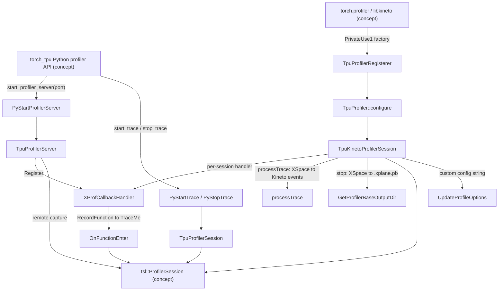

# TPU profiler backend - xprof sessions, the Kineto plugin and RecordFunction bridging

## Overview
`csrc/internal/profiler` is the C++ half of TPU profiling in torch_tpu. Everything in it is a thin, thread-safe shell around **one engine: `tsl::ProfilerSession`**, the same XLA/TSL profiler that JAX and TensorFlow use, which collects host TraceMe events, Python events and TPU device activity into an `XSpace` protobuf (the xprof "XPlane" format). The subsystem exposes that engine through three doors: (1) a pybind module `_profiler_backend` ([`TorchTpuPyBindInitModule__profiler_backend`](../catalog/csrc/internal/profiler/profiler_api.cc.md#TorchTpuPyBindInitModule__profiler_backend "csrc/internal/profiler/profiler_api.cc:L233")) with explicit start/stop trace and an on-demand gRPC profiler server; (2) a **libkineto plugin** ([`TpuKinetoProfilerSession`](../catalog/csrc/internal/profiler/tpu_profiler_plugin.h.md#TpuKinetoProfilerSession "csrc/internal/profiler/tpu_profiler_plugin.h:L42"), "TPU implementation of libkineto::IActivityProfilerSession") so stock `torch.profiler.profile` can record TPU activity, write an `.xplane.pb` for xprof/TensorBoard, and also hand device events back to Kineto for `key_averages()` and Chrome traces; and (3) a **RecordFunction bridge** ([`XProfCallbackHandler`](../catalog/csrc/internal/profiler/xprof_callback_handler.h.md#XProfCallbackHandler "csrc/internal/profiler/xprof_callback_handler.h:L33")) that turns every PyTorch `RecordFunction` (aten ops, `record_function` scopes) into a TraceMe so PyTorch-level names appear on the xprof host timeline next to the TPU ops they launched.

## Diagram
The three doors into the one TSL session, and where the trace goes.

Legend:
- `PY` - (concept) `torch_tpu._internal.profiler` (`start_trace`, `stop_trace`, `profile`, `start_server`)
- `PST` - [`PyStartTrace`](../catalog/csrc/internal/profiler/profiler_api.cc.md#PyStartTrace "csrc/internal/profiler/profiler_api.cc:L224") / [`PyStopTrace`](../catalog/csrc/internal/profiler/profiler_api.cc.md#PyStopTrace "csrc/internal/profiler/profiler_api.cc:L229")
- `TPS` - [`TpuProfilerSession`](../catalog/csrc/internal/profiler/profiler_api.cc.md#TpuProfilerSession "csrc/internal/profiler/profiler_api.cc:L79")
- `PSS` - [`PyStartProfilerServer`](../catalog/csrc/internal/profiler/profiler_api.cc.md#PyStartProfilerServer "csrc/internal/profiler/profiler_api.cc:L216")
- `SRV` - [`TpuProfilerServer`](../catalog/csrc/internal/profiler/profiler_api.cc.md#TpuProfilerServer "csrc/internal/profiler/profiler_api.cc:L47")
- `KIN` - (concept) PyTorch's Kineto profiler
- `REG` - [`TpuProfilerRegisterer`](../catalog/csrc/internal/profiler/tpu_profiler_plugin.cc.md#TpuProfilerRegisterer.TpuProfilerRegisterer "csrc/internal/profiler/tpu_profiler_plugin.cc:L791")
- `CFG` - [`configure`](../catalog/csrc/internal/profiler/tpu_profiler_plugin.h.md#TpuProfiler.configure "csrc/internal/profiler/tpu_profiler_plugin.h:L104")
- `KS` - [`TpuKinetoProfilerSession`](../catalog/csrc/internal/profiler/tpu_profiler_plugin.h.md#TpuKinetoProfilerSession "csrc/internal/profiler/tpu_profiler_plugin.h:L42")
- `UPO` - [`UpdateProfileOptions`](../catalog/csrc/internal/profiler/tpu_profiler_plugin.cc.md#UpdateProfileOptions "csrc/internal/profiler/tpu_profiler_plugin.cc:L280")
- `TSL` - (concept) `tsl::ProfilerSession`, the XLA/TSL profiler engine
- `OUT` - [`GetProfilerBaseOutputDir`](../catalog/csrc/internal/profiler/tpu_profiler_plugin.cc.md#GetProfilerBaseOutputDir "csrc/internal/profiler/tpu_profiler_plugin.cc:L332")
- `PT` - [`processTrace`](../catalog/csrc/internal/profiler/tpu_profiler_plugin.cc.md#TpuKinetoProfilerSession.processTrace "csrc/internal/profiler/tpu_profiler_plugin.cc:L594")
- `XCH` - [`XProfCallbackHandler`](../catalog/csrc/internal/profiler/xprof_callback_handler.h.md#XProfCallbackHandler "csrc/internal/profiler/xprof_callback_handler.h:L33")
- `OFE` - `OnFunctionEnter`

## Design rationale (why it's built this way)
- **Reuse the XLA profiler, not a new one.** Device tracing on TPU is only available through the TSL profiler; by wrapping `tsl::ProfilerSession` directly, torch_tpu traces are byte-for-byte the format xprof / TensorBoard's profile plugin already reads, and options such as `host_tracer_level` mean exactly what they mean in JAX. The Python `TpuProfilerConfig` defaults (host 2, device 1, python 0) are documented as "standard XLA profiling defaults used in frameworks like JAX and TensorFlow".
- **Process-wide singletons behind mutexes.** The explicit API models exactly one trace and one server per process, so [`TpuProfilerSession`](../catalog/csrc/internal/profiler/profiler_api.cc.md#TpuProfilerSession "csrc/internal/profiler/profiler_api.cc:L79") ("Thread-safe wrapper for tsl::ProfilerSession") and [`TpuProfilerServer`](../catalog/csrc/internal/profiler/profiler_api.cc.md#TpuProfilerServer "csrc/internal/profiler/profiler_api.cc:L47") ("Thread-safe wrapper for tsl::profiler::ProfilerServer") are never-destroyed globals ([`GetInstance`](../catalog/csrc/internal/profiler/profiler_api.cc.md#TpuProfilerSession.GetInstance "csrc/internal/profiler/profiler_api.cc:L100")), non-copyable and non-movable ([`operator=`](../catalog/csrc/internal/profiler/profiler_api.cc.md#TpuProfilerSession.operator "csrc/internal/profiler/profiler_api.cc:L88") is deleted), with every state change under a mutex and double-start / stop-without-start reported as `FailedPrecondition`.
- **Plug into Kineto as a PrivateUse1 device.** torch_tpu registers as PyTorch's `privateuse1` backend, so it advertises the single activity type `PRIVATEUSE1_RUNTIME` and is created through PyTorch's PrivateUse1 profiler registry. That registry only exists from PyTorch 2.12; the plugin forward-declares it with **weak symbols** so the same binary loads on 2.10 and simply logs "Native TPU profiling will be disabled (this is expected on PyTorch < 2.12)".
- **Sync before collecting.** A torch_tpu program defers and launches TPU work asynchronously, so stopping the TSL session the instant Python leaves the `with` block would lose in-flight device events. [`stop`](../catalog/csrc/internal/profiler/tpu_profiler_plugin.cc.md#TpuKinetoProfilerSession.stop "csrc/internal/profiler/tpu_profiler_plugin.cc:L485") synchronizes every addressable TPU device first ("ensures trace completeness for asynchronous operations"); the integration tests assert identical TPU event counts with and without user-side `torch.accelerator.synchronize()`, and that work still in flight on a background thread is captured.
- **Mirror, then de-duplicate.** Kineto already records PyTorch ops on the CPU timeline; xprof does not. The RecordFunction bridge copies each op into xprof as a TraceMe tagged with `pt_correlation_id`, and when the XSpace is converted back for Kineto those tagged host events are skipped "to avoid duplicates". Each viewer thus gets PyTorch op names exactly once.
- **Stop recording frontend events before teardown.** `stop` destroys the per-session callback handler first "so teardown operations are not captured" - the synchronization and data collection would otherwise appear in the trace as PyTorch ops.

## Entry points
- [`TorchTpuPyBindInitModule__profiler_backend`](../catalog/csrc/internal/profiler/profiler_api.cc.md#TorchTpuPyBindInitModule__profiler_backend "csrc/internal/profiler/profiler_api.cc:L233") - module init of `torch_tpu._internal.profiler._profiler_backend` (the pybind glue is [`pybind11_init__profiler_backend`](../catalog/csrc/internal/profiler/profiler_api.cc.md#pybind11_init__profiler_backend "csrc/internal/profiler/profiler_api.cc:L233") / [`pybind11_exec__profiler_backend`](../catalog/csrc/internal/profiler/profiler_api.cc.md#pybind11_exec__profiler_backend "csrc/internal/profiler/profiler_api.cc:L233")). Defines `start_trace(logdir, options=None)`, `stop_trace(filename)`, `start_profiler_server(port)`, `stop_profiler_server()`, and the private `_push_enable_profiler` / `_pop_enable_profiler`. Reached when the Python profiler package is imported.
- [`PyStartTrace`](../catalog/csrc/internal/profiler/profiler_api.cc.md#PyStartTrace "csrc/internal/profiler/profiler_api.cc:L224") / [`PyStopTrace`](../catalog/csrc/internal/profiler/profiler_api.cc.md#PyStopTrace "csrc/internal/profiler/profiler_api.cc:L229") - the explicit capture path, called by the Python `start_trace` / `stop_trace` and the legacy `profile()` context manager; status errors are thrown as Python exceptions.
- [`PyStartProfilerServer`](../catalog/csrc/internal/profiler/profiler_api.cc.md#PyStartProfilerServer "csrc/internal/profiler/profiler_api.cc:L216") / [`PyStopProfilerServer`](../catalog/csrc/internal/profiler/profiler_api.cc.md#PyStopProfilerServer "csrc/internal/profiler/profiler_api.cc:L220") - start/stop the gRPC server that lets TensorBoard or the xprof CLI capture a trace from a running job on demand.
- [`TpuProfilerRegisterer`](../catalog/csrc/internal/profiler/tpu_profiler_plugin.cc.md#TpuProfilerRegisterer.TpuProfilerRegisterer "csrc/internal/profiler/tpu_profiler_plugin.cc:L791") - a static initializer that runs when the profiler extension library is loaded (the Python loader imports it via `register_kineto_backend()`); after that, any `torch.profiler.profile(activities=[..., ProfilerActivity.TPU])` reaches [`configure`](../catalog/csrc/internal/profiler/tpu_profiler_plugin.h.md#TpuProfiler.configure "csrc/internal/profiler/tpu_profiler_plugin.h:L104"), then [`start`](../catalog/csrc/internal/profiler/tpu_profiler_plugin.cc.md#TpuKinetoProfilerSession.start "csrc/internal/profiler/tpu_profiler_plugin.cc:L409"), [`stop`](../catalog/csrc/internal/profiler/tpu_profiler_plugin.cc.md#TpuKinetoProfilerSession.stop "csrc/internal/profiler/tpu_profiler_plugin.cc:L485") and [`processTrace`](../catalog/csrc/internal/profiler/tpu_profiler_plugin.cc.md#TpuKinetoProfilerSession.processTrace "csrc/internal/profiler/tpu_profiler_plugin.cc:L594").
- `OnFunctionEnter` - runs on every `RecordFunction` push once an [`XProfCallbackHandler`](../catalog/csrc/internal/profiler/xprof_callback_handler.cc.md#XProfCallbackHandler.XProfCallbackHandler "csrc/internal/profiler/xprof_callback_handler.cc:L102") is alive.

## Mechanism (step-by-step)
1. **Explicit trace: start.** TpuProfilerSession's [`Start`](../catalog/csrc/internal/profiler/profiler_api.cc.md#TpuProfilerSession.Start "csrc/internal/profiler/profiler_api.cc:L130") ("Starts the profiler session on the given log directory with the given options") takes the lock, refuses if [`session_`](../catalog/csrc/internal/profiler/profiler_api.cc.md#TpuProfilerSession.session_ "csrc/internal/profiler/profiler_api.cc:L107") is already set, starts from `tsl::ProfilerSession::DefaultOptions()`, overrides only the three keys it understands from the Python options dict (`host_tracer_level`, `device_tracer_level`, `python_tracer_level`), sets `logdir` as the repository path, and creates the TSL session. The new session is kept in a temporary and only stored after its status is OK, "so if the new session has a bad status, session_ will still be null and the user can try to create a session again".

2. **Explicit trace: stop and write.** TpuProfilerSession's [`Stop`](../catalog/csrc/internal/profiler/profiler_api.cc.md#TpuProfilerSession.Stop "csrc/internal/profiler/profiler_api.cc:L166") ("Stops the profiler session and writes the trace data to the given file") calls `CollectData` into an `XSpace`, recursively creates the parent directory, serializes the proto and writes it to the exact `filename` the caller supplies (the Python layer builds `<log_dir>/plugins/profile/<YYYY_MM_DD_HH_MM_SS>/<hostname>[_<rank>].xplane.pb`). An `absl::Cleanup` resets the session on every exit path, so a failed write does not leave the profiler wedged. Unlike the Kineto path, this path does not synchronize the devices itself.

   > [!inferred]
   > The Python `profile()` context manager (`torch_tpu._internal.profiler._api`) maps `ProfilerActivity.TPU` to `device_tracer_level=1` and `ProfilerActivity.CPU` to `host_tracer_level=2` + `python_tracer_level=1`, and brackets the region with `_push_enable_profiler` / `_pop_enable_profiler`; it is marked `forbid_in_torch_compile` (see [hardware-introspection](hardware-introspection.md)). Its own TODO says it is to be removed once the native PyTorch profiler path is fully integrated.

3. **On-demand server.** TpuProfilerServer's [`Start`](../catalog/csrc/internal/profiler/profiler_api.cc.md#TpuProfilerServer.Start "csrc/internal/profiler/profiler_api.cc:L111") registers the global RecordFunction bridge via [`Register`](../catalog/csrc/internal/profiler/xprof_callback_handler.cc.md#XProfCallbackHandler.Register "csrc/internal/profiler/xprof_callback_handler.cc:L111") and then starts a `tsl::profiler::ProfilerServer` on the port, kept in [`server_`](../catalog/csrc/internal/profiler/profiler_api.cc.md#TpuProfilerServer.server_ "csrc/internal/profiler/profiler_api.cc:L74") under [`mutex_`](../catalog/csrc/internal/profiler/profiler_api.cc.md#TpuProfilerServer.mutex_ "csrc/internal/profiler/profiler_api.cc:L73"); remote clients then drive TSL sessions themselves and receive the XSpace over gRPC. TpuProfilerServer's [`Stop`](../catalog/csrc/internal/profiler/profiler_api.cc.md#TpuProfilerServer.Stop "csrc/internal/profiler/profiler_api.cc:L121") just destroys the server.

4. **Kineto plugin: registration and configure.** At library load, [`TpuProfilerRegisterer`](../catalog/csrc/internal/profiler/tpu_profiler_plugin.cc.md#TpuProfilerRegisterer.TpuProfilerRegisterer "csrc/internal/profiler/tpu_profiler_plugin.cc:L791") checks whether the weak `PrivateUse1ProfilerRegistry::instance` resolved and, if so, registers a factory that creates a `TpuProfiler`. When Kineto starts a trace, [`configure`](../catalog/csrc/internal/profiler/tpu_profiler_plugin.h.md#TpuProfiler.configure "csrc/internal/profiler/tpu_profiler_plugin.h:L104") returns a fresh [`TpuKinetoProfilerSession`](../catalog/csrc/internal/profiler/tpu_profiler_plugin.h.md#TpuKinetoProfilerSession "csrc/internal/profiler/tpu_profiler_plugin.h:L42") bound to Kineto's `Config`; the timed overload ignores `ts_ms` / `duration_ms` and forwards.

5. **Kineto plugin: start.** [`start`](../catalog/csrc/internal/profiler/tpu_profiler_plugin.cc.md#TpuKinetoProfilerSession.start "csrc/internal/profiler/tpu_profiler_plugin.cc:L409") builds TSL options with `device_type = TPU` and `raise_error_on_start_failure = true`, turns on the Python tracer (level 1) when Kineto or the PyTorch profiler config asks for `with_stack`, and then applies the user's custom config string with [`UpdateProfileOptions`](../catalog/csrc/internal/profiler/tpu_profiler_plugin.cc.md#UpdateProfileOptions "csrc/internal/profiler/tpu_profiler_plugin.cc:L280"), which also extracts [`run_dir_`](../catalog/csrc/internal/profiler/tpu_profiler_plugin.h.md#TpuKinetoProfilerSession.run_dir_ "csrc/internal/profiler/tpu_profiler_plugin.h:L77") and [`worker_rank_`](../catalog/csrc/internal/profiler/tpu_profiler_plugin.h.md#TpuKinetoProfilerSession.worker_rank_ "csrc/internal/profiler/tpu_profiler_plugin.h:L78"). It creates the TSL session into [`session_`](../catalog/csrc/internal/profiler/tpu_profiler_plugin.h.md#TpuKinetoProfilerSession.session_ "csrc/internal/profiler/tpu_profiler_plugin.h:L71"); if the session comes back with a bad status it records the message in [`errors_`](../catalog/csrc/internal/profiler/tpu_profiler_plugin.h.md#TpuKinetoProfilerSession.errors_ "csrc/internal/profiler/tpu_profiler_plugin.h:L73"), marks the trace `ERROR`, resets the session and throws (a null session only records the error and sets `ERROR`, without throwing); on success it ensures the global bridge is registered and additionally owns a per-session [`XProfCallbackHandler`](../catalog/csrc/internal/profiler/xprof_callback_handler.cc.md#XProfCallbackHandler.XProfCallbackHandler "csrc/internal/profiler/xprof_callback_handler.cc:L102").

6. **The custom-config grammar.** Kineto passes `TpuProfilerConfig`'s options as one string (e.g. `host_tracer_level:2,device_tracer_level:1,python_tracer_level:0,run_dir:/logs,worker_rank:"3"`). [`UpdateProfileOptions`](../catalog/csrc/internal/profiler/tpu_profiler_plugin.cc.md#UpdateProfileOptions "csrc/internal/profiler/tpu_profiler_plugin.cc:L280") rejects non-ASCII input, splits on commas that are outside double quotes, and splits each item at its first unquoted colon with [`SplitConfigItem`](../catalog/csrc/internal/profiler/tpu_profiler_plugin.cc.md#SplitConfigItem "csrc/internal/profiler/tpu_profiler_plugin.cc:L262") (whitespace-trimmed). `run_dir` and `worker_rank` are captured, not passed to TSL. Every other key goes to [`UpdateProfileOption`](../catalog/csrc/internal/profiler/tpu_profiler_plugin.cc.md#UpdateProfileOption "csrc/internal/profiler/tpu_profiler_plugin.cc:L202"): the three tracer levels are parsed as `uint32` by [`ParseAndSetUint`](../catalog/csrc/internal/profiler/tpu_profiler_plugin.cc.md#ParseAndSetUint "csrc/internal/profiler/tpu_profiler_plugin.cc:L102"), and anything else becomes an entry of TSL's `advanced_configuration` map through [`SetAdvancedConfigValue`](../catalog/csrc/internal/profiler/tpu_profiler_plugin.cc.md#SetAdvancedConfigValue "csrc/internal/profiler/tpu_profiler_plugin.cc:L168") - a double-quoted value is a string (unescaped by [`UnescapeString`](../catalog/csrc/internal/profiler/tpu_profiler_plugin.cc.md#UnescapeString "csrc/internal/profiler/tpu_profiler_plugin.cc:L140"), which accepts only `\\` and `\"`), `true`/`false` a bool, otherwise an `int64`. This advanced map is how experimental XLA profiler knobs reach the engine without torch_tpu knowing their names.

7. **Kineto plugin: stop.** [`stop`](../catalog/csrc/internal/profiler/tpu_profiler_plugin.cc.md#TpuKinetoProfilerSession.stop "csrc/internal/profiler/tpu_profiler_plugin.cc:L485") (under [`mutex_`](../catalog/csrc/internal/profiler/tpu_profiler_plugin.h.md#TpuKinetoProfilerSession.mutex_ "csrc/internal/profiler/tpu_profiler_plugin.h:L70")) drops the per-session callback handler, synchronizes every TPU device through the PrivateUse1 device guard (a failure only logs a warning), collects the `XSpace`, appends `_<worker_rank>` to its hostnames when a rank is set, and writes it as a binary proto. The output directory is [`GetProfilerBaseOutputDir`](../catalog/csrc/internal/profiler/tpu_profiler_plugin.cc.md#GetProfilerBaseOutputDir "csrc/internal/profiler/tpu_profiler_plugin.cc:L332") of the session's `run_dir` (or, if none was configured, the directory of Kineto's activities log file): `TORCH_TPU_PROFILER_OUTPUT_DIR` wins if set, then a non-`/tmp` `run_dir`, then `TMPDIR`, then `/tmp`. Under it the file lands at `plugins/profile/<YYYY_MM_DD_HH_MM_SS>/<hostname>[_<rank>].xplane.pb` (colons replaced), the TensorBoard/xprof convention, so `xprof --logdir <base>` finds it directly. Write failures go to `errors_` rather than throwing.

8. **Kineto plugin: XSpace -> Kineto events.** [`processTrace`](../catalog/csrc/internal/profiler/tpu_profiler_plugin.cc.md#TpuKinetoProfilerSession.processTrace "csrc/internal/profiler/tpu_profiler_plugin.cc:L594") converts the already-written XSpace into Kineto activities so `prof.key_averages()` shows "TPU time" and the Chrome trace has device rows. It rebases line timestamps on the `profile_start_time` stat of the "Task Environment" plane; treats planes named `/device:...` or `TPU` as devices (activity type `CONCURRENT_KERNEL`, device id = plane id) and all others as host planes mapped onto the Python process's pid (`CPU_OP`) so they merge with PyTorch's CPU rows; skips events without a timeline offset and host events carrying `pt_correlation_id`; converts XStats into quoted metadata (byte blobs such as HLO protos become `"<binary_data>"`); stops at 1,000,000 events; and clears each plane after use to give the memory back.

9. **RecordFunction -> TraceMe.** The [`XProfCallbackHandler`](../catalog/csrc/internal/profiler/xprof_callback_handler.cc.md#XProfCallbackHandler.XProfCallbackHandler "csrc/internal/profiler/xprof_callback_handler.cc:L102") constructor installs a global `at::RecordFunctionCallback` (with `needsIds`), removed again by its destructor ("RAII class to manage the lifetime of PyTorch RecordFunction callbacks"). `OnFunctionEnter` has a fast path that returns `nullptr` - no allocation - unless a TraceMe consumer is active *and* [`IsProfilerEnabled`](../catalog/csrc/internal/profiler/xprof_callback_handler.cc.md#IsProfilerEnabled "csrc/internal/profiler/xprof_callback_handler.cc:L59") is true; otherwise it opens a `TraceMe` named after the RecordFunction with a `pt_correlation_id` equal to its handle, closed when the RecordFunction pops. `IsProfilerEnabled` defaults to enabled whenever a TSL session or the native PyTorch profiler is active, and the thread-local profile context state (pushed by `_push_enable_profiler`) can override that per thread. [`Register`](../catalog/csrc/internal/profiler/xprof_callback_handler.cc.md#XProfCallbackHandler.Register "csrc/internal/profiler/xprof_callback_handler.cc:L111") creates a never-destroyed global instance on first call ("to avoid SIOF").

## Key data structures
- **`XSpace`** (TSL protobuf) - the whole trace: one plane per host thread group and per TPU device, each with lines (threads/streams), events (offset + duration in ps) and stat metadata. [`TpuKinetoProfilerSession`](../catalog/csrc/internal/profiler/tpu_profiler_plugin.h.md#TpuKinetoProfilerSession "csrc/internal/profiler/tpu_profiler_plugin.h:L42") holds it between `stop` and `processTrace`, so peak host memory includes the full trace once.
- **`tensorflow::ProfileOptions`** - tracer levels, device type, repository path and the `advanced_configuration` map; built per session from defaults + the parsed options.
- **Session state** - [`session_`](../catalog/csrc/internal/profiler/tpu_profiler_plugin.h.md#TpuKinetoProfilerSession.session_ "csrc/internal/profiler/tpu_profiler_plugin.h:L71"), [`errors_`](../catalog/csrc/internal/profiler/tpu_profiler_plugin.h.md#TpuKinetoProfilerSession.errors_ "csrc/internal/profiler/tpu_profiler_plugin.h:L73") (surfaced to Kineto via `errors()`), [`run_dir_`](../catalog/csrc/internal/profiler/tpu_profiler_plugin.h.md#TpuKinetoProfilerSession.run_dir_ "csrc/internal/profiler/tpu_profiler_plugin.h:L77"), [`worker_rank_`](../catalog/csrc/internal/profiler/tpu_profiler_plugin.h.md#TpuKinetoProfilerSession.worker_rank_ "csrc/internal/profiler/tpu_profiler_plugin.h:L78"); in the explicit path the singleton's [`session_`](../catalog/csrc/internal/profiler/profiler_api.cc.md#TpuProfilerSession.session_ "csrc/internal/profiler/profiler_api.cc:L107") guarded by [`mutex_`](../catalog/csrc/internal/profiler/profiler_api.cc.md#TpuProfilerSession.mutex_ "csrc/internal/profiler/profiler_api.cc:L106").

## Dynamics (design intent)
- **One trace at a time per process.** Both the explicit singleton and the Kineto session refuse to start a second session (the Kineto `start` only logs a warning and returns if already started); the Python layer adds its own lock and `RuntimeError("Profile has already been started")`.
- **Overhead when not profiling.** With no TSL consumer active, the RecordFunction callback returns immediately without allocating, so leaving a handler registered is cheap; the `XProfCallbackHandler` header notes that dynamic add/remove of the global callback "is safe in practice" because PyTorch's callback manager is mutex/snapshot-based (a stress test exercises thread safety).
- **Overhead while profiling.** Every aten op and `record_function` scope costs one TraceMe on the host; `python_tracer_level=1` (or `with_stack=True`) adds Python function tracing, which the Python config leaves off by default "to minimize overhead".
- **Stop is synchronous and blocking.** Kineto's stop path waits for all TPU queues to drain before collecting, so the measured region's tail includes waiting for outstanding device work - intended, to make the trace complete.

## Edge cases
- **PyTorch < 2.12**: no Kineto TPU activity at all (only the explicit `start_trace`/server paths work); the registerer logs at INFO.
- **Bad options fail the trace start**, not silently: non-ASCII config, an item without `:`, a non-integer tracer level, an unquoted string advanced value, an unmatched quote, an escape other than `\\`/`\"`, or a trailing backslash all return `InvalidArgument` and `start` throws.
- **`run_dir` of `/tmp`** is treated like "unset" and replaced by `TMPDIR` if set; `TORCH_TPU_PROFILER_OUTPUT_DIR` overrides any `run_dir`, which can surprise a job that sets both.
- **Same host, many ranks**: without `worker_rank`, ranks on one host write `<hostname>.xplane.pb` into the same timestamped directory (and the timestamp has one-second resolution); pass a rank to get `<hostname>_<rank>.xplane.pb`.
- **Truncation**: Kineto-side conversion stops after 1,000,000 events (the `.xplane.pb` on disk is complete; only `key_averages`/Chrome output is truncated).
- **Explicit path and async work**: `stop_trace` does not sync devices; call `torch.accelerator.synchronize()` before it or in-flight TPU work may be missing.

## Open questions
- `start` both calls the global [`Register`](../catalog/csrc/internal/profiler/xprof_callback_handler.cc.md#XProfCallbackHandler.Register "csrc/internal/profiler/xprof_callback_handler.cc:L111") and creates a per-session handler, i.e. two RecordFunction callbacks while a Kineto session is live. Whether that produces two TraceMe events per op (later collapsed by de-duplication, or not) is not settled by the source.
- `TpuProfiler` itself, `GetXPlaneOutputPath`, the device-sync helper, the `profile_start_time` lookup, `SanitizeStatString` / `AddActivityStringMetadata` and the `OnFunctionExit` callback are not in this packet's subgraph and are described only through the cited methods.
- The packet's evidence table lists only namespace-level matches; the dedicated tests in `tests/profiler/` (`tpu_profiler_plugin_test.cc`, `profiler_integration_test.py`, `xprof_callback_handler_test.cc`) were read for this page but are not in the configured test paths.

## See also
- [hardware-introspection](hardware-introspection.md) - peak FLOP/s and HBM per device to turn a trace's step time into MFU; also `forbid_in_torch_compile`.
- [deferred-execution-and-materialization](deferred-execution-and-materialization.md) - why device work is in flight when profiling stops.
- [tensor-synchronization](tensor-synchronization.md) - the synchronization primitives `stop` relies on.
- [op-names-and-python-context](op-names-and-python-context.md) - how op names attached to TPU work are produced.
- [pjrt-client](pjrt-client.md) - the runtime whose device activity the TSL device tracer records.
