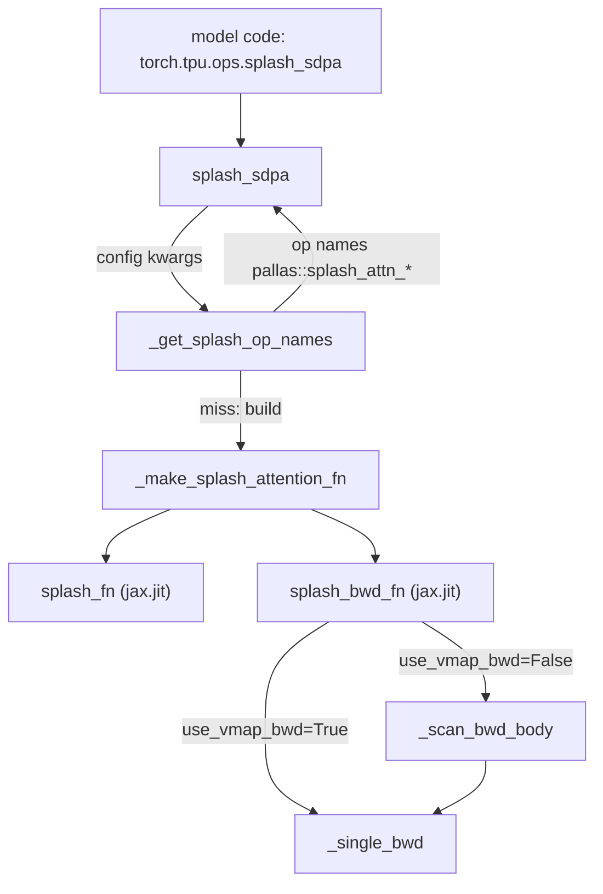
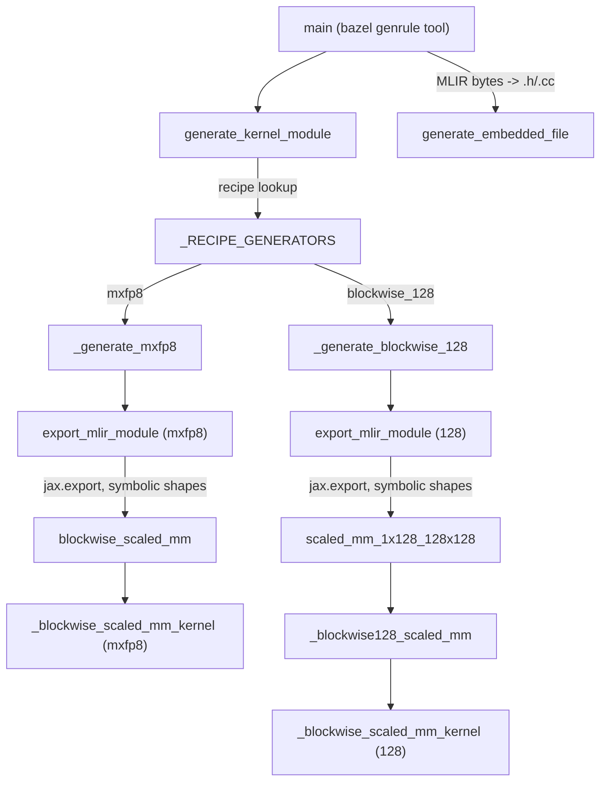

# Python-side TPU ops (torch.tpu.ops) - splash attention and block-scaled FP8 matmul kernels

<!-- connect:up:begin -->
> **Cross-repo concept:** part of [pallas-kernel](../../../concepts/pallas-kernel.md), [splash-attention](../../../concepts/splash-attention.md) across this wiki's repos.
<!-- connect:up:end -->
## Overview
`src/torch_tpu/_internal/ops` is the Python home of TPU-specific operators. Most of it is thin: `ops.py` and `collectives.py` wrap C++ `torch.ops.tpu.*` ops (optimization barrier, index-free max pooling, `ragged_dot`, sparse-core ops, dim-wise all-gather / reduce-scatter), `jagged.py` adds pure-PyTorch helpers that pad / strip a jagged values buffer to a multiple of 128, and all of them are re-exported as `torch.tpu.ops`. The two pieces with real machinery are **Pallas kernels written in JAX** and brought into PyTorch two different ways. [`splash_sdpa`](../catalog/src/torch_tpu/_internal/ops/splash_attention.md#splash_sdpa "src/torch_tpu/_internal/ops/splash_attention.py:L442") wraps JAX's splash attention kernel at **runtime**: it builds jitted forward/backward JAX functions, bridges them through the Pallas custom-JAX-kernel adapter, and registers them as `torch.library` custom ops. The block-scaled FP8 matmul kernels ([`blockwise_scaled_mm`](../catalog/src/torch_tpu/_internal/ops/scaled_mm/kernels/blockwise_scaled_mm_kernel.md#blockwise_scaled_mm "src/torch_tpu/_internal/ops/scaled_mm/kernels/blockwise_scaled_mm_kernel.py:L183"), [`scaled_mm_1x128_128x128`](../catalog/src/torch_tpu/_internal/ops/scaled_mm/kernels/blockwise128_scaled_mm_kernel.md#scaled_mm_1x128_128x128 "src/torch_tpu/_internal/ops/scaled_mm/kernels/blockwise128_scaled_mm_kernel.py:L328")) go the other way: at **build time** a generator ([`main`](../catalog/src/torch_tpu/_internal/ops/scaled_mm/kernels/scaled_mm_generate.md#main "src/torch_tpu/_internal/ops/scaled_mm/kernels/scaled_mm_generate.py:L259")) exports them with symbolic shapes to a StableHLO MLIR string that is embedded into C++ and spliced in by the native `_scaled_mm_v2` op - no JAX tracing on the hot path.

## Diagram
Runtime bridge (splash attention):

Legend:
- `USER` - (concept) PyTorch model code calling the public op
- `SDPA` - [`splash_sdpa`](../catalog/src/torch_tpu/_internal/ops/splash_attention.md#splash_sdpa "src/torch_tpu/_internal/ops/splash_attention.py:L442")
- `NAMES` - [`_get_splash_op_names`](../catalog/src/torch_tpu/_internal/ops/splash_attention.md#_get_splash_op_names "src/torch_tpu/_internal/ops/splash_attention.py:L342")
- `MAKE` - [`_make_splash_attention_fn`](../catalog/src/torch_tpu/_internal/ops/splash_attention.md#_make_splash_attention_fn "src/torch_tpu/_internal/ops/splash_attention.py:L48")
- `FWD` - [`splash_fn`](../catalog/src/torch_tpu/_internal/ops/splash_attention.md#_make_splash_attention_fn.splash_fn "src/torch_tpu/_internal/ops/splash_attention.py:L208")
- `BWD` - [`splash_bwd_fn`](../catalog/src/torch_tpu/_internal/ops/splash_attention.md#_make_splash_attention_fn.splash_bwd_fn "src/torch_tpu/_internal/ops/splash_attention.py:L268")
- `SB` - [`_single_bwd`](../catalog/src/torch_tpu/_internal/ops/splash_attention.md#_make_splash_attention_fn._single_bwd "src/torch_tpu/_internal/ops/splash_attention.py:L217")
- `SCAN` - [`_scan_bwd_body`](../catalog/src/torch_tpu/_internal/ops/splash_attention.md#_make_splash_attention_fn._scan_bwd_body "src/torch_tpu/_internal/ops/splash_attention.py:L259")

Build-time export (block-scaled FP8 matmul):

Legend:
- `MAIN` - [`main`](../catalog/src/torch_tpu/_internal/ops/scaled_mm/kernels/scaled_mm_generate.md#main "src/torch_tpu/_internal/ops/scaled_mm/kernels/scaled_mm_generate.py:L259")
- `GEN` - [`generate_kernel_module`](../catalog/src/torch_tpu/_internal/ops/scaled_mm/kernels/scaled_mm_generate.md#generate_kernel_module "src/torch_tpu/_internal/ops/scaled_mm/kernels/scaled_mm_generate.py:L210")
- `REG` - [`_RECIPE_GENERATORS`](../catalog/src/torch_tpu/_internal/ops/scaled_mm/kernels/scaled_mm_generate.md#_RECIPE_GENERATORS._RECIPE_GENERATORS "src/torch_tpu/_internal/ops/scaled_mm/kernels/scaled_mm_generate.py:L186")
- `MX` - [`_generate_mxfp8`](../catalog/src/torch_tpu/_internal/ops/scaled_mm/kernels/scaled_mm_generate.md#_generate_mxfp8 "src/torch_tpu/_internal/ops/scaled_mm/kernels/scaled_mm_generate.py:L135")
- `B128` - [`_generate_blockwise_128`](../catalog/src/torch_tpu/_internal/ops/scaled_mm/kernels/scaled_mm_generate.md#_generate_blockwise_128 "src/torch_tpu/_internal/ops/scaled_mm/kernels/scaled_mm_generate.py:L162")
- `EXA` - [`export_mlir_module`](../catalog/src/torch_tpu/_internal/ops/scaled_mm/kernels/blockwise_scaled_mm_kernel.md#export_mlir_module "src/torch_tpu/_internal/ops/scaled_mm/kernels/blockwise_scaled_mm_kernel.py:L368")
- `EXB` - [`export_mlir_module`](../catalog/src/torch_tpu/_internal/ops/scaled_mm/kernels/blockwise128_scaled_mm_kernel.md#export_mlir_module "src/torch_tpu/_internal/ops/scaled_mm/kernels/blockwise128_scaled_mm_kernel.py:L399")
- `BSM` - [`blockwise_scaled_mm`](../catalog/src/torch_tpu/_internal/ops/scaled_mm/kernels/blockwise_scaled_mm_kernel.md#blockwise_scaled_mm "src/torch_tpu/_internal/ops/scaled_mm/kernels/blockwise_scaled_mm_kernel.py:L183")
- `S128` - [`scaled_mm_1x128_128x128`](../catalog/src/torch_tpu/_internal/ops/scaled_mm/kernels/blockwise128_scaled_mm_kernel.md#scaled_mm_1x128_128x128 "src/torch_tpu/_internal/ops/scaled_mm/kernels/blockwise128_scaled_mm_kernel.py:L328")
- `KA` - [`_blockwise_scaled_mm_kernel`](../catalog/src/torch_tpu/_internal/ops/scaled_mm/kernels/blockwise_scaled_mm_kernel.md#_blockwise_scaled_mm_kernel "src/torch_tpu/_internal/ops/scaled_mm/kernels/blockwise_scaled_mm_kernel.py:L117")
- `IMPL` - [`_blockwise128_scaled_mm`](../catalog/src/torch_tpu/_internal/ops/scaled_mm/kernels/blockwise128_scaled_mm_kernel.md#_blockwise128_scaled_mm "src/torch_tpu/_internal/ops/scaled_mm/kernels/blockwise128_scaled_mm_kernel.py:L179")
- `KB` - [`_blockwise_scaled_mm_kernel`](../catalog/src/torch_tpu/_internal/ops/scaled_mm/kernels/blockwise128_scaled_mm_kernel.md#_blockwise_scaled_mm_kernel "src/torch_tpu/_internal/ops/scaled_mm/kernels/blockwise128_scaled_mm_kernel.py:L126")
- `EMB` - [`generate_embedded_file`](../catalog/src/torch_tpu/_internal/pallas/pallas_kernel_generate_utils.md#generate_embedded_file "src/torch_tpu/_internal/pallas/pallas_kernel_generate_utils.py:L18")

## Design rationale (why it's built this way)
- **Reuse upstream JAX Pallas kernels instead of re-authoring them.** The module docstring: "Wraps JAX's splash_attention_kernel for use with PyTorch tensors on TPU. Uses torch_tpu._internal.pallas.custom_jax_kernel() to bridge JAX -> PyTorch." The splash kernel, its block-sparse mask machinery and its backward are taken as-is from `jax.experimental.pallas.ops.tpu.splash_attention`.
- **Backward without a recomputed forward.** [`splash_fn`](../catalog/src/torch_tpu/_internal/ops/splash_attention.md#_make_splash_attention_fn.splash_fn "src/torch_tpu/_internal/ops/splash_attention.py:L208") returns `(out, logsumexp)` with `save_residuals=True`; the autograd function saves both and [`splash_bwd_fn`](../catalog/src/torch_tpu/_internal/ops/splash_attention.md#_make_splash_attention_fn.splash_bwd_fn "src/torch_tpu/_internal/ops/splash_attention.py:L268") calls the private `_splash_attention_bwd` directly ("uses saved (out, logsumexp) - no extra forward pass"). This trades HBM for a saved fp32 `[B, H, S]` logsumexp plus `out` against a full extra attention forward per step.
- **Return op names, not callables.** [`_get_splash_op_names`](../catalog/src/torch_tpu/_internal/ops/splash_attention.md#_get_splash_op_names "src/torch_tpu/_internal/ops/splash_attention.py:L342") is `@torch.compiler.assume_constant_result` and returns `pallas::splash_attn_{fwd,bwd}_<md5>` strings. The comment: passing callables through activation checkpointing in Dynamo trips mutation guards because "function guards" are not fully supported, while strings "are easily guarded by Dynamo".
- **Precompile the FP8 matmuls to StableHLO.** The generator docstring says it "Generate[s] blockwise scaled mm Pallas kernel MLIR module embedded C++ files"; [`export_mlir_module`](../catalog/src/torch_tpu/_internal/ops/scaled_mm/kernels/blockwise_scaled_mm_kernel.md#export_mlir_module "src/torch_tpu/_internal/ops/scaled_mm/kernels/blockwise_scaled_mm_kernel.py:L368") exports with symbolic M/N/K, so one module per (recipe, dtype, tile) variant serves every shape. [`_maybe_use_abstract_tpu_mesh`](../catalog/src/torch_tpu/_internal/ops/scaled_mm/kernels/blockwise_scaled_mm_kernel.md#_maybe_use_abstract_tpu_mesh "src/torch_tpu/_internal/ops/scaled_mm/kernels/blockwise_scaled_mm_kernel.py:L320") lets the export run "without a TPU (build time)" by faking an abstract TPU device.
- **Keep operands FP8 all the way to the MXU.** The MXFP8 docstring: "Keeps operands in FP8 and performs block-by-block matmul on the MXU (FP8 MAC, FP32 accumulate), applying per-block scales inside the K-loop in VMEM." Scaling happens on f32 partial dots per K-block, never by dequantizing whole operands to bf16 in HBM.
- **Scale layout chosen to avoid cross-lane shuffles.** Both kernels store `scale_a` block-major (`[K/bs, M]`). The 128-family comment explains the row-major layout "paid an XLU `vperm` (plus `vrot.slane`/`vsel`) every block to shuffle each row scale from a lane onto its sublane, which is expensive".
- **Two kernel families on purpose.** The 128-granularity kernel covers `BlockWise1x128` / `BlockWise128x128` "but deliberately not `BlockWise1x32` (mxfp8), which uses e8m0 scales and a separate lowering".
- **Recipe registry as the extension point.** [`register_recipe`](../catalog/src/torch_tpu/_internal/ops/scaled_mm/kernels/scaled_mm_generate.md#register_recipe "src/torch_tpu/_internal/ops/scaled_mm/kernels/scaled_mm_generate.py:L193") plus [`_RECIPE_GENERATORS`](../catalog/src/torch_tpu/_internal/ops/scaled_mm/kernels/scaled_mm_generate.md#_RECIPE_GENERATORS._RECIPE_GENERATORS "src/torch_tpu/_internal/ops/scaled_mm/kernels/scaled_mm_generate.py:L186") "unifies kernel generation across block-scaling formats without creating separate conflicting build-time generation scripts"; the matching Bazel macro `define_scaled_mm_kernel` instantiates one embedded library per variant.

## Entry points
- [`splash_sdpa`](../catalog/src/torch_tpu/_internal/ops/splash_attention.md#splash_sdpa "src/torch_tpu/_internal/ops/splash_attention.py:L442") - public as `torch.tpu.ops.splash_sdpa` (marked experimental): "Replacement for F.scaled_dot_product_attention using splash attention." Reached from model attention code in eager or under `torch.compile`.
- [`main`](../catalog/src/torch_tpu/_internal/ops/scaled_mm/kernels/scaled_mm_generate.md#main "src/torch_tpu/_internal/ops/scaled_mm/kernels/scaled_mm_generate.py:L259") - the build-time tool run by the `define_scaled_mm_kernel` genrule with `--recipe`, `--in_dtype`, `--out_dtype`, `--block_size`, `--tile_{m,n,k}`, `--has_bias` (flags such as [`_RECIPE`](../catalog/src/torch_tpu/_internal/ops/scaled_mm/kernels/scaled_mm_generate.md#_RECIPE "src/torch_tpu/_internal/ops/scaled_mm/kernels/scaled_mm_generate.py:L45") and [`_TILE_K`](../catalog/src/torch_tpu/_internal/ops/scaled_mm/kernels/scaled_mm_generate.md#_TILE_K "src/torch_tpu/_internal/ops/scaled_mm/kernels/scaled_mm_generate.py:L82")).
- [`generate_kernel_module`](../catalog/src/torch_tpu/_internal/ops/scaled_mm/kernels/scaled_mm_generate.md#generate_kernel_module "src/torch_tpu/_internal/ops/scaled_mm/kernels/scaled_mm_generate.py:L210") - the programmatic form: "Generates a StableHLO MLIR module string for the specified recipe"; [`get_supported_recipes`](../catalog/src/torch_tpu/_internal/ops/scaled_mm/kernels/scaled_mm_generate.md#get_supported_recipes "src/torch_tpu/_internal/ops/scaled_mm/kernels/scaled_mm_generate.py:L205") lists `blockwise_128` and `mxfp8`.
- [`blockwise_scaled_mm`](../catalog/src/torch_tpu/_internal/ops/scaled_mm/kernels/blockwise_scaled_mm_kernel.md#blockwise_scaled_mm "src/torch_tpu/_internal/ops/scaled_mm/kernels/blockwise_scaled_mm_kernel.py:L183") and [`scaled_mm_1x128_128x128`](../catalog/src/torch_tpu/_internal/ops/scaled_mm/kernels/blockwise128_scaled_mm_kernel.md#scaled_mm_1x128_128x128 "src/torch_tpu/_internal/ops/scaled_mm/kernels/blockwise128_scaled_mm_kernel.py:L328") - `jax.jit` kernels callable directly from JAX (tests and benchmarks use them via [`_run_kernel`](../catalog/src/torch_tpu/_internal/ops/scaled_mm/kernels/blockwise_scaled_mm_kernel_test.md#_run_kernel "src/torch_tpu/_internal/ops/scaled_mm/kernels/blockwise_scaled_mm_kernel_test.py:L106")); in PyTorch they are reached only through the C++ `_scaled_mm_v2` op.

## Mechanism (step-by-step)
1. **Normalize heads and look up the op pair.** [`splash_sdpa`](../catalog/src/torch_tpu/_internal/ops/splash_attention.md#splash_sdpa "src/torch_tpu/_internal/ops/splash_attention.py:L442") reads `(B, H, S, D)` from `q`, checks that `enable_gqa` matches `n_heads != n_kv_heads`, squeezes the KV head dim for MQA (`n_kv_heads == 1`), and for GQA **materializes** `repeat_interleave` of K and V up to `n_heads`. A non-default `block_dkv` overrides both dK/dV block sizes. It then calls [`_get_splash_op_names`](../catalog/src/torch_tpu/_internal/ops/splash_attention.md#_get_splash_op_names "src/torch_tpu/_internal/ops/splash_attention.py:L342") with the full config, including `seq_len`.
2. **Build the JAX kernel pair (once per config).** [`_make_splash_attention_fn`](../catalog/src/torch_tpu/_internal/ops/splash_attention.md#_make_splash_attention_fn "src/torch_tpu/_internal/ops/splash_attention.py:L48") clamps every block size to `seq_len`, maps layout strings via [`_get_layout`](../catalog/src/torch_tpu/_internal/ops/splash_attention.md#_make_splash_attention_fn._get_layout "src/torch_tpu/_internal/ops/splash_attention.py:L99") (`HEAD_DIM_MINOR` / `SEQ_MINOR`), picks `LocalMask` (sliding window, lets the kernel "skip the off-window blocks entirely"), `CausalMask` or `FullMask`, replicates it per head, and builds an MQA or MHA splash kernel with `head_shards=1, q_seq_shards=1`. It keeps the kernel's precomputed forward/dQ/dKV mask infos and kwargs so the jitted functions can call the private forward/backward entry points directly.
3. **Forward.** [`splash_fn`](../catalog/src/torch_tpu/_internal/ops/splash_attention.md#_make_splash_attention_fn.splash_fn "src/torch_tpu/_internal/ops/splash_attention.py:L208") pre-scales `q` by `scale` (default `1/sqrt(head_dim)`) and `jax.vmap`s the single-example forward over the batch, returning `(out, logsumexp)`.
4. **Backward.** [`splash_bwd_fn`](../catalog/src/torch_tpu/_internal/ops/splash_attention.md#_make_splash_attention_fn.splash_bwd_fn "src/torch_tpu/_internal/ops/splash_attention.py:L268") re-scales `q`, then either vmaps [`_single_bwd`](../catalog/src/torch_tpu/_internal/ops/splash_attention.md#_make_splash_attention_fn._single_bwd "src/torch_tpu/_internal/ops/splash_attention.py:L217") over the batch or runs it sequentially with `jax.lax.scan` via [`_scan_bwd_body`](../catalog/src/torch_tpu/_internal/ops/splash_attention.md#_make_splash_attention_fn._scan_bwd_body "src/torch_tpu/_internal/ops/splash_attention.py:L259"). The docstring frames scan as sizing "the XLA backward program for one element at a time to avoid O(batch) growth in program size". It applies the chain rule `dq = dq_scaled * scale` and wraps `dq`, `dk`, `dv` in `jax.lax.optimization_barrier` (marked with a TODO to remove).
5. **Register as torch custom ops.** Back in [`_get_splash_op_names`](../catalog/src/torch_tpu/_internal/ops/splash_attention.md#_get_splash_op_names "src/torch_tpu/_internal/ops/splash_attention.py:L342"), both JAX functions go through the Pallas custom-JAX-kernel bridge and become `torch.library.custom_op("pallas::splash_attn_fwd_<id>")` (schema `(q, k, v) -> (Tensor, Tensor)`) and the matching backward, with fake (meta) implementations so Dynamo/AOTAutograd can trace them: `out` like `q`, logsumexp fp32 `[B, H, S]`. If `torchax` is loaded it also registers the JAX composites there. A private autograd function saves `(q, k, v, out, lse)` and calls the backward op once (`once_differentiable`); the result is cast back to the input dtype.
6. **MXFP8 kernel.** [`blockwise_scaled_mm`](../catalog/src/torch_tpu/_internal/ops/scaled_mm/kernels/blockwise_scaled_mm_kernel.md#blockwise_scaled_mm "src/torch_tpu/_internal/ops/scaled_mm/kernels/blockwise_scaled_mm_kernel.py:L183") validates the contract (`K % block_size == 0`, `tile_k % block_size == 0`, `scale_a = [M, K/bs]`, `scale_b = [K/bs, N]`), zero-pads with [`_pad_to_tiles`](../catalog/src/torch_tpu/_internal/ops/scaled_mm/kernels/blockwise_scaled_mm_kernel.md#_pad_to_tiles "src/torch_tpu/_internal/ops/scaled_mm/kernels/blockwise_scaled_mm_kernel.py:L58") ("Zero padding is safe: padded rows/cols contribute 0"), reorders `scale_a` to block-major `[K/bs, M, 1]`, and launches a `pallas_call` on grid `(M/tile_m, N/tile_n, K/tile_k)` with `dimension_semantics=("parallel", "parallel", "arbitrary")`. Each grid step of [`_blockwise_scaled_mm_kernel`](../catalog/src/torch_tpu/_internal/ops/scaled_mm/kernels/blockwise_scaled_mm_kernel.md#_blockwise_scaled_mm_kernel "src/torch_tpu/_internal/ops/scaled_mm/kernels/blockwise_scaled_mm_kernel.py:L117") loops over the `tile_k / block_size` K-blocks of its tile, does an FP8 `dot_general` with f32 accumulation, multiplies by `sa[i] * sb[i]`, and accumulates into an f32 VMEM scratch that is written to the output (cast to `out_dtype`) on the last K step. Defaults are [`_DEFAULT_TILE_M`](../catalog/src/torch_tpu/_internal/ops/scaled_mm/kernels/blockwise_scaled_mm_kernel.md#_DEFAULT_TILE_M "src/torch_tpu/_internal/ops/scaled_mm/kernels/blockwise_scaled_mm_kernel.py:L44") = [`_DEFAULT_TILE_N`](../catalog/src/torch_tpu/_internal/ops/scaled_mm/kernels/blockwise_scaled_mm_kernel.md#_DEFAULT_TILE_N "src/torch_tpu/_internal/ops/scaled_mm/kernels/blockwise_scaled_mm_kernel.py:L45") = 256, [`_DEFAULT_TILE_K`](../catalog/src/torch_tpu/_internal/ops/scaled_mm/kernels/blockwise_scaled_mm_kernel.md#_DEFAULT_TILE_K "src/torch_tpu/_internal/ops/scaled_mm/kernels/blockwise_scaled_mm_kernel.py:L46") = 512, but the exported variants use 128 x 128 x 256.
7. **128-granularity kernel.** [`scaled_mm_1x128_128x128`](../catalog/src/torch_tpu/_internal/ops/scaled_mm/kernels/blockwise128_scaled_mm_kernel.md#scaled_mm_1x128_128x128 "src/torch_tpu/_internal/ops/scaled_mm/kernels/blockwise128_scaled_mm_kernel.py:L328") calls [`_blockwise128_scaled_mm`](../catalog/src/torch_tpu/_internal/ops/scaled_mm/kernels/blockwise128_scaled_mm_kernel.md#_blockwise128_scaled_mm "src/torch_tpu/_internal/ops/scaled_mm/kernels/blockwise128_scaled_mm_kernel.py:L179") with row-wise activation scales and 128-column weight scales. [`_expand_scale_axis`](../catalog/src/torch_tpu/_internal/ops/scaled_mm/kernels/blockwise128_scaled_mm_kernel.md#_expand_scale_axis "src/torch_tpu/_internal/ops/scaled_mm/kernels/blockwise128_scaled_mm_kernel.py:L68") repeats each `scale_b` entry 128 times along N (trimming a partial trailing band), operands and scales are padded by [`_pad_to_tiles`](../catalog/src/torch_tpu/_internal/ops/scaled_mm/kernels/blockwise128_scaled_mm_kernel.md#_pad_to_tiles "src/torch_tpu/_internal/ops/scaled_mm/kernels/blockwise128_scaled_mm_kernel.py:L86") and the optional bias by [`_pad_bias`](../catalog/src/torch_tpu/_internal/ops/scaled_mm/kernels/blockwise128_scaled_mm_kernel.md#_pad_bias "src/torch_tpu/_internal/ops/scaled_mm/kernels/blockwise128_scaled_mm_kernel.py:L119"), and `scale_a` becomes rank-2 block-major. The kernel ([`_blockwise_scaled_mm_kernel`](../catalog/src/torch_tpu/_internal/ops/scaled_mm/kernels/blockwise128_scaled_mm_kernel.md#_blockwise_scaled_mm_kernel "src/torch_tpu/_internal/ops/scaled_mm/kernels/blockwise128_scaled_mm_kernel.py:L126")) has the same accumulate-per-K-block structure with [`_BLOCK_SIZE`](../catalog/src/torch_tpu/_internal/ops/scaled_mm/kernels/blockwise128_scaled_mm_kernel.md#_BLOCK_SIZE "src/torch_tpu/_internal/ops/scaled_mm/kernels/blockwise128_scaled_mm_kernel.py:L49") = 128 and fuses `+ bias` on the last K step. Larger default tiles ([`_DEFAULT_TILE_M`](../catalog/src/torch_tpu/_internal/ops/scaled_mm/kernels/blockwise128_scaled_mm_kernel.md#_DEFAULT_TILE_M "src/torch_tpu/_internal/ops/scaled_mm/kernels/blockwise128_scaled_mm_kernel.py:L45") = 512, [`_DEFAULT_TILE_N`](../catalog/src/torch_tpu/_internal/ops/scaled_mm/kernels/blockwise128_scaled_mm_kernel.md#_DEFAULT_TILE_N "src/torch_tpu/_internal/ops/scaled_mm/kernels/blockwise128_scaled_mm_kernel.py:L46") = 512, [`_DEFAULT_TILE_K`](../catalog/src/torch_tpu/_internal/ops/scaled_mm/kernels/blockwise128_scaled_mm_kernel.md#_DEFAULT_TILE_K "src/torch_tpu/_internal/ops/scaled_mm/kernels/blockwise128_scaled_mm_kernel.py:L47") = 1024) match the Bazel variants. With concrete shapes it attaches a `pl.CostEstimate` (`2*M*N*K` FLOPs, ideal HBM bytes) "for latency-hiding scheduling and XProf/roofline FLOPs reporting"; under symbolic export the estimate is dropped.
8. **Export with symbolic shapes.** For MXFP8, [`get_shapes`](../catalog/src/torch_tpu/_internal/ops/scaled_mm/kernels/blockwise_scaled_mm_kernel.md#get_shapes "src/torch_tpu/_internal/ops/scaled_mm/kernels/blockwise_scaled_mm_kernel.py:L335") constrains M, N, K to exact tile multiples ("the C++ op pads to satisfy this") and ties `blocks_k` to K linearly; export runs under the experimental `pallas_export_experimental(dynamic_shapes=True)` context ([`pallas_export_experimental`](../catalog/src/torch_tpu/_internal/ops/scaled_mm/kernels/blockwise_scaled_mm_kernel.md#pallas_export_experimental "src/torch_tpu/_internal/ops/scaled_mm/kernels/blockwise_scaled_mm_kernel.py:L41")). For the 128 family, [`get_shapes`](../catalog/src/torch_tpu/_internal/ops/scaled_mm/kernels/blockwise128_scaled_mm_kernel.md#get_shapes "src/torch_tpu/_internal/ops/scaled_mm/kernels/blockwise128_scaled_mm_kernel.py:L371") only constrains K to a multiple of 128 and leaves M, N free because the kernel pads and slices them itself; [`export_mlir_module`](../catalog/src/torch_tpu/_internal/ops/scaled_mm/kernels/blockwise128_scaled_mm_kernel.md#export_mlir_module "src/torch_tpu/_internal/ops/scaled_mm/kernels/blockwise128_scaled_mm_kernel.py:L399") rejects any block size other than 128. Both return `jax.export(...).mlir_module()`.
9. **Generate and embed.** [`generate_kernel_module`](../catalog/src/torch_tpu/_internal/ops/scaled_mm/kernels/scaled_mm_generate.md#generate_kernel_module "src/torch_tpu/_internal/ops/scaled_mm/kernels/scaled_mm_generate.py:L210") validates the recipe and dtype names (`float8_e4m3fn` / `float8_e5m2` in, `float32` / `bfloat16` out) and dispatches through [`_RECIPE_GENERATORS`](../catalog/src/torch_tpu/_internal/ops/scaled_mm/kernels/scaled_mm_generate.md#_RECIPE_GENERATORS._RECIPE_GENERATORS "src/torch_tpu/_internal/ops/scaled_mm/kernels/scaled_mm_generate.py:L186"); [`_generate_mxfp8`](../catalog/src/torch_tpu/_internal/ops/scaled_mm/kernels/scaled_mm_generate.md#_generate_mxfp8 "src/torch_tpu/_internal/ops/scaled_mm/kernels/scaled_mm_generate.py:L135") refuses `has_bias`. [`main`](../catalog/src/torch_tpu/_internal/ops/scaled_mm/kernels/scaled_mm_generate.md#main "src/torch_tpu/_internal/ops/scaled_mm/kernels/scaled_mm_generate.py:L259") writes the MLIR bytes into a C++ header/implementation pair named by [`_KERNEL_NAME`](../catalog/src/torch_tpu/_internal/ops/scaled_mm/kernels/scaled_mm_generate.md#_KERNEL_NAME "src/torch_tpu/_internal/ops/scaled_mm/kernels/scaled_mm_generate.py:L39") via [`generate_embedded_file`](../catalog/src/torch_tpu/_internal/pallas/pallas_kernel_generate_utils.md#generate_embedded_file "src/torch_tpu/_internal/pallas/pallas_kernel_generate_utils.py:L18").

> [!inferred]
> The C++ `_scaled_mm_v2` ATen kernel (csrc/ops/scaled_mm) loads the embedded MLIR string for the matching recipe/dtype variant and inlines it into the graph it builds, padding M/N/K for the MXFP8 variant to satisfy the exported constraints. The embedding consumer was not traced line by line here.

## Key data structures
- [`_RECIPE_GENERATORS`](../catalog/src/torch_tpu/_internal/ops/scaled_mm/kernels/scaled_mm_generate.md#_RECIPE_GENERATORS._RECIPE_GENERATORS "src/torch_tpu/_internal/ops/scaled_mm/kernels/scaled_mm_generate.py:L186") - `recipe name -> generator(in_dtype, out_dtype, block_size, tile_m, tile_n, tile_k, has_bias, **kw) -> MLIR str`; ships `mxfp8` and `blockwise_128`.
- Splash `BlockSizes` (built in [`_make_splash_attention_fn`](../catalog/src/torch_tpu/_internal/ops/splash_attention.md#_make_splash_attention_fn "src/torch_tpu/_internal/ops/splash_attention.py:L48")) - `block_q`, `block_kv`, `block_kv_compute` for the forward; `block_q_dkv`, `block_kv_dkv`, `block_kv_dkv_compute` for dK/dV; `block_q_dq`, `block_kv_dq` only when the fused backward is off; Q/K/V layouts. All default to 512 and are clamped to `seq_len`.
- The splash op-name cache - a module-level dict from the config tuple to the `(fwd, bwd)` op names; each new config registers a new `pallas::` op pair.
- Tile/block constants per kernel ([`_BLOCK_SIZE`](../catalog/src/torch_tpu/_internal/ops/scaled_mm/kernels/scaled_mm_generate.md#_BLOCK_SIZE "src/torch_tpu/_internal/ops/scaled_mm/kernels/scaled_mm_generate.py:L64") flag default 32 for MXFP8; 128 fixed for the 128 family) and the f32 `[tile_m, tile_n]` VMEM accumulator scratch.

## Dynamics (design intent)
- **Per-config kernel instantiation.** Because `seq_len`, head counts and every block size are part of the cache key, each distinct sequence length produces a new pair of jitted JAX functions and a new custom op; under `torch.compile` the `assume_constant_result` decorator makes the lookup a trace-time constant.
- **Grid parallelism.** Both FP8 kernels mark M and N grid axes `parallel` and K `arbitrary` (sequential accumulation into scratch), the standard Pallas TPU contract for a reduction axis.
- **Tests pin the contracts.** Host tests check the precondition errors (e.g. [`test_contraction_mismatch_raises`](../catalog/src/torch_tpu/_internal/ops/scaled_mm/kernels/blockwise_scaled_mm_kernel_host_test.md#PreconditionValidationTest.test_contraction_mismatch_raises "src/torch_tpu/_internal/ops/scaled_mm/kernels/blockwise_scaled_mm_kernel_host_test.py:L42"), [`test_scale_a_shape_mismatch_raises`](../catalog/src/torch_tpu/_internal/ops/scaled_mm/kernels/blockwise_scaled_mm_kernel_host_test.md#PreconditionValidationTest.test_scale_a_shape_mismatch_raises "src/torch_tpu/_internal/ops/scaled_mm/kernels/blockwise_scaled_mm_kernel_host_test.py:L74")), recipe registration and module generation ([`test_generate_kernel_module`](../catalog/src/torch_tpu/_internal/ops/scaled_mm/kernels/blockwise128_scaled_mm_kernel_host_test.md#RecipeRegistryTest.test_generate_kernel_module "src/torch_tpu/_internal/ops/scaled_mm/kernels/blockwise128_scaled_mm_kernel_host_test.py:L191"), [`test_export_mlir_module`](../catalog/src/torch_tpu/_internal/ops/scaled_mm/kernels/blockwise128_scaled_mm_kernel_host_test.md#ExportSymbolicShapesTest.test_export_mlir_module "src/torch_tpu/_internal/ops/scaled_mm/kernels/blockwise128_scaled_mm_kernel_host_test.py:L152")); on-TPU tests use identity, all-ones, single-marker and random-scale inputs through [`_run_kernel`](../catalog/src/torch_tpu/_internal/ops/scaled_mm/kernels/blockwise128_scaled_mm_kernel_test.md#_run_kernel "src/torch_tpu/_internal/ops/scaled_mm/kernels/blockwise128_scaled_mm_kernel_test.py:L104") to catch scale-indexing mistakes, plus FP8 saturation ([`test_fp8_saturation`](../catalog/src/torch_tpu/_internal/ops/scaled_mm/kernels/blockwise_scaled_mm_kernel_test.md#BlockwiseScaledMmEdgeCaseTest.test_fp8_saturation "src/torch_tpu/_internal/ops/scaled_mm/kernels/blockwise_scaled_mm_kernel_test.py:L349")).

> [!inferred]
> Perf levers a TPU tuner would reach for here: splash `block_q`/`block_kv`/`block_kv_compute` (and `block_dkv`, documented as reducing XLA program size "at a small efficiency cost; use 256 for large batches"), `use_vmap_bwd` (throughput vs. program size/HBM at large batch), the layout strings, and `local_window_size` (block skipping). GQA through `splash_sdpa` repeats K/V heads in HBM before the kernel, so it pays KV bandwidth as if it were MHA. For FP8, the exported tile shapes are fixed at build time; changing them means a new `define_scaled_mm_kernel` variant and rebuild.

## Edge cases
- `use_vmap_bwd` defaults to `True` in both [`splash_sdpa`](../catalog/src/torch_tpu/_internal/ops/splash_attention.md#splash_sdpa "src/torch_tpu/_internal/ops/splash_attention.py:L442") and [`_make_splash_attention_fn`](../catalog/src/torch_tpu/_internal/ops/splash_attention.md#_make_splash_attention_fn "src/torch_tpu/_internal/ops/splash_attention.py:L48"), while the [`splash_bwd_fn`](../catalog/src/torch_tpu/_internal/ops/splash_attention.md#_make_splash_attention_fn.splash_bwd_fn "src/torch_tpu/_internal/ops/splash_attention.py:L268") docstring says scan is used "by default"; the code default is vmap.
- `enable_gqa` must agree with the head counts or `splash_sdpa` raises `ValueError` (it is not just "kept for API compatibility" as the arg doc says).
- The mask is square `(seq_len, seq_len)` from `q`; there is no separate KV length, segment ids or attention sinks (passed as `None`).
- `block_dkv=512` (the default) does not override `block_q_dkv` / `block_kv_dkv`; any other value overrides both.
- MXFP8 requires `K % block_size == 0` and `tile_k % block_size == 0` and exact scale shapes; the generator rejects `has_bias` for `mxfp8` and unknown dtype names.
- The 128-family export raises `ValueError` for `block_size != 128`.

## Open questions
- `custom_jax_kernel` (the JAX -> PyTorch bridge), the `_SplashAttentionFn` autograd class, the op-name cache, `align_jagged_to_multiple` / `strip_jagged_padding`, `all_gather_dim` / `reduce_scatter_dim` and the `ops.py` wrappers are in this subsystem's scope but not in the packet subgraph, so they are described without citations.
- Whether the C++ `_scaled_mm_v2` path uses the 128-family kernel for both `bf16` and `bf16_bias` variants at runtime selection, and how it chooses between JIT and embedded kernels, was not traced.
- No profile data in this source settles the vmap-vs-scan backward or the GQA repeat cost; both need measurement.

## See also
- [pallas-custom-kernels](pallas-custom-kernels.md) - the custom-JAX-kernel bridge these ops use.
- [scaled-dot-product-attention](scaled-dot-product-attention.md) - the native SDPA path that `splash_sdpa` replaces.
- [dtype-and-precision](dtype-and-precision.md) - FP8 dtypes and precision handling.
- [ragged-collectives-and-sparse-ops](ragged-collectives-and-sparse-ops.md) - the C++ ops behind the thin `torch.tpu.ops` wrappers.
- [torch-compile-backend](torch-compile-backend.md) - how these custom ops appear inside compiled graphs.
