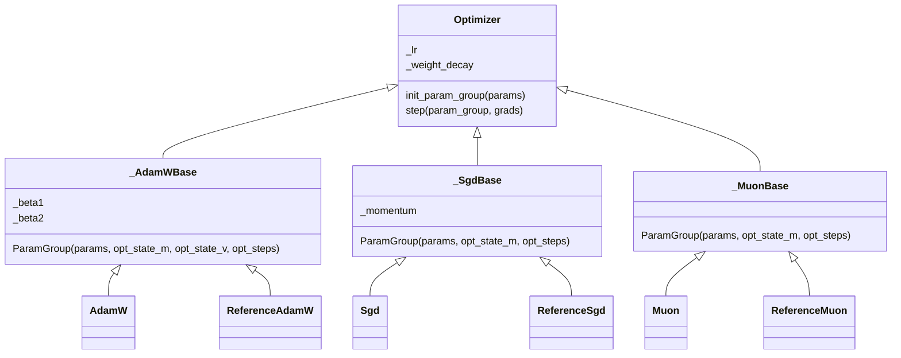
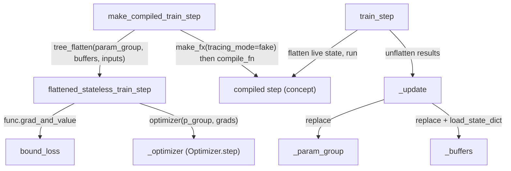

# torch.tpu.optimizers - stateless functional optimizers (AdamW, Sgd, Muon) and SingleTraceTrainer whole-step capture

The subsystem `src/torch_tpu/_internal/optimizers` is exported publicly as `torch.tpu.optimizers` (`AdamW`, `Sgd`, `Muon`, `Optimizer`, `SingleTraceTrainer`). It exists so that a complete training step (forward, backward and optimizer update) can be **traced once into a single functional graph** and compiled as one TPU program. Everything else in the layer serves that goal.

## Overview

`torch.optim.Optimizer` hides state in a mutable `self.state` dict. The torch_tpu [`Optimizer`](../catalog/src/torch_tpu/_internal/optimizers/optim.md#Optimizer "src/torch_tpu/_internal/optimizers/optim.py:L33") instead keeps all mutable state in an explicit, pytree-registered dataclass: the per-optimizer [`ParamGroup`](../catalog/src/torch_tpu/_internal/optimizers/adamw.md#_AdamWBase.ParamGroup "src/torch_tpu/_internal/optimizers/adamw.py:L40"), holding `params`, moments and step counters. The optimizer object holds only fixed hyperparameters. `step(param_group, grads) -> ParamGroup` is therefore a function of tensors, which `make_fx` can trace. Each optimizer family has two concrete implementations. A `Reference*` class is pure PyTorch tensor math. A production class (`AdamW`, `Sgd`, `Muon`) packs the dicts into lists and calls the upstream functional kernel (`torch.optim.adamw.adamw`, `torch.optim.sgd.sgd`, `torch.optim._muon.muon`). [`SingleTraceTrainer`](../catalog/src/torch_tpu/_internal/optimizers/single_trace_trainer.md#SingleTraceTrainer.make_compiled_train_step "src/torch_tpu/_internal/optimizers/single_trace_trainer.py:L374") ties this together. It flattens `(param_group, buffers, inputs)` into a flat tensor list, traces `grad_and_value(loss)` followed by `optimizer(param_group, grads)` with `make_fx`, hands the resulting FX graph to a caller-supplied `compile_fn`, and returns a stateful `train_step` that writes the new state back.

## Diagram

Legend:
- `MCTS` - [`make_compiled_train_step`](../catalog/src/torch_tpu/_internal/optimizers/single_trace_trainer.md#SingleTraceTrainer.make_compiled_train_step "src/torch_tpu/_internal/optimizers/single_trace_trainer.py:L374")
- `FST` - [`flattened_stateless_train_step`](../catalog/src/torch_tpu/_internal/optimizers/single_trace_trainer.md#SingleTraceTrainer.flattened_stateless_train_step "src/torch_tpu/_internal/optimizers/single_trace_trainer.py:L399")
- `BL` - [`bound_loss`](../catalog/src/torch_tpu/_internal/optimizers/single_trace_trainer.md#SingleTraceTrainer.bound_loss "src/torch_tpu/_internal/optimizers/single_trace_trainer.py:L408")
- `OPT` - [`_optimizer`](../catalog/src/torch_tpu/_internal/optimizers/single_trace_trainer.md#SingleTraceTrainer._optimizer "src/torch_tpu/_internal/optimizers/single_trace_trainer.py:L298")
- `CS` - (concept) whatever `compile_fn` returns, for example a static compiler backend
- `TS` - [`train_step`](../catalog/src/torch_tpu/_internal/optimizers/single_trace_trainer.md#SingleTraceTrainer.train_step "src/torch_tpu/_internal/optimizers/single_trace_trainer.py:L515")
- `UPD` - [`_update`](../catalog/src/torch_tpu/_internal/optimizers/single_trace_trainer.md#SingleTraceTrainer._update "src/torch_tpu/_internal/optimizers/single_trace_trainer.py:L335")
- `PG` - [`_param_group`](../catalog/src/torch_tpu/_internal/optimizers/single_trace_trainer.md#SingleTraceTrainer._param_group "src/torch_tpu/_internal/optimizers/single_trace_trainer.py:L323")
- `BUF` - [`_buffers`](../catalog/src/torch_tpu/_internal/optimizers/single_trace_trainer.md#SingleTraceTrainer._buffers "src/torch_tpu/_internal/optimizers/single_trace_trainer.py:L316")

## Design rationale (why it's built this way)

**State as a pytree, so the whole step is a pure function.** Each `ParamGroup` ([AdamW](../catalog/src/torch_tpu/_internal/optimizers/adamw.md#_AdamWBase.ParamGroup "src/torch_tpu/_internal/optimizers/adamw.py:L40"), [Sgd](../catalog/src/torch_tpu/_internal/optimizers/sgd.md#_SgdBase.ParamGroup "src/torch_tpu/_internal/optimizers/sgd.py:L40"), [Muon](../catalog/src/torch_tpu/_internal/optimizers/muon.md#_MuonBase.ParamGroup "src/torch_tpu/_internal/optimizers/muon.py:L95")) is registered with `torch.utils._pytree` through explicit flatten/unflatten pairs ([`_adam_param_group_flatten`](../catalog/src/torch_tpu/_internal/optimizers/adamw.md#_adam_param_group_flatten "src/torch_tpu/_internal/optimizers/adamw.py:L284") / [`_adam_param_group_unflatten`](../catalog/src/torch_tpu/_internal/optimizers/adamw.md#_adam_param_group_unflatten "src/torch_tpu/_internal/optimizers/adamw.py:L294"), and the SGD and Muon equivalents). The trainer can then `tree_flatten` params, moments and steps into the positional inputs of one traced graph, and `tree_unflatten` the outputs back. No optimizer state hides in Python objects that tracing would miss.

**Hyperparameters are frozen constants.** The [`Optimizer`](../catalog/src/torch_tpu/_internal/optimizers/optim.md#Optimizer "src/torch_tpu/_internal/optimizers/optim.py:L33") docstring says: "They are captured as constants when a train step is traced, so they can't be changed afterwards. Create a new optimizer instead." [`_lr`](../catalog/src/torch_tpu/_internal/optimizers/optim.md#Optimizer._lr "src/torch_tpu/_internal/optimizers/optim.py:L48") and [`_weight_decay`](../catalog/src/torch_tpu/_internal/optimizers/optim.md#Optimizer._weight_decay "src/torch_tpu/_internal/optimizers/optim.py:L49") are plain Python floats. This makes the compiled graph maximally specialized. The cost is that an LR schedule needs a new optimizer, and so a new trace and compile, for each LR value. This is the opposite trade-off from the eager [fused kernels](fused-optimizer-kernels.md), which promote `lr` to a runtime tensor.

**Delegate the math to upstream, keep a Reference for checking.** The production `step`s call the upstream functional entry points directly: [`AdamW.step`](../catalog/src/torch_tpu/_internal/optimizers/adamw.md#AdamW.step "src/torch_tpu/_internal/optimizers/adamw.py:L249") "calling torch.optim.adamw.adamw directly", plus the [`Sgd.step`](../catalog/src/torch_tpu/_internal/optimizers/sgd.md#Sgd.step "src/torch_tpu/_internal/optimizers/sgd.py:L223") and [`Muon.step`](../catalog/src/torch_tpu/_internal/optimizers/muon.md#Muon.step "src/torch_tpu/_internal/optimizers/muon.py:L288") equivalents. Algorithm semantics (AMSGrad, maximize, grad_scale/found_inf, the `fused`/`foreach` path selection) therefore stay identical to `torch.optim`. The `Reference*` classes ([`ReferenceAdamW`](../catalog/src/torch_tpu/_internal/optimizers/adamw.md#ReferenceAdamW "src/torch_tpu/_internal/optimizers/adamw.py:L136"), etc.) are "Internal: not part of the public API" pure-tensor versions. They are useful as a numerics oracle, and as a path with no dependence on which upstream code path gets picked.

**Default dispatch path differs by optimizer.** `AdamW` defaults to `foreach=False, fused=False, capturable=True`. `Sgd` defaults to `fused=True`. `Muon` defaults to `foreach=False`. Under tracing, `Sgd` therefore lowers through `aten::_fused_sgd_` (torch_tpu's [fused kernel](fused-optimizer-kernels.md)), while `AdamW` traces upstream's single-tensor loop into the graph unless the caller passes `fused=True`. `capturable=True` keeps AdamW's step counter math on device, so the trace has no host sync.

**bf16 moments are a first-class knob.** [`_AdamWBase.init_param_group`](../catalog/src/torch_tpu/_internal/optimizers/adamw.md#_AdamWBase.init_param_group "src/torch_tpu/_internal/optimizers/adamw.py:L80") allocates `opt_state_m` and `opt_state_v` as `torch.bfloat16` when `use_bfloat16_moments` is set. That flag **defaults to True for AdamW** and False for Muon (see [`_MuonBase.__init__`](../catalog/src/torch_tpu/_internal/optimizers/muon.md#_MuonBase.__init__ "src/torch_tpu/_internal/optimizers/muon.py:L116")). This halves optimizer-state HBM versus fp32 moments. The precision cost is that moments are stored in bf16 between steps.

## Entry points

- [`make_compiled_train_step`](../catalog/src/torch_tpu/_internal/optimizers/single_trace_trainer.md#SingleTraceTrainer.make_compiled_train_step "src/torch_tpu/_internal/optimizers/single_trace_trainer.py:L374") - "Returns a callable for the training step with the model compiled." Called once per input structure. It traces and compiles. It raises if no `compile_fn` was given to the trainer or to this call. In the repo, `perflab/single_trace_trainer_adapter.py` subclasses the trainer and supplies a static-compiler `compile_fn` that donates every param-group tensor.
- [`train_step`](../catalog/src/torch_tpu/_internal/optimizers/single_trace_trainer.md#SingleTraceTrainer.train_step "src/torch_tpu/_internal/optimizers/single_trace_trainer.py:L515") - the closure returned above, called every iteration with `(inputs, targets)`. It returns the loss tensor.
- [`AdamW.step`](../catalog/src/torch_tpu/_internal/optimizers/adamw.md#AdamW.step "src/torch_tpu/_internal/optimizers/adamw.py:L249") / [`Sgd.step`](../catalog/src/torch_tpu/_internal/optimizers/sgd.md#Sgd.step "src/torch_tpu/_internal/optimizers/sgd.py:L223") / [`Muon.step`](../catalog/src/torch_tpu/_internal/optimizers/muon.md#Muon.step "src/torch_tpu/_internal/optimizers/muon.py:L288") - can also be called eagerly as `new_pg = opt(pg, grads)`, because `Optimizer.__call__` forwards to `step`.
- [`_AdamWBase.init_param_group`](../catalog/src/torch_tpu/_internal/optimizers/adamw.md#_AdamWBase.init_param_group "src/torch_tpu/_internal/optimizers/adamw.py:L80"), [`_SgdBase.init_param_group`](../catalog/src/torch_tpu/_internal/optimizers/sgd.md#_SgdBase.init_param_group "src/torch_tpu/_internal/optimizers/sgd.py:L74"), [`_MuonBase.init_param_group`](../catalog/src/torch_tpu/_internal/optimizers/muon.md#_MuonBase.init_param_group "src/torch_tpu/_internal/optimizers/muon.py:L145") - build the initial state from a `dict` or an `nn.Module`. Names are rewritten `a.b.c -> a_b_c`. The trainer calls these in its constructor.

## Mechanism (step-by-step)

1. **Construct state.** The trainer constructor detaches every parameter and buffer and renames them with `.` replaced by `_`, recording the mapping in [`_key_map`](../catalog/src/torch_tpu/_internal/optimizers/single_trace_trainer.md#SingleTraceTrainer._key_map "src/torch_tpu/_internal/optimizers/single_trace_trainer.py:L309"). It calls `optimizer.init_param_group(initial_params)` to get [`_param_group`](../catalog/src/torch_tpu/_internal/optimizers/single_trace_trainer.md#SingleTraceTrainer._param_group "src/torch_tpu/_internal/optimizers/single_trace_trainer.py:L323"). For AdamW that means zero moments (bf16 by default) and f32 step counters starting at 0.0. For SGD and Muon, step counters start at 1.0, and SGD allocates `opt_state_m` only when `momentum != 0`. With no optimizer, the param dict itself is stored and the step only produces gradients. The model's `tie_weights()` is called first if it exists.

2. **Flatten and trace.** [`make_compiled_train_step`](../catalog/src/torch_tpu/_internal/optimizers/single_trace_trainer.md#SingleTraceTrainer.make_compiled_train_step "src/torch_tpu/_internal/optimizers/single_trace_trainer.py:L374") flattens `(param_group, buffers, example_inputs[, example_targets])` and runs `make_fx(..., tracing_mode="fake")` over [`flattened_stateless_train_step`](../catalog/src/torch_tpu/_internal/optimizers/single_trace_trainer.md#SingleTraceTrainer.flattened_stateless_train_step "src/torch_tpu/_internal/optimizers/single_trace_trainer.py:L399"). Targets are added only when provided, because "Static compiler doesn't support optional input args". Inside, `func.grad_and_value` differentiates [`bound_loss`](../catalog/src/torch_tpu/_internal/optimizers/single_trace_trainer.md#SingleTraceTrainer.bound_loss "src/torch_tpu/_internal/optimizers/single_trace_trainer.py:L408") with respect to the params, or the inputs for a parameterless model. `bound_loss` runs the model functionally, with SDPA restricted to the OVERRIDEABLE and MATH backends, and derives a loss from `targets` (MSE), `out.loss`, `logits.mean()` or the first tensor output.

3. **Optimizer inside the trace.** With an optimizer, the traced function calls [`_optimizer`](../catalog/src/torch_tpu/_internal/optimizers/single_trace_trainer.md#SingleTraceTrainer._optimizer "src/torch_tpu/_internal/optimizers/single_trace_trainer.py:L298")`(p_group, grads)`, for example [`AdamW.step`](../catalog/src/torch_tpu/_internal/optimizers/adamw.md#AdamW.step "src/torch_tpu/_internal/optimizers/adamw.py:L249"), which mutates the param and state tensors in place through upstream kernels. It returns `(loss, new_p_group, updated_bufs)` flattened as the graph outputs. The trainer comment notes that the optimizer's in-place update "is not functionalized", while buffer mutations inside `grad_and_value` are. That is why buffers need an explicit write-back. Without an optimizer, gradients are made graph outputs "to prevent compiler dead-code elimination". Sparse gradients are wrapped in [`_SparseGradPlaceholder`](../catalog/src/torch_tpu/_internal/optimizers/single_trace_trainer.md#_SparseGradPlaceholder "src/torch_tpu/_internal/optimizers/single_trace_trainer.py:L171") (indices, values, size) so they can cross the flat-tensor boundary.

4. **Graph cleanup and compile.** Still inside [`make_compiled_train_step`](../catalog/src/torch_tpu/_internal/optimizers/single_trace_trainer.md#SingleTraceTrainer.make_compiled_train_step "src/torch_tpu/_internal/optimizers/single_trace_trainer.py:L374"), a decomposition table rewrites embedding (and embedding-bag) backward, turning sparse embedding gradients into a COO tensor built in-graph. A post-pass then short-circuits `_indices`/`_values` of a freshly built `_sparse_coo_tensor_unsafe` back to its inputs, runs DCE and recompiles the GraphModule. The graph is passed to `compile_fn` as either `(gm)` or `(gm, flat_inputs)`, chosen by inspecting the callback's signature.

5. **Run and write back.** Each call to [`train_step`](../catalog/src/torch_tpu/_internal/optimizers/single_trace_trainer.md#SingleTraceTrainer.train_step "src/torch_tpu/_internal/optimizers/single_trace_trainer.py:L515") re-flattens the live [`_param_group`](../catalog/src/torch_tpu/_internal/optimizers/single_trace_trainer.md#SingleTraceTrainer._param_group "src/torch_tpu/_internal/optimizers/single_trace_trainer.py:L323") and [`_buffers`](../catalog/src/torch_tpu/_internal/optimizers/single_trace_trainer.md#SingleTraceTrainer._buffers "src/torch_tpu/_internal/optimizers/single_trace_trainer.py:L316"), runs the compiled step and unflattens the results with the traced output spec. [`_update`](../catalog/src/torch_tpu/_internal/optimizers/single_trace_trainer.md#SingleTraceTrainer._update "src/torch_tpu/_internal/optimizers/single_trace_trainer.py:L335") replaces the container state and reloads buffers into the user model, using [`_bufs`](../catalog/src/torch_tpu/_internal/optimizers/single_trace_trainer.md#SingleTraceTrainer._bufs "src/torch_tpu/_internal/optimizers/single_trace_trainer.py:L366") to restore the original names, with `load_state_dict(strict=False)`. Without an optimizer, [`_unwrap_sparse`](../catalog/src/torch_tpu/_internal/optimizers/single_trace_trainer.md#SingleTraceTrainer._unwrap_sparse "src/torch_tpu/_internal/optimizers/single_trace_trainer.py:L539") rebuilds sparse COO gradients and assigns `param.grad` on the model, so callers can synchronize on them.

6. **The Reference update formulas.** The `Reference*` subclasses of [`_AdamWBase`](../catalog/src/torch_tpu/_internal/optimizers/adamw.md#_AdamWBase "src/torch_tpu/_internal/optimizers/adamw.py:L33"), [`_SgdBase`](../catalog/src/torch_tpu/_internal/optimizers/sgd.md#_SgdBase "src/torch_tpu/_internal/optimizers/sgd.py:L33") and [`_MuonBase`](../catalog/src/torch_tpu/_internal/optimizers/muon.md#_MuonBase "src/torch_tpu/_internal/optimizers/muon.py:L88") spell out the math that the production path must match:
   - [`_reference_adamw_update`](../catalog/src/torch_tpu/_internal/optimizers/adamw.md#ReferenceAdamW._reference_adamw_update "src/torch_tpu/_internal/optimizers/adamw.py:L143") uses decoupled decay `p *= 1 - lr*wd` and the same `sqrt(bc2)`-folded step size and epsilon as the fused C++ kernel. The step is incremented *before* the update ([`ReferenceAdamW.step`](../catalog/src/torch_tpu/_internal/optimizers/adamw.md#ReferenceAdamW.step "src/torch_tpu/_internal/optimizers/adamw.py:L172")).
   - [`_reference_sgd_update`](../catalog/src/torch_tpu/_internal/optimizers/sgd.md#ReferenceSgd._reference_sgd_update "src/torch_tpu/_internal/optimizers/sgd.py:L129") seeds momentum with `torch.where(step == 1.0, d_p, ...)`, which is a device-side select instead of a Python `if`, so it traces without a host sync. The step is incremented *after* the update ([`ReferenceSgd.step`](../catalog/src/torch_tpu/_internal/optimizers/sgd.md#ReferenceSgd.step "src/torch_tpu/_internal/optimizers/sgd.py:L155")).
   - [`_reference_muon_update`](../catalog/src/torch_tpu/_internal/optimizers/muon.md#ReferenceMuon._reference_muon_update "src/torch_tpu/_internal/optimizers/muon.py:L198") does a momentum `lerp`, an optional Nesterov `lerp`, and a Newton-Schulz orthogonalization of the 2-D update. The Newton-Schulz runs **in bf16** (`ns_steps` iterations of `X X^T` matmuls plus `addmm`), so Muon's extra cost is MXU matmuls. A shape-dependent LR scaling and decoupled weight decay follow ([`ReferenceMuon.step`](../catalog/src/torch_tpu/_internal/optimizers/muon.md#ReferenceMuon.step "src/torch_tpu/_internal/optimizers/muon.py:L219")).

## Key data structures

| Structure | Fields | Notes |
|---|---|---|
| [`_AdamWBase.ParamGroup`](../catalog/src/torch_tpu/_internal/optimizers/adamw.md#_AdamWBase.ParamGroup "src/torch_tpu/_internal/optimizers/adamw.py:L40") | [`params`](../catalog/src/torch_tpu/_internal/optimizers/adamw.md#_AdamWBase.ParamGroup.params "src/torch_tpu/_internal/optimizers/adamw.py:L43"), [`opt_state_m`](../catalog/src/torch_tpu/_internal/optimizers/adamw.md#_AdamWBase.ParamGroup.opt_state_m "src/torch_tpu/_internal/optimizers/adamw.py:L44"), [`opt_state_v`](../catalog/src/torch_tpu/_internal/optimizers/adamw.md#_AdamWBase.ParamGroup.opt_state_v "src/torch_tpu/_internal/optimizers/adamw.py:L47"), [`opt_steps`](../catalog/src/torch_tpu/_internal/optimizers/adamw.md#_AdamWBase.ParamGroup.opt_steps "src/torch_tpu/_internal/optimizers/adamw.py:L50") | All dicts keyed by `_`-joined param names. The moments are bf16 by default. Steps are 0-D f32 device tensors starting at 0 |
| [`_SgdBase.ParamGroup`](../catalog/src/torch_tpu/_internal/optimizers/sgd.md#_SgdBase.ParamGroup "src/torch_tpu/_internal/optimizers/sgd.py:L40") | [`params`](../catalog/src/torch_tpu/_internal/optimizers/sgd.md#_SgdBase.ParamGroup.params "src/torch_tpu/_internal/optimizers/sgd.py:L43"), [`opt_state_m`](../catalog/src/torch_tpu/_internal/optimizers/sgd.md#_SgdBase.ParamGroup.opt_state_m "src/torch_tpu/_internal/optimizers/sgd.py:L44"), [`opt_steps`](../catalog/src/torch_tpu/_internal/optimizers/sgd.md#_SgdBase.ParamGroup.opt_steps "src/torch_tpu/_internal/optimizers/sgd.py:L47") | `opt_state_m` is empty when [`_momentum`](../catalog/src/torch_tpu/_internal/optimizers/sgd.md#_SgdBase._momentum "src/torch_tpu/_internal/optimizers/sgd.py:L66") is 0, which changes the traced graph's arity. Momentum is in the param dtype. Steps start at 1 |
| [`_MuonBase.ParamGroup`](../catalog/src/torch_tpu/_internal/optimizers/muon.md#_MuonBase.ParamGroup "src/torch_tpu/_internal/optimizers/muon.py:L95") | [`params`](../catalog/src/torch_tpu/_internal/optimizers/muon.md#_MuonBase.ParamGroup.params "src/torch_tpu/_internal/optimizers/muon.py:L98"), [`opt_state_m`](../catalog/src/torch_tpu/_internal/optimizers/muon.md#_MuonBase.ParamGroup.opt_state_m "src/torch_tpu/_internal/optimizers/muon.py:L99"), [`opt_steps`](../catalog/src/torch_tpu/_internal/optimizers/muon.md#_MuonBase.ParamGroup.opt_steps "src/torch_tpu/_internal/optimizers/muon.py:L102") | Momentum is optionally bf16. Steps start at 1 |
| [`_SparseGradPlaceholder`](../catalog/src/torch_tpu/_internal/optimizers/single_trace_trainer.md#_SparseGradPlaceholder "src/torch_tpu/_internal/optimizers/single_trace_trainer.py:L171") | `indices`, `values`, `size` | A frozen pytree node that lets sparse COO grads leave the flat-tensor graph |
| Hyperparameter attrs | [`_lr`](../catalog/src/torch_tpu/_internal/optimizers/optim.md#Optimizer._lr "src/torch_tpu/_internal/optimizers/optim.py:L48"), [`_weight_decay`](../catalog/src/torch_tpu/_internal/optimizers/optim.md#Optimizer._weight_decay "src/torch_tpu/_internal/optimizers/optim.py:L49"), [`_beta1`](../catalog/src/torch_tpu/_internal/optimizers/adamw.md#_AdamWBase._beta1 "src/torch_tpu/_internal/optimizers/adamw.py:L71"), [`_beta2`](../catalog/src/torch_tpu/_internal/optimizers/adamw.md#_AdamWBase._beta2 "src/torch_tpu/_internal/optimizers/adamw.py:L72") | Python floats, exposed read-only through `defaults`. Baked into the trace as constants |

Default hyperparameters worth knowing when comparing against `torch.optim`:

| Class | lr | weight_decay | moments dtype | fused / foreach |
|---|---|---|---|---|
| `AdamW` | 1e-3 | 1e-2 | bf16 (`use_bfloat16_moments=True`) | `fused=False`, `foreach=False`, `capturable=True` |
| `Sgd` | 1e-3 | 0.0 | param dtype | `fused=True`, `foreach=False` |
| `Muon` | 1e-3 | 0.1 | param dtype (`use_bfloat16_moments=False`) | `foreach=False` |

## Dynamics (design intent)

- **One trace, many runs.** [`train_step`](../catalog/src/torch_tpu/_internal/optimizers/single_trace_trainer.md#SingleTraceTrainer.train_step "src/torch_tpu/_internal/optimizers/single_trace_trainer.py:L515") does no re-tracing. It asserts that `targets` presence matches the example ("Targets passed to step but not as examples, or vice versa"), and it relies on `compile_fn`'s own handling for any shape change.
- **Donation is the caller's choice.** The trainer itself never donates. The perflab adapter's default `compile_fn` donates the flat indices of every param-group tensor, but only when an optimizer exists, because "donating parameters would invalidate them across repeated training iterations" otherwise. Because state is rebound in [`_update`](../catalog/src/torch_tpu/_internal/optimizers/single_trace_trainer.md#SingleTraceTrainer._update "src/torch_tpu/_internal/optimizers/single_trace_trainer.py:L335") every step, donated input buffers are never read again.
- **No tests** in the configured test paths reference this subgraph (packet Evidence is empty). The behaviour above is read from source, and from the perflab benchmark stepper that drives it.

## Edge cases

- **LR schedules.** Hyperparameters are trace constants, so changing `lr` means building a new optimizer and calling [`make_compiled_train_step`](../catalog/src/torch_tpu/_internal/optimizers/single_trace_trainer.md#SingleTraceTrainer.make_compiled_train_step "src/torch_tpu/_internal/optimizers/single_trace_trainer.py:L374") again, which is a recompile.
- **Step-counter convention differs.** AdamW counters start at 0 and are incremented before use (inside upstream `adamw` or `ReferenceAdamW`). SGD and Muon counters start at 1 and are incremented after the update with `aten._foreach_add_`. Mixing `init_param_group` from one class with `step` from another gives off-by-one bias correction.
- **Muon only on 2-D params.** The Newton-Schulz helper raises unless `grad.ndim == 2`. Embeddings, norms and biases need a different optimizer.
- **Name mangling.** Param names containing `_` and `.` can collide after `.` is replaced by `_`. The key map is a plain dict, and collisions are not detected.
- **perflab conversion.** `perflab/steps/train.py` maps any non-SGD `torch.optim` optimizer to `ReferenceAdamW`, not `AdamW`, with bf16 moments iff the first parameter is bf16. Benchmarks through that path therefore measure the pure-tensor reference update, not upstream `adamw`.

## Open questions

- Does upstream `torch.optim.adamw.adamw` with `fused=False, foreach=False` under fake-mode `make_fx` produce one long per-param op chain, and does XLA fuse it as well as the `fused=True` path ([fused-optimizer-kernels](fused-optimizer-kernels.md))? A side-by-side HLO comparison would settle which default is better for step time.
- Why is AdamW's `use_bfloat16_moments` default True while Muon's is False? No comment explains the asymmetry.
- `AdamW` passes `max_exp_avg_sqs=[]` even when `amsgrad=True`. Whether upstream then errors or silently ignores AMSGrad was not verified.

## See also

- [fused-optimizer-kernels](fused-optimizer-kernels.md) - the C++ `aten::_fused_*_` kernels that `Sgd` (default) and `AdamW(fused=True)` lower into.
- [compiled-mode](compiled-mode.md) and [torch-compile-backend](torch-compile-backend.md) - the compile paths a `compile_fn` can target.
- [fx-graph-passes](fx-graph-passes.md) - compiler passes applied to traced graphs (for example the causal-mask folding the trainer's HF tracing shim relies on).
- [dtype-and-precision](dtype-and-precision.md) - bf16 state and precision modes.
