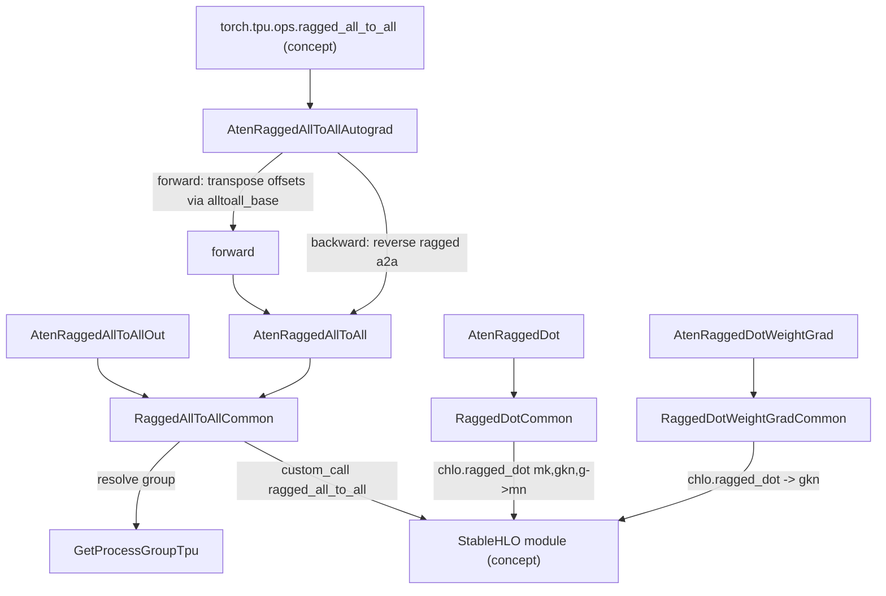
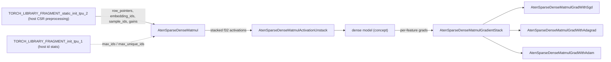

# Experimental tpu:: ops - ragged all-to-all, ragged_dot (MoE), dim collectives, send/recv, and SparseCore embedding ops

<!-- connect:up:begin -->
> **Cross-repo concept:** part of [expert-parallelism](../../../concepts/expert-parallelism.md), [sparsecore](../../../concepts/sparsecore.md) across this wiki's repos.
<!-- connect:up:end -->
`csrc/ops/experimental` holds torch_tpu's non-ATen, `torch.ops.tpu::*` kernels. Most are exposed as `torch.tpu.ops.*`. They fall into two groups. The **Mixture-of-Experts building blocks** are ragged all-to-all token dispatch, ragged (grouped) matmul, and dimension-aware all-gather/reduce-scatter, with host send/recv on the side. The **SparseCore embedding ops** (sparse-dense matmul with fused optimizer backward, sparse gather, map-row, iota) offload sparse lookups to the TPU's SparseCore units.

## Overview

Every compiled op here follows the standard torch_tpu kernel shape: `TT_KERNEL` scope, validate, a StableHLO builder lambda, then eager dispatch. The exceptions are send/recv (a `TT_KERNEL` scope that calls the process group directly, nothing is compiled) and the host-side embedding preprocessing/stats ops (no `TT_KERNEL` at all). Most compiled ops lower to a **single opaque StableHLO construct** that XLA or libtpu knows how to schedule, rather than to a decomposition into dense ops; the sparse-gather backward is the exception, a plain StableHLO scatter-add:

| Op family | Lowered to |
|---|---|
| Ragged all-to-all | `stablehlo.custom_call @ragged_all_to_all` with replica groups and, on SparseCore chips, `compute_type = "tpu_embedding"` |
| Ragged dot | `chlo.ragged_dot` |
| Dim collectives | the shared all-gather / reduce-scatter builders, with the process group's replica groups and device assignment |
| SparseCore family | `custom_call`s targeting SparseCore: the gather, iota, map-row and fused-optimizer backward calls carry a `backend_config` with `DEVICE_TYPE_SPARSECORE`, while the sparse-dense matmul forward is marked through `mhlo.frontend_attributes` (sparse compute type). Optimizer math is passed in as a `called_computations` function |

The MoE ops are differentiable through C++ autograd functions registered under `AutogradPrivateUse1`. For ragged all-to-all, the backward is itself a ragged all-to-all with transposed offsets.

## Diagram

Legend:
- `U` - (concept) Python wrapper in `src/torch_tpu/_internal/ops/ops.py` calling `torch.ops.tpu._ragged_all_to_all`
- `AG` - [`AtenRaggedAllToAllAutograd`](../catalog/csrc/ops/experimental/ragged_all_to_all/ragged_all_to_all_aten_kernels.h.md#AtenRaggedAllToAllAutograd "csrc/ops/experimental/ragged_all_to_all/ragged_all_to_all_aten_kernels.h:L58")
- `F` - [`forward`](../catalog/csrc/ops/experimental/ragged_all_to_all/ragged_all_to_all_aten_kernels.cc.md#AtenRaggedAllToAllAutograd.forward "csrc/ops/experimental/ragged_all_to_all/ragged_all_to_all_aten_kernels.cc:L174")
- `K` - [`AtenRaggedAllToAll`](../catalog/csrc/ops/experimental/ragged_all_to_all/ragged_all_to_all_aten_kernels.cc.md#AtenRaggedAllToAll "csrc/ops/experimental/ragged_all_to_all/ragged_all_to_all_aten_kernels.cc:L135")
- `KO` - [`AtenRaggedAllToAllOut`](../catalog/csrc/ops/experimental/ragged_all_to_all/ragged_all_to_all_aten_kernels.cc.md#AtenRaggedAllToAllOut "csrc/ops/experimental/ragged_all_to_all/ragged_all_to_all_aten_kernels.cc:L155")
- `C` - [`RaggedAllToAllCommon`](../catalog/csrc/ops/experimental/ragged_all_to_all/ragged_all_to_all_aten_kernels.cc.md#RaggedAllToAllCommon "csrc/ops/experimental/ragged_all_to_all/ragged_all_to_all_aten_kernels.cc:L86")
- `PG` - [`GetProcessGroupTpu`](../catalog/csrc/ops/experimental/ragged_all_to_all/ragged_all_to_all_aten_kernels.cc.md#GetProcessGroupTpu "csrc/ops/experimental/ragged_all_to_all/ragged_all_to_all_aten_kernels.cc:L65")
- `HLO` - (concept) the per-op StableHLO module handed to the eager dispatcher
- `RD` - [`AtenRaggedDot`](../catalog/csrc/ops/experimental/ragged_dot/ragged_dot_aten_kernels.cc.md#AtenRaggedDot "csrc/ops/experimental/ragged_dot/ragged_dot_aten_kernels.cc:L186")
- `RDC` - [`RaggedDotCommon`](../catalog/csrc/ops/experimental/ragged_dot/ragged_dot_aten_kernels.cc.md#RaggedDotCommon "csrc/ops/experimental/ragged_dot/ragged_dot_aten_kernels.cc:L85")
- `RDW` - [`AtenRaggedDotWeightGrad`](../catalog/csrc/ops/experimental/ragged_dot/ragged_dot_aten_kernels.cc.md#AtenRaggedDotWeightGrad "csrc/ops/experimental/ragged_dot/ragged_dot_aten_kernels.cc:L205")
- `RDWC` - [`RaggedDotWeightGradCommon`](../catalog/csrc/ops/experimental/ragged_dot/ragged_dot_aten_kernels.cc.md#RaggedDotWeightGradCommon "csrc/ops/experimental/ragged_dot/ragged_dot_aten_kernels.cc:L154")

Legend:
- `PRE` - `TORCH_LIBRARY_FRAGMENT_static_init_tpu_2`
- `STATS` - [`TORCH_LIBRARY_FRAGMENT_init_tpu_1`](../catalog/csrc/ops/experimental/sparse_dense_matmul/compute_stats_aten_kernels.cc.md#TORCH_LIBRARY_FRAGMENT_init_tpu_1 "csrc/ops/experimental/sparse_dense_matmul/compute_stats_aten_kernels.cc:L32")
- `SDM` - [`AtenSparseDenseMatmul`](../catalog/csrc/ops/experimental/sparse_dense_matmul/sparse_dense_matmul_aten_kernels.cc.md#AtenSparseDenseMatmul "csrc/ops/experimental/sparse_dense_matmul/sparse_dense_matmul_aten_kernels.cc:L132")
- `UNS` - [`AtenSparseDenseMatmulActivationUnstack`](../catalog/csrc/ops/experimental/sparse_dense_matmul/sparse_dense_matmul_activation_unstack_aten_kernels.cc.md#AtenSparseDenseMatmulActivationUnstack "csrc/ops/experimental/sparse_dense_matmul/sparse_dense_matmul_activation_unstack_aten_kernels.cc:L167")
- `DENSE` - (concept) the TensorCore part of the model
- `STK` - [`AtenSparseDenseMatmulGradientStack`](../catalog/csrc/ops/experimental/sparse_dense_matmul/sparse_dense_matmul_gradient_stack_aten_kernels.cc.md#AtenSparseDenseMatmulGradientStack "csrc/ops/experimental/sparse_dense_matmul/sparse_dense_matmul_gradient_stack_aten_kernels.cc:L142")
- `SGD` - [`AtenSparseDenseMatmulGradWithSgd`](../catalog/csrc/ops/experimental/sparse_dense_matmul/sparse_dense_matmul_grad_with_sgd_aten_kernels.cc.md#AtenSparseDenseMatmulGradWithSgd "csrc/ops/experimental/sparse_dense_matmul/sparse_dense_matmul_grad_with_sgd_aten_kernels.cc:L176")
- `ADA` - [`AtenSparseDenseMatmulGradWithAdagrad`](../catalog/csrc/ops/experimental/sparse_dense_matmul/sparse_dense_matmul_grad_with_adagrad_aten_kernels.cc.md#AtenSparseDenseMatmulGradWithAdagrad "csrc/ops/experimental/sparse_dense_matmul/sparse_dense_matmul_grad_with_adagrad_aten_kernels.cc:L241")
- `ADM` - [`AtenSparseDenseMatmulGradWithAdam`](../catalog/csrc/ops/experimental/sparse_dense_matmul/sparse_dense_matmul_grad_with_adam_aten_kernels.cc.md#AtenSparseDenseMatmulGradWithAdam "csrc/ops/experimental/sparse_dense_matmul/sparse_dense_matmul_grad_with_adam_aten_kernels.cc:L303")

## Design rationale (why it's built this way)

**Ragged offsets are runtime tensors, so MoE routing never recompiles.** [`RaggedAllToAllCommon`](../catalog/csrc/ops/experimental/ragged_all_to_all/ragged_all_to_all_aten_kernels.cc.md#RaggedAllToAllCommon "csrc/ops/experimental/ragged_all_to_all/ragged_all_to_all_aten_kernels.cc:L86") passes `input_offsets`, `send_sizes`, `output_offsets` and `recv_sizes` as the 3rd to 6th **operands** of the dispatched program. They are not attributes. Only the shapes and dtypes of all six tensors (and the group name) enter the cache key. Every MoE step routes a different number of tokens to each expert, yet all steps reuse one executable. The output buffer has a fixed, worst-case row count (`output` supplies "the initial contents, shape and dtype"), which is what keeps shapes static.

> [!inferred]
> The c10d `ProcessGroup.alltoall` path with uneven split sizes (in `csrc/distributed/process_group_tpu.cc`) reuses the same `ragged_all_to_all` builder, but computes offsets on the host, syncs them through the c10d store, and writes them into the cache key with `SetParam`. That path recompiles whenever the split sizes change. For MoE token dispatch, `torch.tpu.ops.ragged_all_to_all` is therefore the recompile-free choice.

**Backward is a reverse ragged all-to-all, so offsets must be transposed across ranks.** Rank i only knows where *its* tokens went. To send gradients back, each rank needs where *other ranks'* tokens landed in its own output. [`forward`](../catalog/csrc/ops/experimental/ragged_all_to_all/ragged_all_to_all_aten_kernels.cc.md#AtenRaggedAllToAllAutograd.forward "csrc/ops/experimental/ragged_all_to_all/ragged_all_to_all_aten_kernels.cc:L174") gets this with two equal-split `alltoall_base` calls of one int per peer, which transpose `output_offsets` and `input_offsets` "directly on TPU". It saves the results for backward. This only happens when `operand.requires_grad()`, so inference pays nothing.

**SparseCore placement is opt-in per chip.** The ragged all-to-all custom call is tagged `compute_type = "tpu_embedding"` only when the device supports SparseCore. It is always tagged `inlineable = "false"`. Only two SparseCore ops check the chip up front: [`ValidateSparseGatherInputs`](../catalog/csrc/ops/experimental/sparse_gather/sparse_gather_aten_kernels.cc.md#ValidateSparseGatherInputs "csrc/ops/experimental/sparse_gather/sparse_gather_aten_kernels.cc:L209") and [`ValidateSparseMapRowInputs`](../catalog/csrc/ops/experimental/sparse_map_row/sparse_map_row_aten_kernels.cc.md#ValidateSparseMapRowInputs "csrc/ops/experimental/sparse_map_row/sparse_map_row_aten_kernels.cc:L269") fail with `kFailedPrecondition` on chips without SparseCore, except under meta tracing. The sparse-dense matmul, iota and stack/unstack kernels do no such check.

**Fuse the optimizer into the sparse backward.** The embedding table never sees a dense gradient. [`AtenSparseDenseMatmulGradWithSgd`](../catalog/csrc/ops/experimental/sparse_dense_matmul/sparse_dense_matmul_grad_with_sgd_aten_kernels.cc.md#AtenSparseDenseMatmulGradWithSgd "csrc/ops/experimental/sparse_dense_matmul/sparse_dense_matmul_grad_with_sgd_aten_kernels.cc:L176") (doc: "Computes gradients and updates the embedding table using Exact SGD") emits a private `func.func` named by `computation_name`. That function does the per-row update `param - lr*grad` on `f32[1, D]` slices, and is attached to a `SparseDenseMatmulGradOpWithOptimizerUpdate` custom call through `called_computations`. The table (operand 4) is donated, so the update happens in place in HBM. Adagrad and Adam do the same with slot variables (`num_slot_variables` 1 and 2), and support row-wise (1-D) accumulators and velocity.

**Gather backward deliberately leaves SparseCore.** [`AtenSparseGatherBackward`](../catalog/csrc/ops/experimental/sparse_gather/sparse_gather_aten_kernels.cc.md#AtenSparseGatherBackward "csrc/ops/experimental/sparse_gather/sparse_gather_aten_kernels.cc:L276") is built by [`SparseGatherBackwardBuilder`](../catalog/csrc/ops/experimental/sparse_gather/sparse_gather_aten_kernels.cc.md#SparseGatherBackwardBuilder "csrc/ops/experimental/sparse_gather/sparse_gather_aten_kernels.cc:L110") as a plain StableHLO `scatter`-add into a zero `[V, D]` buffer. Padding indices (INT_MAX or negative) are masked to contribute 0. The forward is a SparseCore `SparseGather` custom call. The autograd wrapper saves only `indices` and the table's shape, "to significantly reduce peak memory", not the table itself.

## Entry points

- [`AtenRaggedAllToAll`](../catalog/csrc/ops/experimental/ragged_all_to_all/ragged_all_to_all_aten_kernels.cc.md#AtenRaggedAllToAll "csrc/ops/experimental/ragged_all_to_all/ragged_all_to_all_aten_kernels.cc:L135") - "RaggedAllToAll collective operation." `torch.ops.tpu._ragged_all_to_all` on PrivateUse1 (and also on the CPU key). Under autograd, control first enters [`AtenRaggedAllToAllAutograd`](../catalog/csrc/ops/experimental/ragged_all_to_all/ragged_all_to_all_aten_kernels.h.md#AtenRaggedAllToAllAutograd "csrc/ops/experimental/ragged_all_to_all/ragged_all_to_all_aten_kernels.h:L58").
- [`AtenRaggedAllToAllOut`](../catalog/csrc/ops/experimental/ragged_all_to_all/ragged_all_to_all_aten_kernels.cc.md#AtenRaggedAllToAllOut "csrc/ops/experimental/ragged_all_to_all/ragged_all_to_all_aten_kernels.cc:L155") - the `.out` overload. Same program, with the result buffer assigned onto `out`. It has no autograd registration, so the Python doc says the op is differentiable only "when `out` is not given".
- [`AtenRaggedDot`](../catalog/csrc/ops/experimental/ragged_dot/ragged_dot_aten_kernels.cc.md#AtenRaggedDot "csrc/ops/experimental/ragged_dot/ragged_dot_aten_kernels.cc:L186") / [`AtenRaggedDotOut`](../catalog/csrc/ops/experimental/ragged_dot/ragged_dot_aten_kernels.cc.md#AtenRaggedDotOut "csrc/ops/experimental/ragged_dot/ragged_dot_aten_kernels.cc:L195") - "Ragged dot product of two arrays, useful for implementing Mixture-of-Experts": `lhs[m,k]`, `rhs[g,k,n]`, `group_sizes[g]` -> `[m,n]`. [`AtenRaggedDotWeightGrad`](../catalog/csrc/ops/experimental/ragged_dot/ragged_dot_aten_kernels.cc.md#AtenRaggedDotWeightGrad "csrc/ops/experimental/ragged_dot/ragged_dot_aten_kernels.cc:L205") gives the `[g,k,n]` weight gradient.
- [`AllGatherDim`](../catalog/csrc/ops/experimental/collectives/collectives_aten_kernels.cc.md#AllGatherDim "csrc/ops/experimental/collectives/collectives_aten_kernels.cc:L173") / [`ReduceScatterDim`](../catalog/csrc/ops/experimental/collectives/collectives_aten_kernels.cc.md#ReduceScatterDim "csrc/ops/experimental/collectives/collectives_aten_kernels.cc:L197") - `tpu::_all_gather_dim` / `tpu::_reduce_scatter_dim` (Python `torch.tpu.ops.all_gather_dim` / `reduce_scatter_dim`). These gather or scatter along any dimension. No autograd.
- [`TorchTpuSend`](../catalog/csrc/ops/experimental/send_recv/send_recv_kernels.cc.md#TorchTpuSend "csrc/ops/experimental/send_recv/send_recv_kernels.cc:L62") / [`TorchTpuRecv`](../catalog/csrc/ops/experimental/send_recv/send_recv_kernels.cc.md#TorchTpuRecv "csrc/ops/experimental/send_recv/send_recv_kernels.cc:L76") - `tpu::_send` / `tpu::_recv`. They return a c10d `Work`. Nothing is compiled here: the default group's experimental send/recv does the transfer.
- [`AtenSparseDenseMatmul`](../catalog/csrc/ops/experimental/sparse_dense_matmul/sparse_dense_matmul_aten_kernels.cc.md#AtenSparseDenseMatmul "csrc/ops/experimental/sparse_dense_matmul/sparse_dense_matmul_aten_kernels.cc:L132") - "Performs sparse-dense matrix multiplication, equivalent to embedding" lookup with a combiner, on SparseCore.
- [`AtenSparseGather`](../catalog/csrc/ops/experimental/sparse_gather/sparse_gather_aten_kernels.cc.md#AtenSparseGather "csrc/ops/experimental/sparse_gather/sparse_gather_aten_kernels.cc:L245"), [`AtenSparseMapRow`](../catalog/csrc/ops/experimental/sparse_map_row/sparse_map_row_aten_kernels.cc.md#AtenSparseMapRow "csrc/ops/experimental/sparse_map_row/sparse_map_row_aten_kernels.cc:L322"), [`AtenSparseIota`](../catalog/csrc/ops/experimental/sparse_iota/sparse_iota_aten_kernels.cc.md#AtenSparseIota "csrc/ops/experimental/sparse_iota/sparse_iota_aten_kernels.cc:L113") - the CSR-matrix SparseCore primitives: gather rows of a table, map a user MLIR function over rows, and iota over a CSR structure.

## Mechanism (step-by-step)

1. **Autograd entry and offset transposition.** For a TPU `operand` that requires grad, [`forward`](../catalog/csrc/ops/experimental/ragged_all_to_all/ragged_all_to_all_aten_kernels.cc.md#AtenRaggedAllToAllAutograd.forward "csrc/ops/experimental/ragged_all_to_all/ragged_all_to_all_aten_kernels.cc:L174") resolves the group with [`GetProcessGroupTpu`](../catalog/csrc/ops/experimental/ragged_all_to_all/ragged_all_to_all_aten_kernels.cc.md#GetProcessGroupTpu "csrc/ops/experimental/ragged_all_to_all/ragged_all_to_all_aten_kernels.cc:L65") and moves the offset tensors to the operand's device if needed. For group size greater than 1, it runs two equal-split `alltoall_base` calls so that `bwd_input_offsets[j]` on rank i equals rank j's forward `output_offsets[i]`. For group size 1 it just clones. It saves `(bwd_input_offsets, send_sizes, bwd_output_offsets, recv_sizes)`, the operand shape and dtype, and the group name. It then redispatches below autograd through a cached operator handle, which avoids a schema lookup on every call.

2. **Validate and build the collective.** [`RaggedAllToAllCommon`](../catalog/csrc/ops/experimental/ragged_all_to_all/ragged_all_to_all_aten_kernels.cc.md#RaggedAllToAllCommon "csrc/ops/experimental/ragged_all_to_all/ragged_all_to_all_aten_kernels.cc:L86") checks that `operand` and `output` have the same rank, trailing dims and dtype (the ragged dimension is dim 0). It resolves the [`GetProcessGroupTpu`](../catalog/csrc/ops/experimental/ragged_all_to_all/ragged_all_to_all_aten_kernels.cc.md#GetProcessGroupTpu "csrc/ops/experimental/ragged_all_to_all/ragged_all_to_all_aten_kernels.cc:L65") backend by name, with a hard `dynamic_cast` (a wrapped backend is an internal error). Its builder lambda captures the group's replica groups and emits `custom_call @ragged_all_to_all` (typed-FFI API) with six operands and `backend_config {channel_id, replica_groups}`. The op is dispatched with `out_dims = output.sizes()` and the group's `device_assignment`.

3. **Reverse pass.** `AtenRaggedAllToAllAutograd::backward` allocates a zero `grad_operand` of the operand's shape. It calls the same op with `operand = grad_output`, `output = zeros`, the transposed offsets, and `send_sizes` and `recv_sizes` **swapped**, because tokens received in forward are the gradients sent in backward. See [`AtenRaggedAllToAllAutograd`](../catalog/csrc/ops/experimental/ragged_all_to_all/ragged_all_to_all_aten_kernels.h.md#AtenRaggedAllToAllAutograd "csrc/ops/experimental/ragged_all_to_all/ragged_all_to_all_aten_kernels.h:L58"). Only `operand` gets a gradient. The other six inputs return undefined tensors.

4. **Grouped expert matmul.** [`RaggedDotCommon`](../catalog/csrc/ops/experimental/ragged_dot/ragged_dot_aten_kernels.cc.md#RaggedDotCommon "csrc/ops/experimental/ragged_dot/ragged_dot_aten_kernels.cc:L85") checks `lhs` 2-D, `rhs` 3-D, `group_sizes` 1-D and matching `k` and `g`. It then emits `chlo.ragged_dot` with `lhsRaggedDimensions={0}` and `rhsGroupDimensions={0}`, so row block `i` of `lhs` (of length `group_sizes[i]`) multiplies `rhs[i]`. The output dtype is `result_type(lhs, rhs)`. The current matmul precision is read and **added to the cache key**, so changing the matmul precision mode recompiles. The autograd backward gets `grad_lhs` from a second ragged dot against `rhs^T` (materialized with `.contiguous()`), and `grad_rhs` from [`RaggedDotWeightGradCommon`](../catalog/csrc/ops/experimental/ragged_dot/ragged_dot_aten_kernels.cc.md#RaggedDotWeightGradCommon "csrc/ops/experimental/ragged_dot/ragged_dot_aten_kernels.cc:L154"). That function uses ragged mode 2: it transposes `lhs` to `[k,m]` and makes the contracting `m` dimension ragged, producing `[g,k,n]`.

5. **Dimension-aware collectives.** [`AllGatherDim`](../catalog/csrc/ops/experimental/collectives/collectives_aten_kernels.cc.md#AllGatherDim "csrc/ops/experimental/collectives/collectives_aten_kernels.cc:L173") and [`ReduceScatterDim`](../catalog/csrc/ops/experimental/collectives/collectives_aten_kernels.cc.md#ReduceScatterDim "csrc/ops/experimental/collectives/collectives_aten_kernels.cc:L197") compute the output shape with [`ValidateArgs`](../catalog/csrc/ops/experimental/collectives/collectives_aten_kernels.cc.md#ValidateArgs "csrc/ops/experimental/collectives/collectives_aten_kernels.cc:L69") and [`ReduceScatterShape`](../catalog/csrc/ops/experimental/collectives/collectives_aten_kernels.cc.md#ReduceScatterShape "csrc/ops/experimental/collectives/collectives_aten_kernels.cc:L90"). Reduce-scatter requires the dim to be divisible by `group_size`. [`ParseReduceOp`](../catalog/csrc/ops/experimental/collectives/collectives_aten_kernels.cc.md#ParseReduceOp "csrc/ops/experimental/collectives/collectives_aten_kernels.cc:L103") accepts only the c10d reduce ops below `PREMUL_SUM`. [`DispatchCollectiveWithDim`](../catalog/csrc/ops/experimental/collectives/collectives_aten_kernels.cc.md#DispatchCollectiveWithDim "csrc/ops/experimental/collectives/collectives_aten_kernels.cc:L148") then resolves the group (via [this `GetProcessGroupTpu`](../catalog/csrc/ops/experimental/collectives/collectives_aten_kernels.cc.md#GetProcessGroupTpu "csrc/ops/experimental/collectives/collectives_aten_kernels.cc:L125"), which insists the caller's `group_size` matches the group and rejects wrapped backends such as `TORCH_DISTRIBUTED_DEBUG=DETAIL`). It dispatches with the collective split mode and the group's device assignment. The split mode differs from ragged all-to-all, which sets no split mode. [`MetaAllGatherDim`](../catalog/csrc/ops/experimental/collectives/collectives_aten_kernels.cc.md#MetaAllGatherDim "csrc/ops/experimental/collectives/collectives_aten_kernels.cc:L221") / [`MetaReduceScatterDim`](../catalog/csrc/ops/experimental/collectives/collectives_aten_kernels.cc.md#MetaReduceScatterDim "csrc/ops/experimental/collectives/collectives_aten_kernels.cc:L228") reuse the same shape functions for FakeTensor tracing.

6. **Host-side embedding preprocessing.** `TORCH_LIBRARY_FRAGMENT_static_init_tpu_2` registers a CPU op that wraps the framework-independent `jax_tpu_embedding` preprocessing library. It turns ragged int32 `(indices, offsets)` into per-SparseCore CSR buffers (`row_pointers`, `embedding_ids`, `sample_ids`, `gains`), with `kMod` sharding, and also reports `max_ids_per_partition`, `required_buffer_sizes` and `dropped_id_count`. [`TORCH_LIBRARY_FRAGMENT_init_tpu_1`](../catalog/csrc/ops/experimental/sparse_dense_matmul/compute_stats_aten_kernels.cc.md#TORCH_LIBRARY_FRAGMENT_init_tpu_1 "csrc/ops/experimental/sparse_dense_matmul/compute_stats_aten_kernels.cc:L32") computes the per-partition id and unique-id maxima on the host. Neither one uses `TT_KERNEL` ("does not dispatch XLA/StableHLO TPU kernels").

7. **SparseCore forward and layout shuffles.** [`AtenSparseDenseMatmul`](../catalog/csrc/ops/experimental/sparse_dense_matmul/sparse_dense_matmul_aten_kernels.cc.md#AtenSparseDenseMatmul "csrc/ops/experimental/sparse_dense_matmul/sparse_dense_matmul_aten_kernels.cc:L132") emits `custom_call @SparseDenseMatmulOp` with frontend attributes for sparse compute type, `max_ids_per_partition`, `max_unique_ids_per_partition`, pad value `INT_MAX` and mod sharding. The output is always f32 `[device_batch_size, D]`. Those partition limits are `int64` kernel arguments, so they are **compile-time** and part of the cache key. [`AtenSparseDenseMatmulActivationUnstack`](../catalog/csrc/ops/experimental/sparse_dense_matmul/sparse_dense_matmul_activation_unstack_aten_kernels.cc.md#AtenSparseDenseMatmulActivationUnstack "csrc/ops/experimental/sparse_dense_matmul/sparse_dense_matmul_activation_unstack_aten_kernels.cc:L167") ("Unstacks and uninterleaves stacked activations across SparseCore cores") and [`AtenSparseDenseMatmulGradientStack`](../catalog/csrc/ops/experimental/sparse_dense_matmul/sparse_dense_matmul_gradient_stack_aten_kernels.cc.md#AtenSparseDenseMatmulGradientStack "csrc/ops/experimental/sparse_dense_matmul/sparse_dense_matmul_gradient_stack_aten_kernels.cc:L142") are inverse custom calls with explicit `{1,0}` / `{0,1}` operand and result layouts. They convert between the SparseCore-interleaved stacked layout and per-feature dense tensors. [`ValidateSparseDenseMatmulGradientStackInputs`](../catalog/csrc/ops/experimental/sparse_dense_matmul/sparse_dense_matmul_gradient_stack_aten_kernels.cc.md#ValidateSparseDenseMatmulGradientStackInputs "csrc/ops/experimental/sparse_dense_matmul/sparse_dense_matmul_gradient_stack_aten_kernels.cc:L104") enforces f32, 2-D, a feature dim no larger than the stacked dim, and batch sizes that sum to `stacked_batch_size`.

8. **Fused sparse backward plus optimizer.** [`SparseDenseMatmulGradWithSgdBuilder`](../catalog/csrc/ops/experimental/sparse_dense_matmul/sparse_dense_matmul_grad_with_sgd_aten_kernels.cc.md#SparseDenseMatmulGradWithSgdBuilder "csrc/ops/experimental/sparse_dense_matmul/sparse_dense_matmul_grad_with_sgd_aten_kernels.cc:L57") creates the update function in the module only if a symbol named `computation_name` does not already exist, then emits the custom call with that function in `called_computations`. Adagrad ([`SparseDenseMatmulGradWithAdagradBuilder`](../catalog/csrc/ops/experimental/sparse_dense_matmul/sparse_dense_matmul_grad_with_adagrad_aten_kernels.cc.md#SparseDenseMatmulGradWithAdagradBuilder "csrc/ops/experimental/sparse_dense_matmul/sparse_dense_matmul_grad_with_adagrad_aten_kernels.cc:L61")) bakes `epsilon` in as a compile-time constant and passes `learning_rate` as a tensor. It donates both the table and the accumulator (`{4, 5}`). Adam ([`SparseDenseMatmulGradWithAdamBuilder`](../catalog/csrc/ops/experimental/sparse_dense_matmul/sparse_dense_matmul_grad_with_adam_aten_kernels.cc.md#SparseDenseMatmulGradWithAdamBuilder "csrc/ops/experimental/sparse_dense_matmul/sparse_dense_matmul_grad_with_adam_aten_kernels.cc:L61")) takes a precomputed `alpha_t` tensor and uses `beta_1`, `beta_2` and `epsilon` as constants. Its update is `m += (1-b1)(g-m)`, `v += (1-b2)(g^2-v)`, `p -= alpha_t*m/(sqrt(v)+eps)`. The SGD kernel also copies the input table's device layout onto the result buffer, so the in-place table keeps its tiled layout.

9. **CSR gather, map-row, iota.** [`AtenSparseGather`](../catalog/csrc/ops/experimental/sparse_gather/sparse_gather_aten_kernels.cc.md#AtenSparseGather "csrc/ops/experimental/sparse_gather/sparse_gather_aten_kernels.cc:L245") packs `(row_pointers, indices)` into a tuple and calls `@SparseGather` with `csr_config.max_non_zeroes_per_row`. [`ValidateSparseGatherInputs`](../catalog/csrc/ops/experimental/sparse_gather/sparse_gather_aten_kernels.cc.md#ValidateSparseGatherInputs "csrc/ops/experimental/sparse_gather/sparse_gather_aten_kernels.cc:L209") requires `len(indices) == len(row_pointers) * max_non_zeroes_per_row`, so the indices are padded to a fixed size. [`AtenSparseMapRow`](../catalog/csrc/ops/experimental/sparse_map_row/sparse_map_row_aten_kernels.cc.md#AtenSparseMapRow "csrc/ops/experimental/sparse_map_row/sparse_map_row_aten_kernels.cc:L322") parses a user-serialized MLIR module, renames its symbols to avoid collisions, clones it into the program, and calls `@SparseMapRow` with `is_output_parallel` and `wait_threshold` latency-hiding settings, after [`ValidateSparseMapRowInputs`](../catalog/csrc/ops/experimental/sparse_map_row/sparse_map_row_aten_kernels.cc.md#ValidateSparseMapRowInputs "csrc/ops/experimental/sparse_map_row/sparse_map_row_aten_kernels.cc:L269") passes. [`AtenSparseIota`](../catalog/csrc/ops/experimental/sparse_iota/sparse_iota_aten_kernels.cc.md#AtenSparseIota "csrc/ops/experimental/sparse_iota/sparse_iota_aten_kernels.cc:L113") is the same CSR custom-call pattern with target `SparseIota`, gated by [`ValidateSparseIotaInputs`](../catalog/csrc/ops/experimental/sparse_iota/sparse_iota_aten_kernels.cc.md#ValidateSparseIotaInputs "csrc/ops/experimental/sparse_iota/sparse_iota_aten_kernels.cc:L92").

## Key data structures

| Data | Shape / dtype | What it controls |
|---|---|---|
| Ragged a2a `output` | worst-case rows x trailing dims, same dtype as operand | Static output shape. Rows not written keep their initial values |
| `input_offsets`, `send_sizes`, `output_offsets`, `recv_sizes` | 1-D, one entry per peer rank | Runtime routing. They are program operands, not cache-key entries |
| Saved autograd state | transposed offsets, operand sizes and dtype, group name | Built only if `operand.requires_grad()` |
| `group_sizes` (ragged dot) | 1-D `[g]`, summing to `m` | Rows per expert. Runtime operand |
| Matmul precision | taken from the current precision mode | Part of the ragged-dot cache key |
| SparseCore partition limits | `max_ids_per_partition`, `max_unique_ids_per_partition`, `max_non_zeroes_per_row` | Compile-time `backend_config` and cache-key values. Changing them recompiles |
| Embedding table / slot variables | `[V, D]` f32 table; accumulator `[V, D]` or row-wise `[V]` | Donated and updated in place by the grad-with-optimizer ops |

## Dynamics (design intent)

- **Routing changes are free, partition-limit changes are not.** This follows from which values are operands (offsets, sizes, `group_sizes`, lr, `alpha_t`) and which are attributes or kernel args (partition maxima, epsilon, betas, group name). See the [compilation-cache-key](compilation-cache-key.md) contract.
- **Collective scheduling differs by op.** The dim collectives pass the collective split mode to the dispatcher. In non-SPMD-safe mode that splits the eager graph around them by default. [`RaggedAllToAllCommon`](../catalog/csrc/ops/experimental/ragged_all_to_all/ragged_all_to_all_aten_kernels.cc.md#RaggedAllToAllCommon "csrc/ops/experimental/ragged_all_to_all/ragged_all_to_all_aten_kernels.cc:L86") sets no split mode.
- **Tests.** The Evidence tests for this unit exercise the shared helpers (cache keys, error utils, the process-group test harness), not the experimental ops themselves. Behaviour above is read from source.

## Edge cases

- **`out=` disables autograd** for ragged all-to-all. The `.out` overload has no `AutogradPrivateUse1` registration.
- **Wrapped process groups.** The dim collectives reject a TPU backend wrapped by `TORCH_DISTRIBUTED_DEBUG=DETAIL` or TorchComms with `kInvalidArgument`. Ragged all-to-all treats a failed cast as `kInternal`.
- **Send/recv always use group "0".** [`GetProcessGroupTpu`](../catalog/csrc/ops/experimental/send_recv/send_recv_kernels.cc.md#GetProcessGroupTpu "csrc/ops/experimental/send_recv/send_recv_kernels.cc:L42") hard-codes the default group name. `dst`, `src` and `tag` are excluded from the cache key ("no op being dispatched").
- **Gather padding.** Gather-backward treats any index outside `[0, V)` as padding: it is clamped to 0 and its update is zeroed. A real out-of-range id is silently dropped rather than reported.
- **Ragged dot dtype.** The output dtype is promoted from `(lhs, rhs)`, and there is no fp32 accumulator option exposed here. In backward, `rhs.transpose(1,2).contiguous()` materializes a full transposed copy of the expert weights.
- **SparseCore-only ops on non-SparseCore chips** fail at validation (gather, map-row, iota). Ragged all-to-all still works but loses the `tpu_embedding` placement.

## Open questions

- The c10d alltoall path in `process_group_tpu.cc` explicitly materializes input and output before dispatch. The reason given is that a constant-filled `output` (for example `torch.zeros`) can be inlined into the `ragged_all_to_all` module, and on SparseCore chips its TensorCore fill can race with incoming peer RDMAs. [`RaggedAllToAllCommon`](../catalog/csrc/ops/experimental/ragged_all_to_all/ragged_all_to_all_aten_kernels.cc.md#RaggedAllToAllCommon "csrc/ops/experimental/ragged_all_to_all/ragged_all_to_all_aten_kernels.cc:L86") does no such materialization, and the autograd backward passes a fresh `at::zeros` as `output`. Whether the op path is exposed to that race is not settled by the source.
- `tpu::_ragged_all_to_all` is not in the Python `is_collective_op` set (`src/torch_tpu/_internal/distributed/collective_ops.py`), so compiler passes keyed on that predicate will not treat it as a collective. Whether that is intentional is unknown.
- Why the ops are also registered for the CPU dispatch key is not explained.
- **Packet gaps.** The builder `BuildRaggedAllToAllShlo` (in `ragged_all_to_all_builder.cc`), the ragged-dot and sparse-gather autograd classes, the sparse-dense-matmul builder lambdas other than SGD/Adagrad/Adam, and the c10d alltoall offset helpers are not in the subgraph, so they are described here without citations.

## See also

- [process-group-and-collectives](process-group-and-collectives.md) - `ProcessGroupTpu`, replica groups, device assignment, and the c10d alltoall that shares the ragged builder.
- [fused-optimizer-kernels](fused-optimizer-kernels.md) - the dense multi-tensor optimizer kernels. The sparse grad-with-optimizer ops here are their SparseCore counterpart.
- [compilation-cache-key](compilation-cache-key.md) - why operands versus kernel args decide recompiles.
- [python-ops](python-ops.md) - the `torch.tpu.ops` Python wrappers for these kernels.
- [pallas-custom-kernels](pallas-custom-kernels.md) - the alternative tokamax/Mosaic `ragged_dot` route.
