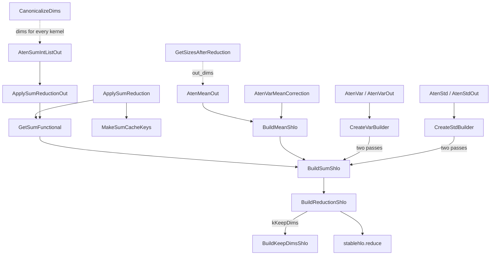

# Reductions - sum, mean, var, std and the shared stablehlo.reduce builder

## Overview
`csrc/ops/reductions` has two layers. The bottom layer is a pair of StableHLO builders: [`BuildReductionShlo`](../catalog/csrc/ops/reductions/reductions.cc.md#BuildReductionShlo "csrc/ops/reductions/reductions.cc:L37") emits one `stablehlo.reduce` over a set of dimensions with a caller-supplied init value and reduction body, optionally restoring the reduced dimensions as size 1, and [`BuildSumShlo`](../catalog/csrc/ops/reductions/sum.cc.md#BuildSumShlo "csrc/ops/reductions/sum.cc:L35") specializes it to addition from zero. These builders are the shared reduce primitive for much of the op library - cross-entropy and NLL loss, norms, softmax, all/any, batch norm, embedding and others call them directly (the min/max kernels are an exception: they emit `stablehlo.reduce` themselves). The top layer is the ATen kernels registered for the reduction ops themselves (sum, mean, var, std, var_mean), plus small helpers that canonicalize `dim`, compute output sizes, and validate dtypes. The single design idea is that every reduction is *one* traced StableHLO region built inside a deferred op: mean is sum-then-divide, var/std are a two-pass "mean, then sum of squared deviations" in an upcast compute dtype, and var_mean produces both results from one op, so XLA sees the whole computation and can fuse it.

## Diagram
How the ATen reduction kernels reach `stablehlo.reduce`.

Legend:
- `SUMK` - [`AtenSumIntListOut`](../catalog/csrc/ops/reductions/sum_aten_kernels.cc.md#AtenSumIntListOut "csrc/ops/reductions/sum_aten_kernels.cc:L36")
- `ASRO` - [`ApplySumReductionOut`](../catalog/csrc/ops/reductions/reduction_utils.cc.md#ApplySumReductionOut "csrc/ops/reductions/reduction_utils.cc:L214")
- `ASR` - [`ApplySumReduction`](../catalog/csrc/ops/reductions/reduction_utils.cc.md#ApplySumReduction "csrc/ops/reductions/reduction_utils.cc:L191")
- `GSF` - [`GetSumFunctional`](../catalog/csrc/ops/reductions/reduction_utils.cc.md#GetSumFunctional "csrc/ops/reductions/reduction_utils.cc:L57")
- `MSK` - [`MakeSumCacheKeys`](../catalog/csrc/ops/reductions/reduction_utils.cc.md#MakeSumCacheKeys "csrc/ops/reductions/reduction_utils.cc:L93")
- `MEANK` - [`AtenMeanOut`](../catalog/csrc/ops/reductions/mean_aten_kernels.cc.md#AtenMeanOut "csrc/ops/reductions/mean_aten_kernels.cc:L71")
- `MEAN` - [`BuildMeanShlo`](../catalog/csrc/ops/reductions/mean_aten_kernels.cc.md#BuildMeanShlo "csrc/ops/reductions/mean_aten_kernels.cc:L59")
- `VARK` - [`AtenVar`](../catalog/csrc/ops/reductions/var_aten_kernels.cc.md#AtenVar "csrc/ops/reductions/var_aten_kernels.cc:L151") and [`AtenVarOut`](../catalog/csrc/ops/reductions/var_aten_kernels.cc.md#AtenVarOut "csrc/ops/reductions/var_aten_kernels.cc:L196")
- `CVB` - [`CreateVarBuilder`](../catalog/csrc/ops/reductions/var_aten_kernels.cc.md#CreateVarBuilder "csrc/ops/reductions/var_aten_kernels.cc:L66")
- `STDK` - [`AtenStd`](../catalog/csrc/ops/reductions/std_aten_kernels.cc.md#AtenStd "csrc/ops/reductions/std_aten_kernels.cc:L136") and [`AtenStdOut`](../catalog/csrc/ops/reductions/std_aten_kernels.cc.md#AtenStdOut "csrc/ops/reductions/std_aten_kernels.cc:L189")
- `CSB` - [`CreateStdBuilder`](../catalog/csrc/ops/reductions/std_aten_kernels.cc.md#CreateStdBuilder "csrc/ops/reductions/std_aten_kernels.cc:L60")
- `VMK` - [`AtenVarMeanCorrection`](../catalog/csrc/ops/reductions/var_aten_kernels.cc.md#AtenVarMeanCorrection "csrc/ops/reductions/var_aten_kernels.cc:L246")
- `SUM` - [`BuildSumShlo`](../catalog/csrc/ops/reductions/sum.cc.md#BuildSumShlo "csrc/ops/reductions/sum.cc:L35")
- `RED` - [`BuildReductionShlo`](../catalog/csrc/ops/reductions/reductions.cc.md#BuildReductionShlo "csrc/ops/reductions/reductions.cc:L37")
- `KEEP` - [`BuildKeepDimsShlo`](../catalog/csrc/ops/reductions/reductions.cc.md#BuildKeepDimsShlo "csrc/ops/reductions/reductions.cc:L73")
- `HLO` - (concept) the emitted `stablehlo.reduce` op
- `CAN` - [`CanonicalizeDims`](../catalog/csrc/ops/reductions/reduction_utils.cc.md#CanonicalizeDims "csrc/ops/reductions/reduction_utils.cc:L119")
- `SIZES` - [`GetSizesAfterReduction`](../catalog/csrc/ops/reductions/reduction_utils.cc.md#GetSizesAfterReduction "csrc/ops/reductions/reduction_utils.cc:L101")

## Design rationale (why it's built this way)
- **One reduce builder, parameterized by body.** [`BuildReductionShlo`](../catalog/csrc/ops/reductions/reductions.cc.md#BuildReductionShlo "csrc/ops/reductions/reductions.cc:L37") takes the reduction body as an `absl::AnyInvocable<void(mlir::RegionBuilder&)>`, so sum, max, min, logical any/all, and fused loss reductions all share the same convert -> reduce -> optional keepdim path. The body is wrapped in a `shared_ptr` only because `mlir::stablehlo::Reduce` takes a `std::function`, which requires copyable captures.
- **The element type passed in is the accumulation type.** Before reducing, the input is converted to `mlir_type` if it differs. This is how callers choose precision: [`BuildSumShlo`](../catalog/csrc/ops/reductions/sum.cc.md#BuildSumShlo "csrc/ops/reductions/sum.cc:L35") uses the explicit `element_type_opt` if given, else the input's own element type, and the zero init constant is built in that same type.
- **keepdim is a reshape after the reduce.** StableHLO `reduce` always drops the reduced axes; [`BuildKeepDimsShlo`](../catalog/csrc/ops/reductions/reductions.cc.md#BuildKeepDimsShlo "csrc/ops/reductions/reductions.cc:L73") reshapes the result back to the input's dimensions with the reduced ones set to 1 (a no-op for rank-0 inputs). It reads the input's `stablehlo::Dimensions`, so bounded dynamic dimensions on the non-reduced axes are preserved.
- **Mean and variance are compositions, not special kernels.** [`BuildMeanShlo`](../catalog/csrc/ops/reductions/mean_aten_kernels.cc.md#BuildMeanShlo "csrc/ops/reductions/mean_aten_kernels.cc:L59") is sum divided by an element-count op; var and std compute `mean = sum(x, keepdim) / n`, `diff = x - mean`, `sum(diff * conj(diff))`, divided by `max(n - correction, 0)`. That is the numerically stable two-pass formula rather than `E[x^2] - E[x]^2`.
- **Upcast low-precision inputs for statistics.** std and var_mean upcast BF16/F16 to F32 "to perform the entire calculation in high precision, avoiding precision loss" via the dispatch `computation_dtype`; mean computes in `ToAccumulateType(dtype)`; var casts inside its builder with `InferComputationDtype` (`at::toOpMathType`). Plain sum does not upcast (see Edge cases).
- **Reuse the general unary/N-ary dispatch.** Sum and mean go through `UnaryOp` / `UnaryOpOut` with a builder closure; var/std/var_mean go through `DispatchOp<2, ...>` with the correction as a second tensor input. No reduction-specific dispatch machinery exists, so all the generic features (deferred execution, compilation cache, computation dtype, out-tensor handling) apply unchanged.

## Entry points
- [`AtenSumIntListOut`](../catalog/csrc/ops/reductions/sum_aten_kernels.cc.md#AtenSumIntListOut "csrc/ops/reductions/sum_aten_kernels.cc:L36") - registered for `aten::sum.IntList_out`; reached for `torch.sum(x, dim, keepdim, dtype, out=...)` and wherever PyTorch routes the functional sum through the out variant.
- [`AtenMeanOut`](../catalog/csrc/ops/reductions/mean_aten_kernels.cc.md#AtenMeanOut "csrc/ops/reductions/mean_aten_kernels.cc:L71") - registered for `aten::mean.out`; rejects non-float, non-complex output dtypes.
- [`AtenVar`](../catalog/csrc/ops/reductions/var_aten_kernels.cc.md#AtenVar "csrc/ops/reductions/var_aten_kernels.cc:L151"), [`AtenVarOut`](../catalog/csrc/ops/reductions/var_aten_kernels.cc.md#AtenVarOut "csrc/ops/reductions/var_aten_kernels.cc:L196"), [`AtenStd`](../catalog/csrc/ops/reductions/std_aten_kernels.cc.md#AtenStd "csrc/ops/reductions/std_aten_kernels.cc:L136"), [`AtenStdOut`](../catalog/csrc/ops/reductions/std_aten_kernels.cc.md#AtenStdOut "csrc/ops/reductions/std_aten_kernels.cc:L189") - the `.correction` overloads of `var` / `std` (default correction 1.0, i.e. Bessel's correction), used by `torch.var`, `torch.std` and by layer-norm-style user code.
- [`AtenVarMeanCorrection`](../catalog/csrc/ops/reductions/var_aten_kernels.cc.md#AtenVarMeanCorrection "csrc/ops/reductions/var_aten_kernels.cc:L246") - `aten::var_mean.correction`; returns both tensors from one dispatched op.
- [`ApplySumReduction`](../catalog/csrc/ops/reductions/reduction_utils.cc.md#ApplySumReduction "csrc/ops/reductions/reduction_utils.cc:L191") - the library entry for other kernels that need "reduce by sum" as a standalone op; dispatches under `OpName::kSum` "as this is not for implementing a specific op, but rather a general reduction utility".
- [`BuildReductionShlo`](../catalog/csrc/ops/reductions/reductions.cc.md#BuildReductionShlo "csrc/ops/reductions/reductions.cc:L37") / [`BuildSumShlo`](../catalog/csrc/ops/reductions/sum.cc.md#BuildSumShlo "csrc/ops/reductions/sum.cc:L35") - called from inside other ops' StableHLO builders (losses, norms, softmax, all/any, batch norm, and more; not the min/max kernels, which build their own reduce) when those ops need an in-graph reduce.
- [`CanonicalizeDims`](../catalog/csrc/ops/reductions/reduction_utils.cc.md#CanonicalizeDims "csrc/ops/reductions/reduction_utils.cc:L119") and [`GetSizesAfterReduction`](../catalog/csrc/ops/reductions/reduction_utils.cc.md#GetSizesAfterReduction "csrc/ops/reductions/reduction_utils.cc:L101") with [`ReductionMode`](../catalog/csrc/ops/reductions/reductions.h.md#ReductionMode "csrc/ops/reductions/reductions.h:L29") - the shape helpers every reduction kernel (here and elsewhere) calls before dispatch.

## Mechanism (step-by-step)
1. **Canonicalize the reduction axes.** [`CanonicalizeDims`](../catalog/csrc/ops/reductions/reduction_utils.cc.md#CanonicalizeDims "csrc/ops/reductions/reduction_utils.cc:L119") maps `-i` to `rank - i`, expands a missing or empty `dim` to all axes `[0, rank)`, accepts only `0` / `-1` for rank-0 tensors (returning no axes), and rejects out-of-range values with `kPythonIndexError` (so Python sees `IndexError`) and duplicates with `kInvalidArgument`.

2. **Compute the output shape.** [`GetSizesAfterReduction`](../catalog/csrc/ops/reductions/reduction_utils.cc.md#GetSizesAfterReduction "csrc/ops/reductions/reduction_utils.cc:L101") picks [`OutputSizesArrayKeepDim`](../catalog/csrc/ops/reductions/reduction_utils.cc.md#OutputSizesArrayKeepDim "csrc/ops/reductions/reduction_utils.cc:L69") ("All reduced dimensions are set to size 1") for [`kKeepDims`](../catalog/csrc/ops/reductions/reductions.h.md#ReductionMode.kKeepDims "csrc/ops/reductions/reductions.h:L29") or [`OutputSizesArrayDiscardDim`](../catalog/csrc/ops/reductions/reduction_utils.cc.md#OutputSizesArrayDiscardDim "csrc/ops/reductions/reduction_utils.cc:L79") ("All reduced dimensions are removed") for [`kDropDims`](../catalog/csrc/ops/reductions/reductions.h.md#ReductionMode.kDropDims "csrc/ops/reductions/reductions.h:L29"). These sizes become the dispatch's `out_dims`, which is how the deferred op knows its result shape without tracing the builder.

3. **Validate dtypes and derive the count.** Mean, var and std call [`ValidateFloatOrComplex`](../catalog/csrc/ops/reductions/reduction_utils.cc.md#ValidateFloatOrComplex "csrc/ops/reductions/reduction_utils.cc:L109") (mean through [`GetOutputScalarType`](../catalog/csrc/ops/reductions/mean_aten_kernels.cc.md#GetOutputScalarType "csrc/ops/reductions/mean_aten_kernels.cc:L50"), which checks the explicit `dtype` or the out tensor's dtype). Var and std compute `n` with [`GetReductionFactor`](../catalog/csrc/ops/reductions/reduction_utils.cc.md#GetReductionFactor "csrc/ops/reductions/reduction_utils.cc:L172"), the product of the reduced sizes using overflow-checked multiplication (or `numel()` with no `dim`), and [`WarnIfInvalidCorrection`](../catalog/csrc/ops/reductions/var_aten_kernels.cc.md#WarnIfInvalidCorrection "csrc/ops/reductions/var_aten_kernels.cc:L137") emits a correctness warning when `n - correction <= 0` (the std file has its own copy, [`WarnIfInvalidCorrection`](../catalog/csrc/ops/reductions/std_aten_kernels.cc.md#WarnIfInvalidCorrection "csrc/ops/reductions/std_aten_kernels.cc:L122")).

4. **Sum.** [`AtenSumIntListOut`](../catalog/csrc/ops/reductions/sum_aten_kernels.cc.md#AtenSumIntListOut "csrc/ops/reductions/sum_aten_kernels.cc:L36") picks the result dtype (`dtype` or the out tensor's dtype) and calls [`ApplySumReductionOut`](../catalog/csrc/ops/reductions/reduction_utils.cc.md#ApplySumReductionOut "csrc/ops/reductions/reduction_utils.cc:L214") with the `TT_KERNEL`-generated cache keys. That canonicalizes dims, computes the output sizes, and runs `UnaryOpOut` with the closure from [`GetSumFunctional`](../catalog/csrc/ops/reductions/reduction_utils.cc.md#GetSumFunctional "csrc/ops/reductions/reduction_utils.cc:L57"), which captures the dims by value and calls [`BuildSumShlo`](../catalog/csrc/ops/reductions/sum.cc.md#BuildSumShlo "csrc/ops/reductions/sum.cc:L35") with the result dtype as the accumulation type. The non-out helper [`ApplySumReduction`](../catalog/csrc/ops/reductions/reduction_utils.cc.md#ApplySumReduction "csrc/ops/reductions/reduction_utils.cc:L191") builds its own keys with [`MakeSumCacheKeys`](../catalog/csrc/ops/reductions/reduction_utils.cc.md#MakeSumCacheKeys "csrc/ops/reductions/reduction_utils.cc:L93") - just `keep_dim` and the canonical dims.

5. **Emit the reduce.** [`BuildReductionShlo`](../catalog/csrc/ops/reductions/reductions.cc.md#BuildReductionShlo "csrc/ops/reductions/reductions.cc:L37") converts the input to the accumulation type when needed, emits `stablehlo.reduce(input, init, body, dims)`, and for keepdim calls [`BuildKeepDimsShlo`](../catalog/csrc/ops/reductions/reductions.cc.md#BuildKeepDimsShlo "csrc/ops/reductions/reductions.cc:L73") to reshape the size-1 axes back in. The output of the reduce is in the accumulation type; casting to the requested out dtype is left to the surrounding dispatch.

6. **Mean.** [`AtenMeanOut`](../catalog/csrc/ops/reductions/mean_aten_kernels.cc.md#AtenMeanOut "csrc/ops/reductions/mean_aten_kernels.cc:L71") canonicalizes dims *before* entering `TT_KERNEL` and passes the canonical dims as a kernel argument, so they, not the user's raw `dim`, enter the cache key. It sets `computation_dtype = ToAccumulateType(dtype)` on `UnaryOpOut` and builds [`BuildMeanShlo`](../catalog/csrc/ops/reductions/mean_aten_kernels.cc.md#BuildMeanShlo "csrc/ops/reductions/mean_aten_kernels.cc:L59"): a sum in that computation dtype divided by the element count of the reduced axes (`GetNumElements` emits a constant for static axes and a runtime size computation only when a reduced axis is dynamic).

7. **Variance and standard deviation.** [`AtenVar`](../catalog/csrc/ops/reductions/var_aten_kernels.cc.md#AtenVar "csrc/ops/reductions/var_aten_kernels.cc:L151") and [`AtenStd`](../catalog/csrc/ops/reductions/std_aten_kernels.cc.md#AtenStd "csrc/ops/reductions/std_aten_kernels.cc:L136") wrap the correction in a [`PromotedScalar`](../catalog/csrc/common/cache_key.h.md#PromotedScalar "csrc/common/cache_key.h:L98") ("A scalar value that is promoted to a tensor lazily") and dispatch a two-input op `{self, correction_tensor}`. [`CreateVarBuilder`](../catalog/csrc/ops/reductions/var_aten_kernels.cc.md#CreateVarBuilder "csrc/ops/reductions/var_aten_kernels.cc:L66") casts `self` to its op-math type, sums with keepdim, divides by the constant `n`, subtracts, squares (real^2 + imag^2 for complex), sums again with the requested keepdim mode, divides by `max(n - correction, 0)`, and casts to the output dtype. [`CreateStdBuilder`](../catalog/csrc/ops/reductions/std_aten_kernels.cc.md#CreateStdBuilder "csrc/ops/reductions/std_aten_kernels.cc:L60") is the same with `diff * conj(diff)` and a final `sqrt`, and relies on the dispatch `computation_dtype = F32` for BF16/F16 inputs or outputs. Complex inputs return the real value type.

8. **Fused var_mean.** [`AtenVarMeanCorrection`](../catalog/csrc/ops/reductions/var_aten_kernels.cc.md#AtenVarMeanCorrection "csrc/ops/reductions/var_aten_kernels.cc:L246") dispatches a single `DispatchOp<2, 2>` whose builder computes the keepdim mean once via [`BuildMeanShlo`](../catalog/csrc/ops/reductions/mean_aten_kernels.cc.md#BuildMeanShlo "csrc/ops/reductions/mean_aten_kernels.cc:L59"), reshapes it away for the `keepdim=False` mean output, reuses it for the deviations, and returns `{var, mean}` - one op, one compiled region, with F32 compute for BF16/F16. The resulting buffers are wrapped back into ATen tensors with [`MakeTensor`](../catalog/csrc/eager/tensor_to_buffer.cc.md#MakeTensor "csrc/eager/tensor_to_buffer.cc:L392").

## Key data structures
- **[`ReductionMode`](../catalog/csrc/ops/reductions/reductions.h.md#ReductionMode "csrc/ops/reductions/reductions.h:L29")**: `kKeepDims` or `kDropDims` (default for [`BuildReductionShlo`](../catalog/csrc/ops/reductions/reductions.cc.md#BuildReductionShlo "csrc/ops/reductions/reductions.cc:L37")); every kernel maps the ATen `keepdim` bool onto it.
- **Canonical dims**: a [`Dimensions`](../catalog/csrc/common/dimension_types.h.md#Dimensions "csrc/common/dimension_types.h:L33") vector of non-negative, unique axis indices in the order the user gave them (not sorted).
- **Cache keys**: an [`OpParamCacheKeys`](../catalog/csrc/common/cache_key.h.md#OpParamCacheKeys "csrc/common/cache_key.h:L541") map; for the generic sum helper it holds `keep_dim` and `dims`, for the ATen kernels it is generated by `TT_KERNEL` from the argument list (so its exact content depends on what each kernel passes in, e.g. canonical dims for mean versus raw `dim` for sum).
- **Builder closures**: the `NAryMlirOpBuilder` / unary builder lambdas capture dims, mode, `n` and dtypes by value; they are stored in the deferred op and run only when the graph is lowered.

## Dynamics (design intent)
- All shape and dtype decisions (canonical dims, output sizes, `n`, computation dtype) are made eagerly on the host at dispatch; the StableHLO body is built later, when the deferred op is traced, from the captured values.
- `n` in var/std is a compile-time constant computed from static sizes, while the correction is a runtime tensor operand; the mean's element count is a constant unless a reduced axis is dynamic.
- No reduction-specific tests are listed in the packet evidence; behavior described here comes from the kernel sources.

> [!inferred]
> TPU-performance reading of the above, not stated in the source: (a) because the reduce body and the elementwise prologue/epilogue (convert, subtract, square, divide, sqrt) are emitted in one region, XLA can fuse a whole `var`/`std` into reduction fusions, but the two-pass formula still needs two reduces over the input - roughly two reads of `x` from HBM when the input does not fit on-chip - which is the price of numerical stability; (b) `var_mean` computes both outputs for the cost of `var`, so it is cheaper than separate `var` and `mean` calls; (c) passing `correction` as a tensor operand means different correction values reuse one compiled program, while a new reduction size or axis set produces a new cache key; (d) since the mean kernel keys on canonical dims, `dim=-1` and `dim=rank-1` share a compiled program, whereas the sum kernel's `TT_KERNEL` keys on the raw `dim` argument and may compile them separately.

## Edge cases
- **Sum does not upcast.** `ApplySumReductionOut` passes the result dtype as the accumulation type and `UnaryOpOut` is called without a `computation_dtype`, so `x.sum()` on a BF16 tensor emits a BF16 `stablehlo.reduce` (the compiler may still choose a wider internal accumulator; that is not controlled here). Pass `dtype=torch.float32` to force F32 accumulation. Mean, var, std and var_mean upcast as described above.
- `mean` with an integer `dtype` or integer out tensor fails `ValidateFloatOrComplex` (`InvalidArgument`) instead of computing an integer mean; the same holds for var/std inputs.
- `AtenMeanOut` calls `CanonicalizeDims` with `TT_ASSIGN_OR_THROW` before `TT_KERNEL`, so an out-of-range `dim` is thrown outside the kernel's `TtError` translation; see [error-handling](error-handling.md) for what that changes in the Python exception type.
- A correction `>= n` produces `max(n - correction, 0) = 0` in the denominator (inf/NaN results) after a `kCorrectness` warning.
- Keepdim on a rank-0 input is a no-op; reducing a rank-0 tensor over `dim=0` or `-1` reduces over no axes.
- `CanonicalizeDims` preserves the user's axis order, so `dim=(1, 0)` and `dim=(0, 1)` produce different canonical lists (and potentially different cache keys) for the same reduction.

## Open questions
- The functional `aten::sum.dim_IntList` and `aten::mean.dim` are not registered in this subsystem (only the `out` variants plus var/std/var_mean are); how PyTorch routes the functional forms to these kernels for the TPU backend, and whether an intermediate out allocation appears in the trace, is not settled by the files read.
- `UnaryOp` / `UnaryOpOut` / `DispatchOp`, `GetNumElements`, `ToAccumulateType` and `InferComputationDtype` are outside the subgraph; their exact casting rules (for example where the final cast to the out dtype is inserted) were read in source but are not linked here.
- `AtenVar` registers under `OpName::kVarCorrection` but its `TT_KERNEL` uses `OpName::kVar`; whether that mismatch affects profiling op names or cache keys was not traced.

## See also
- [eager-op-dispatch](eager-op-dispatch.md) - `DispatchOp`, `computation_dtype` and out-tensor handling used by every reduction kernel.
- [aten-kernel-authoring](aten-kernel-authoring.md) - the `TT_KERNEL` macro and how its arguments become cache keys.
- [stablehlo-op-builder](stablehlo-op-builder.md) - the StableHLO builder APIs (`Reduce`, `Reshape`, constants).
- [dtype-and-precision](dtype-and-precision.md) - accumulation and op-math dtype rules behind the upcasts.
- [compilation-cache-key](compilation-cache-key.md) - how `OpParamCacheKeys` enter the compiled-program key.
- [error-handling](error-handling.md) - the status codes used for invalid `dim` and dtype arguments.
