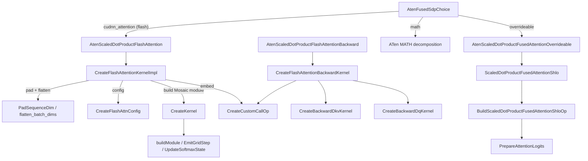

# Scaled dot-product attention - backend choice, Mosaic flash kernels, and the StableHLO fallback

<!-- connect:up:begin -->
> **Cross-repo concept:** part of [flash-attention](../../../concepts/flash-attention.md), [mosaic-kernel](../../../concepts/mosaic-kernel.md), [vmem](../../../concepts/vmem.md), [vmem-budget](../../../concepts/vmem-budget.md) across this wiki's repos.
<!-- connect:up:end -->
## Overview

`torch.nn.functional.scaled_dot_product_attention` on a `tpu` tensor ends up in one of three
places, and which one is decided per call by
[`AtenFusedSdpChoice`](../catalog/csrc/ops/scaled_dot_product_attention/scaled_dot_product_attention_aten_kernels.cc.md#AtenFusedSdpChoice "csrc/ops/scaled_dot_product_attention/scaled_dot_product_attention_aten_kernels.cc:L123"):
(1) the **flash path** - a C++-built Mosaic TPU kernel emitted as a `tpu_custom_call` inside the
op's StableHLO, reached through PyTorch's *cuDNN* attention op name; (2) the **overrideable path** -
an "SHLO optimized MATH" StableHLO graph that XLA fuses on its own; (3) PyTorch's generic **MATH**
decomposition into separate ATen ops. The key design idea is that the flash kernel is not a
precompiled binary: every call builds a Mosaic MLIR module whose tile sizes, grid, padding, GQA
mapping, causal skipping and dropout are specialized to the static shapes, serialized, and embedded
in the deferred StableHLO op, so it participates in the normal compile/cache pipeline like any other
op. The StableHLO fallback exists for everything the kernel cannot do - chiefly dynamic shapes and
odd head dims.

## Diagram

Legend:
- `CHOICE` - [`AtenFusedSdpChoice`](../catalog/csrc/ops/scaled_dot_product_attention/scaled_dot_product_attention_aten_kernels.cc.md#AtenFusedSdpChoice "csrc/ops/scaled_dot_product_attention/scaled_dot_product_attention_aten_kernels.cc:L123")
- `FWD` - [`AtenScaledDotProductFlashAttention`](../catalog/csrc/ops/scaled_dot_product_attention/scaled_dot_product_attention_aten_kernels.cc.md#AtenScaledDotProductFlashAttention "csrc/ops/scaled_dot_product_attention/scaled_dot_product_attention_aten_kernels.cc:L319")
- `OVR` - [`AtenScaledDotProductFusedAttentionOverrideable`](../catalog/csrc/ops/scaled_dot_product_attention/scaled_dot_product_attention_aten_kernels.cc.md#AtenScaledDotProductFusedAttentionOverrideable "csrc/ops/scaled_dot_product_attention/scaled_dot_product_attention_aten_kernels.cc:L249")
- `MATH` - (concept) PyTorch's own composite implementation, not torch_tpu code
- `IMPL` - [`CreateFlashAttentionKernelImpl`](../catalog/csrc/ops/scaled_dot_product_attention/flash_attention_kernel_builder.cc.md#CreateFlashAttentionKernelImpl "csrc/ops/scaled_dot_product_attention/flash_attention_kernel_builder.cc:L468")
- `PAD` - [`PadSequenceDim`](../catalog/csrc/ops/scaled_dot_product_attention/flash_attention_kernel_builder.cc.md#PadSequenceDim "csrc/ops/scaled_dot_product_attention/flash_attention_kernel_builder.cc:L279"), [`flatten_batch_dims`](../catalog/csrc/ops/scaled_dot_product_attention/helpers.cc.md#flatten_batch_dims "csrc/ops/scaled_dot_product_attention/helpers.cc:L59")
- `CFG` - [`CreateFlashAttnConfig`](../catalog/csrc/ops/scaled_dot_product_attention/flash_attention_kernel_builder.cc.md#CreateFlashAttnConfig "csrc/ops/scaled_dot_product_attention/flash_attention_kernel_builder.cc:L370")
- `KERN` - [`CreateKernel`](../catalog/csrc/ops/scaled_dot_product_attention/flash_attention_kernel.cc.md#CreateKernel "csrc/ops/scaled_dot_product_attention/flash_attention_kernel.cc:L557")
- `BODY` - [`buildModule`](../catalog/csrc/ops/scaled_dot_product_attention/flash_attention_kernel.cc.md#buildModule "csrc/ops/scaled_dot_product_attention/flash_attention_kernel.cc:L401"), [`EmitGridStep`](../catalog/csrc/ops/scaled_dot_product_attention/flash_attention_kernel.cc.md#EmitGridStep "csrc/ops/scaled_dot_product_attention/flash_attention_kernel.cc:L345"), [`UpdateSoftmaxState`](../catalog/csrc/ops/scaled_dot_product_attention/flash_attention_kernel.cc.md#UpdateSoftmaxState "csrc/ops/scaled_dot_product_attention/flash_attention_kernel.cc:L224")
- `CC` - `CreateCustomCallOp`
- `BWD` - [`AtenScaledDotProductFlashAttentionBackward`](../catalog/csrc/ops/scaled_dot_product_attention/scaled_dot_product_attention_aten_kernels.cc.md#AtenScaledDotProductFlashAttentionBackward "csrc/ops/scaled_dot_product_attention/scaled_dot_product_attention_aten_kernels.cc:L353")
- `BIMPL` - [`CreateFlashAttentionBackwardKernel`](../catalog/csrc/ops/scaled_dot_product_attention/flash_attention_kernel_builder.cc.md#CreateFlashAttentionBackwardKernel "csrc/ops/scaled_dot_product_attention/flash_attention_kernel_builder.cc:L698")
- `DKV` - [`CreateBackwardDkvKernel`](../catalog/csrc/ops/scaled_dot_product_attention/flash_attention_backward_kernel.cc.md#CreateBackwardDkvKernel "csrc/ops/scaled_dot_product_attention/flash_attention_backward_kernel.cc:L568")
- `DQ` - [`CreateBackwardDqKernel`](../catalog/csrc/ops/scaled_dot_product_attention/flash_attention_backward_kernel.cc.md#CreateBackwardDqKernel "csrc/ops/scaled_dot_product_attention/flash_attention_backward_kernel.cc:L710")
- `SHLO` - [`ScaledDotProductFusedAttentionShlo`](../catalog/csrc/ops/scaled_dot_product_attention/scaled_dot_product_attention_shlo.cc.md#ScaledDotProductFusedAttentionShlo "csrc/ops/scaled_dot_product_attention/scaled_dot_product_attention_shlo.cc:L885")
- `SHLOOP` - [`BuildScaledDotProductFusedAttentionShloOp`](../catalog/csrc/ops/scaled_dot_product_attention/scaled_dot_product_attention_shlo.cc.md#BuildScaledDotProductFusedAttentionShloOp "csrc/ops/scaled_dot_product_attention/scaled_dot_product_attention_shlo.cc:L473")
- `PREP` - [`PrepareAttentionLogits`](../catalog/csrc/ops/scaled_dot_product_attention/scaled_dot_product_attention_shlo.cc.md#PrepareAttentionLogits "csrc/ops/scaled_dot_product_attention/scaled_dot_product_attention_shlo.cc:L203")

### Backend selection at a glance

| Condition (checked in order) | Result | Warning |
|---|---|---|
| FLASH enabled, dtype f32/bf16, static shapes, rank >= 4, batch >= 1, head_dim < 128 or % 128 == 0, equal ranks, 0 <= dropout_p < 1, mask not requiring grad | `cudnn_attention` -> Mosaic flash kernel | - |
| else, MATH or OVERRIDEABLE enabled, equal ranks, rank >= 4, dropout_p == 0, floating (non-complex) dtype, mask not requiring grad | `overrideable` -> StableHLO graph | one-time `kPerformance` warning listing the flash conditions |
| else, MATH enabled | `math` -> ATen decomposition | one-time warning listing the SHLO conditions |
| else | error: "no viable SDPBackend found" | - |

## Design rationale (why it's built this way)

**The flash kernel hides behind the cuDNN op name because of upstream PyTorch plumbing.** The
author's comment on
[`AtenFusedSdpChoice`](../catalog/csrc/ops/scaled_dot_product_attention/scaled_dot_product_attention_aten_kernels.cc.md#AtenFusedSdpChoice "csrc/ops/scaled_dot_product_attention/scaled_dot_product_attention_aten_kernels.cc:L123")
is blunt - "Torch's extensibility is pretty gross here due to weird SDPA implementation":
`_fused_sdp_choice_stub` can be overridden for PrivateUse1, but the CPU/CUDA backend selectors it
normally calls are not overrideable and hard-code their supported backends. So torch_tpu inlines the
`at::globalContext()` flag checks itself and returns the enum value `cudnn_attention` for its flash
kernel. The op-name table explains why it is cuDNN and not flash: "the pytorch logic calls the CPU
version for flash_attention rather than our implementation on non-CUDA devices", so
[`AtenScaledDotProductFlashAttention`](../catalog/csrc/ops/scaled_dot_product_attention/scaled_dot_product_attention_aten_kernels.cc.md#AtenScaledDotProductFlashAttention "csrc/ops/scaled_dot_product_attention/scaled_dot_product_attention_aten_kernels.cc:L319")
"implements the interface of scaled_dot_product_cudnn_attention" (returns the 9-tuple with
`cum_seq_q/k`, philox seed/offset, debug mask). In a profile or an op-name trace, attention served by
the flash kernel therefore shows up as `_scaled_dot_product_cudnn_attention`.

**Warn, don't fail.** The selector's comment states the policy: "to support easy migration for
users, we only warn on an unsupported backend instead of erroring (we only error if *all* backends
are disabled)." A silently slower attention is the result: if a model's attention is unexpectedly
slow, look for the one-time `kPerformance` warning that enumerates exactly which flash condition
failed (it prints the query's symbolic sizes so torch.compile shapes are not specialized).

**Build the kernel per shape instead of shipping a fixed kernel.** Because the kernel is emitted
from C++ inside the StableHLO op builder (see [Mosaic matmul and kernel-emission helpers](mosaic-matmul.md)),
every structural decision - whether there is a mask operand, a dropout seed operand, an LSE output,
causal tile skipping, a single-KV-step fast path, a GQA head mapping - is a compile-time branch, and
the kernel never carries dead operands. The cost is that each distinct shape/flag combination is a
distinct kernel; the cache keys on the TT_KERNEL calls deliberately mark arguments that cannot change
the emitted module with `IgnoreInCacheKey(..., "Unused")` / "Delegates to implementation", and the
implementation adds `is_causal`, `scale`, `dropout_p`, `attn_bias`, `return_lse` and the precision to
its own param keys.

**Softmax in the log2 domain.** `kLog2e` is folded into the logit scale so the kernels can use the
cheaper `exp2`/`log2` EUP ops; "as a consequence the LSE returned by the forward kernel (and
consumed by the backward kernel) is log2-sum-exp2, i.e. the natural LSE multiplied by log2(e)"
(comment in `flash_attention_config.h`). The flash forward and backward are a matched pair - the LSE
is an internal contract, not a natural-log value you can compare with another backend's.

**Two block sizes, not one.** [`Tiling`](../catalog/csrc/ops/scaled_dot_product_attention/flash_attention_config.h.md#Tiling "csrc/ops/scaled_dot_product_attention/flash_attention_config.h:L53")
has `qt`/`kt` - "Q / KV block sizes that are DMA'd per grid step" - and a separate `kc`, the "KV
sub-block size the forward kernel computes on within a grid step. This decouples the (large) DMA
block, which amortizes the per grid step overhead, from the (smaller) compute block, which bounds the
size of the [qt, kc] softmax intermediates."

**The StableHLO path is "an optimized version of MATH".** The selector tries it whenever MATH *or*
OVERRIDEABLE is enabled, because it is one fused-friendly StableHLO op rather than many ATen ops.
It is written to cooperate with XLA: for half-precision inputs only the softmax is promoted to f32
("keeping all matrix multiplications in native half precision on TPU MXUs"), and the softmax is
emitted as `Div(exp, Broadcast(sum_exp))` whenever XLA's online-softmax rewriter can match it (and also for unaligned or small shapes); only aligned, large shapes that the rewriter cannot match get a precomputed-reciprocal `Mul` instead.

## Entry points

- [`AtenFusedSdpChoice`](../catalog/csrc/ops/scaled_dot_product_attention/scaled_dot_product_attention_aten_kernels.cc.md#AtenFusedSdpChoice "csrc/ops/scaled_dot_product_attention/scaled_dot_product_attention_aten_kernels.cc:L123") - registered against `_fused_sdp_choice_stub` with `REGISTER_PRIVATEUSE1_DISPATCH` in `csrc/eager/tpu_aten_kernels.cc`; reached once per `F.scaled_dot_product_attention` call (eager or while tracing) and returns the `SDPBackend` enum that PyTorch then dispatches on.
- [`AtenScaledDotProductFlashAttention`](../catalog/csrc/ops/scaled_dot_product_attention/scaled_dot_product_attention_aten_kernels.cc.md#AtenScaledDotProductFlashAttention "csrc/ops/scaled_dot_product_attention/scaled_dot_product_attention_aten_kernels.cc:L319") / [`AtenScaledDotProductFlashAttentionBackward`](../catalog/csrc/ops/scaled_dot_product_attention/scaled_dot_product_attention_aten_kernels.cc.md#AtenScaledDotProductFlashAttentionBackward "csrc/ops/scaled_dot_product_attention/scaled_dot_product_attention_aten_kernels.cc:L353") - the PrivateUse1 impls of `_scaled_dot_product_cudnn_attention` and its backward, registered in `TORCH_LIBRARY_IMPL_init_aten_PrivateUse1_3`; hit when the selector returned `cudnn_attention` and when autograd runs the corresponding backward.
- [`AtenScaledDotProductFusedAttentionOverrideable`](../catalog/csrc/ops/scaled_dot_product_attention/scaled_dot_product_attention_aten_kernels.cc.md#AtenScaledDotProductFusedAttentionOverrideable "csrc/ops/scaled_dot_product_attention/scaled_dot_product_attention_aten_kernels.cc:L249") / [`AtenScaledDotProductFusedAttentionOverrideableBackward`](../catalog/csrc/ops/scaled_dot_product_attention/scaled_dot_product_attention_aten_kernels.cc.md#AtenScaledDotProductFusedAttentionOverrideableBackward "csrc/ops/scaled_dot_product_attention/scaled_dot_product_attention_aten_kernels.cc:L276") - impls of `_scaled_dot_product_fused_attention_overrideable[_backward]`; hit when the selector returned `overrideable`. Both read `allowFP16BF16ReductionMathSDP()` and record it as the `allow_fp16_bf16_reduction` cache param.
- [`CreateFlashAttentionBackwardKernel`](../catalog/csrc/ops/scaled_dot_product_attention/flash_attention_kernel_builder.cc.md#CreateFlashAttentionBackwardKernel "csrc/ops/scaled_dot_product_attention/flash_attention_kernel_builder.cc:L698") - one of the two builder functions called from outside its file (the other is the forward wrapper `CreateFlashAttentionKernel`); called by the flash backward entry, it builds both backward kernels into one deferred op.

## Mechanism (step-by-step)

1. **Choose the backend.** [`AtenFusedSdpChoice`](../catalog/csrc/ops/scaled_dot_product_attention/scaled_dot_product_attention_aten_kernels.cc.md#AtenFusedSdpChoice "csrc/ops/scaled_dot_product_attention/scaled_dot_product_attention_aten_kernels.cc:L123") reads `userEnabledFlashSDP / MathSDP / OverrideableSDP` and applies the table above. The shape check rejects any input that has symbolic sizes (torch.compile dynamic shapes) or bounded dynamic dimensions on its device buffer (eager `mark_dynamic`) - "Flash attention (Mosaic) does not support dynamic shapes / bounded dynamism" - and requires the head dim to be below 128 or a multiple of 128. Batch size is computed with [`get_batch_size`](../catalog/csrc/ops/scaled_dot_product_attention/helpers.cc.md#get_batch_size "csrc/ops/scaled_dot_product_attention/helpers.cc:L83"), the product of every dim before the last three.

2. **Defer the forward op.** [`AtenScaledDotProductFlashAttention`](../catalog/csrc/ops/scaled_dot_product_attention/scaled_dot_product_attention_aten_kernels.cc.md#AtenScaledDotProductFlashAttention "csrc/ops/scaled_dot_product_attention/scaled_dot_product_attention_aten_kernels.cc:L319") forwards (through the public wrapper `CreateFlashAttentionKernel`) to [`CreateFlashAttentionKernelImpl`](../catalog/csrc/ops/scaled_dot_product_attention/flash_attention_kernel_builder.cc.md#CreateFlashAttentionKernelImpl "csrc/ops/scaled_dot_product_attention/flash_attention_kernel_builder.cc:L468"), which first runs [`ValidateDtype`](../catalog/csrc/ops/scaled_dot_product_attention/flash_attention_kernel_builder.cc.md#ValidateDtype "csrc/ops/scaled_dot_product_attention/flash_attention_kernel_builder.cc:L271") (f32 or bf16 only, otherwise "unsupported dtype for sdpa custom kernel"), then packages everything into an op-builder lambda handed to `DispatchOp`. The LSE output is requested exactly when PyTorch passes `compute_log_sumexp = true`; the wrapper's own fallback (grad mode on and any of q/k/v requires grad) applies only to callers that omit the flag, which this ATen entry never does. Without LSE, the kernel skips both the LSE store and its transpose. With dropout, the dispatch is wrapped in `DispatchRngOpGeneral` so the generator state becomes an extra input.

3. **Pick tiles against a VMEM budget.** Inside the lambda the file-local tiling heuristic derives a [`Tiling`](../catalog/csrc/ops/scaled_dot_product_attention/flash_attention_config.h.md#Tiling "csrc/ops/scaled_dot_product_attention/flash_attention_config.h:L53") per call. The starting tile is 128 for seq <= 128, 256 for seq <= 256, and otherwise the **whole sequence rounded up to a multiple of 256**; it then repeatedly halves the larger of [`qt`](../catalog/csrc/ops/scaled_dot_product_attention/flash_attention_config.h.md#Tiling.qt "csrc/ops/scaled_dot_product_attention/flash_attention_config.h:L55") / [`kt`](../catalog/csrc/ops/scaled_dot_product_attention/flash_attention_config.h.md#Tiling.kt "csrc/ops/scaled_dot_product_attention/flash_attention_config.h:L56") (never below 256) until an estimate fits. The estimate counts double-buffered q/k/v/out blocks, two live f32 `[qt, kt]` tiles for S and P (six with dropout), the mask block, and doubles everything for the backward. The budget is half of the per-generation VMEM capacity looked up from the PJRT device kind ("Limit to 50% of capacity to avoid spilling"): 128 MiB on v5e/v6e and 64 MiB on v5p/TPU7x/TPU8 parts, giving ~64 MiB / ~32 MiB, with a 16 MiB capacity fallback for unknown kinds. The KV compute sub-tile `kc` is `kt` below 1024, else the largest multiple of 256 (<= 1024) dividing `kt`.

4. **Normalize shapes: flatten, pad, configure.** [`CreateFlashAttnConfig`](../catalog/csrc/ops/scaled_dot_product_attention/flash_attention_kernel_builder.cc.md#CreateFlashAttnConfig "csrc/ops/scaled_dot_product_attention/flash_attention_kernel_builder.cc:L370") fills a [`FlashAttnConfig`](../catalog/csrc/ops/scaled_dot_product_attention/flash_attention_config.h.md#FlashAttnConfig "csrc/ops/scaled_dot_product_attention/flash_attention_config.h:L31"): the flattened [`batch_size`](../catalog/csrc/ops/scaled_dot_product_attention/flash_attention_config.h.md#FlashAttnConfig.batch_size "csrc/ops/scaled_dot_product_attention/flash_attention_config.h:L33"), q and kv head counts (rejecting `num_heads % kv_num_heads != 0`), separate qk and vo head dims, padded sequence lengths (rounded up to `qt` / `kt`), default scale `1/sqrt(head_dim)`, mask broadcast dims, and - for f32 inputs only - the MXU contraction precision taken from the thread's matmul precision (`HIGHEST` -> `kFP32`, `HIGH` -> `kBF16x3`, otherwise unset, i.e. one-pass bf16). It rejects `is_causal` together with a bias. The lambda then reshapes q/k/v to 4-D `[B, N, S, D]` with [`flatten_batch_dims`](../catalog/csrc/ops/scaled_dot_product_attention/helpers.cc.md#flatten_batch_dims "csrc/ops/scaled_dot_product_attention/helpers.cc:L59") and zero-pads the sequence dim with [`PadSequenceDim`](../catalog/csrc/ops/scaled_dot_product_attention/flash_attention_kernel_builder.cc.md#PadSequenceDim "csrc/ops/scaled_dot_product_attention/flash_attention_kernel_builder.cc:L279") (a `stablehlo.pad`); the bias is zero-padded too because "the bias will be combined with the structured bias within the kernel".

5. **Emit the forward Mosaic module.** [`CreateKernel`](../catalog/csrc/ops/scaled_dot_product_attention/flash_attention_kernel.cc.md#CreateKernel "csrc/ops/scaled_dot_product_attention/flash_attention_kernel.cc:L557") validates divisibility, dropout range and `kc` ("a multiple of 128 that divides the KV tile size"), then [`buildModule`](../catalog/csrc/ops/scaled_dot_product_attention/flash_attention_kernel.cc.md#buildModule "csrc/ops/scaled_dot_product_attention/flash_attention_kernel.cc:L401") creates `flash_forward`: four i32 grid indices `(batch, head, q_block, kv_block)`, an optional SMEM seed, VMEM blocks q `[1,1,qt,Dqk]`, k/v `[1,1,kt,D]`, optional mask `[1,1,qt,kt]`, output, optional LSE `[1,1,1,qt]` (f32), and three f32 scratch buffers: the unnormalized output and the running max/sum stored lane-replicated as `[qt, 128]`. Scratch is zeroed on `kv_block == 0` and the normalized output is written on the last KV block. Two specializations matter for speed: when the whole padded KV fits in one tile and the call is not causal (`is_single_kv_step`) the scratch round trip is skipped entirely; with `is_causal`, tiles strictly above the diagonal are wrapped in an `scf.if` and skipped, and only tiles intersecting the diagonal get the masked variant of the step - "tiles strictly below it are computed without any masking overhead".

6. **Compute one grid step.** [`EmitGridStep`](../catalog/csrc/ops/scaled_dot_product_attention/flash_attention_kernel.cc.md#EmitGridStep "csrc/ops/scaled_dot_product_attention/flash_attention_kernel.cc:L345") processes the `[qt, kt]` tile as a static grid of `[band_rows, kc]` sub-blocks; q is pre-scaled by `scale * log2(e)` with [`ScaleValue`](../catalog/csrc/ops/scaled_dot_product_attention/util.cc.md#ScaleValue "csrc/ops/scaled_dot_product_attention/util.cc:L360"). On a square causal diagonal tile, `band_rows = kc` so sub-blocks above the diagonal are skipped and only the diagonal ones are masked. [`UpdateSoftmaxState`](../catalog/csrc/ops/scaled_dot_product_attention/flash_attention_kernel.cc.md#UpdateSoftmaxState "csrc/ops/scaled_dot_product_attention/flash_attention_kernel.cc:L224") is the online-softmax core: `S = q K^T` on the MXU (f32 accumulate), add the log2e-scaled bias, apply structured (padding/causal) masking, update the running max and `exp2`-based sum, cast P back to the input dtype with `ConvertElementType` so the `P V` matmul runs at input precision, and rescale the accumulator. With a mask it clamps the row max rather than the logits, so fully masked rows yield `exp2(-inf) = 0` "without any vector compare or select on p in the inner loop". Dropout (Philox keep mask from the seed and block indices) is applied only to the probabilities feeding `P V`; the statistics stay undropped "because the backward pass recomputes P from the LSE". The final store divides by a zero-guarded `l` and writes `lse = m + log2(l)` (`-inf` for empty rows) transposed onto the lane dimension.

7. **Describe the grid to Mosaic.** [`SetKernelAttributes`](../catalog/csrc/ops/scaled_dot_product_attention/flash_attention_kernel.cc.md#SetKernelAttributes "csrc/ops/scaled_dot_product_attention/flash_attention_kernel.cc:L84") sets `iteration_bounds = [B, N, Sq_pad/qt, Skv_pad/kt]`, `dimension_semantics` parallel for the first three axes and arbitrary for the KV axis (the reduction carried through scratch), `scratch_operands = 3`, and per-operand `window_params`. Q, output and LSE use affine maps over `(b, h, i)`. K and V use [`v_map`](../catalog/csrc/ops/scaled_dot_product_attention/util.h.md#KVWindowMaps.v_map "csrc/ops/scaled_dot_product_attention/util.h:L43") and its K twin, which point at a generated `kv_transform_indices` function because "Mosaic's AffineMap doesn't support FloorDiv": it maps a q head to `head / group_size` (GQA/MQA without replicating K/V in HBM) and, for causal, redirects a skipped KV block to block 0 so the pipeline prefetches the next row's first block instead of a block that will never be used. Mask maps zero out broadcast dims.

8. **Embed as a custom call and restore the user layout.** `CreateCustomCallOp` serializes the module (versioned Mosaic serde) and emits `stablehlo.custom_call @tpu_custom_call` with a backend config carrying the base64 kernel body, `needs_layout_passes: true`, `DEVICE_TYPE_TENSORCORE`, and a scoped VMEM reservation equal to the same 50% budget; operand/result layouts are default row-major. The padded output is sliced back to the real sequence length and reshaped with [`unflatten_batch_dims`](../catalog/csrc/ops/scaled_dot_product_attention/helpers.cc.md#unflatten_batch_dims "csrc/ops/scaled_dot_product_attention/helpers.cc:L77"); the LSE is sliced and transposed to the cuDNN `[B, N, S, 1]` contract in StableHLO (a TODO says to fold this into the kernel). The output tensor is returned with the meta function's strides via `ContiguousToView`, and LSE / philox tensors are constructed first so an early materialization cannot drop their buffers.

9. **Backward: precompute di, then two kernels.** [`AtenScaledDotProductFlashAttentionBackward`](../catalog/csrc/ops/scaled_dot_product_attention/scaled_dot_product_attention_aten_kernels.cc.md#AtenScaledDotProductFlashAttentionBackward "csrc/ops/scaled_dot_product_attention/scaled_dot_product_attention_aten_kernels.cc:L353") calls [`CreateFlashAttentionBackwardKernel`](../catalog/csrc/ops/scaled_dot_product_attention/flash_attention_kernel_builder.cc.md#CreateFlashAttentionBackwardKernel "csrc/ops/scaled_dot_product_attention/flash_attention_kernel_builder.cc:L698"). It re-derives tiling with `is_backward = true` (the doubled VMEM estimate usually yields smaller tiles than the forward), computes `di = rowsum(out * grad_out)` in f32 StableHLO, transposes the LSE back to `[B, N, 1, S]`, pads everything, and emits two custom calls in the same deferred op. [`CreateBackwardDkvKernel`](../catalog/csrc/ops/scaled_dot_product_attention/flash_attention_backward_kernel.cc.md#CreateBackwardDkvKernel "csrc/ops/scaled_dot_product_attention/flash_attention_backward_kernel.cc:L568") builds `flash_backward_dkv` via [`buildBackwardDkvModule`](../catalog/csrc/ops/scaled_dot_product_attention/flash_attention_backward_kernel.cc.md#buildBackwardDkvModule "csrc/ops/scaled_dot_product_attention/flash_attention_backward_kernel.cc:L218"); [`SetBackwardDkvKernelAttributes`](../catalog/csrc/ops/scaled_dot_product_attention/flash_attention_backward_kernel.cc.md#SetBackwardDkvKernelAttributes "csrc/ops/scaled_dot_product_attention/flash_attention_backward_kernel.cc:L359") gives it a 5-D grid `(batch, kv_head, kv_tile, q_tile, head_group)` with the last two axes arbitrary, so dK/dV for one KV tile accumulate in f32 scratch across all q tiles *and* all q heads sharing that KV head. [`CreateBackwardDqKernel`](../catalog/csrc/ops/scaled_dot_product_attention/flash_attention_backward_kernel.cc.md#CreateBackwardDqKernel "csrc/ops/scaled_dot_product_attention/flash_attention_backward_kernel.cc:L710") builds `flash_backward_dq` via [`buildBackwardDqModule`](../catalog/csrc/ops/scaled_dot_product_attention/flash_attention_backward_kernel.cc.md#buildBackwardDqModule "csrc/ops/scaled_dot_product_attention/flash_attention_backward_kernel.cc:L600") on a 4-D `(batch, head, q_tile, kv_tile)` grid set by [`SetBackwardDqKernelAttributes`](../catalog/csrc/ops/scaled_dot_product_attention/flash_attention_backward_kernel.cc.md#SetBackwardDqKernelAttributes "csrc/ops/scaled_dot_product_attention/flash_attention_backward_kernel.cc:L496"). Both kernels share `ComputeSharedBackwardLogic`, which recomputes `P = exp2(S - lse)` (guarding `lse = -inf`), `dP = dO V^T`, regenerates the dropout keep mask from the saved philox seed/offset, and forms `dS = P * (dP - di)` cast to the input dtype; operand positions come from `GetBwdArgIndices`. Gradients are returned with [`EmptyLikeStrides`](../catalog/csrc/ops/scaled_dot_product_attention/helpers.cc.md#EmptyLikeStrides "csrc/ops/scaled_dot_product_attention/helpers.cc:L104") ("the strides of `torch.empty_like(tensor)`").

10. **The StableHLO path.** [`ScaledDotProductFusedAttentionShlo`](../catalog/csrc/ops/scaled_dot_product_attention/scaled_dot_product_attention_shlo.cc.md#ScaledDotProductFusedAttentionShlo "csrc/ops/scaled_dot_product_attention/scaled_dot_product_attention_shlo.cc:L885") dispatches [`BuildScaledDotProductFusedAttentionShloOp`](../catalog/csrc/ops/scaled_dot_product_attention/scaled_dot_product_attention_shlo.cc.md#BuildScaledDotProductFusedAttentionShloOp "csrc/ops/scaled_dot_product_attention/scaled_dot_product_attention_shlo.cc:L473"). Promotion is "softmax only" for bf16/f16 unless the user allowed half-precision reduction. [`PrepareAttentionLogits`](../catalog/csrc/ops/scaled_dot_product_attention/scaled_dot_product_attention_shlo.cc.md#PrepareAttentionLogits "csrc/ops/scaled_dot_product_attention/scaled_dot_product_attention_shlo.cc:L203") requires static head count and head dim but allows bounded-dynamic batch and sequence dims; scales Q before the dot ("matches pytorch attention implementation and improves stability"); handles GQA by reshaping Q to 5-D `[B, Nkv, group, S, D]` instead of replicating K/V (it falls back to replication only when shapes are dynamic, since `stablehlo.reshape` supports at most one bounded dim); builds the causal mask from iota compares; clamps float masks to the min finite value (boolean masks are rejected); and subtracts the row max. The softmax uses a precomputed-reciprocal `Mul` only when the shapes are "aligned and large" (query has at least 500k elements and sequences are multiples of 128, or of 32 when both are >= 2048) but XLA's online-softmax matcher does not apply (it needs sequences <= 8192 and head_dim >= 128); in every other case - matcher applies, unaligned sequences, or small tensors - it emits the canonical `Div` form. It returns `sum_exp` (f32) in the LSE slot; [`ScaledDotProductFusedAttentionShloBackward`](../catalog/csrc/ops/scaled_dot_product_attention/scaled_dot_product_attention_shlo.cc.md#ScaledDotProductFusedAttentionShloBackward "csrc/ops/scaled_dot_product_attention/scaled_dot_product_attention_shlo.cc:L934") hands it to [`BuildScaledDotProductAttentionBackward`](../catalog/csrc/ops/scaled_dot_product_attention/scaled_dot_product_attention_shlo.cc.md#BuildScaledDotProductAttentionBackward "csrc/ops/scaled_dot_product_attention/scaled_dot_product_attention_shlo.cc:L742"), which recomputes the logits and softmax from it. This path materializes full `[S, S]` logits per head in the graph unless XLA fuses them away.

> [!inferred]
> Worked example of step 3 (bf16, head_dim 128, seq 4096, forward, v6e with its ~64 MiB budget): the
> initial `qt = kt = 4096` estimate is ~157 MB, halving `kt` to 2048 gives ~88 MB, then halving `qt`
> to 2048 gives ~45 MB, which fits - so `qt = kt = 2048, kc = 1024`, a `[B, N, 2, 2]` grid. On v5p
> (~32 MiB budget) the same call shrinks one more step. Arithmetic by hand from the estimator in
> `flash_attention_kernel_builder.cc`; not measured.

## Key data structures

- [`FlashAttnConfig`](../catalog/csrc/ops/scaled_dot_product_attention/flash_attention_config.h.md#FlashAttnConfig "csrc/ops/scaled_dot_product_attention/flash_attention_config.h:L31") - "Configuration for the flash attention kernel": element type (F32 or BF16), [`batch_size`](../catalog/csrc/ops/scaled_dot_product_attention/flash_attention_config.h.md#FlashAttnConfig.batch_size "csrc/ops/scaled_dot_product_attention/flash_attention_config.h:L33") (all leading dims flattened), q / kv head counts, separate qk and vo head dims, real and padded sequence lengths, `is_causal`, `scale`, mask broadcast dims, `return_lse`, `has_attn_bias`, [`dropout_rate`](../catalog/csrc/ops/scaled_dot_product_attention/flash_attention_config.h.md#FlashAttnConfig.dropout_rate "csrc/ops/scaled_dot_product_attention/flash_attention_config.h:L49"), and an optional `tpu::ContractPrecision`. Every structural branch in the kernel builders reads this struct.
- [`Tiling`](../catalog/csrc/ops/scaled_dot_product_attention/flash_attention_config.h.md#Tiling "csrc/ops/scaled_dot_product_attention/flash_attention_config.h:L53") - `qt`, `kt` (DMA blocks; the grid is `padded_len / tile`) and `kc` (forward-only compute sub-block). `kDefaultQTileSize` / `kDefaultKTileSize = 512` are declared next to it but the heuristic in step 3 does not use them.
- Kernel argument order (Mosaic calling convention): grid indices, optional SMEM seed (scalar prefetch), VMEM inputs, VMEM outputs, VMEM scratch. `GetBwdArgIndices` encodes the backward layout `[seed], q, k, v, dO, lse, di, [mask]`, followed by outputs and f32 scratch.
- The LSE tensor - log2-domain on the flash path (`[B, N, S, 1]` to PyTorch, `[B, N, 1, S]` inside the kernels), but `sum_exp` (not a log) on the StableHLO path. The two backends' "logsumexp" outputs are not interchangeable.

## Dynamics (design intent)

- **Parallel vs. arbitrary axes.** The forward grid marks batch, head and q-block axes parallel and only the KV axis arbitrary; the dK/dV grid marks the q-tile and head-group axes arbitrary because they are reductions into scratch ([`SetKernelAttributes`](../catalog/csrc/ops/scaled_dot_product_attention/flash_attention_kernel.cc.md#SetKernelAttributes "csrc/ops/scaled_dot_product_attention/flash_attention_kernel.cc:L84"), [`SetBackwardDkvKernelAttributes`](../catalog/csrc/ops/scaled_dot_product_attention/flash_attention_backward_kernel.cc.md#SetBackwardDkvKernelAttributes "csrc/ops/scaled_dot_product_attention/flash_attention_backward_kernel.cc:L359")). Accumulation correctness relies on arbitrary axes executing "sequentially in increasing index order" (the kiln spec's wording for the same Mosaic attribute).
- **Deferred, not eager.** All four entry points build their work as an op-builder lambda passed to `DispatchOp`; nothing is lowered or executed inside the ATen call itself. The kernel module is generated when the op builder runs, so its cost is paid at trace/compile time and amortized by the compilation cache. See [Deferred execution and materialization](deferred-execution-and-materialization.md).
- **Materialization ordering.** Both flash and SHLO paths construct auxiliary result tensors before calling `ContiguousToView`, and the backward brackets the first two `ContiguousToView` calls with `RecordNewDataPtrCreated` / `RecordDataPtrDestroyed`, so a background materialization triggered mid-function cannot flush the shared result node (comments flag this as "clunky" with a TODO).

> [!inferred]
> On chips with two TensorCores per device, Mosaic's `parallel` dimension semantics is what lets the
> grid be split across cores; with tiles that cover the whole sequence for short sequences, the
> parallel extent is just `B x N`, so very small batch x head counts may under-fill the chip.

## Edge cases

- **Dynamic shapes never get flash.** Any symbolic or bounded-dynamic dimension on q/k/v/mask sends the call to the StableHLO path, which supports bounded dynamic batch/sequence dims but not a dynamic head count or head dim.
- **Head dims such as 192 or 320** (>= 128 and not a multiple of 128) fall off the flash path with the performance warning; 64 or 96 stay on it.
- **fp16 inputs** never take flash (f32/bf16 only); they go to the StableHLO path with f32 softmax.
- **Dropout > 0** is flash-only; if flash is disabled or ineligible, the call drops all the way to MATH because the SHLO path requires `dropout_p == 0`.
- **Rank-3 inputs** (no batch dim) fail both the flash and SHLO `rank >= 4` checks and run as MATH.
- **A mask that requires grad** forces MATH. **`is_causal` together with a bias** is an error in [`CreateFlashAttnConfig`](../catalog/csrc/ops/scaled_dot_product_attention/flash_attention_kernel_builder.cc.md#CreateFlashAttnConfig "csrc/ops/scaled_dot_product_attention/flash_attention_kernel_builder.cc:L370"). **Boolean masks** are rejected by the SHLO builder ("PyTorch converts boolean masks to float before passing them").
- **Unaligned sequence lengths** are zero-padded to a multiple of the tile, and every sub-block then pays for padding masks; a sequence just over a tile boundary can nearly double the work of the last tile row/column.
- **Fully masked rows** produce zeros (a zero-guarded `l`) and `lse = -inf`, which the backward guards before `exp2`.
- **Unrequested gradients** on the overrideable backward are returned as empty tensors, but the StableHLO graph still builds all three gradients.

> [!inferred]
> An explicit lower-triangular attention mask defeats the flash kernel's causal tile skipping (it is
> treated as a dense bias). Under torch.compile, torch_tpu has an FX pass
> (`src/torch_tpu/_internal/compile/fx_passes/detect_causal_mask.py`) whose docstring says it
> "Detects and eliminates redundant causal attention masks in SDPA ops" and sets `is_causal = True`;
> that pass lives outside this subsystem and is not cited here.

## Open questions

- The tiling heuristic, the per-generation VMEM table and the VMEM estimator are file-local helpers in `flash_attention_kernel_builder.cc` that are not in this page's symbol subgraph, so they are described but not cited; likewise the public forward wrapper that computes `return_lse` and the causal/padding mask helpers in `util.cc`.
- The estimator's `qt * 1024` term and the `x2` for double buffering are heuristics with no stated derivation; whether 50% of VMEM is the right ceiling on every generation is not justified beyond "to avoid spilling".
- There is no user-facing knob for `qt` / `kt` / `kc`; the unused `kDefaultQTileSize` constants suggest a fixed-tile design preceded the heuristic.
- Whether XLA dead-code-eliminates unrequested gradients in the overrideable backward is not visible from this code.

## See also

- [Mosaic matmul and kernel-emission helpers](mosaic-matmul.md) - `CreateMatmul`, VMEM memref types, dimension semantics used by these kernels.
- [KILN kernel DSL](kiln-kernel-dsl.md) - the newer Pallas-shaped C++ layer over the same helpers.
- [Pallas custom kernels](pallas-custom-kernels.md) - the Python-side route for user-supplied kernels.
- [Dtype and precision](dtype-and-precision.md) - where the thread-local matmul precision consumed here comes from.
- [Eager op dispatch](eager-op-dispatch.md) and [Compilation cache key](compilation-cache-key.md) - how `TT_KERNEL`, `IgnoreInCacheKey` and param keys feed caching.
- [Dynamic shapes compiler](dynamic-shapes-compiler.md) - why bounded-dynamic inputs land on the StableHLO path.
