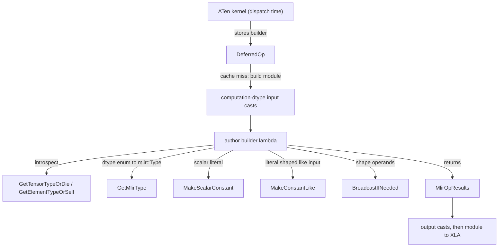
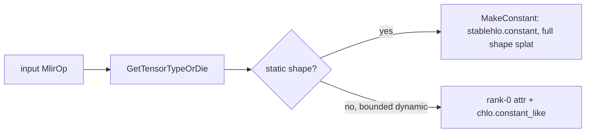

# StableHLO op builder utilities (op_builder_utils): constants, broadcasting, type helpers

## Overview

In torch_tpu an op's actual math is a **builder**: a C++ lambda (or a free function, conventionally named `Build<Op>Shlo` in `csrc/ops/<op>.cc`) that receives `mlir::MlirOp` value handles for its inputs and emits StableHLO ops through the StableHLO C++ builder API. `csrc/ops/op_builder_utils.{h,cc}` is the shared toolkit those builders lean on - a grep for its constant and broadcast helpers finds ~1000 references across `csrc/ops`. It answers four recurring questions a lowering has: *what type is this value* ([`GetTensorTypeOrDie`](../catalog/csrc/ops/op_builder_utils.cc.md#GetTensorTypeOrDie "csrc/ops/op_builder_utils.cc:L475"), [`GetElementTypeOrSelf`](../catalog/csrc/ops/op_builder_utils.cc.md#GetElementTypeOrSelf "csrc/ops/op_builder_utils.cc:L484"), [`GetMlirType`](../catalog/csrc/ops/op_builder_utils.cc.md#GetMlirType "csrc/ops/op_builder_utils.cc:L509")), *how do I make a constant of the right type and shape* ([`MakeScalarConstant`](../catalog/csrc/ops/op_builder_utils.h.md#MakeScalarConstant "csrc/ops/op_builder_utils.h:L338"), [`MakeConstantLike`](../catalog/csrc/ops/op_builder_utils.h.md#MakeConstantLike "csrc/ops/op_builder_utils.h:L366"), [`MakeConstant`](../catalog/csrc/ops/op_builder_utils.cc.md#MakeConstant "csrc/ops/op_builder_utils.cc:L716")), *how do I make two operands the same shape* ([`BroadcastIfNeeded`](../catalog/csrc/ops/op_builder_utils.cc.md#BroadcastIfNeeded "csrc/ops/op_builder_utils.cc:L926")), and *how many results do I return* ([`MlirOpResults`](../catalog/csrc/ops/op_builder_utils.h.md#MlirOpResults "csrc/ops/op_builder_utils.h:L155")). The single design idea running through all of them: **a builder must work unchanged for both static shapes and bounded-dynamic shapes**, so helpers that only understand static shapes are deprecated or crash, and the preferred helpers derive shape from an existing value instead of from an explicit shape array.

For TPU performance, two facts frame everything below. First, the builder is stored inside a [`DeferredOp`](../catalog/csrc/eager/device_buffer.h.md#DeferredOp "csrc/eager/device_buffer.h:L383") at dispatch time and is executed only when a traversal's MLIR module is built, which happens inside the compilation cache's miss path - so builder code is compile-time cost, not per-step cost. Second, what the builder emits is exactly what XLA sees: an extra broadcast, a full-shape constant, or a needless convert is HLO that XLA must fuse away (or not).

## Diagram

Where the builder runs and what it calls:

Legend:
- `KER` - (concept) a TT_KERNEL body, see [ATen kernel authoring](aten-kernel-authoring.md)
- `DOP` - [`DeferredOp`](../catalog/csrc/eager/device_buffer.h.md#DeferredOp "csrc/eager/device_buffer.h:L383")
- `CAST` - (concept) the dispatcher's computation-dtype wrapper around the builder
- `BLD` - (concept) the op's `Build<Op>Shlo` function or lambda
- `TY` - [`GetTensorTypeOrDie`](../catalog/csrc/ops/op_builder_utils.cc.md#GetTensorTypeOrDie "csrc/ops/op_builder_utils.cc:L475"), [`GetElementTypeOrSelf`](../catalog/csrc/ops/op_builder_utils.cc.md#GetElementTypeOrSelf "csrc/ops/op_builder_utils.cc:L484")
- `GMT` - [`GetMlirType`](../catalog/csrc/ops/op_builder_utils.cc.md#GetMlirType "csrc/ops/op_builder_utils.cc:L509")
- `MSC` - [`MakeScalarConstant`](../catalog/csrc/ops/op_builder_utils.h.md#MakeScalarConstant "csrc/ops/op_builder_utils.h:L338")
- `MCL` - [`MakeConstantLike`](../catalog/csrc/ops/op_builder_utils.h.md#MakeConstantLike "csrc/ops/op_builder_utils.h:L366")
- `BIN` - [`BroadcastIfNeeded`](../catalog/csrc/ops/op_builder_utils.cc.md#BroadcastIfNeeded "csrc/ops/op_builder_utils.cc:L926")
- `RES` - [`MlirOpResults`](../catalog/csrc/ops/op_builder_utils.h.md#MlirOpResults "csrc/ops/op_builder_utils.h:L155")
- `OUTC` - (concept) downcast to the declared output dtypes, then compile

How `MakeConstantLike` picks its lowering:

Legend:
- `IN` - (concept) the value whose shape the constant should match
- `T` - [`GetTensorTypeOrDie`](../catalog/csrc/ops/op_builder_utils.cc.md#GetTensorTypeOrDie "csrc/ops/op_builder_utils.cc:L475")
- `Q` - (concept) `RankedTensorType::hasStaticShape()`
- `FULL` - [`MakeConstant`](../catalog/csrc/ops/op_builder_utils.h.md#MakeConstant "csrc/ops/op_builder_utils.h:L300")
- `SC` - [`MakeConstantLike`](../catalog/csrc/ops/op_builder_utils.h.md#MakeConstantLike "csrc/ops/op_builder_utils.h:L366") (bounded branch)

## Design rationale (why it's built this way)

**Derive shapes from values, not arrays.** Under bounded dynamism a tensor's type carries a padded upper bound plus a runtime size, and a constant built from a literal shape array cannot express that. Hence the explicit steering in the header: the shape-array [`MakeConstant`](../catalog/csrc/ops/op_builder_utils.h.md#MakeConstant "csrc/ops/op_builder_utils.h:L325") overload taking an `ElementType` is `[[deprecated("Prefer MakeScalarConstant if shape is empty, or MakeConstantLike otherwise. These functions fully support static and bounded programs.")]]`, and the other shape-array overloads carry the same advice in comments. [`MakeConstantLike`](../catalog/csrc/ops/op_builder_utils.h.md#MakeConstantLike "csrc/ops/op_builder_utils.h:L366") asks the input value for its type, so the same builder code produces a static constant for static programs and a `chlo.constant_like` (which "handles proper padding and slicing to match the bounded dynamic runtime shape") for bounded ones. That is what lets one compiled executable serve a range of dynamic sizes instead of recompiling per size - see [dynamic shapes compiler](dynamic-shapes-compiler.md).

**Rank-0 constants are the portable default.** [`MakeScalarConstant`](../catalog/csrc/ops/op_builder_utils.h.md#MakeScalarConstant "csrc/ops/op_builder_utils.h:L338") documents itself as preferred "since the intent more clear and scalars are supported in programs with bounded dynamism". A scalar constant combined with an op that broadcasts implicitly (via the broadcast helpers) never encodes a shape at all.

**Crash on torch_tpu bugs, return Status on user errors.** [`GetTensorTypeOrDie`](../catalog/csrc/ops/op_builder_utils.cc.md#GetTensorTypeOrDie "csrc/ops/op_builder_utils.cc:L475") `ABSL_CHECK`s with "This is a torch_tpu bug as it should only call ... with an input that is a tensor" - a non-tensor operand can only come from a bad lowering. By contrast [`BroadcastIfNeeded`](../catalog/csrc/ops/op_builder_utils.cc.md#BroadcastIfNeeded "csrc/ops/op_builder_utils.cc:L946") returns a [`kInvalidArgument`](../catalog/csrc/common/error_utils.h.md#kInvalidArgument "csrc/common/error_utils.h:L79") status ("failed to broadcast tensor: " plus the captured MLIR diagnostic), because incompatible shapes are a user mistake that must surface as a Python exception.

**Thin wrappers over upstream StableHLO.** The bounded-aware broadcast overloads delegate to StableHLO's own `numpyBroadcastIfNeeded` / `broadcastIfNeeded` transforms rather than re-deriving broadcast rules, so torch_tpu inherits upstream's bounded-shape handling; torch_tpu adds the Status conversion and an explicit `broadcast_dimensions` mode.

> [!inferred]
> Keeping builders free of any dispatch-time state other than what is captured by value (dtype choices, flags) is what makes it safe to defer them until a cache miss on another thread of control; the helpers here are pure functions of their `MlirOp` inputs plus the builder's location, consistent with that contract.

## Entry points

- [`MakeConstantLike`](../catalog/csrc/ops/op_builder_utils.h.md#MakeConstantLike "csrc/ops/op_builder_utils.h:L366") - "Creates a constant with the same shape as the input tensor." The template overloads take any C++ literal plus an optional element-type override (`mlir::Type` at L366, `mlir::ElementType` at [`MakeConstantLike`](../catalog/csrc/ops/op_builder_utils.h.md#MakeConstantLike "csrc/ops/op_builder_utils.h:L387")); the non-template [`MakeConstantLike`](../catalog/csrc/ops/op_builder_utils.cc.md#MakeConstantLike "csrc/ops/op_builder_utils.cc:L726") takes an `at::Scalar` and returns `StatusOr`. Reached from builders that need a literal combined elementwise with an input (relu's `max(x, 0)`, nonzero masks, clamps).
- [`MakeScalarConstant`](../catalog/csrc/ops/op_builder_utils.h.md#MakeScalarConstant "csrc/ops/op_builder_utils.h:L338") - "Creates a constant with a scalar shape of the given element type." Overloads take an `mlir::Type` (L338) or an `mlir::ElementType` ([`MakeScalarConstant`](../catalog/csrc/ops/op_builder_utils.h.md#MakeScalarConstant "csrc/ops/op_builder_utils.h:L348")).
- [`MakeConstant`](../catalog/csrc/ops/op_builder_utils.cc.md#MakeConstant "csrc/ops/op_builder_utils.cc:L716") - the `at::Scalar` overload (declared at [`MakeConstant`](../catalog/csrc/ops/op_builder_utils.h.md#MakeConstant "csrc/ops/op_builder_utils.h:L289"), "PyTorch Specific constant builders") used when the literal arrives from PyTorch as a Scalar; the template forms ([`MakeConstant`](../catalog/csrc/ops/op_builder_utils.h.md#MakeConstant "csrc/ops/op_builder_utils.h:L300"), [`MakeConstant`](../catalog/csrc/ops/op_builder_utils.h.md#MakeConstant "csrc/ops/op_builder_utils.h:L310"), [`MakeConstant`](../catalog/csrc/ops/op_builder_utils.h.md#MakeConstant "csrc/ops/op_builder_utils.h:L325")) take a C++ value and an explicit tensor type or shape.
- [`BroadcastIfNeeded`](../catalog/csrc/ops/op_builder_utils.cc.md#BroadcastIfNeeded "csrc/ops/op_builder_utils.cc:L926") - "Returns a broadcasted version of the input tensor to the target shape." Three overloads: a static `Span<int64_t>` target ([`BroadcastIfNeeded`](../catalog/csrc/ops/op_builder_utils.cc.md#BroadcastIfNeeded "csrc/ops/op_builder_utils.cc:L896"), declared at [`BroadcastIfNeeded`](../catalog/csrc/ops/op_builder_utils.h.md#BroadcastIfNeeded "csrc/ops/op_builder_utils.h:L499")), a bounded-aware `stablehlo::Dimensions` target (L926), and "broadcast to the shape of this other value" ([`BroadcastIfNeeded`](../catalog/csrc/ops/op_builder_utils.cc.md#BroadcastIfNeeded "csrc/ops/op_builder_utils.cc:L946")).
- [`GetTensorTypeOrDie`](../catalog/csrc/ops/op_builder_utils.cc.md#GetTensorTypeOrDie "csrc/ops/op_builder_utils.cc:L475") - "Gets the tensor type of the input op. Crashes if the input is not a tensor." The first line of most builders that branch on dtype (float vs integer vs bool) or shape.

## Mechanism (step-by-step)

1. **The builder is captured, not run.** At dispatch time a kernel passes its builder into the eager dispatcher, which stores it in a [`DeferredOp`](../catalog/csrc/eager/device_buffer.h.md#DeferredOp "csrc/eager/device_buffer.h:L383") together with the op name, input buffer references, declared output shapes and parameter cache keys, and the Python context captured at that moment. If the op has a `computation_dtype`, the dispatcher first wraps the builder: inputs whose element type (read via [`GetTensorTypeOrDie`](../catalog/csrc/ops/op_builder_utils.cc.md#GetTensorTypeOrDie "csrc/ops/op_builder_utils.cc:L475")) differs are converted before the builder sees them, and results are converted back to each declared output dtype afterwards (`csrc/eager/device_buffer_utils.cc`). The builder author therefore writes the math once in the computation dtype; the upcast/downcast `stablehlo.convert`s are emitted around it.

2. **It runs on a compile-cache miss.** When a traversal is materialized, `Traversal::Compile` computes the compilation cache key and hands the cache a closure that calls `BuildMlirModule` only "on a cache miss" (`csrc/eager/traversal.cc`). `BuildMlirModule` walks deferred nodes (each a [`DeferredOp`](../catalog/csrc/eager/device_buffer.h.md#DeferredOp "csrc/eager/device_buffer.h:L383")) in execution order, maps each input buffer to the `MlirOp` already built for it, installs a Python-context provider so every op the builder emits gets the user's source location, and invokes the stored builder. On a cache hit none of the code on this page executes, which is why builder-side cleverness affects compile time and generated HLO quality, never steady-state dispatch cost.

3. **Type introspection.** Inside the builder, [`GetTensorTypeOrDie`](../catalog/csrc/ops/op_builder_utils.cc.md#GetTensorTypeOrDie "csrc/ops/op_builder_utils.cc:L475") `dyn_cast`s the value's type to `RankedTensorType` or crashes; [`GetElementTypeOrSelf`](../catalog/csrc/ops/op_builder_utils.cc.md#GetElementTypeOrSelf "csrc/ops/op_builder_utils.cc:L484") ("Gets the element type if ranked type, otherwise returns self") and its `MlirOp` overload [`GetElementTypeOrSelf`](../catalog/csrc/ops/op_builder_utils.cc.md#GetElementTypeOrSelf "csrc/ops/op_builder_utils.cc:L491") normalize "a tensor type or an element type" to an element type, which is how [`MakeConstantLike`](../catalog/csrc/ops/op_builder_utils.h.md#MakeConstantLike "csrc/ops/op_builder_utils.h:L366") accepts either as its override. [`GetMlirType`](../catalog/csrc/ops/op_builder_utils.cc.md#GetMlirType "csrc/ops/op_builder_utils.cc:L509") converts the builder API's `mlir::ElementType` enum (the dtype vocabulary kernels pass around, e.g. `BF16`, `F32`, `PRED`) into a concrete `mlir::Type` in the given context.

4. **Constants.** [`MakeScalarConstant`](../catalog/csrc/ops/op_builder_utils.h.md#MakeScalarConstant "csrc/ops/op_builder_utils.h:L338") builds a rank-0 `stablehlo.constant` of the requested element type. [`MakeConstantLike`](../catalog/csrc/ops/op_builder_utils.h.md#MakeConstantLike "csrc/ops/op_builder_utils.h:L366") reads the input's type, optionally swaps the element type, and then: for a static shape, emits a full-shape constant through the tensor-type [`MakeConstant`](../catalog/csrc/ops/op_builder_utils.h.md#MakeConstant "csrc/ops/op_builder_utils.h:L300"); for a bounded-dynamic shape, builds a rank-0 attribute with a fresh, bounds-free scalar type ("avoid `clone` since that preserves the bounds, which are invalid since this uses a scalar shape") and emits `chlo.constant_like` against the input. The `at::Scalar` path in [`MakeConstant`](../catalog/csrc/ops/op_builder_utils.cc.md#MakeConstant "csrc/ops/op_builder_utils.cc:L716") and [`MakeConstantLike`](../catalog/csrc/ops/op_builder_utils.cc.md#MakeConstantLike "csrc/ops/op_builder_utils.cc:L726") goes through a private converter that switches over the target element type and calls the matching `at::Scalar::toX()` accessor; with no explicit element type it uses the Scalar's own type, which the header warns "reports its type in the highest precision necessary to hold their value category" (a Python float becomes f64, an int becomes i64).

5. **Broadcasting.** The static overload [`BroadcastIfNeeded`](../catalog/csrc/ops/op_builder_utils.cc.md#BroadcastIfNeeded "csrc/ops/op_builder_utils.cc:L896") returns the input untouched when the shape already matches (no op emitted), otherwise right-aligns dimensions NumPy-style, checks each is 1 or equal, and emits one `stablehlo.broadcast_in_dim` with the computed [`Dimensions`](../catalog/csrc/common/dimension_types.h.md#Dimensions "csrc/common/dimension_types.h:L33") mapping; it `ABSL_CHECK`s that the input has no dynamic dims (TODO in source). The `stablehlo::Dimensions` overload [`BroadcastIfNeeded`](../catalog/csrc/ops/op_builder_utils.cc.md#BroadcastIfNeeded "csrc/ops/op_builder_utils.cc:L926") delegates to upstream `numpyBroadcastIfNeeded`, or to `broadcastIfNeeded` with explicit `broadcast_dimensions` when given; for a bounded target "input is broadcasted to the padded shape and also made bounded" (the test `StablehloDimsWithBoundOp` checks a result with padded size 10 and `isDynamicDim(0)`). The value-target overload [`BroadcastIfNeeded`](../catalog/csrc/ops/op_builder_utils.cc.md#BroadcastIfNeeded "csrc/ops/op_builder_utils.cc:L946") reads the target's dimensions (bounds included) and does the same. Failures are captured through an MLIR diagnostic handler and returned as `kInvalidArgument`; like every `TT_RET_CHECK` status they carry the root op name from [`GetRootOpName`](../catalog/csrc/ops/python_context.cc.md#GetRootOpName "csrc/ops/python_context.cc:L325") via [`SetRootOpNamePayload`](../catalog/csrc/common/status_builder.cc.md#SetRootOpNamePayload "csrc/common/status_builder.cc:L136"), with the message assembled by [`StatusBuilder`](../catalog/csrc/common/status_builder.h.md#StatusBuilder "csrc/common/status_builder.h:L63").

6. **Returning results.** A builder's return type is fixed by its declared output count through [`MlirOpResults`](../catalog/csrc/ops/op_builder_utils.h.md#MlirOpResults "csrc/ops/op_builder_utils.h:L155"): a bare `MlirOp` for one output, `std::array<MlirOp, N>` for a known N (a `static_assert` rejects N < 1: "An op must produce at least one output."), and a `SmallVector` for a dynamic count. The dispatcher's adapter normalizes all of these to a vector, checks the count, and the traversal then casts each result to the node's declared element type before recording it as the op's output value.

## Key data structures

- **`mlir::MlirOp`** (external, from StableHLO's C++ builder API) - a value handle that also knows its builder, which is why one-input and N-input builders need no explicit builder parameter; only nullary builders receive one.
- [`MlirOpResults`](../catalog/csrc/ops/op_builder_utils.h.md#MlirOpResults "csrc/ops/op_builder_utils.h:L155") - "Result type of an MLIR op builder for the given number of outputs"; arity is checked at C++ compile time where known.
- [`Dimensions`](../catalog/csrc/common/dimension_types.h.md#Dimensions "csrc/common/dimension_types.h:L33") - "Holds the size array of a tensor efficiently"; torch_tpu's static shape vector, distinct from `mlir::stablehlo::Dimensions`, which also carries per-dimension bound information.
- [`DeferredOp`](../catalog/csrc/eager/device_buffer.h.md#DeferredOp "csrc/eager/device_buffer.h:L383") - "A deferred operation, used to back a DeviceBufferList"; owns the builder until materialization.

## Dynamics (design intent)

- **Deferred and cached execution.** Builders execute only while building a module for a cache miss (step 2); the same builder may run many times over a process lifetime (once per distinct cache key - per shape, dtype, parameter-key combination) and zero times for a warmed cache.
- **Location scoping.** Every MLIR op a builder emits inherits the location set by the context provider for the duration of that builder call, including the convert ops added by the computation-dtype wrapper; nothing in the helpers needs to pass locations explicitly. See [op names and Python context](op-names-and-python-context.md).
- **Tests pin the static/bounded contract.** `op_builder_utils_test.cc` covers scalar-to-shape broadcast, same-shape no-op, `{3}` and `{1,3}` to `{2,3}`, bounded targets, explicit `broadcast_dimensions` (`{2,3}` into `{2,5,3}` with dims `{0,2}`), and the `kInvalidArgument` failure message.

## Edge cases

- **Implicit f64/i64 from `at::Scalar`.** Calling the `at::Scalar` [`MakeConstant`](../catalog/csrc/ops/op_builder_utils.cc.md#MakeConstant "csrc/ops/op_builder_utils.cc:L716") without an element type yields a 64-bit constant, which then forces promotion or an explicit convert in the surrounding computation. Pass the target `ElementType`, or use [`MakeConstantLike`](../catalog/csrc/ops/op_builder_utils.cc.md#MakeConstantLike "csrc/ops/op_builder_utils.cc:L726"), which takes the element type from the input.
- **FP8/FP4/sub-byte constants are unsupported** on the `at::Scalar` path: the converter lists `F8E4M3FN`, `F8E5M2`, `F4E2M1FN`, `I4`, and others as explicit unsupported cases returning `kInvalidArgument`.
- **Static broadcast on a dynamic input crashes** (`ABSL_CHECK`, "Pending feature work") rather than returning an error; use the `stablehlo::Dimensions` or value-target overload in code that may see bounded shapes.
- **Full-shape constants under static shapes.** For static inputs [`MakeConstantLike`](../catalog/csrc/ops/op_builder_utils.h.md#MakeConstantLike "csrc/ops/op_builder_utils.h:L366") emits a constant of the input's full shape rather than a scalar plus broadcast.
- **Same names, different dialect.** [`MakeScalarConstant`](../catalog/csrc/internal/mosaic/kiln/core/scalar.cc.md#MakeScalarConstant "csrc/internal/mosaic/kiln/core/scalar.cc:L36"), [`MakeConstant`](../catalog/csrc/internal/mosaic/kiln/core/scalar.cc.md#Scalar.MakeConstant "csrc/internal/mosaic/kiln/core/scalar.cc:L62") and [`MakeConstant`](../catalog/csrc/internal/mosaic/kiln/core/tile.h.md#Tile.MakeConstant "csrc/internal/mosaic/kiln/core/tile.h:L48") in `torch_tpu::kiln` are unrelated: they emit `arith.constant` scalars or splatted vreg tiles inside a Mosaic kernel body, not StableHLO. See [Kiln kernel DSL](kiln-kernel-dsl.md).

> [!inferred]
> The full-shape constant is emitted as a splat `DenseElementsAttr` (built via `mlir::makeConstant` from a single value), so it should not grow the serialized module with tensor size, and XLA normally folds a splat constant into the consuming fusion; but this is upstream behavior not verified in this repo.

## Open questions

- Packet gap: the builder function types themselves (the unary/binary/ternary/N-ary builder aliases and the adapter that normalizes their results), the multi-operand broadcast helper used by most binary builders, the result-cast helper, and the traversal's module builder are central to this mechanism but are not in this page's subgraph; they are described from source without catalog links.
- Whether any builder relies on the static [`BroadcastIfNeeded`](../catalog/csrc/ops/op_builder_utils.cc.md#BroadcastIfNeeded "csrc/ops/op_builder_utils.cc:L896") in a path that can receive bounded-dynamic inputs (which would crash rather than error) is not established by the tests.
- The source carries a "REMOVE STATUS RESULT ONCE TESTED" redundancy check for min-finite constants against XLA; how long that double path remains is not stated.

## See also

- [ATen kernel authoring](aten-kernel-authoring.md) - the kernels that hand builders to the dispatcher
- [Deferred execution and materialization](deferred-execution-and-materialization.md) - when builders run
- [Compilation cache key](compilation-cache-key.md) - why builders run once per key
- [Dynamic shapes compiler](dynamic-shapes-compiler.md) and [dynamic shape ops](dynamic-shape-ops.md) - the bounded-dynamic programs these helpers support
- [Dtype and precision](dtype-and-precision.md) - computation-dtype casts around the builder
- [Op names and Python context](op-names-and-python-context.md) - the MLIR locations attached to emitted ops
- [Kiln kernel DSL](kiln-kernel-dsl.md) - the Mosaic-side namesakes
