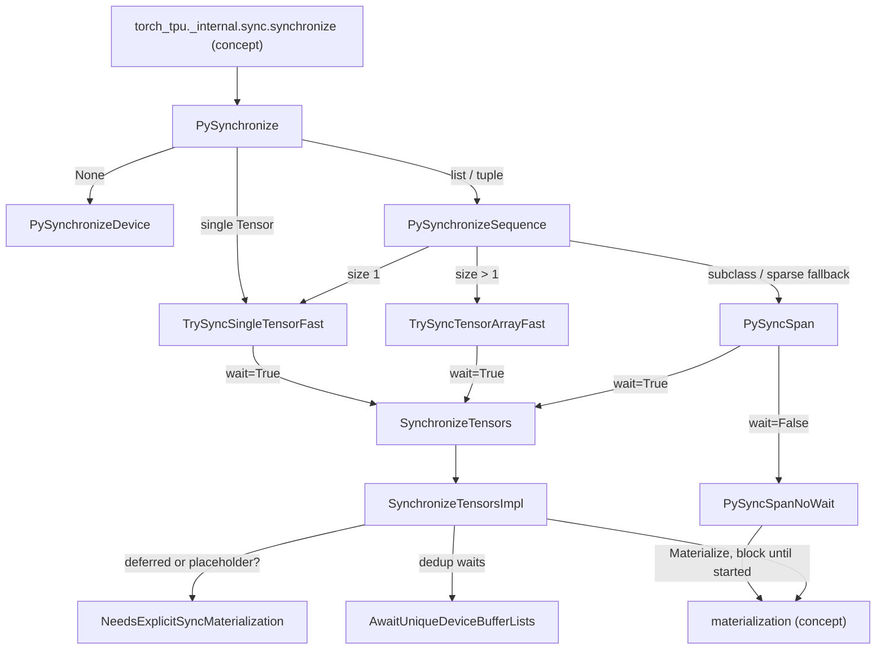

# Tensor synchronization - torch_tpu.sync.synchronize, is_materializing/is_materialized, and graph dumps

Scope: `csrc/internal/sync/{sync.h,sync.cc,sync_py.cc}` and its Python face
`torch_tpu._internal.sync` (`synchronize`, `is_materializing`, `is_materialized`,
`computation_mlir`, `computation_graphviz`).

## Overview

torch_tpu records ATen ops into a deferred graph and only compiles/executes it when something
forces a *materialization* (see [deferred execution and materialization](deferred-execution-and-materialization.md)).
This subsystem is the explicit, user-controlled way to force it. It offers exactly two strengths,
named by [`WaitOnExecution`](../catalog/csrc/internal/sync/sync.h.md#WaitOnExecution "csrc/internal/sync/sync.h:L53"):
[`kNo`](../catalog/csrc/internal/sync/sync.h.md#WaitOnExecution.kNo "csrc/internal/sync/sync.h:L56")
"only ensures that all deferred operations have been scheduled for execution on the device" (a
*graph cut*), and [`kYes`](../catalog/csrc/internal/sync/sync.h.md#WaitOnExecution.kYes "csrc/internal/sync/sync.h:L59")
"blocks the calling thread until all deferred operations have completed execution" (a *barrier*).
The C++ core is [`SynchronizeTensors`](../catalog/csrc/internal/sync/sync.cc.md#SynchronizeTensors "csrc/internal/sync/sync.cc:L130"),
documented as the middle ground between plain materialization (graph break, no wait) and a
device-to-host copy (graph break, wait, and transfer): it "forces a graph break and waits for the
PjRtBuffers to be ready, but doesn't copy the data to the CPU", which is why it is the right tool
for timing compile+execute without transfer cost. Most of the remaining code is about making the
Python call cheap: avoiding pybind conversions, avoiding GIL round-trips when nothing is pending,
and deduplicating waits on shared buffer lists.

## Diagram

Legend:
- `PY` - (concept) the Python binding `torch_tpu._internal.sync.synchronize(tensors=None, wait=False)`
- `PSY` - [`PySynchronize`](../catalog/csrc/internal/sync/sync_py.cc.md#PySynchronize "csrc/internal/sync/sync_py.cc:L367")
- `PSD` - [`PySynchronizeDevice`](../catalog/csrc/internal/sync/sync_py.cc.md#PySynchronizeDevice "csrc/internal/sync/sync_py.cc:L305")
- `PSS` - [`PySynchronizeSequence`](../catalog/csrc/internal/sync/sync_py.cc.md#PySynchronizeSequence "csrc/internal/sync/sync_py.cc:L330")
- `T1` - [`TrySyncSingleTensorFast`](../catalog/csrc/internal/sync/sync_py.cc.md#TrySyncSingleTensorFast "csrc/internal/sync/sync_py.cc:L180")
- `TN` - [`TrySyncTensorArrayFast`](../catalog/csrc/internal/sync/sync_py.cc.md#TrySyncTensorArrayFast "csrc/internal/sync/sync_py.cc:L235")
- `SPAN` - [`PySyncSpan`](../catalog/csrc/internal/sync/sync_py.cc.md#PySyncSpan "csrc/internal/sync/sync_py.cc:L123")
- `NW` - [`PySyncSpanNoWait`](../catalog/csrc/internal/sync/sync_py.cc.md#PySyncSpanNoWait "csrc/internal/sync/sync_py.cc:L77")
- `ST` - [`SynchronizeTensors`](../catalog/csrc/internal/sync/sync.cc.md#SynchronizeTensors "csrc/internal/sync/sync.cc:L130")
- `IMPL` - [`SynchronizeTensorsImpl`](../catalog/csrc/internal/sync/sync.cc.md#SynchronizeTensorsImpl "csrc/internal/sync/sync.cc:L89")
- `NEED` - [`NeedsExplicitSyncMaterialization`](../catalog/csrc/internal/sync/sync.cc.md#NeedsExplicitSyncMaterialization "csrc/internal/sync/sync.cc:L57")
- `AW` - [`AwaitUniqueDeviceBufferLists`](../catalog/csrc/internal/sync/sync.cc.md#AwaitUniqueDeviceBufferLists "csrc/internal/sync/sync.cc:L63")
- `MAT` - (concept) the materialization machinery; see [deferred execution and materialization](deferred-execution-and-materialization.md)

## Design rationale (why it's built this way)

**Sync means "cut the stream", not "compute this tensor".** Every path materializes with reason
`synchronize()` in split-graph mode, and materialization snapshots the whole stream. The tests make
the consequence explicit: after `synchronize(y, wait=False)` with `z = x + y` pending, "The entire
stream begins materializing" - `x`, `y` *and* `z` report `is_materializing`. With `wait=True` on `y`,
`x` and `y` are ready but `z` "will have started materializing, but may not have finished yet"
(`tests/internal_sync_test.py`). So `wait=False` is a graph-split primitive: everything recorded so
far becomes one compiled program and later ops start a fresh graph.

**Bases, not views.** All tensor paths sync the tensor's *base* buffer. The implementation comment in
[`SynchronizeTensorsImpl`](../catalog/csrc/internal/sync/sync.cc.md#SynchronizeTensorsImpl "csrc/internal/sync/sync.cc:L89")
explains that views "are ephemeral and re-materialized every time, so there's no point in
materializing a copy only to discard it"; a later `.cpu()` on a view re-runs the view program (from
the compilation cache). The header comment is out of date here: it says the function will
"materialize the base buffer, and then materialize and wait for the view buffer", but the code only
touches the base.

**`wait=False` still waits a little.** Even the no-wait path uses "block until started", "so that
is_materializing() is true for all buffers" on return - the caller gets a deterministic state
transition without paying for execution.

**Release the GIL whenever we might block.** [`PySyncSpanNoWait`](../catalog/csrc/internal/sync/sync_py.cc.md#PySyncSpanNoWait "csrc/internal/sync/sync_py.cc:L77")
documents an AB-BA deadlock: background host-to-device threads may drop the last reference to a
Python-backed tensor and need the GIL, while this thread waits on them. Inputs are converted to
pure C++ buffer handles first, so releasing the GIL is safe.

**Make the common case nearly free.** The fast paths exist because `synchronize` is called every
step in training loops: skip pybind's vector conversion (no per-tensor refcount churn), and skip GIL
release entirely when the buffer list is already synchronized or nothing is deferred.

## Entry points

- [`PySynchronize`](../catalog/csrc/internal/sync/sync_py.cc.md#PySynchronize "csrc/internal/sync/sync_py.cc:L367") - "Unified C++ entry point for `torch_tpu.sync.synchronize(tensors, wait)`", bound as `synchronize` (default `wait=False`) by [`TorchTpuPyBindInitModule__tpu_torch_sync`](../catalog/csrc/internal/sync/sync_py.cc.md#TorchTpuPyBindInitModule__tpu_torch_sync "csrc/internal/sync/sync_py.cc:L467"); re-exported by `torch_tpu/_internal/sync/sync.py`. Reached from user/framework code (e.g. a graph split between loss and backward) and from SPMD helpers.
- [`PySync`](../catalog/csrc/internal/sync/sync_py.cc.md#PySync "csrc/internal/sync/sync_py.cc:L159") - the `_synchronize_list` binding; always goes through the general [`PySyncSpan`](../catalog/csrc/internal/sync/sync_py.cc.md#PySyncSpan "csrc/internal/sync/sync_py.cc:L123") path.
- [`SynchronizeTensors`](../catalog/csrc/internal/sync/sync.cc.md#SynchronizeTensors "csrc/internal/sync/sync.cc:L130") (and the [pointer-span overload](../catalog/csrc/internal/sync/sync.cc.md#SynchronizeTensors "csrc/internal/sync/sync.cc:L134")) - the C++ API declared in `sync.h`; in this checkout its only caller is the Python binding layer in `sync_py.cc`; author intent: "Materializes the given tensors, and then waits for their PjRtBuffers to be ready."
- [`PyIsMaterializing`](../catalog/csrc/internal/sync/sync_py.cc.md#PyIsMaterializing "csrc/internal/sync/sync_py.cc:L393") / [`PyIsMaterialized`](../catalog/csrc/internal/sync/sync_py.cc.md#PyIsMaterialized "csrc/internal/sync/sync_py.cc:L402") - `is_materializing(t)` / `is_materialized(t)` probes, backed by [`IsMaterializing`](../catalog/csrc/internal/sync/sync.cc.md#IsMaterializing "csrc/internal/sync/sync.cc:L138") and [`IsMaterialized`](../catalog/csrc/internal/sync/sync.cc.md#IsMaterialized "csrc/internal/sync/sync.cc:L146").
- [`PyGetComputationMlir`](../catalog/csrc/internal/sync/sync_py.cc.md#PyGetComputationMlir "csrc/internal/sync/sync_py.cc:L456") / [`PyGetComputationGraphviz`](../catalog/csrc/internal/sync/sync_py.cc.md#PyGetComputationGraphviz "csrc/internal/sync/sync_py.cc:L443") - `computation_mlir(*tensors)` and `computation_graphviz(*tensors)` (plus `dump_computation_*` file writers in Python): print the StableHLO or graphviz of the pending deferred graph behind given tensors, without executing it.

## Mechanism (step-by-step)

1. **Dispatch on the Python object type.** [`PySynchronize`](../catalog/csrc/internal/sync/sync_py.cc.md#PySynchronize "csrc/internal/sync/sync_py.cc:L367")
   routes `None` to [`PySynchronizeDevice`](../catalog/csrc/internal/sync/sync_py.cc.md#PySynchronizeDevice "csrc/internal/sync/sync_py.cc:L305"),
   exact `list`/`tuple` to [`PySynchronizeSequence`](../catalog/csrc/internal/sync/sync_py.cc.md#PySynchronizeSequence "csrc/internal/sync/sync_py.cc:L330"),
   other list subclasses through [`UnwrapTensor`](../catalog/csrc/internal/sync/sync_py.cc.md#UnwrapTensor "csrc/internal/sync/sync_py.cc:L51")
   to [`PySyncSpan`](../catalog/csrc/internal/sync/sync_py.cc.md#PySyncSpan "csrc/internal/sync/sync_py.cc:L123"),
   and a single object to [`TrySyncSingleTensorFast`](../catalog/csrc/internal/sync/sync_py.cc.md#TrySyncSingleTensorFast "csrc/internal/sync/sync_py.cc:L180")
   with an unwrap fallback. `UnwrapTensor` recursively follows `_local_tensor` (DTensor) and `elem`
   (wrapper subclasses), so syncing a DTensor syncs its local shard.

2. **Single-tensor fast path.** [`TrySyncSingleTensorFast`](../catalog/csrc/internal/sync/sync_py.cc.md#TrySyncSingleTensorFast "csrc/internal/sync/sync_py.cc:L180")
   declines (returns false) for tensor subclasses and sparse COO tensors, returns immediately for
   non-TPU tensors, and otherwise reads the base buffer's list. With `wait=True`: if the list is
   already synchronized it returns *while still holding the GIL*; else it releases the GIL and
   either awaits the already-materialized list directly or calls
   [`SynchronizeTensors`](../catalog/csrc/internal/sync/sync.cc.md#SynchronizeTensors "csrc/internal/sync/sync.cc:L130").
   With `wait=False`: only if the list is deferred or a placeholder does it release the GIL and
   materialize (split graph, block until started).

3. **Multi-tensor fast path.** [`TrySyncTensorArrayFast`](../catalog/csrc/internal/sync/sync_py.cc.md#TrySyncTensorArrayFast "csrc/internal/sync/sync_py.cc:L235")
   reads `PyObject*` items straight out of the list/tuple into a stack `InlinedVector` of
   `const at::Tensor*` (16 inline), filtering to TPU tensors; any subclass or sparse item aborts to
   the general path. `wait=True` first checks whether *all* lists are synchronized (common when many
   outputs share one compiled execution's list) and returns without releasing the GIL; otherwise it
   calls the pointer overload of [`SynchronizeTensors`](../catalog/csrc/internal/sync/sync.cc.md#SynchronizeTensors "csrc/internal/sync/sync.cc:L134").
   `wait=False` materializes once for the whole batch if any base is deferred or a placeholder.

4. **General path.** [`PySyncSpan`](../catalog/csrc/internal/sync/sync_py.cc.md#PySyncSpan "csrc/internal/sync/sync_py.cc:L123")
   uses [`AllTensorsAreDenseOnDevice`](../catalog/csrc/internal/sync/sync_py.cc.md#AllTensorsAreDenseOnDevice "csrc/internal/sync/sync_py.cc:L67")
   to decide whether to rebuild the span: sparse tensors contribute their TPU-resident `indices` and
   `values`, CPU tensors are dropped. Then `wait=True` releases the GIL around
   [`SynchronizeTensors`](../catalog/csrc/internal/sync/sync.cc.md#SynchronizeTensors "csrc/internal/sync/sync.cc:L130"),
   and `wait=False` calls [`PySyncSpanNoWait`](../catalog/csrc/internal/sync/sync_py.cc.md#PySyncSpanNoWait "csrc/internal/sync/sync_py.cc:L77"),
   which collects base buffers, returns early if none is deferred/placeholder, otherwise releases the
   GIL and materializes them with reason `synchronize()`, split-graph mode, block until started.

5. **Materialize-then-wait core.** [`SynchronizeTensorsImpl`](../catalog/csrc/internal/sync/sync.cc.md#SynchronizeTensorsImpl "csrc/internal/sync/sync.cc:L89")
   handles one tensor directly (materialize only if
   [`NeedsExplicitSyncMaterialization`](../catalog/csrc/internal/sync/sync.cc.md#NeedsExplicitSyncMaterialization "csrc/internal/sync/sync.cc:L57")
   says its list is deferred or a placeholder, then synchronize the list). For many tensors it
   gathers base buffers (via [`DerefTensor`](../catalog/csrc/internal/sync/sync.cc.md#DerefTensor "csrc/internal/sync/sync.cc:L49")
   for value spans or the [pointer overload](../catalog/csrc/internal/sync/sync.cc.md#DerefTensor "csrc/internal/sync/sync.cc:L53")),
   issues a single blocking-until-started materialization if any needs it, then calls
   [`AwaitUniqueDeviceBufferLists`](../catalog/csrc/internal/sync/sync.cc.md#AwaitUniqueDeviceBufferLists "csrc/internal/sync/sync.cc:L63"),
   which synchronizes each distinct [`DeviceBufferList`](../catalog/csrc/eager/device_buffer.h.md#DeviceBufferList "csrc/eager/device_buffer.h:L529")
   once - "Deduplicating prevents redundant O(N^2) GetReadyFuture().Await() calls" when many outputs
   share a list.

6. **Whole-device sync.** [`PySynchronizeDevice`](../catalog/csrc/internal/sync/sync_py.cc.md#PySynchronizeDevice "csrc/internal/sync/sync_py.cc:L305")
   caches the PrivateUse1 device-guard implementation and, with the GIL released, either calls its
   `synchronizeDevice` (`wait=True`) or materializes every stream on the current device and awaits
   each stream's snapshot future (`wait=False`) - described in the source as equivalent to recording
   a `torch.tpu.Event` on every stream and discarding it. Tests confirm all live tensors become
   `is_materializing` (and, with `wait=True`, `is_materialized`).

7. **State probes.** [`IsMaterializing`](../catalog/csrc/internal/sync/sync.cc.md#IsMaterializing "csrc/internal/sync/sync.cc:L138")
   is true once the base buffer has a PjRtBuffer (which "is itself an asynchronous future"), and
   [`IsMaterialized`](../catalog/csrc/internal/sync/sync.cc.md#IsMaterialized "csrc/internal/sync/sync.cc:L146")
   requires that buffer to have "completed execution". [`PyIsMaterialized`](../catalog/csrc/internal/sync/sync_py.cc.md#PyIsMaterialized "csrc/internal/sync/sync_py.cc:L402")
   checks `is_materializing` first and short-circuits to false. Both Python probes reject non-TPU
   tensors with InvalidArgument.

8. **Graph dumps without execution.** [`GetComputationBuffers`](../catalog/csrc/internal/sync/sync_py.cc.md#GetComputationBuffers "csrc/internal/sync/sync_py.cc:L415")
   maps tensors to base buffers; [`GetTraversal`](../catalog/csrc/internal/sync/sync.cc.md#GetTraversal "csrc/internal/sync/sync.cc:L156")
   dedups their lists (rejecting placeholders) and builds a traversal backward to the leaves.
   [`GetComputationMlir`](../catalog/csrc/internal/sync/sync.cc.md#GetComputationMlir "csrc/internal/sync/sync.cc:L188")
   builds the same StableHLO module that materialization would compile, in a fresh MLIR context, and
   prints it; [`GetComputationGraphviz`](../catalog/csrc/internal/sync/sync.cc.md#GetComputationGraphviz "csrc/internal/sync/sync.cc:L179")
   renders the ATen-op DAG, labeling nodes with caller variable names collected by
   [`GetComputationGraph`](../catalog/csrc/internal/sync/sync_py.cc.md#GetComputationGraph "csrc/internal/sync/sync_py.cc:L426")
   into a [`BufferRefToVarMap`](../catalog/csrc/internal/sync/sync_py.cc.md#BufferRefToVarMap "csrc/internal/sync/sync_py.cc:L47")
   (the Python wrapper passes the caller frame's locals).

## Key data structures

- [`WaitOnExecution`](../catalog/csrc/internal/sync/sync.h.md#WaitOnExecution "csrc/internal/sync/sync.h:L53") - the two sync strengths ([`kNo`](../catalog/csrc/internal/sync/sync.h.md#WaitOnExecution.kNo "csrc/internal/sync/sync.h:L56") = scheduled, [`kYes`](../catalog/csrc/internal/sync/sync.h.md#WaitOnExecution.kYes "csrc/internal/sync/sync.h:L59") = completed); the Python API expresses the same thing as the `wait` bool.
- Base [`DeviceBufferList`](../catalog/csrc/eager/device_buffer.h.md#DeviceBufferList "csrc/eager/device_buffer.h:L529") state - the probes read its deferred / materializing / materialized flags, and its `is_synchronized` latch is what makes repeated `wait=True` calls cheap.
- [`BufferRefToVarMap`](../catalog/csrc/internal/sync/sync_py.cc.md#BufferRefToVarMap "csrc/internal/sync/sync_py.cc:L47") - buffer handle -> variable name, used only for graphviz labels.

## Dynamics (design intent)

From `tests/internal_sync_test.py` (run under the internal defer-all mode, so nothing executes
until synced):

| Call | x, y (dispatched before) | z = x + y (pending) |
|---|---|---|
| `synchronize(y, wait=False)` | materializing | materializing |
| `synchronize(y, wait=True)` | materializing + materialized | materializing (maybe not done) |
| `synchronize([x, y, z], wait=True)` | materialized | materialized |
| `synchronize(wait=False)` (device) | all materializing | - |
| `synchronize(wait=True)` (device) | all materialized | - |

A host-to-device copy (`torch.ones(128).to("tpu")`) is already `is_materializing` immediately.
Zero-sized tensors, mixed empty/non-empty lists, tensor-subclass wrappers and sparse COO tensors are
covered by dedicated tests.

> [!inferred]
> Perf usage pattern: `synchronize(loss, wait=False)` between forward and backward bounds the size
> of each compiled program (shorter first-step compile, smaller recompiles) at the cost of one extra
> graph boundary; `synchronize(..., wait=True)` belongs only at timing points (it stalls the host
> until the device drains, removing host/device overlap). For step-time measurement it is the right
> barrier because it excludes the device-to-host transfer that `.cpu()`/`.item()` would add.

## Edge cases

- Non-TPU tensors in a list are silently skipped by sync; the probes, by contrast, raise InvalidArgument.
- Syncing a view only syncs its base; a later device-to-host read of the view re-executes the view program.
- Placeholders are treated like deferred lists by the sync paths (they trigger a materialize call), but materializing a placeholder is an error downstream, and graph dumps reject them outright.
- `computation_mlir`/`computation_graphviz` on an empty tensor list fail ("tensors must not be empty").
- [`PySynchronizeDevice`](../catalog/csrc/internal/sync/sync_py.cc.md#PySynchronizeDevice "csrc/internal/sync/sync_py.cc:L305") syncs only the *current* device, not every local TPU.

## Open questions

- The materialization calls, `Traversal::Create`, the graphviz renderer and the device guard's
  `synchronizeDevice` are outside this packet's subgraph; their behavior here comes from reading the
  source, not from cited symbols. The `pybind11_init__tpu_torch_sync` / `pybind11_exec__tpu_torch_sync`
  symbols are macro-generated module plumbing.
- Whether `wait=True` on a tensor guarantees ordering with ops on *other* streams is not stated;
  the snapshot is per stream.

## See also

- [Deferred execution and materialization](deferred-execution-and-materialization.md) - what a sync actually triggers.
- [Eager op dispatch](eager-op-dispatch.md) - how tensors get their deferred buffers.
- [Host-device copy](host-device-copy.md), [batch host-device transfer](batch-host-device-transfer.md), [device streams, generators and RNG](device-streams-generators-and-rng.md), [profiler](profiler.md).
