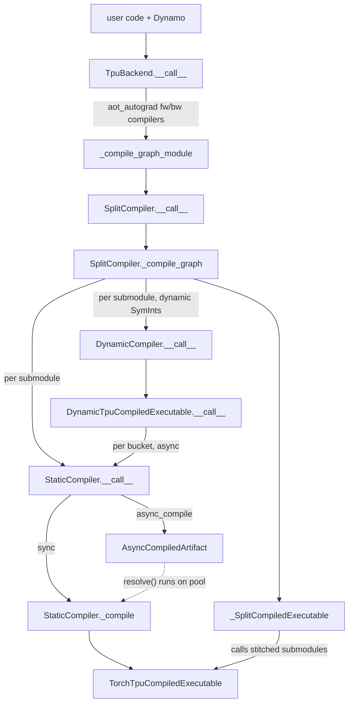

# torch.compile TPU backend (TpuBackend)

## Overview
`torch_tpu._internal.compile` registers a singleton `TpuBackend()` under the Dynamo backend name `"tpu"` at import time, so `torch.compile(model, backend="tpu", options={...})` hands every captured FX graph to [`__call__`](../catalog/src/torch_tpu/_internal/compile/_backend.md#TpuBackend.__call__ "src/torch_tpu/_internal/compile/_backend.py:L654"). The backend does not lower ops itself: it runs AOTAutograd (forward/backward partitioning with min-cut rematerialization), then feeds each partitioned graph through a **compiler stack** - a SplitCompiler (entered via [`__call__`](../catalog/src/torch_tpu/_internal/compile/split_compiler.md#SplitCompiler.__call__ "src/torch_tpu/_internal/compile/split_compiler.py:L745")) that cuts the graph on collectives, wrapping either a static compiler (one StableHLO module -> one PJRT executable per shape) or a dynamic compiler (bounded-shape buckets). The key design idea is that **every compiled artifact is a lazy callable behind one interface that includes pickling** (the dynamic dispatcher is the exception: its `__reduce__` raises) ([`CompiledArtifact`](../catalog/src/torch_tpu/_internal/compile/torch_tpu_compiled_executable.md#CompiledArtifact "src/torch_tpu/_internal/compile/torch_tpu_compiled_executable.py:L67")): it can be a real executable, a future that resolves on first touch ([`AsyncCompiledArtifact`](../catalog/src/torch_tpu/_internal/compile/torch_tpu_compiled_executable.md#AsyncCompiledArtifact "src/torch_tpu/_internal/compile/torch_tpu_compiled_executable.py:L594")), a stitched set of split submodules, or a bucket dispatcher - and Dynamo/AOTAutograd cache and call all of them the same way.

## Diagram

Legend:
- `USER` - (concept) the user's `torch.compile` call and Dynamo graph capture
- `TB` - [`__call__`](../catalog/src/torch_tpu/_internal/compile/_backend.md#TpuBackend.__call__ "src/torch_tpu/_internal/compile/_backend.py:L654")
- `CGM` - [`_compile_graph_module`](../catalog/src/torch_tpu/_internal/compile/_backend.md#TpuBackend._compile_graph_module "src/torch_tpu/_internal/compile/_backend.py:L866")
- `SPLIT` - [`__call__`](../catalog/src/torch_tpu/_internal/compile/split_compiler.md#SplitCompiler.__call__ "src/torch_tpu/_internal/compile/split_compiler.py:L745")
- `CG` - [`_compile_graph`](../catalog/src/torch_tpu/_internal/compile/split_compiler.md#SplitCompiler._compile_graph "src/torch_tpu/_internal/compile/split_compiler.py:L608")
- `STC` - [`__call__`](../catalog/src/torch_tpu/_internal/compile/compiler.md#StaticCompiler.__call__ "src/torch_tpu/_internal/compile/compiler.py:L463")
- `DC` - [`__call__`](../catalog/src/torch_tpu/_internal/compile/dynamic/dynamic_compiler.md#DynamicCompiler.__call__ "src/torch_tpu/_internal/compile/dynamic/dynamic_compiler.py:L217")
- `COMP` - [`_compile`](../catalog/src/torch_tpu/_internal/compile/compiler.md#StaticCompiler._compile "src/torch_tpu/_internal/compile/compiler.py:L340")
- `ACA` - [`AsyncCompiledArtifact`](../catalog/src/torch_tpu/_internal/compile/torch_tpu_compiled_executable.md#AsyncCompiledArtifact "src/torch_tpu/_internal/compile/torch_tpu_compiled_executable.py:L594")
- `TTE` - [`TorchTpuCompiledExecutable`](../catalog/src/torch_tpu/_internal/compile/torch_tpu_compiled_executable.md#TorchTpuCompiledExecutable "src/torch_tpu/_internal/compile/torch_tpu_compiled_executable.py:L225")
- `DTE` - [`__call__`](../catalog/src/torch_tpu/_internal/compile/dynamic/dynamic_executable.md#DynamicTpuCompiledExecutable.__call__ "src/torch_tpu/_internal/compile/dynamic/dynamic_executable.py:L515")
- `SCE` - [`_SplitCompiledExecutable`](../catalog/src/torch_tpu/_internal/compile/split_compiler.md#_SplitCompiledExecutable "src/torch_tpu/_internal/compile/split_compiler.py:L431")

The async-compile warmup protocol (first call compiles in the background and skips execution):

```mermaid
sequenceDiagram
  participant U as caller (async_compile warmup loop)
  participant W as TpuBackend.__call__ wrapper
  participant S as StaticCompiler.__call__
  participant A as AsyncCompiledArtifact
  U->>W: first call with warmup inputs
  W->>S: AOTAutograd compiles fw graph
  S-->>W: AsyncCompiledArtifact(future on 8-worker pool)
  W-->>U: raise AsyncCompilationSubmitted(artifact)
  U->>A: resolve() after all shapes submitted
  A->>A: future.result(); swap __class__ to TorchTpuCompiledExecutable
  U->>W: steady-state call
  W->>A: execute (already resolved, no block)
```

## Design rationale (why it's built this way)
- **One backend, compilers composed underneath.** [`__call__`](../catalog/src/torch_tpu/_internal/compile/_backend.md#TpuBackend.__call__ "src/torch_tpu/_internal/compile/_backend.py:L654") picks the base compiler per graph from the example inputs: if any example input or tensor dimension is a SymInt with free symbols it builds a dynamic compiler (configured with `num_dynamic_buckets` / `bucket_size`), otherwise a static compiler (configured with `async_compile`). Either way the result is wrapped in the collective-splitting compiler. The docstring of the selection helper says it returns "A SplitCompiler instance wrapping either DynamicCompiler or StaticCompiler."
- **The graph is always split, even into one partition.** [`_compile_graph`](../catalog/src/torch_tpu/_internal/compile/split_compiler.md#SplitCompiler._compile_graph "src/torch_tpu/_internal/compile/split_compiler.py:L608") carries an explicit warning comment against short-circuiting to the base compiler when there is a single partition: `split_module` sometimes produces graphs the downstream stack trips on, and the authors want those incompatibilities fixed by an FX pass now rather than discovered later when real splits appear.
- **Collectives are materialized at split boundaries by default.** A non-`wait_tensor` collective gets its own partition id, and its `wait_tensor`/`getitem` consumers are pinned to the producer's partition. The comment explains why: tracing a collective registers a `TpuWork` keyed by storage pointer in a global registry, and `wait_tensor` is what pops it; tracing the wait in a different submodule would see a different storage pointer and leak the work object.
- **`dynamic=True` is refused; dynamism comes from marked dims.** The backend raises `NotImplementedError` when Dynamo's `assume_static_by_default` is off and tells the user to use default dynamism; dynamic shapes enter only through SymInts that Dynamo still produces under the default (e.g. `mark_dynamic`), which then route to the dynamic compiler. See [dynamic-shapes-compiler](dynamic-shapes-compiler.md).
- **Storage offset is part of the compiled program.** For static compilation a view's slice offset is baked into the executable, so the backend installs a Dynamo `EQUALS_MATCH` guard on `storage_offset` of every tensor input, and the AOTAutograd cache-key patch restores `storage_offset` that PyTorch's metadata extraction zeroes out ("which is harmful for TPU").
- **auto_functionalized ops are decomposed explicitly.** [`__call__`](../catalog/src/torch_tpu/_internal/compile/compiler.md#StaticCompiler.__call__ "src/torch_tpu/_internal/compile/compiler.py:L463") marks and decomposes `auto_functionalized` before lowering because "the default behaviour inserts flatten and unflatten ops at the boundaries which then blocks buffer donation" - a direct HBM / copy cost concern.
- **Placeholders, not FakeTensors, drive lowering.** [`_compile`](../catalog/src/torch_tpu/_internal/compile/compiler.md#StaticCompiler._compile "src/torch_tpu/_internal/compile/compiler.py:L340") leaves FakeTensorMode (`unset_fake_temporarily`) because TorchTPU tracing needs tensors with valid storage; it converts example inputs into TPU placeholder tensors so that deferred eager work cannot be accidentally compiled into the graph and tracing never depends on data.
- **Pre-bound C++ runner for the hot path.** [`TorchTpuCompiledExecutable`](../catalog/src/torch_tpu/_internal/compile/torch_tpu_compiled_executable.md#TorchTpuCompiledExecutable "src/torch_tpu/_internal/compile/torch_tpu_compiled_executable.py:L225") eagerly builds a `CompiledExecutableRunner` when the executable is a real `LoadedExecutableWithMetadata`; the comment says this "eliminates per-step Python dispatch and pybind11 type-registry lookups on every call" and handles RNG state and dynamic output shapes in C++.

> [!inferred]
> Because each split partition becomes its own PJRT executable, XLA cannot schedule compute and a materialized collective inside one HLO module, so latency hiding across a split boundary is lost. Regions tagged spmd-safe (the `SPMD_SAFE_METADATA_KEY` node metadata) and the `TORCH_TPU_INTERNAL_MATERIALIZE_COLLECTIVE_TENSORS=0` path keep collectives inside the module instead, which is the in-graph collective lowering route.

## Entry points
- [`__call__`](../catalog/src/torch_tpu/_internal/compile/_backend.md#TpuBackend.__call__ "src/torch_tpu/_internal/compile/_backend.py:L654") - the Dynamo backend callable; reached once per captured graph (and again on every Dynamo recompile). Parses `options` (`async_compile`, `num_dynamic_buckets` in 1..8, `bucket_size`, `serializable`, `debug_callback`, `custom_module_name`/`name`), runs AOTAutograd and returns the callable Dynamo caches.
- [`_compile_graph_module`](../catalog/src/torch_tpu/_internal/compile/_backend.md#TpuBackend._compile_graph_module "src/torch_tpu/_internal/compile/_backend.py:L866") - the `fw_compiler` / `bw_compiler` AOTAutograd invokes for each partitioned forward and backward graph.
- [`__call__`](../catalog/src/torch_tpu/_internal/compile/split_compiler.md#SplitCompiler.__call__ "src/torch_tpu/_internal/compile/split_compiler.py:L745") - entry of the compiler stack; decides handshake stage and whether collectives are materialized.
- [`__call__`](../catalog/src/torch_tpu/_internal/compile/compiler.md#StaticCompiler.__call__ "src/torch_tpu/_internal/compile/compiler.py:L463") - compiles one (sub)graph with static shapes; also used by the dynamic compiler for every bucket.
- [`__call__`](../catalog/src/torch_tpu/_internal/compile/dynamic/dynamic_compiler.md#DynamicCompiler.__call__ "src/torch_tpu/_internal/compile/dynamic/dynamic_compiler.py:L217") - compiles a (sub)graph whose inputs carry dynamic SymInts.
- [`__call__`](../catalog/src/torch_tpu/_internal/compile/torch_tpu_compiled_executable.md#TorchTpuCompiledExecutable.__call__ "src/torch_tpu/_internal/compile/torch_tpu_compiled_executable.py:L405") - the per-step execution path for a static executable.

## Mechanism (step-by-step)
1. **Option parsing and guards.** [`__call__`](../catalog/src/torch_tpu/_internal/compile/_backend.md#TpuBackend.__call__ "src/torch_tpu/_internal/compile/_backend.py:L654") validates the options dict, forces `serializable=False` whenever dynamic SymInts are present ("DynamicCompiler artifacts are not pickleable yet"), creates a [`TpuCompileDebug`](../catalog/src/torch_tpu/_internal/compile/debug.md#TpuCompileDebug "src/torch_tpu/_internal/compile/debug.py:L22") container only if a `debug_callback` was given, rejects `dynamic=True`, and installs `storage_offset` guards on all tensor placeholders. It then builds the compiler stack and runs the base compiler's pre-grad passes (GQA folding for the static compiler) on the Dynamo graph before AOTAutograd sees it.
2. **AOTAutograd under compile mode.** The backend calls `aot_autograd(fw_compiler, bw_compiler, partition_fn=min_cut_rematerialization_partition, decompositions=...)` with `keep_inference_input_mutations=False`, inside `execution_mode.set_eager_mode(EagerMode._INTERNAL_COMPILE_FX_GRAPH)`. The only extra decomposition is `masked_fill`, chosen "to align behavior with GPU (Inductor)". When `serializable` is on, the forward compiler is wrapped in `SerializableAOTDispatchCompiler` with `output_code_ty=`[`CompiledArtifact`](../catalog/src/torch_tpu/_internal/compile/torch_tpu_compiled_executable.md#CompiledArtifact "src/torch_tpu/_internal/compile/torch_tpu_compiled_executable.py:L67"), and a context manager patches AOTAutograd so a bundled cache entry is produced with a `torchtpu_<sha256>` key over torch/torch_tpu versions, the forward graph string and input metadata including storage offsets. With `async_compile`, AOTAutograd cache writes are moved to a single background thread via [`async_save`](../catalog/src/torch_tpu/_internal/compile/_backend.md#_CacheSavesManager.async_save "src/torch_tpu/_internal/compile/_backend.py:L510").
3. **Per-partition compile.** For each forward/backward graph, [`_compile_graph_module`](../catalog/src/torch_tpu/_internal/compile/_backend.md#TpuBackend._compile_graph_module "src/torch_tpu/_internal/compile/_backend.py:L866") first runs [`_mark_pinned_host_inputs`](../catalog/src/torch_tpu/_internal/compile/_backend.md#_mark_pinned_host_inputs "src/torch_tpu/_internal/compile/_backend.py:L207"), which tags example inputs that are pinned-host tensors or that feed an `ao.reload` (activation offload) so they are lowered as host-memory parameters rather than HBM. It derives an MLIR module name `<name>_split<idx>_<fwd|bwd>` from the user's `custom_module_name` - the name that shows up in xprof and IR dumps - and calls the compiler stack.
4. **Handshake decision.** [`__call__`](../catalog/src/torch_tpu/_internal/compile/split_compiler.md#SplitCompiler.__call__ "src/torch_tpu/_internal/compile/split_compiler.py:L745") reads the handshake stage and `TORCH_TPU_INTERNAL_MATERIALIZE_COLLECTIVE_TENSORS` (default on). In `COMPILE_STAGE` it fingerprints the graph code and exchanges it with the other ranks; if every rank compiled the same graph, collectives are *not* materialized (kept in-graph). In `DISPATCH_STAGE` it compiles unsplit first and stores a `recompile_fn` that re-splits if the dispatch-time handshake later fails. With the handshake off, collectives are split out by default.
5. **Split on collectives and compile submodules.** [`_compile_graph`](../catalog/src/torch_tpu/_internal/compile/split_compiler.md#SplitCompiler._compile_graph "src/torch_tpu/_internal/compile/split_compiler.py:L608") runs `mark_embedded_constants` and [`apply`](../catalog/src/torch_tpu/_internal/compile/fx_passes/clone_mutated_returned_placeholders.md#apply "src/torch_tpu/_internal/compile/fx_passes/clone_mutated_returned_placeholders.py:L88") (clone placeholders that are both mutated-and-returned and used in compute), assigns partition ids (collective outside an spmd-safe region -> isolated partition), calls `split_module`, then fixes the split graph: [`apply`](../catalog/src/torch_tpu/_internal/compile/fx_passes/sink_get_attr_constants.md#apply "src/torch_tpu/_internal/compile/fx_passes/sink_get_attr_constants.py:L169") sinks root `get_attr` constants into the child submodules, followed by passes that force collectives to be outputs and propagate/reorder SymInt placeholders. A `torch.fx.Interpreter` subclass walks the split graph under fake mode, compiles each `call_module` with the base compiler on a deep-copied graph (weights shared by reference), propagates fake output shapes to the next submodule, and swaps in the compiled wrapper. The result is a [`_SplitCompiledExecutable`](../catalog/src/torch_tpu/_internal/compile/split_compiler.md#_SplitCompiledExecutable "src/torch_tpu/_internal/compile/split_compiler.py:L431").
6. **Static lowering.** [`__call__`](../catalog/src/torch_tpu/_internal/compile/compiler.md#StaticCompiler.__call__ "src/torch_tpu/_internal/compile/compiler.py:L463") applies the pre-lowering FX passes (auto_functionalized decomposition, GQA folding, causal-mask detection, embedded constants, and for backward graphs activation-checkpoint marking), lints, and either runs [`_compile`](../catalog/src/torch_tpu/_internal/compile/compiler.md#StaticCompiler._compile "src/torch_tpu/_internal/compile/compiler.py:L340") inline or submits it to a class-level `ThreadPoolExecutor(max_workers=8)` and returns an [`AsyncCompiledArtifact`](../catalog/src/torch_tpu/_internal/compile/torch_tpu_compiled_executable.md#AsyncCompiledArtifact "src/torch_tpu/_internal/compile/torch_tpu_compiled_executable.py:L594"). `_compile` builds placeholders, reads the on-device layout of already-materialized TPU inputs so the executable is compiled for the layout the data already has, and calls the FX-to-MLIR exporter (MLIR text is only built when tracing or debug is on). A graph with no computed outputs (a seam between graph breaks) becomes a no-op artifact instead of a trivial executable; otherwise the PJRT executable is wrapped in [`TorchTpuCompiledExecutable`](../catalog/src/torch_tpu/_internal/compile/torch_tpu_compiled_executable.md#TorchTpuCompiledExecutable "src/torch_tpu/_internal/compile/torch_tpu_compiled_executable.py:L225"), with [`mlir_text`](../catalog/src/torch_tpu/_internal/compile/torch_tpu_compiled_executable.md#TorchTpuCompiledExecutable.mlir_text "src/torch_tpu/_internal/compile/torch_tpu_compiled_executable.py:L340") and [`graph_module_debug_str`](../catalog/src/torch_tpu/_internal/compile/torch_tpu_compiled_executable.md#TorchTpuCompiledExecutable.graph_module_debug_str "src/torch_tpu/_internal/compile/torch_tpu_compiled_executable.py:L316") populated only in debug mode (controlled by [`_debug`](../catalog/src/torch_tpu/_internal/compile/compiler.md#Compiler._debug "src/torch_tpu/_internal/compile/compiler.py:L100")).
7. **Dynamic path.** When the stack was built around [`__call__`](../catalog/src/torch_tpu/_internal/compile/dynamic/dynamic_compiler.md#DynamicCompiler.__call__ "src/torch_tpu/_internal/compile/dynamic/dynamic_compiler.py:L217"), each submodule is rewritten into bounded-shape form per bucket ([`apply_dynamism_transformations`](../catalog/src/torch_tpu/_internal/compile/dynamic/graph_transformations.md#apply_dynamism_transformations "src/torch_tpu/_internal/compile/dynamic/graph_transformations.py:L395")) and returned as a dispatcher whose [`get_executable`](../catalog/src/torch_tpu/_internal/compile/dynamic/dynamic_executable.md#DynamicTpuCompiledExecutable.get_executable "src/torch_tpu/_internal/compile/dynamic/dynamic_executable.py:L438") compiles buckets lazily through an internal async static compiler. Details are on [dynamic-shapes-compiler](dynamic-shapes-compiler.md).
8. **Async warmup and resolution.** The callable returned to Dynamo wraps the AOTAutograd result. With `async_compile=True` its first invocation raises `AsyncCompilationSubmitted(artifact)` instead of executing, turning the first call into a compile warmup that never blocks. The public `async_compile(fn, warmup_inputs)` helper drives this: it compiles with `fullgraph=True, dynamic=False`, calls once per warmup shape catching the exception, then blocks once on all artifacts and flushes pending AOTAutograd cache saves. An [`AsyncCompiledArtifact`](../catalog/src/torch_tpu/_internal/compile/torch_tpu_compiled_executable.md#AsyncCompiledArtifact "src/torch_tpu/_internal/compile/torch_tpu_compiled_executable.py:L594") resolves under a lock by taking `future.result()` and then rebinding its own `__dict__` and `__class__` to the real executable, so after the first touch it *is* the executable with no proxy overhead.
9. **Execution.** [`__call__`](../catalog/src/torch_tpu/_internal/compile/torch_tpu_compiled_executable.md#TorchTpuCompiledExecutable.__call__ "src/torch_tpu/_internal/compile/torch_tpu_compiled_executable.py:L405") takes the pre-bound C++ fast runner whenever no explicit output shapes are passed. On the Python fallback, graphs without generators go straight to the executor; for graphs that consume or update RNG state it filters non-tensor args, maps every generator to the device default generator, locks them, appends their device state tensors as extra executable inputs and writes the updated state back after execution. A split executable additionally runs the dispatch-stage handshake (and possible recompile) on every call before invoking the stitched submodules.

## Key data structures
- [`CompiledArtifact`](../catalog/src/torch_tpu/_internal/compile/torch_tpu_compiled_executable.md#CompiledArtifact "src/torch_tpu/_internal/compile/torch_tpu_compiled_executable.py:L67") - abstract base for everything the compilers return; it is both an ABC and PyTorch's `OutputCode`, sets `_boxed_call = True` (AOTAutograd passes inputs as one list) and requires `__reduce__` "for integration into PyTorch-native caching mechanisms at the Dynamo/AOT Autograd layers". Exposes `resolve()`, `is_resolved`, `fingerprint()` and `compiled_executables`.
- [`TorchTpuCompiledExecutable`](../catalog/src/torch_tpu/_internal/compile/torch_tpu_compiled_executable.md#TorchTpuCompiledExecutable "src/torch_tpu/_internal/compile/torch_tpu_compiled_executable.py:L225") - wraps one PJRT loaded executable plus `reconstruct_fx_outputs_fn` (re-inserts `None`s and input pass-throughs), dynamic-output flags, deduplicated output indices and the pre-bound C++ runner. Pickles by serializing the PJRT executable.
- [`AsyncCompiledArtifact`](../catalog/src/torch_tpu/_internal/compile/torch_tpu_compiled_executable.md#AsyncCompiledArtifact "src/torch_tpu/_internal/compile/torch_tpu_compiled_executable.py:L594") - future-backed proxy; any unknown attribute access, call or pickle forces resolution. It sets `_fx_graph_cache_key = None` and `_is_fallback = False` as class attributes so AOTAutograd's introspection does not trigger premature resolution.
- [`_SplitCompiledExecutable`](../catalog/src/torch_tpu/_internal/compile/split_compiler.md#_SplitCompiledExecutable "src/torch_tpu/_internal/compile/split_compiler.py:L431") - holds the split `GraphModule` whose children are wrappers around per-partition artifacts, a collective count per process group, and an optional `recompile_fn`; its fingerprint is the colon-joined fingerprints of its children.
- [`TpuCompileDebug`](../catalog/src/torch_tpu/_internal/compile/debug.md#TpuCompileDebug "src/torch_tpu/_internal/compile/debug.py:L22") - "Log container for TorchTPU compilation artifacts": pre-AOTAutograd FX, post-AOTAutograd forward/backward FX, StableHLO forward/backward text, and the compiled executables. Populated in place, so backward entries appear only after `loss.backward()` triggers backward compilation.

## Dynamics (design intent)
- **Compilation concurrency is bounded at 8.** The static compiler's class-level pool has 8 workers; the backend caps `num_dynamic_buckets` at 8 "matching the worker limit of StaticCompiler._async_compile_executor". Async debug callbacks are scheduled on the same pool after waiting on every artifact's future.
- **AOTAutograd cache saves are serialized on one thread** (`max_workers=1`) behind an `RLock`; the module-level `clear_cache()` and `resolve_compilations()` flush them.
- **Rank-collective counts are process-global.** The split compiler keeps a per-process collective count guarded by a lock and sends a deep copy in each handshake, so handshakes compare cumulative collective history, not only the current graph.
- **Async compile changes first-call semantics only.** The warmup flag is per returned callable; the second and later calls execute normally, blocking on resolution if compilation has not finished.

## Edge cases
- `torch.compile(..., dynamic=True)` raises `NotImplementedError`; use default dynamism and `mark_dynamic`.
- A tensor input reused at a different `storage_offset` triggers a Dynamo recompile because of the offset guard - watch for recompile churn when feeding views of a shared buffer.
- `serializable` is silently forced off for graphs with dynamic SymInts, and the legacy constructor arguments (`debug`, `enable_serialization`) override the options dict when set.
- `num_dynamic_buckets` outside 1..8 or a non-positive `bucket_size` raises `ValueError` at backend entry.
- The MLIR module-name suffix uses a counter on the singleton backend, so `_split<idx>` increases monotonically across every compilation in the process, not per model.
- With `TORCH_TPU_INTERNAL_MATERIALIZE_COLLECTIVE_TENSORS=0`, the handshake is skipped with a warning.
- Accessing [`mlir_text`](../catalog/src/torch_tpu/_internal/compile/torch_tpu_compiled_executable.md#TorchTpuCompiledExecutable.mlir_text "src/torch_tpu/_internal/compile/torch_tpu_compiled_executable.py:L340") outside debug mode logs a warning and returns `None`.

## Open questions
- The static/dynamic selection helper (`make_backend_compiler`), the `TpuBackend` class itself, `async_compile`, `AsyncCompilationSubmitted`, `StaticCompiler` as a type, `NoOpCompiledArtifact` and the FX-to-MLIR exporter are central to this mechanism but are not in this packet's subgraph, so they are named in prose without citations.
- How much step time the default collective splitting costs relative to the handshake-enabled in-graph path is not settled by the source; it needs a profile comparison.
- The handshake stage env var name and its default live behind `tpu_torch_compile.get_handshake_stage_env_var_once()` (C++ binding) and were not traced here.

## See also
- [dynamic-shapes-compiler](dynamic-shapes-compiler.md) - bucketed bounded dynamism under this backend.
- [compilation-pipeline](compilation-pipeline.md) - FX -> StableHLO -> PJRT lowering.
- [compilation-cache](compilation-cache.md) - the cache tiers the compiled executables land in.
- [fx-graph-passes](fx-graph-passes.md) - the FX passes run before and after splitting.
- [python-ops](python-ops.md) - Pallas/JAX custom ops that appear inside compiled graphs.
