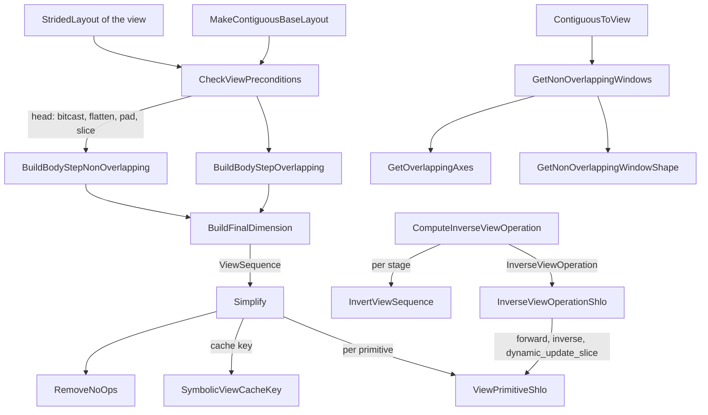

# View decomposition - representing strided views and in-place view writes on immutable TPU buffers

## Overview
On CPU and CUDA a PyTorch view is free: it is the same storage pointer read through new `(sizes, strides, storage_offset, dtype)` metadata. A TPU buffer (a PjRtBuffer behind a `DeviceBufferRef`) has no pointer arithmetic and is immutable, and StableHLO "does not have support for manual striding". The `csrc/ops/view_decomposition` subsystem bridges that gap in both directions. **Reading** a view: given the shape of the contiguous base buffer and the target [`StridedLayout`](../catalog/csrc/ops/view_decomposition/strided_layout.h.md#StridedLayout "csrc/ops/view_decomposition/strided_layout.h:L65"), it computes a `ViewSequence` - an ordered list of high-level primitives (reshape, transpose, broadcast_in_dim, slice, pad, bitcast, unfold, conj) whose composition reproduces exactly the elements the strided view would address - and lowers it to StableHLO. **Writing** through a view (`y = x[1]; y += 1`): it inverts that sequence and merges the mutated values back into the base with `dynamic_update_slice`, producing a new base buffer. A third entry point, [`ContiguousToView`](../catalog/csrc/ops/view_decomposition/contiguous_to_view.cc.md#ContiguousToView "csrc/ops/view_decomposition/contiguous_to_view.cc:L261"), goes the other way and fabricates a storage so that a contiguous result can be handed back to PyTorch with arbitrary target strides.

The key idea: every primitive knows how to update a [`StridedLayout`](../catalog/csrc/ops/view_decomposition/strided_layout.h.md#StridedLayout "csrc/ops/view_decomposition/strided_layout.h:L65") symbolically (no data touched), so decomposition, simplification, inversion and cache-key construction are all pure host-side algebra on layouts; only the final `ViewPrimitiveShlo` calls emit IR. The price is that a view on TPU is a real op: each read of a non-trivial view is a deferred computation that produces a new buffer, and each in-place write through a view is another deferred op that rewrites (or donates and updates) the whole base.

## Diagram
Read path (strided view -> StableHLO) and write path (mutated view -> new base).

Legend:
- `LAY` - [`StridedLayout`](../catalog/csrc/ops/view_decomposition/strided_layout.h.md#StridedLayout "csrc/ops/view_decomposition/strided_layout.h:L65")
- `BASE` - [`MakeContiguousBaseLayout`](../catalog/csrc/ops/view_decomposition/strided_layout.cc.md#MakeContiguousBaseLayout "csrc/ops/view_decomposition/strided_layout.cc:L35")
- `PRE` - [`CheckViewPreconditions`](../catalog/csrc/ops/view_decomposition/decomposition.cc.md#CheckViewPreconditions "csrc/ops/view_decomposition/decomposition.cc:L58")
- `BODY` - [`BuildBodyStepNonOverlapping`](../catalog/csrc/ops/view_decomposition/decomposition.cc.md#BuildBodyStepNonOverlapping "csrc/ops/view_decomposition/decomposition.cc:L874")
- `BODYO` - [`BuildBodyStepOverlapping`](../catalog/csrc/ops/view_decomposition/decomposition.cc.md#BuildBodyStepOverlapping "csrc/ops/view_decomposition/decomposition.cc:L1010")
- `FIN` - [`BuildFinalDimension`](../catalog/csrc/ops/view_decomposition/decomposition.cc.md#BuildFinalDimension "csrc/ops/view_decomposition/decomposition.cc:L1117")
- `SIMP` - [`Simplify`](../catalog/csrc/ops/view_decomposition/view_sequence.cc.md#Simplify "csrc/ops/view_decomposition/view_sequence.cc:L320")
- `RNO` - [`RemoveNoOps`](../catalog/csrc/ops/view_decomposition/view_sequence.cc.md#RemoveNoOps "csrc/ops/view_decomposition/view_sequence.cc:L61")
- `SYM` - [`SymbolicViewCacheKey`](../catalog/csrc/ops/view_decomposition/view_sequence.cc.md#SymbolicViewCacheKey "csrc/ops/view_decomposition/view_sequence.cc:L491")
- `SHLO` - [`ViewPrimitiveShlo`](../catalog/csrc/ops/view_decomposition/slice_primitive.cc.md#ViewPrimitiveShlo "csrc/ops/view_decomposition/slice_primitive.cc:L199") (one overload per primitive type; the bitcast overload is [`ViewPrimitiveShlo`](../catalog/csrc/ops/view_decomposition/bitcast_primitive.cc.md#ViewPrimitiveShlo "csrc/ops/view_decomposition/bitcast_primitive.cc:L469"))
- `INV` - [`ComputeInverseViewOperation`](../catalog/csrc/ops/view_decomposition/inversion.cc.md#ComputeInverseViewOperation "csrc/ops/view_decomposition/inversion.cc:L903")
- `IVS` - [`InvertViewSequence`](../catalog/csrc/ops/view_decomposition/inversion.cc.md#InvertViewSequence "csrc/ops/view_decomposition/inversion.cc:L470")
- `IVSH` - [`InverseViewOperationShlo`](../catalog/csrc/ops/view_decomposition/inversion.cc.md#InverseViewOperationShlo "csrc/ops/view_decomposition/inversion.cc:L953")
- `C2V` - [`ContiguousToView`](../catalog/csrc/ops/view_decomposition/contiguous_to_view.cc.md#ContiguousToView "csrc/ops/view_decomposition/contiguous_to_view.cc:L261")
- `WIN` - [`GetNonOverlappingWindows`](../catalog/csrc/ops/view_decomposition/contiguous_to_view.cc.md#GetNonOverlappingWindows "csrc/ops/view_decomposition/contiguous_to_view.cc:L166")
- `AXES` - [`GetOverlappingAxes`](../catalog/csrc/ops/view_decomposition/contiguous_to_view.cc.md#GetOverlappingAxes "csrc/ops/view_decomposition/contiguous_to_view.cc:L62")
- `WSH` - [`GetNonOverlappingWindowShape`](../catalog/csrc/ops/view_decomposition/contiguous_to_view.cc.md#GetNonOverlappingWindowShape "csrc/ops/view_decomposition/contiguous_to_view.cc:L121")

## Design rationale (why it's built this way)
- **Always decompose from a contiguous base.** In eager mode "every Tensor has a c10::Storage containing a contiguous base DeviceBufferRef of a known shape", so a view is always "contiguous base -> strided layout", never view-of-view. That collapses arbitrarily long chains of user view ops into one decomposition problem and one deferred op, and makes the base's flat element order the coordinate system for everything (`decomposition.h`). [`MakeContiguousBaseLayout`](../catalog/csrc/ops/view_decomposition/strided_layout.cc.md#MakeContiguousBaseLayout "csrc/ops/view_decomposition/strided_layout.cc:L35") returns "the unique contiguous base layout with that shape".
- **Meet in the middle.** The implementation notes say "It's easiest to work both forward and backwards and meet in the middle." Backwards, the target is reduced to a "well-behaved" layout (row-major, no size-1 or stride-0 dims) plus at most two tail ops (one `broadcast_in_dim` that absorbs reshape+permute+expand, or a reshape followed by a transpose). Forwards, the base is bitcast to the view dtype, flattened to a 1-D "storage" array, padded and sliced to the view window. The body then alternates reshape+slice (or reshape+unfold for overlapping dims) until head and tail layouts coincide.
- **Only high-level, fusible ops.** Every primitive lowers to ordinary StableHLO data-movement ops - mostly one op each (`reshape`, `transpose`, `broadcast_in_dim`, `slice`, `pad`, `bitcast_convert`), while an unfold becomes one `slice` per window joined by a `concatenate`, and bitcasts to or from `bool` add a `convert` through `ui8` - so XLA sees ops it can fuse into consumers rather than gathers over computed indices.
- **Invert with dynamic_update_slice, not select.** The inversion header describes the general scheme (scatter values back to their base positions, then `select` with a mask), but the code rewrites strided slices away first because a strided slice "would require a stablehlo.select operation with a boolean mask" and is "somewhat complicated and slow to compile"; with only dense slices every merge is a `dynamic_update_slice`. The comment on that merge spells out the memory reason: `dynamic_update_slice` "has a single read operand ... that XLA buffer assignment aliases in-place with the output buffer", while a slice+concatenate rebuild "reads `output` via two distinct `Slice` operations, preventing XLA from aliasing `output` in-place and doubling memory consumption".
- **Overlapping views are read-only.** Writes to overlapping or broadcast views are undefined behavior on every backend ("multiple competing writes to that location"); torch_tpu raises `kFailedPrecondition` with a hint to `clone()` / `contiguous()` first instead of picking a winner.
- **Shape-polymorphic cache keys.** A view op's parameter cache key tries to describe the sequence as a mapping between shapes (`[A] -> [A, 1]`) instead of embedding static sizes, so the same view pattern over different sizes contributes the same op parameters to the graph's shapeless key. Concrete tensor sizes still enter the dimensions key, so a static-shape graph at a new size is still a new compile; the size-independent param key is what lets shapeless-keyed (bounded/unbounded dynamic) cache entries match (see [compilation-cache-key](compilation-cache-key.md)).

## Entry points
- [`SymbolicViewCacheKey`](../catalog/csrc/ops/view_decomposition/view_sequence.cc.md#SymbolicViewCacheKey "csrc/ops/view_decomposition/view_sequence.cc:L491") - the shape-polymorphic half of `ViewSequenceCacheKey`; reached when a materializing read of a non-contiguous tensor (`CreateViewDeviceBufferRef` in `csrc/eager/device_buffer_utils.cc`) has decomposed and simplified the view and needs the `OpParamCacheKeys` for the ephemeral `as_strided` deferred op it is about to create.
- [`ComputeInverseViewOperation`](../catalog/csrc/ops/view_decomposition/inversion.cc.md#ComputeInverseViewOperation "csrc/ops/view_decomposition/inversion.cc:L903") - reached when a buffer is assigned into a non-contiguous view of a base (`CreateInverseViewDeviceBufferRef`, op name `kAsStridedInverse`), i.e. every in-place op or `copy_` whose destination is a slice, transpose, or dtype view of a larger tensor.
- [`InverseViewOperationShlo`](../catalog/csrc/ops/view_decomposition/inversion.cc.md#InverseViewOperationShlo "csrc/ops/view_decomposition/inversion.cc:L953") - the op builder body of that inverse deferred op, run when the deferred graph is lowered to StableHLO.
- [`ContiguousToView`](../catalog/csrc/ops/view_decomposition/contiguous_to_view.cc.md#ContiguousToView "csrc/ops/view_decomposition/contiguous_to_view.cc:L261") - called by kernels whose result is computed contiguously but must be returned with specific strides: SDPA and flash-attention outputs and gradients, `optimization_barrier`, AO offload, and `torch.compile` outputs.
- [`Simplify`](../catalog/csrc/ops/view_decomposition/view_sequence.cc.md#Simplify "csrc/ops/view_decomposition/view_sequence.cc:L320") - called on every decomposed sequence before use (and by the compiled-mode base-shape chooser).
- [`operator<<`](../catalog/csrc/ops/view_decomposition/strided_layout.cc.md#operator "csrc/ops/view_decomposition/strided_layout.cc:L70") - formats a `StridedLayout`; together with the per-primitive formatters (a primitive prints as `reshape(base_sizes=..., new_sizes=...)`, `slice[(start=..., limit=..., stride=...), ...]`, `bitcast(from_type=..., to_type=...)`, etc.; a layout prints as `shape: [...] strides: [...] storage_offset: N`) this is what appears in `ABSL_VLOG` output (`[GetBuffer] Decomposed base buffer ... into view sequence ...`) and in error messages, and it is the quickest way to see what a view costs.

## Mechanism (step-by-step)
1. **Model the view.** A [`StridedLayout`](../catalog/csrc/ops/view_decomposition/strided_layout.h.md#StridedLayout "csrc/ops/view_decomposition/strided_layout.h:L65") holds [`strided_dims`](../catalog/csrc/ops/view_decomposition/strided_layout.h.md#StridedLayout.strided_dims "csrc/ops/view_decomposition/strided_layout.h:L70") (each a [`size`](../catalog/csrc/ops/view_decomposition/strided_layout.h.md#StridedDimension.size "csrc/ops/view_decomposition/strided_layout.h:L51") and a [`stride`](../catalog/csrc/ops/view_decomposition/strided_layout.h.md#StridedDimension.stride "csrc/ops/view_decomposition/strided_layout.h:L53") in elements) plus a storage offset, with the CPU/CUDA semantics `offset + sum(x[i] * stride[i])`. Stride 0 with size > 1 means broadcast; size 1 makes the stride irrelevant. The struct is deliberately kept at 64 bytes, "one cache line on most x86 CPUs", by inlining only 3 dimensions.

2. **Validate.** [`CheckViewPreconditions`](../catalog/csrc/ops/view_decomposition/decomposition.cc.md#CheckViewPreconditions "csrc/ops/view_decomposition/decomposition.cc:L58") crashes (these are torch_tpu bugs, already checked at view construction) on negative sizes, zero-sized views ("not yet supported; use empty_strided() instead" - callers short-circuit those to a zero-size constant), negative offsets, or a view whose highest addressed element, in bits, exceeds the base's storage. Bits rather than bytes because of sub-byte dtypes such as F4.

3. **Build the tail (backwards) and head (forwards).** The tail sorts dimensions by stride and peels off the final broadcast or reshape+transpose, leaving a well-behaved layout. The head bitcasts the base to the view dtype - a [`RealToRealBitcast`](../catalog/csrc/ops/view_decomposition/bitcast_primitive.h.md#RealToRealBitcast "csrc/ops/view_decomposition/bitcast_primitive.h:L83") appends or removes a trailing dimension of size `bitwidth ratio`, following StableHLO rather than torch's divide-the-last-dim convention, and complex types go through view_as_real / view_as_complex with [`ComplexElementType`](../catalog/csrc/ops/view_decomposition/bitcast_primitive.h.md#ComplexElementType "csrc/ops/view_decomposition/bitcast_primitive.h:L125") disambiguating torch vs StableHLO complex bit widths - then a [`ReshapePrimitive`](../catalog/csrc/ops/view_decomposition/reshape_primitive.h.md#ReshapePrimitive "csrc/ops/view_decomposition/reshape_primitive.h:L55") flattens to 1-D, a pad grows storage if the window runs off the end, and a [`SlicePrimitive`](../catalog/csrc/ops/view_decomposition/slice_primitive.h.md#SlicePrimitive "csrc/ops/view_decomposition/slice_primitive.h:L67") cuts the window `[offset, offset + width)`. If head and tail already match (pure unsqueeze/transpose/expand of the base, or at most one non-trivial dim), decomposition stops here.

4. **Solve the body.** While the head has fewer dims than the tail, each step satisfies one or more tail dimensions. [`BuildBodyStepNonOverlapping`](../catalog/csrc/ops/view_decomposition/decomposition.cc.md#BuildBodyStepNonOverlapping "csrc/ops/view_decomposition/decomposition.cc:L874") uses "exactly one reshape and one slice" (reshape the remaining 1-D run into `[count, stride ratios...]`, then a dense slice); [`BuildBodyStepOverlapping`](../catalog/csrc/ops/view_decomposition/decomposition.cc.md#BuildBodyStepOverlapping "csrc/ops/view_decomposition/decomposition.cc:L1010") handles a dimension whose windows overlap (stride smaller than the inner width, as produced by `unfold` or sliding-window `as_strided`) with "exactly one reshape and unfold". Every step re-establishes the same invariant with one more completed dimension, so the loop is bounded by the view's rank. Along the way the head pad and slice are shrunk when the needed offset can be absorbed into a body slice, often eliminating them.

5. **Finish the minor dimension.** [`BuildFinalDimension`](../catalog/csrc/ops/view_decomposition/decomposition.cc.md#BuildFinalDimension "csrc/ops/view_decomposition/decomposition.cc:L1117") handles a last dimension with stride > 1: if the remaining elements divide evenly it reshapes to `[..., n / stride, stride]` and densely slices the last axis to size 1; otherwise it emits one strided slice. Any extra size-1 dim introduced is squeezed by adjusting the tail op, the tail is appended, and a `conj` is appended for conjugate views.

6. **Simplify.** [`Simplify`](../catalog/csrc/ops/view_decomposition/view_sequence.cc.md#Simplify "csrc/ops/view_decomposition/view_sequence.cc:L320") iterates to a fixed point over [`RemoveNoOps`](../catalog/csrc/ops/view_decomposition/view_sequence.cc.md#RemoveNoOps "csrc/ops/view_decomposition/view_sequence.cc:L61") (drop any primitive for which [`UpdateLayout`](../catalog/csrc/ops/view_decomposition/reshape_primitive.cc.md#UpdateLayout "csrc/ops/view_decomposition/reshape_primitive.cc:L156") reports no change) and merging of back-to-back primitives of the same kind (two reshapes -> the second; two slices -> one). A plain transpose or contiguous slice therefore usually ends up as one or two StableHLO ops, not the full head/body/tail scaffold.

7. **Key and lower.** `ViewSequenceCacheKey` first tries [`SymbolicViewCacheKey`](../catalog/csrc/ops/view_decomposition/view_sequence.cc.md#SymbolicViewCacheKey "csrc/ops/view_decomposition/view_sequence.cc:L491"), which encodes reshapes as reassociations (`[6,4] -> [3,2,4,1]` as dim groups plus only the split sizes needed to disambiguate), transposes by permutation, broadcasts with input dims named `in<k>`, and bitcasts/pads by parameters. Slices and unfolds have no symbolic form ("slicing along a dynamic dimension is a cache miss, not worth a partially symbolic key"), so any sequence containing one falls back to keying on the raw strides and storage offset. The deferred op's builder then applies the per-primitive `ViewPrimitiveShlo` overloads in order - for example the slice overload ([`ViewPrimitiveShlo`](../catalog/csrc/ops/view_decomposition/slice_primitive.cc.md#ViewPrimitiveShlo "csrc/ops/view_decomposition/slice_primitive.cc:L199")) is a direct `stablehlo.slice` and rejects slicing a dynamic (bounded) dimension, and the bitcast overload ([`ViewPrimitiveShlo`](../catalog/csrc/ops/view_decomposition/bitcast_primitive.cc.md#ViewPrimitiveShlo "csrc/ops/view_decomposition/bitcast_primitive.cc:L469")) routes `bool` through `convert` to/from `ui8` because XLA stores PRED as bits, not bytes.

8. **Plan the inverse for a write.** [`ComputeInverseViewOperation`](../catalog/csrc/ops/view_decomposition/inversion.cc.md#ComputeInverseViewOperation "csrc/ops/view_decomposition/inversion.cc:L903") aligns dtypes first (both sides cast to the smaller bit width so partial updates of wider base elements keep their untouched bits; a `bool` base is widened to `uint8` "to preserve all assigned bytes"), decomposes base -> view in that writable dtype with strided slices rewritten into pad + reshape + dense slice + reshape, simplifies, and partitions the sequence at every slice into stages. Within a stage, [`InvertViewSequence`](../catalog/csrc/ops/view_decomposition/inversion.cc.md#InvertViewSequence "csrc/ops/view_decomposition/inversion.cc:L470") reverses the lossless primitives (reshape <-> reshape, transpose <-> transpose, pad -> slice, conj -> conj, view_as_real <-> view_as_complex with a corrective reshape). With `preserve_base == false` (base not donated) an initial reshape and any invertible bitcast are folded into a `base_transform` instead of being inverted, so the written-back base may change shape/dtype into one "that will make this view more efficient to compute in the future"; [`final_shape`](../catalog/csrc/ops/view_decomposition/inversion.h.md#InverseViewOperation.final_shape "csrc/ops/view_decomposition/inversion.h:L182") records the result.

9. **Emit the write.** [`InverseViewOperationShlo`](../catalog/csrc/ops/view_decomposition/inversion.cc.md#InverseViewOperationShlo "csrc/ops/view_decomposition/inversion.cc:L953") applies the base transform, replays the forward stages on the old base to materialize each pre-slice value, bitcasts the mutated view, then walks the stages backwards: invert the stage, and merge into the pre-slice value with `dynamic_update_slice` at the slice's start indices (or, for a single sliced dimension larger than `INT32_MAX`, a slice+concatenate to avoid 32-bit index overflow). If the forward sequence has no slices at all, the caller skips this and emits a pure inverse sequence with no dependency on the old base and nothing to donate; otherwise the base is input 0 and is donated when the caller allows it.

10. **Rebuild a strided tensor from contiguous data.** [`ContiguousToView`](../catalog/csrc/ops/view_decomposition/contiguous_to_view.cc.md#ContiguousToView "csrc/ops/view_decomposition/contiguous_to_view.cc:L261") is a no-op when the target strides are contiguous with offset 0. Otherwise it allocates an empty base of the minimal shape, uses [`GetOverlappingAxes`](../catalog/csrc/ops/view_decomposition/contiguous_to_view.cc.md#GetOverlappingAxes "csrc/ops/view_decomposition/contiguous_to_view.cc:L62") to find dimensions whose stride is not larger than everything to their right, sizes each write window with [`GetNonOverlappingWindowShape`](../catalog/csrc/ops/view_decomposition/contiguous_to_view.cc.md#GetNonOverlappingWindowShape "csrc/ops/view_decomposition/contiguous_to_view.cc:L121") (broadcast and overlapping axes cut to 1), enumerates one window per combination of overlapping indices in [`GetNonOverlappingWindows`](../catalog/csrc/ops/view_decomposition/contiguous_to_view.cc.md#GetNonOverlappingWindows "csrc/ops/view_decomposition/contiguous_to_view.cc:L166"), and assigns each window into the new storage through the inverse-view write path above. Gaps are filled with NaN / max-int, overlapping duplicates are "last write wins".

## Key data structures
- **`ViewPrimitive`**: a `std::variant` of reshape, transpose, broadcast, slice, pad, real-to-real bitcast, complex-to-real bitcast, view_as_complex, unfold and conj (176 bytes, asserted). A `ViewSequence` is a `std::vector` of them, always interpreted relative to a contiguous base. Each primitive type provides `UpdateLayout`, `Merge` where meaningful, an `operator<<`, and a `ViewPrimitiveShlo` overload.
- **[`ReshapePrimitive`](../catalog/csrc/ops/view_decomposition/reshape_primitive.h.md#ReshapePrimitive "csrc/ops/view_decomposition/reshape_primitive.h:L55")** stores both `base_sizes` and `new_sizes`; a reshape is only legal on a strided layout when it respects "contiguity-like blocks", and [`UpdateLayout`](../catalog/csrc/ops/view_decomposition/reshape_primitive.cc.md#UpdateLayout "csrc/ops/view_decomposition/reshape_primitive.cc:L156") crashes otherwise.
- **[`SlicePrimitive`](../catalog/csrc/ops/view_decomposition/slice_primitive.h.md#SlicePrimitive "csrc/ops/view_decomposition/slice_primitive.h:L67")**: per-dim `(start, limit, stride)` in [`slice_dims`](../catalog/csrc/ops/view_decomposition/slice_primitive.h.md#SlicePrimitive.slice_dims "csrc/ops/view_decomposition/slice_primitive.h:L68"); result stride is input stride times slice stride. Slices are the only lossy-but-mergeable primitive and the stage boundaries of an inversion.
- **`InverseViewOperation`**: `base_transform` (bitcasts and at most one reshape applied to the base), `bitcast_view` (aligns the mutated view's dtype), `stages` (one more than the number of slices; each holds `forward`, the boundary `slice`, and `inverse`), and [`final_shape`](../catalog/csrc/ops/view_decomposition/inversion.h.md#InverseViewOperation.final_shape "csrc/ops/view_decomposition/inversion.h:L182").
- **`InverseViewPrimitive`**: the invertible subset (reshape, transpose, slice, conj, real-to-real bitcast, complex-to-real bitcast, view_as_complex). Broadcast and unfold are absent because they are one-to-many; real()/imag() and bitcasts to bool are absent because they lose data.

## Dynamics (design intent)
- All decomposition, inversion and keying happens on the host at dispatch time and touches no device data; its output is captured by value into a deferred op's builder lambda, so StableHLO is only emitted if and when the deferred graph is lowered.
- Decomposition is deterministic for a given (base shape, base dtype, layout, view dtype, conj), which is what makes the strides+offset fallback cache key sound.
- Tests pin exact sequences: `decomposition_test.cc` covers permute, expand, broadcast, padding-required, overlapping major/minor dims, complex and bitcast cases; `inversion_test.cc` (`ComputeInverseViewOperation.SliceTensorStridedNonContiguous`) shows `torch.ones(7)[1:].view(2, 3)[:, ::2]` turned into three stages with the strided slice replaced by pad + reshape + dense slice, for both `preserve_base` settings.

> [!inferred]
> Cost model for performance work, read from the source rather than measured: a read of a non-contiguous view becomes one `as_strided` deferred op whose body is the simplified view sequence, so inside a larger deferred graph XLA can usually fuse it into its consumer, but at a graph boundary it materializes a full new buffer (HBM traffic proportional to the view size, plus pad/reshape copies when padding was unavoidable). An in-place write through a sliced view costs a forward replay to the pre-slice value plus a `dynamic_update_slice` per stage; when the base is donated XLA can alias it and update in place, otherwise the whole base is rewritten. Views with stride patterns that defeat the symbolic key (any slice or unfold left after simplification) recompile per distinct (strides, offset), which can show up as repeated `as_strided` compiles when slicing at many different offsets.

## Edge cases
- Zero-element views never reach the decomposition; they are turned into zero-size constants by the caller.
- In-place writes to overlapping or broadcast views are rejected with `kFailedPrecondition`; reads of them are fine (broadcast_in_dim / unfold).
- Real-to-bool bitcasts, `real()` / `imag()` views and broadcasts cannot be inverted; [`InvertViewSequence`](../catalog/csrc/ops/view_decomposition/inversion.cc.md#InvertViewSequence "csrc/ops/view_decomposition/inversion.cc:L470") "will crash" if handed one, which is why the write path decomposes in a writable dtype and splits at slices first.
- Slicing a dynamic (bounded) dimension is unsupported in the slice lowering; a bitcast input must have a static shape.
- [`ContiguousToView`](../catalog/csrc/ops/view_decomposition/contiguous_to_view.cc.md#ContiguousToView "csrc/ops/view_decomposition/contiguous_to_view.cc:L261") can leave "zombie data" (NaN / max-int fill) in storage gaps that a later out-of-bounds `as_strided` could observe, and its window count grows with the product of the sizes of overlapping axes.

## Open questions
- The packet subgraph omits the central drivers - `DecomposeIntoViewSequence`, `GetContiguousBaseShape`, `ViewSequenceShlo`, `ReplaceStridedSlices`, `InvertNonStridedSliceShlo`, the `ViewPrimitive` variant and the transpose/broadcast/pad/unfold primitive types - so they are described from source in prose without catalog links.
- `ViewSequenceCacheKey` (L510) and the `ViewPrimitive` `operator<<` (view_sequence.cc L247) are listed in the subgraph, but their catalog anchors collide with sibling overloads in the same file and the linter resolves them outside the subgraph, so they are named here without links.
- In compiled mode, `GetContiguousBaseShape` chooses a FakeTensor's base shape by decomposing from a 1-D BF16 base and reusing a leading reshape; how often that choice differs from the eager base shape (and so changes cache keys between modes) is not visible statically.
- The `inversion.h` header still describes a pad + `select` path for slices with interior padding; the current implementation always replaces strided slices and merges with `dynamic_update_slice`, so the select path appears to be historical.

## See also
- [deferred-execution-and-materialization](deferred-execution-and-materialization.md) - the deferred ops that `as_strided` / `as_strided_inverse` become.
- [compilation-cache-key](compilation-cache-key.md) - how `OpParamCacheKeys` from the view sequence enter the compilation cache key.
- [stablehlo-op-builder](stablehlo-op-builder.md) - the StableHLO builder the primitives lower through.
- [compiled-mode](compiled-mode.md) and [torch-compile-backend](torch-compile-backend.md) - where FakeTensor base shapes and `ContiguousToView` outputs are used.
- [scaled-dot-product-attention](scaled-dot-product-attention.md) - a heavy user of `ContiguousToView` for output strides.
- [dynamic-shapes-compiler](dynamic-shapes-compiler.md) - why slicing dynamic dims is rejected.
