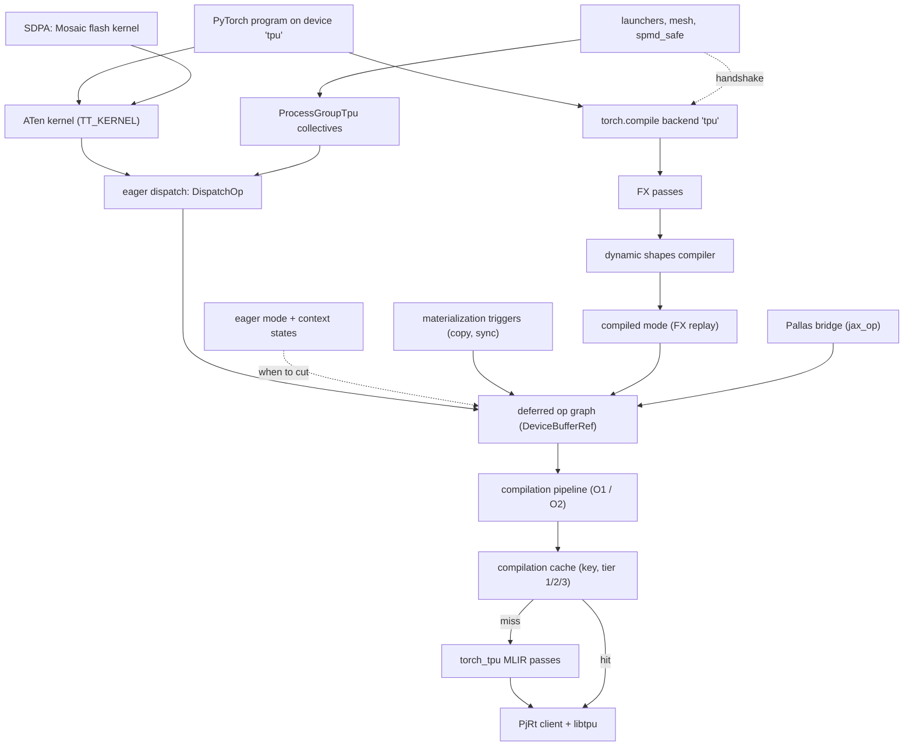

# torch_tpu - what it is and how it fits together

## In one paragraph
torch_tpu registers TPU as PyTorch's `PrivateUse1` device (`"tpu"`), with a C++ core in `csrc/` and the Python package in `src/torch_tpu/`. Every ATen kernel only *describes* its work: it hands a StableHLO builder lambda, output shapes/dtypes and a parameter cache key to the eager dispatcher, which records a deferred node over device-buffer handles instead of running anything. Something later forces a **materialization**: a host copy, `.item()`, a sync, a collective, or simply the next op in the default Strict eager mode. At that point the pending graph is cut, fingerprinted, looked up in a three-tier compilation cache, and on a miss built into one StableHLO module and compiled by XLA on a background pool. The eager mode decides how big those graphs get: one op each by default, multi-op fused clusters under `TORCH_TPU_DEFER_AND_FUSE=1`. `torch.compile(backend="tpu")` adds no second lowering: it replays the FX graph on placeholder tensors through the same deferred machinery and compiles it once. Nearly every step-time question on torch_tpu comes down to three things: how large the compiled graphs are, how often the cache key changes, and where the host is forced to wait.

## Performance-relevant surfaces
The knobs that move step time, MFU and HBM, grouped by what they act on. Env vars are memoized on first read: set them in the launch command, before `import torch` ([environment variables](doc-concepts/environment-variables.md) has the full registry with defaults and readers).

| Group | Surface (knob / API) | Default | Effect on perf | Page |
|---|---|---|---|---|
| Execution mode | `TORCH_TPU_DEFER_AND_FUSE=1` (or the `torch.tpu.eager_mode` property) | off: Strict eager, one executable per op, XLA O1 | ops queue until a trigger and compile as one fused program at fast-runtime (O2) effort; in-place donation is off in this mode | [execution modes](concepts/context-states-and-execution-modes.md), [eager modes doc](doc-concepts/eager-execution-modes.md) |
| Execution mode | `torch.compile(m, backend="tpu", dynamic=False)`; options `async_compile`, `num_dynamic_buckets`, `bucket_size` | - | one PJRT executable per FX partition, a pre-bound C++ runner per step, async warmup compile; `dynamic=True` is refused | [torch.compile backend](concepts/torch-compile-backend.md), [compiled mode](concepts/compiled-mode.md) |
| Execution mode | `torch.tpu.optimizers.SingleTraceTrainer` | - | forward + backward + optimizer traced as one graph; hyperparameters are frozen constants, so every LR change is a recompile | [python optimizers](concepts/python-optimizers.md), [single-trace trainer](doc-concepts/single-trace-trainer.md) |
| Graph cuts | `.cpu()`, `.item()`, `.tolist()`, `print`, `if tensor:`; RNG state every 4 advances | - | each one cuts the fused cluster and adds a host round trip; accumulate `loss.detach()` and read once | [host-device copy](concepts/host-device-copy.md), [defer-and-fuse triggers](doc-concepts/defer-and-fuse-materialization.md), [RNG](concepts/device-streams-generators-and-rng.md) |
| Graph cuts | `torch.tpu.synchronize` (`wait=False` = graph cut, `wait=True` = barrier) | - | the right way to time compile+execute without paying for a D2H copy | [tensor synchronization](concepts/tensor-synchronization.md) |
| Compile cache | `TORCH_TPU_TIER2_COMPILATION_CACHE=<name>` | on iff `WORLD_SIZE` > 1 | the ranks on a host compile each graph once (per-key file lock in `/dev/shm`) | [compilation cache](concepts/compilation-cache.md), [tiers doc](doc-concepts/multi-tier-compilation-cache.md) |
| Compile cache | `TORCH_TPU_TIER3_COMPILATION_CACHE_ROOT=gs://...`; `..._INTERNAL_TIER3_..._LOCAL_BACKUP_TASK` | off; backup task 1 | cache survives restarts and hosts; a local compile races the remote read; a libtpu or binary-fingerprint bump invalidates everything | [compilation cache](concepts/compilation-cache.md) |
| Compile options | `XLA_FLAGS`, `LIBTPU_INIT_ARGS`, `TORCH_TPU_INTERNAL_XLA_OPTIONS`, `torch.tpu.compiler.custom_compiler_options(...)` | - | the raw flag strings are hashed into the key: adding or reordering a flag means a cold cache | [compilation pipeline](concepts/compilation-pipeline.md), [cache key](concepts/compilation-cache-key.md) |
| Compile options | `TORCH_TPU_INTERNAL_ENABLE_MLIR_CSE`, `..._ENABLE_REASSOCIATE_NORM_WEIGHTS` | CSE off (~10% prefill regression); reassociation on (not bit-exact) | torch_tpu's own pre-XLA pass pipeline | [MLIR passes](concepts/mlir-optimization-passes.md) |
| Recompiles | cache-key composition: every dimension, op params, raw scalars by value | scalars promoted to runtime tensors in eager | shape churn, a ragged last batch, or a Python float baked into a compiled graph each force a new compile | [cache key](concepts/compilation-cache-key.md), [recompilation storms](doc-concepts/graph-fingerprint-and-recompilation.md) |
| Recompiles | `torch._dynamo.mark_dynamic` -> bounded dynamism | static | up to 8 buckets aligned to 128, one executable each; you pay padding waste; dynamic graphs recompile in every new process | [dynamic shapes compiler](concepts/dynamic-shapes-compiler.md), [dynamic-shape ops](concepts/dynamic-shape-ops.md) |
| Precision | `torch.tpu.precision(...)`, patched `torch.set_float32_matmul_precision` | `DEFAULT` ("medium"): 1-pass bf16 MXU | `HIGH` / `HIGHEST` cost 3 / 6 MXU passes; precision is part of each op's cache key | [dtype and precision](concepts/dtype-and-precision.md), [matmul precision](doc-concepts/matmul-precision-modes.md) |
| Precision | `torch.tpu.allow_excess_precision` | off | lets XLA drop f32<->bf16 converts inside fusions; breaks parity with Strict eager | [excess precision](doc-concepts/excess-precision.md) |
| Precision | `x.sum()` on bf16 | bf16 accumulate | pass `dtype=torch.float32`; mean/var/std already upcast | [reductions](concepts/reductions.md) |
| Attention | `F.scaled_dot_product_attention` routing | flash if static shapes, f32/bf16, head dim < 128 or a multiple of 128 | Mosaic flash kernel (shows up as `_scaled_dot_product_cudnn_attention`) vs a fused StableHLO path vs MATH; a fallback only emits a one-time warning | [SDPA](concepts/scaled-dot-product-attention.md), [porting doc](doc-concepts/sdpa-backend-selection-when-porting.md) |
| Attention | FX passes: GQA folding, causal-mask -> `is_causal`; `torch.tpu.ops.splash_sdpa` | on under torch.compile | avoid materialized `repeat_kv` and dense masks; splash block sizes | [FX passes](concepts/fx-graph-passes.md), [python ops](concepts/python-ops.md) |
| Custom kernels | `torch.tpu.pallas.jax_op`; C++ Mosaic via KILN | - | JAX is exported to StableHLO, never run; every new shape is a new export; unset precision on f32 operands means 1-pass bf16 | [Pallas bridge](concepts/pallas-custom-kernels.md), [KILN](concepts/kiln-kernel-dsl.md), [Mosaic matmul](concepts/mosaic-matmul.md) |
| Memory | `fused=True` optimizers; in-place donation (`..._DISABLE_INPLACE_BUFFER_DONATION`) | donation on in Strict eager | one program per param group, LR as a runtime tensor, donated state; views written in place rewrite the whole base | [fused optimizers](concepts/fused-optimizer-kernels.md), [dispatch](concepts/eager-op-dispatch.md), [views](concepts/view-decomposition.md) |
| Distributed | `TORCH_TPU_INTERNAL_MATERIALIZE_COLLECTIVE_TENSORS=0`, `torch.tpu.distributed.spmd_safe`, `TORCH_TPU_SPMD_HANDSHAKE_STAGE` | split around every collective | proving ranks identical keeps collectives inside the compute graph, so XLA can overlap them | [collectives](concepts/process-group-and-collectives.md), [launchers and SPMD](concepts/distributed-launchers-and-spmd.md) |
| Distributed | `topology_aware_mesh`; `torch.tpu.ops.ragged_all_to_all`; `Stream(pinned="sparse_core")` | - | ICI-friendly rank layout; recompile-free MoE dispatch; SparseCore work alongside the TensorCore | [launchers and SPMD](concepts/distributed-launchers-and-spmd.md), [ragged / sparse ops](concepts/ragged-collectives-and-sparse-ops.md), [streams](concepts/device-streams-generators-and-rng.md) |
| Measuring | `torch.profiler` with TPU activity (PyTorch >= 2.12); per-device peak bf16 FLOP/s | - | xprof trace with Python-attributed HLO scopes; MFU denominator (v7 counts 2 devices per chip) | [profiler](concepts/profiler.md), [hardware](concepts/hardware-introspection.md), [trace red flags](doc-concepts/trace-red-flags.md) |

Traps that silently void a perf experiment:
- An env var set from Python after the first TPU op is a no-op: the value is memoized on first read.
- A new or reordered `XLA_FLAGS` / `LIBTPU_INIT_ARGS` string changes the compile-options key, so the first step pays a full cold compile ([cache key](concepts/compilation-cache-key.md)).
- Tier-2/3 loads count as misses in `num_cache_hits`. Use `num_compilations` to tell a cold host from a warm one ([compilation cache](concepts/compilation-cache.md)).
- `TORCH_TPU_LAUNCH_BLOCKING`, `TORCH_TPU_ENABLE_DEBUG_CHECKS` and dump flags all add syncs. Never benchmark with them on ([debugging ladder](doc-concepts/tpu-debugging-ladder.md)).
- A causal mask passed *into* a compiled graph is judged causal from its example value only ([FX passes](concepts/fx-graph-passes.md)).

## Core architecture

Legend:
- `USER` - [device initialization doc](doc-concepts/tpu-device-backend-initialization.md)
- `KERN` - [ATen kernel authoring](concepts/aten-kernel-authoring.md) (builders: [StableHLO op builder](concepts/stablehlo-op-builder.md))
- `DISP` - [eager op dispatch](concepts/eager-op-dispatch.md)
- `DEFER` - [deferred execution and materialization](concepts/deferred-execution-and-materialization.md)
- `MODE` - [context states and execution modes](concepts/context-states-and-execution-modes.md)
- `TRIG` - [host-device copy](concepts/host-device-copy.md), [tensor synchronization](concepts/tensor-synchronization.md)
- `COMP` - [compilation pipeline](concepts/compilation-pipeline.md)
- `CACHE` - [compilation cache](concepts/compilation-cache.md), [compilation cache key](concepts/compilation-cache-key.md)
- `MLIR` - [MLIR optimization passes](concepts/mlir-optimization-passes.md)
- `PJRT` - [PjRt client](concepts/pjrt-client.md)
- `TC` - [torch.compile backend](concepts/torch-compile-backend.md)
- `FXP` - [FX graph passes](concepts/fx-graph-passes.md)
- `DYN` - [dynamic shapes compiler](concepts/dynamic-shapes-compiler.md)
- `CM` - [compiled mode](concepts/compiled-mode.md)
- `ATTN` - [scaled dot-product attention](concepts/scaled-dot-product-attention.md)
- `PAL` - [Pallas custom kernels](concepts/pallas-custom-kernels.md)
- `PG` - [process group and collectives](concepts/process-group-and-collectives.md)
- `DIST` - [distributed launchers and SPMD](concepts/distributed-launchers-and-spmd.md)

One eager op, from Python to device (Fused eager shown; Strict eager cuts right after `REC`):

```mermaid
flowchart LR
  OP["y = a * b + 1"] --> TK["TT_KERNEL: op name, param keys, promote scalar"]
  TK --> HLP["BinaryOp: broadcast shape, promote dtype"]
  HLP --> REC["DispatchOp records DeferredOp"]
  REC --> Q["per-stream queue"]
  Q -- "trigger: .item() / sync / collective" --> TRV["traversal + fingerprint"]
  TRV --> LK{"cache hit?"}
  LK -- "no" --> BLD["run builders -> one StableHLO module"]
  BLD --> XLA["MLIR passes + XLA compile on pool"]
  XLA --> EX["PjRt Execute"]
  LK -- "yes" --> EX
  EX --> MAT["buffers materialized"]
```

Legend:
- `OP`, `TK` - [ATen kernel authoring](concepts/aten-kernel-authoring.md), [op names and Python context](concepts/op-names-and-python-context.md)
- `HLP` - [ATen kernel authoring](concepts/aten-kernel-authoring.md), [dtype and precision](concepts/dtype-and-precision.md)
- `REC` - [eager op dispatch](concepts/eager-op-dispatch.md)
- `Q` - [deferred execution and materialization](concepts/deferred-execution-and-materialization.md), [streams](concepts/device-streams-generators-and-rng.md)
- `TRV`, `LK` - [compilation cache key](concepts/compilation-cache-key.md), [compilation cache](concepts/compilation-cache.md)
- `BLD` - [StableHLO op builder](concepts/stablehlo-op-builder.md), [compilation pipeline](concepts/compilation-pipeline.md)
- `XLA` - [MLIR optimization passes](concepts/mlir-optimization-passes.md), [compilation pipeline](concepts/compilation-pipeline.md)
- `EX`, `MAT` - [PjRt client](concepts/pjrt-client.md), [deferred execution and materialization](concepts/deferred-execution-and-materialization.md)

## Main concepts

**Kernels describe, the runtime schedules.** Each of the ~800 `TT_KERNEL` sites wraps a lowering with an op-name scope, Python-context capture, parameter cache keys and error translation, and then returns a deferred node. No kernel computes anything or builds MLIR at call time. Builders run only on a cache miss, so builder code costs compile time, not step time. What a kernel puts in its cache key decides whether a later call reuses an executable. A missing key is a correctness bug; an over-specific key is a recompile bug. See [ATen kernel authoring](concepts/aten-kernel-authoring.md), [eager op dispatch](concepts/eager-op-dispatch.md), [StableHLO op builder](concepts/stablehlo-op-builder.md), [error handling](concepts/error-handling.md).

**Tensors point at buffer handles, not HBM.** A tensor's storage holds a `DeviceBufferRef` into a list that is a placeholder, a deferred op, or materialized PjRt buffers. Intermediates that die before a cut never get their own HBM buffer. Views are recomputed from a contiguous base, and in-place writes swap handles. TPU -> CPU copies are the implicit sync point, and an OOM raised there usually reflects the whole pending graph. See [deferred execution and materialization](concepts/deferred-execution-and-materialization.md), [host-device copy](concepts/host-device-copy.md), [view decomposition](concepts/view-decomposition.md), [tensor synchronization](concepts/tensor-synchronization.md), [batch host-device transfer](concepts/batch-host-device-transfer.md).

**One dispatch path; the mode is a post-step.** Strict eager (the default) materializes every op alone at O1. Fused eager keeps a per-stream queue and compiles clusters at O2. Debug eager blocks after every op. A device-free mode traces for torch.compile. The mode is one of seven thread-local context states, along with precision, tracebacks, `spmd_safe`, compiler options, layout and profile. Only the dispatch thread may read them, so compile workers never see a stale scope. See [context states and execution modes](concepts/context-states-and-execution-modes.md), [eager execution modes](doc-concepts/eager-execution-modes.md).

**Compile once, key carefully, cache in three tiers.** A graph's key is a shapeless part (structure, dtypes, op params, donation, core pinning), every dimension, the resolved compile options (including the raw `XLA_FLAGS` / `LIBTPU_INIT_ARGS` strings) and an optional id. The cache stores *futures*, so concurrent requests share one compile. Tier 1 lives in process; tier 2 is host tmpfs behind file locks; tier 3 is a local or `gs://` store with a racing backup compile. Before XLA, a deliberately thin MLIR pipeline (canonicalize, norm-weight reassociation, StableHLO optimizer, DCE) runs, with CSE off. See [compilation pipeline](concepts/compilation-pipeline.md), [compilation cache key](concepts/compilation-cache-key.md), [compilation cache](concepts/compilation-cache.md), [MLIR optimization passes](concepts/mlir-optimization-passes.md), [PjRt client](concepts/pjrt-client.md).

**torch.compile reuses the eager tracer.** `TpuBackend` runs AOTAutograd with min-cut remat, applies FX rewrites (GQA folding, causal-mask elimination, remat barriers, split repairs), and splits graphs at collectives. It then replays each partition on placeholders under the internal compile mode, so every eager lowering and Pallas call works identically under compile. Graphs with symbolic sizes go to a bucketed bounded-dynamism compiler backed by `set_dimension_size`-style ops. `scan` lowers to `stablehlo.while` or `chlo.scan`. See [torch.compile backend](concepts/torch-compile-backend.md), [compiled mode](concepts/compiled-mode.md), [FX graph passes](concepts/fx-graph-passes.md), [dynamic shapes compiler](concepts/dynamic-shapes-compiler.md), [dynamic-shape ops](concepts/dynamic-shape-ops.md).

**Precision is a cache-key input with TPU defaults.** Matmul precision (`DEFAULT` / `HIGH` / `HIGHEST` = 1 / 3 / 6 bf16 MXU passes) is stamped on each `dot_general` and written into that op's key at dispatch. The TPU global default is `DEFAULT`, not PyTorch's `"highest"`. Elementwise ops upcast to a compute dtype and downcast again; excess precision is off so fused and op-by-op runs round the same way. Accumulation follows CUDA (bf16 -> f32), except plain `sum`. See [dtype and precision](concepts/dtype-and-precision.md), [reductions](concepts/reductions.md), [MXU bf16 arithmetic](doc-concepts/mxu-bf16-arithmetic.md), [TPU/CPU parity](doc-concepts/tpu-cpu-numerical-parity.md).

**Fast kernels ride inside StableHLO.** The SDPA flash kernel is a Mosaic module built in C++ for each call's static shapes and embedded as a `tpu_custom_call`, so it caches like any op. A shared builder layer fixes f32 MXU accumulation and transposes-as-dimension-numbers, and KILN is an emerging Pallas-shaped C++ DSL (unused in production ops at v0.2.0). JAX/Pallas kernels enter through `jax_op`: they are exported to StableHLO under a content fingerprint and never run by JAX. Splash attention and blockwise FP8 `_scaled_mm_v2` are the in-tree users. Fused optimizers emit one multi-tensor program per param group. See [scaled dot-product attention](concepts/scaled-dot-product-attention.md), [Mosaic matmul](concepts/mosaic-matmul.md), [KILN kernel DSL](concepts/kiln-kernel-dsl.md), [Pallas custom kernels](concepts/pallas-custom-kernels.md), [python ops](concepts/python-ops.md), [fused optimizer kernels](concepts/fused-optimizer-kernels.md), [python optimizers](concepts/python-optimizers.md).

**Collectives are graph ops, and splits are the default.** `ProcessGroupTpu` (`"tpu_dist"`) emits StableHLO collectives whose replica groups are positions in a topology-sorted device assignment. That keeps the HLO, and so the cache key, independent of launcher rank order. By default the eager graph is cut around every collective to avoid cross-rank executable mismatch. `spmd_safe` (eager), the compile-time fingerprint handshake, or the materialize-collectives env var proves the ranks identical and removes the cut. MoE routing uses `ragged_all_to_all` with runtime offsets; embeddings use SparseCore custom calls. See [process group and collectives](concepts/process-group-and-collectives.md), [distributed launchers and SPMD](concepts/distributed-launchers-and-spmd.md), [ragged collectives and sparse ops](concepts/ragged-collectives-and-sparse-ops.md), [device streams, generators and RNG](concepts/device-streams-generators-and-rng.md).

Supporting plumbing: [op names and Python context](concepts/op-names-and-python-context.md) (xprof attribution, stable op strings in keys), [profiler](concepts/profiler.md) (Kineto plugin over the TSL profiler) and [hardware introspection](concepts/hardware-introspection.md) (per-device HBM and peak FLOP/s, API lifecycle decorators).

## How a request flows
A training step in eager mode: Python calls hit [ATen kernels](concepts/aten-kernel-authoring.md), which record deferred nodes through [dispatch](concepts/eager-op-dispatch.md) into the [deferred graph](concepts/deferred-execution-and-materialization.md). The [eager mode](concepts/context-states-and-execution-modes.md) or a [trigger](concepts/host-device-copy.md) cuts the graph. The [pipeline](concepts/compilation-pipeline.md) fingerprints it ([key](concepts/compilation-cache-key.md)) and asks the [cache](concepts/compilation-cache.md). On a miss it builds StableHLO, runs the [MLIR passes](concepts/mlir-optimization-passes.md) and compiles off-thread. The [PjRt client](concepts/pjrt-client.md) enqueues the executable, and the host only waits when a result is read. Under `torch.compile` the [backend](concepts/torch-compile-backend.md) produces the same deferred graph via [compiled mode](concepts/compiled-mode.md) once per graph, then calls the cached executable directly every step.

## Map of the wiki
- **Start from an area:** [csrc](areas/csrc.md) (the C++ spine: dispatch, deferral, compile, cache, Mosaic kernels, collectives, PjRt) or [src](areas/src.md) (Python: torch.compile stack, FX passes, launchers, Pallas bridge, optimizers, profiler, hardware). Per-op kernel directories (pooling, linalg, norms, losses, ...) have no concept page; they follow [ATen kernel authoring](concepts/aten-kernel-authoring.md) and are listed in the catalog.
- **"Where is X / who calls X":** [catalog/index.md](catalog/index.md) is the module map. The symbol index `catalog/symbols/*.tsv` can be grepped by anchor. Concept pages cite catalog anchors for every claim.
- **The user guide, routed to code:** [user-guide map](doc-concepts/torchtpu-user-guide-map.md) maps each chapter of `docs/` to concept pages. [Architecture and lowering stack](doc-concepts/torch-tpu-architecture-and-lowering-stack.md) and [ATen -> StableHLO -> HLO -> LLO](doc-concepts/xla-lowering-stablehlo-hlo-llo.md) are the conceptual intros.
- **Knobs and API surface:** [environment variables](doc-concepts/environment-variables.md), [global vs local knobs](doc-concepts/global-and-local-knobs.md), [public API inventory](doc-concepts/public-api-surface-inventory.md), [API lifecycle stages](doc-concepts/api-lifecycle-stages.md), [CUDA -> TPU API mapping](doc-concepts/cuda-to-tpu-api-mapping.md).
- **Concept list:** all 36 concept pages are linked from the diagrams and Main concepts above; the host wiki's `index.md` points at this page as the silo's front door.
- **README topics:**
  - ATen kernels -> [ATen kernel authoring](concepts/aten-kernel-authoring.md)
  - Compilation cache -> [compilation cache](concepts/compilation-cache.md), [tiers doc](doc-concepts/multi-tier-compilation-cache.md)
  - Distributed training (DP / TP) -> [torchrun + tpu_dist DDP](doc-concepts/torchrun-launch-and-tpu-dist-ddp.md), [collectives](concepts/process-group-and-collectives.md)
  - `torch.compile()` integration -> [torch.compile backend](concepts/torch-compile-backend.md)
  - Debugging and benchmarking utilities -> [debugging ladder](doc-concepts/tpu-debugging-ladder.md), [error anatomy](doc-concepts/tpu-error-anatomy.md), [hardware introspection and tracers](concepts/hardware-introspection.md), [profiler](concepts/profiler.md)
  - User guide and Marimo notebooks -> [user-guide map](doc-concepts/torchtpu-user-guide-map.md)
  - Python version support -> [support policy](doc-concepts/python-version-support-policy.md)
  - Build from source (`-c opt`, `--config=wheel_common`) -> [optimized wheel build](doc-concepts/optimized-wheel-build.md); CI job membership -> [CI test-tag filters](doc-concepts/ci-test-tag-filters.md)
  - Public APIs -> [public API inventory](doc-concepts/public-api-surface-inventory.md)
  - **Not covered by this wiki:** pip/nightly installation and authentication; the `examples/` models (Llama, Qwen, ResNet, DLRM, minGPT, UNet) and `examples/tutorials` (neither is indexed); Bazel/Bazelisk setup; the VSCode clangd setup; contributing and license. Read `raw/code/torch_tpu/README.md` for those.

## Where to go for a given task
| Task | Start here | Then |
|---|---|---|
| Speed up an eager training loop | [eager execution modes](doc-concepts/eager-execution-modes.md) | [defer-and-fuse triggers](doc-concepts/defer-and-fuse-materialization.md), [host-sync avoidance](doc-concepts/host-sync-avoidance-in-training-loops.md), [deferred execution](concepts/deferred-execution-and-materialization.md) |
| Hunt a recompilation storm or slow cold start | [recompilation storms](doc-concepts/graph-fingerprint-and-recompilation.md) | [compilation cache key](concepts/compilation-cache-key.md), [compilation cache](concepts/compilation-cache.md) |
| Move a model to torch.compile (static or bounded shapes) | [static shapes and bounded dynamism](doc-concepts/torch-compile-static-shapes-and-bounded-dynamism.md) | [torch.compile backend](concepts/torch-compile-backend.md), [dynamic shapes compiler](concepts/dynamic-shapes-compiler.md), [graph breaks](doc-concepts/graph-breaks-on-tpu.md) |
| Debug a slow attention layer | [scaled dot-product attention](concepts/scaled-dot-product-attention.md) | [FX graph passes](concepts/fx-graph-passes.md), [SDPA backend selection](doc-concepts/sdpa-backend-selection-when-porting.md) |
| Add or optimize an ATen op lowering | [ATen kernel authoring](concepts/aten-kernel-authoring.md) | [eager op dispatch](concepts/eager-op-dispatch.md), [StableHLO op builder](concepts/stablehlo-op-builder.md) |
| Wrap a Pallas kernel as a PyTorch op | [Pallas as custom ops](doc-concepts/pallas-jax-op-bridge.md) | [Pallas custom kernels](concepts/pallas-custom-kernels.md), [extension ladder](doc-concepts/pytorch-extension-ladder.md) |
| Scale out and keep collectives fused | [torchrun + tpu_dist DDP](doc-concepts/torchrun-launch-and-tpu-dist-ddp.md) | [distributed launchers and SPMD](concepts/distributed-launchers-and-spmd.md), [SPMD lock-step rules](doc-concepts/spmd-lockstep-and-collective-fusion.md), [collectives](concepts/process-group-and-collectives.md) |
| Profile a step and read the trace | [xprof workflow](doc-concepts/xprof-profiling-workflow.md) | [profiler](concepts/profiler.md), [trace red flags](doc-concepts/trace-red-flags.md), [HLO/LLO dumps](doc-concepts/hlo-and-llo-compilation-dumps.md) |
