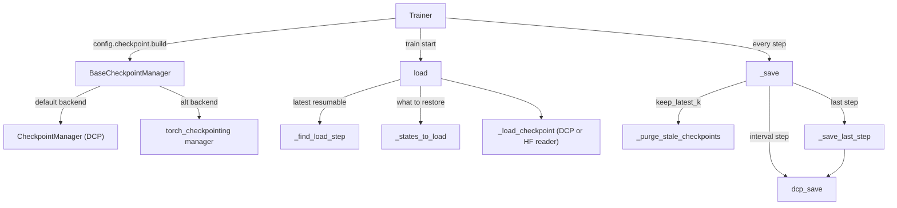

# Checkpointing

## Overview

The checkpointer package separates **policy** from **backend**.
[`BaseCheckpointManager`](../catalog/torchtitan/components/checkpointer/base.md#BaseCheckpointManager "torchtitan/components/checkpointer/base.py:L194")
("Contract every TorchTitan checkpoint manager implements") owns everything that depends only on
config: when to save, which step to resume, what to restore (full state vs model-only vs HF
weights), and which old checkpoints to delete. Concrete managers supply the byte-level parts -
`_save`, `_load_checkpoint`, validity probes and async waits. Two backends ship:
[`CheckpointManager`](../catalog/torchtitan/components/checkpointer/dcp.md#CheckpointManager "torchtitan/components/checkpointer/dcp.py:L89"),
built on `torch.distributed.checkpoint` (DCP) and the trainer's default, and a manager backed by the
external `torch_checkpointing` library. Both checkpoint the same five named states - model (through
a flattening `ModelWrapper`), optimizers, LR schedulers, data loader and the trainer's own
`train_state` - into `<dump_folder>/<folder>/step-N`. For step-time the lens is simple: a
checkpoint step either blocks the training loop (sync), blocks only for device-to-host staging
(async), or blocks only on the next save if the previous upload has not finished
([`AsyncMode`](../catalog/torchtitan/components/checkpointer/dcp.md#AsyncMode "torchtitan/components/checkpointer/dcp.py:L58")).

## Diagram

Legend:
- `TR` - [`Trainer`](../catalog/torchtitan/trainer.md#Trainer "torchtitan/trainer.py:L74")
- `BASE` - [`BaseCheckpointManager`](../catalog/torchtitan/components/checkpointer/base.md#BaseCheckpointManager "torchtitan/components/checkpointer/base.py:L194")
- `DCPM` - [`CheckpointManager`](../catalog/torchtitan/components/checkpointer/dcp.md#CheckpointManager "torchtitan/components/checkpointer/dcp.py:L89")
- `TCM` - the `torch_checkpointing`-backed manager, entered through its [`__init__`](../catalog/torchtitan/components/checkpointer/torch_checkpointing.md#TorchCheckpointingManager.__init__ "torchtitan/components/checkpointer/torch_checkpointing.py:L224")
- `LOAD` - [`load`](../catalog/torchtitan/components/checkpointer/base.md#BaseCheckpointManager.load "torchtitan/components/checkpointer/base.py:L230")
- `FLS` - [`_find_load_step`](../catalog/torchtitan/components/checkpointer/base.md#BaseCheckpointManager._find_load_step "torchtitan/components/checkpointer/base.py:L444")
- `STL` - [`_states_to_load`](../catalog/torchtitan/components/checkpointer/base.md#BaseCheckpointManager._states_to_load "torchtitan/components/checkpointer/base.py:L389")
- `LCK` - [`_load_checkpoint`](../catalog/torchtitan/components/checkpointer/dcp.md#CheckpointManager._load_checkpoint "torchtitan/components/checkpointer/dcp.py:L354")
- `SAVE` - [`_save`](../catalog/torchtitan/components/checkpointer/dcp.md#CheckpointManager._save "torchtitan/components/checkpointer/dcp.py:L405")
- `PURGE` - [`_purge_stale_checkpoints`](../catalog/torchtitan/components/checkpointer/base.md#BaseCheckpointManager._purge_stale_checkpoints "torchtitan/components/checkpointer/base.py:L472")
- `DCPS` - [`dcp_save`](../catalog/torchtitan/components/checkpointer/dcp.md#CheckpointManager.dcp_save "torchtitan/components/checkpointer/dcp.py:L252")
- `LAST` - [`_save_last_step`](../catalog/torchtitan/components/checkpointer/dcp.md#CheckpointManager._save_last_step "torchtitan/components/checkpointer/dcp.py:L598")

How the save modes cost the training loop (DCP manager):

| `async_mode` | What `_save` does | Blocks the step for | Extra resources |
|---|---|---|---|
| `disabled` (default) | `dcp.save` then GC | the whole write | none |
| `async` | GC, `dcp.async_save` on a gloo group, GC | whatever `dcp.async_save` does before returning its future (see note); previous save must finish first | gloo process group |
| `async_with_pinned_mem` | GC, `dcp.async_save` with a process-based checkpointer and a `DefaultStager` (pinned + shared memory, non-blocking copy) | nothing at save time; `maybe_wait_for_staging` before the next optimizer step | pinned host buffers, a save subprocess |

> [!inferred]
> The "blocks for" column for the two async modes is read from how torchtitan consumes the returned
> futures (`staging_completion` vs `upload_completion`, and where the trainer waits); how much of
> the copy `dcp.async_save` performs synchronously is PyTorch DCP behavior not shown in this repo.

## Design rationale (why it's built this way)

- **Policies live on the base class.** The base-class comment: "These depend only on config fields
  that BaseCheckpointManager.Config declares, not on how a backend reads or writes bytes, so they
  live here rather than once per backend." Path questions go through a four-method
  `CheckpointStorage` protocol ([`isdir`](../catalog/torchtitan/components/checkpointer/base.md#CheckpointStorage.isdir "torchtitan/components/checkpointer/base.py:L177"),
  `isfile`, `listdir`, `remove`), held in [`_storage`](../catalog/torchtitan/components/checkpointer/base.md#BaseCheckpointManager._storage "torchtitan/components/checkpointer/base.py:L221"),
  so retention and resume logic never knows which backend answers. Paths stay `str` because "a
  checkpoint id may be a remote URI (gs://...) that Path would mangle".
- **Every subclass declares its own `Config`.** "Subclasses must declare their own nested Config,
  even an empty one": `Configurable` builds `Config._owner`, so an inherited Config would build the
  abstract base. That is why
  [`Config`](../catalog/torchtitan/components/checkpointer/torch_checkpointing.md#TorchCheckpointingManager.Config "torchtitan/components/checkpointer/torch_checkpointing.py:L221")
  of the torch_checkpointing manager is an empty `pass` class, and why the trainer's
  `checkpoint` field is typed as the base Config with a DCP default - swapping backends is a config
  change.
- **Flatten model state across PP chunks; flatten optimizer state by FQN.** The
  [`CheckpointManager`](../catalog/torchtitan/components/checkpointer/dcp.md#CheckpointManager "torchtitan/components/checkpointer/dcp.py:L89")
  docstring explains the pipeline-parallel hazard: per-rank optimizers index `param_group[0]`
  differently, so naive saves collide. The fix is FQN-keyed optimizer flattening (in the optimizer
  container) plus a model wrapper that merges every model chunk's state dict into one.
- **Stable storage for fast async saves.** `ModelWrapper` caches the flattened state dict and
  refreshes hook-produced tensors *in place*, because "Async DCP staging may cache pinned host
  buffers keyed by the source storage, so keeping the storage stable lets it reuse those buffers
  across saves (the fast checkpoint path)".
- **Retention keeps one slot free and is rank-0 only.** `keep_latest_k == 1` is rejected: "We need
  to maintain at least 2 checkpoint replicas, as the last one may be in the process of being saved."
  Deletion runs on a daemon thread fed by a queue so `rmtree` never stalls the step.
- **Resume picks the newest *loadable* step, not the newest directory.** `_find_load_step` filters
  by `_is_resumable_checkpoint` (a `.metadata` file for DCP), so a half-written step or a
  model-only HF export is skipped. Its docstring flags that this is "not remote friendly" (one
  probe per step directory) but runs only once.

## Entry points

- [`Config`](../catalog/torchtitan/components/checkpointer/dcp.md#CheckpointManager.Config "torchtitan/components/checkpointer/dcp.py:L136") -
  the trainer config field `checkpoint` defaults to this DCP Config (adds `async_mode`). The trainer
  calls `config.checkpoint.build(...)` after building data loader, model parts, optimizers and LR
  schedulers, passing `states={"train_state": self}` and the model's state-dict adapter for HF
  conversion; that lands in
  [`__init__`](../catalog/torchtitan/components/checkpointer/dcp.md#CheckpointManager.__init__ "torchtitan/components/checkpointer/dcp.py:L151").
- [`load`](../catalog/torchtitan/components/checkpointer/base.md#BaseCheckpointManager.load "torchtitan/components/checkpointer/base.py:L230") -
  "Restore state from step, or the latest checkpoint when -1"; called once at the top of
  `Trainer.train` with `checkpoint.load_step`.
- `save(curr_step, last_step)` -> [`_save`](../catalog/torchtitan/components/checkpointer/dcp.md#CheckpointManager._save "torchtitan/components/checkpointer/dcp.py:L405") -
  called after every training step; returns immediately unless it is a checkpoint step.
- `maybe_wait_for_staging` - called right before `optimizers.step()` so the optimizer does not
  mutate parameters that pinned-memory staging is still copying (see
  [`AsyncMode`](../catalog/torchtitan/components/checkpointer/dcp.md#AsyncMode "torchtitan/components/checkpointer/dcp.py:L58")).
- [`close`](../catalog/torchtitan/components/checkpointer/base.md#BaseCheckpointManager.close "torchtitan/components/checkpointer/base.py:L334") -
  "Release background threads and other resources"; trainer shutdown and `__del__`.

## Mechanism (step-by-step)

1. **Construct.** [`__init__`](../catalog/torchtitan/components/checkpointer/dcp.md#CheckpointManager.__init__ "torchtitan/components/checkpointer/dcp.py:L151")
   returns immediately if [`enable`](../catalog/torchtitan/components/checkpointer/base.md#BaseCheckpointManager.enable "torchtitan/components/checkpointer/base.py:L203")
   is false - none of the other attributes exist then, which is why every public entry point checks
   `enable` first. Otherwise it resolves [`folder`](../catalog/torchtitan/components/checkpointer/base.md#BaseCheckpointManager.folder "torchtitan/components/checkpointer/base.py:L209")
   under the dump folder, fills [`states`](../catalog/torchtitan/components/checkpointer/base.md#BaseCheckpointManager.states "torchtitan/components/checkpointer/base.py:L211")
   with `MODEL`/`OPTIMIZER`/`DATALOADER`/`LR_SCHEDULER` (the model wrapped for flattening), copies
   the load/save policy, converts [`export_dtype`](../catalog/torchtitan/components/checkpointer/dcp.md#CheckpointManager.export_dtype "torchtitan/components/checkpointer/dcp.py:L193")
   to a torch dtype, requires [`sd_adapter`](../catalog/torchtitan/components/checkpointer/base.md#BaseCheckpointManager.sd_adapter "torchtitan/components/checkpointer/base.py:L217")
   when `last_save_in_hf`, creates a gloo [`pg`](../catalog/torchtitan/components/checkpointer/dcp.md#CheckpointManager.pg "torchtitan/components/checkpointer/dcp.py:L209")
   for async modes, and starts the purge daemon fed by
   [`purge_queue`](../catalog/torchtitan/components/checkpointer/dcp.md#CheckpointManager.purge_queue "torchtitan/components/checkpointer/dcp.py:L224")
   when `keep_latest_k > 0`.

2. **Validate config up front.** [`__post_init__`](../catalog/torchtitan/components/checkpointer/base.md#BaseCheckpointManager.Config.__post_init__ "torchtitan/components/checkpointer/base.py:L584")
   rejects combinations that would fail deep inside DCP: [`interval`](../catalog/torchtitan/components/checkpointer/base.md#BaseCheckpointManager.Config.interval "torchtitan/components/checkpointer/base.py:L538")
   `< 1`, `keep_latest_k == 1`, excluding `model` from loading, excluding `optimizer` without
   `lr_scheduler`, a relative [`initial_load_path`](../catalog/torchtitan/components/checkpointer/base.md#BaseCheckpointManager.Config.initial_load_path "torchtitan/components/checkpointer/base.py:L541"),
   [`initial_load_in_hf`](../catalog/torchtitan/components/checkpointer/base.md#BaseCheckpointManager.Config.initial_load_in_hf "torchtitan/components/checkpointer/base.py:L547")
   without `initial_load_model_only`, `last_save_in_hf` without
   [`last_save_model_only`](../catalog/torchtitan/components/checkpointer/base.md#BaseCheckpointManager.Config.last_save_model_only "torchtitan/components/checkpointer/base.py:L553"),
   and HF read/write against a remote URI ("Remote (fsspec) checkpoint IO supports only the native
   DCP format"). The DCP subclass's
   [`__post_init__`](../catalog/torchtitan/components/checkpointer/dcp.md#CheckpointManager.Config.__post_init__ "torchtitan/components/checkpointer/dcp.py:L140")
   additionally validates and lower-cases `async_mode`.

3. **Resolve what to load.** [`load`](../catalog/torchtitan/components/checkpointer/base.md#BaseCheckpointManager.load "torchtitan/components/checkpointer/base.py:L230")
   looks in the output folder first: with `step == -1` it asks
   [`_find_load_step`](../catalog/torchtitan/components/checkpointer/base.md#BaseCheckpointManager._find_load_step "torchtitan/components/checkpointer/base.py:L444")
   for the highest resumable `step-N`. If one is found, step 0 is treated as a **seed checkpoint**
   (model only) and any other step restores full state. If the output folder has nothing, it falls
   back to `initial_load_path` (DCP or HF), then to the model's `hf_assets_path` when
   `initial_load_in_hf`, else logs "fresh start" and returns `False`.
   [`_states_to_load`](../catalog/torchtitan/components/checkpointer/base.md#BaseCheckpointManager._states_to_load "torchtitan/components/checkpointer/base.py:L389")
   reduces `states` to `{MODEL}` for model-only loads or drops `exclude_from_loading` keys.

4. **Read bytes.** [`_load_checkpoint`](../catalog/torchtitan/components/checkpointer/dcp.md#CheckpointManager._load_checkpoint "torchtitan/components/checkpointer/dcp.py:L354")
   ("Restore selected states through DCP or its Hugging Face reader") flattens the model into the
   state dict. For HF it maps native FQNs to HF keys with the adapter's `to_hf`, reads through the
   adapter's HF storage reader (optionally quantized), maps back with `from_hf`, and loads the model.
   Otherwise it calls `dcp.load` in place - DCP reshards from whatever mesh wrote the checkpoint to
   the current DTensor placements - and pushes the flattened model entries back through the wrapper
   (a TODO notes this manual step). A GC pass follows every load.

5. **Decide and prepare a save.** [`_save`](../catalog/torchtitan/components/checkpointer/dcp.md#CheckpointManager._save "torchtitan/components/checkpointer/dcp.py:L405")
   saves on `last_step`, on `curr_step % interval == 0`, or on step 1 with
   `enable_first_step_checkpoint`, never with `load_only`. It first waits for the previous async
   save (via [`save_future`](../catalog/torchtitan/components/checkpointer/dcp.md#CheckpointManager.save_future "torchtitan/components/checkpointer/dcp.py:L215")),
   then [`_purge_stale_checkpoints`](../catalog/torchtitan/components/checkpointer/base.md#BaseCheckpointManager._purge_stale_checkpoints "torchtitan/components/checkpointer/base.py:L472")
   ("Delete abandoned entries and reserve one retained slot for this save") queues deletion of
   invalid/abandoned directories and of the oldest valid ones beyond `keep_latest_k - 1`, honoring an
   optional `purge_exempt` predicate.

6. **Write.** For an interval step the path is
   [`_create_checkpoint_id`](../catalog/torchtitan/components/checkpointer/base.md#BaseCheckpointManager._create_checkpoint_id "torchtitan/components/checkpointer/base.py:L373")
   (`<folder>/step-N`) and [`dcp_save`](../catalog/torchtitan/components/checkpointer/dcp.md#CheckpointManager.dcp_save "torchtitan/components/checkpointer/dcp.py:L252")
   dispatches on [`AsyncMode`](../catalog/torchtitan/components/checkpointer/dcp.md#AsyncMode "torchtitan/components/checkpointer/dcp.py:L58")
   (table above). Pinned-memory mode lazily creates one `DefaultStager` and keeps two futures:
   staging completion (device -> pinned host) and upload completion. Async modes also log the total
   async write latency when the future resolves.

7. **Final export.** [`_save_last_step`](../catalog/torchtitan/components/checkpointer/dcp.md#CheckpointManager._save_last_step "torchtitan/components/checkpointer/dcp.py:L598")
   always writes synchronously. With `last_save_model_only` (the default) it saves only the model,
   casting floating-point tensors to [`export_dtype`](../catalog/torchtitan/components/checkpointer/base.md#BaseCheckpointManager.Config.export_dtype "torchtitan/components/checkpointer/base.py:L559")
   (default `float32`); with `last_save_in_hf` it writes HF safetensors through
   `HuggingFaceStorageWriter`, sharded by the adapter's FQN-to-file mapping when present. Otherwise
   it saves the full flattened state so training can resume.

8. **The torch_checkpointing backend.** Its [`__init__`](../catalog/torchtitan/components/checkpointer/torch_checkpointing.md#TorchCheckpointingManager.__init__ "torchtitan/components/checkpointer/torch_checkpointing.py:L224")
   rejects remote `folder`/`initial_load_path`, builds an async saver (pinned-memory staging, a
   TCPStore write barrier on `MASTER_ADDR:43001`) unless `load_only`, and wraps the backend
   [`_manager`](../catalog/torchtitan/components/checkpointer/torch_checkpointing.md#TorchCheckpointingManager._manager "torchtitan/components/checkpointer/torch_checkpointing.py:L305").
   [`_save`](../catalog/torchtitan/components/checkpointer/torch_checkpointing.md#TorchCheckpointingManager._save "torchtitan/components/checkpointer/torch_checkpointing.py:L365")
   **prewarms** staging buffers on the first non-saving step "so the first real save does not pay
   for pinned-buffer allocation", and passes the backend's temp-dir prefix to the purge so the current step's staging directory is
   preserved while leftover staging directories from earlier saves are deleted as abandoned.
   Its [`_save_last_step`](../catalog/torchtitan/components/checkpointer/torch_checkpointing.md#TorchCheckpointingManager._save_last_step "torchtitan/components/checkpointer/torch_checkpointing.py:L456")
   closes the async manager and writes through a fresh synchronous one, consolidating per-rank HF
   shards in a pre-finalize callback. Loads are `strict=True` so a missing key cannot silently
   leave initialized weights, and HF loading is not supported yet;
   [`_is_valid_checkpoint`](../catalog/torchtitan/components/checkpointer/torch_checkpointing.md#TorchCheckpointingManager._is_valid_checkpoint "torchtitan/components/checkpointer/torch_checkpointing.py:L411")
   still counts a finished HF export as valid so retention does not delete it.

## TPU lane usage

- The TPU recipes mostly keep checkpointing off during perf work:
  [`llama3_70b`](../catalog/torchtitan/experiments/tpu/llama3/config_registry.md#llama3_70b "torchtitan/experiments/tpu/llama3/config_registry.py:L269")
  and [`qwen3_8b`](../catalog/torchtitan/experiments/tpu/qwen3/config_registry.md#qwen3_8b "torchtitan/experiments/tpu/qwen3/config_registry.py:L555")
  set `CheckpointManager.Config(enable=False, interval=500, ...)`, so checkpoint I/O does not enter
  benchmark step times.
- [`sft_llama3_8b_metamath`](../catalog/torchtitan/experiments/tpu/llama3/config_registry.md#sft_llama3_8b_metamath "torchtitan/experiments/tpu/llama3/config_registry.py:L399")
  uses the policy layer only for the initial weight load: `enable=True, load_only=True,
  initial_load_in_hf=True, initial_load_model_only=True`. Its comment: "`enable` is on only so the
  initial HF weight load happens; `load_only` then suppresses every save, including the
  unconditional last-step one."

> [!inferred]
> From `torchtitan/experiments/tpu/train.py` (not in this packet's subgraph): the TPU launcher
> creates a seed checkpoint by calling `trainer.checkpointer.save(curr_step=0, last_step=True)` and
> asserts `WORLD_SIZE == 1` and `checkpoint.enable`. The core trainer also initializes the model on
> CPU when `create_seed_checkpoint` is set. Both the DCP async modes and the
> torch_checkpointing backend stage through pinned host memory; whether TorchTPU tensors take the
> same pinned-staging fast path as CUDA tensors is not established by this source.

## Key data structures

- **[`Config`](../catalog/torchtitan/components/checkpointer/base.md#BaseCheckpointManager.Config "torchtitan/components/checkpointer/base.py:L529")**
  ("Checkpoint policies shared by concrete TorchTitan checkpoint managers") - the knobs:

  | Field | Default | Effect |
  |---|---|---|
  | `enable` | `False` | master switch ([`enable`](../catalog/torchtitan/components/checkpointer/base.md#BaseCheckpointManager.Config.enable "torchtitan/components/checkpointer/base.py:L532")) |
  | `folder` | `"checkpoint"` | relative to the dump folder |
  | `interval` | `500` | save every N steps |
  | `keep_latest_k` | `10` | 0 = keep all; 1 is rejected |
  | `load_step` | `-1` | -1 = latest resumable |
  | `initial_load_path` / `initial_load_model_only` / `initial_load_in_hf(_quantized)` | `None` / `True` / `False` | bootstrap when the output folder is empty |
  | `last_save_model_only` / `last_save_in_hf` / `export_dtype` | `True` / `False` / `"float32"` | final artifact shape |
  | `exclude_from_loading` | `[]` | e.g. drop data loader state on resume |
  | `enable_first_step_checkpoint`, `create_seed_checkpoint`, `load_only` | `False` | special modes |
  | `async_mode` (DCP only) | `"disabled"` | see table above |

- **Named states** - [`MODEL`](../catalog/torchtitan/components/checkpointer/base.md#MODEL "torchtitan/components/checkpointer/base.py:L33")
  plus `optimizer`, `lr_scheduler`, `dataloader`, `train_state`. Model entries are flattened to
  top-level FQN keys in the DCP state dict; the others stay nested under their key.
- **Checkpoint layout** - DCP: `step-N/.metadata` + shards (resumable); final HF export:
  `model.safetensors.index.json` + shard files (valid, not resumable). torch_checkpointing:
  `metadata.pkl` + `model_<rank>.pt` / `optimizer_<rank>.pt`.
- **Async handles** - `staging_future` (pinned staging) and
  [`save_future`](../catalog/torchtitan/components/checkpointer/dcp.md#CheckpointManager.save_future "torchtitan/components/checkpointer/dcp.py:L215")
  (upload); `_wait_for_saving` clears the future *before* awaiting it so a failed save is not
  retried by `close()` or `__del__`.

## Dynamics (design intent)

- At most one async save is in flight: `_save` waits on the previous `save_future` before purging
  and staging the next, so a slow filesystem shows up as a stall on the *next* checkpoint step, not
  on the current one.
- In pinned-memory mode the only per-step cost is `maybe_wait_for_staging` before the optimizer
  step, which returns immediately unless staging from the last save is still copying.
- Explicit `GarbageCollection.collect` calls bracket saves and follow loads; with the trainer's
  manual GC policy these are deliberate pause points.
- Evidence: integration recipes exercise full save/load, HF save/load, model-only bf16 export and
  `fsdp2_tp2_pp2` save/load (`llama3_debugmodel_full_checkpoint_save`,
  `llama3_debugmodel_hf_checkpoint_load`, `llama3_debugmodel_last_save_model_only_bf16`,
  `llama3_debugmodel_fsdp2_tp2_pp2_save`); torchft tests cover async-save waiting
  (`test_torchft_async_save_calls_maybe_wait_for_saving`).

## Edge cases

- A disabled manager has almost no attributes; code that bypasses the public methods will hit
  `AttributeError`.
- `load_step=N` with a missing checkpoint folder raises `FileNotFoundError` rather than starting
  fresh.
- Step 0 is always loaded model-only (seed checkpoint semantics), even if it contains more.
- `initial_load_model_only=True` without `initial_load_path` only warns - it has no effect.
- The final save ignores `async_mode` and always blocks; with `last_save_model_only=False` it is a
  full-precision, full-state save.
- HF export with a sharded FQN mapping: [`dcp_save`](../catalog/torchtitan/components/checkpointer/dcp.md#CheckpointManager.dcp_save "torchtitan/components/checkpointer/dcp.py:L252")
  calls `consolidate_safetensors_files_on_every_rank`, but in this fork the import of that helper is
  commented out at the top of `dcp.py` (the comment says it is unavailable in some builds), so that
  path would raise `NameError` when the adapter supplies an `fqn_to_index_mapping`.
- The torch_checkpointing manager does not accept remote URIs and cannot load HF checkpoints; use
  the DCP manager for either.

## Open questions

- The class `TorchCheckpointingManager` itself, `ModelWrapper`, `CheckpointStorage` (as a type),
  `_should_save`, `_is_resumable_checkpoint` and `canonical_fqn` are central but absent from the
  packet subgraph; they are described from source above without catalog links.
- Optimizers with construction-time layouts (for example DistMuon's compute sharding, see
  [flex-shard](flex-shard.md)) are not captured in the checkpoint; the restore must rebuild them
  with matching config. How the checkpointer and such optimizers coordinate beyond the optimizer's
  own post-load hook is not visible here.
- Whether `async_with_pinned_mem` meaningfully overlaps on TorchTPU (host staging of device
  tensors) has no test or recipe in the TPU lane.

## See also

- [trainer-and-train-loop](trainer-and-train-loop.md)
- [job-config](job-config.md)
- [optimizers-and-lr-schedulers](optimizers-and-lr-schedulers.md)
- [parallel-dims-and-parallelization](parallel-dims-and-parallelization.md)
- [flex-shard](flex-shard.md)
- [data-loading](data-loading.md)
- [tpu-trainer-and-job-config](tpu-trainer-and-job-config.md)
- [model-spec-protocols](model-spec-protocols.md)
