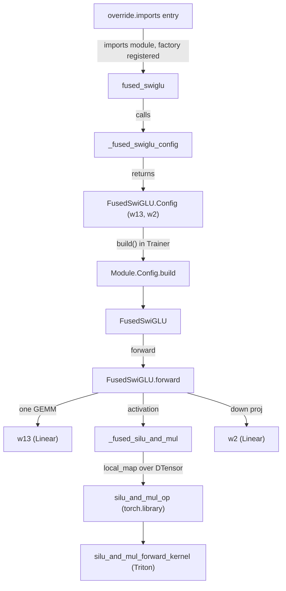
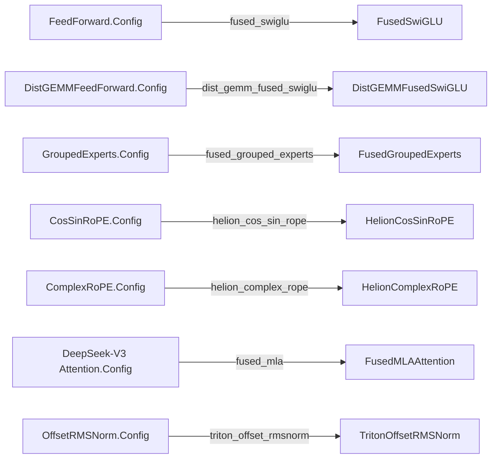

# Config overrides (torchtitan/overrides)

<!-- connect:up:begin -->
> **Cross-repo concept:** part of [layer-norm](../../../concepts/layer-norm.md) across this wiki's repos.
<!-- connect:up:end -->
## Overview

`torchtitan/overrides/` is the in-repo collection of **opt-in component replacements**: each kernel module
defines a faster implementation of an existing [`Module`](../catalog/torchtitan/protocols/module.md#Module "torchtitan/protocols/module.py:L43")
and registers a factory that rewrites the matching `Config` node in the job's config tree (the MoE
dispatcher module only flips DeepEP / HybridEP dispatcher config fields). The package
docstring states the bar: they "are held to a lower code-quality bar than core (they may be
hardware-specific or experimental) and are opt-in: nothing here runs unless the user lists the module in
``--override.imports``". The key design idea is that **the swap happens on configs, not modules** - a
factory receives, say, a stock `FeedForward.Config` and returns a
[`FusedSwiGLU`](../catalog/torchtitan/overrides/fused_swiglu.md#FusedSwiGLU "torchtitan/overrides/fused_swiglu.py:L450") config, and the normal
[`build`](../catalog/torchtitan/protocols/module.md#Module.Config.build "torchtitan/protocols/module.py:L98") path later constructs the replacement with the
same `param_init` and `sharding_config` machinery as core modules. That is what lets an override compose
with FSDP / TP / CP, `torch.compile` and checkpointing without per-model code. The registration /
application machinery itself (`@override`, `derive`, `apply_overrides`) lives in `torchtitan/config` and
is described on [job-config](job-config.md); this page is about the override *modules* and the contract
they follow.

For the TPU-performance lens the important fact is that **every kernel shipped here is CUDA-only**
(Triton or Helion). The Helion RoPE, fused MLA and Triton norm modules check CUDA residency and fall back
to the stock PyTorch path for non-CUDA inputs, but the fused SwiGLU / grouped-experts modules have no such
guard: they import `triton` and always call a CUDA-only custom op. On TorchTPU these modules are therefore
either no-ops or unusable, and the TPU lane ships its own override modules that
follow the same pattern (see the inferred note under Design rationale).

## Diagram

How one override flows from registration to a running kernel (fused SwiGLU as the example):

Legend:
- `IMP` - (concept) the `module.function` target listed in `override.imports`
- `FAC` - [`fused_swiglu`](../catalog/torchtitan/overrides/fused_swiglu.md#fused_swiglu "torchtitan/overrides/fused_swiglu.py:L585")
- `CFGF` - [`_fused_swiglu_config`](../catalog/torchtitan/overrides/fused_swiglu.md#_fused_swiglu_config "torchtitan/overrides/fused_swiglu.py:L561")
- `FCFG` - [`Config`](../catalog/torchtitan/overrides/fused_swiglu.md#FusedSwiGLU.Config "torchtitan/overrides/fused_swiglu.py:L461")
- `MB` - [`build`](../catalog/torchtitan/protocols/module.md#Module.Config.build "torchtitan/protocols/module.py:L98")
- `FSG` - [`FusedSwiGLU`](../catalog/torchtitan/overrides/fused_swiglu.md#FusedSwiGLU "torchtitan/overrides/fused_swiglu.py:L450")
- `FWD` - [`forward`](../catalog/torchtitan/overrides/fused_swiglu.md#FusedSwiGLU.forward "torchtitan/overrides/fused_swiglu.py:L472")
- `W13` - [`w13`](../catalog/torchtitan/overrides/fused_swiglu.md#FusedSwiGLU.w13 "torchtitan/overrides/fused_swiglu.py:L468")
- `FSM` - [`_fused_silu_and_mul`](../catalog/torchtitan/overrides/fused_swiglu.md#_fused_silu_and_mul "torchtitan/overrides/fused_swiglu.py:L414")
- `OP` - [`silu_and_mul_op`](../catalog/torchtitan/overrides/fused_swiglu.md#silu_and_mul_op "torchtitan/overrides/fused_swiglu.py:L301")
- `K` - [`silu_and_mul_forward_kernel`](../catalog/torchtitan/overrides/fused_swiglu.md#silu_and_mul_forward_kernel "torchtitan/overrides/fused_swiglu.py:L219")
- `W2` - [`w2`](../catalog/torchtitan/overrides/fused_swiglu.md#FusedSwiGLU.w2 "torchtitan/overrides/fused_swiglu.py:L467")

The override catalogue (target config -> replacement):

Legend:
- `FF` - (concept) stock target config in `torchtitan/models`
- `DG` - (concept) stock target config in `torchtitan/models`
- `GE` - (concept) stock target config in `torchtitan/models`
- `CR` - (concept) stock target config in `torchtitan/models`
- `AT` - (concept) stock target config in `torchtitan/models`
- `ON` - (concept) stock target config in `torchtitan/models`
- `CS` - [`CosSinRoPE`](../catalog/torchtitan/models/common/rope.md#CosSinRoPE "torchtitan/models/common/rope.py:L281")
- `FS` - [`FusedSwiGLU`](../catalog/torchtitan/overrides/fused_swiglu.md#FusedSwiGLU "torchtitan/overrides/fused_swiglu.py:L450") (factory [`fused_swiglu`](../catalog/torchtitan/overrides/fused_swiglu.md#fused_swiglu "torchtitan/overrides/fused_swiglu.py:L585"))
- `DFS` - [`DistGEMMFusedSwiGLU`](../catalog/torchtitan/overrides/fused_swiglu.md#DistGEMMFusedSwiGLU "torchtitan/overrides/fused_swiglu.py:L507") (factory [`dist_gemm_fused_swiglu`](../catalog/torchtitan/overrides/fused_swiglu.md#dist_gemm_fused_swiglu "torchtitan/overrides/fused_swiglu.py:L594"))
- `FGE` - [`__init__`](../catalog/torchtitan/overrides/fused_swiglu.md#FusedGroupedExperts.__init__ "torchtitan/overrides/fused_swiglu.py:L621") of `FusedGroupedExperts` (factory [`fused_grouped_experts`](../catalog/torchtitan/overrides/fused_swiglu.md#fused_grouped_experts "torchtitan/overrides/fused_swiglu.py:L710"))
- `HCS` - [`HelionCosSinRoPE`](../catalog/torchtitan/overrides/helion_rope.md#HelionCosSinRoPE "torchtitan/overrides/helion_rope.py:L972") (factory [`helion_cos_sin_rope`](../catalog/torchtitan/overrides/helion_rope.md#helion_cos_sin_rope "torchtitan/overrides/helion_rope.py:L1041"))
- `HCR` - [`forward`](../catalog/torchtitan/overrides/helion_rope.md#HelionComplexRoPE.forward "torchtitan/overrides/helion_rope.py:L1020") of `HelionComplexRoPE` (factory [`helion_complex_rope`](../catalog/torchtitan/overrides/helion_rope.md#helion_complex_rope "torchtitan/overrides/helion_rope.py:L1055"))
- `FMLA` - [`forward`](../catalog/torchtitan/overrides/fused_mla.md#FusedMLAAttention.forward "torchtitan/overrides/fused_mla.py:L818") of `FusedMLAAttention` (factory [`fused_mla`](../catalog/torchtitan/overrides/fused_mla.md#fused_mla "torchtitan/overrides/fused_mla.py:L899"))
- `TON` - [`forward`](../catalog/torchtitan/overrides/offset_rmsnorm.md#TritonOffsetRMSNorm.forward "torchtitan/overrides/offset_rmsnorm.py:L317") of `TritonOffsetRMSNorm` (factory [`triton_offset_rmsnorm`](../catalog/torchtitan/overrides/offset_rmsnorm.md#triton_offset_rmsnorm "torchtitan/overrides/offset_rmsnorm.py:L343"))

## Design rationale (why it's built this way)

- **An extension point instead of a core change.** The overrides README lists three motivating classes
  of work: hardware-specific kernels ("valuable for performance but ... hardware-specific, harder to
  maintain, and reasonably held to a lower code-quality bar than core"), larger fused regions that span
  several Config nodes (e.g. a whole fused MoE), and team experimentation. Converters (Float8, LoRA) stay
  in core because they preserve guaranteed properties; overrides make "no promise that any core property
  survives an arbitrary override".
- **Replacements subclass the stock module (and usually its config).** [`HelionCosSinRoPE`](../catalog/torchtitan/overrides/helion_rope.md#HelionCosSinRoPE "torchtitan/overrides/helion_rope.py:L972")
  is "a drop-in for `CosSinRoPE`" whose `Config` adds nothing; [`FusedSwiGLU`](../catalog/torchtitan/overrides/fused_swiglu.md#FusedSwiGLU "torchtitan/overrides/fused_swiglu.py:L450")
  "inherits `FeedForward` so `isinstance(x, FeedForward)` checks hold", although its own `Config` derives
  from the base `Module.Config` with new `w13` / `w2` fields rather than from `FeedForward.Config`. Factories build the new config by
  copying shared fields (via `derive`), so fields added to the stock config later are carried over
  instead of silently reset - the factory "states only the deltas it genuinely changes".
- **Exact targeting where the contract is concrete.** Most factories register with `exact=True`: the
  Helion RoPEs target exactly `CosSinRoPE.Config` / `ComplexRoPE.Config` so subclasses "with different
  cache contracts (e.g. Qwen3.5 `MRoPE`) are untouched"; the dist-GEMM SwiGLU has its own exact override
  "so its communication overlap cannot be replaced accidentally by the regular fused implementation".
- **Kernels are torch.library ops, never opaque calls.** Because `compile.components` includes `model`
  by default, a raw Triton call would graph-break. [`silu_and_mul_op`](../catalog/torchtitan/overrides/fused_swiglu.md#silu_and_mul_op "torchtitan/overrides/fused_swiglu.py:L301"),
  [`_helion_cossin_rope_fwd`](../catalog/torchtitan/overrides/helion_rope.md#_helion_cossin_rope_fwd "torchtitan/overrides/helion_rope.py:L520")
  and [`_triton_offset_rms_norm_op`](../catalog/torchtitan/overrides/offset_rmsnorm.md#_triton_offset_rms_norm_op "torchtitan/overrides/offset_rmsnorm.py:L175")
  are registered `torch.library` ops with `register_autograd` backwards - the first two are `custom_op`s
  with `register_fake` shape functions, the norm is a `triton_op` (traceable without a fake kernel); fused MLA exposes "every Triton launch [as] a stable `torch.library` custom operator, so
  GraphTrainer's fake-tensor `make_fx` trace keeps the fused boundaries".
- **Parallelism through declarative sharding, not imperative code.** A replacement declares its own
  [`ShardingConfig`](../catalog/torchtitan/protocols/sharding.md#ShardingConfig "torchtitan/protocols/sharding.py:L60"), and kernels that cannot run on
  DTensors unwrap with `local_map` / `spmd.local_map` and re-wrap the result (e.g.
  [`_to_local`](../catalog/torchtitan/overrides/helion_rope.md#_to_local "torchtitan/overrides/helion_rope.py:L712")). The README's "Fusion under TP"
  note explains the SwiGLU layout choice: gate/up rows are *interleaved* in `w13.weight`, so `Shard(0)`
  "gives each TP rank matching slices of both projections (the Megatron column-parallel layout)".
- **Checkpoint parity.** Layout-changing replacements save and load in the stock layout via
  `state_dict` hooks: `FusedSwiGLU` "checkpoints in the stock `FeedForward` layout (`w1.weight` /
  `w3.weight`)", so its checkpoints and the HF adapter are interchangeable with the unfused module.

> [!inferred]
> The TPU lane keeps its own override modules under `torchtitan/experiments/tpu/overrides/`, activated
> by TPU recipes appending to `override.imports`: an activation-dtype cos/sin RoPE (the stock module
> upcasts q/k to FP32; the override "removes large FP32 elementwise intermediates and shortens both the
> forward and recomputed backward graphs" on TPU), a real-arithmetic complex RoPE so the rotation can be
> traced inside `scan` (works around `view_as_complex_copy` having no autograd formula), an LM-head
> wrapper targeted at `fqns=["model_spec.model.lm_head"]` that hands `(hidden, weight.T)` to a Pallas
> fused linear-cross-entropy loss instead of materializing logits, and an MoE token-counter redirect for
> scanned layers. These follow the exact pattern described here (subclass, `exact=True`, `derive`) but
> are outside this packet's subgraph; see [tpu-trainer-and-job-config](tpu-trainer-and-job-config.md)
> and [tpu-pallas-kernels](tpu-pallas-kernels.md).

## Entry points

- [`fused_swiglu`](../catalog/torchtitan/overrides/fused_swiglu.md#fused_swiglu "torchtitan/overrides/fused_swiglu.py:L585") and
  [`dist_gemm_fused_swiglu`](../catalog/torchtitan/overrides/fused_swiglu.md#dist_gemm_fused_swiglu "torchtitan/overrides/fused_swiglu.py:L594") - exact
  overrides for dense `FeedForward` / `DistGEMMFeedForward`; both delegate to
  [`_fused_swiglu_config`](../catalog/torchtitan/overrides/fused_swiglu.md#_fused_swiglu_config "torchtitan/overrides/fused_swiglu.py:L561"). Activated as
  `--override.imports torchtitan.overrides.fused_swiglu.fused_swiglu`.
- [`fused_grouped_experts`](../catalog/torchtitan/overrides/fused_swiglu.md#fused_grouped_experts "torchtitan/overrides/fused_swiglu.py:L710") - MoE routed
  experts with fused gate+up; deliberately *not* exact, but idempotent: it returns the config unchanged if
  it is not a stock `GroupedExperts.Config` ("already fused, or a subclass like GptOssGroupedExperts").
- [`helion_cos_sin_rope`](../catalog/torchtitan/overrides/helion_rope.md#helion_cos_sin_rope "torchtitan/overrides/helion_rope.py:L1041") and
  [`helion_complex_rope`](../catalog/torchtitan/overrides/helion_rope.md#helion_complex_rope "torchtitan/overrides/helion_rope.py:L1055") - fused cache
  gather + rotation for the two RoPE cache contracts.
- [`fused_mla`](../catalog/torchtitan/overrides/fused_mla.md#fused_mla "torchtitan/overrides/fused_mla.py:L899") - DeepSeek-V3 MLA Q/KV RoPE assembly
  ("specific to TorchTitan's DeepSeek-V3 `Attention` module and its packed MLA Q/KV projection layout").
- [`triton_offset_rmsnorm`](../catalog/torchtitan/overrides/offset_rmsnorm.md#triton_offset_rmsnorm "torchtitan/overrides/offset_rmsnorm.py:L343") - Qwen3.5
  `(1 + weight) * rmsnorm(x)` in one Triton forward kernel, with Triton backward kernels for the input and
  weight gradients.
- Control reaches all of these from [`Trainer`](../catalog/torchtitan/trainer.md#Trainer "torchtitan/trainer.py:L74") construction: the trainer
  applies overrides after `update_from_config` and before any component's
  [`build`](../catalog/torchtitan/config/configurable.md#Configurable.Config.build "torchtitan/config/configurable.py:L134") (see
  [trainer-and-train-loop](trainer-and-train-loop.md)).

## Mechanism (step-by-step)

1. **Activation and replacement.** When a target such as `torchtitan.overrides.fused_swiglu.fused_swiglu`
   is listed, importing the module registers its factories; the trainer then calls each matching factory
   on the original config node and splices the returned config in. For dense SwiGLU,
   [`_fused_swiglu_config`](../catalog/torchtitan/overrides/fused_swiglu.md#_fused_swiglu_config "torchtitan/overrides/fused_swiglu.py:L561") builds
   [`w13`](../catalog/torchtitan/overrides/fused_swiglu.md#FusedSwiGLU.Config.w13 "torchtitan/overrides/fused_swiglu.py:L462") as a copy of the stock
   `w1` [`Config`](../catalog/torchtitan/models/common/linear.md#Linear.Config "torchtitan/models/common/linear.py:L35") with doubled `out_features`, no bias, and
   a fused initializer that inits the gate half with `w1`'s init and the up half with `w3`'s (they differ:
   "up shares w2's depth-scaled init"); [`w2`](../catalog/torchtitan/overrides/fused_swiglu.md#FusedSwiGLU.Config.w2 "torchtitan/overrides/fused_swiglu.py:L463")
   is copied as-is. Keeping `w13` a plain [`Linear`](../catalog/torchtitan/models/common/linear.md#Linear "torchtitan/models/common/linear.py:L31")
   "also lets config-time linear converters replace it".

2. **Construction through the normal path.** The replacement config is built by
   [`build`](../catalog/torchtitan/protocols/module.md#Module.Config.build "torchtitan/protocols/module.py:L98"), which attaches `param_init` and
   `sharding_config` exactly as for core modules, so `parallelize_fn` shards it with no special casing.
   [`FusedSwiGLU`](../catalog/torchtitan/overrides/fused_swiglu.md#FusedSwiGLU "torchtitan/overrides/fused_swiglu.py:L450")'s constructor builds `w2` and `w13`
   and registers the save/load hooks that split and merge `w13`. For MoE,
   [`__init__`](../catalog/torchtitan/overrides/fused_swiglu.md#FusedGroupedExperts.__init__ "torchtitan/overrides/fused_swiglu.py:L621") deletes the separate
   `w1_EFD` / `w3_EFD` and creates [`w13`](../catalog/torchtitan/overrides/fused_swiglu.md#FusedGroupedExperts.w13 "torchtitan/overrides/fused_swiglu.py:L627")
   of shape `(E, F, 2, D)`; the factory remaps param-init and state shardings so EP shards dim 0, TP
   shards dim 1, and the size-2 axis stays unsharded.

3. **Dense forward: one GEMM plus a fused activation.** [`forward`](../catalog/torchtitan/overrides/fused_swiglu.md#FusedSwiGLU.forward "torchtitan/overrides/fused_swiglu.py:L472")
   runs `w13(x)`, unflattens the last axis to `(hidden, 2)` to recover gate and up, and calls
   [`_fused_silu_and_mul`](../catalog/torchtitan/overrides/fused_swiglu.md#_fused_silu_and_mul "torchtitan/overrides/fused_swiglu.py:L414"), which `local_map`s over
   DTensor placements and dispatches [`silu_and_mul_op`](../catalog/torchtitan/overrides/fused_swiglu.md#silu_and_mul_op "torchtitan/overrides/fused_swiglu.py:L301")
   ("Compute ``silu(gate) * up`` over optionally offset-limited rows."), backed by
   [`silu_and_mul_forward_kernel`](../catalog/torchtitan/overrides/fused_swiglu.md#silu_and_mul_forward_kernel "torchtitan/overrides/fused_swiglu.py:L219").
   The win is two GEMMs -> one and an unfused SiLU + multiply -> one kernel, with the activation tensor
   written once.

4. **TP-overlapped variant.** [`forward`](../catalog/torchtitan/overrides/fused_swiglu.md#DistGEMMFusedSwiGLU.forward "torchtitan/overrides/fused_swiglu.py:L529")
   of [`DistGEMMFusedSwiGLU`](../catalog/torchtitan/overrides/fused_swiglu.md#DistGEMMFusedSwiGLU "torchtitan/overrides/fused_swiglu.py:L507")
   ("`FusedSwiGLU` with the TP collectives also folded into its GEMMs") looks up the TP group, then runs an
   all-gather-fused GEMM for `w13` and a GEMM-fused reduce-scatter for `w2`, with the Triton activation in
   between; with TP off it falls back to the unoverlapped parent forward (warning once). Its empty
   [`Config`](../catalog/torchtitan/overrides/fused_swiglu.md#DistGEMMFusedSwiGLU.Config "torchtitan/overrides/fused_swiglu.py:L525") exists only to bind `build()` to
   this class.

5. **MoE forward: grouped GEMM with offset-aware activation.** [`forward`](../catalog/torchtitan/overrides/fused_swiglu.md#FusedGroupedExperts.forward "torchtitan/overrides/fused_swiglu.py:L634")
   unwraps DTensors to local, computes `cumsum(num_tokens_per_expert)` offsets, runs one grouped GEMM over
   the `(E, 2F, D)` view (inputs cast to bf16), applies `silu_and_mul_op` with the offsets so inactive
   capacity-padding rows are skipped, and runs the `w2` grouped GEMM.

6. **RoPE: eligibility check, then a tuned Helion kernel.** [`forward`](../catalog/torchtitan/overrides/helion_rope.md#HelionCosSinRoPE.forward "torchtitan/overrides/helion_rope.py:L985")
   uses the stock path for the inverse / query-only cases, otherwise calls
   [`_apply_helion_cossin_rope`](../catalog/torchtitan/overrides/helion_rope.md#_apply_helion_cossin_rope "torchtitan/overrides/helion_rope.py:L818")
   ("Run the fused kernel, or return ``None`` if the inputs are unsupported."). It localizes tensors, makes
   positions explicit when absent, checks CUDA / shape / dtype eligibility (else warns once and returns
   `None` so the caller falls back), async-checks position bounds without a host sync, and runs
   [`_helion_cossin_rope_fwd`](../catalog/torchtitan/overrides/helion_rope.md#_helion_cossin_rope_fwd "torchtitan/overrides/helion_rope.py:L520")
   under `spmd.local_map` with explicit dp / cp / tp layouts. The kernel config is picked per call from
   token-count buckets built by [`_config`](../catalog/torchtitan/overrides/helion_rope.md#_config "torchtitan/overrides/helion_rope.py:L334")
   (the comment calls it "this bandwidth-bound kernel", buckets "tuned on Qwen3 TP=8 local training
   shapes"), with a separate bucket table for
   [`_helion_cossin_rope_bwd`](../catalog/torchtitan/overrides/helion_rope.md#_helion_cossin_rope_bwd "torchtitan/overrides/helion_rope.py:L550"). The complex
   variant ([`_apply_helion_complex_rope`](../catalog/torchtitan/overrides/helion_rope.md#_apply_helion_complex_rope "torchtitan/overrides/helion_rope.py:L887"),
   [`_helion_complex_rope_fwd`](../catalog/torchtitan/overrides/helion_rope.md#_helion_complex_rope_fwd "torchtitan/overrides/helion_rope.py:L624"))
   presents the complex cache as `view_as_real` so the kernel never handles complex tensors.

7. **MLA: fuse RoPE into Q/K assembly.** [`__init__`](../catalog/torchtitan/overrides/fused_mla.md#FusedMLAAttention.__init__ "torchtitan/overrides/fused_mla.py:L810")
   rejects anything but `ComplexRoPE`. [`forward`](../catalog/torchtitan/overrides/fused_mla.md#FusedMLAAttention.forward "torchtitan/overrides/fused_mla.py:L818")
   falls back to the stock attention off-CUDA; otherwise it projects Q, applies RoPE in place to Q's
   positional tail with [`fused_mla_q`](../catalog/torchtitan/overrides/fused_mla.md#fused_mla_q "torchtitan/overrides/fused_mla.py:L766"), and uses
   [`fused_mla_kv`](../catalog/torchtitan/overrides/fused_mla.md#fused_mla_kv "torchtitan/overrides/fused_mla.py:L780") ("Materialize K and expose V with
   a fused custom backward.") so V stays a zero-copy view of the packed KV projection, before calling the
   configured inner attention. Positions are normalized by
   [`_resolve_positions`](../catalog/torchtitan/overrides/fused_mla.md#_resolve_positions "torchtitan/overrides/fused_mla.py:L749").

8. **Norm: Triton kernel with explicit gradient sharding.** [`forward`](../catalog/torchtitan/overrides/offset_rmsnorm.md#TritonOffsetRMSNorm.forward "torchtitan/overrides/offset_rmsnorm.py:L317")
   falls back on non-CUDA or unsupported dtypes; with a DTensor weight it requires
   [`weight_grad_sharding`](../catalog/torchtitan/overrides/offset_rmsnorm.md#TritonOffsetRMSNorm.weight_grad_sharding "torchtitan/overrides/offset_rmsnorm.py:L315")
   (derived by the factory from the weight's sharding contract as the backward type of each axis) and
   calls [`triton_offset_rms_norm`](../catalog/torchtitan/overrides/offset_rmsnorm.md#triton_offset_rms_norm "torchtitan/overrides/offset_rmsnorm.py:L292"),
   whose forward op saves the FP32 inverse RMS for
   [`_triton_offset_rms_norm_backward_op`](../catalog/torchtitan/overrides/offset_rmsnorm.md#_triton_offset_rms_norm_backward_op "torchtitan/overrides/offset_rmsnorm.py:L204").

## Key data structures

- **Fused gate/up weight** - dense: [`w13`](../catalog/torchtitan/overrides/fused_swiglu.md#FusedSwiGLU.w13 "torchtitan/overrides/fused_swiglu.py:L468")
  is a `Linear` with weight `(2 x hidden, dim)`, gate/up rows interleaved (logical `(hidden, 2, dim)`
  view, index 0 = stock `w1`, 1 = `w3`). MoE: [`w13`](../catalog/torchtitan/overrides/fused_swiglu.md#FusedGroupedExperts.w13 "torchtitan/overrides/fused_swiglu.py:L627")
  is a raw `(E, F, 2, D)` parameter. Both checkpoint as the stock separate tensors.
- **Replacement configs** - [`Config`](../catalog/torchtitan/overrides/fused_swiglu.md#FusedSwiGLU.Config "torchtitan/overrides/fused_swiglu.py:L461")
  for `FusedSwiGLU` (fields `w13`, `w2`, plus inherited `param_init` / `sharding_config`); the Helion,
  MLA and fused-experts configs subclass their targets and add no fields; `TritonOffsetRMSNorm.Config`
  adds `weight_grad_sharding`.
- **SPMD layout annotations** - the `spmd.local_map` in/out types used around kernels name the mesh
  axes `dp`, `cp`, `tp` (cf. [`MeshAxisName`](../catalog/torchtitan/distributed/parallel_dims.md#MeshAxisName "torchtitan/distributed/parallel_dims.py:L72")): activations are
  varying over all three with tokens partitioned over `(dp, cp)` and heads / hidden over `tp`; RoPE caches
  are replicated. MLA checks these with `spmd.assert_type` only when
  [`get_spmd_backend`](../catalog/torchtitan/distributed/utils.md#get_spmd_backend "torchtitan/distributed/utils.py:L45") is `spmd_types` and type
  checking is on.

## Dynamics (design intent)

- **Overrides apply once, at trainer construction**, on the post-converter tree: in-repo converters run
  inside `model_registry()` first, and the README notes an override targeting `Linear.Config` can collide
  with Float8 / LoRA converters, whereas RoPE / FeedForward / MoE / norm / inner attention targets do not.
- **Fallback is per call, not per job**: the Helion, MLA and norm modules check CUDA residency (and
  shapes / dtypes) on every forward and drop to the inherited PyTorch implementation when ineligible; the
  RoPE modules log the fallback once.
- **Bounds checks are asynchronous**: position-id range checks use an async assert "No host sync, and
  skipped under torch.compile -- same semantics as the PyTorch path".
- **Tests:** TPU-lane graph-trainer config tests assert that recipes override the complex RoPE and the
  lm_head through the same mechanism (Evidence: `test_tpu_graph_trainer_config.py`); the README points to
  `tests/unit_tests/cpu/test_override.py` for registration, FQN / exact targeting, per-node conflicts and
  per-entry kwargs.

## Edge cases

- **On TPU, these modules do not help.** All kernels are registered with `device_types="cuda"` and the
  modules import `triton` at top level (fused SwiGLU, offset RMSNorm, fused MLA); even where import
  succeeds, TPU tensors fail the `is_cuda` checks and take the stock path. Fused SwiGLU has no fallback in
  its `forward` at all - its activation always dispatches the CUDA-only op.
- **Helion missing:** the README says the module "falls back to the PyTorch RoPE when it (or CUDA) is
  unavailable", but the factories
  [`helion_cos_sin_rope`](../catalog/torchtitan/overrides/helion_rope.md#helion_cos_sin_rope "torchtitan/overrides/helion_rope.py:L1041") /
  [`helion_complex_rope`](../catalog/torchtitan/overrides/helion_rope.md#helion_complex_rope "torchtitan/overrides/helion_rope.py:L1055") raise `ImportError`
  when `helion` is not installed; only a *missing CUDA input* falls back.
- `fused_mla` targets the DeepSeek-V3 `Attention.Config` without `exact=True`; it requires `ComplexRoPE`
  and raises `TypeError` otherwise. MLA offsets use 64-bit arithmetic because "the traced 671B local
  tensors exceed 2**31 elements".
- Triton OffsetRMSNorm supports at most 65536 columns and raises if a sharding config lacks input /
  output / weight contracts.
- `fused_grouped_experts` silently returns subclasses (e.g. GPT-OSS experts) unchanged; listing it on a
  model without stock `GroupedExperts` produces no replacement (the mechanism then warns that nothing
  matched).

## Open questions

- The registration and application functions (`override`, `derive`, `apply_overrides`) and the MoE
  dispatcher overrides (`deepep_override`, `hybridep_override` in `moe_token_dispatcher.py`, which flip
  DeepEP / HybridEP to static, host-sync-free dispatch for a CUDA-graph-capturing RL generator via
  per-entry kwargs) are not in this packet's subgraph.
- The TPU-lane override modules are outside this subgraph (see the inferred note above).
- No measured speedups are recorded in this repo for the in-repo overrides beyond the README's
  illustrative "~2x faster on A100+" for a hypothetical Triton RoPE.

## See also

- [job-config](job-config.md) - `@override`, `derive`, `apply_overrides`, `OverrideConfig`
- [trainer-and-train-loop](trainer-and-train-loop.md) - where overrides are applied in construction order
- [model-building-blocks](model-building-blocks.md) - the stock FeedForward / RoPE / attention / norm modules being replaced
- [parallel-dims-and-parallelization](parallel-dims-and-parallelization.md) - how `ShardingConfig` is applied
- [deepseek-v3-model](deepseek-v3-model.md), [qwen3-5-model](qwen3-5-model.md) - targets of `fused_mla` and `triton_offset_rmsnorm`
- [tpu-pallas-kernels](tpu-pallas-kernels.md), [tpu-trainer-and-job-config](tpu-trainer-and-job-config.md) - the TPU-side kernel swaps
- [quantization](quantization.md) - converters, which run before overrides
