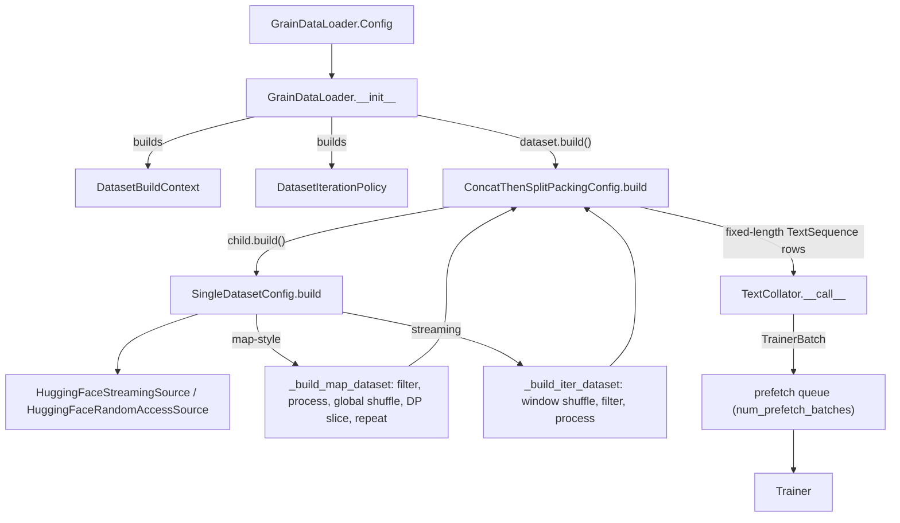
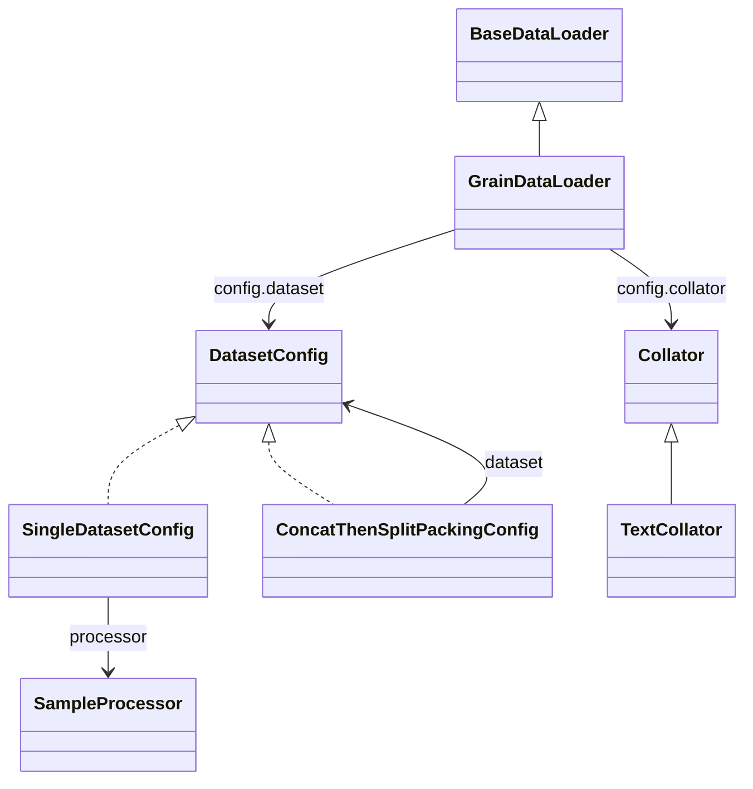

# Data loading: the Grain dataset graph, packing, and the fixed-size token batch

## Overview

The data subsystem is a thin, declarative layer over Google's Grain library. A recipe describes *what* data it wants as a tree of small frozen config objects - a leaf [`SingleDatasetConfig`](../catalog/torchtitan/components/data/dataset.md#SingleDatasetConfig "torchtitan/components/data/dataset.py:L84") (one source plus row filters and a processor), optionally wrapped by mixing, concatenation, and a packer - and [`GrainDataLoader`](../catalog/torchtitan/components/data/loader.md#GrainDataLoader "torchtitan/components/data/loader.py:L61") ("Batches and checkpoints one composed Grain dataset graph") calls `build()` on the root to get one Grain dataset per data-parallel rank. Every node implements the same one-method [`DatasetConfig`](../catalog/torchtitan/components/data/dataset.md#DatasetConfig "torchtitan/components/data/dataset.py:L26") protocol and receives the same two runtime bundles: a [`DatasetBuildContext`](../catalog/torchtitan/components/data/types.md#DatasetBuildContext "torchtitan/components/data/types.py:L17") (tokenizer, context length, token budget) and a [`DatasetIterationPolicy`](../catalog/torchtitan/components/data/types.md#DatasetIterationPolicy "torchtitan/components/data/types.py:L28") (seed, shuffle, repeat, DP rank/world size).

The single most important design idea for TPU performance: the batch the trainer receives is **budgeted in tokens, not samples, and always has exactly `num_tokens_per_batch` tokens**. The collator ([`TextCollator`](../catalog/torchtitan/components/data/collators.md#TextCollator "torchtitan/components/data/collators.py:L52")) allocates a flat 1-D buffer of that size, concatenates whatever rows it was given, and pads the tail with `IGNORE_INDEX` labels and a `padding_mask`. Document boundaries travel in-band as per-token `positions` that reset to 0 at each document start. The shape of every step's input is therefore a static function of the config, independent of document lengths.

> [!inferred]
> On an XLA backend such as TorchTPU, where every new input shape is a new compiled program, a fixed per-step input shape is what keeps the step graph from recompiling as document lengths vary. The pipeline does not state this motivation (the source names CUDA graphs and varlen metadata as consumers of fixed shapes), but the TPU lane relies on the same property.

## Diagram

How one DP rank's pipeline is assembled by `GrainDataLoader.__init__` (for the common text-packing recipe):

Legend:
- `CFG` - [`Config`](../catalog/torchtitan/components/data/loader.md#GrainDataLoader.Config "torchtitan/components/data/loader.py:L65")
- `INIT` - [`__init__`](../catalog/torchtitan/components/data/loader.md#GrainDataLoader.__init__ "torchtitan/components/data/loader.py:L82")
- `CTX` - [`DatasetBuildContext`](../catalog/torchtitan/components/data/types.md#DatasetBuildContext "torchtitan/components/data/types.py:L17")
- `POL` - [`DatasetIterationPolicy`](../catalog/torchtitan/components/data/types.md#DatasetIterationPolicy "torchtitan/components/data/types.py:L28")
- `PACK` - [`build`](../catalog/torchtitan/components/data/packing.md#ConcatThenSplitPackingConfig.build "torchtitan/components/data/packing.py:L27")
- `LEAF` - [`build`](../catalog/torchtitan/components/data/dataset.md#SingleDatasetConfig.build "torchtitan/components/data/dataset.py:L96")
- `SRC` - [`HuggingFaceStreamingSource`](../catalog/torchtitan/components/data/sources.md#HuggingFaceStreamingSource "torchtitan/components/data/sources.py:L145"), [`HuggingFaceRandomAccessSource`](../catalog/torchtitan/components/data/sources.md#HuggingFaceRandomAccessSource "torchtitan/components/data/sources.py:L94")
- `MAP` - [`_build_map_dataset`](../catalog/torchtitan/components/data/dataset.md#SingleDatasetConfig._build_map_dataset "torchtitan/components/data/dataset.py:L126")
- `ITER` - [`_build_iter_dataset`](../catalog/torchtitan/components/data/dataset.md#SingleDatasetConfig._build_iter_dataset "torchtitan/components/data/dataset.py:L173")
- `COLL` - [`__call__`](../catalog/torchtitan/components/data/collators.md#TextCollator.__call__ "torchtitan/components/data/collators.py:L64")
- `PREF` - (concept) Grain's thread prefetch wrapper, configured by [`Config`](../catalog/torchtitan/components/data/loader.md#GrainDataLoader.Config "torchtitan/components/data/loader.py:L65")
- `TR` - [`Trainer`](../catalog/torchtitan/trainer.md#Trainer "torchtitan/trainer.py:L74")

The type structure (what composes with what):

Legend:
- `BaseDataLoader` - [`BaseDataLoader`](../catalog/torchtitan/components/data/loader.md#BaseDataLoader "torchtitan/components/data/loader.py:L39")
- `GrainDataLoader` - [`GrainDataLoader`](../catalog/torchtitan/components/data/loader.md#GrainDataLoader "torchtitan/components/data/loader.py:L61")
- `DatasetConfig` - [`DatasetConfig`](../catalog/torchtitan/components/data/dataset.md#DatasetConfig "torchtitan/components/data/dataset.py:L26")
- `SingleDatasetConfig` - [`SingleDatasetConfig`](../catalog/torchtitan/components/data/dataset.md#SingleDatasetConfig "torchtitan/components/data/dataset.py:L84")
- `ConcatThenSplitPackingConfig` - [`ConcatThenSplitPackingConfig`](../catalog/torchtitan/components/data/packing.md#ConcatThenSplitPackingConfig "torchtitan/components/data/packing.py:L22")
- `Collator` - [`Collator`](../catalog/torchtitan/components/data/collators.md#Collator "torchtitan/components/data/collators.py:L36")
- `TextCollator` - [`TextCollator`](../catalog/torchtitan/components/data/collators.md#TextCollator "torchtitan/components/data/collators.py:L52")
- `SampleProcessor` - [`SampleProcessor`](../catalog/torchtitan/components/data/dataset.md#SampleProcessor "torchtitan/components/data/dataset.py:L67")

## Design rationale (why it's built this way)

- **Config objects are the graph; Grain is the engine.** Each node is a frozen dataclass whose `build()` returns a `grain.MapDataset` or `grain.IterDataset`. Composition is ordinary function nesting, so a recipe can wrap any leaf in a packer or a mix without the loader knowing. The leaf is the only node that "owns leaf shuffle, repeat, and effective-DP sharding" (docstring of [`SingleDatasetConfig`](../catalog/torchtitan/components/data/dataset.md#SingleDatasetConfig "torchtitan/components/data/dataset.py:L84")); wrappers either forward the policy or rewrite it (concatenation strips shuffle/repeat/sharding from its children and re-applies them once over the concatenation, see [`build`](../catalog/torchtitan/components/data/dataset.md#DatasetConcatConfig.build "torchtitan/components/data/dataset.py:L272")).
- **The processor, not the trainer, does the next-token shift.** [`TextSequence`](../catalog/torchtitan/components/data/dataset.md#TextSequence "torchtitan/components/data/dataset.py:L39") is documented as "Next-token-aligned text preserved through composition and packing", and its note says "It is the dataset's processor responsibility to shift tokens into aligned input and label pairs. The trainer does not do it." This keeps packing correct: shifting after packing would leak one token across a document boundary.
- **Token budget instead of batch size.** [`num_tokens_per_batch`](../catalog/torchtitan/components/data/types.md#DatasetBuildContext.num_tokens_per_batch "torchtitan/components/data/types.py:L22") is set by the trainer from `training.num_tokens_per_microbatch_per_dp_rank`. Packers produce rows of exactly this many tokens and the default collator consumes one row per batch, so a "batch" is a flat token buffer; the trainer re-derives a sample count (`tokens // max_context_length`) only where a model needs it.
- **Count valid tokens on the data workers.** The collator computes `num_valid_tokens` so "the trainer does not rescan every batch on the critical path" (comment above [`TrainerBatch`](../catalog/torchtitan/components/data/collators.md#TrainerBatch.TrainerBatch "torchtitan/components/data/collators.py:L27")). The trainer pops it before the batch reaches the model and all-reduces the per-step total on device for loss normalization.
- **Page-locked buffers for an async host-to-device copy.** The collator allocates with `pin_memory` because "a copy out of pageable memory is synchronous whatever `non_blocking` says"; CPU-only runs fall back to pageable memory because pinning raises without an accelerator.
- **Finite data with DP is refused rather than half-supported.** [`__init__`](../catalog/torchtitan/components/data/loader.md#GrainDataLoader.__init__ "torchtitan/components/data/loader.py:L82") raises on `repeat=False` with `dp_world_size > 1`: ranks could "exhaust ranks at different steps and hang collectives". The training length is controlled by the trainer's step count instead.

## Entry points

- [`GrainDataLoader`](../catalog/torchtitan/components/data/loader.md#GrainDataLoader "torchtitan/components/data/loader.py:L61") / its [`Config`](../catalog/torchtitan/components/data/loader.md#GrainDataLoader.Config "torchtitan/components/data/loader.py:L65") - the loader recipes put in `TrainerConfig.dataloader`. The [`Trainer`](../catalog/torchtitan/trainer.md#Trainer "torchtitan/trainer.py:L74") builds it once in `__init__` (after the tokenizer, before the checkpointer) with `dp_world_size`, `dp_rank`, the tokenizer, `max_context_length` and the per-DP-rank token budget, and hands it to the checkpointer as a stateful component.
- [`dataset`](../catalog/torchtitan/components/data/loader.md#GrainDataLoader.Config.dataset "torchtitan/components/data/loader.py:L66") - the root [`DatasetConfig`](../catalog/torchtitan/components/data/dataset.md#DatasetConfig "torchtitan/components/data/dataset.py:L26") of the graph. It is suppressed from the CLI (`tyro.conf.Suppress`), so the data graph is chosen in Python recipes, not by flags. Examples: [`llama3_debugmodel`](../catalog/torchtitan/models/llama3/config_registry.md#llama3_debugmodel "torchtitan/models/llama3/config_registry.py:L63") uses concat-then-split packing over `c4_test`; the TPU SFT recipe [`sft_llama3_8b_metamath`](../catalog/torchtitan/experiments/tpu/llama3/config_registry.md#sft_llama3_8b_metamath "torchtitan/experiments/tpu/llama3/config_registry.py:L399") uses first-fit packing over a random-access Hugging Face source with a chat processor.
- [`ConcatThenSplitPackingConfig`](../catalog/torchtitan/components/data/packing.md#ConcatThenSplitPackingConfig "torchtitan/components/data/packing.py:L22") - "Concatenates documents, chunking them into fixed-length rows." The packer used by pretraining recipes and by the TPU lane's default text loader (`experiments/tpu/datasets.py`, which wraps every registered text dataset in it).
- [`collator`](../catalog/torchtitan/components/data/loader.md#GrainDataLoader.Config.collator "torchtitan/components/data/loader.py:L67") - defaults to [`Config`](../catalog/torchtitan/components/data/collators.md#TextCollator.Config "torchtitan/components/data/collators.py:L56") of the text collator; multimodal recipes substitute their own [`Collator`](../catalog/torchtitan/components/data/collators.md#Collator "torchtitan/components/data/collators.py:L36") subclass (see [hf-datasets](hf-datasets.md)).
- [`processor`](../catalog/torchtitan/components/data/dataset.md#SingleDatasetConfig.processor "torchtitan/components/data/dataset.py:L93") - the per-row [`SampleProcessor`](../catalog/torchtitan/components/data/dataset.md#SampleProcessor "torchtitan/components/data/dataset.py:L67") config (tokenization, label masking) on a leaf; run via Grain's `random_map`, which hands it a deterministic `np.random.Generator`.
- [`streaming_shuffle_buffer_size`](../catalog/torchtitan/components/data/loader.md#GrainDataLoader.Config.streaming_shuffle_buffer_size "torchtitan/components/data/loader.py:L73") - "Streaming rows retained per rank for approximate shuffling" (default 1000); only streaming leaves use it.

## Mechanism (step-by-step)

1. **Assemble the runtime bundles.** [`__init__`](../catalog/torchtitan/components/data/loader.md#GrainDataLoader.__init__ "torchtitan/components/data/loader.py:L82") validates the run policy, records [`_rank_id`](../catalog/torchtitan/components/data/loader.md#GrainDataLoader._rank_id "torchtitan/components/data/loader.py:L106") (`dp_rank_<n>`, later the checkpoint key), and builds a [`DatasetBuildContext`](../catalog/torchtitan/components/data/types.md#DatasetBuildContext "torchtitan/components/data/types.py:L17") and a [`DatasetIterationPolicy`](../catalog/torchtitan/components/data/types.md#DatasetIterationPolicy "torchtitan/components/data/types.py:L28") from its [`Config`](../catalog/torchtitan/components/data/loader.md#GrainDataLoader.Config "torchtitan/components/data/loader.py:L65") and constructor args. Note what is *not* here: there is no DP mesh object. The loader only knows its rank index and world size, which is all sharding needs.

2. **Build the source.** The root `build()` recurses down to a leaf, whose [`build`](../catalog/torchtitan/components/data/dataset.md#SingleDatasetConfig.build "torchtitan/components/data/dataset.py:L96") asks its [`source`](../catalog/torchtitan/components/data/dataset.md#SingleDatasetConfig.source "torchtitan/components/data/dataset.py:L91") to build. A random-access source (anything with `__len__`/`__getitem__`, e.g. [`HuggingFaceRandomAccessSource`](../catalog/torchtitan/components/data/sources.md#HuggingFaceRandomAccessSource "torchtitan/components/data/sources.py:L94"), which loads a materialized `datasets.Dataset`) becomes a `grain.MapDataset`; a streaming source ([`HuggingFaceStreamingSource`](../catalog/torchtitan/components/data/sources.md#HuggingFaceStreamingSource "torchtitan/components/data/sources.py:L145"), itself a `grain.IterDataset`) is used as-is. The streaming source shards **at the source**: its [`__init__`](../catalog/torchtitan/components/data/sources.md#HuggingFaceStreamingSource.__init__ "torchtitan/components/data/sources.py:L166") calls Hugging Face `split_dataset_by_node` with the policy's rank and world size, and refuses datasets without `state_dict`/`load_state_dict` ("does not support exact resume").

3. **Map-style path: process, then globally shuffle and slice.** [`_build_map_dataset`](../catalog/torchtitan/components/data/dataset.md#SingleDatasetConfig._build_map_dataset "torchtitan/components/data/dataset.py:L126") ("Process globally indexed rows before shuffle, sharding, and repeat") applies pre-filters, the processor (`random_map` seeded by the policy seed), and [`post_filters`](../catalog/torchtitan/components/data/dataset.md#SingleDatasetConfig.post_filters "torchtitan/components/data/dataset.py:L94"), then does a global index shuffle and gives each DP rank a contiguous slice (`divmod` split, the first `remainder` ranks get one extra row), then `repeat()`. Because shuffling happens on the global index before slicing, every rank sees a disjoint, uniformly mixed subset, and Grain reshuffles with `seed + epoch` on each repeat. Processing is lazy: `random_map` and `filter` are index transforms, so the tokenizer runs only on rows a rank actually reads.

4. **Streaming path: window-shuffle, then process.** [`_build_iter_dataset`](../catalog/torchtitan/components/data/dataset.md#SingleDatasetConfig._build_iter_dataset "torchtitan/components/data/dataset.py:L173") ("Shuffle streaming rows before row processing") wraps the stream in a window shuffle of [`streaming_shuffle_buffer_size`](../catalog/torchtitan/components/data/loader.md#GrainDataLoader.Config.streaming_shuffle_buffer_size "torchtitan/components/data/loader.py:L73") rows, then filters and processes in stream order. The processor seed is `seed + dp_rank`, because each rank processes a different stream. Shuffle quality is only local (a 1000-row window per rank) - the price of not materializing the dataset.

5. **Optional composition.** [`build`](../catalog/torchtitan/components/data/dataset.md#DatasetMixConfig.build "torchtitan/components/data/dataset.py:L226") of the mix node builds each weighted child with `seed + index` ("Inserting or reordering a child reseeds every later child") and interleaves them by weight - as a `MapDataset.mix` when all children are map-style, otherwise as an `IterDataset.mix`. Weights count emitted *elements*, so mixing unpacked children weights documents while mixing packed children weights fixed-size token rows. [`build`](../catalog/torchtitan/components/data/dataset.md#DatasetConcatConfig.build "torchtitan/components/data/dataset.py:L272") of the concat node requires map-style children, builds them unsharded and unshuffled, concatenates, then performs the same global shuffle + DP slice + repeat as a leaf.

6. **Pack documents into fixed-length rows.** The concat-then-split [`build`](../catalog/torchtitan/components/data/packing.md#ConcatThenSplitPackingConfig.build "torchtitan/components/data/packing.py:L27") converts each [`TextSequence`](../catalog/torchtitan/components/data/dataset.md#TextSequence "torchtitan/components/data/dataset.py:L39") into arrays (missing positions become `arange(n) % max_context_length`, so a document longer than the context window is split into context-sized pseudo-documents), feeds Grain's `ConcatThenSplitIterDataset` with a length struct of `num_tokens_per_batch` for every field, **drops any row that is not completely full**, and finalizes each row with [`_packing_output_to_text_sequence`](../catalog/torchtitan/components/data/packing.md#_packing_output_to_text_sequence "torchtitan/components/data/packing.py:L381") ("Finalize packed text by masking padding and canonicalizing positions"): padding gets `IGNORE_INDEX` labels and `padding_mask=True`, and positions are recomputed so that every 0 marks a document start. When `max_num_documents` is set, the same config switches to a document-aware iterator whose [`__next__`](../catalog/torchtitan/components/data/packing.md#_DocumentAwareConcatThenSplitIterator.__next__ "torchtitan/components/data/packing.py:L117") stops filling a row once it holds that many document segments and pads the rest, carrying the unfinished document into the next row. The alternative first-fit [`build`](../catalog/torchtitan/components/data/packing.md#FirstFitPackingConfig.build "torchtitan/components/data/packing.py:L236") first splits documents into context-sized chunks with [`flat_map`](../catalog/torchtitan/components/data/packing.md#_SplitTextSequenceDocuments.flat_map "torchtitan/components/data/packing.py:L305"), then bin-packs whole chunks into `num_packing_bins` open rows (padding instead of splitting a chunk across rows), which is the SFT choice because a response is never cut mid-sequence.

7. **Batch and collate into one flat token buffer.** Back in [`__init__`](../catalog/torchtitan/components/data/loader.md#GrainDataLoader.__init__ "torchtitan/components/data/loader.py:L82"), a remaining `MapDataset` is converted to an `IterDataset` (using `read_options` for concurrent indexed reads), then batched with `collator.num_rows_per_batch()` rows (1 for text) and `batch_fn=collator`. [`__call__`](../catalog/torchtitan/components/data/collators.md#TextCollator.__call__ "torchtitan/components/data/collators.py:L64") allocates four pinned int64/bool tensors of exactly `num_tokens_per_batch`, concatenates the rows' [`input_ids`](../catalog/torchtitan/components/data/dataset.md#TextSequence.input_ids "torchtitan/components/data/dataset.py:L46"), labels, positions and padding masks into them in place (`torch.cat(..., out=...)`), fills tail positions with `arange % max_context_length`, and returns the [`TrainerBatch`](../catalog/torchtitan/components/data/collators.md#TrainerBatch.TrainerBatch "torchtitan/components/data/collators.py:L27") dict `{input, labels, positions, padding_mask, num_valid_tokens}`. If the rows exceed the budget it raises instead of truncating.

8. **Prefetch and hand off.** The batched dataset is wrapped in Grain's thread prefetcher with `num_prefetch_batches` (default 2) "Collated batches queued per rank for trainer consumption", and the loader's iterator is that prefetcher. The [`Trainer`](../catalog/torchtitan/trainer.md#Trainer "torchtitan/trainer.py:L74") pulls one batch per microbatch (timing each pull into `data_loading_times`), pops `num_valid_tokens`, copies every tensor to the device with `non_blocking=True` on a dedicated transfer stream, and passes the batch to the model's `preprocess_inputs`, which turns `positions`/`padding_mask` into flex or varlen document masks and applies CP sharding.

9. **Checkpoint the iterator, per rank.** `state_dict()` on [`GrainDataLoader`](../catalog/torchtitan/components/data/loader.md#GrainDataLoader "torchtitan/components/data/loader.py:L61") stores `{version, dp_world_size, dp_rank_<n>: iterator.get_state()}`; Grain recurses `get_state` through every node. The streaming cursor's [`__next__`](../catalog/torchtitan/components/data/sources.md#_HuggingFaceCursorIterator.__next__ "torchtitan/components/data/sources.py:L244") tracks an epoch counter and restarts (re-seeding the HF shuffle with the epoch) on exhaustion when `repeat` is on; its state is `{epoch, hf: dataset.state_dict()}`. The document-aware packer saves the parent state from *before* the partially consumed document plus an offset, and on restore re-reads that document and skips to the offset. Loading rejects a changed `dp_world_size` ("cannot resume after changing the effective data-parallel degree").

## Key data structures

- [`TextSequence`](../catalog/torchtitan/components/data/dataset.md#TextSequence "torchtitan/components/data/dataset.py:L39") - the row type between processor and collator: `input_ids`, `labels` (`IGNORE_INDEX` where loss is off), `positions` (None until packing or collation materializes them; 0 marks a document start), `padding_mask` (None before padding). `__post_init__` enforces equal lengths.
- [`DatasetBuildContext`](../catalog/torchtitan/components/data/types.md#DatasetBuildContext "torchtitan/components/data/types.py:L17") - "Runtime values shared while building the data pipeline": tokenizer, `max_context_length` (attention window per document chunk), [`num_tokens_per_batch`](../catalog/torchtitan/components/data/types.md#DatasetBuildContext.num_tokens_per_batch "torchtitan/components/data/types.py:L22") (row and batch length), Grain `read_options`, optional `max_num_documents`.
- [`DatasetIterationPolicy`](../catalog/torchtitan/components/data/types.md#DatasetIterationPolicy "torchtitan/components/data/types.py:L28") - "Controls dataset order, repetition, and data-parallel ownership". Wrappers derive child policies with `dataclasses.replace` (seed offsets, sharding stripped).
- [`TrainerBatch`](../catalog/torchtitan/components/data/collators.md#TrainerBatch.TrainerBatch "torchtitan/components/data/collators.py:L27") - a plain `dict[str, Any]` holding the model's forward kwargs, `labels`, and `num_valid_tokens`. Multimodal collators add pixel and grid fields to the same dict.
- [`BaseDataLoader`](../catalog/torchtitan/components/data/loader.md#BaseDataLoader "torchtitan/components/data/loader.py:L39") - "Enforces the `Stateful`, `state_dict()`, and `load_state_dict()` contract"; its [`Config`](../catalog/torchtitan/components/data/loader.md#BaseDataLoader.Config "torchtitan/components/data/loader.py:L45") carries `max_num_documents` ("Maximum non-padding document segments in one local token batch"), which the trainer also forwards to `preprocess_inputs`.

## Dynamics (design intent)

- **Determinism across ranks and restarts.** Every random choice is seeded from `config.seed` through the policy: global shuffle and `random_map` use the seed directly on map-style data, streaming processors use `seed + dp_rank`, mixes use `seed + child_index`, and first-fit packing receives the seed for bin shuffling. [`SampleProcessor`](../catalog/torchtitan/components/data/dataset.md#SampleProcessor "torchtitan/components/data/dataset.py:L67") is described as a "Configured row processor using Grain-provided deterministic randomness": processors must use the `rng` they are passed, not global RNG, to stay reproducible under checkpoint/resume.
- **Concurrency is threads, not processes.** CPU work (tokenization, packing, collation) runs in Grain's in-process iterator plus one prefetch thread queueing 2 batches. A TODO in [`__init__`](../catalog/torchtitan/components/data/loader.md#GrainDataLoader.__init__ "torchtitan/components/data/loader.py:L82") notes "CPU-heavy processing should use multiple processes rather than only threads", but packing and mixing produce an iterable before the loader sees it, so Grain's map-style worker split does not apply.
- **Overlap with the device step.** The prefetch queue lets the next batch be collated while the trainer consumes the current one; pinned buffers let the host-to-device copy be asynchronous. The trainer's tests exercise the loader end-to-end, e.g. `gpt_oss_debugmodel_fsdp4_tp2_ep4` in `torchtitan_recipes/tests/models.py` configures [`GrainDataLoader`](../catalog/torchtitan/components/data/loader.md#GrainDataLoader "torchtitan/components/data/loader.py:L61") directly.

> [!inferred]
> On TPU the data pipeline is rarely the bottleneck for large models, but it shares host CPU with the TorchTPU eager dispatcher. If `data_loading_times` grows, the levers are `num_prefetch_batches` and moving tokenization out of the hot path (pre-tokenized sources), since there is no multi-process worker pool to scale.

## Edge cases

- **Concat-then-split drops partial rows.** Rows that are not completely filled are filtered out, so the final tail of a finite dataset is discarded, and a tiny dataset with fewer total tokens than `num_tokens_per_batch` yields no batches at all.
- **Long documents become multiple "documents".** Positions reset every `max_context_length` tokens within a single source document (both packers), so attention never spans more than `max_context_length` tokens even when `num_tokens_per_batch` is larger.
- **Document masks depend on the attention backend.** `positions` and `padding_mask` reach every model, but the common decoder only builds document masks for flex and varlen attention backends; with a plain causal kernel, packed documents can attend across boundaries within a row.
- **First-fit and SFT drop, not truncate.** The chat processor returns None for samples longer than the context window and a post-filter removes them; first-fit packing pads rather than split, so padding fraction depends on `num_packing_bins` (default 8: "more bins can reduce padding but buffer more samples").
- **Small map datasets.** A map dataset with fewer rows than `dp_world_size` raises; uneven division gives some ranks one extra row per epoch.
- **Mixed-source `repeat=False`.** The mix "stops at the first exhausted child, so larger children are not fully covered" (docstring of the mix node); with DP this combination is rejected anyway.
- **Resume constraints.** Changing the DP degree invalidates the data checkpoint. Changing the dataset graph or `num_tokens_per_batch` is not detected by the loader and would restore an iterator state into a different graph.
- **HF cache location.** Both Hugging Face sources pass `cache_dir` set to the system temp directory, and reject `split`, `name`, `revision`, `streaming` or `cache_dir` in `load_dataset_kwargs` ("first-class Hugging Face fields repeated in kwargs").

## Open questions

- The TPU lane's loader wrapper (`TPUGrainDataLoader` and `c4_test_dataloader` in `torchtitan/experiments/tpu/datasets.py`) is not in this packet's subgraph. From source it keeps the old `--dataloader.dataset` / `--dataloader.dataset_path` string flags, wraps any registered text dataset in concat-then-split packing, defaults `shuffle=False` for test recipes, and falls back to the Flux dataset registry (forcing `img_size=256`) for non-text names.
- `IndexedJsonlSource` (byte-offset JSONL random access) is exported but not in the subgraph; its TODO notes startup "rescans every JSONL file per rank and worker".
- Whether `HAS_PIN_MEMORY` (`torch.accelerator.is_available()`) is true under TorchTPU, and whether pinning actually makes the TPU copy asynchronous, is not settled by this code; the trainer adds an explicit transfer-stream synchronize as a TorchTPU workaround, which suggests the copy is not yet fully overlapped there.
- Two TODOs record known imbalances: packing happens after DP sharding ("Consider packing before DP sharding so ranks receive similarly filled rows"), and mix weights count rows rather than tokens.

## See also

- [hf-datasets](hf-datasets.md) - the registered text/multimodal datasets, processors and the multimodal collator that plug into this pipeline.
- [trainer-and-train-loop](trainer-and-train-loop.md) - where the loader is built, consumed, and its batches copied to device.
- [checkpointing](checkpointing.md) - how the loader's per-rank state is saved alongside model and optimizer state.
- [job-config](job-config.md) - `training.num_tokens_per_microbatch_per_dp_rank` and `max_context_length`.
- [tpu-trainer-and-job-config](tpu-trainer-and-job-config.md) - TPU recipes and the TPU loader wrapper.
- [tpu-context-parallel-attention](tpu-context-parallel-attention.md) - how packed `positions` are consumed under CP.
- [flux-diffusion-model](flux-diffusion-model.md) - the image pipeline that reuses this loader.
