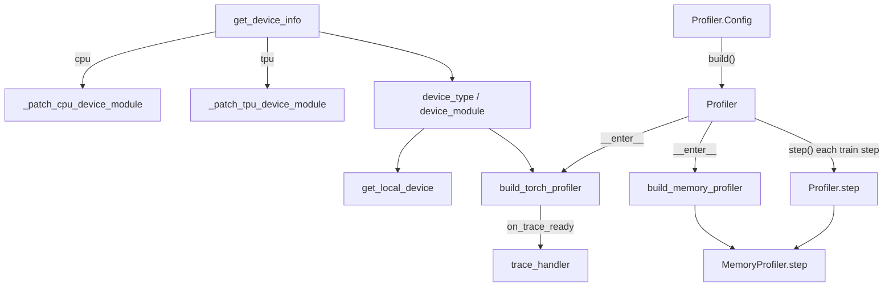

# Debug and profiling tools: Profiler, device abstraction, peak FLOPS, GC, logging

## Overview

`torchtitan/tools` is the small utility layer every other subsystem imports (129 outside symbols depend on it); it is not dependency-free - `utils.py` and `profiler.py` import the structured logger from `torchtitan.observability`, and `profiler.py` also imports `torchtitan.config` and the CUDA-graph annotation helper. It has four jobs. **(1) Device abstraction:** at import time [`get_device_info`](../catalog/torchtitan/tools/utils.md#get_device_info "torchtitan/tools/utils.py:L206") resolves the process-wide [`device_type`](../catalog/torchtitan/tools/utils.md#device_type "torchtitan/tools/utils.py:L219") and [`device_module`](../catalog/torchtitan/tools/utils.md#device_module "torchtitan/tools/utils.py:L219") (`torch.cuda`, `torch.tpu`, `torch.cpu`, ...) and patches in whatever CUDA-shaped APIs the backend lacks, so the rest of torchtitan can keep calling `device_module.memory_stats()` or `set_device()` on TPU. **(2) Profiling:** [`Profiler`](../catalog/torchtitan/tools/profiler.md#Profiler "torchtitan/tools/profiler.py:L106") owns a scheduled `torch.profiler` (adding the TPU activity and a TorchTPU tracer config when `device_type == "tpu"`) plus a periodic memory-snapshot recorder. **(3) Performance accounting:** [`get_peak_flops`](../catalog/torchtitan/tools/utils.md#get_peak_flops "torchtitan/tools/utils.py:L309") maps a device name to the dense BF16 peak used as the MFU denominator, and [`GarbageCollection`](../catalog/torchtitan/tools/utils.md#GarbageCollection "torchtitan/tools/utils.py:L270") disables automatic GC so collections happen on a fixed step cadence on every rank. **(4) Plumbing:** the console [`logger`](../catalog/torchtitan/tools/logging.md#logger "torchtitan/tools/logging.py:L12") and fsspec-aware path helpers ([`join`](../catalog/torchtitan/tools/filesystem.md#join "torchtitan/tools/filesystem.py:L101"), [`is_remote`](../catalog/torchtitan/tools/filesystem.md#is_remote "torchtitan/tools/filesystem.py:L22")) used for `gs://` checkpoint IO.

The design idea that ties them together: *resolve the platform once, at import, and give every caller a CUDA-shaped surface.* Most TPU-specific behavior in this package is therefore a branch on `device_type` or a patched `device_module`, not a separate code path - which is convenient, but also means TPU semantics can hide behind a no-op (e.g. `reset_peak_memory_stats`).

## Diagram

Import-time device resolution and the per-step profiling lifecycle inside the training loop:

Legend:
- `GDI` - [`get_device_info`](../catalog/torchtitan/tools/utils.md#get_device_info "torchtitan/tools/utils.py:L206")
- `PCPU` - [`_patch_cpu_device_module`](../catalog/torchtitan/tools/utils.md#_patch_cpu_device_module "torchtitan/tools/utils.py:L59")
- `PTPU` - [`_patch_tpu_device_module`](../catalog/torchtitan/tools/utils.md#_patch_tpu_device_module "torchtitan/tools/utils.py:L164")
- `DT` - [`device_type`](../catalog/torchtitan/tools/utils.md#device_type "torchtitan/tools/utils.py:L219"), [`device_module`](../catalog/torchtitan/tools/utils.md#device_module "torchtitan/tools/utils.py:L219")
- `LOC` - [`get_local_device`](../catalog/torchtitan/tools/utils.md#get_local_device "torchtitan/tools/utils.py:L222")
- `CFG` - [`Config`](../catalog/torchtitan/tools/profiler.md#Profiler.Config "torchtitan/tools/profiler.py:L129")
- `PROF` - [`Profiler`](../catalog/torchtitan/tools/profiler.md#Profiler "torchtitan/tools/profiler.py:L106")
- `BTP` - [`build_torch_profiler`](../catalog/torchtitan/tools/profiler.md#Profiler.build_torch_profiler "torchtitan/tools/profiler.py:L286")
- `BMP` - [`build_memory_profiler`](../catalog/torchtitan/tools/profiler.md#Profiler.build_memory_profiler "torchtitan/tools/profiler.py:L388")
- `TH` - [`trace_handler`](../catalog/torchtitan/tools/profiler.md#Profiler.trace_handler "torchtitan/tools/profiler.py:L311")
- `MPS` - [`step`](../catalog/torchtitan/tools/profiler.md#MemoryProfiler.step "torchtitan/tools/profiler.py:L77")
- `PSTEP` - [`step`](../catalog/torchtitan/tools/profiler.md#Profiler.step "torchtitan/tools/profiler.py:L276")

## Design rationale (why it's built this way)

- **A view over `torch.tpu`, not a patch.** The TPU device-module wrapper exists because torch_tpu marks some `torch.tpu` APIs internal (PyTorch >= 2.11) and warns when they are called from outside; torchtitan routes `is_available`, `device_count`, `current_device`, `set_device`, `synchronize`, and stream calls to `torch.accelerator` instead. The source says it is "a separate object rather than a patch on ``torch.tpu`` because torch_tpu calls these same functions on ``torch.tpu`` internally ... and their pre-initialization behavior must not change." Only the missing memory functions (`reset_peak_memory_stats`, `empty_cache`, `memory_stats`) and an `is_triton_capable = False` stub are patched onto the module itself.
- **TPU is index-free.** [`get_local_device`](../catalog/torchtitan/tools/utils.md#get_local_device "torchtitan/tools/utils.py:L222") returns a bare `torch.device("tpu")` because "a process owns exactly one of them, so LOCAL_RANK is not a device index on those lanes", and because `torch.tpu.device_count()` "reports the host's chip count -- not the process's single addressable chip -- until the PJRT runtime is initialized".
- **Profiling is schedule-driven and cheap to leave configured.** [`Config`](../catalog/torchtitan/tools/profiler.md#Profiler.Config "torchtitan/tools/profiler.py:L129") maps onto `torch.profiler.schedule(wait, warmup, active, ...)` with `wait = profile_freq - (warmup + active)`, so a single config captures one active step every `profile_freq` steps after a warmup; nothing is recorded outside the window.
- **Memory snapshots trade fidelity for dump time.** [`__init__`](../catalog/torchtitan/tools/profiler.md#MemoryProfiler.__init__ "torchtitan/tools/profiler.py:L53") records history with `stacks="python"` because "the default stacks="all" symbolizes C++ frames, which is very slow for torchtitan workload", and caps events with a ring buffer.
- **Controlled GC to avoid stragglers.** The class comment reads "used to avoid stragglers in garbage collection": automatic GC is disabled so no rank pauses at a random point mid-collective; instead all ranks collect every `gc_freq` steps (default 50), and the step is tagged so analysis can exclude it.
- **MFU denominators are hardcoded per device.** `get_peak_flops` is a lookup table of dense BF16 peaks with source links; on TPU it uses per-device numbers and explicitly halves v7 because "v7 exposes each of its two TensorCores as a separate device".

## Entry points

- [`logger`](../catalog/torchtitan/tools/logging.md#logger "torchtitan/tools/logging.py:L12") - the most-imported symbol in the repo; it is the *root* logger (`logging.getLogger()`), configured by [`init_logger`](../catalog/torchtitan/tools/logging.md#init_logger "torchtitan/tools/logging.py:L15") with a `[titan]` stdout format. Entry scripts call `init_logger()` first; the TPU entry and minimal trainers call it on rank 0 only (e.g. [`start_trainer`](../catalog/torchtitan/experiments/tpu/conformer/train_minimal.md#start_trainer "torchtitan/experiments/tpu/conformer/train_minimal.py:L144")).
- [`device_type`](../catalog/torchtitan/tools/utils.md#device_type "torchtitan/tools/utils.py:L219") / [`device_module`](../catalog/torchtitan/tools/utils.md#device_module "torchtitan/tools/utils.py:L219") - module-level globals computed at import; read wherever code needs to branch on platform or call memory/stream/sync APIs (the profiler itself branches on `device_type == "tpu"`).
- [`Profiler`](../catalog/torchtitan/tools/profiler.md#Profiler "torchtitan/tools/profiler.py:L106") - the [`Trainer`](../catalog/torchtitan/trainer.md#Trainer "torchtitan/trainer.py:L74") builds it from `config.profiler` with `global_step=self.step` and `base_folder=config.dump_folder`, enters it around the whole step loop, and calls `profiler.step()` once per step after checkpoint save and validation. Recipes set it explicitly, e.g. [`llama3_405b`](../catalog/torchtitan/models/llama3/config_registry.md#llama3_405b "torchtitan/models/llama3/config_registry.py:L370") enables profiling and the TPU Qwen3 MoE base config [`_qwen3_moe_30b_fsdp_only_full_ac`](../catalog/torchtitan/experiments/tpu/qwen3/config_registry.md#_qwen3_moe_30b_fsdp_only_full_ac "torchtitan/experiments/tpu/qwen3/config_registry.py:L797") disables it (a sibling `_profile` recipe re-enables it on rank 0 with `profile_freq=5`, `profiler_warmup=2`, `profiler_active=1`).
- [`get_peak_flops`](../catalog/torchtitan/tools/utils.md#get_peak_flops "torchtitan/tools/utils.py:L309") - called by the trainer (logged as "Peak FLOPS used for computing MFU") and by the metrics processor with the device-memory monitor's device name.
- [`GarbageCollection`](../catalog/torchtitan/tools/utils.md#GarbageCollection "torchtitan/tools/utils.py:L270") - constructed by the trainer from `training.gc_freq` / `training.gc_debug`; its [`run`](../catalog/torchtitan/tools/utils.md#GarbageCollection.run "torchtitan/tools/utils.py:L284") is the first thing inside every `step` span.
- [`join`](../catalog/torchtitan/tools/filesystem.md#join "torchtitan/tools/filesystem.py:L101") (with [`isdir`](../catalog/torchtitan/tools/filesystem.md#isdir "torchtitan/tools/filesystem.py:L50"), [`isfile`](../catalog/torchtitan/tools/filesystem.md#isfile "torchtitan/tools/filesystem.py:L57"), [`listdir`](../catalog/torchtitan/tools/filesystem.md#listdir "torchtitan/tools/filesystem.py:L64")) - used by the checkpointer to build and scan `step-N` folders that may live on `gs://`.

## Mechanism (step-by-step)

1. **Platform resolution at import.** [`get_device_info`](../catalog/torchtitan/tools/utils.md#get_device_info "torchtitan/tools/utils.py:L206") asks PyTorch for the available device type, falling back to `"cpu"` (this fork's change: upstream falls back to `"cuda"`, but a host whose accelerator is hidden should report what it will actually run on). For CPU, [`_patch_cpu_device_module`](../catalog/torchtitan/tools/utils.md#_patch_cpu_device_module "torchtitan/tools/utils.py:L59") adds a fake device name, index 0, total memory from `psutil`, and no-op memory calls. For TPU, [`_patch_tpu_device_module`](../catalog/torchtitan/tools/utils.md#_patch_tpu_device_module "torchtitan/tools/utils.py:L164") adds a no-op `reset_peak_memory_stats` and `empty_cache`, a `memory_stats` that forwards to `torch.accelerator.memory_stats()` (or `{}` on older PyTorch), and `is_triton_capable = False`, then returns the `torch.accelerator`-backed view when available. The result is bound to [`device_type`](../catalog/torchtitan/tools/utils.md#device_type "torchtitan/tools/utils.py:L219") and [`device_module`](../catalog/torchtitan/tools/utils.md#device_module "torchtitan/tools/utils.py:L219") once per process.

2. **Profiler construction and validation.** `config.profiler.build()` yields a [`Profiler`](../catalog/torchtitan/tools/profiler.md#Profiler "torchtitan/tools/profiler.py:L106") whose [`__init__`](../catalog/torchtitan/tools/profiler.md#Profiler.__init__ "torchtitan/tools/profiler.py:L202") only stores arguments; nothing starts until entry. Config validation in [`__post_init__`](../catalog/torchtitan/tools/profiler.md#Profiler.Config.__post_init__ "torchtitan/tools/profiler.py:L193") requires [`profile_freq`](../catalog/torchtitan/tools/profiler.md#Profiler.Config.profile_freq "torchtitan/tools/profiler.py:L136") >= [`profiler_warmup`](../catalog/torchtitan/tools/profiler.md#Profiler.Config.profiler_warmup "torchtitan/tools/profiler.py:L167") + [`profiler_active`](../catalog/torchtitan/tools/profiler.md#Profiler.Config.profiler_active "torchtitan/tools/profiler.py:L160") when [`enable_profiling`](../catalog/torchtitan/tools/profiler.md#Profiler.Config.enable_profiling "torchtitan/tools/profiler.py:L130") is set (defaults 10, 3, 1). A pre-built profiler can be re-targeted with [`active`](../catalog/torchtitan/tools/profiler.md#Profiler.active "torchtitan/tools/profiler.py:L217"), which updates step and folders and returns itself for use as a context manager.

3. **Starting the torch profiler.** [`__enter__`](../catalog/torchtitan/tools/profiler.md#Profiler.__enter__ "torchtitan/tools/profiler.py:L239") calls [`build_torch_profiler`](../catalog/torchtitan/tools/profiler.md#Profiler.build_torch_profiler "torchtitan/tools/profiler.py:L286"), which returns `None` when disabled. Otherwise it creates `{dump_folder}/{save_traces_folder}` ([`save_traces_folder`](../catalog/torchtitan/tools/profiler.md#Profiler.Config.save_traces_folder "torchtitan/tools/profiler.py:L133"), default `profiling/traces`), picks activities - CPU always; on TPU the TPU activity plus a TorchTPU profiler config with host tracer level 2, device tracer level 1, and a per-rank `run_dir` of `<trace_dir>/rank_<rank>`; else CUDA or XPU - and constructs `torch.profiler.profile(..., record_shapes=True)` with the wait/warmup/active schedule (plus optional `repeat`, `skip_first`, `skip_first_wait`). It enters the profiler immediately and sets its `step_num` to the global step so resumed runs name trace folders by real step. The result is held in [`torch_profiler`](../catalog/torchtitan/tools/profiler.md#Profiler.torch_profiler "torchtitan/tools/profiler.py:L214").

4. **Per-step advance and trace export.** Each training step the trainer calls [`step`](../catalog/torchtitan/tools/profiler.md#Profiler.step "torchtitan/tools/profiler.py:L276"), which steps the torch profiler and the memory profiler, each wrapped in a structured-logger span (`kineto_profiler_step_call`, `memory_profiler_step_call`) so the cost of the profiler itself shows up in the JSONL timeline. When an active window closes, [`trace_handler`](../catalog/torchtitan/tools/profiler.md#Profiler.trace_handler "torchtitan/tools/profiler.py:L311") writes `iteration_<step>/rank<rank>_trace.json.gz` via `export_chrome_trace`, baking in CUDA-graph annotations when the installed torch supports it, and logs the dump time.

5. **Memory snapshots.** [`build_memory_profiler`](../catalog/torchtitan/tools/profiler.md#Profiler.build_memory_profiler "torchtitan/tools/profiler.py:L388") (stored in [`memory_profiler`](../catalog/torchtitan/tools/profiler.md#Profiler.memory_profiler "torchtitan/tools/profiler.py:L215")) is active only with `enable_memory_snapshot`; its frequency defaults to `profile_freq`. The recorder's [`__init__`](../catalog/torchtitan/tools/profiler.md#MemoryProfiler.__init__ "torchtitan/tools/profiler.py:L53") starts `device_module.memory._record_memory_history`, and its [`step`](../catalog/torchtitan/tools/profiler.md#MemoryProfiler.step "torchtitan/tools/profiler.py:L77") pickles `device_module.memory._snapshot()` every N steps into `profiling/memory_snapshot/step_<NNNNNNNNNNNN>/<rank>_step_<n>.pickle` (protocol 4 for the `pytorch.org/memory_viz` viewer).

6. **Exit and OOM capture.** [`__exit__`](../catalog/torchtitan/tools/profiler.md#Profiler.__exit__ "torchtitan/tools/profiler.py:L252") stops the torch profiler, and if `torch.OutOfMemoryError` appears anywhere in the exception's cause/context chain (pipeline parallelism wraps OOMs in a plain `RuntimeError`) it forces a final `step_<n>_exit` memory dump - the snapshot you actually want after an OOM. It never suppresses the exception.

7. **GC cadence and tagging.** [`GarbageCollection`](../catalog/torchtitan/tools/utils.md#GarbageCollection "torchtitan/tools/utils.py:L270") calls `gc.disable()` and does one initial collection; [`run`](../catalog/torchtitan/tools/utils.md#GarbageCollection.run "torchtitan/tools/utils.py:L284") is decorated with a `gc_collect` span and, on steps divisible by `gc_freq` (or every step in debug mode, which also runs a full generation-2 collection and warns about tensor reference cycles), calls [`collect`](../catalog/torchtitan/tools/utils.md#GarbageCollection.collect "torchtitan/tools/utils.py:L301") and adds a `gc` step tag. Collection time is logged in seconds.

8. **Peak FLOPS lookup.** [`get_peak_flops`](../catalog/torchtitan/tools/utils.md#get_peak_flops "torchtitan/tools/utils.py:L309") first tries `lspci` to refine H100 variants, then matches substrings. For any name containing `tpu` (case-insensitive) it normalizes dashes and returns per-device dense BF16: v4 275e12, v5e 197e12, v5p 459e12 (per chip, "we assume megacore is enabled"), v6e 918e12, v7/7x 2307e12 / 2 (~1.15e15, per TensorCore). Unknown GPUs fall back to A100's 312e12.

## Key data structures

- **`Profiler.Config`** - `enable_profiling`, `save_traces_folder`, `profile_freq`, `profiler_warmup`, `profiler_active`, optional `profiler_repeat` / `profiler_skip_first` / `profiler_skip_first_wait`, and the memory-snapshot fields (`enable_memory_snapshot`, `memory_snapshot_freq`, `save_memory_snapshot_folder`, `memory_snapshot_max_entries` default 1,000,000).
- **On-disk layout constants** - `profiling/traces/iteration_{step}/rank{rank}_trace.json.gz` and `profiling/memory_snapshot/step_{step:012d}[_exit]/{rank:06d}_step_{step}.pickle`; on TPU the TorchTPU tracer additionally writes under `profiling/traces/rank_{rank}`.
- **[`Color`](../catalog/torchtitan/tools/utils.md#Color "torchtitan/tools/utils.py:L456") / [`NoColor`](../catalog/torchtitan/tools/utils.md#NoColor "torchtitan/tools/utils.py:L471")** - ANSI palettes for metric log lines; a module-level assert keeps their field sets identical so either can be swapped in (fields like [`turquoise`](../catalog/torchtitan/tools/utils.md#NoColor.turquoise "torchtitan/tools/utils.py:L482") are empty strings in `NoColor`).
- **Small helpers** - [`warn_once`](../catalog/torchtitan/tools/logging.md#warn_once "torchtitan/tools/logging.py:L33") (dedupe by message), [`set_default_dtype`](../catalog/torchtitan/tools/utils.md#set_default_dtype "torchtitan/tools/utils.py:L510") (scoped default dtype), [`check_if_feature_in_pytorch`](../catalog/torchtitan/tools/utils.md#check_if_feature_in_pytorch "torchtitan/tools/utils.py:L490") (version warnings), [`has_cuda_capability`](../catalog/torchtitan/tools/utils.md#has_cuda_capability "torchtitan/tools/utils.py:L29") (excludes ROCm; the gate every GPU-only feature such as the quantization converters uses), and [`get_cuda_flash_attention_impl`](../catalog/torchtitan/tools/utils.md#get_cuda_flash_attention_impl "torchtitan/tools/utils.py:L38") (FA4 on SM100, FA3 on SM90).

## Dynamics (design intent)

- **When traces land.** With defaults (`profile_freq=10`, `warmup=3`, `active=1`) the schedule waits 6 steps, warms up 3, and records 1, so traces land at steps 10, 20, 30, ... counted from `global_step`. Validation and checkpoint saves sit inside the same step, before `profiler.step()`, so an active step can include them.
- **Profiler overhead is itself traced.** The `kineto_profiler_step_call` span makes trace-export stalls visible in the structured log instead of silently inflating step time.
- **GC is synchronous by design.** Every rank collects on the same step numbers, so the pause is aligned across ranks rather than causing one straggler to stall a collective.
- **Tests.** The TPU lane has `torchtitan/experiments/tpu/tests/test_profiler.py`, which builds a profiler with `enable_profiling=True` and `profile_freq=4`.

## Edge cases

- **TPU peak-FLOPS fallthrough returns `None`.** In the `tpu` branch of [`get_peak_flops`](../catalog/torchtitan/tools/utils.md#get_peak_flops "torchtitan/tools/utils.py:L309"), an unrecognized TPU generation logs "fallback to A100" but has no `return` after the warning, so the function falls off the end and returns `None`; the trainer's `f"{gpu_peak_flops:.3e}"` log line would then raise. The later `device_name.startswith("TPU")` branch, which does fall back to 312e12, is unreachable because every `TPU ...` name already matches the case-insensitive `tpu` branch.
- **MFU on v7 is per TensorCore.** Because v7 exposes two devices per chip and the table halves the chip peak, MFU is consistent per device, but tokens/sec-per-chip comparisons against v6e must account for two processes/devices per chip.
- **No peak-memory reset on TPU.** `reset_peak_memory_stats` is a no-op for TPU and CPU, so "peak" memory reported by the device-memory monitor on TPU is whatever `torch.accelerator.memory_stats()` reports, not a per-interval peak.
- **The TPU lane monkey-patches `Profiler`.** `torchtitan/experiments/tpu/profiler_workaround.py` replaces `Profiler.__init__`, `__enter__`, `step`, and `__exit__` at import; when `tpu_config.use_jax_profiler` is set it disables the torch profiler and drives a JAX/xprof profiler on the same wait/warmup/active arithmetic, while still running the memory recorder. Without that flag the original methods run.
- **`init_logger` clears root handlers.** Since [`logger`](../catalog/torchtitan/tools/logging.md#logger "torchtitan/tools/logging.py:L12") is the root logger, calling `init_logger()` after the structured logger is initialized would drop the structured logger's root forwarder; the training entry calls `init_logger()` first. On the TPU entry non-zero ranks never call it, so their INFO console output is not configured.
- **Memory snapshots depend on `device_module.memory`.** The recorder calls `device_module.memory._record_memory_history` / `_snapshot`, which the TPU patch does not add.
- **Profile directory naming on resume** relies on `global_step`; passing 0 on a resumed run overwrites `iteration_<n>` folders from the earlier run.

> [!inferred]
> On TPU the useful artifact is the TorchTPU tracer output under `profiling/traces/rank_<rank>/` (host + device trace, viewable with xprof), not the Chrome JSON from `export_chrome_trace`, which only carries what the PyTorch profiler itself saw on the host. Whether `torch.tpu.memory._record_memory_history` exists is not visible from this repo; if it does not, enabling `enable_memory_snapshot` on TPU would fail at profiler entry.

## Open questions

- `MemoryProfiler` (the class), `exists`, `rmtree`, `round_up`, `has_rocm_capability`, and the `torch.accelerator`-backed device view class are in the source but not in this packet's subgraph; they are described above without citation.
- What `TpuProfilerConfig`'s `host_tracer_level=2` / `device_tracer_level=1` capture (and whether HLO/LLO dumps are included) is defined in torch_tpu, not here.
- Whether the patched `torch.accelerator.memory_stats()` keys match what the metrics processor's device-memory monitor reads (it expects CUDA-allocator-style keys) is not settled by this package alone.

## See also

- [Observability](observability.md) - structured JSONL spans, step tags, SDC replay
- [Trainer and train loop](trainer-and-train-loop.md) - where the profiler, GC, and peak FLOPS are wired in
- [Training components](training-components.md) - metrics processor and MFU
- [Quantization](quantization.md) - why MFU is suppressed under FP8/MX, and the `has_cuda_capability` gates
- [Checkpointing](checkpointing.md) - consumer of the fsspec path helpers
- [TPU trainer and job config](tpu-trainer-and-job-config.md) - TPU entry, rank-0 logging, profiler workaround
- [JAX lane](jax-lane.md)
