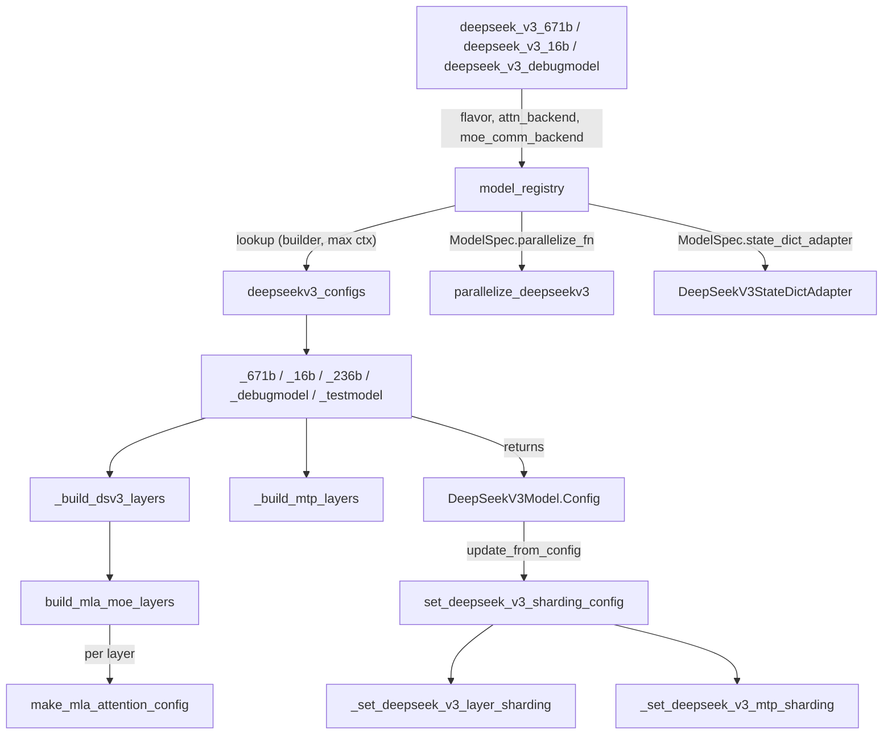
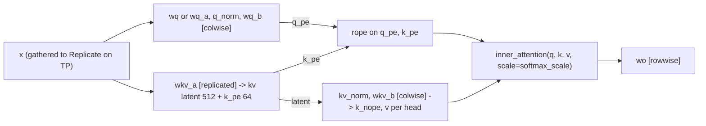

# DeepSeek-V3 model: MLA attention, MoE layers, MTP and their sharding in TorchTitan

<!-- connect:up:begin -->
> **Cross-repo concept:** part of [expert-parallelism](../../../concepts/expert-parallelism.md), [sequence-parallelism](../../../concepts/sequence-parallelism.md), [sharding](../../../concepts/sharding.md) across this wiki's repos.
<!-- connect:up:end -->
## Overview

`torchtitan/models/deepseek_v3` is the reference DeepSeek-V3 implementation that every other MLA+MoE model in the repo leans on (Kimi K2.x and the TPU lane reuse its builders). It is a **config-first** model: a flavor function (`_debugmodel`, `_16b`, `_236b`, `_671b`, `_testmodel`) returns a fully specified [`Config`](../catalog/torchtitan/models/deepseek_v3/model.md#DeepSeekV3Model.Config "torchtitan/models/deepseek_v3/model.py:L243") tree, [`model_registry`](../catalog/torchtitan/models/deepseek_v3/__init__.md#model_registry "torchtitan/models/deepseek_v3/__init__.py:L723") wraps it into a `ModelSpec` with the model's own parallelize function and HF adapter, and the trainer builds modules from that tree. The architecture has three DeepSeek-specific pieces on top of the shared decoder: [`Attention`](../catalog/torchtitan/models/deepseek_v3/model.md#Attention "torchtitan/models/deepseek_v3/model.py:L32") ("Multi-head latent attention (MLA) module"), a layer stack whose first `n_dense_layers` blocks use a dense FFN and the rest a routed MoE with shared experts, and optional multi-token-prediction layers owned by [`MTPDecoder`](../catalog/torchtitan/models/deepseek_v3/mtp.md#MTPDecoder "torchtitan/models/deepseek_v3/mtp.py:L170").

The key design idea for performance: **sharding is data, not code**. When the job config is applied, [`set_deepseek_v3_sharding_config`](../catalog/torchtitan/models/deepseek_v3/sharding.md#set_deepseek_v3_sharding_config "torchtitan/models/deepseek_v3/sharding.py:L44") writes a placement plan onto every sub-config (which MLA projections are replicated vs. colwise/rowwise, where activations are gathered, how grouped experts split), and [`parallelize_deepseekv3`](../catalog/torchtitan/models/deepseek_v3/parallelize.md#parallelize_deepseekv3 "torchtitan/models/deepseek_v3/parallelize.py:L21") only *executes* that plan, then layers activation checkpointing, `torch.compile` and FSDP on top in a fixed order.

## Diagram

Build path, from a recipe name to a parallelized module:

Legend:
- `REC` - [`deepseek_v3_671b`](../catalog/torchtitan/models/deepseek_v3/config_registry.md#deepseek_v3_671b "torchtitan/models/deepseek_v3/config_registry.py:L252"), [`deepseek_v3_16b`](../catalog/torchtitan/models/deepseek_v3/config_registry.md#deepseek_v3_16b "torchtitan/models/deepseek_v3/config_registry.py:L182"), [`deepseek_v3_debugmodel`](../catalog/torchtitan/models/deepseek_v3/config_registry.md#deepseek_v3_debugmodel "torchtitan/models/deepseek_v3/config_registry.py:L66")
- `REG` - [`model_registry`](../catalog/torchtitan/models/deepseek_v3/__init__.md#model_registry "torchtitan/models/deepseek_v3/__init__.py:L723")
- `TBL` - [`deepseekv3_configs`](../catalog/torchtitan/models/deepseek_v3/__init__.md#deepseekv3_configs "torchtitan/models/deepseek_v3/__init__.py:L708")
- `FLV` - [`_671b`](../catalog/torchtitan/models/deepseek_v3/__init__.md#_671b "torchtitan/models/deepseek_v3/__init__.py:L557"), [`_16b`](../catalog/torchtitan/models/deepseek_v3/__init__.md#_16b "torchtitan/models/deepseek_v3/__init__.py:L406"), [`_236b`](../catalog/torchtitan/models/deepseek_v3/__init__.md#_236b "torchtitan/models/deepseek_v3/__init__.py:L480"), [`_debugmodel`](../catalog/torchtitan/models/deepseek_v3/__init__.md#_debugmodel "torchtitan/models/deepseek_v3/__init__.py:L332"), [`_testmodel`](../catalog/torchtitan/models/deepseek_v3/__init__.md#_testmodel "torchtitan/models/deepseek_v3/__init__.py:L635")
- `BL` - [`_build_dsv3_layers`](../catalog/torchtitan/models/deepseek_v3/__init__.md#_build_dsv3_layers "torchtitan/models/deepseek_v3/__init__.py:L293")
- `MM` - [`build_mla_moe_layers`](../catalog/torchtitan/models/deepseek_v3/__init__.md#build_mla_moe_layers "torchtitan/models/deepseek_v3/__init__.py:L175")
- `MLA` - [`make_mla_attention_config`](../catalog/torchtitan/models/deepseek_v3/__init__.md#make_mla_attention_config "torchtitan/models/deepseek_v3/__init__.py:L85")
- `MTPB` - [`_build_mtp_layers`](../catalog/torchtitan/models/deepseek_v3/__init__.md#_build_mtp_layers "torchtitan/models/deepseek_v3/__init__.py:L304")
- `CFG` - [`Config`](../catalog/torchtitan/models/deepseek_v3/model.md#DeepSeekV3Model.Config "torchtitan/models/deepseek_v3/model.py:L243")
- `SH` - [`set_deepseek_v3_sharding_config`](../catalog/torchtitan/models/deepseek_v3/sharding.md#set_deepseek_v3_sharding_config "torchtitan/models/deepseek_v3/sharding.py:L44")
- `LSH` - [`_set_deepseek_v3_layer_sharding`](../catalog/torchtitan/models/deepseek_v3/sharding.md#_set_deepseek_v3_layer_sharding "torchtitan/models/deepseek_v3/sharding.py:L74")
- `MSH` - [`_set_deepseek_v3_mtp_sharding`](../catalog/torchtitan/models/deepseek_v3/sharding.md#_set_deepseek_v3_mtp_sharding "torchtitan/models/deepseek_v3/sharding.py:L155")
- `PAR` - [`parallelize_deepseekv3`](../catalog/torchtitan/models/deepseek_v3/parallelize.md#parallelize_deepseekv3 "torchtitan/models/deepseek_v3/parallelize.py:L21")
- `SDA` - [`DeepSeekV3StateDictAdapter`](../catalog/torchtitan/models/deepseek_v3/state_dict_adapter.md#DeepSeekV3StateDictAdapter "torchtitan/models/deepseek_v3/state_dict_adapter.py:L20")

MLA data flow inside one [`forward`](../catalog/torchtitan/models/deepseek_v3/model.md#Attention.forward "torchtitan/models/deepseek_v3/model.py:L99") (tensors are token-major `[T, ...]`; TP placement in brackets):

Legend:
- `X` - (concept) attention input after `attention_norm`
- `WQ` - (concept) `Linear` sub-modules of [`Attention`](../catalog/torchtitan/models/deepseek_v3/model.md#Attention "torchtitan/models/deepseek_v3/model.py:L32"), configured by [`make_mla_attention_config`](../catalog/torchtitan/models/deepseek_v3/__init__.md#make_mla_attention_config "torchtitan/models/deepseek_v3/__init__.py:L85")
- `WKVA` - (concept) `Linear` sub-modules of [`Attention`](../catalog/torchtitan/models/deepseek_v3/model.md#Attention "torchtitan/models/deepseek_v3/model.py:L32"), configured by [`make_mla_attention_config`](../catalog/torchtitan/models/deepseek_v3/__init__.md#make_mla_attention_config "torchtitan/models/deepseek_v3/__init__.py:L85")
- `WKVB` - (concept) `Linear` sub-modules of [`Attention`](../catalog/torchtitan/models/deepseek_v3/model.md#Attention "torchtitan/models/deepseek_v3/model.py:L32"), configured by [`make_mla_attention_config`](../catalog/torchtitan/models/deepseek_v3/__init__.md#make_mla_attention_config "torchtitan/models/deepseek_v3/__init__.py:L85")
- `WO` - (concept) `Linear` sub-modules of [`Attention`](../catalog/torchtitan/models/deepseek_v3/model.md#Attention "torchtitan/models/deepseek_v3/model.py:L32"), configured by [`make_mla_attention_config`](../catalog/torchtitan/models/deepseek_v3/__init__.md#make_mla_attention_config "torchtitan/models/deepseek_v3/__init__.py:L85")
- `ROPE` - [`ComplexRoPE`](../catalog/torchtitan/models/common/rope.md#ComplexRoPE "torchtitan/models/common/rope.py:L185")
- `INNER` - (concept) the pluggable inner attention backend (flex / sdpa / varlen), scaled by [`softmax_scale`](../catalog/torchtitan/models/deepseek_v3/model.md#Attention.softmax_scale "torchtitan/models/deepseek_v3/model.py:L90")

## Design rationale (why it's built this way)

**MLA compresses projections, not the training-time attention.** `wkv_a` maps `dim -> kv_lora_rank + qk_rope_head_dim` (512 + 64 in every real flavor), and `wkv_b` re-expands the normalized latent to `n_heads * (qk_nope_head_dim + v_head_dim)`. In training the inner attention therefore still runs as full multi-head attention with `n_heads` K/V heads (no KV-head sharing); the per-head query/key width is `qk_nope_head_dim + qk_rope_head_dim = 192` while the value width is `v_head_dim = 128`. Any attention kernel substituted for the inner backend must accept **different QK and V head dims** and the explicit `scale` argument.

**Replicate the low-rank projections on TP.** The docstring of [`_set_deepseek_v3_layer_sharding`](../catalog/torchtitan/models/deepseek_v3/sharding.md#_set_deepseek_v3_layer_sharding "torchtitan/models/deepseek_v3/sharding.py:L74") states the policy: "low-rank projections (wkv_a, wq_a, kv_norm, q_norm) stay replicated. Up-projections (wkv_b, wq_b, wq) are colwise." The narrow latent (512/1536 wide) is not worth splitting, so every TP rank recomputes it redundantly; heads are split only after the up-projection, which keeps the rope-shared `k_pe` (one 64-wide vector broadcast across heads via `expand`) local. A source comment adds that the replicated weights are still distributed as Replicate DTensors "so DTensor activations flow through without mixing plain Tensor + DTensor in the matmul". The attention input `x` is gathered to Replicate on TP before the projections, so with sequence parallelism enabled each attention layer pays one all-gather in and one reduce-scatter out (rowwise `wo` with `output_sp`).

**Fill sharding unconditionally, filter at runtime.** [`set_deepseek_v3_sharding_config`](../catalog/torchtitan/models/deepseek_v3/sharding.md#set_deepseek_v3_sharding_config "torchtitan/models/deepseek_v3/sharding.py:L44") says dense sub-configs are "populated unconditionally - `Module.parallelize` filters disabled axes at runtime", and the same for MoE sub-configs via `resolve_mesh`. One plan therefore serves every mesh shape; enabling EP or SP is a flag flip, not a different code path.

**MTP layers are folded into the main layer list when the shared machinery runs.** `MTPDecoder.Config.update_from_config` temporarily appends the MTP layers to `layers` so the shared decoder config update sees them, then removes them; the FSDP wrapper does the same trick. MTP layers are deep copies of the **last** main layer's attention/FFN/MoE configs plus `enorm`, `hnorm`, `eh_proj`, `mtp_norm` (see [`_build_mtp_layers`](../catalog/torchtitan/models/deepseek_v3/__init__.md#_build_mtp_layers "torchtitan/models/deepseek_v3/__init__.py:L304")), so in the 671B flavor each MTP depth adds one more full MoE block plus one more `lm_head` application.

**FLOPs follow the active parameters.** [`get_deepseek_v3_nparams_and_flops`](../catalog/torchtitan/models/deepseek_v3/model.md#get_deepseek_v3_nparams_and_flops "torchtitan/models/deepseek_v3/model.py:L202") ("Estimate DeepSeek-style decoder FLOPs from the final model config") returns `6 * active_nparams + attention_op_flops`, summing quadratic attention FLOPs over both `layers` and `mtp_layers` with `qk_head_dim = qk_nope + qk_rope`, and adding one extra `lm_head` parameter count per MTP depth ("MTP applies that same output projection once more for every prediction depth"). This FLOP count is the numerator of the reported MFU (achieved model FLOPs over peak), so MTP runs get credit for the extra work.

## Entry points

- [`model_registry`](../catalog/torchtitan/models/deepseek_v3/__init__.md#model_registry "torchtitan/models/deepseek_v3/__init__.py:L723") - the single factory recipes call. Defaults `attn_backend="flex"`, `moe_comm_backend="standard"`; rejects `seq_len` above the flavor's max context (16384 for every flavor in [`deepseekv3_configs`](../catalog/torchtitan/models/deepseek_v3/__init__.md#deepseekv3_configs "torchtitan/models/deepseek_v3/__init__.py:L708")); applies config converters (Float8 / MXFP8) after validating their order; returns a `ModelSpec` naming `parallelize_deepseekv3`, `pipeline_llm`, the MoE load-balancing/aux-loss post-optimizer hook and the HF adapter.
- [`deepseek_v3_debugmodel`](../catalog/torchtitan/models/deepseek_v3/config_registry.md#deepseek_v3_debugmodel "torchtitan/models/deepseek_v3/config_registry.py:L66"), [`deepseek_v3_16b`](../catalog/torchtitan/models/deepseek_v3/config_registry.md#deepseek_v3_16b "torchtitan/models/deepseek_v3/config_registry.py:L182"), [`deepseek_v3_671b`](../catalog/torchtitan/models/deepseek_v3/config_registry.md#deepseek_v3_671b "torchtitan/models/deepseek_v3/config_registry.py:L252") - full `Trainer.Config` recipes. The 16B and 671B recipes set `expert_parallel_degree` (8 and 2), `Interleaved1F1B` pipeline schedule, `SelectiveAC`, and compile only the `loss` component; the model itself runs uncompiled by default.
- Recipe variants that swap one knob each: [`deepseek_v3_debugmodel_mtp`](../catalog/torchtitan/models/deepseek_v3/config_registry.md#deepseek_v3_debugmodel_mtp "torchtitan/models/deepseek_v3/config_registry.py:L105") (one MTP layer + `MTPLoss`), [`deepseek_v3_671b_float8`](../catalog/torchtitan/models/deepseek_v3/config_registry.md#deepseek_v3_671b_float8 "torchtitan/models/deepseek_v3/config_registry.py:L292") and [`deepseek_v3_debugmodel_mxfp8`](../catalog/torchtitan/models/deepseek_v3/config_registry.md#deepseek_v3_debugmodel_mxfp8 "torchtitan/models/deepseek_v3/config_registry.py:L118") (quantization converters), [`deepseek_v3_16b_hybridep`](../catalog/torchtitan/models/deepseek_v3/config_registry.md#deepseek_v3_16b_hybridep "torchtitan/models/deepseek_v3/config_registry.py:L217"), [`deepseek_v3_16b_minimal_async_ep`](../catalog/torchtitan/models/deepseek_v3/config_registry.md#deepseek_v3_16b_minimal_async_ep "torchtitan/models/deepseek_v3/config_registry.py:L230") and [`deepseek_v3_debugmodel_minimal_async_ep`](../catalog/torchtitan/models/deepseek_v3/config_registry.md#deepseek_v3_debugmodel_minimal_async_ep "torchtitan/models/deepseek_v3/config_registry.py:L160") (alternate MoE communication backends).
- [`parallelize_deepseekv3`](../catalog/torchtitan/models/deepseek_v3/parallelize.md#parallelize_deepseekv3 "torchtitan/models/deepseek_v3/parallelize.py:L21") - reached from the trainer through `ModelSpec.parallelize_fn` after model construction (on the TPU lane, after `workarounds.apply_patches`).
- [`DeepSeekV3StateDictAdapter`](../catalog/torchtitan/models/deepseek_v3/state_dict_adapter.md#DeepSeekV3StateDictAdapter "torchtitan/models/deepseek_v3/state_dict_adapter.py:L20") with [`from_hf`](../catalog/torchtitan/models/deepseek_v3/state_dict_adapter.md#DeepSeekV3StateDictAdapter.from_hf "torchtitan/models/deepseek_v3/state_dict_adapter.py:L211") / [`to_hf`](../catalog/torchtitan/models/deepseek_v3/state_dict_adapter.md#DeepSeekV3StateDictAdapter.to_hf "torchtitan/models/deepseek_v3/state_dict_adapter.py:L152") - reached by the checkpointer when loading or saving HF-format weights.
- [`preprocess_inputs`](../catalog/torchtitan/models/deepseek_v3/mtp.md#MTPDecoder.preprocess_inputs "torchtitan/models/deepseek_v3/mtp.py:L224") - called by the train step on every batch, before CP sharding ("Prepare aligned pairs before applying CP sharding and annotations").

## Mechanism (step-by-step)

1. **Pick a flavor and build the layer configs.** [`model_registry`](../catalog/torchtitan/models/deepseek_v3/__init__.md#model_registry "torchtitan/models/deepseek_v3/__init__.py:L723") looks up `(builder, max_context_length)` in [`deepseekv3_configs`](../catalog/torchtitan/models/deepseek_v3/__init__.md#deepseekv3_configs "torchtitan/models/deepseek_v3/__init__.py:L708") and calls the builder with the attention and MoE backends. Each builder, for example [`_671b`](../catalog/torchtitan/models/deepseek_v3/__init__.md#_671b "torchtitan/models/deepseek_v3/__init__.py:L557"), fixes the shape constants and calls [`_build_dsv3_layers`](../catalog/torchtitan/models/deepseek_v3/__init__.md#_build_dsv3_layers "torchtitan/models/deepseek_v3/__init__.py:L293") ("Thin wrapper: `build_mla_moe_layers` with DeepSeek V3's own inits"), which binds DeepSeek's truncated-normal and depth-scaled initializers. The YaRN RoPE (`rope_factor=40`, `original_seq_len=4096`) is built here with `max_context_length=seq_len`, so the RoPE cache size follows the requested sequence length.

2. **Per layer: MLA attention plus dense-or-MoE FFN.** [`build_mla_moe_layers`](../catalog/torchtitan/models/deepseek_v3/__init__.md#build_mla_moe_layers "torchtitan/models/deepseek_v3/__init__.py:L175") ("Build the per-layer `DeepSeekV3TransformerBlock` configs (MLA + MoE)") calls [`make_mla_attention_config`](../catalog/torchtitan/models/deepseek_v3/__init__.md#make_mla_attention_config "torchtitan/models/deepseek_v3/__init__.py:L85") for every layer, then gives layers `< n_dense_layers` a dense FFN and the rest a MoE config with router (sigmoid or softmax scoring, optional expert-group limiting and route scale), routed `GroupedExperts` carrying the `comm_backend` and `non_blocking_capacity_factor`, and a shared-expert FFN of width `moe_hidden_dim * num_shared_experts`. The attention factory resolves the `attn_backend` string into the inner attention config; with `q_lora_rank == 0` (16B, debug) a single `wq` is built and `q_norm` is a placeholder that is never instantiated, with `q_lora_rank > 0` (236B, 671B) the query also goes through a low-rank `wq_a -> q_norm -> wq_b` path.

3. **Optionally append MTP layers and wrap into the model config.** The builder returns a [`Config`](../catalog/torchtitan/models/deepseek_v3/model.md#DeepSeekV3Model.Config "torchtitan/models/deepseek_v3/model.py:L243") (defaults [`dim`](../catalog/torchtitan/models/deepseek_v3/model.md#DeepSeekV3Model.Config.dim "torchtitan/models/deepseek_v3/model.py:L244") 2048, [`vocab_size`](../catalog/torchtitan/models/deepseek_v3/model.md#DeepSeekV3Model.Config.vocab_size "torchtitan/models/deepseek_v3/model.py:L245") 102400, overridden per flavor) whose `mtp_layers` come from [`_build_mtp_layers`](../catalog/torchtitan/models/deepseek_v3/__init__.md#_build_mtp_layers "torchtitan/models/deepseek_v3/__init__.py:L304") cloning the last main layer. Config converters from the recipe run on this finished tree inside `model_registry`.

4. **Attach the sharding plan when the job config is applied.** `DeepSeekV3Model.Config.update_from_config` first runs the MTP-aware decoder update, then calls [`set_deepseek_v3_sharding_config`](../catalog/torchtitan/models/deepseek_v3/sharding.md#set_deepseek_v3_sharding_config "torchtitan/models/deepseek_v3/sharding.py:L44") with `enable_sp = parallelism.enable_sequence_parallel` and `enable_ep = expert_parallel_degree > 1`. For each layer [`_set_deepseek_v3_layer_sharding`](../catalog/torchtitan/models/deepseek_v3/sharding.md#_set_deepseek_v3_layer_sharding "torchtitan/models/deepseek_v3/sharding.py:L74") sets: norms per SP; attention input redistributed from the SP/activation layout to `tp=Replicate, cp=Shard(0)`; RoPE cache replicated; `wkv_a`/`kv_norm` (and `wq_a`/`q_norm`) replicated; `wkv_b`, `wq`/`wq_b` colwise; `wo` rowwise; the inner attention wrapped by a local map; dense FFN or MoE through the shared helpers, with routed experts laid out as `w1_EFD: Shard(1)`, `w2_EDF: Shard(2)`, `w3_EFD: Shard(1)`. [`_set_deepseek_v3_mtp_sharding`](../catalog/torchtitan/models/deepseek_v3/sharding.md#_set_deepseek_v3_mtp_sharding "torchtitan/models/deepseek_v3/sharding.py:L155") repeats the layer plan for MTP blocks, keeps `eh_proj` replicated and, under SP, reshards the MTP validity mask to the sequence-parallel token layout.

5. **Execute the plan, then AC, compile, FSDP - in that order.** [`parallelize_deepseekv3`](../catalog/torchtitan/models/deepseek_v3/parallelize.md#parallelize_deepseekv3 "torchtitan/models/deepseek_v3/parallelize.py:L21") calls `model.parallelize(parallel_dims)` only if TP or EP is enabled or the `spmd_types` backend is selected; otherwise the plan stays dormant and the model is pure FSDP. It then applies the activation-checkpointing config, then per-block `torch.compile` if `"model"` is in `compile.components`, and finally FSDP over the `["dp_replicate","fsdp"]` (or `["fsdp"]`) mesh for dense parameters and the `efsdp` mesh for experts when EP is on, with `mixed_precision_param` / `mixed_precision_reduce` dtypes, CPU offload, reshard policy and optional symmetric memory taken from the job config. With `skip_dp` (inference / RL rollout) it returns before FSDP because "FSDP's forward hooks are incompatible with torch.inference_mode()".

6. **Prepare MTP-shifted inputs per batch.** [`preprocess_inputs`](../catalog/torchtitan/models/deepseek_v3/mtp.md#MTPDecoder.preprocess_inputs "torchtitan/models/deepseek_v3/mtp.py:L224") requires `positions` when MTP is on and, for each depth `k`, left-rolls tokens and labels by `k` without crossing packed-document boundaries (fill token 0 / ignore index, plus a validity mask). It builds flex/varlen block-causal masks from positions, applies context-parallel input sharding to all aligned tensors together, and returns tuples `(main, depth1, ...)` for tokens and labels. Without MTP layers ([`mtp_layers`](../catalog/torchtitan/models/deepseek_v3/mtp.md#MTPDecoder.mtp_layers "torchtitan/models/deepseek_v3/mtp.py:L212") is `None`) it degenerates to the plain decoder path.

7. **Forward: main stack, then MTP depths.** [`forward`](../catalog/torchtitan/models/deepseek_v3/mtp.md#MTPDecoder.forward "torchtitan/models/deepseek_v3/mtp.py:L321") embeds the main tokens, runs every `DeepSeekV3TransformerBlock` (attention residual then MoE or FFN residual), keeps the **pre-norm** hidden state for MTP, and applies the final norm. Each MTP depth's [`forward`](../catalog/torchtitan/models/deepseek_v3/mtp.md#MTPTransformerBlock.forward "torchtitan/models/deepseek_v3/mtp.py:L147") zeros the previous hidden state where the shifted input is invalid, computes `eh_proj(cat(enorm(embed), hnorm(prev)))`, runs one full transformer block and `mtp_norm`; its output feeds the next depth. `lm_head` is applied to the main and every MTP output (unless the trainer asked to skip it for a fused loss), and `MTPLoss` weights the MTP terms by `mtp_scale / num_mtp_layers`.

8. **Inside MLA.** [`forward`](../catalog/torchtitan/models/deepseek_v3/model.md#Attention.forward "torchtitan/models/deepseek_v3/model.py:L99") works on token-major tensors (`num_tokens = x.shape[0]`), splits Q into nope/rope parts, splits the `wkv_a` output into the 512-wide latent and the 64-wide shared `k_pe`, applies RoPE, up-projects the normalized latent with `wkv_b`, concatenates `k = [k_nope, k_pe expanded over heads]`, and calls the inner attention with [`softmax_scale`](../catalog/torchtitan/models/deepseek_v3/model.md#Attention.softmax_scale "torchtitan/models/deepseek_v3/model.py:L90"). That scale is `qk_head_dim ** -0.5`, multiplied by `mscale ** 2` with `mscale = 0.1 * config.mscale * ln(rope_factor) + 1` when YaRN scaling with `rope_factor > 1` is active (all shipped flavors). The view/expand steps run under `spmd.local()` with `spmd_types` assertions that q, k, v are `PartitionSpec(("dp","cp"), "tp", None)`.

9. **HF weight conversion.** [`from_hf`](../catalog/torchtitan/models/deepseek_v3/state_dict_adapter.md#DeepSeekV3StateDictAdapter.from_hf "torchtitan/models/deepseek_v3/state_dict_adapter.py:L211") validates the HF RoPE config against `ComplexRoPE`, maps keys through [`from_hf_map`](../catalog/torchtitan/models/deepseek_v3/state_dict_adapter.md#DeepSeekV3StateDictAdapter.from_hf_map "torchtitan/models/deepseek_v3/state_dict_adapter.py:L33") (the `q_a/q_b` or `q_proj` entries are chosen in [`__init__`](../catalog/torchtitan/models/deepseek_v3/state_dict_adapter.md#DeepSeekV3StateDictAdapter.__init__ "torchtitan/models/deepseek_v3/state_dict_adapter.py:L27") from `q_lora_rank`), and concatenates per-expert HF weights into grouped `w1_EFD`/`w2_EDF`/`w3_EFD` tensors - as DTensors when `to_hf` previously recorded local expert placements (online), or as plain tensors (offline conversion). HF layer indices past the main stack are remapped to `mtp_layers.*` by [`_map_from_hf_layer_key`](../catalog/torchtitan/models/deepseek_v3/state_dict_adapter.md#DeepSeekV3StateDictAdapter._map_from_hf_layer_key "torchtitan/models/deepseek_v3/state_dict_adapter.py:L81"); [`to_hf`](../catalog/torchtitan/models/deepseek_v3/state_dict_adapter.md#DeepSeekV3StateDictAdapter.to_hf "torchtitan/models/deepseek_v3/state_dict_adapter.py:L152") inverts all of this via [`_map_to_hf_layer_key`](../catalog/torchtitan/models/deepseek_v3/state_dict_adapter.md#DeepSeekV3StateDictAdapter._map_to_hf_layer_key "torchtitan/models/deepseek_v3/state_dict_adapter.py:L106") and splits grouped experts back into per-expert weights.

## Key data structures

| Flavor | dim | layers (dense) | heads | q_lora_rank | experts / top-k / shared | router | vocab |
|---|---|---|---|---|---|---|---|
| `_testmodel` | 16 | 2 (1) | 8 | 0 | 4 / 3 / 2 | sigmoid | 2048 |
| `_debugmodel` | 256 | 6 (1) | 16 | 0 | 8 / 3 / 2 | sigmoid | 2048 |
| `_16b` | 2048 | 27 (1) | 16 | 0 | 64 / 6 / 2 | sigmoid | 102400 |
| `_236b` | 5120 | 60 (1) | 128 | 1536 | 160 / 6 / 2 | softmax, 8 groups limit 3, scale 16 | 102400 |
| `_671b` | 7168 | 61 (3) | 128 | 1536 | 256 / 8 / 1 | sigmoid, 8 groups limit 4, scale 2.5 | 129280 |

All real flavors use `kv_lora_rank=512`, `qk_nope_head_dim=128`, `qk_rope_head_dim=64`, `v_head_dim=128`, YaRN RoPE with factor 40, and a max context of 16384.

- [`Config`](../catalog/torchtitan/models/deepseek_v3/model.md#Attention.Config "torchtitan/models/deepseek_v3/model.py:L40") (MLA) - the projection sub-configs (`wq` or `wq_a`/`wq_b`, `wkv_a`, `wkv_b`, `wo`), the two norms, the head-dim split, `rope`, `mscale`, and `inner_attention` (default flex). Each sub-config later carries its own `sharding_config`.
- `_GROUPED_EXPERTS_PARAM_LAYOUT` in `sharding.py` - the expert weight split per mesh axis: `w1_EFD`/`w3_EFD` shard dim 1 (F), `w2_EDF` shards dim 2 (F), i.e. the expert FFN hidden dim is what TP splits inside each expert.
- [`DeepSeekV3Model`](../catalog/torchtitan/models/deepseek_v3/model.md#DeepSeekV3Model "torchtitan/models/deepseek_v3/model.py:L237") - a thin subclass of [`MTPDecoder`](../catalog/torchtitan/models/deepseek_v3/mtp.md#MTPDecoder "torchtitan/models/deepseek_v3/mtp.py:L170") whose only additions are the sharding hook and the FLOPs estimator.

## Dynamics (design intent)

- **Composition order is fixed.** `parallelize_deepseekv3` applies TP/EP (via the plan), then AC, then compile, then FSDP. Compile is per-block over already-DTensor modules, and FSDP wraps the compiled blocks; changing the order is not configurable from the job config.
- **TPU lane reuse.** The TPU tests drive this exact function: `test_dtensor_parallelize_distributed.py` wraps `parallelize_deepseekv3` for TP forward, TP backward and an FSDP training loop, and `test_deepseek_v3.py` checks CPU vs. device parity for embedding, RoPE, [`Attention`](../catalog/torchtitan/models/deepseek_v3/model.md#Attention "torchtitan/models/deepseek_v3/model.py:L32"), the transformer block and full training steps. The TPU registry builds its own small configs ([`_testmodel`](../catalog/torchtitan/experiments/tpu/deepseek_v3/__init__.md#_testmodel "torchtitan/experiments/tpu/deepseek_v3/__init__.py:L17"), all-dense, and [`_testmodel_moe`](../catalog/torchtitan/experiments/tpu/deepseek_v3/__init__.md#_testmodel_moe "torchtitan/experiments/tpu/deepseek_v3/__init__.py:L77"), one dense + two MoE layers) by calling the upstream [`_build_dsv3_layers`](../catalog/torchtitan/models/deepseek_v3/__init__.md#_build_dsv3_layers "torchtitan/models/deepseek_v3/__init__.py:L293") with `attn_backend="sdpa"`, softmax routing and a 128-token context.
- **TPU recipe shape.** `experiments/tpu/deepseek_v3/config_registry.py` uses the upstream `model_registry("debugmodel", attn_backend="sdpa")`, a plain `CrossEntropyLoss` (no chunked wrapper), foreach AdamW, `SelectiveAC` and EP degree 1; its graph-trainer variant compiles the `model` component through the TPU graph trainer.

> [!inferred]
> On the TPU lane the inner attention is not the upstream flex or sdpa kernel at runtime: `experiments/tpu/train.py` installs a `patched_parallelize` that calls `workarounds.apply_patches` before `parallelize_deepseekv3`, and those patches replace `ScaledDotProduct*` / `FlexAttention` inner modules with a Splash (or tokamax splash) attention that receives the explicit `scale`. DeepSeek-V3 is not in the list of models that also receive a `tpu_compile_mode` argument, so it runs the upstream parallelize path unmodified otherwise.

## Edge cases

- **MTP + pipeline parallelism** raises `NotImplementedError("MTP does not support pipeline parallelism yet.")` in `MTPDecoder.Config.update_from_config`, even though the 16B/671B recipes default to an `Interleaved1F1B` schedule; MTP recipes must keep `pipeline_parallel_degree == 1`.
- **MTP needs `positions`.** [`preprocess_inputs`](../catalog/torchtitan/models/deepseek_v3/mtp.md#MTPDecoder.preprocess_inputs "torchtitan/models/deepseek_v3/mtp.py:L224") raises without them, because document-boundary-aware shifting depends on reset-style position IDs.
- **`seq_len` above 16384** is rejected by [`model_registry`](../catalog/torchtitan/models/deepseek_v3/__init__.md#model_registry "torchtitan/models/deepseek_v3/__init__.py:L723") for every flavor.
- **`model.parallelize` is skipped** under plain FSDP (no TP, no EP, non-`spmd_types` backend); the sharding plan written on the configs then has no effect, so a profile with no TP collectives is expected in that case.
- **Quantization recipes are GPU-targeted.** [`deepseek_v3_671b_float8`](../catalog/torchtitan/models/deepseek_v3/config_registry.md#deepseek_v3_671b_float8 "torchtitan/models/deepseek_v3/config_registry.py:L292") notes the converter "is only supported on NVIDIA SM89+ or AMD MI300+"; [`deepseek_v3_debugmodel_mxfp8`](../catalog/torchtitan/models/deepseek_v3/config_registry.md#deepseek_v3_debugmodel_mxfp8 "torchtitan/models/deepseek_v3/config_registry.py:L118") sets `pad_multiple=128` "required by the CuTeDSL quantization kernel on sm_100". Both exclude `lm_head` and the router gate. The TPU lane has its own float8 converter (see [quantization](quantization.md)).
- **Quantized HF checkpoints.** The adapter's storage reader dequantizes FP8 HF weights to float32 with block size 128 when loading `from_quantized` (the 671B release format).
- **`q_norm` placeholder.** With `q_lora_rank == 0` the config still carries a 1-wide `q_norm` that is never built; do not count it in parameter audits.

## Open questions

- Whether the TPU lane's real-arithmetic RoPE override (`experiments/tpu/overrides/real_rope.py`, whose test documents that upstream [`ComplexRoPE`](../catalog/torchtitan/models/common/rope.md#ComplexRoPE "torchtitan/models/common/rope.py:L185") "cannot be traced inside scan") is applied to DeepSeek-V3 recipes, i.e. whether DSV3 can use scan-over-layers on TPU, is not settled by this subsystem's code.
- Whether the Splash kernels used on TPU handle MLA's mismatched QK (192) and V (128) head dims natively or via padding is not visible here; see [TPU Pallas kernels](tpu-pallas-kernels.md).
- The MoE dispatch, router and `GroupedExperts` internals (`make_moe_config`, `set_moe_sharding_config`) are outside this packet's subgraph; see [TPU MoE dispatch](tpu-moe-dispatch-and-grouped-experts.md).

## See also

- [model-building-blocks](model-building-blocks.md) - the shared `Decoder`, `TransformerBlock`, RoPE and attention backends this model composes.
- [model-spec-protocols](model-spec-protocols.md) - `ModelSpec`, config converters and the `ShardingConfig` protocol.
- [parallel-dims-and-parallelization](parallel-dims-and-parallelization.md) - mesh construction and `Module.parallelize`.
- [tpu-moe-dispatch-and-grouped-experts](tpu-moe-dispatch-and-grouped-experts.md), [tpu-pallas-kernels](tpu-pallas-kernels.md), [tpu-trainer-and-job-config](tpu-trainer-and-job-config.md), [tpu-graph-trainer](tpu-graph-trainer.md)
- [deepseek-v4-model](deepseek-v4-model.md), [kimi-k2-7-model](kimi-k2-7-model.md) - models that extend or reuse the MLA+MoE builders.
- [quantization](quantization.md), [checkpointing](checkpointing.md)
