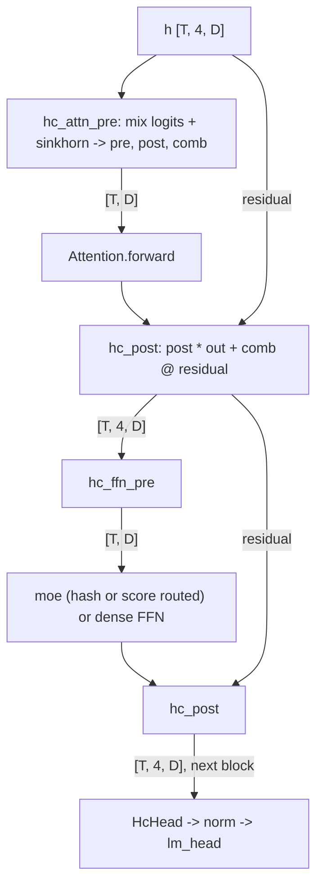
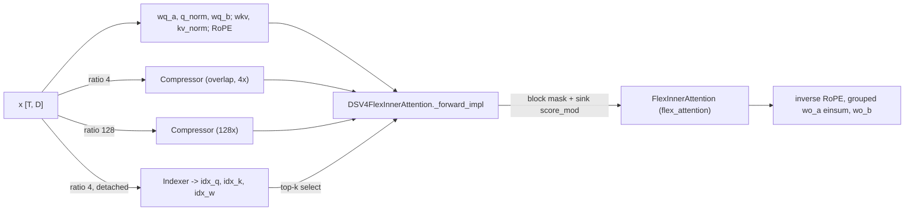

# DeepSeek-V4 model: hyper-connection residuals, compressed sparse attention and hash-routed MoE

<!-- connect:up:begin -->
> **Cross-repo concept:** part of [expert-parallelism](../../../concepts/expert-parallelism.md), [sequence-parallelism](../../../concepts/sequence-parallelism.md), [sharding](../../../concepts/sharding.md), [sparsecore](../../../concepts/sparsecore.md) across this wiki's repos.
<!-- connect:up:end -->
## Overview

`torchtitan/models/deepseek_v4` implements DeepSeek-V4 as a config-built [`Decoder`](../catalog/torchtitan/models/common/decoder.md#Decoder "torchtitan/models/common/decoder.py:L67") subclass, [`DeepSeekV4Model`](../catalog/torchtitan/models/deepseek_v4/model.md#DeepSeekV4Model "torchtitan/models/deepseek_v4/model.py:L101") ("DeepSeek V4 decoder model with HC branches and sparse attention"). It differs from [DeepSeek-V3](deepseek-v3-model.md) in three structural ways that all matter for step time: (1) the residual stream is **widened to `hc_mult = 4` branches** (`[T, 4, D]`) that are mixed in and out of each sublayer by hyper-connection modules with a Sinkhorn-normalized mixing matrix; (2) attention is **sparse and per-layer heterogeneous** - every layer attends a local sliding window plus, depending on its `compress_ratio`, either nothing more, all causal 128x-compressed KV tokens (HCA), or a learned top-k subset of 4x-compressed KV tokens chosen by an indexer (CSA), all expressed as one flex_attention call over a dynamically built block mask; (3) MoE layers route the first few layers by a **fixed token-id hash table** and the rest by `sqrtsoftplus` scores.

The repo's README marks it as smoke-tested only ("The debug model has been smoke-tested with 4 GPUs using FSDP2, TP2, EP2, and the `spmd_types` backend ... larger-scale convergence validation should be verified"). There is **no TPU-lane recipe** for DeepSeek-V4 in `experiments/tpu`; everything below describes the upstream path.

## Diagram

One decoder block (shapes in brackets; HC = hyper-connection):

Legend:
- `IN` - (concept) embedded tokens repeated `hc_mult` times by [`forward`](../catalog/torchtitan/models/deepseek_v4/model.md#DeepSeekV4Model.forward "torchtitan/models/deepseek_v4/model.py:L230")
- `PRE1` - [`sinkhorn`](../catalog/torchtitan/models/deepseek_v4/mhc.md#HcPre.sinkhorn "torchtitan/models/deepseek_v4/mhc.py:L93") inside the block's HC pre module, driven by [`forward`](../catalog/torchtitan/models/deepseek_v4/model.md#DeepSeekV4TransformerBlock.forward "torchtitan/models/deepseek_v4/model.py:L64")
- `ATT` - [`forward`](../catalog/torchtitan/models/deepseek_v4/attention.md#Attention.forward "torchtitan/models/deepseek_v4/attention.py:L431")
- `POST1` - (concept) HC post mixing, see [`DeepSeekV4TransformerBlock`](../catalog/torchtitan/models/deepseek_v4/model.md#DeepSeekV4TransformerBlock "torchtitan/models/deepseek_v4/model.py:L30")
- `PRE2` - [`sinkhorn`](../catalog/torchtitan/models/deepseek_v4/mhc.md#HcPre.sinkhorn "torchtitan/models/deepseek_v4/mhc.py:L93") (second HC pre module of the block)
- `FFN` - [`moe`](../catalog/torchtitan/models/deepseek_v4/model.md#DeepSeekV4TransformerBlock.Config.moe "torchtitan/models/deepseek_v4/model.py:L38")
- `POST2` - (concept) HC post mixing
- `HEAD` - [`HcHead`](../catalog/torchtitan/models/deepseek_v4/mhc.md#HcHead "torchtitan/models/deepseek_v4/mhc.py:L148")

Inside one attention layer, by `compress_ratio`:

Legend:
- `X` - (concept) normalized sublayer input
- `QK` - (concept) Q/KV projections of the attention module, configured by [`_make_v4_attn_config`](../catalog/torchtitan/models/deepseek_v4/__init__.md#_make_v4_attn_config "torchtitan/models/deepseek_v4/__init__.py:L172")
- `CMP` - [`compressor`](../catalog/torchtitan/models/deepseek_v4/attention.md#Attention.Config.compressor "torchtitan/models/deepseek_v4/attention.py:L392")
- `CMP128` - [`compressor_128`](../catalog/torchtitan/models/deepseek_v4/attention.md#Attention.Config.compressor_128 "torchtitan/models/deepseek_v4/attention.py:L393")
- `IDX` - [`forward`](../catalog/torchtitan/models/deepseek_v4/compressor.md#Indexer.forward "torchtitan/models/deepseek_v4/compressor.py:L159")
- `CORE` - [`_forward_impl`](../catalog/torchtitan/models/deepseek_v4/attention.md#DSV4FlexInnerAttention._forward_impl "torchtitan/models/deepseek_v4/attention.py:L193")
- `FLEX` - [`FlexInnerAttention`](../catalog/torchtitan/models/common/attention.md#FlexInnerAttention "torchtitan/models/common/attention.py:L233")
- `OUT` - (concept) output projection path at the end of [`forward`](../catalog/torchtitan/models/deepseek_v4/attention.md#Attention.forward "torchtitan/models/deepseek_v4/attention.py:L431")

## Design rationale (why it's built this way)

**One sparse attention core, three patterns.** [`DSV4FlexInnerAttention`](../catalog/torchtitan/models/deepseek_v4/attention.md#DSV4FlexInnerAttention "torchtitan/models/deepseek_v4/attention.py:L30") ("DeepSeek sparse attention core for DeepSeek-V4") concatenates the KV sequence as `[0, L + n_cmp + 1)`: `L` uncompressed sliding-window positions, `n_cmp` compressed positions, and one learned **attention-sink** position. Its docstring explains the split: the sliding window and HCA blocks are fixed `mask_mod` patterns, CSA's top-k selection "is the only dynamic (index-based) part", and the sink is always attendable via `score_mod`. Expressing all three as a single block mask lets one flex_attention kernel serve every layer type, and the docstring names the intended override points: replace `_build_block_mask` (e.g. varlen kernels) or the whole `forward` (fused SMLA/CSA kernels consuming raw `q / swa_k / cmp_k / idx_q / idx_k / idx_w`). That is the hook a TPU kernel port would use.

**Shared single-head KV with a 512-wide head.** `wkv` projects `dim -> head_dim` (512) once per token, and the core uses that one tensor as **both K and V**, expanded across all query heads. Training-time attention is therefore multi-query with `head_dim = 512`, and the output's rope slice is un-rotated (`inverse=True`) before the output projection because V carried rotated values. The output projection is grouped low-rank: heads are folded into `n_groups` groups, multiplied by a grouped `wo_a` weight via einsum, then `wo_b`.

**Hyper-connections trade activation width for residual expressivity.** Every block carries four residual branches. The HC pre module flattens `[T, 4, D]` to `4D`, computes `(2 + 4) * 4 = 24` mixing logits with an RMS-scaled linear, and the [`sinkhorn`](../catalog/torchtitan/models/deepseek_v4/mhc.md#HcPre.sinkhorn "torchtitan/models/deepseek_v4/mhc.py:L93") submodule turns them into `pre` (branch reduction), `post` (re-expansion) and a 4x4 `comb` matrix normalized by 20 alternating row/column normalizations (default `sinkhorn_iters=20`). All of this runs in float32. The attention and FFN themselves see only `[T, D]`.

**Hash routing for the first layers.** The MoE router replaces score-based expert choice with a lookup `tid2eid[input_ids]` for `layer_id < n_hash_layers` (3 in the real flavors). The table is a persistent buffer drawn at random per layer, so those layers' routing depends only on token identity and is perfectly predictable. This is why the block threads `input_ids_T` through to the MoE and why the sharding plan has to give the token ids the same token sharding as the activations under SP+EP.

**Reuse V3 machinery wherever shapes allow.** Parallelization is DeepSeek-V3's function imported under a new name, MTP input shifting reuses V3's `roll_mtp_sequence` and `MTPLoss`, and the HF adapter subclasses the V3 adapter and delegates every key that is not V4-specific (compressor, indexer, `tid2eid`, attention sink).

## Entry points

- [`model_registry`](../catalog/torchtitan/models/deepseek_v4/__init__.md#model_registry "torchtitan/models/deepseek_v4/__init__.py:L1013") - factory for flavors `debugmodel` (max context 16384), `deepseek_v4_flash` and `deepseek_v4_pro` (max context 4096); applies converters and returns a `ModelSpec` whose `parallelize_fn` is the DeepSeek-V3 parallelize function, with the MoE load-balancing hook and the V4 HF adapter.
- [`deepseek_v4_debugmodel`](../catalog/torchtitan/models/deepseek_v4/config_registry.md#deepseek_v4_debugmodel "torchtitan/models/deepseek_v4/config_registry.py:L25"), [`deepseek_v4_mtp_debugmodel`](../catalog/torchtitan/models/deepseek_v4/config_registry.md#deepseek_v4_mtp_debugmodel "torchtitan/models/deepseek_v4/config_registry.py:L70"), [`deepseek_v4_flash`](../catalog/torchtitan/models/deepseek_v4/config_registry.md#deepseek_v4_flash "torchtitan/models/deepseek_v4/config_registry.py:L113"), [`deepseek_v4_pro`](../catalog/torchtitan/models/deepseek_v4/config_registry.md#deepseek_v4_pro "torchtitan/models/deepseek_v4/config_registry.py:L156") - `Trainer.Config` recipes. All four disable activation checkpointing and `torch.compile`, set EP degree 1 and use the `c4_test` dataset; the flash/pro recipes are shape scaffolds, not tuned training configs.
- [`forward`](../catalog/torchtitan/models/deepseek_v4/model.md#DeepSeekV4Model.forward "torchtitan/models/deepseek_v4/model.py:L230") - the model forward the train step calls ("Run the DeepSeek V4 decoder").
- [`from_hf`](../catalog/torchtitan/models/deepseek_v4/state_dict_adapter.md#DeepSeekV4StateDictAdapter.from_hf "torchtitan/models/deepseek_v4/state_dict_adapter.py:L203") / [`to_hf`](../catalog/torchtitan/models/deepseek_v4/state_dict_adapter.md#DeepSeekV4StateDictAdapter.to_hf "torchtitan/models/deepseek_v4/state_dict_adapter.py:L169") - reached by the checkpointer for HF-format load/save.
- [`set_deepseek_v4_sharding_config`](../catalog/torchtitan/models/deepseek_v4/sharding.md#set_deepseek_v4_sharding_config "torchtitan/models/deepseek_v4/sharding.py:L308") - reached from `DeepSeekV4Model.Config.update_from_config` when the job config is applied.

## Mechanism (step-by-step)

1. **Build per-layer configs.** A flavor builder such as [`_deepseek_v4_flash`](../catalog/torchtitan/models/deepseek_v4/__init__.md#_deepseek_v4_flash "torchtitan/models/deepseek_v4/__init__.py:L742") or [`_deepseek_v4_pro`](../catalog/torchtitan/models/deepseek_v4/__init__.md#_deepseek_v4_pro "torchtitan/models/deepseek_v4/__init__.py:L874") defines a `compress_ratios` tuple (flash: `(1, 1) + (4, 128) * 20 + (4,)`, 43 layers; pro: `(128,) + (128, 4) * 30`, 61 layers) and two RoPEs - a plain one (theta 1e4) for uncompressed layers and a YaRN one (theta 1.6e5, factor 16) for compressed layers. [`_build_v4_layers`](../catalog/torchtitan/models/deepseek_v4/__init__.md#_build_v4_layers "torchtitan/models/deepseek_v4/__init__.py:L387") walks the layers and, per layer, calls [`_make_v4_attn_config`](../catalog/torchtitan/models/deepseek_v4/__init__.md#_make_v4_attn_config "torchtitan/models/deepseek_v4/__init__.py:L172") and either a dense FFN or [`_make_v4_moe_config`](../catalog/torchtitan/models/deepseek_v4/__init__.md#_make_v4_moe_config "torchtitan/models/deepseek_v4/__init__.py:L316"), then wraps them with two HC pre configs and one HC post config.

2. **Choose the attention variant from `compress_ratio`.** [`_make_v4_attn_config`](../catalog/torchtitan/models/deepseek_v4/__init__.md#_make_v4_attn_config "torchtitan/models/deepseek_v4/__init__.py:L172") picks the inner class and the side modules: ratio 4 -> CSA core plus an overlapping [`_make_compressor_config`](../catalog/torchtitan/models/deepseek_v4/__init__.md#_make_compressor_config "torchtitan/models/deepseek_v4/__init__.py:L93") (`coff = 2`) and an indexer from [`_make_indexer_config`](../catalog/torchtitan/models/deepseek_v4/__init__.md#_make_indexer_config "torchtitan/models/deepseek_v4/__init__.py:L131") (its own 2x-wide compressor, `index_n_heads` x `index_head_dim` queries from the low-rank `qr`); any other ratio > 1 -> HCA core with a non-overlapping compressor stored as [`compressor_128`](../catalog/torchtitan/models/deepseek_v4/attention.md#Attention.Config.compressor_128 "torchtitan/models/deepseek_v4/attention.py:L393"); ratio <= 1 -> sliding-window-only core. The [`inner_attention`](../catalog/torchtitan/models/deepseek_v4/attention.md#Attention.Config.inner_attention "torchtitan/models/deepseek_v4/attention.py:L365") config carries `window_size`, `compress_ratio`, `softmax_scale = head_dim ** -0.5` and `index_topk`.

3. **MoE config with hash or score routing.** [`_make_v4_moe_config`](../catalog/torchtitan/models/deepseek_v4/__init__.md#_make_v4_moe_config "torchtitan/models/deepseek_v4/__init__.py:L316") builds a V4 router with `score_func="sqrtsoftplus"`, `route_scale`, `route_norm`, `vocab_size`, `n_hash_layers` and the layer id (which decides hash routing at construction), routed grouped experts carrying the `comm_backend` / capacity factor, an optional shared expert, and `load_balance_coeff`. The block config's [`moe`](../catalog/torchtitan/models/deepseek_v4/model.md#DeepSeekV4TransformerBlock.Config.moe "torchtitan/models/deepseek_v4/model.py:L38") field is narrowed to the V4 MoE type so sharding and MTP helpers can read `router.layer_id`.

4. **Optional MTP depths.** [`_build_mtp_layers`](../catalog/torchtitan/models/deepseek_v4/__init__.md#_build_mtp_layers "torchtitan/models/deepseek_v4/__init__.py:L535") clones the last main layer through [`_make_mtp_inner_block`](../catalog/torchtitan/models/deepseek_v4/__init__.md#_make_mtp_inner_block "torchtitan/models/deepseek_v4/__init__.py:L514"), which **strips compression** (ratio 1, no compressor/indexer, sliding-window core, plain RoPE), re-inits router and experts for the new layer id, and adds `e_proj`, `h_proj`, norms and a per-depth [`hc_head`](../catalog/torchtitan/models/deepseek_v4/mtp.md#MTPBlock.Config.hc_head "torchtitan/models/deepseek_v4/mtp.py:L34"). The result lands in the model config's [`mtp_layers`](../catalog/torchtitan/models/deepseek_v4/model.md#DeepSeekV4Model.Config.mtp_layers "torchtitan/models/deepseek_v4/model.py:L114").

5. **Validate the mesh and attach sharding.** `DeepSeekV4Model.Config.update_from_config` rejects MTP with pipeline parallelism, requires `n_heads % tp == 0` and `n_groups % tp == 0` for every layer, and rejects any context parallelism ("Context Parallel is not yet supported for DeepSeek V4 sparse attention"). It then calls [`set_deepseek_v4_sharding_config`](../catalog/torchtitan/models/deepseek_v4/sharding.md#set_deepseek_v4_sharding_config "torchtitan/models/deepseek_v4/sharding.py:L308"), which applies the shared decoder sharding, gives the HC head replicated parameters with a token-sharded branch input under SP, runs [`set_deepseek_v4_layer_sharding`](../catalog/torchtitan/models/deepseek_v4/sharding.md#set_deepseek_v4_layer_sharding "torchtitan/models/deepseek_v4/sharding.py:L214") per layer (HC params replicated; HC branch tensors keep the token dim sharded over `(dp, cp, tp)` under SP; expert weights split on F as in V3; hash-layer `input_ids_T` sequence-sharded only when both SP and EP are on; `tid2eid` replicated via [`_replicated_layout`](../catalog/torchtitan/models/deepseek_v4/sharding.md#_replicated_layout "torchtitan/models/deepseek_v4/sharding.py:L34")), and keeps MTP blocks' extra projections replicated.

6. **Attention sharding: heads split, KV and compression replicated.** [`set_deepseek_v4_attention_sharding`](../catalog/torchtitan/models/deepseek_v4/sharding.md#set_deepseek_v4_attention_sharding "torchtitan/models/deepseek_v4/sharding.py:L131") gathers `x` to TP-Replicate, keeps `wq_a`, `q_norm`, `wkv`, `kv_norm`, every compressor and the indexer replicated, makes `wq_b` and the grouped `wo_a` colwise, `wo_b` rowwise, and shards the per-head `attn_sink` on heads. [`set_dsa_flex_attention_sharding`](../catalog/torchtitan/models/deepseek_v4/sharding.md#set_dsa_flex_attention_sharding "torchtitan/models/deepseek_v4/sharding.py:L76") wraps the sparse core in a local map: `q` enters head-sharded, `swa_k` / `cmp_k` / indexer tensors enter replicated, and the declared gradient placements make the KV gradients TP-Partial. Under TP every rank therefore recomputes the compressors and the indexer top-k for the full token stream.

7. **Model forward: widen, run blocks, merge.** [`forward`](../catalog/torchtitan/models/deepseek_v4/model.md#DeepSeekV4Model.forward "torchtitan/models/deepseek_v4/model.py:L230") detaches the token ids for hash routing, embeds, repeats to `[T, hc_mult, D]`, and runs each [`forward`](../catalog/torchtitan/models/deepseek_v4/model.md#DeepSeekV4TransformerBlock.forward "torchtitan/models/deepseek_v4/model.py:L64") ("Run one DeepSeek V4 decoder block"): HC pre -> norm -> attention -> HC post, then HC pre -> norm -> MoE (passing `input_ids_T` when the router is a hash router) or dense FFN -> HC post. The final [`HcHead`](../catalog/torchtitan/models/deepseek_v4/mhc.md#HcHead "torchtitan/models/deepseek_v4/mhc.py:L148") ("Merge final HC branches before the output norm and LM head") reduces the branches with sigmoid weights, then norm and `lm_head`. `get_attention_masks` returns `None`: the decoder-level document mask is unused.

8. **Attention forward.** [`forward`](../catalog/torchtitan/models/deepseek_v4/attention.md#Attention.forward "torchtitan/models/deepseek_v4/attention.py:L431") ("Apply one DeepSeek V4 attention layer over folded tokens") computes `qr = q_norm(wq_a(x))`, `q = wq_b(qr)` reshaped to heads and RMS-normalized per head without a weight, `kv = kv_norm(wkv(x))`, and applies RoPE to the last `rope_head_dim` dims. For compressed layers it runs the indexer on **detached** `x` and `qr` (so the indexer gets no gradient through attention; the source notes the indexer auxiliary loss "is intentionally dropped for now") and the matching [`forward`](../catalog/torchtitan/models/deepseek_v4/compressor.md#Compressor.forward "torchtitan/models/deepseek_v4/compressor.py:L85") ("Compress hidden states into compressed KV states"): fp32 `wkv`/`wgate` projections, a softmax-weighted sum over each group of `ratio` tokens with a learned position bias (overlapping with the previous group for ratio 4), norm, and RoPE at the group positions. After the core it inverse-rotates the rope slice and applies the grouped output projection.

9. **Sparse core: indices -> block mask -> flex_attention.** [`_forward_impl`](../catalog/torchtitan/models/deepseek_v4/attention.md#DSV4FlexInnerAttention._forward_impl "torchtitan/models/deepseek_v4/attention.py:L193") ("Run DSV4 sparse attention over a folded token stream") treats the whole microbatch as **one** folded sequence (`bsz=1`), concatenates `[swa_k; cmp_k; zero sink]` as the shared K/V, and collects per-query KV indices: the sliding window, then for CSA the indexer's top-k (ReLU'd per-head scores weighted by `idx_w`, causally masked, `topk = min(index_topk, L/4)`), for HCA every causal compressed position, then the sink index. `_build_block_mask` scatters those indices into a block-occupancy map at flex block granularity plus a token-level `[1, L, kv_len]` selection mask, and the call into [`FlexInnerAttention`](../catalog/torchtitan/models/common/attention.md#FlexInnerAttention "torchtitan/models/common/attention.py:L233") passes the mask, a `score_mod` that replaces the sink column's score with the per-head learned `attn_sink`, and the explicit scale.

10. **MTP depths and FLOPs.** With MTP, [`mtp_forward`](../catalog/torchtitan/models/deepseek_v4/model.md#DeepSeekV4Model.mtp_forward "torchtitan/models/deepseek_v4/model.py:L272") ("Run auxiliary MTP depths and return prediction hidden states") rolls tokens by each depth inside the model (not in a preprocess hook as in V3), feeds `e_proj(enorm(embed)) + h_proj(hnorm(prev_hc_hidden))` through an MTP block, and returns each depth's HC-merged, normed hidden state for `lm_head`; the depth modules live in [`mtp_layers`](../catalog/torchtitan/models/deepseek_v4/model.md#DeepSeekV4Model.mtp_layers "torchtitan/models/deepseek_v4/model.py:L213"). [`get_nparams_and_flops`](../catalog/torchtitan/models/deepseek_v4/model.md#DeepSeekV4Model.Config.get_nparams_and_flops "torchtitan/models/deepseek_v4/model.py:L153") counts `6 * active_params` plus, per layer, sliding-window attention FLOPs, compressed-attention FLOPs at `L / ratio` tokens (capped at `index_topk` for CSA), and `6 * index_n_heads * index_head_dim * L/4` for the CSA indexer; it adds one `lm_head` and `(hc_mult - 1)` extra `h_proj` parameter counts per MTP depth.

11. **HF conversion.** [`from_hf`](../catalog/torchtitan/models/deepseek_v4/state_dict_adapter.md#DeepSeekV4StateDictAdapter.from_hf "torchtitan/models/deepseek_v4/state_dict_adapter.py:L203") renumbers `mtp.{i}` keys after the main layers, converts V4-only keys directly through [`from_hf_map`](../catalog/torchtitan/models/deepseek_v4/state_dict_adapter.md#DeepSeekV4StateDictAdapter.from_hf_map "torchtitan/models/deepseek_v4/state_dict_adapter.py:L30") (compressor/indexer entries are added per layer from `compress_ratios`, `tid2eid` cast to int64, `attn_sink` unsqueezed to the `(n_heads, 1)` Linear weight), and hands everything [`_can_delegate_hf_key`](../catalog/torchtitan/models/deepseek_v4/state_dict_adapter.md#DeepSeekV4StateDictAdapter._can_delegate_hf_key "torchtitan/models/deepseek_v4/state_dict_adapter.py:L161") accepts to the V3 adapter for expert stacking and layer-key mapping; [`to_hf`](../catalog/torchtitan/models/deepseek_v4/state_dict_adapter.md#DeepSeekV4StateDictAdapter.to_hf "torchtitan/models/deepseek_v4/state_dict_adapter.py:L169") is the inverse.

## Key data structures

| Flavor | dim | layers | heads x head_dim | q / o lora | groups | window | index heads x dim, top-k | experts / top-k / shared | max ctx |
|---|---|---|---|---|---|---|---|---|---|
| `_debugmodel` | 256 | 4 | 16 x 256 | 128 / 128 | 2 | 16 | 8 x 64, 16 | 4 / 3 / 1 | 16384 |
| `_deepseek_v4_flash` | 4096 | 43 | 64 x 512 | 1024 / 1024 | 8 | 128 | 64 x 128, 512 | 256 / 6 / 1 | 4096 |
| `_deepseek_v4_pro` | 7168 | 61 | 128 x 512 | 1536 / 1024 | 16 | 128 | 64 x 128, 1024 | 384 / 6 / 1 | 4096 |

All real flavors use `hc_mult=4`, `sinkhorn_iters=20`, `rope_head_dim=64`, `n_hash_layers=3`, vocab 129280. The debug model's ratios are `(0, 0, 4, 128)`. A CPU unit test (`tests/unit_tests/cpu/test_deepseek_v4_flops.py`) pins flash with one MTP layer at seq 4096 to 290,942,278,866 parameters and 92,762,352,876 training FLOPs per token.

- [`Compressor`](../catalog/torchtitan/models/deepseek_v4/compressor.md#Compressor "torchtitan/models/deepseek_v4/compressor.py:L31") ("Compress local hidden states into lower-rate KV tokens") - `wkv`, `wgate` (out `coff * head_dim`), `norm`, a `[ratio, coff * head_dim]` learned position bias `ape`, and its own RoPE.
- The HC triple per block - two HC pre modules (each `hc_fn [24, 4D]`, `hc_base [24]`, `hc_scale [3]` plus a [`sinkhorn`](../catalog/torchtitan/models/deepseek_v4/mhc.md#HcPre.sinkhorn "torchtitan/models/deepseek_v4/mhc.py:L93") submodule) and one parameter-free HC post.
- Router `tid2eid` - a `[vocab_size, top_k]` int64 persistent buffer on hash layers; stored as float32 in HF exports and cast back on load.

## Dynamics (design intent)

- **Composition order** is inherited from DeepSeek-V3's parallelize function: plan execution (TP/EP/`spmd_types`) -> AC -> per-block compile -> FSDP; the V4 recipes ship with AC and compile off.
- **Hash-id sharding** is covered by CPU tests (`test_deepseek_v4_hash_sharding.py`): SP+EP shards `input_ids_T` with the activations, SP-only and EP-only keep them TP-replicated - matching the comment in [`set_deepseek_v4_layer_sharding`](../catalog/torchtitan/models/deepseek_v4/sharding.md#set_deepseek_v4_layer_sharding "torchtitan/models/deepseek_v4/sharding.py:L214") that "MoE keeps activations sequence-parallel only on the SP+EP path".
- **The DSA mask construction** is checked against an older index-gather formulation in `test_deepseek_v4_dsa.py` (attended sets and indexer top-k).

> [!inferred]
> Memory/perf hot spots that follow directly from the shapes in the source (not measured here): the CSA indexer score `einsum("shd,td->sht")` materializes `L x index_n_heads x L/4` values per CSA layer (4096 x 64 x 1024 ~ 268M elements at flash/pro shapes); `_build_block_mask` materializes an int32 `[1, L, L + L/ratio + 1]` selection tensor per layer per step; the HC pre/post and Sinkhorn steps are chains of small float32 elementwise ops on `[T, 4, D]` and `[T, 4, 4]` tensors. With `torch.compile` disabled in every shipped recipe, these run as separate eager kernels.

## Edge cases

- **No context parallelism** (hard `NotImplementedError`), and **no PP with MTP**.
- **TP divisibility**: both `n_heads` and `n_groups` must be divisible by the TP degree (flash: 64 heads / 8 groups -> TP <= 8; pro: 128 / 16 -> TP <= 16).
- **`seqlen` divisibility**: the compressor requires `seqlen % compress_ratio == 0` (so the folded token count must be a multiple of 128 when HCA layers exist), and `_build_block_mask` requires `seqlen % Q block size == 0`.
- **Packed documents**: the sparse core ignores `attention_masks` (it raises if one is passed) and builds its causal patterns over the whole folded stream; positions only feed RoPE.
- **Fused loss is unsupported with MTP**: [`forward`](../catalog/torchtitan/models/deepseek_v4/model.md#DeepSeekV4Model.forward "torchtitan/models/deepseek_v4/model.py:L230") raises if the trainer asks to skip `lm_head` with MTP layers ("chunked cross entropy is not supported"); [`deepseek_v4_mtp_debugmodel`](../catalog/torchtitan/models/deepseek_v4/config_registry.md#deepseek_v4_mtp_debugmodel "torchtitan/models/deepseek_v4/config_registry.py:L70") accordingly uses a bare `MTPLoss`, not the chunked wrapper.
- **Debug ratio 0** behaves as a sliding-window-only layer (only `ratio == 4` and `ratio > 1` take the compressed paths).
- **Hash table re-draw**: re-initializing buffers re-samples `tid2eid` randomly; a loaded checkpoint must supply it to reproduce routing.

## Open questions

- There is no TPU-lane recipe; whether the TPU attention patches can serve this model is open. They match inner-attention class names containing `ScaledDotProduct` or `FlexAttention`, and the V4 core classes (`SlidingWindowAttention`, `HeavilyCompressedAttention`, `CompressedSparseAttention`) match neither, so flex_attention would stay in place. A TPU port would have to override the core's `forward` as its docstring suggests (see [TPU Pallas kernels](tpu-pallas-kernels.md)).
- The V4 router (`DeepSeekV4Router`) and MoE class are not in this packet's subgraph, so the `sqrtsoftplus` scoring and dispatch internals are documented only at the config level here; see [TPU MoE dispatch](tpu-moe-dispatch-and-grouped-experts.md).
- The indexer's dropped auxiliary loss means the indexer projections receive no training signal in this implementation; the source marks it as a TODO.

## See also

- [deepseek-v3-model](deepseek-v3-model.md) - the parallelize function, MTP helpers and HF adapter this model reuses.
- [model-building-blocks](model-building-blocks.md) - `Decoder`, `FlexInnerAttention`, RoPE.
- [parallel-dims-and-parallelization](parallel-dims-and-parallelization.md), [model-spec-protocols](model-spec-protocols.md)
- [tpu-moe-dispatch-and-grouped-experts](tpu-moe-dispatch-and-grouped-experts.md), [tpu-pallas-kernels](tpu-pallas-kernels.md), [tpu-context-parallel-attention](tpu-context-parallel-attention.md)
- [checkpointing](checkpointing.md)
