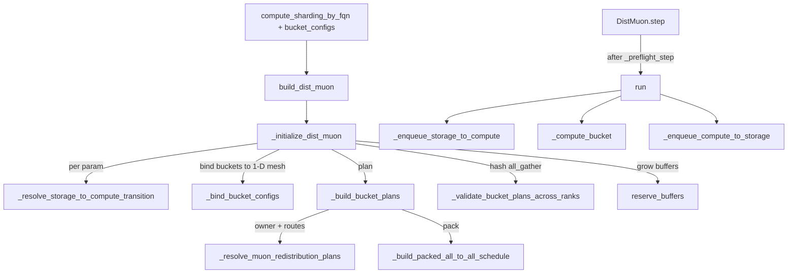
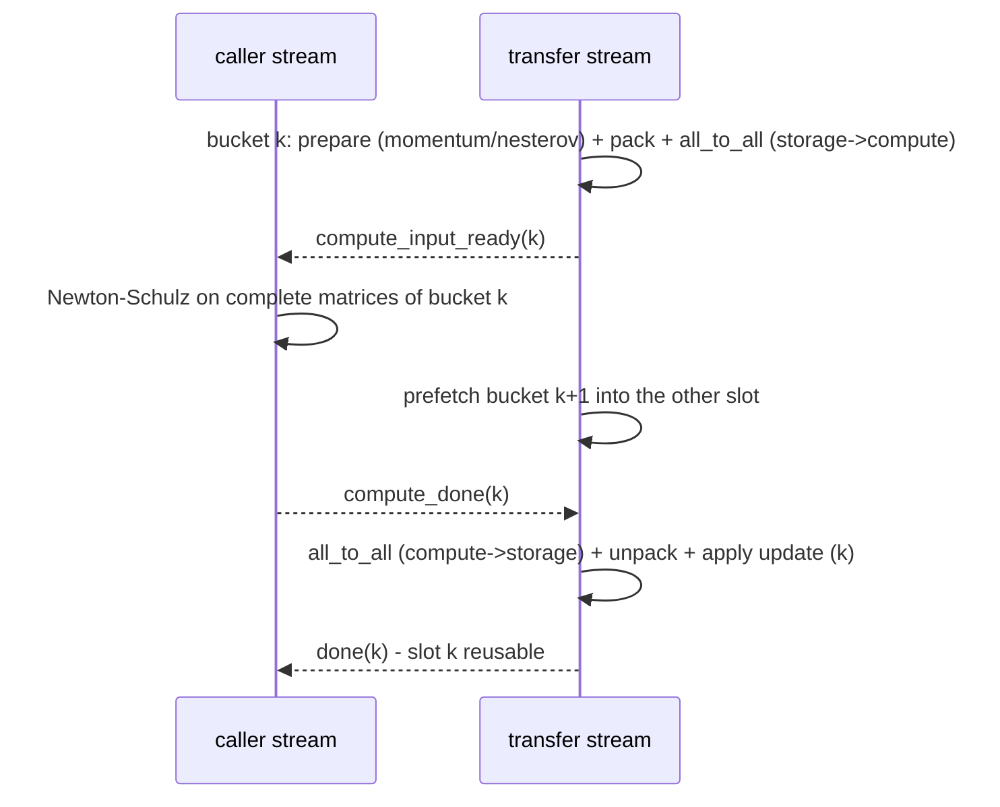

# FlexShard - storage-to-compute optimizer resharding

<!-- connect:up:begin -->
> **Cross-repo concept:** part of [expert-parallelism](../../../concepts/expert-parallelism.md), [sharding](../../../concepts/sharding.md) across this wiki's repos.
<!-- connect:up:end -->
## Overview

FlexShard solves a mismatch that matrix optimizers such as Muon create under FSDP: parameters are
*stored* row-sharded across the data-parallel group (`Shard(0)` on `dp_shard`, or `(efsdp, ep)` for
experts), but Muon's Newton-Schulz orthogonalization needs **complete matrices** - a whole weight,
a whole attention head, or a whole expert. The package README states the goal: "running optimizer
compute with layouts that differ from persistent DTensor parameter storage layouts. It plans packed
storage-to-compute redistribution and overlaps communication with optimizer work." The user
declares, per parameter FQN, a temporary
[`ComputeLayout`](../catalog/torchtitan/distributed/flex_shard/optimizer_reshard.md#ComputeLayout "torchtitan/distributed/flex_shard/optimizer_reshard.py:L111")
on named storage-mesh axes; FlexShard resolves what actually has to move, groups parameters into
ordered [`BucketConfig`](../catalog/torchtitan/distributed/flex_shard/optimizer_reshard.md#BucketConfig "torchtitan/distributed/flex_shard/optimizer_reshard.py:L252")
buckets, precomputes one packed `all_to_all_single` per bucket and direction, and runs
"storage -> compute -> update -> storage" through a two-slot pipeline on a side stream.
[`DistMuon`](../catalog/torchtitan/distributed/flex_shard/dist_muon.md#DistMuon "torchtitan/distributed/flex_shard/dist_muon.py:L252")
(built via [`build_dist_muon`](../catalog/torchtitan/distributed/flex_shard/dist_muon.md#build_dist_muon "torchtitan/distributed/flex_shard/dist_muon.py:L58"))
is the only consumer today. All planning happens once, at optimizer construction; the hot path
only reuses buffers and pre-built schedules.

## Diagram

Legend:
- `CFG` - (concept) the per-FQN `ComputeLayout` map and ordered bucket list from the model recipe
- `BDM` - [`build_dist_muon`](../catalog/torchtitan/distributed/flex_shard/dist_muon.md#build_dist_muon "torchtitan/distributed/flex_shard/dist_muon.py:L58")
- `INIT` - [`_initialize_dist_muon`](../catalog/torchtitan/distributed/flex_shard/dist_muon.md#_initialize_dist_muon "torchtitan/distributed/flex_shard/dist_muon.py:L170")
- `RES` - [`_resolve_storage_to_compute_transition`](../catalog/torchtitan/distributed/flex_shard/dist_muon.md#_resolve_storage_to_compute_transition "torchtitan/distributed/flex_shard/dist_muon.py:L1411")
- `BIND` - [`_bind_bucket_configs`](../catalog/torchtitan/distributed/flex_shard/_optimizer_reshard_schedule.md#_bind_bucket_configs "torchtitan/distributed/flex_shard/_optimizer_reshard_schedule.py:L33")
- `BBP` - [`_build_bucket_plans`](../catalog/torchtitan/distributed/flex_shard/_optimizer_reshard_schedule.md#_build_bucket_plans "torchtitan/distributed/flex_shard/_optimizer_reshard_schedule.py:L1061")
- `RMP` - [`_resolve_muon_redistribution_plans`](../catalog/torchtitan/distributed/flex_shard/dist_muon.md#_resolve_muon_redistribution_plans "torchtitan/distributed/flex_shard/dist_muon.py:L954")
- `PAK` - [`_build_packed_all_to_all_schedule`](../catalog/torchtitan/distributed/flex_shard/_optimizer_reshard_schedule.md#_build_packed_all_to_all_schedule "torchtitan/distributed/flex_shard/_optimizer_reshard_schedule.py:L818")
- `VAL` - [`_validate_bucket_plans_across_ranks`](../catalog/torchtitan/distributed/flex_shard/_optimizer_reshard_schedule.md#_validate_bucket_plans_across_ranks "torchtitan/distributed/flex_shard/_optimizer_reshard_schedule.py:L1217")
- `RSV` - [`reserve_buffers`](../catalog/torchtitan/distributed/flex_shard/_optimizer_reshard_runtime.md#_BucketedRedistributionRuntime.reserve_buffers "torchtitan/distributed/flex_shard/_optimizer_reshard_runtime.py:L324")
- `STEP` - [`DistMuon`](../catalog/torchtitan/distributed/flex_shard/dist_muon.md#DistMuon "torchtitan/distributed/flex_shard/dist_muon.py:L252") `.step`
- `RUN` - [`run`](../catalog/torchtitan/distributed/flex_shard/_optimizer_reshard_runtime.md#_BucketedRedistributionRuntime.run "torchtitan/distributed/flex_shard/_optimizer_reshard_runtime.py:L419")
- `S2C` - [`_enqueue_storage_to_compute`](../catalog/torchtitan/distributed/flex_shard/_optimizer_reshard_runtime.md#_BucketedRedistributionRuntime._enqueue_storage_to_compute "torchtitan/distributed/flex_shard/_optimizer_reshard_runtime.py:L559")
- `CB` - [`_compute_bucket`](../catalog/torchtitan/distributed/flex_shard/_optimizer_reshard_runtime.md#_BucketedRedistributionRuntime._compute_bucket "torchtitan/distributed/flex_shard/_optimizer_reshard_runtime.py:L589")
- `C2S` - [`_enqueue_compute_to_storage`](../catalog/torchtitan/distributed/flex_shard/_optimizer_reshard_runtime.md#_BucketedRedistributionRuntime._enqueue_compute_to_storage "torchtitan/distributed/flex_shard/_optimizer_reshard_runtime.py:L621")

## Design rationale (why it's built this way)

- **Compute layout is separate from storage layout.** "Storage placements describe persistent
  ownership only; they do not define Muon matrix boundaries" (README). FSDP picks storage for memory
  and all-gather efficiency; the optimizer needs a different partition only for the duration of
  `step()`. Declaring that partition separately avoids changing the model's FSDP plan.
- **Three compute shardings beyond DTensor's own.**
  [`Owned`](../catalog/torchtitan/distributed/flex_shard/optimizer_reshard.md#Owned "torchtitan/distributed/flex_shard/optimizer_reshard.py:L22")
  ("Assign the complete subgroup-local logical tensor to one owner rank") gathers a whole matrix on
  one dynamically chosen rank - for single matrices such as `wo`.
  [`BlockShard`](../catalog/torchtitan/distributed/flex_shard/optimizer_reshard.md#BlockShard "torchtitan/distributed/flex_shard/optimizer_reshard.py:L35")
  ("Shard fixed-size blocks without changing the tensor shape") treats a flat `[M * R, C]` weight as
  `M` independent `[R, C]` matrices (per-head Muon) and guarantees "A block is never split between
  participants". Plain `Shard(0)` distributes complete matrices of a native 3D `[M, R, C]` expert
  tensor. `Replicate` is accepted by the declaration type, but DistMuon rejects explicit replicated
  compute as not implemented.
- **Plan once, freeze, verify collectively.** "Parameter groups, compute layouts, and bucket
  configuration are frozen because optimizer state and collectives depend on them"
  ([`_initialize_dist_muon`](../catalog/torchtitan/distributed/flex_shard/dist_muon.md#_initialize_dist_muon "torchtitan/distributed/flex_shard/dist_muon.py:L170")).
  Because every rank must enter the same all-to-alls with matching split sizes, plans are hashed and
  all-gathered once at build time
  ([`_validate_bucket_plans_across_ranks`](../catalog/torchtitan/distributed/flex_shard/_optimizer_reshard_schedule.md#_validate_bucket_plans_across_ranks "torchtitan/distributed/flex_shard/_optimizer_reshard_schedule.py:L1217"));
  the step itself has no validation collective - `_preflight_step` warns "Do not add a validation
  collective to the optimizer hot path".
- **Packed all-to-all per bucket, not per parameter.** A bucket's every route is laid into one flat
  buffer so each direction is a single `all_to_all_single`, with a plain copy when nothing is
  remote. The runtime module credits "Canzona and its FSDP implementation" for the packed
  redistribution and asynchronous compute overlap design.
- **Buckets order work; layouts decide topology.** [`BucketConfig`](../catalog/torchtitan/distributed/flex_shard/optimizer_reshard.md#BucketConfig "torchtitan/distributed/flex_shard/optimizer_reshard.py:L252")
  docstring: "Compute layouts determine communication topology. A bucket controls only scheduling
  order and overlap; all redistributed parameters it selects must currently resolve to one
  homogeneous transport group." Each bucket binds to exactly one 1-D communication mesh.
- **Load balance by Newton-Schulz FLOPs.** `Owned` items are spread across ranks with a
  deterministic longest-processing-time heuristic keyed on estimated NS cost
  (`ns_steps * s^2 * (2l + s)` for an `s x l` matrix) and bytes, carried *across* buckets.
- **Self-contained, PyTorch-only package.** README: "FlexShard must not depend on TorchTitan model
  or training infrastructure", intended to be split out into its own package; dependencies flow
  `TorchTitan -> FlexShard -> PyTorch`.

## Entry points

- [`build_dist_muon`](../catalog/torchtitan/distributed/flex_shard/dist_muon.md#build_dist_muon "torchtitan/distributed/flex_shard/dist_muon.py:L58") -
  registered as the `"DistMuon"` optimizer factory in
  [`_resolve_optimizer_factory`](../catalog/torchtitan/components/optimizer/optimizer.md#OptimizersContainer._resolve_optimizer_factory "torchtitan/components/optimizer/optimizer.py:L147");
  control reaches it when the optimizers container builds a param group whose optimizer name is
  `DistMuon`. It normalizes param groups (which must carry aligned `param_names`) and constructs
  [`DistMuon`](../catalog/torchtitan/distributed/flex_shard/dist_muon.md#DistMuon "torchtitan/distributed/flex_shard/dist_muon.py:L252").
- [`ComputeLayout`](../catalog/torchtitan/distributed/flex_shard/optimizer_reshard.md#ComputeLayout "torchtitan/distributed/flex_shard/optimizer_reshard.py:L111"),
  [`Owned`](../catalog/torchtitan/distributed/flex_shard/optimizer_reshard.md#Owned "torchtitan/distributed/flex_shard/optimizer_reshard.py:L22"),
  [`BlockShard`](../catalog/torchtitan/distributed/flex_shard/optimizer_reshard.md#BlockShard "torchtitan/distributed/flex_shard/optimizer_reshard.py:L35"),
  [`BucketConfig`](../catalog/torchtitan/distributed/flex_shard/optimizer_reshard.md#BucketConfig "torchtitan/distributed/flex_shard/optimizer_reshard.py:L252") -
  the public declaration types, constructed in model config registries. The first integration is
  the Kimi registry: [`_dist_muon_optimizer`](../catalog/torchtitan/models/kimi_k2_7/config_registry.md#_dist_muon_optimizer "torchtitan/models/kimi_k2_7/config_registry.py:L294")
  maps `wq_a`/`wkv_a`/`wo` to `Owned` on `dp_shard`, `wq_b`/`wkv_b` to per-head `BlockShard`
  (block size = head dim), and experts to
  [`_per_expert_compute_layout`](../catalog/torchtitan/models/kimi_k2_7/config_registry.md#_per_expert_compute_layout "torchtitan/models/kimi_k2_7/config_registry.py:L267").
- `DistMuon.step` -> [`run`](../catalog/torchtitan/distributed/flex_shard/_optimizer_reshard_runtime.md#_BucketedRedistributionRuntime.run "torchtitan/distributed/flex_shard/_optimizer_reshard_runtime.py:L419") -
  every optimizer step, after [`_preflight_step`](../catalog/torchtitan/distributed/flex_shard/dist_muon.md#DistMuon._preflight_step "torchtitan/distributed/flex_shard/dist_muon.py:L486").
- [`_after_load_state_dict`](../catalog/torchtitan/distributed/flex_shard/dist_muon.md#_after_load_state_dict "torchtitan/distributed/flex_shard/dist_muon.py:L1937") -
  a load-state-dict post hook that replans after checkpoint restore.

## Mechanism (step-by-step)

1. **Declare.** [`ComputeLayout`](../catalog/torchtitan/distributed/flex_shard/optimizer_reshard.md#ComputeLayout "torchtitan/distributed/flex_shard/optimizer_reshard.py:L111")
   maps mesh-axis names to a compute sharding via
   [`shardings_by_mesh_axis`](../catalog/torchtitan/distributed/flex_shard/optimizer_reshard.md#ComputeLayout.shardings_by_mesh_axis "torchtitan/distributed/flex_shard/optimizer_reshard.py:L165")
   and optionally `shard_order_by_tensor_dim`. Its
   [`__post_init__`](../catalog/torchtitan/distributed/flex_shard/optimizer_reshard.md#ComputeLayout.__post_init__ "torchtitan/distributed/flex_shard/optimizer_reshard.py:L168")
   sorts axes, freezes both maps into a hashable, deepcopy-safe mapping, and
   [`_validated_shard_order`](../catalog/torchtitan/distributed/flex_shard/optimizer_reshard.md#ComputeLayout._validated_shard_order "torchtitan/distributed/flex_shard/optimizer_reshard.py:L196")
   requires every ordered axis to declare `Shard` on that same tensor dim. "Omitted axes preserve
   their storage placement"; declarations for axes a parameter's mesh lacks are ignored, but at least
   one must apply. [`BlockShard`](../catalog/torchtitan/distributed/flex_shard/optimizer_reshard.md#BlockShard "torchtitan/distributed/flex_shard/optimizer_reshard.py:L35")
   validates [`dim`](../catalog/torchtitan/distributed/flex_shard/optimizer_reshard.md#BlockShard.dim "torchtitan/distributed/flex_shard/optimizer_reshard.py:L45")
   and a positive [`block_size`](../catalog/torchtitan/distributed/flex_shard/optimizer_reshard.md#BlockShard.block_size "torchtitan/distributed/flex_shard/optimizer_reshard.py:L46").

2. **Prepare compute views.** [`_initialize_dist_muon`](../catalog/torchtitan/distributed/flex_shard/dist_muon.md#_initialize_dist_muon "torchtitan/distributed/flex_shard/dist_muon.py:L170")
   requires a layout for every local parameter (entries for other PP stages are ignored). For each,
   [`_matrix_batch_view_from_compute_layout`](../catalog/torchtitan/distributed/flex_shard/dist_muon.md#_matrix_batch_view_from_compute_layout "torchtitan/distributed/flex_shard/dist_muon.py:L121")
   turns a `BlockShard` on a 2D `[M * R, C]` weight into a matrix-batch view with compute shape
   `[M, R, C]` (requires dim 0, one block size across axes, and exact `Shard(0)`/`Replicate`
   storage). Without `BlockShard` the compute shape is the storage shape; either way it must be 2D or
   batch-first 3D.

3. **Resolve what must move.** [`_build_parameter_compute_layouts`](../catalog/torchtitan/distributed/flex_shard/dist_muon.md#DistMuon._build_parameter_compute_layouts "torchtitan/distributed/flex_shard/dist_muon.py:L371")
   calls [`_resolve_storage_to_compute_transition`](../catalog/torchtitan/distributed/flex_shard/dist_muon.md#_resolve_storage_to_compute_transition "torchtitan/distributed/flex_shard/dist_muon.py:L1411")
   per parameter ("Validate one storage layout and resolve its concrete compute transition"). It
   rejects complex, non-contiguous or rank-1 params, maps declared axis names onto the DTensor's
   storage mesh, and lowers any non-default shard order with
   [`_lower_shard_order_to_strided_shards`](../catalog/torchtitan/distributed/flex_shard/dist_muon.md#_lower_shard_order_to_strided_shards "torchtitan/distributed/flex_shard/dist_muon.py:L1291")
   into `_StridedShard` placements ("Encode a declared shard order as DTensor placements").
   [`_resolve_storage_to_compute_redistribution_requirement`](../catalog/torchtitan/distributed/flex_shard/dist_muon.md#_resolve_storage_to_compute_redistribution_requirement "torchtitan/distributed/flex_shard/dist_muon.py:L761")
   then decides which axes must move: without a `BlockShard` view it compares the normalized storage
   placement with the target placement on each declared axis, and on the matrix-batch path it
   compares *row intervals*, not placement names:
   [`_row_intervals_by_mesh_axis_coordinate`](../catalog/torchtitan/distributed/flex_shard/dist_muon.md#_row_intervals_by_mesh_axis_coordinate "torchtitan/distributed/flex_shard/dist_muon.py:L724")
   explains that `Shard(0)` and `BlockShard(0, R)` "may own the same rows when shard boundaries
   align". If storage already equals compute, the parameter is *compute-ready* and never
   communicates. The result is a frozen
   [`_ParameterComputeLayout`](../catalog/torchtitan/distributed/flex_shard/dist_muon.md#_ParameterComputeLayout "torchtitan/distributed/flex_shard/dist_muon.py:L887")
   per parameter, with at most one redistribution storage-mesh axis.

4. **Bind and plan buckets.** [`_bind_bucket_configs`](../catalog/torchtitan/distributed/flex_shard/_optimizer_reshard_schedule.md#_bind_bucket_configs "torchtitan/distributed/flex_shard/_optimizer_reshard_schedule.py:L33")
   matches FQNs with case-sensitive `fnmatch` and binds each bucket to the single 1-D mesh its
   redistributed items move along (a fully local bucket stays mesh-free; mixed transport axes raise
   "split its BucketConfig patterns").
   [`_build_bucket_plans`](../catalog/torchtitan/distributed/flex_shard/_optimizer_reshard_schedule.md#_build_bucket_plans "torchtitan/distributed/flex_shard/_optimizer_reshard_schedule.py:L1061")
   requires each FQN to match exactly one bucket, sorts items by FQN, emits a local plan for
   all-ready buckets, and otherwise calls
   [`_resolve_muon_redistribution_plans`](../catalog/torchtitan/distributed/flex_shard/dist_muon.md#_resolve_muon_redistribution_plans "torchtitan/distributed/flex_shard/dist_muon.py:L954"):
   [`_assign_balanced_owner_ranks`](../catalog/torchtitan/distributed/flex_shard/dist_muon.md#_assign_balanced_owner_ranks "torchtitan/distributed/flex_shard/dist_muon.py:L1006")
   picks owners for `Owned` items, and
   [`_build_parameter_redistribution_plan`](../catalog/torchtitan/distributed/flex_shard/dist_muon.md#_build_parameter_redistribution_plan "torchtitan/distributed/flex_shard/dist_muon.py:L1104")
   dispatches to an owned, a dim-0 shard
   ([`_build_dim0_shard_redistribution_plan`](../catalog/torchtitan/distributed/flex_shard/_optimizer_reshard_schedule.md#_build_dim0_shard_redistribution_plan "torchtitan/distributed/flex_shard/_optimizer_reshard_schedule.py:L585"),
   "Route storage regions to dim-0 compute shards") or a batched-matrix plan
   ([`_build_batched_matrix_redistribution_plan`](../catalog/torchtitan/distributed/flex_shard/dist_muon.md#_build_batched_matrix_redistribution_plan "torchtitan/distributed/flex_shard/dist_muon.py:L1148"),
   "Build flat 2D routes whose destination shards contain complete matrices"). Identical specs share
   one plan object. Each plan is a set of
   [`_TensorRegion`](../catalog/torchtitan/distributed/flex_shard/_optimizer_reshard_schedule.md#_TensorRegion "torchtitan/distributed/flex_shard/_optimizer_reshard_schedule.py:L114")
   routes checked by [`_validate_redistribution_plan`](../catalog/torchtitan/distributed/flex_shard/_optimizer_reshard_schedule.md#_validate_redistribution_plan "torchtitan/distributed/flex_shard/_optimizer_reshard_schedule.py:L229").

5. **Pack schedules, verify, reserve.** For each redistributed bucket,
   [`_build_packed_all_to_all_schedule`](../catalog/torchtitan/distributed/flex_shard/_optimizer_reshard_schedule.md#_build_packed_all_to_all_schedule "torchtitan/distributed/flex_shard/_optimizer_reshard_schedule.py:L818")
   is called twice (storage->compute and compute->storage) to produce split sizes and per-parameter
   packed spans. [`_validate_bucket_plans_across_ranks`](../catalog/torchtitan/distributed/flex_shard/_optimizer_reshard_schedule.md#_validate_bucket_plans_across_ranks "torchtitan/distributed/flex_shard/_optimizer_reshard_schedule.py:L1217")
   hashes each plan plus
   [`_plan_item_signature`](../catalog/torchtitan/distributed/flex_shard/dist_muon.md#DistMuon._plan_item_signature "torchtitan/distributed/flex_shard/dist_muon.py:L446")
   (shape, stride, dtype, placements, mesh ranks, hyperparameters) and all-gathers the hash on the
   bucket's group. [`reserve_buffers`](../catalog/torchtitan/distributed/flex_shard/_optimizer_reshard_runtime.md#_BucketedRedistributionRuntime.reserve_buffers "torchtitan/distributed/flex_shard/_optimizer_reshard_runtime.py:L324")
   ("Eagerly grow runtime-owned tensors to the plans' maximum sizes") creates the transfer stream,
   two pipeline slots with their events, and sizes each slot's exchange and scratch buffers to the
   maximum over the buckets that will use it.

6. **Step: preflight.** [`_preflight_step`](../catalog/torchtitan/distributed/flex_shard/dist_muon.md#DistMuon._preflight_step "torchtitan/distributed/flex_shard/dist_muon.py:L486")
   ("Fail the local worker before bucket communication on invalid input") checks every configured
   gradient exists as a DTensor with the recorded storage layout
   ([`_has_storage_layout`](../catalog/torchtitan/distributed/flex_shard/dist_muon.md#DistMuon._has_storage_layout "torchtitan/distributed/flex_shard/dist_muon.py:L546")),
   that compute-ready parameters' local storage pointer has not changed, and creates momentum
   buffers only after all validation passes, "so a deterministic input error cannot partially update
   an earlier bucket".

7. **Step: pipelined execution.** [`run`](../catalog/torchtitan/distributed/flex_shard/_optimizer_reshard_runtime.md#_BucketedRedistributionRuntime.run "torchtitan/distributed/flex_shard/_optimizer_reshard_runtime.py:L419")
   walks buckets in order. For a redistributed bucket,
   [`_enqueue_storage_to_compute`](../catalog/torchtitan/distributed/flex_shard/_optimizer_reshard_runtime.md#_BucketedRedistributionRuntime._enqueue_storage_to_compute "torchtitan/distributed/flex_shard/_optimizer_reshard_runtime.py:L559")
   on the transfer stream runs
   [`_prepare_redistributed`](../catalog/torchtitan/distributed/flex_shard/_optimizer_reshard_runtime.md#_prepare_redistributed "torchtitan/distributed/flex_shard/_optimizer_reshard_runtime.py:L663")
   (DistMuon's `prepare` updates momentum and applies Nesterov into a storage-shaped scratch tensor;
   the runtime then packs each item's spans into the storage buffer with a batched `_foreach_copy_`)
   and the packed all-to-all.
   [`_compute_bucket`](../catalog/torchtitan/distributed/flex_shard/_optimizer_reshard_runtime.md#_BucketedRedistributionRuntime._compute_bucket "torchtitan/distributed/flex_shard/_optimizer_reshard_runtime.py:L589")
   on the caller stream first processes the bucket's compute-ready items, then waits on
   `compute_input_ready` and runs
   [`_compute_redistributed`](../catalog/torchtitan/distributed/flex_shard/_optimizer_reshard_runtime.md#_compute_redistributed "torchtitan/distributed/flex_shard/_optimizer_reshard_runtime.py:L697"),
   which unpacks into a compute tensor, calls
   [`_compute_update`](../catalog/torchtitan/distributed/flex_shard/dist_muon.md#DistMuon._compute_update "torchtitan/distributed/flex_shard/dist_muon.py:L610")
   (zero-copy `[M, R, C]` view + BF16 Newton-Schulz) in place, and repacks.
   [`_enqueue_compute_to_storage`](../catalog/torchtitan/distributed/flex_shard/_optimizer_reshard_runtime.md#_BucketedRedistributionRuntime._enqueue_compute_to_storage "torchtitan/distributed/flex_shard/_optimizer_reshard_runtime.py:L621")
   waits on `compute_done`, runs the reverse all-to-all and
   [`_finalize_redistributed`](../catalog/torchtitan/distributed/flex_shard/_optimizer_reshard_runtime.md#_finalize_redistributed "torchtitan/distributed/flex_shard/_optimizer_reshard_runtime.py:L750"),
   whose `finalize` is [`_apply_update`](../catalog/torchtitan/distributed/flex_shard/dist_muon.md#DistMuon._apply_update "torchtitan/distributed/flex_shard/dist_muon.py:L624")
   (decoupled weight decay, then `param -= adjusted_lr * direction`). While bucket k computes, the
   next redistributed bucket is prefetched into the other slot; a local-only bucket is a prefetch
   barrier.

## Key data structures

- **[`ComputeLayout`](../catalog/torchtitan/distributed/flex_shard/optimizer_reshard.md#ComputeLayout "torchtitan/distributed/flex_shard/optimizer_reshard.py:L111")** -
  frozen, hashable declaration. Example from its docstring: experts stored on `(efsdp, ep)` can be
  computed with `{"efsdp": Shard(0), "ep": Shard(0)}` and `shard_order_by_tensor_dim={0: ("ep",
  "efsdp")}` - EP splits experts first, then EFSDP repartitions each EP-local expert domain, which
  is what [`_per_expert_compute_layout`](../catalog/torchtitan/models/kimi_k2_7/config_registry.md#_per_expert_compute_layout "torchtitan/models/kimi_k2_7/config_registry.py:L267")
  uses when `ep > 1` (with `ep == 1` it is just `Shard(0)` on `dp_shard`).
- **[`_ParameterComputeLayout`](../catalog/torchtitan/distributed/flex_shard/dist_muon.md#_ParameterComputeLayout "torchtitan/distributed/flex_shard/dist_muon.py:L887")** -
  per-parameter resolved state: the storage DTensor ([`param`](../catalog/torchtitan/distributed/flex_shard/dist_muon.md#_ParameterComputeLayout.param "torchtitan/distributed/flex_shard/dist_muon.py:L889")),
  compute shape, optional matrix-batch view, storage/local signatures, resolved compute sharding,
  the transition (`storage_is_compute_ready` when no redistribution) and the redistribution axis.
- **Compute-sharding type ladder** - a declared sharding goes through three forms:
  [`_LoweredComputeSharding`](../catalog/torchtitan/distributed/flex_shard/dist_muon.md#_LoweredComputeSharding "torchtitan/distributed/flex_shard/dist_muon.py:L929")
  (shard order lowered to `_StridedShard`),
  [`_AxisComputeSharding`](../catalog/torchtitan/distributed/flex_shard/dist_muon.md#_AxisComputeSharding "torchtitan/distributed/flex_shard/dist_muon.py:L933")
  (`Owned` split out), and finally `Owned | Replicate | Shard` with `BlockShard` folded into
  `Shard(0)` plus the matrix-batch view.
- **[`_TensorRegion`](../catalog/torchtitan/distributed/flex_shard/_optimizer_reshard_schedule.md#_TensorRegion "torchtitan/distributed/flex_shard/_optimizer_reshard_schedule.py:L114")** -
  "One rectangular tensor region" ([`offsets`](../catalog/torchtitan/distributed/flex_shard/_optimizer_reshard_schedule.md#_TensorRegion.offsets "torchtitan/distributed/flex_shard/_optimizer_reshard_schedule.py:L117"),
  [`shape`](../catalog/torchtitan/distributed/flex_shard/_optimizer_reshard_schedule.md#_TensorRegion.shape "torchtitan/distributed/flex_shard/_optimizer_reshard_schedule.py:L118")),
  the unit every route and packed span is expressed in.
- **Pipeline slots** - two slots (`_NUM_PIPELINE_SLOTS = 2`), each holding storage-exchange,
  compute-exchange and two scratch buffers per `(device, dtype)`
  ([`reserve`](../catalog/torchtitan/distributed/flex_shard/_optimizer_reshard_runtime.md#_BufferSlot.reserve "torchtitan/distributed/flex_shard/_optimizer_reshard_runtime.py:L128"),
  [`communication_buffers`](../catalog/torchtitan/distributed/flex_shard/_optimizer_reshard_runtime.md#_BufferSlot.communication_buffers "torchtitan/distributed/flex_shard/_optimizer_reshard_runtime.py:L190"))
  plus three events (`compute_input_ready`, `compute_done`, `done`).

## Dynamics (design intent)

- Optimizer-step communication is **two all-to-alls per redistributed bucket** (there and back),
  overlapped with Newton-Schulz on the previous/next bucket. Memory overhead is bounded by two slots'
  worth of the largest buckets, allocated once.
- Compute-ready parameters cost no communication; `_row_intervals_by_mesh_axis_coordinate` is the
  check that keeps aligned `Shard(0)`/`BlockShard` cases local.
- The runtime's docstring: "Any exception is fatal: parameters or optimizer state may already be
  updated and communication may be in flight, so callers must not reuse this runtime or optimizer."
- Numerics: DistMuon "implement[s] the same mathematical update as `torch.optim.Muon` running one
  matrix at a time, but bitwise equality across the two kernel schedules is not part of the
  contract" (batched BF16 reductions differ in order).
- Evidence: the packet lists no tests in the configured test paths; unit tests exist under
  `tests/unit_tests/cpu/flex_shard/` and `tests/unit_tests/gpu/flex_shard/` in the repo.

> [!inferred]
> TPU relevance: the runtime drives overlap with `torch.get_device_module(device).Stream` / `Event`
> objects and a priority-0 side stream. Nothing in the TPU experiment folder imports
> `flex_shard` or selects `DistMuon` at this commit (a repo-wide grep finds only the Kimi registry,
> the optimizer factory and tests), so FlexShard is a CUDA-lane optimizer path today. Whether the
> TorchTPU device module provides compatible streams/events, and whether XLA would honor the
> intended overlap, is not established by this source.

## Edge cases

- Every optimizer FQN must match **exactly one** bucket; zero or several matches raise.
- A bucket whose redistributed items move along different mesh axes (or different groups) raises
  `NotImplementedError` - split the patterns.
- `BlockShard` matrix-batch compute supports at most one non-unit `BlockShard` axis; every other
  non-unit storage axis must be replicated (README + `_resolve_storage_to_compute_redistribution_requirement`).
- `Owned` requires a 2D matrix; combining it with a matrix-batch view raises.
- Declaring `Replicate` compute raises "replicated compute is not implemented".
- DistMuon requires exactly one param group, DTensor parameters on one device, no `fused`/`foreach`,
  and `adjust_lr_fn` in `{None, "original", "match_rms_adamw", "spectral_unclamped"}`.
- Compute sharding "is not stored in its state dict; checkpoint restore must rebuild the optimizer
  with matching values" (README). [`_after_load_state_dict`](../catalog/torchtitan/distributed/flex_shard/dist_muon.md#_after_load_state_dict "torchtitan/distributed/flex_shard/dist_muon.py:L1937")
  replans because restored `ns_steps` changes cost-based owner assignment and buffer sizes.
- Rebinding a compute-ready parameter's storage (for example re-wrapping the model) is detected at
  the next step: "parameter local storage changed ... rebuild DistMuon".

## Open questions

- [`_is_supported_orthogonal_dim0_shard_redistribution`](../catalog/torchtitan/distributed/flex_shard/dist_muon.md#_is_supported_orthogonal_dim0_shard_redistribution "torchtitan/distributed/flex_shard/dist_muon.py:L1388") accepts one specific 3D case - storage `Shard(1)`, compute a strided `Shard(0)`, with a
  preserved `Shard(0)` on another axis - but the full set of storage/compute combinations that
  [`_validate_shard_order_compute_targets`](../catalog/torchtitan/distributed/flex_shard/dist_muon.md#_validate_shard_order_compute_targets "torchtitan/distributed/flex_shard/dist_muon.py:L1326") ("Reject declared shard orders that DistMuon cannot lower to a transport plan") accepts is
  only partially traced here.
- [`_build_whole_tensor_redistribution_plan`](../catalog/torchtitan/distributed/flex_shard/_optimizer_reshard_schedule.md#_build_whole_tensor_redistribution_plan "torchtitan/distributed/flex_shard/_optimizer_reshard_schedule.py:L482") ("Build whole-tensor compute from a canonical region-to-holders mapping") is the generic
  builder behind the `Owned` path (it is called from the owned-plan builder in the same module); how
  it orders routes for multi-holder regions was not traced.
- `Owned` owners are load-balanced by estimated cost, but expert `Shard(0)` compute is not: the Kimi
  registry comment defers balanced rank assignment for small EP-local expert counts until "benchmarks
  show that the fixed nonempty EFSDP coordinates are a hotspot"; no such benchmark is in the repo.
- Central symbols missing from the packet subgraph: `_BucketedRedistributionRuntime` (the class
  itself), `_build_owned_redistribution_plan`, `_zeropower_via_newtonschulz`,
  `_dtensor_storage_regions`, and the `_RedistributionPlan` / `_PackedAllToAllSchedule` types.

## See also

- [parallel-dims-and-parallelization](parallel-dims-and-parallelization.md) - where `dp_shard`, `efsdp`, `ep` storage meshes come from
- [optimizers-and-lr-schedulers](optimizers-and-lr-schedulers.md)
- [checkpointing](checkpointing.md)
- [kimi-k2-7-model](kimi-k2-7-model.md)
- [deepseek-v3-model](deepseek-v3-model.md)
- [tpu-moe-dispatch-and-grouped-experts](tpu-moe-dispatch-and-grouped-experts.md)
