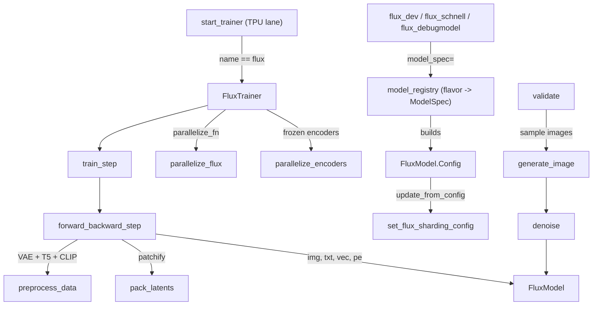

# FLUX diffusion model (flow-matching text-to-image training)

<!-- connect:up:begin -->
> **Cross-repo concept:** part of [rematerialization](../../../concepts/rematerialization.md) across this wiki's repos.
<!-- connect:up:end -->
## Overview
`torchtitan/models/flux` is the one non-language-model family in the repo: the README says it
"showcase[s] the pre-training process of text-to-image part of the FLUX model". Unlike the LLM
families, Flux cannot reuse the generic train step (the base train loop still drives it), because every training example has to be
*encoded* first (image -> latent through a VAE, prompt -> T5 sequence + CLIP vector), then noised
with a randomly drawn flow-matching timestep. So the subsystem ships its own trainer,
[`FluxTrainer`](../catalog/torchtitan/models/flux/trainer.md#FluxTrainer "torchtitan/models/flux/trainer.py:L38"),
which owns three encoder modules (VAE, T5, CLIP; none of them optimized) next to the trained
[`FluxModel`](../catalog/torchtitan/models/flux/model/model.md#FluxModel "torchtitan/models/flux/model/model.py:L30")
("Transformer model for flow matching on sequences"), and overrides the batch, forward/backward
and step hooks. The key performance idea is that the denoiser sees **one joint sequence of text
tokens + image patches** (`max_context_length` = latent patches + T5 length), so all the usual
sequence machinery - FSDP per block, all-gather-KV context parallelism, full activation
checkpointing and per-block `torch.compile` - applies to it, while the encoders get a much
cheaper treatment (T5 sharded, CLIP replicated; T5/CLIP explicitly frozen, the VAE only kept out of the optimizer). In this fork the trainer's config
inherits the TPU trainer config, and the TPU launcher routes `model_spec.name == "flux"` to
`FluxTrainer` directly, bypassing the TPU trainer integration.

## Diagram

Legend:
- `REG` - [`model_registry`](../catalog/torchtitan/models/flux/__init__.md#model_registry "torchtitan/models/flux/__init__.py:L678")
- `CFG` - [`Config`](../catalog/torchtitan/models/flux/model/model.md#FluxModel.Config "torchtitan/models/flux/model/model.py:L36")
- `RECIPE` - [`flux_dev`](../catalog/torchtitan/models/flux/config_registry.md#flux_dev "torchtitan/models/flux/config_registry.py:L128"), [`flux_schnell`](../catalog/torchtitan/models/flux/config_registry.md#flux_schnell "torchtitan/models/flux/config_registry.py:L186"), [`flux_debugmodel`](../catalog/torchtitan/models/flux/config_registry.md#flux_debugmodel "torchtitan/models/flux/config_registry.py:L55")
- `START` - [`start_trainer`](../catalog/torchtitan/experiments/tpu/train.md#start_trainer "torchtitan/experiments/tpu/train.py:L208")
- `TR` - [`FluxTrainer`](../catalog/torchtitan/models/flux/trainer.md#FluxTrainer "torchtitan/models/flux/trainer.py:L38")
- `PAR` - [`parallelize_flux`](../catalog/torchtitan/models/flux/parallelize.md#parallelize_flux "torchtitan/models/flux/parallelize.py:L52")
- `ENC` - [`parallelize_encoders`](../catalog/torchtitan/models/flux/parallelize.md#parallelize_encoders "torchtitan/models/flux/parallelize.py:L257")
- `STEP` - [`train_step`](../catalog/torchtitan/models/flux/trainer.md#FluxTrainer.train_step "torchtitan/models/flux/trainer.py:L357")
- `FB` - [`forward_backward_step`](../catalog/torchtitan/models/flux/trainer.md#FluxTrainer.forward_backward_step "torchtitan/models/flux/trainer.py:L216")
- `PRE` - [`preprocess_data`](../catalog/torchtitan/models/flux/utils.md#preprocess_data "torchtitan/models/flux/utils.py:L18")
- `PACK` - [`pack_latents`](../catalog/torchtitan/models/flux/utils.md#pack_latents "torchtitan/models/flux/utils.py:L126")
- `MODEL` - [`FluxModel`](../catalog/torchtitan/models/flux/model/model.md#FluxModel "torchtitan/models/flux/model/model.py:L30")
- `SHARD` - [`set_flux_sharding_config`](../catalog/torchtitan/models/flux/sharding.md#set_flux_sharding_config "torchtitan/models/flux/sharding.py:L61")
- `VAL` - [`validate`](../catalog/torchtitan/models/flux/validate.md#FluxValidator.validate "torchtitan/models/flux/validate.py:L142")
- `GEN` - [`generate_image`](../catalog/torchtitan/models/flux/inference/sampling.md#generate_image "torchtitan/models/flux/inference/sampling.py:L70")
- `DEN` - [`denoise`](../catalog/torchtitan/models/flux/inference/sampling.md#denoise "torchtitan/models/flux/inference/sampling.py:L157")

The parallelization order inside `parallelize_flux` matters for performance, so it gets its own view:

Legend:
- `M` - [`FluxModel`](../catalog/torchtitan/models/flux/model/model.md#FluxModel "torchtitan/models/flux/model/model.py:L30")
- `SP` - stage of [`parallelize_flux`](../catalog/torchtitan/models/flux/parallelize.md#parallelize_flux "torchtitan/models/flux/parallelize.py:L52") (splash patch)
- `AC` - stage of [`parallelize_flux`](../catalog/torchtitan/models/flux/parallelize.md#parallelize_flux "torchtitan/models/flux/parallelize.py:L52") (activation checkpointing)
- `SPMD` - stage of [`parallelize_flux`](../catalog/torchtitan/models/flux/parallelize.md#parallelize_flux "torchtitan/models/flux/parallelize.py:L52") (spmd_types parallelize)
- `CMP` - stage of [`parallelize_flux`](../catalog/torchtitan/models/flux/parallelize.md#parallelize_flux "torchtitan/models/flux/parallelize.py:L52") (per-block compile)
- `DP` - stage of [`parallelize_flux`](../catalog/torchtitan/models/flux/parallelize.md#parallelize_flux "torchtitan/models/flux/parallelize.py:L52") (data parallelism)

## Design rationale (why it's built this way)
- **A dedicated trainer, not a model plug-in.** Flux's "labels" are pixels; the loss target is the
  flow-matching velocity `noise - latent`. `forward_backward_step` asserts
  `global_valid_tokens is None` because "we rescale the loss within forward_backward_step for
  FLUX": the normalizer is the number of *latent elements* after the VAE, summed over the batch
  mesh, not a token count from the collator. Gradient accumulation is rejected outright
  ("FLUX doesn't support gradient accumulation for now").
- **Text encoders are frozen and treated by cost.** Each T5/CLIP `FluxEmbedder` wrapper sets
  `eval().requires_grad_(False)` and makes every parameter contiguous "to make sure the encoders
  works with FSDP". `parallelize_encoders` shards only T5 (per encoder block, then the whole HF
  module); the source comment explains CLIP is skipped because it "has low computation /
  communication ratio". The VAE built by `load_ae` gets no such treatment: its parameters keep
  `requires_grad`, and `preprocess_data` runs `encode` outside `torch.no_grad`, so the training step
  records an autograd graph for the VAE encoder that is never backpropagated.
- **Encoder dtype follows FSDP.** The trainer comment on `_dtype`: if FSDP mixed precision is used,
  encoders and their inputs/outputs are cast to `mixed_precision_param`; otherwise they stay in
  fp32 (the Flux default). So turning off `dp_shard` silently promotes the whole encoding path to
  fp32.
- **Distinct RNG per data-parallel rank.** Noise and timesteps are sampled inside every step, so
  the trainer seeds the model RNG distinctly across `cp, dp_shard, dp_replicate` (spmd_types
  backend) or `fsdp, dp_replicate` (otherwise), per its comment "data-parallel ranks need distinct
  model RNG streams".
- **Save the splash forward under AC.** The AC policy in `parallelize.py` marks the Pallas
  splash-attention forward ops `MUST_SAVE` and everything else `PREFER_RECOMPUTE`. Its docstring:
  since torch 2.12 vanilla AC "recomputes the splash forward in backward and roughly doubles its
  cost; torch 2.11 effectively saved it."
- **Compile per block.** The compile helper's docstring: compiling "each DoubleStreamBlock and
  SingleStreamBlock ... makes compilation efficient due to repeated structure"; each block is
  first wrapped with the TPU `spmd_safe` decorator, then compiled with `fullgraph=True`.
- **Honest MFU.** `get_nparams_and_flops` on the model config does not just use `6 x nparams`: it
  subtracts one side of each double-stream block (a token goes through *either* the image or the
  text weights), amortizes the per-sample modulation linears over the sequence, and adds
  quadratic attention FLOPs.

> [!inferred]
> The choice of `load_balancer_type=None` for `cp_shard` follows from Flux attention being
> bidirectional (`is_causal=False` everywhere): without a causal mask there is no triangular load
> imbalance for a load balancer to fix.

## Entry points
- [`start_trainer`](../catalog/torchtitan/experiments/tpu/train.md#start_trainer "torchtitan/experiments/tpu/train.py:L208") - the TPU launcher. When `model_spec.name == "flux"` it skips the RoPE fitting the LLM families get, rejects `compile.compile_grad_norm`, applies `--flux.img_size`, and instantiates `FluxTrainer` ("FluxTrainer owns a separate train_step and bypasses the TPU integration").
- [`flux_debugmodel`](../catalog/torchtitan/models/flux/config_registry.md#flux_debugmodel "torchtitan/models/flux/config_registry.py:L55"), [`flux_dev`](../catalog/torchtitan/models/flux/config_registry.md#flux_dev "torchtitan/models/flux/config_registry.py:L128"), [`flux_schnell`](../catalog/torchtitan/models/flux/config_registry.md#flux_schnell "torchtitan/models/flux/config_registry.py:L186") - recipe functions selected by `CONFIG=` / `--module`. They pin `tpu_config=TPUConfig(eager_mode="DEFER_AND_FUSE")`, MSE loss, full AC, the T5-XXL / CLIP-L tokenizers and `max_context_length` derived from image size.
- [`flux_dev_mxfp8`](../catalog/torchtitan/models/flux/config_registry.md#flux_dev_mxfp8 "torchtitan/models/flux/config_registry.py:L272"), [`flux_schnell_mxfp8`](../catalog/torchtitan/models/flux/config_registry.md#flux_schnell_mxfp8 "torchtitan/models/flux/config_registry.py:L244") - "Flux ... with MXFP8 quantization and torch.compile"; the docstrings say they require SM100+ GPUs, so they are GPU-only recipes in this TPU fork.
- [`model_registry`](../catalog/torchtitan/models/flux/__init__.md#model_registry "torchtitan/models/flux/__init__.py:L678") - builds the `ModelSpec` for a flavor (`flux-test`, `flux-dev`, `flux-schnell`, `flux-debug`), applies model converters, wires `parallelize_flux` and the state-dict adapter, and refuses a `seq_len` larger than the flavor's max context.
- [`train_step`](../catalog/torchtitan/models/flux/trainer.md#FluxTrainer.train_step "torchtitan/models/flux/trainer.py:L357") and [`validate`](../catalog/torchtitan/models/flux/validate.md#FluxValidator.validate "torchtitan/models/flux/validate.py:L142") - called by the base train loop each step / every `validator.freq` steps.
- [`inference`](../catalog/torchtitan/models/flux/inference/infer.md#inference "torchtitan/models/flux/inference/infer.py:L19") - offline sampling script: builds a `FluxTrainer` just to reuse its model + encoders, loads a checkpoint, round-robins prompts over ranks and calls `generate_image`.

## Mechanism (step-by-step)
1. **Flavor -> model config.** [`model_registry`](../catalog/torchtitan/models/flux/__init__.md#model_registry "torchtitan/models/flux/__init__.py:L678")
   looks up `(builder, max_context_len)` in `flux_configs` (`flux-test` 1024, `flux-dev` 768,
   `flux-schnell` 512, `flux-debug` 512). The builders
   [`_flux_dev`](../catalog/torchtitan/models/flux/__init__.md#_flux_dev "torchtitan/models/flux/__init__.py:L213")
   and [`_flux_schnell`](../catalog/torchtitan/models/flux/__init__.md#_flux_schnell "torchtitan/models/flux/__init__.py:L327")
   produce the same architecture (hidden 3072, 24 heads, 19 double-stream + 38 single-stream blocks,
   T5 context dim 4096, CLIP vector 768); [`_flux_debug`](../catalog/torchtitan/models/flux/__init__.md#_flux_debug "torchtitan/models/flux/__init__.py:L441")
   shrinks to hidden 1536 / 2+2 blocks and [`_flux_test`](../catalog/torchtitan/models/flux/__init__.md#_flux_test "torchtitan/models/flux/__init__.py:L557")
   to hidden 256 / 1+1 blocks with 64-dim encoders. Every block is stamped out from one template
   built by [`_make_double_block_config`](../catalog/torchtitan/models/flux/__init__.md#_make_double_block_config "torchtitan/models/flux/__init__.py:L50")
   or [`_make_single_block_config`](../catalog/torchtitan/models/flux/__init__.md#_make_single_block_config "torchtitan/models/flux/__init__.py:L161")
   (deep-copied per layer) out of configurable [`Linear`](../catalog/torchtitan/models/common/linear.md#Linear "torchtitan/models/common/linear.py:L31")
   and [`RMSNorm`](../catalog/torchtitan/models/common/nn_modules.md#RMSNorm "torchtitan/models/common/nn_modules.py:L134")
   configs; modulation and final-layer linears are zero-initialized, so each block starts as an
   identity residual.

2. **Context length from image size.** The recipes compute `max_context_length` as
   `(img_size / 8 / 2)^2 + max_t5_encoding_len` (VAE downsample 8, 2x2 patches): 256 px with a
   512-token T5 prompt gives 768 for [`flux_dev`](../catalog/torchtitan/models/flux/config_registry.md#flux_dev "torchtitan/models/flux/config_registry.py:L128"),
   256 + 256 = 512 for [`flux_schnell`](../catalog/torchtitan/models/flux/config_registry.md#flux_schnell "torchtitan/models/flux/config_registry.py:L186").
   Batch size is no longer set directly; it is `num_tokens_per_microbatch_per_dp_rank //
   max_context_length` (24576 / 768 = 32 images for dev, 32768 / 512 = 64 for schnell). The
   resolved config's [`Config`](../catalog/torchtitan/models/flux/model/model.md#FluxModel.Config "torchtitan/models/flux/model/model.py:L36")
   hook `update_from_config` calls [`set_flux_sharding_config`](../catalog/torchtitan/models/flux/sharding.md#set_flux_sharding_config "torchtitan/models/flux/sharding.py:L61"),
   which installs a CP layout on every inner attention (image, text and joint attention in
   double-stream blocks, the single attention in single-stream blocks): Q stays sequence-sharded
   on `cp`, K/V are redistributed from sequence-sharded to replicated (an all-gather), and their
   gradients come back as partial sums.

3. **Trainer construction.** [`FluxTrainer`](../catalog/torchtitan/models/flux/trainer.md#FluxTrainer "torchtitan/models/flux/trainer.py:L38")
   first lets the base [`Trainer`](../catalog/torchtitan/trainer.md#Trainer "torchtitan/trainer.py:L74")
   build mesh, model, optimizer and checkpointer (the model goes through `parallelize_flux`, step 4).
   It then picks [`_dtype`](../catalog/torchtitan/models/flux/trainer.md#FluxTrainer._dtype "torchtitan/models/flux/trainer.py:L71")
   and, unless `flux.precomputed_dataset_path` or `flux.random_dataset` is set, builds the three
   encoders on the `meta` device: the [`AutoEncoder`](../catalog/torchtitan/models/flux/model/autoencoder.md#AutoEncoder "torchtitan/models/flux/model/autoencoder.py:L385")
   and two [`FluxEmbedder`](../catalog/torchtitan/models/flux/model/hf_embedder.md#FluxEmbedder "torchtitan/models/flux/model/hf_embedder.py:L18")
   instances (CLIP returns `pooler_output`, T5 returns `last_hidden_state`). [`parallelize_encoders`](../catalog/torchtitan/models/flux/parallelize.md#parallelize_encoders "torchtitan/models/flux/parallelize.py:L257")
   FSDP-shards the T5 [`hf_module`](../catalog/torchtitan/models/flux/model/hf_embedder.md#FluxEmbedder.hf_module "torchtitan/models/flux/model/hf_embedder.py:L39")
   per encoder block (or wraps it with SimpleFSDP when `use_simple_fsdp` is set), then all three are
   materialized with `to_empty` and `init_weights`. With a precomputed or random dataset the
   encoders are `None` and the dataloader is replaced by a disk or synthetic loader that already
   yields `img_encodings`, `t5_encodings` and `clip_encodings`; this removes VAE/T5/CLIP compute
   from the step entirely, which isolates denoiser throughput.

4. **Model parallelization.** [`parallelize_flux`](../catalog/torchtitan/models/flux/parallelize.md#parallelize_flux "torchtitan/models/flux/parallelize.py:L52")
   applies, in order: the TPU splash-attention patch (only if `training` is a TPU trainer config
   with `use_splash_attention_kernel`), full activation checkpointing of every double- and
   single-stream block with the save-splash-forward policy, `model.parallelize` plus replicated
   parameter annotation under the `spmd_types` backend, per-block `torch.compile` (wrapped in
   `spmd_safe`) when `compile.enable` includes `"model"`, and finally data parallelism over the
   `dp_replicate x fsdp` mesh - SimpleFSDP if `use_simple_fsdp`, otherwise FSDP2 with
   `fully_shard` on the four input projections, each block, the final layer
   (`reshard_after_forward=False` "to avoid gather right after reshard") and the root, with FSDP
   gradient division disabled because the loss is already globally normalized. It takes
   [`ParallelDims`](../catalog/torchtitan/distributed/parallel_dims.md#ParallelDims "torchtitan/distributed/parallel_dims.py:L112")
   and the [`TrainingConfig`](../catalog/torchtitan/config/configs.md#TrainingConfig "torchtitan/config/configs.py:L36")
   for mixed-precision dtypes; there is no TP, PP or EP path (README TODO).

5. **Token accounting.** [`batch_generator`](../catalog/torchtitan/models/flux/trainer.md#FluxTrainer.batch_generator "torchtitan/models/flux/trainer.py:L195")
   overrides the base generator "to count transformer tokens (image patches + text tokens)": each
   batch adds `bsz x max_context_length` to the tokens-per-second counter instead of
   `labels.numel()`, which would count raw pixels and wildly inflate TPS.

6. **Encode, noise, patchify.** [`forward_backward_step`](../catalog/torchtitan/models/flux/trainer.md#FluxTrainer.forward_backward_step "torchtitan/models/flux/trainer.py:L216")
   runs [`preprocess_data`](../catalog/torchtitan/models/flux/utils.md#preprocess_data "torchtitan/models/flux/utils.py:L18")
   (CLIP + [`t5_encoder`](../catalog/torchtitan/models/flux/trainer.md#FluxTrainer.t5_encoder "torchtitan/models/flux/trainer.py:L92")
   on token ids, VAE `encode` on pixels, all cast to `_dtype`) or just moves precomputed encodings
   to device. It counts latent elements and sums them over the `batch` mesh as the loss
   normalizer, draws `noise` and uniform `timesteps`, forms `latents = (1 - t) x x0 + t x noise`,
   builds 3-D position ids with [`create_position_encoding_for_latents`](../catalog/torchtitan/models/flux/utils.md#create_position_encoding_for_latents "torchtitan/models/flux/utils.py:L92")
   (zeros for text tokens, row/col for patches) and converts both latents and target
   `noise - x0` into patch sequences with [`pack_latents`](../catalog/torchtitan/models/flux/utils.md#pack_latents "torchtitan/models/flux/utils.py:L126")
   ("Rearrange latents from an image-like format into a sequence of patches").

7. **CP shard and denoiser forward.** If CP is on, latents, latent ids, T5 encodings, text ids and
   target are sequence-sharded with `cp_shard` (no masks, no load balancer), and
   `ntokens_seen` is divided by the CP degree. Under the train context the inputs are type-asserted
   (sequence tensors `S(0)` on DP and `S(1)` on CP; CLIP vector and timesteps replicated on CP)
   and [`FluxModel`](../catalog/torchtitan/models/flux/model/model.md#FluxModel "torchtitan/models/flux/model/model.py:L30")
   runs: image and text are projected separately, then each double-stream block's
   [`forward`](../catalog/torchtitan/models/flux/model/layers.md#DoubleStreamBlock.forward "torchtitan/models/flux/model/layers.py:L276")
   modulates and projects the two streams with their own weights, concatenates text-then-image
   Q/K/V locally per rank, applies RoPE and one non-causal attention, and splits back; single-stream
   blocks then run on the locally concatenated sequence. Because concatenation is per-rank,
   each CP shard holds `[its text slice, its image slice]` and the position ids are concatenated
   the same way, so RoPE stays consistent.

8. **Loss, backward, optimizer.** The MSE loss is computed with the latent-element normalizer, the
   prediction/noise/target are `del`-ed "before bwd to avoid peaking memory", and `loss.backward()`
   runs with spmd type-checking disabled. [`train_step`](../catalog/torchtitan/models/flux/trainer.md#FluxTrainer.train_step "torchtitan/models/flux/trainer.py:L357")
   then clips gradients (`foreach=True`), waits for checkpoint staging, steps optimizer and LR
   scheduler, and only on log steps reduces loss sum/max and `ntokens_seen` over the `loss` mesh.

9. **Validation.** [`validate`](../catalog/torchtitan/models/flux/validate.md#FluxValidator.validate "torchtitan/models/flux/validate.py:L142")
   rebuilds a dataloader from [`dl_config`](../catalog/torchtitan/models/flux/validate.md#FluxValidator.dl_config "torchtitan/models/flux/validate.py:L101")
   each call, first samples up to `save_img_count` images with [`generate_image`](../catalog/torchtitan/models/flux/inference/sampling.md#generate_image "torchtitan/models/flux/inference/sampling.py:L70")
   (tokenize via [`FluxTokenizerContainer`](../catalog/torchtitan/models/flux/tokenizer.md#FluxTokenizerContainer "torchtitan/models/flux/tokenizer.py:L19"),
   then [`denoise`](../catalog/torchtitan/models/flux/inference/sampling.md#denoise "torchtitan/models/flux/inference/sampling.py:L157")
   for `denoising_steps` Euler steps, with classifier-free guidance doubling the batch, then VAE
   decode), and then computes a validation loss. With [`all_timesteps`](../catalog/torchtitan/models/flux/validate.md#FluxValidator.all_timesteps "torchtitan/models/flux/validate.py:L93")
   it expands each sample to 8 stratified timesteps in one forward; otherwise it uses the
   dataset's per-sample timestep. CP ranks share the denominator, so only DP contributes extra
   elements to it.

## Key data structures
- **`FluxTrainer.Config`** - inherits the TPU trainer config (so it carries `tpu_config`,
  `splash_attention_kernel`, XLA/libtpu flag maps and the `flux` sub-config with
  `precomputed_dataset_path`, `random_dataset`, `img_size`), and adds the two-tokenizer config,
  the encoder config (T5/CLIP version overrides, autoencoder path, `random_init`) and inference
  settings. [`TrainingConfig`](../catalog/torchtitan/config/configs.md#TrainingConfig "torchtitan/config/configs.py:L36")
  supplies [`max_context_length`](../catalog/torchtitan/config/configs.md#TrainingConfig.max_context_length "torchtitan/config/configs.py:L51"),
  the token budget and mixed-precision dtypes.
- **[`Config`](../catalog/torchtitan/models/flux/model/model.md#FluxModel.Config "torchtitan/models/flux/model/model.py:L36")**
  (model) - the full module tree as nested configs: per-layer `double_blocks` / `single_blocks`
  lists, embedders, final layer, plus the encoder configs (`autoencoder`, `clip_encoder`,
  `t5_encoder`) the trainer builds. It validates `hidden_size % num_heads == 0` and
  `sum(axes_dim) == head_dim` (16 + 56 + 56 = 128).
- **[`AutoEncoder`](../catalog/torchtitan/models/flux/model/autoencoder.md#AutoEncoder "torchtitan/models/flux/model/autoencoder.py:L385")**
  - [`encoder`](../catalog/torchtitan/models/flux/model/autoencoder.md#AutoEncoder.encoder "torchtitan/models/flux/model/autoencoder.py:L400")
  / [`decoder`](../catalog/torchtitan/models/flux/model/autoencoder.md#AutoEncoder.decoder "torchtitan/models/flux/model/autoencoder.py:L408")
  conv stacks (downsampling [`down`](../catalog/torchtitan/models/flux/model/autoencoder.md#Encoder.down "torchtitan/models/flux/model/autoencoder.py:L183"),
  upsampling [`up`](../catalog/torchtitan/models/flux/model/autoencoder.md#Decoder.up "torchtitan/models/flux/model/autoencoder.py:L299"),
  and the [`mid`](../catalog/torchtitan/models/flux/model/autoencoder.md#Encoder.mid "torchtitan/models/flux/model/autoencoder.py:L206")
  / [`mid`](../catalog/torchtitan/models/flux/model/autoencoder.md#Decoder.mid "torchtitan/models/flux/model/autoencoder.py:L289")
  bottlenecks) plus a diagonal-Gaussian sampler; `encode` applies `scale_factor x (z - shift_factor)`
  so latents are roughly unit-variance, `decode` inverts it. 16 latent channels at 1/8 resolution.
- **[`DATASETS`](../catalog/torchtitan/models/flux/flux_datasets.md#DATASETS.DATASETS "torchtitan/models/flux/flux_datasets.py:L229")**
  - named dataset configs (`cc12m`, `cc12m-test`, `cc12m-wds`, `coco-validation`, ...) with a
  prompt-dropout probability of 0.447 used for classifier-free-guidance training.
- **State-dict adapter** - its [`__init__`](../catalog/torchtitan/models/flux/model/state_dict_adapter.md#FluxStateDictAdapter.__init__ "torchtitan/models/flux/model/state_dict_adapter.py:L30")
  reads the HF safetensors index (`model.safetensors.index.json` or the diffusers name) to map
  torchtitan FQNs to HF shards; it handles only the transformer, not the encoders.

## Dynamics (design intent)
- Encoders run inside every training step on the same devices as the denoiser (no
  overlap or offload). They are frozen, so they build no autograd graph, but their forward cost and
  the T5 FSDP all-gathers are paid each step; the precomputed / random loaders exist to take them
  off the critical path.
- The denoiser is wrapped block-by-block for FSDP, AC and compile alike, so the per-block
  all-gather, recompute and compiled-graph granularity all line up with the 19 + 38 block stack.
- Logging reductions happen only on log steps (`metrics_processor.should_log`), so non-log steps
  carry no extra loss collectives.
- `inference` refuses to run with fewer prompts than ranks, because "FSDP all-gather will hang if
  some ranks have no prompts to process" - sampling is collective even though prompts are split.

## Edge cases
- **Splash patch guard looks unreachable from the base trainer.** `parallelize_flux` checks
  `isinstance(training, TPUTrainerConfig)`, but the base trainer passes `training=config.training`,
  which is a `TrainingConfig`, not the whole trainer config. Read statically, the splash patch (and
  therefore the save-splash AC policy) is not activated through that path; the TPU-lane wrapper in
  `experiments/tpu/flux/infra/parallelize.py` also passes `job_config.training`.
- **No gradient accumulation**: `train_step` raises if `gradient_accumulation_steps > 1`.
- **`compile.compile_grad_norm`** is rejected for Flux by `start_trainer`.
- **fp32 encoders without FSDP**: `_dtype` is fp32 unless `dp_shard` is enabled.
- **Random dataset needs a processor image size**; it raises if the dataloader dataset exposes no
  `processor.img_size`, and it re-loops a pool of at most 100 cached batches.
- **Precomputed loader** raises when it runs out of `batch_*.pt` files before `steps`.
- **Validation `steps=-1`** logs a warning that unequal sample counts across ranks can hang.
- **MXFP8 recipes are GPU-only** (SM100+, torchao nightly per their docstrings).
- **Seq-len override**: `model_registry` raises if `seq_len` exceeds the flavor's max context.

## Open questions
- Encoder weights: the trainer builds the autoencoder and HF encoders under `torch.device("meta")`,
  then calls `to_empty` and `init_weights` on all three. Statically this looks like it would
  replace pretrained VAE/T5/CLIP weights with fresh initialization unless something later reloads
  them; the source does not show such a reload in this subsystem.
- RNG vs CP: with the `spmd_types` backend the trainer gives CP ranks distinct seeds, yet noise and
  timesteps are sampled before `cp_shard` and timesteps are asserted replicated over CP. Whether
  the CP shards of one sample end up with matching timesteps is not settled by this code.
- `generate_image` / `denoise` feed full, un-sharded sequences to the model; how validation sampling
  behaves with CP enabled is not covered here.
- Packet gaps: the block classes (double-/single-stream block, `SelfAttention`, `EmbedND`,
  `LastLayer`), the AC/compile/FSDP helpers in `parallelize.py`, the selective-checkpoint policy,
  `annotate_flux_forward_inputs`, `load_ae`, the CP inner-attention layout helper, the dataset
  processor/collator, and the TPU-lane `flux_testmodel` recipe are not in this page's subgraph, so
  they are described without catalog links.

## See also
- [trainer-and-train-loop](trainer-and-train-loop.md)
- [tpu-trainer-and-job-config](tpu-trainer-and-job-config.md)
- [parallel-dims-and-parallelization](parallel-dims-and-parallelization.md)
- [tpu-context-parallel-attention](tpu-context-parallel-attention.md)
- [tpu-pallas-kernels](tpu-pallas-kernels.md)
- [quantization](quantization.md)
- [model-spec-protocols](model-spec-protocols.md)
- [hf-datasets](hf-datasets.md)
- [muse-glimmer-model](muse-glimmer-model.md)
