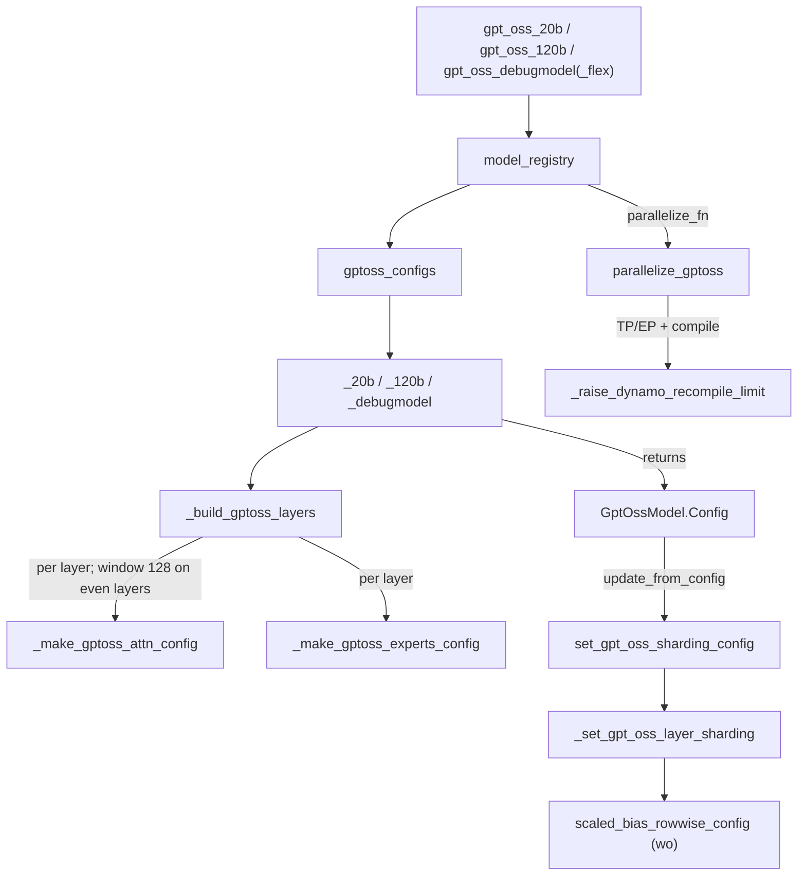
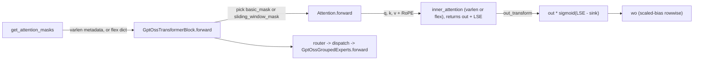

# GPT-OSS model: sink attention, alternating sliding windows and biased MoE experts

<!-- connect:up:begin -->
> **Cross-repo concept:** part of [expert-parallelism](../../../concepts/expert-parallelism.md), [sequence-parallelism](../../../concepts/sequence-parallelism.md), [sharding](../../../concepts/sharding.md) across this wiki's repos.
<!-- connect:up:end -->
## Overview

`torchtitan/models/gpt_oss` implements the GPT-OSS family as [`GptOssModel`](../catalog/torchtitan/models/gpt_oss/model.md#GptOssModel "torchtitan/models/gpt_oss/model.py:L195"), a [`Decoder`](../catalog/torchtitan/models/common/decoder.md#Decoder "torchtitan/models/common/decoder.py:L67") whose every block is attention + MoE (no dense FFN layers). Three model features shape its performance profile: (1) **attention sinks** - a learned per-head logit that competes with the real keys in the softmax, implemented not inside the kernel but as an output epilogue that needs the attention kernel's log-sum-exp (LSE); (2) **alternating attention windows** - even layers use a causal 128-token sliding window, odd layers full causal attention, so the model needs two masks per step; (3) **biased grouped experts** - the expert MLPs carry biases on both projections and a clamped SwiGLU on an interleaved gate/up layout, which forces extra per-token bias gathers and a TP-specific bias correction.

The default attention backend is `varlen` (packed-document variable-length attention); `flex` is the alternative. The repo has **no TPU-lane recipe** for GPT-OSS; it is exercised by the GPU recipes, the graph-trainer tracing tests and the RL experiment.

## Diagram

Build and parallelize path:

Legend:
- `REC` - [`gpt_oss_20b`](../catalog/torchtitan/models/gpt_oss/config_registry.md#gpt_oss_20b "torchtitan/models/gpt_oss/config_registry.py:L84"), [`gpt_oss_120b`](../catalog/torchtitan/models/gpt_oss/config_registry.md#gpt_oss_120b "torchtitan/models/gpt_oss/config_registry.py:L118"), [`gpt_oss_debugmodel`](../catalog/torchtitan/models/gpt_oss/config_registry.md#gpt_oss_debugmodel "torchtitan/models/gpt_oss/config_registry.py:L72"), [`gpt_oss_debugmodel_flex`](../catalog/torchtitan/models/gpt_oss/config_registry.md#gpt_oss_debugmodel_flex "torchtitan/models/gpt_oss/config_registry.py:L78")
- `REG` - [`model_registry`](../catalog/torchtitan/models/gpt_oss/__init__.md#model_registry "torchtitan/models/gpt_oss/__init__.py:L395")
- `TBL` - [`gptoss_configs`](../catalog/torchtitan/models/gpt_oss/__init__.md#gptoss_configs "torchtitan/models/gpt_oss/__init__.py:L388")
- `FLV` - [`_20b`](../catalog/torchtitan/models/gpt_oss/__init__.md#_20b "torchtitan/models/gpt_oss/__init__.py:L296"), [`_120b`](../catalog/torchtitan/models/gpt_oss/__init__.md#_120b "torchtitan/models/gpt_oss/__init__.py:L342"), [`_debugmodel`](../catalog/torchtitan/models/gpt_oss/__init__.md#_debugmodel "torchtitan/models/gpt_oss/__init__.py:L250")
- `BL` - [`_build_gptoss_layers`](../catalog/torchtitan/models/gpt_oss/__init__.md#_build_gptoss_layers "torchtitan/models/gpt_oss/__init__.py:L185")
- `ATT` - [`_make_gptoss_attn_config`](../catalog/torchtitan/models/gpt_oss/__init__.md#_make_gptoss_attn_config "torchtitan/models/gpt_oss/__init__.py:L70")
- `EXP` - [`_make_gptoss_experts_config`](../catalog/torchtitan/models/gpt_oss/__init__.md#_make_gptoss_experts_config "torchtitan/models/gpt_oss/__init__.py:L150")
- `CFG` - [`Config`](../catalog/torchtitan/models/gpt_oss/model.md#GptOssModel.Config "torchtitan/models/gpt_oss/model.py:L201")
- `SH` - [`set_gpt_oss_sharding_config`](../catalog/torchtitan/models/gpt_oss/sharding.md#set_gpt_oss_sharding_config "torchtitan/models/gpt_oss/sharding.py:L58")
- `LSH` - [`_set_gpt_oss_layer_sharding`](../catalog/torchtitan/models/gpt_oss/sharding.md#_set_gpt_oss_layer_sharding "torchtitan/models/gpt_oss/sharding.py:L78")
- `SBR` - [`scaled_bias_rowwise_config`](../catalog/torchtitan/models/gpt_oss/sharding.md#scaled_bias_rowwise_config "torchtitan/models/gpt_oss/sharding.py:L38")
- `PAR` - [`parallelize_gptoss`](../catalog/torchtitan/models/gpt_oss/parallelize.md#parallelize_gptoss "torchtitan/models/gpt_oss/parallelize.py:L58")
- `RCL` - [`_raise_dynamo_recompile_limit`](../catalog/torchtitan/models/gpt_oss/parallelize.md#_raise_dynamo_recompile_limit "torchtitan/models/gpt_oss/parallelize.py:L28")

One block's forward, with the sink epilogue:

Legend:
- `M` - [`get_attention_masks`](../catalog/torchtitan/models/gpt_oss/model.md#GptOssModel.get_attention_masks "torchtitan/models/gpt_oss/model.py:L241")
- `BLK` - [`forward`](../catalog/torchtitan/models/gpt_oss/model.md#GptOssTransformerBlock.forward "torchtitan/models/gpt_oss/model.py:L162")
- `ATTF` - [`forward`](../catalog/torchtitan/models/gpt_oss/model.md#Attention.forward "torchtitan/models/gpt_oss/model.py:L89")
- `INNER` - [`inner_attention`](../catalog/torchtitan/models/gpt_oss/model.md#Attention.Config.inner_attention "torchtitan/models/gpt_oss/model.py:L59"), one of [`VarlenInnerAttention`](../catalog/torchtitan/models/common/attention.md#VarlenInnerAttention "torchtitan/models/common/attention.py:L137") / [`FlexInnerAttention`](../catalog/torchtitan/models/common/attention.md#FlexInnerAttention "torchtitan/models/common/attention.py:L233")
- `SINK` - (concept) the `_apply_sinks` epilogue of [`Attention`](../catalog/torchtitan/models/gpt_oss/model.md#Attention "torchtitan/models/gpt_oss/model.py:L46")
- `WO` - (concept) output projection, sharded by [`scaled_bias_rowwise_config`](../catalog/torchtitan/models/gpt_oss/sharding.md#scaled_bias_rowwise_config "torchtitan/models/gpt_oss/sharding.py:L38")
- `MOE` - [`forward`](../catalog/torchtitan/models/gpt_oss/moe.md#GptOssGroupedExperts.forward "torchtitan/models/gpt_oss/moe.py:L96")

## Design rationale (why it's built this way)

**Sinks as an epilogue, not a kernel change.** A sink adds one extra logit `s_h` per head to the softmax denominator. Since `softmax-with-sink output = out * exp(LSE) / (exp(LSE) + exp(s_h)) = out * sigmoid(LSE - s_h)`, the model can run any standard attention kernel that returns the LSE and rescale afterwards. [`Attention`](../catalog/torchtitan/models/gpt_oss/model.md#Attention "torchtitan/models/gpt_oss/model.py:L46") ("Multi-head attention (MLA) module with sink attention" - the "MLA" in the docstring is a misnomer, this is GQA) passes `out_transform=self._apply_sinks`; the inner backends then call their LSE-returning variant. The consequence for kernel substitution: an attention kernel for GPT-OSS must expose the LSE (or implement the sink natively). Sinks are a plain `[n_heads]` parameter sharded on heads under TP; when they arrive as a DTensor the epilogue takes the local shard.

**Two masks, one per window type.** [`_build_gptoss_layers`](../catalog/torchtitan/models/gpt_oss/__init__.md#_build_gptoss_layers "torchtitan/models/gpt_oss/__init__.py:L185") ("Even-indexed layers (0, 2, 4, ...) use sliding window attention") gives even layers [`sliding_window_size`](../catalog/torchtitan/models/gpt_oss/model.md#Attention.Config.sliding_window_size "torchtitan/models/gpt_oss/model.py:L62") 128. For varlen the window is baked into each layer's inner config (`window_size=(127, 0)`) and one varlen metadata object is shared; for flex the model builds a `basic_mask` and a `sliding_window_mask` once per step and each block selects by key. This keeps per-step mask construction at two BlockMasks regardless of depth.

**Static shapes in the expert bias path.** [`forward`](../catalog/torchtitan/models/gpt_oss/moe.md#GptOssGroupedExperts.forward "torchtitan/models/gpt_oss/moe.py:L96") ("Raw expert computation without dispatch/combine") must add a per-expert bias to each routed token row. It expands biases with `repeat_interleave(..., output_size=x_RD.shape[0])` after appending one "tail slack" count, and the comment states why: so the output is "static-shaped ... avoiding the D2H sync that repeat_interleave incurs without output_size". That is the same constraint a compiled TPU graph imposes.

**TP over-counts row-parallel biases.** A rowwise-sharded projection produces partial sums that are all-reduced; a replicated bias added on every rank would be counted `tp` times. GPT-OSS handles this in two places: the expert down-projection divides its bias by `tp_degree` in forward only (`ScaleBiasForward`: "scale the bias by 1/tp_degree in forward to cancel the extra reduction effect, but keep the gradient unchanged in backward"), and the attention output projection uses a `ScaledBiasRowwiseLinear` with [`scaled_bias_rowwise_config`](../catalog/torchtitan/models/gpt_oss/sharding.md#scaled_bias_rowwise_config "torchtitan/models/gpt_oss/sharding.py:L38") (weight `Shard(1)`, bias Replicate, output Partial then reduced or reduce-scattered under SP).

**Recompile headroom under TP/EP.** [`_raise_dynamo_recompile_limit`](../catalog/torchtitan/models/gpt_oss/parallelize.md#_raise_dynamo_recompile_limit "torchtitan/models/gpt_oss/parallelize.py:L28") explains that a block can be compiled "before every DTensor local tensor has resolved from AsyncCollectiveTensor to a plain Tensor", Dynamo specializes on both, and `fullgraph=True` makes the cap a hard failure; GPT-OSS raises the limit to 12 (vs 10) "because it alternates sliding-window and full-attention layers". [`_has_sliding_window_attention`](../catalog/torchtitan/models/gpt_oss/parallelize.md#_has_sliding_window_attention "torchtitan/models/gpt_oss/parallelize.py:L46") detects that by scanning modules for a non-`-1` `window_size`.

## Entry points

- [`model_registry`](../catalog/torchtitan/models/gpt_oss/__init__.md#model_registry "torchtitan/models/gpt_oss/__init__.py:L395") - factory for flavors `debugmodel`, `20b`, `120b` (all max context 131072); defaults `attn_backend="varlen"`, `moe_comm_backend="standard"`; returns a `ModelSpec` with `parallelize_gptoss`, `pipeline_llm`, the MoE load-balancing hook and the GPT-OSS HF adapter.
- [`gpt_oss_20b`](../catalog/torchtitan/models/gpt_oss/config_registry.md#gpt_oss_20b "torchtitan/models/gpt_oss/config_registry.py:L84") / [`gpt_oss_120b`](../catalog/torchtitan/models/gpt_oss/config_registry.md#gpt_oss_120b "torchtitan/models/gpt_oss/config_registry.py:L118") - `Trainer.Config` recipes: full activation checkpointing, EP degree 1, one full 131072-token context per microbatch per DP rank, at most 64 documents per sample (varlen metadata bound), no `compile` block (so the default compile config applies).
- [`_gpt_oss_debugmodel`](../catalog/torchtitan/models/gpt_oss/config_registry.md#_gpt_oss_debugmodel "torchtitan/models/gpt_oss/config_registry.py:L25") - the shared debug recipe behind [`gpt_oss_debugmodel`](../catalog/torchtitan/models/gpt_oss/config_registry.md#gpt_oss_debugmodel "torchtitan/models/gpt_oss/config_registry.py:L72") (varlen, `max_num_documents=128`) and [`gpt_oss_debugmodel_flex`](../catalog/torchtitan/models/gpt_oss/config_registry.md#gpt_oss_debugmodel_flex "torchtitan/models/gpt_oss/config_registry.py:L78"); AC off, a validator every 5 steps.
- [`get_attention_masks`](../catalog/torchtitan/models/gpt_oss/model.md#GptOssModel.get_attention_masks "torchtitan/models/gpt_oss/model.py:L241") - called by the train step's input preprocessing once per batch, from `positions`.
- [`parallelize_gptoss`](../catalog/torchtitan/models/gpt_oss/parallelize.md#parallelize_gptoss "torchtitan/models/gpt_oss/parallelize.py:L58") - called by the trainer through `ModelSpec.parallelize_fn` after construction.
- [`from_hf`](../catalog/torchtitan/models/gpt_oss/state_dict_adapter.md#GptOssStateDictAdapter.from_hf "torchtitan/models/gpt_oss/state_dict_adapter.py:L114") / [`to_hf`](../catalog/torchtitan/models/gpt_oss/state_dict_adapter.md#GptOssStateDictAdapter.to_hf "torchtitan/models/gpt_oss/state_dict_adapter.py:L76") - reached by the checkpointer for HF-format load/save.

## Mechanism (step-by-step)

1. **Build the layer stack.** A flavor builder ([`_20b`](../catalog/torchtitan/models/gpt_oss/__init__.md#_20b "torchtitan/models/gpt_oss/__init__.py:L296"): 24 layers, 32 experts; [`_120b`](../catalog/torchtitan/models/gpt_oss/__init__.md#_120b "torchtitan/models/gpt_oss/__init__.py:L342"): 36 layers, 128 experts; both `dim = hidden_dim = 2880`, top-4, vocab 201088) creates a YaRN `CosSinRoPE` (theta 150000, factor 32, original length 4096, `truncate=False`) and calls [`_build_gptoss_layers`](../catalog/torchtitan/models/gpt_oss/__init__.md#_build_gptoss_layers "torchtitan/models/gpt_oss/__init__.py:L185"). Each layer gets an attention config, a routed-experts config and a softmax top-k router with `route_norm=True` and a biased gate, plus `load_balance_coeff=1e-3`.

2. **Attention config: fused QKV with biases, GQA, optional window.** [`_make_gptoss_attn_config`](../catalog/torchtitan/models/gpt_oss/__init__.md#_make_gptoss_attn_config "torchtitan/models/gpt_oss/__init__.py:L70") resolves the backend string to an inner attention config (replacing the varlen `window_size` with `(window - 1, 0)` on windowed layers), builds the [`qkv_linear`](../catalog/torchtitan/models/gpt_oss/model.md#Attention.Config.qkv_linear "torchtitan/models/gpt_oss/model.py:L57") as one fused biased projection of width `(64 + 2 * 8) * 64` (or separate `wq`/`wkv` with `fuse_qkv=False`), a biased `ScaledBiasRowwiseLinear` output, depth-scaled init for every projection and for the sinks, and copies the [`rope`](../catalog/torchtitan/models/gpt_oss/model.md#Attention.Config.rope "torchtitan/models/gpt_oss/model.py:L64") config. The result is an attention [`Config`](../catalog/torchtitan/models/gpt_oss/model.md#Attention.Config "torchtitan/models/gpt_oss/model.py:L52") with 64 query heads, 8 KV heads, head dim 64.

3. **Experts config.** [`_make_gptoss_experts_config`](../catalog/torchtitan/models/gpt_oss/__init__.md#_make_gptoss_experts_config "torchtitan/models/gpt_oss/__init__.py:L150") ("Build a fully-specified RoutedExperts.Config for a single GPT-OSS layer") pairs [`GptOssGroupedExperts`](../catalog/torchtitan/models/gpt_oss/moe.md#GptOssGroupedExperts "torchtitan/models/gpt_oss/moe.py:L74") with a token dispatcher built from `moe_comm_backend` and the capacity factor. The experts' [`__init__`](../catalog/torchtitan/models/gpt_oss/moe.md#GptOssGroupedExperts.__init__ "torchtitan/models/gpt_oss/moe.py:L79") allocates [`mlp1_weight_EGD`](../catalog/torchtitan/models/gpt_oss/moe.md#GptOssGroupedExperts.mlp1_weight_EGD "torchtitan/models/gpt_oss/moe.py:L87") `[E, 2F, D]` (fused gate/up), `mlp1_bias_EG`, `mlp2_weight_EDF` `[E, D, F]` and `mlp2_bias_ED`, and stores [`swiglu_limit`](../catalog/torchtitan/models/gpt_oss/moe.md#GptOssGroupedExperts.swiglu_limit "torchtitan/models/gpt_oss/moe.py:L85") (7.0).

4. **Attach sharding when the job config is applied.** [`update_from_config`](../catalog/torchtitan/models/gpt_oss/model.md#GptOssModel.Config.update_from_config "torchtitan/models/gpt_oss/model.py:L205") calls [`set_gpt_oss_sharding_config`](../catalog/torchtitan/models/gpt_oss/sharding.md#set_gpt_oss_sharding_config "torchtitan/models/gpt_oss/sharding.py:L58") with SP and EP flags. Per layer, [`_set_gpt_oss_layer_sharding`](../catalog/torchtitan/models/gpt_oss/sharding.md#_set_gpt_oss_layer_sharding "torchtitan/models/gpt_oss/sharding.py:L78") gathers attention input `x` to TP-Replicate, shards `sinks` on heads, replicates the RoPE cache, applies the shared QKV-linear sharding, uses the scaled-bias rowwise config for `wo`, wraps the inner attention in a local map, and routes the MoE through the shared MoE sharding helper with the GPT-OSS expert layout (`mlp1_weight_EGD`/`mlp1_bias_EG` shard dim 1, `mlp2_weight_EDF` shard dim 2, `mlp2_bias_ED` replicated).

5. **Parallelize: plan, AC, compile, FSDP.** [`parallelize_gptoss`](../catalog/torchtitan/models/gpt_oss/parallelize.md#parallelize_gptoss "torchtitan/models/gpt_oss/parallelize.py:L58") first refuses Ulysses-style CP ("its per-head sinks are not sharded over CP"), executes the sharding plan when TP or EP is on or the `spmd_types` backend is selected, applies AC, then - if `"model"` is a compile component - raises the Dynamo recompile limit under TP/EP via [`_raise_dynamo_recompile_limit`](../catalog/torchtitan/models/gpt_oss/parallelize.md#_raise_dynamo_recompile_limit "torchtitan/models/gpt_oss/parallelize.py:L28") and compiles per block, and finally applies FSDP over the dense DP mesh and the `efsdp` mesh for experts under EP, with the job's mixed-precision param/reduce dtypes. `skip_dp=True` returns before FSDP for inference/RL rollout.

6. **Masks per batch.** [`get_attention_masks`](../catalog/torchtitan/models/gpt_oss/model.md#GptOssModel.get_attention_masks "torchtitan/models/gpt_oss/model.py:L241") reads the first layer's backend: for varlen it builds document metadata from positions (bounded by `max_num_documents` / `max_context_length`); for flex it builds a causal + packed-document `basic_mask` and, if any layer has a window, a `sliding_window_mask` using the first windowed layer's size. Any other backend raises `TypeError` - GPT-OSS does not run on SDPA.

7. **Block and attention forward.** The block [`forward`](../catalog/torchtitan/models/gpt_oss/model.md#GptOssTransformerBlock.forward "torchtitan/models/gpt_oss/model.py:L162") picks its flex mask by the key set in [`__init__`](../catalog/torchtitan/models/gpt_oss/model.md#GptOssTransformerBlock.__init__ "torchtitan/models/gpt_oss/model.py:L146"), then computes `x + attention(attention_norm(x))` and `x + moe(ffn_norm(x))` (the block always has a MoE; [`ffn_norm`](../catalog/torchtitan/models/gpt_oss/model.md#GptOssTransformerBlock.ffn_norm "torchtitan/models/gpt_oss/model.py:L156") feeds it). Attention [`forward`](../catalog/torchtitan/models/gpt_oss/model.md#Attention.forward "torchtitan/models/gpt_oss/model.py:L89") projects q/k/v, applies RoPE, and calls the inner attention with `scale=softmax_scale`, `enable_gqa` (64/8 heads) and the sink epilogue; [`softmax_scale`](../catalog/torchtitan/models/gpt_oss/model.md#Attention.softmax_scale "torchtitan/models/gpt_oss/model.py:L76") is `1/sqrt(64)` times `mscale ** 2`, `mscale = 0.1 * ln(32) + 1`, merged in because YaRN is active ("m**2 being equivalent to scaling q / k each by mscale").

8. **Expert compute.** [`forward`](../catalog/torchtitan/models/gpt_oss/moe.md#GptOssGroupedExperts.forward "torchtitan/models/gpt_oss/moe.py:L96") unwraps DTensor parameters to local tensors ("to work with dynamic-shape inputs in EP which cannot be easily expressed as DTensors"), determines the TP degree from the active backend, computes cumulative expert offsets, and runs `grouped_mm(x.bfloat16(), mlp1) + bias -> swiglu -> grouped_mm(mlp2) + bias/tp`. The SwiGLU splits the fused `2F` dim **interleaved** (`x[..., ::2]` gate, `x[..., 1::2]` linear), clamps gate at 7 and linear to `[-7, 7]`, uses `alpha = 1.702`, and computes `out_glu * (x_linear + 1)` via `addcmul`.

9. **HF conversion.** The adapter's [`__init__`](../catalog/torchtitan/models/gpt_oss/state_dict_adapter.md#GptOssStateDictAdapter.__init__ "torchtitan/models/gpt_oss/state_dict_adapter.py:L21") builds [`from_hf_map`](../catalog/torchtitan/models/gpt_oss/state_dict_adapter.md#GptOssStateDictAdapter.from_hf_map "torchtitan/models/gpt_oss/state_dict_adapter.py:L29"), which maps HF `q_proj`/`k_proj`/`v_proj` to `qkv_linear.wq/wk/wv` (the fused projection presents that split layout through state-dict hooks) and the HF `gate_up_proj_blocks` / `down_proj_blocks` straight onto the grouped expert tensors without reshaping. [`from_hf`](../catalog/torchtitan/models/gpt_oss/state_dict_adapter.md#GptOssStateDictAdapter.from_hf "torchtitan/models/gpt_oss/state_dict_adapter.py:L114") validates the HF RoPE config against `CosSinRoPE` and **resets** each layer's `expert_bias_E` (load-balancing state with no HF equivalent) to zeros, using the templates [`to_hf`](../catalog/torchtitan/models/gpt_oss/state_dict_adapter.md#GptOssStateDictAdapter.to_hf "torchtitan/models/gpt_oss/state_dict_adapter.py:L76") stashed in [`_expert_bias_templates`](../catalog/torchtitan/models/gpt_oss/state_dict_adapter.md#GptOssStateDictAdapter._expert_bias_templates "torchtitan/models/gpt_oss/state_dict_adapter.py:L27") to preserve DTensor layout.

## Key data structures

| Flavor | dim | layers | heads / kv heads x head_dim | experts / top-k | expert hidden | vocab | max ctx |
|---|---|---|---|---|---|---|---|
| `_debugmodel` | 256 | 4 | 64 / 8 x 64 | 8 / 4 | 2880 | 2048 | 131072 |
| `_20b` | 2880 | 24 | 64 / 8 x 64 | 32 / 4 | 2880 | 201088 | 131072 |
| `_120b` | 2880 | 36 | 64 / 8 x 64 | 128 / 4 | 2880 | 201088 | 131072 |

- [`Config`](../catalog/torchtitan/models/gpt_oss/model.md#Attention.Config "torchtitan/models/gpt_oss/model.py:L52") (attention) - heads, KV heads, head dim, the QKV projection, `wo`, the inner backend (default varlen), the optional window, and `rope`. The learned `sinks [n_heads]` parameter lives on the module.
- [`Config`](../catalog/torchtitan/models/gpt_oss/model.md#GptOssModel.Config "torchtitan/models/gpt_oss/model.py:L201") (model) - defaults `dim=2880`, `vocab_size=201088`; its `get_nparams_and_flops` counts `6 * active_params` plus quadratic attention FLOPs with the 128-token window applied on windowed layers.
- `_GPT_OSS_EXPERTS_PARAM_LAYOUT` (`sharding.py`) - TP splits the expert hidden dim: `mlp1` colwise on the fused `2F` axis, `mlp2` rowwise on `F`, `mlp2_bias` replicated (hence the forward-only `1/tp` scale).

## Dynamics (design intent)

- **Composition order** is plan (TP/EP) -> AC -> compile -> FSDP, the same as the DeepSeek models; the recompile-limit bump happens only when compile is combined with TP or EP.
- **PP schedules.** The README states CI runs CP and PP on the debug model with Interleaved1F1B, and that zero-bubble / split-backward schedules are disabled for flex because "FlexInnerAttention `BlockMask` is not a Tensor".
- **Tracing coverage.** Graph-trainer tests (`test_gpt_oss`, `test_gpt_oss_fsdp` in `experiments/graph_trainer/tests/test_trace_module.py`) trace this model's layers, which is how it reaches the graph-based compile path.

> [!inferred]
> TPU-relevant consequences of the above (no TPU recipe exists to confirm them): a TPU attention kernel replacing the inner backend must return per-head LSE to keep sinks correct, and must support the 127-token left window on even layers; the large vocabulary (201088) makes the `lm_head` and loss a significant share of FLOPs and HBM at `dim=2880`; the interleaved `::2` / `1::2` slicing in the SwiGLU is a strided gather on the `2F` axis that a fused grouped-matmul kernel would want folded into weight layout.

## Edge cases

- **Ulysses CP is rejected** at parallelize time; ring/all-gather style CP is not blocked here.
- **SDPA is not a valid backend**: [`get_attention_masks`](../catalog/torchtitan/models/gpt_oss/model.md#GptOssModel.get_attention_masks "torchtitan/models/gpt_oss/model.py:L241") raises for anything but varlen or flex.
- **Uniform window assumed for flex**: only the first windowed layer's size is used to build `sliding_window_mask`; heterogeneous windows would need code changes.
- **MXFP4 checkpoints**: the adapter loads HF MXFP4 expert weights through a quantized storage reader that dequantizes on load, but `to_hf` "does not support saving to mxfp4 quantization format".
- **`expert_bias_E` is reset** on every HF load, so load-balancing history is not preserved across an HF round-trip.

## Open questions

- The router (`TokenChoiceTopKRouter`), token dispatcher and `ScaledBiasRowwiseLinear` internals are not in this packet's subgraph; see [model-building-blocks](model-building-blocks.md) and [TPU MoE dispatch](tpu-moe-dispatch-and-grouped-experts.md).
- Whether the TPU Splash/tokamax attention path can supply the LSE needed by `out_transform` is not settled by this subsystem; see [TPU Pallas kernels](tpu-pallas-kernels.md).

## See also

- [model-building-blocks](model-building-blocks.md) - `Decoder`, varlen/flex inner attention, RoPE, `GroupedExperts`.
- [parallel-dims-and-parallelization](parallel-dims-and-parallelization.md), [model-spec-protocols](model-spec-protocols.md)
- [deepseek-v3-model](deepseek-v3-model.md), [deepseek-v4-model](deepseek-v4-model.md) - sibling MoE models with the same parallelize ordering.
- [tpu-moe-dispatch-and-grouped-experts](tpu-moe-dispatch-and-grouped-experts.md), [tpu-pallas-kernels](tpu-pallas-kernels.md), [graph-trainer](graph-trainer.md), [rl-training](rl-training.md), [checkpointing](checkpointing.md)
