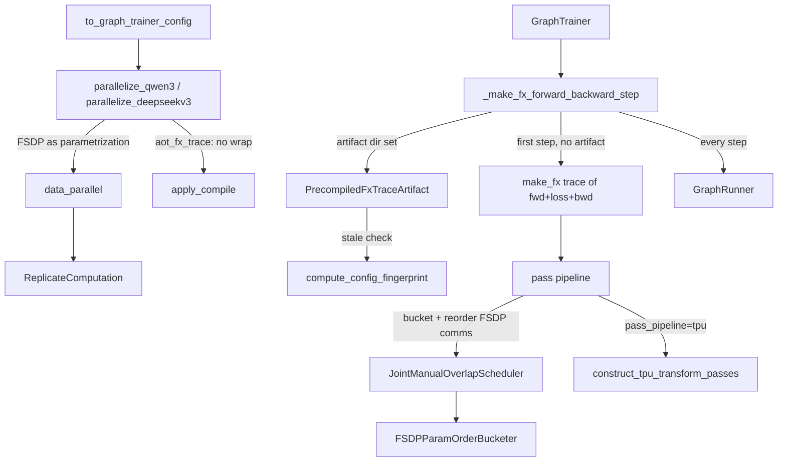
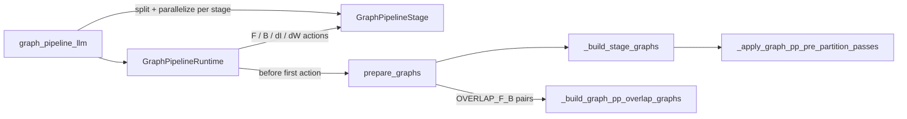

# GraphTrainer: whole-train-step FX capture and graph-pass optimization (experiments/graph_trainer)

<!-- connect:up:begin -->
> **Cross-repo concept:** part of [expert-parallelism](../../../concepts/expert-parallelism.md), [pipeline-parallelism](../../../concepts/pipeline-parallelism.md), [rematerialization](../../../concepts/rematerialization.md), [sharding](../../../concepts/sharding.md) across this wiki's repos.
<!-- connect:up:end -->
## Overview

[`GraphTrainer`](../catalog/torchtitan/experiments/graph_trainer/trainer.md#GraphTrainer "torchtitan/experiments/graph_trainer/trainer.py:L142") is a subclass of the core [`Trainer`](../catalog/torchtitan/trainer.md#Trainer "torchtitan/trainer.py:L74") that replaces eager forward/backward with **one captured FX graph of the entire train step**. On the first step it traces forward + loss + backward (the default `aot_fx_trace` mode, `make_fx`-based, no AOTAutograd partitioning) into a flat graph whose outputs are the loss and every parameter gradient; it then runs an ordered list of graph passes over that graph and executes it on every later step through a [`GraphRunner`](../catalog/torchtitan/experiments/graph_trainer/runner.md#GraphRunner "torchtitan/experiments/graph_trainer/runner.py:L123"). The optimizer step stays in the base trainer (unless a backend such as the TPU one traces it too).

The project's MANIFESTO states the bet in two lines: "**Single unified graph.** Capture the entire training step ... as one flat FX graph" and "**Every optimization is a graph pass.** Activation checkpointing, CUDAGraph, CPU offload, communication overlap, kernel fusion - all expressed as transformations on the same graph." The enabler is SimpleFSDP: parameters are sharded DTensors whose all-gather/reduce-scatter is a parametrization ([`ReplicateComputation`](../catalog/torchtitan/experiments/graph_trainer/simple_fsdp.md#ReplicateComputation "torchtitan/experiments/graph_trainer/simple_fsdp.py:L281")) traced *into* the graph, so collectives are ordinary nodes that passes can bucket, reorder and overlap. The manifesto also names TPUs explicitly: non-GPU accelerators "assume the existence of a graph and perform better with a full graph to optimize over" - which is why the TPU lane builds [`TpuGraphTrainer`](../catalog/torchtitan/experiments/tpu/graph_trainer/tpu_graph_trainer.md#TpuGraphTrainer "torchtitan/experiments/tpu/graph_trainer/tpu_graph_trainer.py:L66") on top of this class rather than beside it.

## Diagram

The first-step capture path and steady-state replay:

Legend:
- `CFG` - [`to_graph_trainer_config`](../catalog/torchtitan/experiments/graph_trainer/configs.md#to_graph_trainer_config "torchtitan/experiments/graph_trainer/configs.py:L256")
- `PAR` - [`parallelize_qwen3`](../catalog/torchtitan/experiments/graph_trainer/qwen3/parallelize.md#parallelize_qwen3 "torchtitan/experiments/graph_trainer/qwen3/parallelize.py:L40") / [`parallelize_deepseekv3`](../catalog/torchtitan/experiments/graph_trainer/deepseek_v3/parallelize.md#parallelize_deepseekv3 "torchtitan/experiments/graph_trainer/deepseek_v3/parallelize.py:L38")
- `DP` - [`data_parallel`](../catalog/torchtitan/experiments/graph_trainer/simple_fsdp.md#data_parallel "torchtitan/experiments/graph_trainer/simple_fsdp.py:L414")
- `RC` - [`ReplicateComputation`](../catalog/torchtitan/experiments/graph_trainer/simple_fsdp.md#ReplicateComputation "torchtitan/experiments/graph_trainer/simple_fsdp.py:L281")
- `AC` - [`apply_compile`](../catalog/torchtitan/experiments/graph_trainer/compile.md#apply_compile "torchtitan/experiments/graph_trainer/compile.py:L56")
- `GT` - [`GraphTrainer`](../catalog/torchtitan/experiments/graph_trainer/trainer.md#GraphTrainer "torchtitan/experiments/graph_trainer/trainer.py:L142")
- `STEP` - [`_make_fx_forward_backward_step`](../catalog/torchtitan/experiments/graph_trainer/trainer.md#GraphTrainer._make_fx_forward_backward_step "torchtitan/experiments/graph_trainer/trainer.py:L262")
- `TRACE` - (concept) the `minimal_fx_tracer` capture of the closure built from the model and loss
- `ART` - [`PrecompiledFxTraceArtifact`](../catalog/torchtitan/experiments/graph_trainer/precompile.md#PrecompiledFxTraceArtifact "torchtitan/experiments/graph_trainer/precompile.py:L191")
- `FP` - [`compute_config_fingerprint`](../catalog/torchtitan/experiments/graph_trainer/precompile.md#compute_config_fingerprint "torchtitan/experiments/graph_trainer/precompile.py:L73")
- `PASSES` - (concept) the default or registered pass pipeline selected by `compile.pass_pipeline`
- `SCHED` - [`JointManualOverlapScheduler`](../catalog/torchtitan/experiments/graph_trainer/fsdp_passes.md#JointManualOverlapScheduler "torchtitan/experiments/graph_trainer/fsdp_passes.py:L299")
- `BUCK` - [`FSDPParamOrderBucketer`](../catalog/torchtitan/experiments/graph_trainer/fsdp_passes.md#FSDPParamOrderBucketer "torchtitan/experiments/graph_trainer/fsdp_passes.py:L276")
- `TPU` - [`construct_tpu_transform_passes`](../catalog/torchtitan/experiments/tpu/graph_trainer/tpu_backend_pass.md#construct_tpu_transform_passes "torchtitan/experiments/tpu/graph_trainer/tpu_backend_pass.py:L523")
- `RUN` - [`GraphRunner`](../catalog/torchtitan/experiments/graph_trainer/runner.md#GraphRunner "torchtitan/experiments/graph_trainer/runner.py:L123")

GraphPP (pipeline parallel) reuses upstream PP schedules but executes prebuilt per-stage graphs:

Legend:
- `GPL` - [`graph_pipeline_llm`](../catalog/torchtitan/experiments/graph_trainer/graph_pp/pipeline.md#graph_pipeline_llm "torchtitan/experiments/graph_trainer/graph_pp/pipeline.py:L66")
- `STG` - [`GraphPipelineStage`](../catalog/torchtitan/experiments/graph_trainer/graph_pp/stage.md#GraphPipelineStage "torchtitan/experiments/graph_trainer/graph_pp/stage.py:L310")
- `RT` - [`GraphPipelineRuntime`](../catalog/torchtitan/experiments/graph_trainer/graph_pp/runner.md#GraphPipelineRuntime "torchtitan/experiments/graph_trainer/graph_pp/runner.py:L306")
- `PREP` - [`prepare_graphs`](../catalog/torchtitan/experiments/graph_trainer/graph_pp/graph_builder.md#GraphTrainerStageGraphProvider.prepare_graphs "torchtitan/experiments/graph_trainer/graph_pp/graph_builder.py:L1297")
- `BSG` - [`_build_stage_graphs`](../catalog/torchtitan/experiments/graph_trainer/graph_pp/graph_builder.md#_build_stage_graphs "torchtitan/experiments/graph_trainer/graph_pp/graph_builder.py:L909")
- `PRE` - [`_apply_graph_pp_pre_partition_passes`](../catalog/torchtitan/experiments/graph_trainer/graph_pp/graph_builder.md#_apply_graph_pp_pre_partition_passes "torchtitan/experiments/graph_trainer/graph_pp/graph_builder.py:L779")
- `OVL` - [`_build_graph_pp_overlap_graphs`](../catalog/torchtitan/experiments/graph_trainer/graph_pp/graph_builder.md#_build_graph_pp_overlap_graphs "torchtitan/experiments/graph_trainer/graph_pp/graph_builder.py:L1169")

## Design rationale (why it's built this way)

- **Composability through one representation.** The MANIFESTO's "Eager Challenges" list is the motivation: "compile graph-breaks on FSDP2, AC recomputes FSDP2 all-gathers in backward, AC with compile graph-breaks invalidates AC and causes OOM". Instead of hooks per feature, every feature edits the same FX graph, and passes compose by ordering.
- **FSDP as a traced parametrization (SimpleFSDP).** [`data_parallel`](../catalog/torchtitan/experiments/graph_trainer/simple_fsdp.md#data_parallel "torchtitan/experiments/graph_trainer/simple_fsdp.py:L414") re-registers each parameter as a sharded DTensor (`Shard(dim)` for `fully_shard`, `(Replicate, Shard)` for `hybrid_shard`, `Replicate` for DDP) and installs [`ReplicateComputation`](../catalog/torchtitan/experiments/graph_trainer/simple_fsdp.md#ReplicateComputation "torchtitan/experiments/graph_trainer/simple_fsdp.py:L281") as its parametrization: every parameter access redistributes to `Replicate` (the forward all-gather, cast to `param_dtype`) with `Partial(sum)` gradient placements (the backward reduce-scatter/all-reduce, in `reduce_dtype`). Because that happens inside `forward`, the tracer sees the collectives as nodes; parameters smaller than the mesh dim are replicated instead of sharded. The parallelize functions apply it "unconditionally", even at degree 1, "so that MixedPrecisionPolicy's param_dtype cast still applies in single-GPU runs".
- **Eager-equivalent numerics by default; speed is opt-in.** The bitwise test module's docstring: "Tests that Trainer (eager) and GraphTrainer (aot_fx_trace) produce bitwise identical losses and gradients on Llama3, DeepSeek-v3, and Qwen3 debug models." Accordingly the default Inductor mode is `regional` (only tagged regions such as [`FlexInnerAttention`](../catalog/torchtitan/models/common/attention.md#FlexInnerAttention "torchtitan/models/common/attention.py:L233") HOPs are compiled, because they "must be compiled ... to produce bitwise identical results to the eager Trainer path"), while `full` Inductor, `numerics_changing_optim` (e.g. RMSNorm fusion), FSDP AG/RS stream overlap and dense-region scheduling are explicit flags on [`GraphTrainerCompileConfig`](../catalog/torchtitan/experiments/graph_trainer/configs.md#GraphTrainerCompileConfig "torchtitan/experiments/graph_trainer/configs.py:L69").
- **Match eager FSDP2's bucketing order.** [`FSDPParamOrderBucketer`](../catalog/torchtitan/experiments/graph_trainer/fsdp_passes.md#FSDPParamOrderBucketer "torchtitan/experiments/graph_trainer/fsdp_passes.py:L276") ("Pack FSDP buckets in Eager FSDP2 parameter order") sorts collectives by the module's first-seen parameter order, which the pass pipeline derives from the traced state FQNs ("The traced state FQNs preserve that registration order, unlike graph execution order"). Matching FSDP2's packing keeps bucket contents - and so reduction order - aligned with eager.
- **Graph-based SAC replaces eager AC.** [`to_graph_trainer_config`](../catalog/torchtitan/experiments/graph_trainer/configs.md#to_graph_trainer_config "torchtitan/experiments/graph_trainer/configs.py:L256") overrides any enabled activation-checkpoint config with the default [`SelectiveAC`](../catalog/torchtitan/distributed/activation_checkpoint.md#SelectiveAC "torchtitan/distributed/activation_checkpoint.py:L187") config, because remat is decided per tensor by the `compile.memory_policy` pass, not by module wrappers. The README calls this "Tensor-granularity memory policy - Each activation can independently be saved, recomputed, or offloaded to the CPU, unlike module-level eager SAC."
- **Explicit gradients, not side effects.** A replayed graph cannot reproduce `param.grad` writes made inside a Python loop, so [`ChunkedLossWrapperWithParamGrads`](../catalog/torchtitan/experiments/graph_trainer/chunked_loss.md#ChunkedLossWrapperWithParamGrads "torchtitan/experiments/graph_trainer/chunked_loss.py:L15") replaces [`ChunkedLossWrapper`](../catalog/torchtitan/components/loss.md#ChunkedLossWrapper "torchtitan/components/loss.py:L515") during config conversion: "the chunk loop's per-chunk `param.grad` side-effect writes don't survive the captured graph and replay therefore produces all-zero param grads."
- **Bind state once, replay cheaply.** [`GraphRunner`](../catalog/torchtitan/experiments/graph_trainer/runner.md#GraphRunner "torchtitan/experiments/graph_trainer/runner.py:L123") flattens parameters, buffers and trainer-owned gradient buffers once at construction "to avoid runtime overhead"; per call it flattens only the user inputs. In-place optimizer and buffer updates remain visible because the same tensor objects are retained.

> [!inferred]
> For TPU, the value of this design is less about launch overhead (the CUDA-graph motivation) and more that XLA receives one whole-step graph whose collectives, remat decisions and offload points have already been placed by passes. That is my reading of why the TPU lane subclasses GraphTrainer and replaces only the pass pipeline and the executor, rather than re-implementing capture.

## Entry points

- [`to_graph_trainer_config`](../catalog/torchtitan/experiments/graph_trainer/configs.md#to_graph_trainer_config "torchtitan/experiments/graph_trainer/configs.py:L256") - turns a base `Trainer.Config` recipe into a `GraphTrainer.Config` (or a `target_cls` such as the TPU graph config): copies every field, swaps the model spec's `parallelize_fn` / `pipelining_fn` / model class for the graph_trainer registry's, drops `compile` so the GraphTrainer default applies, forces graph SAC and the param-grad chunked loss. Reached from every graph_trainer and TPU-graph recipe.
- [`parallelize_qwen3`](../catalog/torchtitan/experiments/graph_trainer/qwen3/parallelize.md#parallelize_qwen3 "torchtitan/experiments/graph_trainer/qwen3/parallelize.py:L40") / [`parallelize_deepseekv3`](../catalog/torchtitan/experiments/graph_trainer/deepseek_v3/parallelize.md#parallelize_deepseekv3 "torchtitan/experiments/graph_trainer/deepseek_v3/parallelize.py:L38") - the model's `parallelize_fn`, called by the base trainer at build time: annotate module FQNs, apply TP/EP via `model.parallelize` when enabled, apply SimpleFSDP, optionally install eager EP chunking, then [`apply_compile`](../catalog/torchtitan/experiments/graph_trainer/compile.md#apply_compile "torchtitan/experiments/graph_trainer/compile.py:L56").
- [`parallelize_autoparallel_llama`](../catalog/torchtitan/experiments/graph_trainer/llama3/parallelize_autoparallel.md#parallelize_autoparallel_llama "torchtitan/experiments/graph_trainer/llama3/parallelize_autoparallel.py:L38") / [`parallelize_autoparallel_deepseekv3`](../catalog/torchtitan/experiments/graph_trainer/deepseek_v3/parallelize_autoparallel.md#parallelize_autoparallel_deepseekv3 "torchtitan/experiments/graph_trainer/deepseek_v3/parallelize_autoparallel.py:L91") - the `--compile.enable_autoparallel` alternative: [`AutoParallelGraph`](../catalog/torchtitan/experiments/graph_trainer/autoparallel_api.md#AutoParallelGraph "torchtitan/experiments/graph_trainer/autoparallel_api.py:L75") solves SPMD placement and returns an AOT-backed module; capture and passes then proceed as usual.
- [`_make_fx_forward_backward_step`](../catalog/torchtitan/experiments/graph_trainer/trainer.md#GraphTrainer._make_fx_forward_backward_step "torchtitan/experiments/graph_trainer/trainer.py:L262") - reached from `forward_backward_step` on every non-PP step in `aot_fx_trace` mode; traces (or loads) and transforms the graph on the first call, replays it on all calls.
- [`graph_pipeline_llm`](../catalog/torchtitan/experiments/graph_trainer/graph_pp/pipeline.md#graph_pipeline_llm "torchtitan/experiments/graph_trainer/graph_pp/pipeline.py:L66") - the `pipelining_fn` of the llama3/deepseek_v3/qwen3 graph registries; reached when `pipeline_parallel_degree > 1`.
- [`TpuGraphTrainer`](../catalog/torchtitan/experiments/tpu/graph_trainer/tpu_graph_trainer.md#TpuGraphTrainer "torchtitan/experiments/tpu/graph_trainer/tpu_graph_trainer.py:L66") - the TPU subclass; see [tpu-graph-trainer](tpu-graph-trainer.md) for its executor, optimizer-in-graph and graph splitting.

## Mechanism (step-by-step)

1. **Recipe conversion.** A model recipe written for the eager trainer is passed through [`to_graph_trainer_config`](../catalog/torchtitan/experiments/graph_trainer/configs.md#to_graph_trainer_config "torchtitan/experiments/graph_trainer/configs.py:L256"). The model config is re-instantiated as the graph registry's subclass with every field value preserved (including MoE comm backend settings), and the resulting [`GraphTrainer`](../catalog/torchtitan/experiments/graph_trainer/trainer.md#GraphTrainer "torchtitan/experiments/graph_trainer/trainer.py:L142") config carries a [`GraphTrainerCompileConfig`](../catalog/torchtitan/experiments/graph_trainer/configs.md#GraphTrainerCompileConfig "torchtitan/experiments/graph_trainer/configs.py:L69") (mode `aot_fx_trace`, backend `aot_eager`, memory policy `default`, Inductor `regional`). The TPU config path reuses this converter with `target_cls` set to [`TpuGraphTrainer`](../catalog/torchtitan/experiments/tpu/graph_trainer/tpu_graph_trainer.md#TpuGraphTrainer "torchtitan/experiments/tpu/graph_trainer/tpu_graph_trainer.py:L66")'s [`Config`](../catalog/torchtitan/experiments/tpu/graph_trainer/tpu_graph_trainer.md#TpuGraphTrainer.Config "torchtitan/experiments/tpu/graph_trainer/tpu_graph_trainer.py:L89"), whose `__post_init__` forces `pass_pipeline = "tpu"` because "A generic GraphTrainer pipeline cannot lower a TPU graph."

2. **Model parallelization (build time).** The model's `parallelize_fn` - e.g. [`parallelize_qwen3`](../catalog/torchtitan/experiments/graph_trainer/qwen3/parallelize.md#parallelize_qwen3 "torchtitan/experiments/graph_trainer/qwen3/parallelize.py:L40") - asserts the per-rank token count divides `tp * 2 * cp`, tags module FQNs (later passes attribute nodes to modules through this metadata), applies TP/EP layouts, then SimpleFSDP via [`data_parallel`](../catalog/torchtitan/experiments/graph_trainer/simple_fsdp.md#data_parallel "torchtitan/experiments/graph_trainer/simple_fsdp.py:L414"). With TP/EP present, [`ReplicateComputation`](../catalog/torchtitan/experiments/graph_trainer/simple_fsdp.md#ReplicateComputation "torchtitan/experiments/graph_trainer/simple_fsdp.py:L281") re-wraps the 2D DTensor as a 1D DTensor on the DP mesh "for efficient FSDP all-gather", gathers, then re-wraps onto the model-parallel mesh, and (under the `spmd_types` backend) adds any backward all-reduces on TP axes that FSDP owns (e.g. TP RMSNorm weights with sequence parallel). [`maybe_apply_ep_overlap_eager_chunking`](../catalog/torchtitan/experiments/graph_trainer/ep_eager_chunk.md#maybe_apply_ep_overlap_eager_chunking "torchtitan/experiments/graph_trainer/ep_eager_chunk.py:L363") wraps `layers.*` or `layers.*.moe` forwards when EP overlap uses the `eager` strategy. Finally [`apply_compile`](../catalog/torchtitan/experiments/graph_trainer/compile.md#apply_compile "torchtitan/experiments/graph_trainer/compile.py:L56") sets `reorder_for_peak_memory = False` and `capture_scalar_outputs = True`, enables async-TP symmetric memory if configured, and in `aot_fx_trace` mode returns the model unwrapped ("graph capture will happen at training time"); `jit` mode (deprecated) calls `model.compile(fullgraph=True)` with a pass-carrying backend.

3. **First step: capture or load.** [`_make_fx_forward_backward_step`](../catalog/torchtitan/experiments/graph_trainer/trainer.md#GraphTrainer._make_fx_forward_backward_step "torchtitan/experiments/graph_trainer/trainer.py:L262") builds a closure that runs the model, the annotated loss and `autograd.grad` over every `requires_grad` parameter (with `remove_duplicate=False`, so tied weights keep both entries), and traces it with `minimal_fx_tracer` under the SPMD context, with model parameters and buffers threaded as static graph inputs. Trace-input preparers registered for enabled features (currently `ep_overlap`) can mark symbolic dims before fakeification. If `compile.precompile_artifact_dir` is set, it instead loads a [`PrecompiledFxTraceArtifact`](../catalog/torchtitan/experiments/graph_trainer/precompile.md#PrecompiledFxTraceArtifact "torchtitan/experiments/graph_trainer/precompile.py:L191") and checks it against [`compute_config_fingerprint`](../catalog/torchtitan/experiments/graph_trainer/precompile.md#compute_config_fingerprint "torchtitan/experiments/graph_trainer/precompile.py:L73") - a SHA-256 over parameter/buffer names, shapes and dtypes, every public `ParallelDims` field, the compile mode/backend/passes/memory policy/EP-overlap settings, the torch version and (on CUDA) device capability.

4. **Pass pipeline.** With `enable_passes`, the pipeline is looked up by `compile.pass_pipeline` in a registry (falling back to the default builder); otherwise only mandatory correctness passes run. The default order, read from the pass builder, is: mandatory marker removal -> dead-code elimination, canonicalization and FSDP unshard-chain dedup -> memory-policy tagging -> CPU-offload insertion (prefetch `cpu_offload_prefetch_n_layers` ahead, defer waits `cpu_offload_defer_n_layers`) -> selective activation remat -> EP-overlap chunking and process-group isolation (if enabled) -> optional collective PG reassignment -> joint transformer-block bucketing and reordering -> EP-overlap scheduling -> optional dense-region FSDP scheduling -> optional async TP -> terminal Inductor (regional or full) -> CUDA graph wrap. The bucketing step is [`JointManualOverlapScheduler`](../catalog/torchtitan/experiments/graph_trainer/fsdp_passes.md#JointManualOverlapScheduler "torchtitan/experiments/graph_trainer/fsdp_passes.py:L299"): it buckets each module's collectives separately per direction (forward AGs vs backward AGs/RSs, with SAC-recomputed forward ops counted as backward) using [`FSDPParamOrderBucketer`](../catalog/torchtitan/experiments/graph_trainer/fsdp_passes.md#FSDPParamOrderBucketer "torchtitan/experiments/graph_trainer/fsdp_passes.py:L276"), then reorders in two walks: a top-down scheduling loop emits reduce-scatter prefetch dependencies (RSs only occur in backward), and a single reversed walk with separate forward/backward buffers emits AG prefetch dependencies, "so AG pairing never crosses the fwd/bwd boundary". For TPU, the `tpu` pipeline starts from [`construct_tpu_transform_passes`](../catalog/torchtitan/experiments/tpu/graph_trainer/tpu_backend_pass.md#construct_tpu_transform_passes "torchtitan/experiments/tpu/graph_trainer/tpu_backend_pass.py:L523"), which keeps the same tag -> offload -> remat order but none of the CUDA bucketing/Inductor/CUDA-graph passes: it adds TPU remat barriers, an optional FSDP all-gather barrier schedule (reusing the dense-region FSDP scheduler, plus a reduce-scatter deadline schedule for the `interleave` policy), a combine-barrier pass and an optional reduce-scatter-to-all-reduce rewrite for selected parameters. The unsplit `tpu` pipeline then appends a TPU backend compile pass; with graph splitting on, compilation is left out ("split mode compiles each resulting child graph independently").

5. **Replay.** A [`GraphRunner`](../catalog/torchtitan/experiments/graph_trainer/runner.md#GraphRunner "torchtitan/experiments/graph_trainer/runner.py:L123") is created once, resolving and flattening state inputs in a fixed order (parameters, buffers, trainer-owned grad buffers, runtime meshes, then user inputs) and recording their identities and storage signatures; it refuses traced optimizer state. Each call flattens the `(inputs, labels, global_valid_tokens, extra_kwargs)` pytree, unwraps tensor subclasses, runs the graph module under `torch.no_grad()` and rewraps outputs. Back in [`_make_fx_forward_backward_step`](../catalog/torchtitan/experiments/graph_trainer/trainer.md#GraphTrainer._make_fx_forward_backward_step "torchtitan/experiments/graph_trainer/trainer.py:L262"), output 0 is the loss and the next `len(params)` outputs are gradients, accumulated into `param.grad` (cloned when the graph is CUDA-graph-wrapped, since replay owns those buffers). With `enable_inplace_graph_gradient_accumulation`, gradients are instead added in-graph into trainer-owned buffers that double as `param.grad`, which is what makes accumulation replay-safe.

6. **Precompile (compile-on-one-rank).** `precompile_main` traces and transforms on a single process, then [`from_traced_result`](../catalog/torchtitan/experiments/graph_trainer/precompile.md#PrecompiledFxTraceArtifact.from_traced_result "torchtitan/experiments/graph_trainer/precompile.py:L221") serializes the graph with `GraphPickler` rather than pickle, because "Plain pickle evaluates SymInts to concrete trace-time values, baking in rank-specific constants (e.g. the embedding vocab offset ...)". Regional-Inductor kernels are baked into the artifact, so the training run skips both tracing and Inductor; at load time only the CUDA-graph pass is re-applied.

7. **Pipeline parallelism (GraphPP).** [`graph_pipeline_llm`](../catalog/torchtitan/experiments/graph_trainer/graph_pp/pipeline.md#graph_pipeline_llm "torchtitan/experiments/graph_trainer/graph_pp/pipeline.py:L66") splits the model into per-stage module lists (eager PP's splitter), runs the model `parallelize_fn` on each local stage, wraps them as [`GraphPipelineStage`](../catalog/torchtitan/experiments/graph_trainer/graph_pp/stage.md#GraphPipelineStage "torchtitan/experiments/graph_trainer/graph_pp/stage.py:L310")s and hands an upstream runtime schedule to [`GraphPipelineRuntime`](../catalog/torchtitan/experiments/graph_trainer/graph_pp/runner.md#GraphPipelineRuntime "torchtitan/experiments/graph_trainer/graph_pp/runner.py:L306"); only runtime schedules (`Interleaved1F1B`, `ZBVZeroBubble`, `DualPipeV`) are accepted. Before the first action, [`prepare_graphs`](../catalog/torchtitan/experiments/graph_trainer/graph_pp/graph_builder.md#GraphTrainerStageGraphProvider.prepare_graphs "torchtitan/experiments/graph_trainer/graph_pp/graph_builder.py:L1297") traces one representative microbatch per stage with [`_build_stage_graphs`](../catalog/torchtitan/experiments/graph_trainer/graph_pp/graph_builder.md#_build_stage_graphs "torchtitan/experiments/graph_trainer/graph_pp/graph_builder.py:L909") (last stages differentiate the loss; others differentiate outputs against `output_grads_from_next`), applies [`_apply_graph_pp_pre_partition_passes`](../catalog/torchtitan/experiments/graph_trainer/graph_pp/graph_builder.md#_apply_graph_pp_pre_partition_passes "torchtitan/experiments/graph_trainer/graph_pp/graph_builder.py:L779") (normalization that is not subject to `enable_passes`, since "partitioning assumes canonical FX structure"), partitions into forward/backward and optional FSDP `UNSHARD`/`REDUCE_GRAD` and dI/dW graphs, builds multiplexed graphs for `OVERLAP_F_B` actions with [`_build_graph_pp_overlap_graphs`](../catalog/torchtitan/experiments/graph_trainer/graph_pp/graph_builder.md#_build_graph_pp_overlap_graphs "torchtitan/experiments/graph_trainer/graph_pp/graph_builder.py:L1169"), and compiles each extracted graph. The runtime then only dispatches prebuilt callables per schedule action.

## Key data structures

| Structure | Holds | Perf relevance |
|---|---|---|
| [`GraphTrainerCompileConfig`](../catalog/torchtitan/experiments/graph_trainer/configs.md#GraphTrainerCompileConfig "torchtitan/experiments/graph_trainer/configs.py:L69") | `mode`, `backend`, `passes`, `enable_passes`, `disable_passes`, `memory_policy` (`default` / `full` / `eager` / `sac_and_offload`; docstring also lists `min_cut`), `full_recompute_save_ops`, `pass_pipeline`, `inductor_compilation`, `numerics_changing_optim`, CPU-offload prefetch/defer/budget, `enable_fsdp_ag_rs_overlap`, `enable_fsdp_dense_region_overlap`, `ep_overlap`, `precompile_artifact_dir`, `enable_autoparallel`, `enable_inplace_graph_gradient_accumulation` | Every graph optimization is a field here; the bitwise-safe ones are on by default, the rest are opt-in. |
| [`EpOverlapConfig`](../catalog/torchtitan/experiments/graph_trainer/configs.md#EpOverlapConfig "torchtitan/experiments/graph_trainer/configs.py:L32") | `enabled`, `chunk_dim` (`batch`/`seq`), `strategy` (`eager`/`graph`), `module_fqn` (`layers.*` or `layers.*.moe`), `disable_early_grad_accumulation` | Splits MoE/transformer regions into chunks so all-to-all of one chunk overlaps compute of another. |
| Traced result | graph module, example inputs, `num_static_inputs`, state FQNs, subclass layouts, output spec | What passes, the runner and the precompile artifact all consume. |
| [`PrecompiledFxTraceArtifact`](../catalog/torchtitan/experiments/graph_trainer/precompile.md#PrecompiledFxTraceArtifact "torchtitan/experiments/graph_trainer/precompile.py:L191") | GraphPickler bytes, state FQNs, flat input/output arity, subclass layouts, output spec, tensor input indices, fingerprint | Lets all ranks skip trace + compile. |
| [`CompiledModule`](../catalog/torchtitan/experiments/graph_trainer/graph_utils.md#CompiledModule "torchtitan/experiments/graph_trainer/graph_utils.py:L173") | A wrapper module that lazily builds a joint graph on first forward and delegates state-dict/parameter access to the inner model | The legacy AOT-mode wrapper; the default `aot_fx_trace` path does not wrap the model. |

## Dynamics (design intent)

- **Trace once, replay forever.** Capture and passes happen inside the first `forward_backward_step`; subsequent steps only flatten user inputs and call the graph. [`GraphRunner`](../catalog/torchtitan/experiments/graph_trainer/runner.md#GraphRunner "torchtitan/experiments/graph_trainer/runner.py:L123")'s `validate_state` exists to diagnose a parameter or storage being replaced after binding (tests cover parameter/storage replacement rejection and in-place buffer updates being allowed).
- **Numerics guardrails.** `test_aot_fx_trace_vs_eager` asserts bitwise-identical losses and grads between eager and traced runs across llama3/DeepSeek-v3/Qwen3 debug models; [`test_llama3_debugmodel_full_ac_numerics_match_eager`](../catalog/torchtitan/experiments/graph_trainer/tests/test_sac_peak_memory.md#TestGraphSACPeakMemory.test_llama3_debugmodel_full_ac_numerics_match_eager "torchtitan/experiments/graph_trainer/tests/test_sac_peak_memory.py:L163") ("Graph full recompute produces bitwise-identical loss and grads vs eager") and [`test_llama3_debugmodel_peak_memory_matches_eager_selective_ac`](../catalog/torchtitan/experiments/graph_trainer/tests/test_sac_peak_memory.md#TestGraphSACPeakMemory.test_llama3_debugmodel_peak_memory_matches_eager_selective_ac "torchtitan/experiments/graph_trainer/tests/test_sac_peak_memory.py:L102") additionally bound the traced path's reserved and active peak memory relative to eager under the `eager` memory policy. `test_numerics_changing_optim_run_to_run` checks that even the numerics-changing passes are run-to-run deterministic.
- **Bucketing follows eager order.** [`_run_and_get_layer_ids`](../catalog/torchtitan/experiments/graph_trainer/tests/test_passes.md#TestBucketingPrefetchOrder._run_and_get_layer_ids "torchtitan/experiments/graph_trainer/tests/test_passes.py:L2128") runs one step and returns the layer ids of bucketed all-gathers, which the bucketing tests use to assert prefetch order.
- **Default SAC keeps FSDP all-gathers.** Per the `memory_policy` docstring, the `default` policy saves "all compute-intensive ops and FSDP all_gathers" - trading memory for not re-gathering parameters in backward, the exact eager-AC failure mode the manifesto lists.

## Edge cases

- **PP and non-`aot_fx_trace` modes bypass capture.** `forward_backward_step` defers to the base trainer when PP is enabled (GraphPP handles that through the pipelining function) or when `mode != "aot_fx_trace"`.
- **In-graph gradient accumulation is narrow.** It requires `aot_fx_trace`, no PP, a single model part, no precompile artifact and no pipeline registered in GraphTrainer's own pass-pipeline registry. (The TPU lane keeps a separate registry for its `tpu` pipeline and overrides the capture method, so this check does not see it.)
- **Graph EP chunking rejects TP > 1.** "After DTensor lowering, the FX graph contains physical TP-local tensors ... Splitting those values is not proven equivalent"; use eager chunking or TP=1. Sequence chunking is limited to `layers.*.moe`.
- **Dense-region FSDP scheduling is silently dropped** (with a warning) when EP overlap is on but not graph-chunked at `layers.*.moe`.
- **Precompile gaps.** Artifacts are tied to torch version, model shapes and parallelism (the fingerprint enforces it); FlexAttention mask closures are not picklable, trainer-owned gradient state is rejected by [`from_traced_result`](../catalog/torchtitan/experiments/graph_trainer/precompile.md#PrecompiledFxTraceArtifact.from_traced_result "torchtitan/experiments/graph_trainer/precompile.py:L221"), and GraphPP does not load artifacts yet.
- **AutoParallel limits.** [`parallelize_autoparallel_llama`](../catalog/torchtitan/experiments/graph_trainer/llama3/parallelize_autoparallel.md#parallelize_autoparallel_llama "torchtitan/experiments/graph_trainer/llama3/parallelize_autoparallel.py:L38") rejects DDP, CP and PP, and AutoParallel may choose different collectives/lowerings, so its tests check tight agreement rather than bitwise equality.
- **TPU rejects chunked loss.** [`TpuGraphTrainer`](../catalog/torchtitan/experiments/tpu/graph_trainer/tpu_graph_trainer.md#TpuGraphTrainer "torchtitan/experiments/tpu/graph_trainer/tpu_graph_trainer.py:L66") raises for [`ChunkedLossWrapper`](../catalog/torchtitan/components/loss.md#ChunkedLossWrapper "torchtitan/components/loss.py:L515") configs because "FX unrolls its loop and defeats bounded-memory execution", even though the generic converter would have swapped in the param-grad variant.

## Open questions

- The packet subgraph omits the capture core: `minimal_fx_tracer` / `TracedResult`, the closure builder `make_fwd_bwd_step`, the pass builders (`construct_default_graph_passes`, `compile_time_passes`, `final_inductor_compile_passes`, `apply_graph_passes`), the memory-policy / SAC / CPU-offload passes, and the pass registries. The mechanism above is described from source but those symbols cannot be cited.
- `min_cut` appears in the `memory_policy` docstring but not in the `GraphTrainerMemoryPolicy` literal type, so whether it is selectable from the CLI is unclear from the config alone.
- The README's composability table marks EP + activation checkpointing, EP + PP, graph-based PP and micro-batch overlap as in progress; how much of that is now covered by the GraphPP and EP-overlap code paths is not stated.
- [`CompiledModule`](../catalog/torchtitan/experiments/graph_trainer/graph_utils.md#CompiledModule "torchtitan/experiments/graph_trainer/graph_utils.py:L173") has no in-tree constructor call outside its own module in this checkout; it appears to be retained for the deprecated AOT mode.

## See also

- [tpu-graph-trainer](tpu-graph-trainer.md) - the TPU/PJRT specialization: TPU pass pipeline, graph splitting, optimizer-in-graph
- [trainer-and-train-loop](trainer-and-train-loop.md) - the base `Trainer` whose train step GraphTrainer overrides
- [parallel-dims-and-parallelization](parallel-dims-and-parallelization.md), [flex-shard](flex-shard.md) - eager FSDP2/TP/EP composition this replaces with in-graph collectives
- [training-components](training-components.md), [job-config](job-config.md), [llama3-model](llama3-model.md), [qwen3-model](qwen3-model.md), [deepseek-v3-model](deepseek-v3-model.md)
