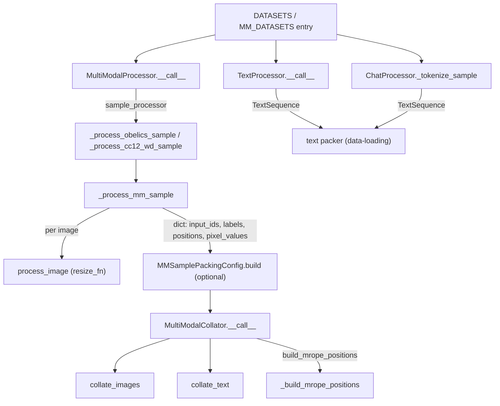

# HF datasets: registered text and multimodal datasets, sample processors, and the multimodal collator

## Overview

`torchtitan/hf_datasets` is the content layer on top of the generic Grain pipeline described in [data-loading](data-loading.md). It does not build loaders or iterate data itself. It provides three kinds of plug-ins for that pipeline: (1) two **registries** of ready-made dataset leaves keyed by name - [`DATASETS`](../catalog/torchtitan/hf_datasets/text_datasets.md#DATASETS.DATASETS "torchtitan/hf_datasets/text_datasets.py:L163") for text (`c4`, `c4_test`, `c4_validation`) and [`MM_DATASETS`](../catalog/torchtitan/hf_datasets/multimodal/mm_datasets.md#MM_DATASETS.MM_DATASETS "torchtitan/hf_datasets/multimodal/mm_datasets.py:L339") for image-text (`obelics`, `cc12m`, `cc12m-test`); (2) **sample processors** that turn one raw Hugging Face row into one next-token-aligned training sample ([`TextProcessor`](../catalog/torchtitan/hf_datasets/text_datasets.md#TextProcessor "torchtitan/hf_datasets/text_datasets.py:L32"), [`ChatProcessor`](../catalog/torchtitan/hf_datasets/text_datasets.md#ChatProcessor "torchtitan/hf_datasets/text_datasets.py:L61"), [`MultiModalProcessor`](../catalog/torchtitan/hf_datasets/multimodal/mm_datasets.md#MultiModalProcessor "torchtitan/hf_datasets/multimodal/mm_datasets.py:L275")); and (3) multimodal-only **packing and collation** ([`build`](../catalog/torchtitan/hf_datasets/multimodal/mm_datasets.md#MMSamplePackingConfig.build "torchtitan/hf_datasets/multimodal/mm_datasets.py:L388") of the multimodal packer and [`MultiModalCollator`](../catalog/torchtitan/hf_datasets/multimodal/mm_collator.md#MultiModalCollator "torchtitan/hf_datasets/multimodal/mm_collator.py:L22")).

The key idea is that a registry entry is just data: a frozen leaf config (source + processor + a `None`-dropping post-filter). Recipes compose it - for example wrapping `DATASETS["c4"]` in concat-then-split packing - and the TPU lane resolves its `--dataloader.dataset` string flag against the same `DATASETS` dict. Every processor follows one contract: **return a fully shifted, label-masked sample, or `None` to drop the row** (oversized, malformed, undecodable image), and the registry's post-filter removes the `None`s.

## Diagram

Text and multimodal rows take parallel paths through the plug-ins and meet in the same flat-token-batch contract:

Legend:
- `REG` - [`DATASETS`](../catalog/torchtitan/hf_datasets/text_datasets.md#DATASETS.DATASETS "torchtitan/hf_datasets/text_datasets.py:L163"), [`MM_DATASETS`](../catalog/torchtitan/hf_datasets/multimodal/mm_datasets.md#MM_DATASETS.MM_DATASETS "torchtitan/hf_datasets/multimodal/mm_datasets.py:L339")
- `TP` - [`__call__`](../catalog/torchtitan/hf_datasets/text_datasets.md#TextProcessor.__call__ "torchtitan/hf_datasets/text_datasets.py:L45")
- `CP` - [`_tokenize_sample`](../catalog/torchtitan/hf_datasets/text_datasets.md#ChatProcessor._tokenize_sample "torchtitan/hf_datasets/text_datasets.py:L100")
- `MP` - [`__call__`](../catalog/torchtitan/hf_datasets/multimodal/mm_datasets.md#MultiModalProcessor.__call__ "torchtitan/hf_datasets/multimodal/mm_datasets.py:L303")
- `OB` - [`_process_obelics_sample`](../catalog/torchtitan/hf_datasets/multimodal/mm_datasets.md#_process_obelics_sample "torchtitan/hf_datasets/multimodal/mm_datasets.py:L213"), [`_process_cc12_wd_sample`](../catalog/torchtitan/hf_datasets/multimodal/mm_datasets.md#_process_cc12_wd_sample "torchtitan/hf_datasets/multimodal/mm_datasets.py:L241")
- `MM` - [`_process_mm_sample`](../catalog/torchtitan/hf_datasets/multimodal/mm_datasets.md#_process_mm_sample "torchtitan/hf_datasets/multimodal/mm_datasets.py:L89")
- `IMG` - [`process_image`](../catalog/torchtitan/hf_datasets/multimodal/utils/image.md#process_image "torchtitan/hf_datasets/multimodal/utils/image.py:L200")
- `TXTPACK` - (concept) concat-then-split or first-fit packing, see [data-loading](data-loading.md)
- `MMPACK` - [`build`](../catalog/torchtitan/hf_datasets/multimodal/mm_datasets.md#MMSamplePackingConfig.build "torchtitan/hf_datasets/multimodal/mm_datasets.py:L388")
- `MMC` - [`__call__`](../catalog/torchtitan/hf_datasets/multimodal/mm_collator.md#MultiModalCollator.__call__ "torchtitan/hf_datasets/multimodal/mm_collator.py:L290")
- `CI` - [`collate_images`](../catalog/torchtitan/hf_datasets/multimodal/mm_collator.md#MultiModalCollator.collate_images "torchtitan/hf_datasets/multimodal/mm_collator.py:L49")
- `CT` - [`collate_text`](../catalog/torchtitan/hf_datasets/multimodal/mm_collator.md#MultiModalCollator.collate_text "torchtitan/hf_datasets/multimodal/mm_collator.py:L81")
- `MR` - [`_build_mrope_positions`](../catalog/torchtitan/hf_datasets/multimodal/mm_collator.md#MultiModalCollator._build_mrope_positions "torchtitan/hf_datasets/multimodal/mm_collator.py:L120")

## Design rationale (why it's built this way)

- **Registries of configs, not dataset classes.** After the move to Grain, a "dataset" is a value - a leaf dataset config (`SingleDatasetConfig`, see [data-loading](data-loading.md)) - so adding a dataset means adding a dict entry with a source and a processor config. The TPU lane's tests pin this contract: `test_c4_test_default_uses_repo_asset` and `test_c4_keeps_upstream_source` in `experiments/tpu/tests/test_datasets.py` assert that the TPU resolver returns `DATASETS["c4_test"]` / `DATASETS["c4"]` unchanged, and the `dataset_path` tests assert it only swaps the source path or `data_files`.
- **Processors shift and mask; nothing downstream does.** [`TextProcessor`](../catalog/torchtitan/hf_datasets/text_datasets.md#TextProcessor "torchtitan/hf_datasets/text_datasets.py:L32") "Tokenizes plain text into next-token input and label pairs"; [`ChatProcessor`](../catalog/torchtitan/hf_datasets/text_datasets.md#ChatProcessor "torchtitan/hf_datasets/text_datasets.py:L61") "Tokenizes one single-turn chat sample and masks prompt labels". Doing the shift per document, before packing, is what keeps a packed row from predicting the first token of the next document.
- **Drop instead of truncate.** [`_tokenize_sample`](../catalog/torchtitan/hf_datasets/text_datasets.md#ChatProcessor._tokenize_sample "torchtitan/hf_datasets/text_datasets.py:L100") "Returns None if the sample exceeds `seq_len`, avoiding training on truncated responses" (a TODO considers truncation later). The multimodal processor likewise skips samples longer than `max_context_length`.
- **Find the prompt boundary by re-tokenizing, not by string offsets.** The chat processor tokenizes the full conversation and, separately, the user turn with `add_generation_prompt=True`, and masks that many leading labels: "Uses incremental prefix re-tokenization to find the prompt/response token boundary, avoiding BPE merge errors."
- **Heavy vision preprocessing happens on the host.** Image decode, resize and normalization run in the processor via torchvision uint8 paths ("faster uint8 SIMD paths" per [`process_image`](../catalog/torchtitan/hf_datasets/multimodal/utils/image.md#process_image "torchtitan/hf_datasets/multimodal/utils/image.py:L200")), and 3-D MRoPE positions are built in the collator: [`_build_mrope_positions`](../catalog/torchtitan/hf_datasets/multimodal/mm_collator.md#MultiModalCollator._build_mrope_positions "torchtitan/hf_datasets/multimodal/mm_collator.py:L120") "Runs here on CPU data workers, off the GPU path."
- **Resolution is snapped to the patch-merge grid.** [`resize_to_pixel_budget`](../catalog/torchtitan/hf_datasets/multimodal/utils/image.md#resize_to_pixel_budget "torchtitan/hf_datasets/multimodal/utils/image.py:L94") (the default [`resize_fn`](../catalog/torchtitan/hf_datasets/multimodal/mm_datasets.md#MultiModalProcessor.Config.resize_fn "torchtitan/hf_datasets/multimodal/mm_datasets.py:L288")) resizes "so the spatial pixel count lands in `[min_pixels, max_pixels]`, with both dims rounded to a `patch_size * merge_size` multiple (Qwen-VL convention)", so the vision encoder never sees a partial patch or merge group.

## Entry points

- [`DATASETS`](../catalog/torchtitan/hf_datasets/text_datasets.md#DATASETS.DATASETS "torchtitan/hf_datasets/text_datasets.py:L163") - imported by model `config_registry.py` files (e.g. [`llama3_debugmodel`](../catalog/torchtitan/models/llama3/config_registry.md#llama3_debugmodel "torchtitan/models/llama3/config_registry.py:L63") wraps `DATASETS["c4_test"]` in concat-then-split packing, [`llama3_405b`](../catalog/torchtitan/models/llama3/config_registry.md#llama3_405b "torchtitan/models/llama3/config_registry.py:L370") uses `DATASETS["c4"]`) and by the TPU lane's dataset resolver. `c4` and `c4_validation` stream `allenai/c4` (config `en`); `c4_test` is random access over the in-repo JSON asset `tests/assets/c4_test/data.json`, which is why every debug recipe can run offline.
- [`MM_DATASETS`](../catalog/torchtitan/hf_datasets/multimodal/mm_datasets.md#MM_DATASETS.MM_DATASETS "torchtitan/hf_datasets/multimodal/mm_datasets.py:L339") - imported by VLM recipes (Qwen3.6 / Qwen3.8 config registries, e.g. [`qwen38_debugmodel_moe`](../catalog/torchtitan/models/qwen3_8/config_registry.md#qwen38_debugmodel_moe "torchtitan/models/qwen3_8/config_registry.py:L98")). All three entries are streaming; `cc12m-test` streams local `.tar` shards from `tests/assets/cc12m_test`.
- [`ChatProcessor`](../catalog/torchtitan/hf_datasets/text_datasets.md#ChatProcessor "torchtitan/hf_datasets/text_datasets.py:L61") with its [`Config`](../catalog/torchtitan/hf_datasets/text_datasets.md#ChatProcessor.Config "torchtitan/hf_datasets/text_datasets.py:L65") - used directly by SFT recipes, which supply [`messages_fn`](../catalog/torchtitan/hf_datasets/text_datasets.md#ChatProcessor.Config.messages_fn "torchtitan/hf_datasets/text_datasets.py:L66") to map dataset columns onto a `[user, assistant]` message pair (there is no registry entry for chat data).
- [`MultiModalProcessor`](../catalog/torchtitan/hf_datasets/multimodal/mm_datasets.md#MultiModalProcessor "torchtitan/hf_datasets/multimodal/mm_datasets.py:L275") / [`Config`](../catalog/torchtitan/hf_datasets/multimodal/mm_datasets.md#MultiModalProcessor.Config "torchtitan/hf_datasets/multimodal/mm_datasets.py:L279") - "Adapts a multimodal processor to Grain's map contract": wraps a dataset-specific [`sample_processor`](../catalog/torchtitan/hf_datasets/multimodal/mm_datasets.md#MultiModalProcessor.Config.sample_processor "torchtitan/hf_datasets/multimodal/mm_datasets.py:L280") callable and owns the vision knobs ([`patch_size`](../catalog/torchtitan/hf_datasets/multimodal/mm_datasets.md#MultiModalProcessor.Config.patch_size "torchtitan/hf_datasets/multimodal/mm_datasets.py:L281") 16, [`temporal_patch_size`](../catalog/torchtitan/hf_datasets/multimodal/mm_datasets.md#MultiModalProcessor.Config.temporal_patch_size "torchtitan/hf_datasets/multimodal/mm_datasets.py:L282") 2, [`spatial_merge_size`](../catalog/torchtitan/hf_datasets/multimodal/mm_datasets.md#MultiModalProcessor.Config.spatial_merge_size "torchtitan/hf_datasets/multimodal/mm_datasets.py:L283") 2, pixel budgets, video sampling).
- [`MultiModalCollator`](../catalog/torchtitan/hf_datasets/multimodal/mm_collator.md#MultiModalCollator "torchtitan/hf_datasets/multimodal/mm_collator.py:L22") / [`Config`](../catalog/torchtitan/hf_datasets/multimodal/mm_collator.md#MultiModalCollator.Config "torchtitan/hf_datasets/multimodal/mm_collator.py:L30") - set as `GrainDataLoader.Config.collator` in VLM recipes. Its patch geometry must match the processor's; recipes copy `patch_size` / `temporal_patch_size` / `spatial_merge_size` from the processor config into the collator config and turn on [`build_mrope_positions`](../catalog/torchtitan/hf_datasets/multimodal/mm_collator.md#MultiModalCollator.Config.build_mrope_positions "torchtitan/hf_datasets/multimodal/mm_collator.py:L35").

## Mechanism (step-by-step)

1. **Plain text.** [`__call__`](../catalog/torchtitan/hf_datasets/text_datasets.md#TextProcessor.__call__ "torchtitan/hf_datasets/text_datasets.py:L45") reads the text with `text_fn` (default: the `text` column), encodes it with BOS and EOS, and returns `TextSequence(input_ids=tokens[:-1], labels=tokens[1:])`, or `None` if fewer than two tokens. It ignores the Grain `rng`. Positions are left unset; the packer assigns per-document positions later. Each registry entry pairs this processor with the [`_is_not_none`](../catalog/torchtitan/hf_datasets/text_datasets.md#_is_not_none "torchtitan/hf_datasets/text_datasets.py:L159") post-filter.

2. **Single-turn chat (SFT).** [`__init__`](../catalog/torchtitan/hf_datasets/text_datasets.md#ChatProcessor.__init__ "torchtitan/hf_datasets/text_datasets.py:L70") requires a tokenizer with an EOS id and caches it as [`_eos_id`](../catalog/torchtitan/hf_datasets/text_datasets.md#ChatProcessor._eos_id "torchtitan/hf_datasets/text_datasets.py:L77") alongside [`_tokenizer`](../catalog/torchtitan/hf_datasets/text_datasets.md#ChatProcessor._tokenizer "torchtitan/hf_datasets/text_datasets.py:L76"). Per row, [`__call__`](../catalog/torchtitan/hf_datasets/text_datasets.md#ChatProcessor.__call__ "torchtitan/hf_datasets/text_datasets.py:L152") delegates to [`_tokenize_sample`](../catalog/torchtitan/hf_datasets/text_datasets.md#ChatProcessor._tokenize_sample "torchtitan/hf_datasets/text_datasets.py:L100"): validate exactly `[user, assistant]`, render the chat template, strip the trailing newline, encode with BOS, append EOS if missing, log the first rendered sample once, drop the row if `len(tokens) - 1 > max_context_length`, then re-tokenize just the user turn with the generation prompt to get `prompt_len` and set `labels[:prompt_len - 1] = IGNORE_INDEX`. Only response tokens (and the final EOS) contribute to loss.

3. **Multimodal sample processing.** [`__call__`](../catalog/torchtitan/hf_datasets/multimodal/mm_datasets.md#MultiModalProcessor.__call__ "torchtitan/hf_datasets/multimodal/mm_datasets.py:L303") forwards the row and every vision knob from [`_config`](../catalog/torchtitan/hf_datasets/multimodal/mm_datasets.md#MultiModalProcessor._config "torchtitan/hf_datasets/multimodal/mm_datasets.py:L299") to the dataset adapter. [`_process_obelics_sample`](../catalog/torchtitan/hf_datasets/multimodal/mm_datasets.md#_process_obelics_sample "torchtitan/hf_datasets/multimodal/mm_datasets.py:L213") passes OBELICS's aligned `texts`/`images` lists through; [`_process_cc12_wd_sample`](../catalog/torchtitan/hf_datasets/multimodal/mm_datasets.md#_process_cc12_wd_sample "torchtitan/hf_datasets/multimodal/mm_datasets.py:L241") turns a CC12M `jpg`/`txt` pair into the interleaved form `texts=[None, txt]`, `images=[jpg, None]`. Both land in [`_process_mm_sample`](../catalog/torchtitan/hf_datasets/multimodal/mm_datasets.md#_process_mm_sample "torchtitan/hf_datasets/multimodal/mm_datasets.py:L89") ("Common processing logic for multimodal samples"), which runs [`process_image`](../catalog/torchtitan/hf_datasets/multimodal/utils/image.md#process_image "torchtitan/hf_datasets/multimodal/utils/image.py:L200") on each image (decode to uint8, resize via `resize_fn`, normalize, return `(1, H, W, C)` float32), counts the vision tokens each image will occupy after `spatial_merge_size` x `spatial_merge_size` merging, drops the whole sample if any image fails, expands each image slot into `vision_start + image_pad * n + vision_end` placeholder text, tokenizes, shifts, and masks the four vision special tokens out of the labels. The result is a dict with `input_ids`, `labels`, `positions` (`arange`) and a list of `pixel_values`. Back in the wrapper, samples longer than [`_max_context_length`](../catalog/torchtitan/hf_datasets/multimodal/mm_datasets.md#MultiModalProcessor._max_context_length "torchtitan/hf_datasets/multimodal/mm_datasets.py:L301") are logged and dropped.

4. **Optional multimodal packing.** [`build`](../catalog/torchtitan/hf_datasets/multimodal/mm_datasets.md#MMSamplePackingConfig.build "torchtitan/hf_datasets/multimodal/mm_datasets.py:L388") ("Packs whole multimodal documents into fixed-length rows") filters out over-length samples, converts token fields to numpy, and runs Grain's first-fit packer with `num_tokens_per_batch` per row, `num_packing_bins` open bins (default 8: "more bins can reduce padding but retain more media"), the tokenizer's pad id for `input_ids`, and the media lists carried as meta-features. Its finalizer derives `padding_mask` from segment ids, wraps padding positions modulo `max_context_length`, and flattens per-document image lists into one list per row. Without this wrapper, the base collator contract (one row per batch) means each batch holds a single document padded to the token budget.

5. **Collate media into patch sequences.** [`__call__`](../catalog/torchtitan/hf_datasets/multimodal/mm_collator.md#MultiModalCollator.__call__ "torchtitan/hf_datasets/multimodal/mm_collator.py:L290") ("Collate batch with patch-based approach") first counts vision entries (images, plus videos counted in temporal patches) and raises if they exceed [`max_images_per_batch`](../catalog/torchtitan/hf_datasets/multimodal/mm_collator.md#MultiModalCollator.max_images_per_batch "torchtitan/hf_datasets/multimodal/mm_collator.py:L41") (default 128). [`collate_images`](../catalog/torchtitan/hf_datasets/multimodal/mm_collator.md#MultiModalCollator.collate_images "torchtitan/hf_datasets/multimodal/mm_collator.py:L49") patchifies each image with the collator's [`temporal_patch_size`](../catalog/torchtitan/hf_datasets/multimodal/mm_collator.md#MultiModalCollator.temporal_patch_size "torchtitan/hf_datasets/multimodal/mm_collator.py:L43"), [`spatial_merge_size`](../catalog/torchtitan/hf_datasets/multimodal/mm_collator.md#MultiModalCollator.spatial_merge_size "torchtitan/hf_datasets/multimodal/mm_collator.py:L44") and [`patch_order`](../catalog/torchtitan/hf_datasets/multimodal/mm_collator.md#MultiModalCollator.patch_order "torchtitan/hf_datasets/multimodal/mm_collator.py:L47") (`block` keeps each merge group contiguous for Qwen-style mergers; `raster` is plain row-major), and concatenates all patches into one `(num_patches, patch_dim)` tensor plus a `(num_images, 3)` `grid_thw`; videos get the same treatment in separate fields.

6. **Collate text into the flat token budget.** [`collate_text`](../catalog/torchtitan/hf_datasets/multimodal/mm_collator.md#MultiModalCollator.collate_text "torchtitan/hf_datasets/multimodal/mm_collator.py:L81") ("Concatenate whole samples and pad only the token-batch tail") concatenates `input_ids`, `labels`, `positions` and `padding_mask` across rows and pads the tail to `num_tokens_per_batch` with the pad id, `IGNORE_INDEX`, positions modulo `max_context_length`, and `True`. The resulting dict matches the text collator's keys, adding `pixel_values`, `grid_thw`, the video equivalents, the tokenizer's `special_tokens` ids (read through [`tokenizer`](../catalog/torchtitan/hf_datasets/multimodal/mm_collator.md#MultiModalCollator.tokenizer "torchtitan/hf_datasets/multimodal/mm_collator.py:L45")), and `num_valid_tokens`.

7. **Build 3-D MRoPE positions on the host.** When `build_mrope_positions` is on and the batch has media, [`_build_mrope_positions`](../catalog/torchtitan/hf_datasets/multimodal/mm_collator.md#MultiModalCollator._build_mrope_positions "torchtitan/hf_datasets/multimodal/mm_collator.py:L120") ("Build 3D (temporal, height, width) MRoPE position IDs per token") splits the flat sequence into documents where `positions` reset to 0, and within each document gives text tokens identical sequential ids on all three axes and each vision run a `(t, h, w)` grid offset by the running position (grids cached per shape). It returns `(num_tokens, 3)` as `mrope_positions`, and refuses `patch_order="raster"` because the ids are laid out in block order.

## Key data structures

- **Registry entry** - a leaf dataset config (`SingleDatasetConfig`, see [data-loading](data-loading.md)) with a Hugging Face streaming or random-access source config, a processor config, and a `None`-dropping post-filter.
- **Processor configs** - [`TextProcessor`](../catalog/torchtitan/hf_datasets/text_datasets.md#TextProcessor "torchtitan/hf_datasets/text_datasets.py:L32")'s [`Config`](../catalog/torchtitan/hf_datasets/text_datasets.md#TextProcessor.Config "torchtitan/hf_datasets/text_datasets.py:L36") (a suppressed `text_fn`), the chat [`Config`](../catalog/torchtitan/hf_datasets/text_datasets.md#ChatProcessor.Config "torchtitan/hf_datasets/text_datasets.py:L65") (`messages_fn`), and the multimodal [`Config`](../catalog/torchtitan/hf_datasets/multimodal/mm_datasets.md#MultiModalProcessor.Config "torchtitan/hf_datasets/multimodal/mm_datasets.py:L279"). Callables are `tyro.conf.Suppress`ed, so they are set in Python recipes, never from the CLI.
- **Multimodal sample dict** - `input_ids`, `labels`, `positions` (torch tensors), `pixel_values` (list of `(T, H, W, C)` float tensors), and optionally `pixel_values_videos` / `padding_mask` after packing.
- **Multimodal batch** - the text collator's flat keys plus `pixel_values` `(num_patches, patch_dim)`, `grid_thw` `(num_images, 3)` (raw patch counts before merging), video equivalents, `special_tokens`, and optional `mrope_positions` `(num_tokens, 3)`.

## Dynamics (design intent)

- **All of this runs on host CPU threads.** Tokenization, chat templating, image decode/resize/normalize and MRoPE construction execute inside the Grain pipeline that the loader prefetches (2 batches by default, threads not processes). For VLM training this is the heaviest host work in the repo.
- **Text recipes are shape-stable; VLM recipes are not.** Text processors feed packers whose output is exactly `num_tokens_per_batch`. The multimodal collator also pads text to that budget, but `pixel_values` is a concatenation of however many patches the batch's images produce, so its leading dimension varies batch to batch with image count and resolution.

> [!inferred]
> On an XLA backend such as TorchTPU, a varying `pixel_values` shape means the vision encoder sees a new input shape whenever the image mix changes, which can trigger recompilation. The module docstring of `mm_datasets.py` still describes padding images "to same num_patches" (shape `(N, max_patches, patch_dim)`) and text to `(batch_size, seq_len)`, but the current [`collate_images`](../catalog/torchtitan/hf_datasets/multimodal/mm_collator.md#MultiModalCollator.collate_images "torchtitan/hf_datasets/multimodal/mm_collator.py:L49") and [`collate_text`](../catalog/torchtitan/hf_datasets/multimodal/mm_collator.md#MultiModalCollator.collate_text "torchtitan/hf_datasets/multimodal/mm_collator.py:L81") do neither; trust the code. Bucketing image sizes (via `min_pixels` / `max_pixels` or `resize_fn`) is the available lever to limit distinct shapes.

## Edge cases

- **Silent drops.** Every processor returns `None` for unusable rows (too short, too long, non-single-turn chat raises instead, undecodable image), and the post-filter removes them. Map-style filtering leaves rejected indices in place, so the effective dataset is smaller than `len(source)`; with long-context SFT a large share of samples can vanish without error.
- **Chat boundary assumption.** The prompt mask assumes the user-turn tokens are an exact prefix of the full-conversation tokens; a TODO notes this is not validated. Multi-turn data is rejected (`Expected single-turn [user, assistant]`).
- **Image failure drops the sample.** If any image in an interleaved sample fails to decode or resize, `_process_mm_sample` logs "Cannot process all images for sample. Dropping".
- **Aspect-ratio guard.** `resize_to_pixel_budget` raises for aspect ratios above 200; inside `process_image` that exception is caught, logged, and turns into a dropped image.
- **Collator/processor geometry must match.** The collator has its own `patch_size` / `temporal_patch_size` / `spatial_merge_size`; if they disagree with the processor, token counts computed at processing time will not match the patch grid at collation time. Recipes copy them across explicitly.
- **`max_images_per_batch` is a hard error**, not a drop; a packed row with many small images can exceed it.
- **Pad id must exist.** Multimodal packing and collation read `tokenizer.pad_id`; text packing pads `input_ids` with 0 instead.

## Open questions

- `insert_vision_placeholders`, `vision_to_patches`, `calculate_vision_tokens`, `MMSamplePackingConfig` (the class) and the video loaders are not in this packet's subgraph; their behavior above is read from source (`multimodal/utils/*.py`, `mm_datasets.py`).
- The TPU lane resolver (`_text_dataset` in `experiments/tpu/datasets.py`) is also outside the subgraph; per its tests it treats `c4_test` specially (directory or non-`.json` paths resolve to `<path>/data.json`) and replaces `source.path` for every other name.
- Whether any TPU recipe trains a VLM through `MultiModalCollator`, and how the TorchTPU vision path handles the variable patch count, is not settled by this subsystem.

## See also

- [data-loading](data-loading.md) - the Grain pipeline, packers, text collator, and checkpointing these plug-ins run inside.
- [qwen3-5-model](qwen3-5-model.md) - a consumer of MRoPE positions and multimodal batches.
- [trainer-and-train-loop](trainer-and-train-loop.md) - how `num_valid_tokens` and the batch dict are consumed.
- [tpu-trainer-and-job-config](tpu-trainer-and-job-config.md) - the TPU recipes that select `DATASETS` entries by name.
- [llama3-model](llama3-model.md) - recipes using `c4`, `c4_test`, and chat SFT.
