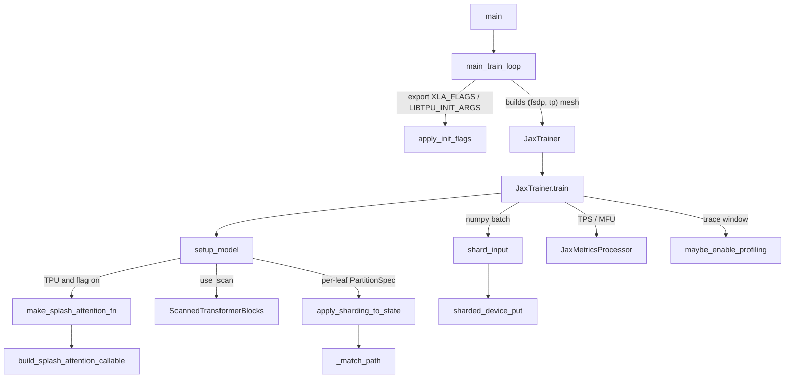
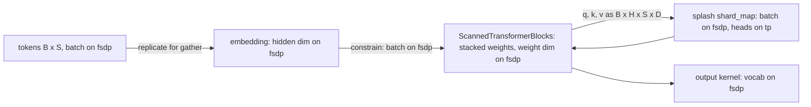

# JAX lane: pure-JAX / Flax NNX trainer (experiments/jax)

<!-- connect:up:begin -->
> **Cross-repo concept:** part of [pallas-kernel](../../../concepts/pallas-kernel.md), [rematerialization](../../../concepts/rematerialization.md), [sharding](../../../concepts/sharding.md), [splash-attention](../../../concepts/splash-attention.md) across this wiki's repos.
<!-- connect:up:end -->
## Overview

`torchtitan/experiments/jax` is a TPU training lane that reuses TorchTitan's *configuration* surface (job config, model flavors, dataloader, profiler config, TPU flag maps) but runs the model, the autodiff, the optimizer and the sharding entirely in JAX: Flax NNX modules, `nnx.jit` + `nnx.value_and_grad`, optax, and `jax.sharding.NamedSharding` on a two-axis `('fsdp', 'tp')` mesh. The README states the intent directly: "LLM training on TPU using pure JAX with Flax NNX - no PyTorch dependency in the training path." Torch survives only at the edges: the TorchTitan dataloader is wrapped by [`torch_loader_to_jax`](../catalog/torchtitan/experiments/jax/data_utils.md#torch_loader_to_jax "torchtitan/experiments/jax/data_utils.py:L13") to yield numpy, and the job config is a [`JaxJobConfig`](../catalog/torchtitan/experiments/jax/jax_job_config.md#JaxJobConfig "torchtitan/experiments/jax/jax_job_config.py:L27") that subclasses the shared [`BaseTPUTrainerConfig`](../catalog/torchtitan/experiments/tpu/tpu_job_config.md#BaseTPUTrainerConfig "torchtitan/experiments/tpu/tpu_job_config.py:L150").

The key design idea is that **parallelism is declared, not implemented**: there is no FSDP wrapper, no all-gather code and no TP module rewrite. Each parameter gets a `PartitionSpec` from a path-keyed sharding map, activations get a couple of `with_sharding_constraint` hints, and XLA's SPMD partitioner inserts every collective. The only hand-written distributed kernel boundary is splash attention, which is wrapped in an explicit `shard_map`. For TPU performance this makes the lane a useful *reference point*: it shows what XLA alone does with a given sharding, scan and remat policy, with no framework-level dispatch overhead in the step.

Only one model family is wired today: Llama3 (`debugmodel`, `8B`, `70B` flavors; see [`llama3_8b`](../catalog/torchtitan/experiments/jax/llama3/model.md#llama3_8b "torchtitan/experiments/jax/llama3/model.py:L68") and [`llama3_70b`](../catalog/torchtitan/experiments/jax/llama3/model.md#llama3_70b "torchtitan/experiments/jax/llama3/model.py:L80")).

## Diagram

Control flow of one run, from CLI to the compiled step:

Legend:
- `MAIN` - [`main`](../catalog/torchtitan/experiments/jax/train_minimal.md#main "torchtitan/experiments/jax/train_minimal.py:L129")
- `LOOP` - [`main_train_loop`](../catalog/torchtitan/experiments/jax/train_minimal.md#main_train_loop "torchtitan/experiments/jax/train_minimal.py:L65")
- `FLAGS` - [`apply_init_flags`](../catalog/torchtitan/experiments/tpu/tpu_flags.md#apply_init_flags "torchtitan/experiments/tpu/tpu_flags.py:L109")
- `JT` - [`JaxTrainer`](../catalog/torchtitan/experiments/jax/trainer.md#JaxTrainer "torchtitan/experiments/jax/trainer.py:L91")
- `TRAIN` - [`train`](../catalog/torchtitan/experiments/jax/trainer.md#JaxTrainer.train "torchtitan/experiments/jax/trainer.py:L321")
- `SETUP` - [`setup_model`](../catalog/torchtitan/experiments/jax/trainer.md#JaxTrainer.setup_model "torchtitan/experiments/jax/trainer.py:L165")
- `SPLASH` - [`make_splash_attention_fn`](../catalog/torchtitan/experiments/jax/splash_attn.md#make_splash_attention_fn "torchtitan/experiments/jax/splash_attn.py:L106")
- `BSC` - [`build_splash_attention_callable`](../catalog/torchtitan/experiments/jax/splash_attn.md#build_splash_attention_callable "torchtitan/experiments/jax/splash_attn.py:L41")
- `SCAN` - [`ScannedTransformerBlocks`](../catalog/torchtitan/experiments/jax/llama3/model.md#ScannedTransformerBlocks "torchtitan/experiments/jax/llama3/model.py:L341")
- `SHARD` - [`apply_sharding_to_state`](../catalog/torchtitan/experiments/jax/distributed.md#apply_sharding_to_state "torchtitan/experiments/jax/distributed.py:L103")
- `MATCH` - [`_match_path`](../catalog/torchtitan/experiments/jax/distributed.md#_match_path "torchtitan/experiments/jax/distributed.py:L79")
- `SIN` - [`shard_input`](../catalog/torchtitan/experiments/jax/distributed.md#shard_input "torchtitan/experiments/jax/distributed.py:L165")
- `SDP` - [`sharded_device_put`](../catalog/torchtitan/experiments/jax/distributed.md#sharded_device_put "torchtitan/experiments/jax/distributed.py:L25")
- `MET` - [`JaxMetricsProcessor`](../catalog/torchtitan/experiments/jax/metrics.md#JaxMetricsProcessor "torchtitan/experiments/jax/metrics.py:L52")
- `PROF` - [`maybe_enable_profiling`](../catalog/torchtitan/experiments/jax/jax_profiling.md#maybe_enable_profiling "torchtitan/experiments/jax/jax_profiling.py:L28")

Where each parameter and activation lives on the mesh (scan variant):

Legend:
- `TOK` - (concept) the int32 batch placed by [`shard_input`](../catalog/torchtitan/experiments/jax/distributed.md#shard_input "torchtitan/experiments/jax/distributed.py:L165")
- `EMB` - (concept) `tok_embeddings/embedding` entry of the scan sharding map, consumed in [`__call__`](../catalog/torchtitan/experiments/jax/llama3/model.md#Transformer.__call__ "torchtitan/experiments/jax/llama3/model.py:L496")
- `BLK` - [`ScannedTransformerBlocks`](../catalog/torchtitan/experiments/jax/llama3/model.md#ScannedTransformerBlocks "torchtitan/experiments/jax/llama3/model.py:L341")
- `ATT` - [`build_splash_attention_callable`](../catalog/torchtitan/experiments/jax/splash_attn.md#build_splash_attention_callable "torchtitan/experiments/jax/splash_attn.py:L41")
- `OUT` - (concept) `output/kernel` entry of the scan sharding map

## Design rationale (why it's built this way)

- **Borrow TorchTitan's config, not its runtime.** [`JaxJobConfig`](../catalog/torchtitan/experiments/jax/jax_job_config.md#JaxJobConfig "torchtitan/experiments/jax/jax_job_config.py:L27") inherits [`BaseTPUTrainerConfig`](../catalog/torchtitan/experiments/tpu/tpu_job_config.md#BaseTPUTrainerConfig "torchtitan/experiments/tpu/tpu_job_config.py:L150"), so the jax lane gets the same XLA/libtpu [`FlagMap`](../catalog/torchtitan/experiments/tpu/tpu_flags.md#FlagMap "torchtitan/experiments/tpu/tpu_flags.py:L45") fields, splash block-size knobs, training/parallelism/activation-checkpoint blocks and profiler config as the TorchTPU lane. Recipes are derived from TPU-lane recipes: [`llama3_debugmodel`](../catalog/torchtitan/experiments/jax/llama3/config_registry.md#llama3_debugmodel "torchtitan/experiments/jax/llama3/config_registry.py:L27") calls the TPU recipe and copy-constructs it onto `JaxJobConfig`, swaps in a JAX-lane `ModelSpec` (whose `parallelize_fn` is a no-op lambda, because "the JAX trainer performs sharding via the JAX named mesh") and turns `use_scan` off; everything else is inherited from the TPU recipe. The payoff is apples-to-apples comparisons: the same CLI flags drive both lanes.
- **Scan over layers by default.** `use_scan` defaults to `True` on [`JaxConfig`](../catalog/torchtitan/experiments/jax/jax_job_config.md#JaxConfig "torchtitan/experiments/jax/jax_job_config.py:L9"). The README's reason: "one compact XLA graph regardless of depth, dramatically reducing compile time." [`ScannedTransformerBlocks`](../catalog/torchtitan/experiments/jax/llama3/model.md#ScannedTransformerBlocks "torchtitan/experiments/jax/llama3/model.py:L341") stores each per-block parameter as one stacked `nnx.Param` attribute (e.g. `attention_wq_kernel`, shape `[n_layers, ...]`) rather than a list, because "NNX rejects" plain-list storage and named attributes give "NNX full visibility for gradient computation and sharding".
- **Path-pattern sharding instead of module wrapping.** A dict from parameter path to `PartitionSpec` tuple is the whole parallelism plan. [`_match_path`](../catalog/torchtitan/experiments/jax/distributed.md#_match_path "torchtitan/experiments/jax/distributed.py:L79") is shared with the torchax lane, which is why it accepts three spellings (exact path, path with integer segments replaced by `*`, then regex). Anything unmatched is replicated with a warning - a deliberate "never fail, but tell me" default.
- **Shard the LM head on vocab, not hidden (scan map only).** The comment above the scan map explains the memory reasoning: the cross-entropy upcast of `f32[B/fsdp, S, V]` was "the single biggest fp32 allocation at optimizer peak" (~4 GiB/chip at b=16, s=2048, V=128256); sharding `output/kernel` as `(None, 'fsdp')` gives vocab-sharded logits (~1 GiB/chip) at the cost of an all-reduce inside the log-sum-exp. The non-scan map keeps the older hidden-dim sharding.
- **Memory-first train step.** The step function is `nnx.jit(donate_argnames=('model', 'optimizer'))`, with the trainer comment citing "7+ f32[32,1024,28672] live copies in the memory report without donate". Logits are kept in bf16 ("Was .astype(fp32) which pins a f32[B,S,V] copy live through backward"), and the optional `adamw_bf16_state` knob stores both Adam moments in bf16 because stock optax "exposes mu_dtype but not nu_dtype".
- **Splash GQA without K/V repeat.** When the splash callable is present, K/V are passed with `n_kv_heads` directly - "saving the ~4x materialized K/V when we'd otherwise repeat to match n_heads". The fallback einsum attention repeats K/V and materializes a full `[S, S]` causal mask.

> [!inferred]
> The lane is best read as an XLA-native upper-bound/reference for the same model and flags rather than a production trainer: it supports one model family, has no checkpointing, no gradient clipping, no LR schedule (a constant LR is passed to optax), no gradient accumulation, and no eval loop. Those omissions are visible in `JaxTrainer`, but the "reference" intent is my reading.

## Entry points

- [`main`](../catalog/torchtitan/experiments/jax/train_minimal.md#main "torchtitan/experiments/jax/train_minimal.py:L129") - the `python -m torchtitan.experiments.jax.train_minimal` entry (absl app). Parses `sys.argv` through TorchTitan's `ConfigManager` into a [`JaxJobConfig`](../catalog/torchtitan/experiments/jax/jax_job_config.md#JaxJobConfig "torchtitan/experiments/jax/jax_job_config.py:L27") and asserts that training returned truthy.
- [`main_train_loop`](../catalog/torchtitan/experiments/jax/train_minimal.md#main_train_loop "torchtitan/experiments/jax/train_minimal.py:L65") - the programmatic entry (the distributed test calls it directly with a parsed config). Owns everything that must happen before the JAX backend initializes: flags, multi-host init, mesh construction.
- [`llama3_debugmodel`](../catalog/torchtitan/experiments/jax/llama3/config_registry.md#llama3_debugmodel "torchtitan/experiments/jax/llama3/config_registry.py:L27") - the only registered recipe (`--module torchtitan.experiments.jax.llama3 --config llama3_debugmodel`). Note it sets `use_scan = False`; larger flavors are selected by overriding `--model.flavor`.
- [`JaxTrainer`](../catalog/torchtitan/experiments/jax/trainer.md#JaxTrainer "torchtitan/experiments/jax/trainer.py:L91") / [`train`](../catalog/torchtitan/experiments/jax/trainer.md#JaxTrainer.train "torchtitan/experiments/jax/trainer.py:L321") - constructed inside `with mesh:`; `train()` builds model, optimizer and dataloader, defines the jitted step and runs the loop.

## Mechanism (step-by-step)

1. **Flags before the backend exists.** [`main_train_loop`](../catalog/torchtitan/experiments/jax/train_minimal.md#main_train_loop "torchtitan/experiments/jax/train_minimal.py:L65") calls [`init_logger`](../catalog/torchtitan/tools/logging.md#init_logger "torchtitan/tools/logging.py:L15") and then [`apply_init_flags`](../catalog/torchtitan/experiments/tpu/tpu_flags.md#apply_init_flags "torchtitan/experiments/tpu/tpu_flags.py:L109"), which renders the config's `xla_flags` / `libtpu_init_flags` (plus their `extra_` layers) into `XLA_FLAGS` / `LIBTPU_INIT_ARGS`. Ordering matters: the docstring warns the consumer "latches their values while the first program is compiled, so flags applied after that point are silently ignored." [`_apply_flags`](../catalog/torchtitan/experiments/tpu/tpu_flags.md#_apply_flags "torchtitan/experiments/tpu/tpu_flags.py:L231") gives an already-set environment variable precedence over the config (it logs a warning and keeps the env value), and `!flag` entries remove a flag. Multi-host JAX is then initialized from `TPU_WORKER_HOSTNAMES` / `TPU_WORKER_ID` (coordinator = first host, port 8476) before any `jax.devices()` call, so the runtime sees the full multi-host mesh.

2. **Mesh = (fsdp, tp), sized from the device count.** `tp` comes from `--parallelism.tensor_parallel_degree` (clamped to >= 1) and `fsdp = num_global_devices // tp`. Single-slice runs use `jax.make_mesh((fsdp, tp), ('fsdp','tp'), axis_types=Auto)`; with `tpu_num_slices > 1` on TPU it uses `create_hybrid_device_mesh` with the per-slice shape `(fsdp // num_slices, tp)` and DCN shape `(num_slices, 1)`, so the slice boundary falls on the fsdp axis. The [`JaxTrainer`](../catalog/torchtitan/experiments/jax/trainer.md#JaxTrainer "torchtitan/experiments/jax/trainer.py:L91") is constructed and run inside `with mesh:`. No other parallelism degree (PP, CP, EP, dp_replicate) is read by this lane.

3. **Model construction: AC policy, attention kernel, dtype.** [`setup_model`](../catalog/torchtitan/experiments/jax/trainer.md#JaxTrainer.setup_model "torchtitan/experiments/jax/trainer.py:L165") maps TorchTitan's activation-checkpoint config onto a JAX remat policy by type: a [`FullAC`](../catalog/torchtitan/distributed/activation_checkpoint.md#FullAC "torchtitan/distributed/activation_checkpoint.py:L168") [`Config`](../catalog/torchtitan/distributed/activation_checkpoint.md#FullAC.Config "torchtitan/distributed/activation_checkpoint.py:L172") becomes `jax.checkpoint_policies.nothing_saveable`, a [`SelectiveAC`](../catalog/torchtitan/distributed/activation_checkpoint.md#SelectiveAC "torchtitan/distributed/activation_checkpoint.py:L187") [`Config`](../catalog/torchtitan/distributed/activation_checkpoint.md#SelectiveAC.Config "torchtitan/distributed/activation_checkpoint.py:L197") becomes `dots_saveable` (save matmul outputs, recompute the rest - not the torch-side per-op SAC list), `None` disables remat, and any other type falls back to `nothing_saveable`. On TPU with `splash_attention_kernel.use_splash_attention_kernel` set, it builds the splash callable (step 5); otherwise it logs and uses the einsum fallback. `training.dtype` picks the *master-weight* dtype (`float32` or `bfloat16`); compute stays bf16 in every `nnx.Linear` / `nnx.Embed`. The model is instantiated on the host-local CPU device (`jax.local_devices(backend='cpu')[0]`) so an 8B/70B model never materializes unsharded on one TPU, and "local" rather than `jax.devices('cpu')[0]` avoids non-addressable CPU devices on multi-host.

4. **Scan-over-layers and where remat attaches.** With `use_scan`, [`layers`](../catalog/torchtitan/experiments/jax/llama3/model.md#Transformer.layers "torchtitan/experiments/jax/llama3/model.py:L467") is a [`ScannedTransformerBlocks`](../catalog/torchtitan/experiments/jax/llama3/model.md#ScannedTransformerBlocks "torchtitan/experiments/jax/llama3/model.py:L341"): it builds N independent blocks (seeds `0..N-1`), flattens each block's NNX state, `jnp.stack`s every leaf along axis 0, and stores the stacks as named params. Its forward runs `jax.lax.scan` whose body unflattens one layer's slice and `nnx.merge`s it into a block; if a checkpoint policy is set, the *scan body* is wrapped in `jax.checkpoint(..., policy=...)`. Each block also tags its input with `checkpoint_name(x, "decoder_layer_input")` so a custom policy could save or offload it. Without scan, `layers` is an `nnx.List` of blocks unrolled in Python and the checkpoint policy is not passed to them (see Edge cases).

5. **Splash attention callable.** [`make_splash_attention_fn`](../catalog/torchtitan/experiments/jax/splash_attn.md#make_splash_attention_fn "torchtitan/experiments/jax/splash_attn.py:L106") fixes the attention sharding to `P('fsdp', 'tp', None, None)` on `[batch, heads, seq, head_dim]` - batch over fsdp, heads over tp - and calls [`build_splash_attention_callable`](../catalog/torchtitan/experiments/jax/splash_attn.md#build_splash_attention_callable "torchtitan/experiments/jax/splash_attn.py:L41"). Per call, that builds a tokamax `SplashConfig` from the `sa_block_*` knobs, each clamped to the actual sequence length (so a short debug sequence never gets a block larger than S), with fused backward by default, configurable Q/K/V layouts and `use_base2_exp=False`. The mask is `CausalMask(S, S)` or, for a `local_window` W, `LocalMask(window_size=(W-1, 0))`. The kernel from `make_splash_mha(q_seq_shards=1)` is `jax.vmap`-ed over the per-shard batch, wrapped in `shard_map(in_specs=(q,q,q,None), out_specs=q, check_rep=False)` so each device runs the Pallas kernel on its local `[B/fsdp, H/tp, S, D]` slab with no collective, then `jax.jit`-ed. Any exception while building returns `None`, which silently selects the fallback attention (logged at error level).

6. **Parameter placement.** After `nnx.split(model)`, [`apply_sharding_to_state`](../catalog/torchtitan/experiments/jax/distributed.md#apply_sharding_to_state "torchtitan/experiments/jax/distributed.py:L103") maps [`shard_leaf`](../catalog/torchtitan/experiments/jax/distributed.md#apply_sharding_to_state.shard_leaf "torchtitan/experiments/jax/distributed.py:L117") over every leaf: it rebuilds a `/`-joined path (stripping NNX's trailing `value` attribute key), asks [`_match_path`](../catalog/torchtitan/experiments/jax/distributed.md#_match_path "torchtitan/experiments/jax/distributed.py:L79") for a spec, builds a `NamedSharding(mesh, P(*spec))`, pulls the CPU array to numpy and hands it to [`sharded_device_put`](../catalog/torchtitan/experiments/jax/distributed.md#sharded_device_put "torchtitan/experiments/jax/distributed.py:L25"). Single-host that is a plain `jax.device_put`; multi-host it assembles a global array from each host's addressable slices via `make_array_from_single_device_arrays` - safe only because every host built the identical replicated model from the same seed. The numpy round-trip is deliberate: slicing a CPU-committed `jax.Array` per device raised "Cannot reshard an input that is not fully addressable". In the scan map every stacked matmul weight is FSDP-sharded on its leading weight dim (`(None, 'fsdp', None)` for wq/wk/wv/w1/w3, `(None, None, 'fsdp')` for wo/w2), norms on hidden, the RoPE table replicated.

7. **Optimizer.** The trainer reads the first param group of the TorchTitan optimizer config (lr, betas, eps, weight decay) and builds `optax.sgd`, `optax.adam` or `optax.adamw`, wrapped in `nnx.Optimizer(model, tx, wrt=nnx.Param)`. With `adamw_bf16_state` on [`JaxConfig`](../catalog/torchtitan/experiments/jax/jax_job_config.md#JaxConfig "torchtitan/experiments/jax/jax_job_config.py:L9"), adamw is replaced by a custom chain whose moments are stored in bf16 and upcast to fp32 per leaf inside the update; the config docstring motivates it with "fp32 nu is 3.5 GiB/chip for the stacked MLP kernel alone" for Llama3 8B on v6e-4. TorchTitan's [`LRSchedulersContainer`](../catalog/torchtitan/components/optimizer/lr_scheduler.md#LRSchedulersContainer "torchtitan/components/optimizer/lr_scheduler.py:L25") is not used: the LR is a constant.

8. **The jitted step.** Inside [`train`](../catalog/torchtitan/experiments/jax/trainer.md#JaxTrainer.train "torchtitan/experiments/jax/trainer.py:L321"), `train_step` is `nnx.jit` with model and optimizer donated. The loss runs the model ([`__call__`](../catalog/torchtitan/experiments/jax/llama3/model.md#Transformer.__call__ "torchtitan/experiments/jax/llama3/model.py:L496")), reshapes bf16 logits to `[B*S, V]`, and computes `sum(logsumexp(logits) - logits[label])` cast to fp32 - a **sum**, not a mean. Gradients come from `nnx.value_and_grad(argnums=nnx.DiffState(0, nnx.Param))` (only `Param`s are differentiated) and `optimizer.update(model, grads)` applies them in the same compiled program, so forward, backward and optimizer update are one XLA executable per step. The forward itself replicates the tokens before the embedding gather (the comment: when the embedding table is replicated and tokens are batch-sharded, "JAX cannot infer the output sharding automatically"; the same workaround is kept for the scan map, whose table is sharded on hidden) and immediately constrains the embedding output back to `P('fsdp', None, None)`.

9. **Feeding the step.** Batches arrive as numpy from [`torch_loader_to_jax`](../catalog/torchtitan/experiments/jax/data_utils.md#torch_loader_to_jax "torchtitan/experiments/jax/data_utils.py:L13") (or a synthetic generator for `dataset=fake`). The trainer converts the token-denominated config back to samples (`global_batch = num_tokens_per_train_step // max_context_length`, falling back to `num_tokens_per_microbatch_per_dp_rank // max_context_length`) and builds the TorchTitan dataloader with `dp_world_size=1, dp_rank=0` - one process reads the whole global batch per host. [`shard_input`](../catalog/torchtitan/experiments/jax/distributed.md#shard_input "torchtitan/experiments/jax/distributed.py:L165") places inputs and labels with `P('fsdp')` on the batch dim through [`sharded_device_put`](../catalog/torchtitan/experiments/jax/distributed.md#sharded_device_put "torchtitan/experiments/jax/distributed.py:L25"); the code keeps them as numpy until this point because `jnp.array` "commits to host 0's TPU, which would then require an unsupported cross-host reshard."

10. **Metrics and profiling.** [`JaxMetricsProcessor`](../catalog/torchtitan/experiments/jax/metrics.md#JaxMetricsProcessor "torchtitan/experiments/jax/metrics.py:L52") is given `num_flops_per_token = 6 * n_params` (all `nnx.Param` leaves, embeddings included, no attention term). [`_log_summary`](../catalog/torchtitan/experiments/jax/metrics.md#JaxMetricsProcessor._log_summary "torchtitan/experiments/jax/metrics.py:L112") computes TPS over the wall time since the last log, TFLOPs, and `mfu = 100 * flops_per_token * tps / peak`, where peak is a per-core BF16 table (v4, v5e, v5p, v6e, v7x, plus A100/H100) times the global device count, doubled on v4/v5p when `tpu_megacore` is true. The loop calls `jax.block_until_ready(loss)` on logging steps (step 1 and every `log_freq`) and, whenever profiling is enabled, on every step (the profiler object is non-`None` for the whole run); with profiling off, non-logging steps are dispatched asynchronously. [`maybe_enable_profiling`](../catalog/torchtitan/experiments/jax/jax_profiling.md#maybe_enable_profiling "torchtitan/experiments/jax/jax_profiling.py:L28") reads the TorchTitan [`Profiler`](../catalog/torchtitan/tools/profiler.md#Profiler "torchtitan/tools/profiler.py:L106") [`Config`](../catalog/torchtitan/tools/profiler.md#Profiler.Config "torchtitan/tools/profiler.py:L129") and starts a `jax.profiler` trace into `<dump_folder>/<save_traces_folder>/iteration_<n>` whenever `(step + warmup) % profile_freq == 0`, stopping at the first later step with `(step - profiler_active) % profile_freq == 0` - i.e. `warmup + profiler_active` steps after the start when that sum is below `profile_freq`, so the warmup steps are inside the trace (see [`profile_freq`](../catalog/torchtitan/tools/profiler.md#Profiler.Config.profile_freq "torchtitan/tools/profiler.py:L136")).

## Key data structures

| Structure | What it holds | Why it matters for perf |
|---|---|---|
| [`JaxConfig`](../catalog/torchtitan/experiments/jax/jax_job_config.md#JaxConfig "torchtitan/experiments/jax/jax_job_config.py:L9") | `use_scan` (True), `tpu_megacore` (True), `tpu_num_slices` (1), `model_layer_override` (None), `adamw_bf16_state` (False) | Scan controls compile time and graph shape; megacore only affects the MFU denominator; slices select the hybrid DCN mesh; bf16 moments halve optimizer HBM. |
| [`JaxJobConfig`](../catalog/torchtitan/experiments/jax/jax_job_config.md#JaxJobConfig "torchtitan/experiments/jax/jax_job_config.py:L27") | `jax_config` plus everything on [`BaseTPUTrainerConfig`](../catalog/torchtitan/experiments/tpu/tpu_job_config.md#BaseTPUTrainerConfig "torchtitan/experiments/tpu/tpu_job_config.py:L150") (flag maps, splash block sizes, training, parallelism, AC, profiler) | One CLI surface shared with the TorchTPU lane. |
| Sharding maps (scan / original) | path -> PartitionSpec tuple; `()` = replicated, `None` = unsharded on that dim | The entire parallelism plan; only the `fsdp` axis is named in either map. |
| Stacked block params | one `nnx.Param` per block-leaf, shape `[n_layers, *leaf_shape]`, attribute name = path with `/` -> `_` | The leading layer axis is unsharded (`None`), so FSDP shards within every layer's slice. |
| Mesh | `jax.sharding.Mesh` with axes `('fsdp', 'tp')`, both `AxisType.Auto` | Auto axes let XLA's partitioner choose collectives from the specs. |

## Dynamics (design intent)

- **One executable per step.** The donated `nnx.jit` step fuses forward, backward and the optax update; XLA schedules FSDP all-gathers/reduce-scatters around the scan body. There is no per-layer Python in the hot path when `use_scan` is on.
- **Async dispatch.** Host-side work (numpy conversion, `shard_input`) for step N+1 can overlap device execution of step N because the loop only blocks on log or profile steps. `data_loading_times` therefore measures host batch-prep time, not device time.
- **Tested paths.** The distributed test trains the debug model for 3 steps at `max_context_length=128` with both `--jax_config.use_scan` and `--jax_config.no-use-scan`, one layer, and `activation-checkpoint:full`. The `_match_path` unit tests pin the precedence order (exact beats `*`-processed beats regex; invalid regexes are skipped) and the expected specs for both Llama3 maps.

## Edge cases

- **Splash is off unless the recipe turns it on.** `use_splash_attention_kernel` defaults to `False` in the shared splash config, so a stock run uses the einsum fallback, which repeats K/V `n_rep` times and materializes a `[B, S, H, S]` score tensor plus an `[S, S]` mask - memory quadratic in sequence length.
- **AC only applies to the scanned stack.** The checkpoint policy is handed only to [`ScannedTransformerBlocks`](../catalog/torchtitan/experiments/jax/llama3/model.md#ScannedTransformerBlocks "torchtitan/experiments/jax/llama3/model.py:L341"); the non-scan `nnx.List` path ignores `--activation_checkpoint.mode`. [`llama3_debugmodel`](../catalog/torchtitan/experiments/jax/llama3/config_registry.md#llama3_debugmodel "torchtitan/experiments/jax/llama3/config_registry.py:L27") defaults to `use_scan = False`, so the debug recipe runs without remat unless `--jax_config.use_scan` is passed.
- **TP shards attention heads only.** Neither sharding map names the `tp` axis, so with `tp > 1` all weights are replicated across tp; only the splash `shard_map` splits heads over tp, and XLA must reshard the projections around it. Batch is sharded on `fsdp` alone, so the global batch must divide `fsdp`, not `fsdp * tp`.
- **Loss is summed.** Gradients are of the summed token loss; the logged loss is divided by `ntokens` only for display. Effective step size scales with tokens per step relative to a mean-reduced loss.
- **Silent replication.** A parameter path that no map entry matches is replicated with a warning - a typo in a map key costs memory, not an error.
- **Splash knobs that this lane ignores.** The tokamax-vs-legacy selector, `use_vmap_bwd`, document-aware block skipping and `sa_block_dkv` exist on the shared config but are not read by [`build_splash_attention_callable`](../catalog/torchtitan/experiments/jax/splash_attn.md#build_splash_attention_callable "torchtitan/experiments/jax/splash_attn.py:L41"); segment ids are always `None` from the model, so packed documents are not masked.
- **Embedding layout differs by map.** The non-scan map replicates the embedding table (`()`); the scan map shards it `(None, 'fsdp')`. Both rely on the forward's replicate-then-constrain trick around the gather.
- **Single-model dispatch.** [`setup_model`](../catalog/torchtitan/experiments/jax/trainer.md#JaxTrainer.setup_model "torchtitan/experiments/jax/trainer.py:L165") raises for any `model_spec.name` other than `llama3`.

## Open questions

- The packet subgraph omits several load-bearing internals: the trainer's `setup_optimizer` and `setup_dataloader`, the bf16-moment Adam helper `_scale_by_adam_bf16_state`, the Llama3 `Transformer` / `TransformerBlock` / `Attention` classes, the `sharding_map_scan` / `sharding_map_original` dicts, `get_peak_flops`, `_maybe_init_jax_distributed`, and `BaseTPUTrainerConfig.derive_from`. Their behavior is described above from source but cannot be cited.
- The module docstrings and README refer to a sibling `torchtitan/experiments/torchax` lane that shares `_match_path` and the metrics processor; no such directory exists in this checkout, so the torchax-specific matcher paths (regex and `___` separators) are exercised only by unit tests here.
- The README quotes ~20% MFU for Llama3 8B (scan, full AC) at seq 2048, batch 4 on v6e-4, but the run configuration (splash on/off, flags) behind that number is not recorded in the repo.
- With `use_scan` the stacked weights are sharded `(None, 'fsdp', ...)`; whether XLA gathers one layer's slice per scan iteration or hoists the full stacked all-gather depends on XLA scheduling, which the source does not control or document.

## See also

- [tpu-trainer-and-job-config](tpu-trainer-and-job-config.md) - the TorchTPU lane whose config base and recipes this lane derives from
- [tpu-layer-loop-remat-and-layouts](tpu-layer-loop-remat-and-layouts.md) - the TorchTPU lane's layer loop and remat counterpart to scan + `jax.checkpoint`
- [tpu-pallas-kernels](tpu-pallas-kernels.md) - splash attention and other Pallas kernels on the TorchTPU side
- [job-config](job-config.md), [parallel-dims-and-parallelization](parallel-dims-and-parallelization.md), [debug-and-profiling-tools](debug-and-profiling-tools.md), [llama3-model](llama3-model.md)
