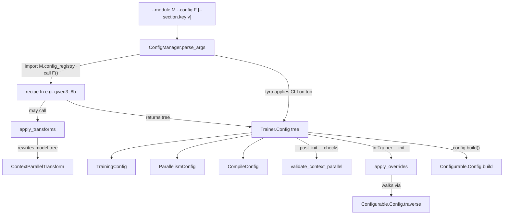
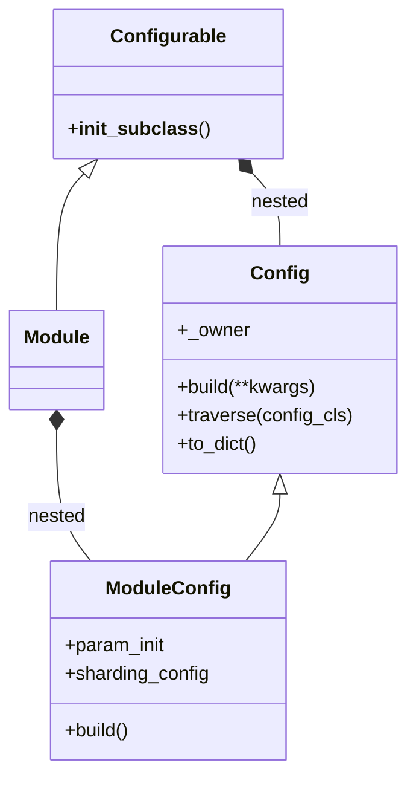

# Job configuration (torchtitan/config)

## Overview

In this repo a run is described by a **full configuration**: a Python function that returns a complete
`Trainer.Config` - model, parallelism degrees and every optimization choice. The `torchtitan/config`
package supplies the machinery that makes that work. Its key idea is that **every component is a
[`Configurable`](../catalog/torchtitan/config/configurable.md#Configurable "torchtitan/config/configurable.py:L18") whose nested
[`Config`](../catalog/torchtitan/config/configurable.md#Configurable.Config "torchtitan/config/configurable.py:L41") dataclass knows how to
[`build`](../catalog/torchtitan/config/configurable.md#Configurable.Config.build "torchtitan/config/configurable.py:L134") its owner**, so the job config is one tree of
plain dataclasses that can be constructed, copied, traversed and rewritten *before anything is
instantiated*. Around that core sit a few job-level dataclasses with no other natural home
([`TrainingConfig`](../catalog/torchtitan/config/configs.md#TrainingConfig "torchtitan/config/configs.py:L36"),
[`ParallelismConfig`](../catalog/torchtitan/config/configs.md#ParallelismConfig "torchtitan/config/configs.py:L123"),
[`CompileConfig`](../catalog/torchtitan/config/configs.md#CompileConfig "torchtitan/config/configs.py:L338"),
[`DebugConfig`](../catalog/torchtitan/config/configs.md#DebugConfig "torchtitan/config/configs.py:L398"), CommConfig), the
[`ConfigManager`](../catalog/torchtitan/config/manager.md#ConfigManager "torchtitan/config/manager.py:L29") that selects a recipe from the command line,
three tree-rewriting tools (recipe-time transforms such as
[`ContextParallelTransform`](../catalog/torchtitan/config/transform/context_parallel.md#ContextParallelTransform "torchtitan/config/transform/context_parallel.py:L22"), user-activated
overrides via [`apply_overrides`](../catalog/torchtitan/config/override.md#apply_overrides "torchtitan/config/override.py:L448"), and the
generic [`traverse`](../catalog/torchtitan/config/configurable.md#Configurable.Config.traverse "torchtitan/config/configurable.py:L75") they both use), and
cross-section validation ([`validate_context_parallel`](../catalog/torchtitan/config/validation.md#validate_context_parallel "torchtitan/config/validation.py:L20")).

For the TPU-performance lens this page is where you find *which knob controls what*: mesh degrees and the
`-1` leftover rule for FSDP, `spmd_backend` (required for CP), FSDP reshard policy (Zero-2 vs Zero-3),
mixed-precision param / reduce dtypes, token-based batch sizing, `compile.components`, and how TPU
recipes swap kernels in (overrides) without editing model code. The TPU lane extends this tree with its
own `TPUTrainerConfig` (see [tpu-trainer-and-job-config](tpu-trainer-and-job-config.md)).

## Diagram

From command line to a built trainer:

Legend:
- `CLI` - (concept) the command line
- `CM` - [`parse_args`](../catalog/torchtitan/config/manager.md#ConfigManager.parse_args "torchtitan/config/manager.py:L44")
- `RF` - [`qwen3_8b`](../catalog/torchtitan/experiments/tpu/qwen3/config_registry.md#qwen3_8b "torchtitan/experiments/tpu/qwen3/config_registry.py:L555")
- `AT` - [`apply_transforms`](../catalog/torchtitan/config/transform/apply.md#apply_transforms "torchtitan/config/transform/apply.py:L76")
- `CPT` - [`ContextParallelTransform`](../catalog/torchtitan/config/transform/context_parallel.md#ContextParallelTransform "torchtitan/config/transform/context_parallel.py:L22")
- `TREE` - [`Config`](../catalog/torchtitan/config/configurable.md#Configurable.Config "torchtitan/config/configurable.py:L41") (the root is a `Trainer.Config`, see [`training`](../catalog/torchtitan/trainer.md#Trainer.Config.training "torchtitan/trainer.py:L113") / [`parallelism`](../catalog/torchtitan/trainer.md#Trainer.Config.parallelism "torchtitan/trainer.py:L114"))
- `TC` - [`TrainingConfig`](../catalog/torchtitan/config/configs.md#TrainingConfig "torchtitan/config/configs.py:L36")
- `PC` - [`ParallelismConfig`](../catalog/torchtitan/config/configs.md#ParallelismConfig "torchtitan/config/configs.py:L123")
- `CC` - [`CompileConfig`](../catalog/torchtitan/config/configs.md#CompileConfig "torchtitan/config/configs.py:L338")
- `VCP` - [`validate_context_parallel`](../catalog/torchtitan/config/validation.md#validate_context_parallel "torchtitan/config/validation.py:L20")
- `AO` - [`apply_overrides`](../catalog/torchtitan/config/override.md#apply_overrides "torchtitan/config/override.py:L448")
- `TRV` - [`traverse`](../catalog/torchtitan/config/configurable.md#Configurable.Config.traverse "torchtitan/config/configurable.py:L75")
- `BLD` - [`build`](../catalog/torchtitan/config/configurable.md#Configurable.Config.build "torchtitan/config/configurable.py:L134")

Structure of the `Configurable` pattern (how a config knows its owner):

Here `Configurable` is [`Configurable`](../catalog/torchtitan/config/configurable.md#Configurable "torchtitan/config/configurable.py:L18"), `Config` is
[`Config`](../catalog/torchtitan/config/configurable.md#Configurable.Config "torchtitan/config/configurable.py:L41") with
[`_owner`](../catalog/torchtitan/config/configurable.md#Configurable.Config._owner "torchtitan/config/configurable.py:L44"), `Module` is
[`Module`](../catalog/torchtitan/protocols/module.md#Module "torchtitan/protocols/module.py:L43") and `ModuleConfig.build` is
[`build`](../catalog/torchtitan/protocols/module.md#Module.Config.build "torchtitan/protocols/module.py:L98").

## Design rationale (why it's built this way)

- **Configuration is programming, not flags.** The package README says to "change the configuration
  directly -- write your own function, instead of using CLI flags, to return a new `Trainer.Config`". The
  `--section.option` flags "still work and still take precedence over the configuration, but only so
  existing scripts do not break", and the CLI surface is **frozen**: new fields must carry
  `tyro.conf.Suppress`. `Trainer.Config.model_spec` is suppressed, which "keeps the whole model config tree
  off the CLI" - every model-level performance knob (attention backend, kernel choices, per-module
  sharding) is reachable only from Python.
- **Auto-wired construction.** [`Configurable`](../catalog/torchtitan/config/configurable.md#Configurable "torchtitan/config/configurable.py:L18")'s
  `__init_subclass__` enforces `@dataclass(kw_only=True, slots=True)` on every nested `Config` and sets
  its [`_owner`](../catalog/torchtitan/config/configurable.md#Configurable.Config._owner "torchtitan/config/configurable.py:L44"), so
  [`build`](../catalog/torchtitan/config/configurable.md#Configurable.Config.build "torchtitan/config/configurable.py:L134") ("Construct the owning class. Auto-wired by
  __init_subclass__.") needs no per-class override. The check runs on the outer class because
  `slots=True` replaces the decorated class. `build()` always passes a shallow copy (`replace(self)`), and
  kwargs that collide with config fields are rejected - runtime objects (meshes, tokenizers, model parts)
  go in kwargs, settings go in the config, never both.
- **Rewrite the tree, not the code.** Because nothing is instantiated until `build()`, features that
  change *which class* implements a component are expressed as tree rewrites: recipe-time
  `ModelConfigTransform`s (ordered by `run_after`, mutually excluded by `conflicts_with`), and
  user-activated `@override`s. The override module docstring: swap any Configurable "without modifying
  config_registry functions or any other in-repo code".
- **Validation lives in two tiers.** "Keep simple invariants that use one config's fields in its
  `__post_init__`. Keep checks that span config sections in validation.py." `Trainer.Config.__post_init__`
  calls the cross-section checks, and both `apply_transforms` and the trainer re-run `__post_init__` after
  rewriting, since a rewrite can invalidate earlier checks.
- **Token budget, not sample counts.** [`num_tokens_per_microbatch_per_dp_rank`](../catalog/torchtitan/config/configs.md#TrainingConfig.num_tokens_per_microbatch_per_dp_rank "torchtitan/config/configs.py:L37")
  is "the number of input-token slots processed per data-parallel rank in one model forward, before
  context or tensor parallel sharding"; the global step size defaults to that x PP microbatches x DP
  degree, and gradient accumulation is derived from it. The per-DP-rank budget is therefore independent of
  the DP degree (changing DP scales the global batch, not the per-rank microbatch), but because it is
  counted before CP / TP sharding, changing the CP or TP degree does change the tokens each device holds.

## Entry points

- [`ConfigManager`](../catalog/torchtitan/config/manager.md#ConfigManager "torchtitan/config/manager.py:L29") /
  [`parse_args`](../catalog/torchtitan/config/manager.md#ConfigManager.parse_args "torchtitan/config/manager.py:L44") - called first by every front end
  (`torchtitan.train`, the TPU and JAX lanes, RL, precompile). Resolves `--module` (a short name searched
  under `torchtitan.models`, `torchtitan.experiments`, `torchtitan.experiments.rl.examples`, or any
  importable path, trying `<module>.config_registry` first), calls the `--config` function with no
  arguments, then lets tyro apply the remaining CLI flags with the loaded config as the default.
- Recipe functions - the `--config` targets, e.g. the TPU recipes
  [`qwen3_8b`](../catalog/torchtitan/experiments/tpu/qwen3/config_registry.md#qwen3_8b "torchtitan/experiments/tpu/qwen3/config_registry.py:L555"),
  [`reg_trainer_qwen3_8b`](../catalog/torchtitan/experiments/tpu/qwen3/config_registry.md#reg_trainer_qwen3_8b "torchtitan/experiments/tpu/qwen3/config_registry.py:L344") and
  [`sft_llama3_8b_metamath`](../catalog/torchtitan/experiments/tpu/llama3/config_registry.md#sft_llama3_8b_metamath "torchtitan/experiments/tpu/llama3/config_registry.py:L399"),
  the upstream [`flux_debugmodel`](../catalog/torchtitan/models/flux/config_registry.md#flux_debugmodel "torchtitan/models/flux/config_registry.py:L55"), or
  RL recipes such as [`rl_grpo_qwen3_30b_a3b_deepep_search_r1_perf`](../catalog/torchtitan/experiments/rl/examples/search_r1/config_registry.md#rl_grpo_qwen3_30b_a3b_deepep_search_r1_perf "torchtitan/experiments/rl/examples/search_r1/config_registry.py:L173")
  (underscore helpers such as [`_qwen3_4b_dapo_math_config`](../catalog/torchtitan/experiments/rl/examples/dapo_math/config_registry.md#_qwen3_4b_dapo_math_config "torchtitan/experiments/rl/examples/dapo_math/config_registry.py:L46")
  take required keyword arguments, so they are shared builders that public recipes call, not `--config`
  targets).
  The README notes per-model `config_registry.py` modules are "the earlier location" and recipes are
  moving to `torchtitan_recipes`.
- [`build`](../catalog/torchtitan/config/configurable.md#Configurable.Config.build "torchtitan/config/configurable.py:L134") - the single construction path for
  every component: `config.build()` creates the trainer, and the trainer calls `.build(...)` on each
  sub-config with its runtime objects.
- [`apply_overrides`](../catalog/torchtitan/config/override.md#apply_overrides "torchtitan/config/override.py:L448") - "Import override modules and
  apply active overrides to the config tree." Called by the trainer after `update_from_config` and before
  any component is built, whenever [`imports`](../catalog/torchtitan/config/override.md#OverrideConfig.imports "torchtitan/config/override.py:L62")
  is non-empty.
- [`apply_transforms`](../catalog/torchtitan/config/transform/apply.md#apply_transforms "torchtitan/config/transform/apply.py:L76") - "Apply every transform to a
  copy of ``config`` and return it." Called by recipe code (e.g. to switch every attention to a CP kernel).

## Mechanism (step-by-step)

1. **Declaring a component.** A class inherits [`Configurable`](../catalog/torchtitan/config/configurable.md#Configurable "torchtitan/config/configurable.py:L18")
   (or [`Module`](../catalog/torchtitan/protocols/module.md#Module "torchtitan/protocols/module.py:L43") for `nn.Module`s) and nests a
   `Config(Configurable.Config)` dataclass. On class creation, `__init_subclass__` verifies slots and
   keyword-only fields and binds `Config._owner = cls`. For modules,
   [`build`](../catalog/torchtitan/protocols/module.md#Module.Config.build "torchtitan/protocols/module.py:L98") additionally copies `param_init` and
   `sharding_config` onto the instance, which is how declarative sharding and per-layer init travel from
   the config tree into the built model.

2. **Writing a recipe.** A recipe function assembles a `Trainer.Config` from component configs and the
   shared dataclasses. A TPU recipe like [`qwen3_8b`](../catalog/torchtitan/experiments/tpu/qwen3/config_registry.md#qwen3_8b "torchtitan/experiments/tpu/qwen3/config_registry.py:L555")
   picks `use_simple_fsdp=True`, `enable_tpu_topo_mesh=True` and
   [`fsdp_reshard_after_forward`](../catalog/torchtitan/config/configs.md#ParallelismConfig.fsdp_reshard_after_forward "torchtitan/config/configs.py:L172")`="never"`
   (Zero-2; the recipe comments that "the current best-performing benchmark recipe uses Zero-2"), sets
   splash-attention block sizes and layouts, enables a Pallas cross-entropy, and converts the result into
   a graph-trainer config; its regular-trainer twin [`reg_trainer_qwen3_8b`](../catalog/torchtitan/experiments/tpu/qwen3/config_registry.md#reg_trainer_qwen3_8b "torchtitan/experiments/tpu/qwen3/config_registry.py:L344")
   instead enables `compile` with backend `tpu`, `materialize_forward_before_backward` and
   `compile_grad_norm`. Recipes may also append to `override.imports` (TPU llama3 / qwen3 recipes add RoPE,
   fused-loss and token-counter overrides) or call [`apply_transforms`](../catalog/torchtitan/config/transform/apply.md#apply_transforms "torchtitan/config/transform/apply.py:L76").

3. **Recipe-time transforms.** [`apply_transforms`](../catalog/torchtitan/config/transform/apply.md#apply_transforms "torchtitan/config/transform/apply.py:L76")
   deep-copies the trainer config, orders transforms by `run_after` (raising on cycles), rejects
   `conflicts_with` pairs, rewrites `model_spec.model` and re-runs `__post_init__`.
   [`ContextParallelTransform`](../catalog/torchtitan/config/transform/context_parallel.md#ContextParallelTransform "torchtitan/config/transform/context_parallel.py:L22")
   ("Run attention under context parallelism.") walks every `BaseAttention.Config` and replaces its inner
   attention with [`inner_attention`](../catalog/torchtitan/config/transform/context_parallel.md#ContextParallelTransform.inner_attention "torchtitan/config/transform/context_parallel.py:L32"),
   which must inherit `CPInnerAttention`; fields are carried over because the replacement config must
   subclass the existing one.

4. **Selecting the recipe and applying the CLI.** [`parse_args`](../catalog/torchtitan/config/manager.md#ConfigManager.parse_args "torchtitan/config/manager.py:L44")
   strips `--module` / `--config`, imports the registry module, calls the function, and runs `tyro.cli`
   with the *type of the returned config* - so a recipe returning a TPU or graph-trainer config subclass
   automatically exposes that subclass's fields. Custom tyro rules parse `list[str]` as comma-separated and
   `--override.imports` as `target` or `target=<json>` tokens. A light post-check warns when
   `hf_assets_path` does not exist.

5. **Per-section validation.** Each dataclass's `__post_init__` checks its own invariants:
   [`__post_init__`](../catalog/torchtitan/config/configs.md#TrainingConfig.__post_init__ "torchtitan/config/configs.py:L54") on `TrainingConfig` requires
   positive token counts and `max_norm >= 0`;
   [`__post_init__`](../catalog/torchtitan/config/configs.md#ParallelismConfig.__post_init__ "torchtitan/config/configs.py:L286") on `ParallelismConfig`
   validates [`spmd_backend`](../catalog/torchtitan/config/configs.md#ParallelismConfig.spmd_backend "torchtitan/config/configs.py:L199"), the CP load balancer
   (`headtail`, `ptrr` or None), FSDP symmetric memory (NVIDIA SM90+ only) and that
   [`pipeline_parallel_schedule`](../catalog/torchtitan/config/configs.md#ParallelismConfig.pipeline_parallel_schedule "torchtitan/config/configs.py:L243")
   names a real schedule class; `CompileConfig` allows only `model` / `loss` in
   [`components`](../catalog/torchtitan/config/configs.md#CompileConfig.components "torchtitan/config/configs.py:L345") and requires `model` compile for async TP.

6. **Cross-section validation.** `Trainer.Config.__post_init__` calls
   [`validate_context_parallel`](../catalog/torchtitan/config/validation.md#validate_context_parallel "torchtitan/config/validation.py:L20") ("Validate the CP
   backend and each inner attention."): with
   [`context_parallel_degree`](../catalog/torchtitan/config/configs.md#ParallelismConfig.context_parallel_degree "torchtitan/config/configs.py:L266") > 1 it requires
   `spmd_backend='spmd_types'`, that every attention's inner attention is a CP kernel, that all layers use
   the *same* CP backend ("model inputs are sharded once"), and for Ulysses-style CP that the load balancer
   is None and `n_heads` / `n_kv_heads` divide by `tp x cp`. With CP = 1 a CP kernel is rejected.

7. **Overrides at trainer construction.** [`apply_overrides`](../catalog/torchtitan/config/override.md#apply_overrides "torchtitan/config/override.py:L448")
   resolves each `module.function` target in [`OverrideConfig`](../catalog/torchtitan/config/override.md#OverrideConfig "torchtitan/config/override.py:L61")
   (importing the module fires its [`override`](../catalog/torchtitan/config/override.md#override "torchtitan/config/override.py:L175")
   decorators), collects every claimed node with [`_collect_claims`](../catalog/torchtitan/config/override.md#_collect_claims "torchtitan/config/override.py:L386")
   *before* mutating anything, rejects two overrides claiming the same node or nested nodes, then calls
   each factory and splices the returned config into its parent. Factories typically use
   [`derive`](../catalog/torchtitan/config/override.md#derive "torchtitan/config/override.py:L249") to copy shared fields. The per-module
   catalogue of in-repo overrides is on [config-overrides](config-overrides.md).

8. **Build.** `config.build()` instantiates the trainer, which reads
   [`training`](../catalog/torchtitan/trainer.md#Trainer.Config.training "torchtitan/trainer.py:L113") and
   [`parallelism`](../catalog/torchtitan/trainer.md#Trainer.Config.parallelism "torchtitan/trainer.py:L114") to size the mesh and batches and
   then builds every component (see [trainer-and-train-loop](trainer-and-train-loop.md)). The model is built
   under the default dtype looked up in [`TORCH_DTYPE_MAP`](../catalog/torchtitan/config/__init__.md#TORCH_DTYPE_MAP "torchtitan/config/__init__.py:L9")
   from `training.dtype`.

## Key data structures

**`ParallelismConfig` - mesh degrees and parallelism policy** ([`ParallelismConfig`](../catalog/torchtitan/config/configs.md#ParallelismConfig "torchtitan/config/configs.py:L123"))

| Field | Default | Meaning for TPU perf |
|---|---|---|
| [`data_parallel_shard_degree`](../catalog/torchtitan/config/configs.md#ParallelismConfig.data_parallel_shard_degree "torchtitan/config/configs.py:L160") | -1 | FSDP degree; -1 = "leftover ranks" after replicate / CP / TP / PP. With replicate > 1 this becomes HSDP. |
| [`data_parallel_replicate_degree`](../catalog/torchtitan/config/configs.md#ParallelismConfig.data_parallel_replicate_degree "torchtitan/config/configs.py:L149") | 1 | DDP / HSDP replicate axis (typically the cross-slice / DCN axis). |
| [`fsdp_reshard_after_forward`](../catalog/torchtitan/config/configs.md#ParallelismConfig.fsdp_reshard_after_forward "torchtitan/config/configs.py:L172") | default | `never` = keep gathered params through backward (Zero-2, more memory, fewer all-gathers); `always` = Zero-3. |
| [`use_simple_fsdp`](../catalog/torchtitan/config/configs.md#ParallelismConfig.use_simple_fsdp "torchtitan/config/configs.py:L124") | False | SimpleFSDP instead of FSDP2; TPU recipes set it. |
| `enable_tpu_topo_mesh` | False | Topology-aware device mesh on TPU. |
| [`tensor_parallel_degree`](../catalog/torchtitan/config/configs.md#ParallelismConfig.tensor_parallel_degree "torchtitan/config/configs.py:L193") | 1 | TP; sequence parallel is on by default when TP > 1. |
| [`pipeline_parallel_degree`](../catalog/torchtitan/config/configs.md#ParallelismConfig.pipeline_parallel_degree "torchtitan/config/configs.py:L207") | 1 | Number of PP ranks (not stages); schedule via [`pipeline_parallel_schedule`](../catalog/torchtitan/config/configs.md#ParallelismConfig.pipeline_parallel_schedule "torchtitan/config/configs.py:L243") (default `1F1B`). |
| [`num_pp_microbatches`](../catalog/torchtitan/config/configs.md#ParallelismConfig.num_pp_microbatches "torchtitan/config/configs.py:L259") | 1 | PP microbatches per DP rank per accumulation step; ignored without PP. |
| [`context_parallel_degree`](../catalog/torchtitan/config/configs.md#ParallelismConfig.context_parallel_degree "torchtitan/config/configs.py:L266") | 1 | CP; needs `spmd_types` and a CP inner attention; balancer `headtail` (SDPA) or `ptrr` (Flex). |
| [`expert_parallel_degree`](../catalog/torchtitan/config/configs.md#ParallelismConfig.expert_parallel_degree "torchtitan/config/configs.py:L326") | 1 | EP "borrows ranks from FSDP and TP": `dp_shard x cp x tp == efsdp x ep`. |
| [`spmd_backend`](../catalog/torchtitan/config/configs.md#ParallelismConfig.spmd_backend "torchtitan/config/configs.py:L199") | partial_dtensor | `partial_dtensor` = DTensor on model-parallel axes only; `spmd_types` = the spmd_types path. |
| `enable_min_cost_redistribute` | False | DTensor min-cost redistribution planner (reduce-scatter before all-reduce for HSDP grads; a win on multi-slice). |

**`TrainingConfig` - token budget and precision** ([`TrainingConfig`](../catalog/torchtitan/config/configs.md#TrainingConfig "torchtitan/config/configs.py:L36"))

| Field | Default | Notes |
|---|---|---|
| [`num_tokens_per_microbatch_per_dp_rank`](../catalog/torchtitan/config/configs.md#TrainingConfig.num_tokens_per_microbatch_per_dp_rank "torchtitan/config/configs.py:L37") | 16384 | Per-forward tokens per DP rank, before CP / TP sharding. |
| `num_tokens_per_train_step` | -1 | Global tokens per optimizer step; -1 = one accumulation step. |
| [`max_context_length`](../catalog/torchtitan/config/configs.md#TrainingConfig.max_context_length "torchtitan/config/configs.py:L51") | 2048 | Logical sequence length; also feeds FLOPs-per-token. |
| [`steps`](../catalog/torchtitan/config/configs.md#TrainingConfig.steps "torchtitan/config/configs.py:L69") | 10000 | Number of optimizer steps. |
| `dtype` | float32 | `bfloat16` = all params / grads / optimizer state in bf16, no fp32 master copy. |
| [`mixed_precision_param`](../catalog/torchtitan/config/configs.md#TrainingConfig.mixed_precision_param "torchtitan/config/configs.py:L96") | bfloat16 | Param compute dtype via fully_shard (FSDP / CP) or autocast (DDP / single device). |
| [`mixed_precision_reduce`](../catalog/torchtitan/config/configs.md#TrainingConfig.mixed_precision_reduce "torchtitan/config/configs.py:L104") | float32 | Gradient-reduction dtype under FSDP. |
| [`enable_cpu_offload`](../catalog/torchtitan/config/configs.md#TrainingConfig.enable_cpu_offload "torchtitan/config/configs.py:L72") | False | FSDP CPU offload of params / grads / optimizer state. |
| [`disable_cuda_graphs`](../catalog/torchtitan/config/configs.md#TrainingConfig.disable_cuda_graphs "torchtitan/config/configs.py:L77") | False | Turns off CUDA-graph capture of fwd+bwd (GPU-only mechanism). |

**`CompileConfig`** ([`CompileConfig`](../catalog/torchtitan/config/configs.md#CompileConfig "torchtitan/config/configs.py:L338")) -
[`enable`](../catalog/torchtitan/config/configs.md#CompileConfig.enable "torchtitan/config/configs.py:L339") (default False),
[`components`](../catalog/torchtitan/config/configs.md#CompileConfig.components "torchtitan/config/configs.py:L345") (`["model", "loss"]`),
[`backend`](../catalog/torchtitan/config/configs.md#CompileConfig.backend "torchtitan/config/configs.py:L348") (`inductor`; TPU recipes use `tpu`), and
`enable_async_tensor_parallel`. Lanes subclass it (TPU and graph-trainer compile configs add
materialize / grad-norm / optimizer-compile / memory-policy fields).

**`OverrideConfig`** ([`OverrideConfig`](../catalog/torchtitan/config/override.md#OverrideConfig "torchtitan/config/override.py:L61")) - just
[`imports`](../catalog/torchtitan/config/override.md#OverrideConfig.imports "torchtitan/config/override.py:L62"): a list of `module.function` strings or
`(target, kwargs)` tuples, each naming exactly one registered override.

**`DebugConfig`** ([`DebugConfig`](../catalog/torchtitan/config/configs.md#DebugConfig "torchtitan/config/configs.py:L398")) - seed, deterministic mode
(slower), SPMD typechecking, MoE forced load balance, anomaly detection, config printing / saving, and
structured trace logging (on by default; "Disable to fully eliminate trace overhead").

## Dynamics (design intent)

- **Order of application:** the recipe function runs first (including any transforms it calls), then
  tyro applies CLI flags on top of the returned tree, then the trainer runs `update_from_config` and
  finally the overrides. Overrides therefore see the CLI-adjusted tree and win over everything before
  them; transforms ran before the CLI, so a flag cannot re-run them (and the model tree they rewrite is
  not CLI-addressable anyway).
- **Overrides are order-independent by construction:** claims are collected on the original tree, so "one
  override cannot affect another's matches", and conflicting claims raise instead of depending on order.
- **Shallow copies:** `build()` and `derive` copy shallowly, so nested sub-configs are shared by reference
  between the original and the replacement - safe because the replaced node is detached from the tree.
- **Tests pin TPU recipe contracts:** the graph-trainer config tests parse TPU recipes through
  `ConfigManager` and assert, for example, that the Qwen3 8B recipe "explicitly uses" the default graph
  policy, that Zero-3 needs explicit protection, that CLI compile / remat / FSDP-barrier flags are
  addressable, and that a recipe applies RoPE / lm_head overrides via `apply_overrides`
  (Evidence: `test_tpu_graph_trainer_config.py`, `test_layer_stack.py`).

## Edge cases

- A recipe that derives one field from another at construction time (e.g. passing
  `model_compile_enabled` from `compile.enable` into a converter) freezes that value; a later CLI flag on
  the source field does not propagate.
- `data_parallel_shard_degree=-1` silently absorbs whatever ranks remain, so the world size (NGPU or the
  TPU slice size) must match the product of the explicit degrees; the README warns "The parallelism
  degrees are in the configuration but the world size is not."
- CP > 1 with the default `spmd_backend='partial_dtensor'` is rejected; mixing CP backends across layers
  is rejected.
- An `override.imports` list that matches nothing logs a warning instead of failing; a target naming no
  registered override, or the same target listed twice, raises.
- An override cannot replace the root config, and with `exact=True` subclasses of the target are skipped.
- `ConfigManager._merge_configs` (custom config extension by dataclass merging) is deprecated in favour of
  `Config` subclasses returned by the registry.

## Open questions

- `ParallelDims` (how the degrees become a device mesh, including the `-1` resolution and EP's derived
  `efsdp` axis) is not in this packet's subgraph; see
  [parallel-dims-and-parallelization](parallel-dims-and-parallelization.md).
- The TPU-lane config subclasses (`TPUTrainerConfig`, `TPUConfig`, the TPU / graph compile configs,
  splash-attention and loss-kernel configs) appear in the cited recipes but are outside this subgraph;
  see [tpu-trainer-and-job-config](tpu-trainer-and-job-config.md).
- `Function` (a Configurable wrapper around a callable, used for lazily computed fields such as per-layer
  init) is in this package but not in the subgraph.

## See also

- [trainer-and-train-loop](trainer-and-train-loop.md) - where the config is built and consumed
- [config-overrides](config-overrides.md) - the in-repo `@override` modules
- [parallel-dims-and-parallelization](parallel-dims-and-parallelization.md) - degrees -> mesh -> `parallelize_fn`
- [model-spec-protocols](model-spec-protocols.md) - `ModelSpec` and `Module` protocols
- [tpu-trainer-and-job-config](tpu-trainer-and-job-config.md) - TPU lane config extensions
- [tpu-context-parallel-attention](tpu-context-parallel-attention.md) - CP kernels the transform installs
- [quantization](quantization.md) - converters configured from recipes
